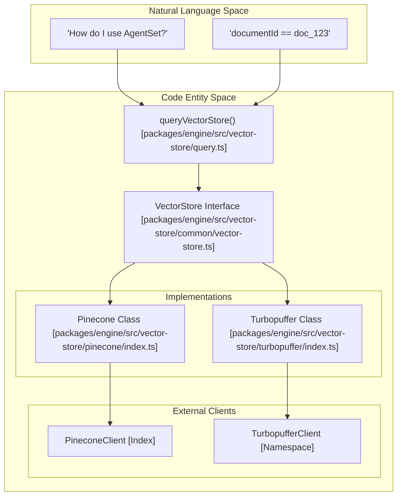
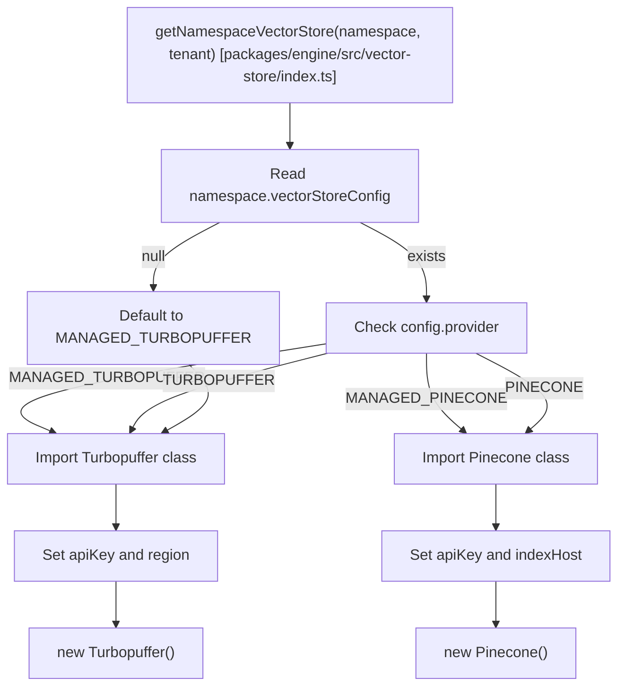
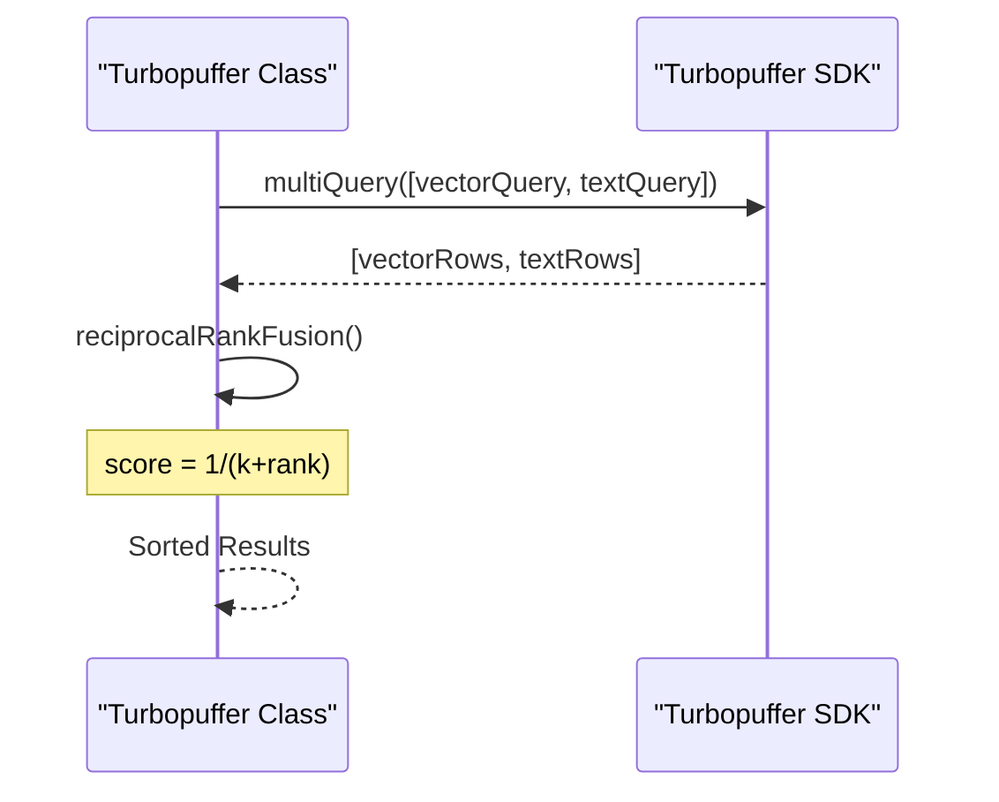
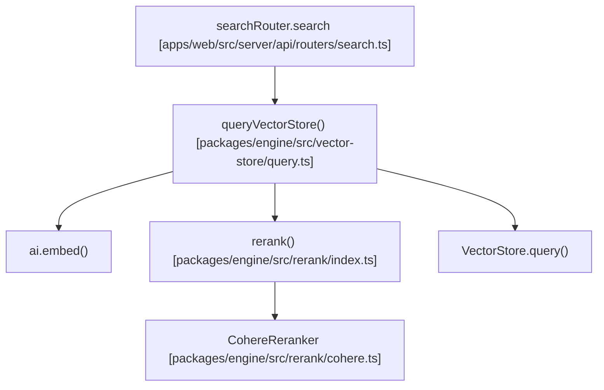

<!-- source: DeepWiki mcp.deepwiki.com · repo agentset-ai/agentset · page 2.3 Vector Store System · fetched 2026-10-27 -->

# Vector Store System

<details>
<summary>Relevant source files</summary>

The following files were used as context for generating this wiki page:

- [apps/web/src/server/api/routers/search.ts](apps/web/src/server/api/routers/search.ts)
- [apps/web/src/services/namespaces/validate.ts](apps/web/src/services/namespaces/validate.ts)
- [packages/db/src/types/prisma.ts](packages/db/src/types/prisma.ts)
- [packages/engine/src/embedding/index.ts](packages/engine/src/embedding/index.ts)
- [packages/engine/src/llm/index.ts](packages/engine/src/llm/index.ts)
- [packages/engine/src/rerank/cohere.ts](packages/engine/src/rerank/cohere.ts)
- [packages/engine/src/rerank/common.ts](packages/engine/src/rerank/common.ts)
- [packages/engine/src/rerank/index.ts](packages/engine/src/rerank/index.ts)
- [packages/engine/src/vector-store/common/vector-store.ts](packages/engine/src/vector-store/common/vector-store.ts)
- [packages/engine/src/vector-store/index.ts](packages/engine/src/vector-store/index.ts)
- [packages/engine/src/vector-store/pinecone/index.ts](packages/engine/src/vector-store/pinecone/index.ts)
- [packages/engine/src/vector-store/query.ts](packages/engine/src/vector-store/query.ts)
- [packages/engine/src/vector-store/turbopuffer/index.ts](packages/engine/src/vector-store/turbopuffer/index.ts)
- [packages/validation/src/llm/constants.ts](packages/validation/src/llm/constants.ts)
- [packages/validation/src/vector-store/turbopuffer.ts](packages/validation/src/vector-store/turbopuffer.ts)

</details>


## Purpose and Scope

This document describes the vector store abstraction layer in the `@agentset/engine` package, which provides a provider-agnostic interface for storing and querying document embeddings. The system supports multiple vector database implementations including Pinecone and Turbopuffer, with configurable managed and self-hosted options. The vector store system supports semantic search (vector similarity), keyword search (BM25 full-text search via Turbopuffer), and hybrid search (combining both with reciprocal rank fusion). For information about the document ingestion process that creates these embeddings, see page 3.1 (Ingestion Workflow). For the higher-level search system that uses vector stores, see page 4.1 (Vector Search).

Sources: [packages/engine/src/vector-store/common/vector-store.ts:1-91](), [packages/engine/src/vector-store/index.ts:1-76]()

## Architecture Overview

The vector store system uses an abstract class pattern to provide a uniform interface across different vector database providers. The `VectorStore` abstract class defines the core operations, while concrete implementations (`Pinecone`, `Turbopuffer`) handle provider-specific details.

### Natural Language Space to Code Entity Space

The following diagram bridges the conceptual "Natural Language Space" (Search queries, Metadata) to the "Code Entity Space" (Classes, Functions, and specific API Clients).



Diagram: Mapping Language Queries to Vector Store Entities

Sources: 
- [packages/engine/src/vector-store/common/vector-store.ts:73-91]()
- [packages/engine/src/vector-store/pinecone/index.ts:19-156]()
- [packages/engine/src/vector-store/turbopuffer/index.ts:28-274]()
- [packages/engine/src/vector-store/query.ts:17-59]()

## Factory Pattern and Configuration

The `getNamespaceVectorStore` function acts as a factory that instantiates the appropriate vector store implementation based on namespace configuration. It supports both managed (Agentset-hosted) and self-hosted vector databases.

### Namespace and Tenant Isolation

Vector data is isolated at two levels:

1. **Namespace Level**: Each namespace maintains its own isolated section in the vector database
2. **Tenant Level**: Within a namespace, data can be optionally segmented by tenant ID

Namespace identifiers follow provider-specific patterns:

| Provider | Pattern | Max Length | Example |
|----------|---------|------------|---------|
| Pinecone | `agentset:{namespaceId}${tenantId ? \`:\${tenantId}\` : ""}` | Unlimited | `agentset:ns_abc123:tenant_xyz` |
| Turbopuffer | `as_{namespaceId}${tenantId ? \`_\${tenantId}\` : ""}` | 128 chars | `as_ns_abc123_tenant_xyz` |

**Note**: The Turbopuffer namespace pattern allows for a maximum combined length of 93 characters when using the longest possible namespace ID (25 chars) and tenant ID (64 chars), leaving room for the `as_` prefix and separators [packages/engine/src/vector-store/turbopuffer/index.ts:46-49]().



Diagram: Vector Store Factory Pattern

Sources: 
- [packages/engine/src/vector-store/index.ts:6-75]()
- [packages/engine/src/vector-store/pinecone/index.ts:23-38]()
- [packages/engine/src/vector-store/turbopuffer/index.ts:35-53]()

## Vector Store Interface

The `VectorStore` abstract class defines a standardized interface that all implementations must follow.

### Core Methods

| Method | Parameters | Return Type | Description |
|--------|-----------|-------------|-------------|
| `query` | `VectorStoreQueryOptions` | `Promise<VectorStoreQueryResponse>` | Search for relevant chunks using semantic, keyword, or hybrid search |
| `upsert` | `VectorStoreUpsertOptions` | `Promise<void>` | Insert or update document chunks with embeddings |
| `deleteByIds` | `string \| string[]` | `Promise<{deleted?: number}>` | Delete specific chunks by ID |
| `getDimensions` | none | `Promise<number \| "ANY">` | Return supported embedding dimensions |
| `supportsKeyword` | none | `boolean` | Indicates if provider supports keyword/full-text search |

Sources: [packages/engine/src/vector-store/common/vector-store.ts:73-91]()

### Query Options

The `VectorStoreQueryOptions` interface supports three search modes:

```typescript
interface VectorStoreQueryOptions<Filter = VectorFilter> {
  id?: string;
  topK: number;
  filter?: Filter;
  includeMetadata?: boolean;
  minScore?: number;
  consistency?: "eventual" | "strong";
  mode: { type: "semantic"; vector: number[] } 
      | { type: "keyword"; text: string } 
      | { type: "hybrid"; vector: number[]; text: string };
}
```

Sources: [packages/engine/src/vector-store/common/vector-store.ts:14-36]()

## Implementation Details

### Pinecone Implementation

The `Pinecone` class wraps the Pinecone SDK. It currently does not support keyword or hybrid modes [packages/engine/src/vector-store/pinecone/index.ts:45-47]().

**Key Features:**
- Uses `PineconeFilterTranslator` to convert generic filters to Pinecone's metadata format [packages/engine/src/vector-store/pinecone/index.ts:21]().
- Uses `client.query` for similarity search [packages/engine/src/vector-store/pinecone/index.ts:50]().
- `getDimensions()` calls `describeIndexStats()` [packages/engine/src/vector-store/pinecone/index.ts:149]().

Sources: [packages/engine/src/vector-store/pinecone/index.ts:19-156]()

### Turbopuffer Implementation

The `Turbopuffer` class supports semantic (ANN), keyword (BM25), and hybrid search.

**Key Features:**
- **Schema Management**: Sends a schema on first write, enabling `full_text_search` on the `text` field [packages/engine/src/vector-store/turbopuffer/index.ts:15-26]().
- **Hybrid Search**: Uses `multiQuery` to fetch both vector and text results, then fuses them using `reciprocalRankFusion` [packages/engine/src/vector-store/turbopuffer/index.ts:119-140]().
- **Distance Normalization**: Converts Turbopuffer's cosine distance (0-2) to a similarity score (0-1) via `(2 - distance) / 2` [packages/engine/src/vector-store/turbopuffer/index.ts:82-84]().



Diagram: Turbopuffer Hybrid Search Logic

Sources: 
- [packages/engine/src/vector-store/turbopuffer/index.ts:61-78]()
- [packages/engine/src/vector-store/turbopuffer/index.ts:119-140]()

## Query Helper and Reranking

The `queryVectorStore` function is the primary entry point for retrieval. It coordinates embedding the query string and optionally reranking the results.

### Code Entity Integration

The following diagram shows how the high-level search API interacts with the vector store and reranking logic.



Diagram: Search and Reranking Data Flow

Sources: 
- [apps/web/src/server/api/routers/search.ts:26-59]()
- [packages/engine/src/vector-store/query.ts:17-59]()
- [packages/engine/src/rerank/cohere.ts:6-33]()

### Validation and Dimensions

Before a namespace is fully configured, the system validates that the selected embedding model's dimensions match the vector store's dimensions using `validateVectorStoreConfig` [apps/web/src/services/namespaces/validate.ts:29-66]().

- **OpenAI text-embedding-3-large**: 3072 dimensions [apps/web/src/services/namespaces/validate.ts:14]().
- **Turbopuffer**: Returns `"ANY"`, effectively matching any embedding model [packages/engine/src/vector-store/turbopuffer/index.ts:247]().
- **Pinecone**: Returns the specific index dimension [packages/engine/src/vector-store/pinecone/index.ts:150]().

Sources: 
- [apps/web/src/services/namespaces/validate.ts:9-27]()
- [apps/web/src/services/namespaces/validate.ts:29-66]()
- [packages/engine/src/vector-store/pinecone/index.ts:148-151]()
- [packages/engine/src/vector-store/turbopuffer/index.ts:246-248]()

---

