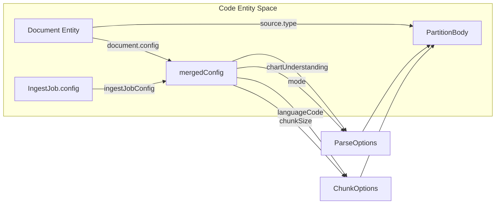
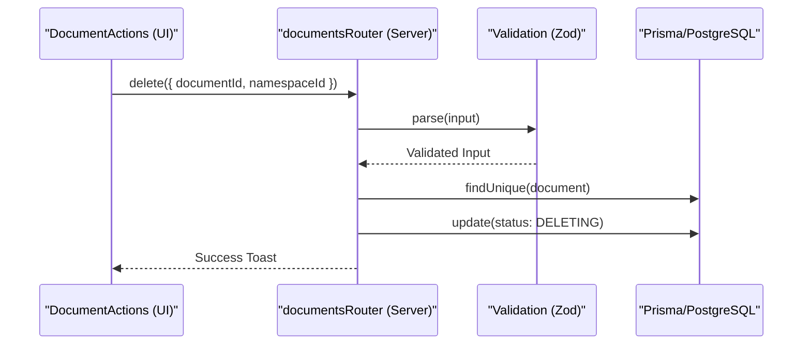

<!-- source: DeepWiki mcp.deepwiki.com · repo agentset-ai/agentset · page 3.3 Ingestion Validation and Configuration · fetched 2026-10-27 -->

# Ingestion Validation and Configuration

Relevant source files

The following files were used as context for generating this wiki page:

- [apps/web/src/app/app.agentset.ai/(dashboard)/[slug]/[namespaceSlug]/documents/actions.tsx](apps/web/src/app/app.agentset.ai/(dashboard)/[slug]/[namespaceSlug]/documents/actions.tsx)
- [apps/web/src/app/app.agentset.ai/(dashboard)/[slug]/[namespaceSlug]/documents/document-actions.tsx](apps/web/src/app/app.agentset.ai/(dashboard)/[slug]/[namespaceSlug]/documents/document-actions.tsx)
- [apps/web/src/app/app.agentset.ai/(dashboard)/[slug]/[namespaceSlug]/documents/ingest-modal/use-ingest.ts](apps/web/src/app/app.agentset.ai/(dashboard)/[slug]/[namespaceSlug]/documents/ingest-modal/use-ingest.ts)
- [apps/web/src/app/openapi.json/route.ts](apps/web/src/app/openapi.json/route.ts)
- [apps/web/src/lib/code-examples/ingest.ts](apps/web/src/lib/code-examples/ingest.ts)
- [apps/web/src/openapi/index.ts](apps/web/src/openapi/index.ts)
- [apps/web/src/openapi/v1/ingest-jobs/create-job.ts](apps/web/src/openapi/v1/ingest-jobs/create-job.ts)
- [apps/web/src/openapi/v1/ingest-jobs/reingest-job.ts](apps/web/src/openapi/v1/ingest-jobs/reingest-job.ts)
- [apps/web/src/schemas/api/document.ts](apps/web/src/schemas/api/document.ts)
- [apps/web/src/schemas/api/ingest-job.ts](apps/web/src/schemas/api/ingest-job.ts)
- [apps/web/src/server/api/routers/documents.ts](apps/web/src/server/api/routers/documents.ts)
- [internal-docs/analytics-events.md](internal-docs/analytics-events.md)
- [packages/db/src/schemas.ts](packages/db/src/schemas.ts)
- [packages/emails/src/env.ts](packages/emails/src/env.ts)
- [packages/engine/src/index.ts](packages/engine/src/index.ts)
- [packages/engine/src/partition/index.ts](packages/engine/src/partition/index.ts)
- [packages/engine/src/partition/types.ts](packages/engine/src/partition/types.ts)
- [packages/validation/src/document-payload/index.ts](packages/validation/src/document-payload/index.ts)
- [packages/validation/src/ingest-payload/batch.ts](packages/validation/src/ingest-payload/batch.ts)
- [packages/validation/src/ingest-payload/config.ts](packages/validation/src/ingest-payload/config.ts)
- [packages/validation/src/ingest-payload/crawl.ts](packages/validation/src/ingest-payload/crawl.ts)
- [packages/validation/src/ingest-payload/file.ts](packages/validation/src/ingest-payload/file.ts)
- [packages/validation/src/ingest-payload/index.ts](packages/validation/src/ingest-payload/index.ts)
- [packages/validation/src/ingest-payload/managed-file.ts](packages/validation/src/ingest-payload/managed-file.ts)
- [packages/validation/src/ingest-payload/text.ts](packages/validation/src/ingest-payload/text.ts)
- [packages/validation/src/ingest-payload/utils.ts](packages/validation/src/ingest-payload/utils.ts)
- [packages/validation/src/ingest-payload/youtube.ts](packages/validation/src/ingest-payload/youtube.ts)
- [packages/validation/src/language.ts](packages/validation/src/language.ts)

## Purpose and Scope

This document describes the validation and configuration system for document ingestion in AgentSet. The validation layer, implemented in `packages/validation`, provides type-safe Zod schemas that enforce correctness for ingestion payloads, configuration options, and document properties across the entire ingestion pipeline.

The validation system serves three primary functions:
1.  **Input validation** for API requests via `ingestJobPayloadInputSchema` [packages/validation/src/ingest-payload/index.ts:71-83]().
2.  **Data reading** via `ingestJobPayloadSchema` (lenient validation for existing jobs) [packages/validation/src/ingest-payload/index.ts:59-68]().
3.  **Type generation** for TypeScript type safety throughout the codebase [packages/validation/src/ingest-payload/index.ts:85-89]().

For information about how these validated payloads flow through the ingestion workflow, see [3.1 Ingestion Workflow](). For details on how background jobs process these payloads, see [3.2 Background Job Processing]().

**Sources:** [packages/validation/src/ingest-payload/index.ts:1-90]()

---

## Validation Architecture

The validation system uses Zod v4 with a discriminated union pattern to support multiple ingestion types. The architecture distinguishes between strict input validation (for creating jobs) and lenient validation (for reading existing jobs from the database).

### Schema Types and Hierarchy

Title: Ingestion Schema Hierarchy

```mermaid
graph TB
    subgraph "Input Schemas (Strict)"
        INPUT["ingestJobPayloadInputSchema"]
        TEXT_INPUT["textPayloadInputSchema"]
        FILE_INPUT["filePayloadSchema"]
        MANAGED_INPUT["managedFilePayloadSchema"]
        CRAWL_INPUT["crawlPayloadSchema"]
        YOUTUBE_INPUT["youtubePayloadSchema"]
        BATCH_INPUT["batchPayloadInputSchema"]
    end
    
    subgraph "Storage Schemas (Lenient)"
        STORAGE["ingestJobPayloadSchema"]
        TEXT_STORAGE["textPayloadSchema"]
        FILE_STORAGE["filePayloadSchema"]
        MANAGED_STORAGE["managedFilePayloadSchema"]
        CRAWL_STORAGE["crawlPayloadSchema"]
        YOUTUBE_STORAGE["youtubePayloadSchema"]
        BATCH_STORAGE["batchPayloadSchema"]
    end
    
    subgraph "Configuration"
        BASE_CONFIG["baseConfigSchema"]
        CONFIG["configSchema"]
        NAME["ingestJobNameSchema"]
        EXTERNAL_ID["externalIdSchema"]
    end
    
    subgraph "TypeScript Types"
        PAYLOAD_TYPE["IngestJobPayload"]
        PAYLOAD_INPUT_TYPE["IngestJobPayloadInput"]
        CONFIG_TYPE["IngestJobConfig"]
        BATCH_ITEM_TYPE["IngestJobBatchItem"]
    end
    
    INPUT -->|"discriminatedUnion"| TEXT_INPUT
    INPUT -->|"discriminatedUnion"| FILE_INPUT
    INPUT -->|"discriminatedUnion"| MANAGED_INPUT
    INPUT -->|"discriminatedUnion"| CRAWL_INPUT
    INPUT -->|"discriminatedUnion"| YOUTUBE_INPUT
    INPUT -->|"discriminatedUnion"| BATCH_INPUT
    
    STORAGE -->|"discriminatedUnion"| TEXT_STORAGE
    STORAGE -->|"discriminatedUnion"| FILE_STORAGE
    STORAGE -->|"discriminatedUnion"| MANAGED_STORAGE
    STORAGE -->|"discriminatedUnion"| CRAWL_STORAGE
    STORAGE -->|"discriminatedUnion"| YOUTUBE_STORAGE
    STORAGE -->|"discriminatedUnion"| BATCH_STORAGE
    
    BASE_CONFIG -->|"extends"| CONFIG
    
    INPUT -->|"z.infer"| PAYLOAD_INPUT_TYPE
    STORAGE -->|"z.infer"| PAYLOAD_TYPE
    CONFIG -->|"z.infer"| CONFIG_TYPE
    BATCH_STORAGE -->|"items[number]"| BATCH_ITEM_TYPE
```

**Sources:** [packages/validation/src/ingest-payload/index.ts:59-89](), [packages/validation/src/ingest-payload/text.ts:13-30]()

### Discriminated Union Pattern

The validation system uses Zod's `discriminatedUnion` with the `type` field as the discriminator [packages/validation/src/ingest-payload/index.ts:60](). This enables type-safe payload handling where TypeScript can narrow the payload type based on the `type` field value.

| Discriminator Value | Input Schema | Storage Schema | Purpose |
|---------------------|--------------|----------------|---------|
| `TEXT` | `textPayloadInputSchema` | `textPayloadSchema` | Direct text content ingestion |
| `FILE` | `filePayloadSchema` | `filePayloadSchema` | External file URL ingestion |
| `MANAGED_FILE` | `managedFilePayloadSchema` | `managedFilePayloadSchema` | S3-stored file references |
| `CRAWL` | `crawlPayloadSchema` | `crawlPayloadSchema` | Web crawling ingestion |
| `YOUTUBE` | `youtubePayloadSchema` | `youtubePayloadSchema` | YouTube video ingestion |
| `BATCH` | `batchPayloadInputSchema` | `batchPayloadSchema` | Batch processing multiple items |

**Sources:** [packages/validation/src/ingest-payload/index.ts:59-83](), [packages/validation/src/ingest-payload/text.ts:6-10]()

---

## Configuration Schema

The configuration schema (`configSchema`) controls ingestion processing behavior and is based on `baseConfigSchema` [packages/validation/src/ingest-payload/config.ts:5]().

### Supported Ingestion Options

The `baseConfigSchema` defines parameters for chunking, parsing, and metadata [packages/validation/src/ingest-payload/config.ts:5-64]():

| Option | Type | Description |
|--------|------|-------------|
| `chunkSize` | `int` | Character count per chunk (min 32, default 2048) [packages/validation/src/ingest-payload/config.ts:6-12](). |
| `delimiter` | `string` | Custom delimiter for text separation [packages/validation/src/ingest-payload/config.ts:13-16](). |
| `metadata` | `record` | Key-value pairs (string, number, boolean, string[]) [packages/validation/src/ingest-payload/config.ts:17-25](). |
| `languageCode` | `enum` | ISO language code for text processing [packages/validation/src/ingest-payload/config.ts:26-30](). |
| `mode` | `enum` | Processing mode: `fast`, `balanced`, or `accurate` [packages/validation/src/ingest-payload/config.ts:31-38](). |
| `disableImageExtraction`| `boolean`| Disables image extraction from documents [packages/validation/src/ingest-payload/config.ts:39-44](). |
| `chartUnderstanding` | `boolean` | Enables data extraction from charts [packages/validation/src/ingest-payload/config.ts:51-56](). |

### Deprecated Parameters
Several legacy parameters are maintained for backward compatibility but are ignored by the current pipeline: `forceOcr`, `disableOcrMath`, `useLlm`, `chunkOverlap`, `maxChunkSize`, and `strategy` [packages/validation/src/ingest-payload/config.ts:69-159]().

**Sources:** [packages/validation/src/ingest-payload/config.ts:5-160]()

---

## Partition Configuration Utility

The `getPartitionDocumentBody` function in `packages/engine` serves as the primary utility for converting validated document configurations into a `PartitionBody` for the partition API [packages/engine/src/partition/index.ts:25-37]().

### Data Flow: Config to Partition Body

Title: Configuration Extraction for Partitioning

The utility merges `ingestJobConfig` and `documentConfig`, with the document-level configuration taking precedence [packages/engine/src/partition/index.ts:88-91](). It then filters undefined values to construct `ChunkOptions` and `ParseOptions` [packages/engine/src/partition/index.ts:93-116]().

**Sources:** [packages/engine/src/partition/index.ts:25-119](), [packages/engine/src/partition/types.ts:1-110]()

---

## API and UI Integration

The validation schemas are utilized by the tRPC routers and the frontend ingestion modal to ensure data consistency.

### Document and Job Actions

The `documentsRouter` provides procedures for querying and deleting documents, using `getDocumentsSchema` for input validation [apps/web/src/server/api/routers/documents.ts:14-20]().

- **Delete Document**: Calls the `deleteDocument` service after verifying namespace access [apps/web/src/server/api/routers/documents.ts:68-109]().
- **Download URL**: Generates presigned URLs for managed files [apps/web/src/server/api/routers/documents.ts:152-192]().

### Frontend Validation

The UI components like `DocumentActions` and `JobActions` trigger these mutations [apps/web/src/app/app.agentset.ai/(dashboard)/[slug]/[namespaceSlug]/documents/document-actions.tsx:29-55]().

Title: UI to Backend Action Flow

**Sources:** [apps/web/src/server/api/routers/documents.ts:13-193](), [apps/web/src/app/app.agentset.ai/(dashboard)/[slug]/[namespaceSlug]/documents/document-actions.tsx:29-149](), [apps/web/src/app/app.agentset.ai/(dashboard)/[slug]/[namespaceSlug]/documents/actions.tsx:27-144]()

---

## Analytics and Event Tracking

Ingestion and deletion events are tracked via PostHog to monitor system usage.

- **`document_ingested`**: Captured when text, files, or URLs are submitted [internal-docs/analytics-events.md:111-132]().
- **`document_deleted`**: Logged when a document is removed [apps/web/src/app/app.agentset.ai/(dashboard)/[slug]/[namespaceSlug]/documents/document-actions.tsx:38-42]().

**Sources:** [internal-docs/analytics-events.md:111-148](), [apps/web/src/app/app.agentset.ai/(dashboard)/[slug]/[namespaceSlug]/documents/document-actions.tsx:38-42]()

---

