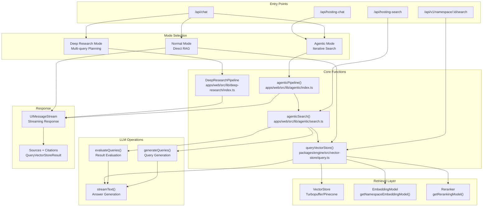
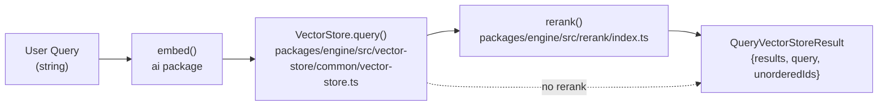
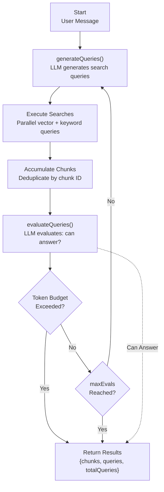

<!-- source: DeepWiki mcp.deepwiki.com · repo agentset-ai/agentset · page 4 RAG and Search System · fetched 2026-10-27 -->

# RAG and Search System

<details>
<summary>Relevant source files</summary>

The following files were used as context for generating this wiki page:

- [.env.example](.env.example)
- [apps/web/src/app/api/(internal-api)/chat/route.ts](apps/web/src/app/api/(internal-api)/chat/route.ts)
- [apps/web/src/app/api/(internal-api)/hosting-chat/route.ts](apps/web/src/app/api/(internal-api)/hosting-chat/route.ts)
- [apps/web/src/app/api/(internal-api)/hosting-search/route.ts](apps/web/src/app/api/(internal-api)/hosting-search/route.ts)
- [apps/web/src/app/api/(public-api)/v1/namespace/[namespaceId]/search/route.ts](apps/web/src/app/api/(public-api)/v1/namespace/[namespaceId]/search/route.ts)
- [apps/web/src/env.ts](apps/web/src/env.ts)
- [apps/web/src/instrumentation-client.ts](apps/web/src/instrumentation-client.ts)
- [apps/web/src/lib/agentic/index.ts](apps/web/src/lib/agentic/index.ts)
- [apps/web/src/lib/agentic/search.ts](apps/web/src/lib/agentic/search.ts)
- [apps/web/src/server/api/routers/search.ts](apps/web/src/server/api/routers/search.ts)
- [packages/engine/package.json](packages/engine/package.json)
- [packages/engine/src/env.ts](packages/engine/src/env.ts)
- [packages/engine/src/vector-store/common/vector-store.ts](packages/engine/src/vector-store/common/vector-store.ts)
- [packages/engine/src/vector-store/index.ts](packages/engine/src/vector-store/index.ts)
- [packages/engine/src/vector-store/pinecone/index.ts](packages/engine/src/vector-store/pinecone/index.ts)
- [packages/engine/src/vector-store/query.ts](packages/engine/src/vector-store/query.ts)
- [packages/engine/src/vector-store/turbopuffer/index.ts](packages/engine/src/vector-store/turbopuffer/index.ts)
- [packages/validation/src/vector-store/turbopuffer.ts](packages/validation/src/vector-store/turbopuffer.ts)
- [turbo.json](turbo.json)

</details>


## Purpose and Scope

This document describes Agentset's Retrieval-Augmented Generation (RAG) and search system architecture. It covers the vector search mechanism, agentic pipeline for iterative retrieval, query generation and evaluation, and the API endpoints that expose these capabilities. This page focuses on the retrieval and answer generation logic.

For information about the underlying vector store implementations and embedding models, see [Vector Store System](#2.3). For document processing and ingestion that populates the vector stores, see [Document Processing](#3). For the frontend chat interface that consumes these APIs, see [Document Management UI](#6.1).

---

## System Architecture Overview

The RAG system implements a multi-mode retrieval architecture supporting three distinct approaches: direct vector search, agentic search with iterative query refinement, and deep research mode. All modes query the vector stores populated during document ingestion and generate responses using language models.

**System Architecture: RAG Pipeline Modes and Data Flow**



**Sources:** [apps/web/src/lib/agentic/index.ts:29-136](), [apps/web/src/app/api/(internal-api)/chat/route.ts:57-237](), [apps/web/src/lib/agentic/search.ts:1-116](), [packages/engine/src/vector-store/query.ts:17-59]()

---

## Query Vector Store

The `queryVectorStore` function provides the foundational semantic search capability. It embeds the user's query, searches the vector store, and optionally applies reranking to improve result quality. For details, see [Vector Search](#4.1).

**Query Vector Store Flow**



The function signature and key operations:

| Operation | Location | Description |
|-----------|----------|-------------|
| `queryVectorStore()` | `packages/engine/src/vector-store/query.ts` | Main entry point for vector search |
| `embed()` | `ai` package | Converts query text to vector embedding [packages/engine/src/vector-store/query.ts:23-26]() |
| `vectorStore.query()` | `packages/engine/src/vector-store/common/vector-store.ts` | Abstract interface for provider-specific queries |
| Reranking | `packages/engine/src/rerank/index.ts` | Optional re-scoring using Cohere or ZeroEntropy [packages/engine/src/vector-store/query.ts:45-52]() |

**Parameters:**

```typescript
export type QueryVectorStoreOptions = Omit<VectorStoreQueryOptions, "mode"> & {
  query: string;
  embeddingModel: EmbeddingModel;
  vectorStore: VectorStore;
  rerank?: false | { model?: RerankingModel; limit?: number };
  mode?: VectorStoreQueryOptions["mode"]["type"];
  consistency?: VectorStoreQueryOptions["consistency"];
};
```

The reranking step, when enabled, takes the initial `topK` results and re-scores them using a dedicated reranking model, returning only the top `limit` results with improved relevance scores.

**Sources:** [packages/engine/src/vector-store/query.ts:8-59](), [packages/engine/src/vector-store/common/vector-store.ts:73-90](), [packages/engine/src/vector-store/turbopuffer/index.ts:86-179]()

---

## Agentic Search Pipeline

The agentic search system implements iterative retrieval with LLM-driven query generation and evaluation. For details, see [Agentic Pipeline](#4.2).

**Agentic Search Iteration Loop**



**Key Functions and Their Roles:**

| Function | File | Purpose |
|----------|------|---------|
| `agenticSearch()` | `apps/web/src/lib/agentic/search.ts` | Orchestrates the iterative search loop [apps/web/src/lib/agentic/search.ts:12-115]() |
| `agenticPipeline()` | `apps/web/src/lib/agentic/index.ts` | Higher-level wrapper for streaming response generation [apps/web/src/lib/agentic/index.ts:29-136]() |

The loop terminates when the evaluation determines the question can be answered, or when `maxEvals` (default 2-3) or `tokenBudget` (default 4096) are reached [apps/web/src/lib/agentic/index.ts:38-39]().

**Sources:** [apps/web/src/lib/agentic/search.ts:1-116](), [apps/web/src/lib/agentic/index.ts:29-136]()

---

## Chat and Search API Endpoints

The system exposes multiple chat and search endpoints that support different modes and access patterns. For details, see [Chat and Search API Endpoints](#4.3).

**Chat API Endpoint Comparison**

| Endpoint | Auth | Modes Supported | Configuration Source |
|----------|------|-----------------|---------------------|
| `/api/chat` | Session (`withAuthApiHandler`) | direct, agentic, deepResearch | Request body [apps/web/src/app/api/(internal-api)/chat/route.ts:57-237]() |
| `/api/hosting-chat` | Public + `hostingAuth` | agentic only | Hosting config in DB [apps/web/src/app/api/(internal-api)/hosting-chat/route.ts:68-136]() |
| `/v1/namespace/:id/search` | Namespace API Key | semantic, keyword | Request body [apps/web/src/app/api/(public-api)/v1/namespace/[namespaceId]/search/route.ts:19-110]() |

**Internal Chat API (`/api/chat`):**

The main chat endpoint supports three modes:

1. **Direct Mode**: Performs a single vector search using `queryVectorStore()` [apps/web/src/app/api/(internal-api)/chat/route.ts:174-190]().
2. **Agentic Mode**: Uses `agenticPipeline()` for multi-query iterative search [apps/web/src/app/api/(internal-api)/chat/route.ts:142-171]().
3. **Deep Research Mode**: Uses `DeepResearchPipeline` for complex, multi-step planning and answering [apps/web/src/app/api/(internal-api)/chat/route.ts:109-140]().

**Usage Tracking:**

All chat endpoints increment usage counters for both the namespace and the organization via the `db.namespace.update` and `db.organization.update` calls, typically wrapped in `waitUntil()` for performance [apps/web/src/app/api/(internal-api)/chat/route.ts:33-52]().

**Sources:** [apps/web/src/app/api/(internal-api)/chat/route.ts:1-237](), [apps/web/src/app/api/(internal-api)/hosting-chat/route.ts:1-136](), [apps/web/src/app/api/(public-api)/v1/namespace/[namespaceId]/search/route.ts:1-110](), [apps/web/src/app/api/(internal-api)/hosting-search/route.ts:1-112]()

---

