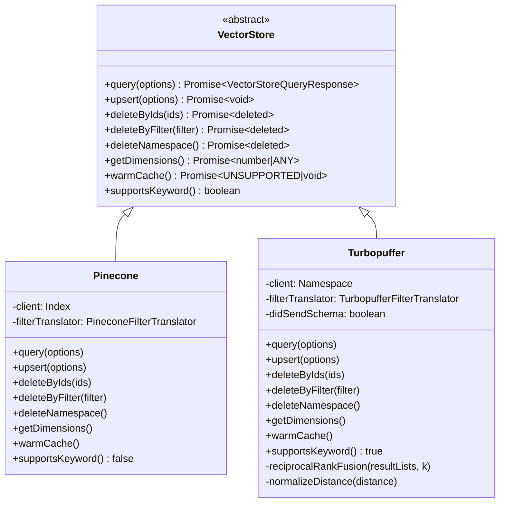
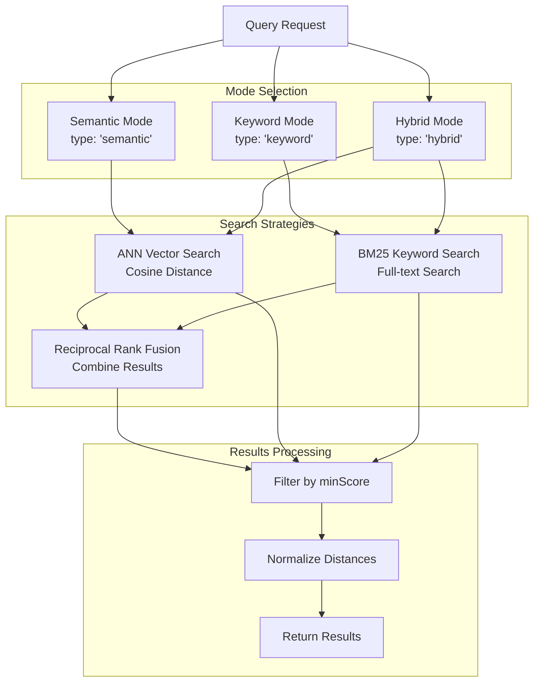
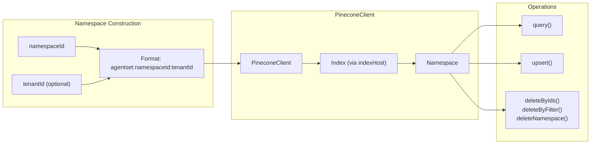
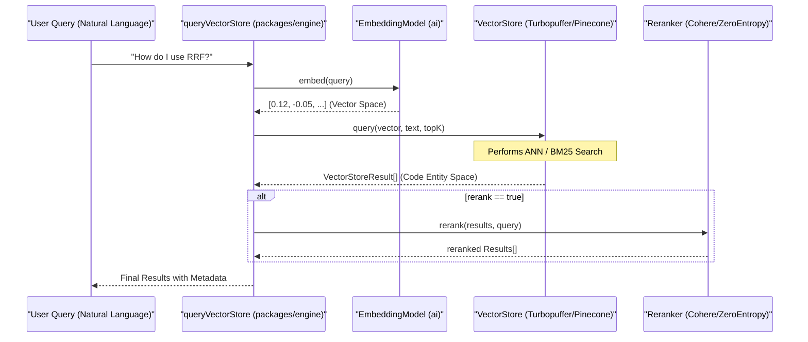

<!-- source: DeepWiki mcp.deepwiki.com · repo agentset-ai/agentset · page 4.1 Vector Search · fetched 2026-10-27 -->

# Vector Search

Relevant source files

The following files were used as context for generating this wiki page:

- [apps/web/src/server/api/routers/search.ts](apps/web/src/server/api/routers/search.ts)
- [apps/web/src/services/namespaces/validate.ts](apps/web/src/services/namespaces/validate.ts)
- [packages/db/src/types/prisma.ts](packages/db/src/types/prisma.ts)
- [packages/engine/src/embedding/index.ts](packages/engine/src/embedding/index.ts)
- [packages/engine/src/llm/index.ts](packages/engine/src/llm/index.ts)
- [packages/engine/src/rerank/cohere.ts](packages/engine/src/rerank/cohere.ts)
- [packages/engine/src/rerank/common.ts](packages/engine/src/rerank/common.ts)
- [packages/engine/src/rerank/index.ts](packages/engine/src/rerank/index.ts)
- [packages/engine/src/vector-store/common/vector-store.ts](packages/engine/src/vector-store/common/vector-store.ts)
- [packages/engine/src/vector-store/index.ts](packages/engine/src/vector-store/index.ts)
- [packages/engine/src/vector-store/pinecone/index.ts](packages/engine/src/vector-store/pinecone/index.ts)
- [packages/engine/src/vector-store/query.ts](packages/engine/src/vector-store/query.ts)
- [packages/engine/src/vector-store/turbopuffer/index.ts](packages/engine/src/vector-store/turbopuffer/index.ts)
- [packages/validation/src/llm/constants.ts](packages/validation/src/llm/constants.ts)
- [packages/validation/src/vector-store/turbopuffer.ts](packages/validation/src/vector-store/turbopuffer.ts)

## Purpose and Scope

This document describes the vector search system in AgentSet, which provides the core retrieval capabilities for the RAG (Retrieval-Augmented Generation) pipeline. The vector search system abstracts multiple vector store providers (Pinecone and Turbopuffer) behind a unified interface, supporting semantic search, keyword search, and hybrid search strategies.

For information about the agentic reasoning that uses vector search results, see [Agentic Pipeline](#4.2). For details on the chat and search API endpoints, see [Chat and Search API Endpoints](#4.3).

---

## Vector Store Abstraction Layer

AgentSet implements a provider-agnostic vector store interface through the abstract `VectorStore` class. This abstraction enables namespaces to use different vector store backends while maintaining consistent query and management interfaces throughout the application.

### Class Architecture

The following diagram illustrates the relationship between the base `VectorStore` class and its concrete implementations.

Title: Vector Store Class Hierarchy

**Sources:** [packages/engine/src/vector-store/common/vector-store.ts:73-90](), [packages/engine/src/vector-store/pinecone/index.ts:19-22](), [packages/engine/src/vector-store/turbopuffer/index.ts:28-33]()

### Core Interfaces

The vector store abstraction defines several key types for handling query input and output:

| Type | Description |
|------|-------------|
| `VectorStoreQueryOptions` | Query parameters including mode (semantic/keyword/hybrid), topK, filters, score thresholds, and consistency levels. |
| `VectorStoreUpsertOptions` | Batch upsert parameters containing an array of `chunks` with `documentId`, raw chunk data, and the generated `embedding`. |
| `VectorStoreResult` | Individual search result containing the chunk `id`, `text`, `metadata`, and calculated `score` or `rerankScore`. |
| `VectorStoreQueryResponse` | An array of `VectorStoreResult` objects returned from a query. |

**Sources:** [packages/engine/src/vector-store/common/vector-store.ts:14-58]()

---

## Query Modes

The vector store system supports three distinct query modes, each optimized for different retrieval scenarios.

Title: Search Mode Logic Flow

**Sources:** [packages/engine/src/vector-store/common/vector-store.ts:22-36](), [packages/engine/src/vector-store/turbopuffer/index.ts:104-140]()

### Semantic Search

Semantic search performs approximate nearest neighbor (ANN) search using cosine distance between the query embedding and stored document embeddings.

*   **Pinecone:** Uses native vector search. [packages/engine/src/vector-store/pinecone/index.ts:50-56]()
*   **Turbopuffer:** Uses `rank_by: ["vector", "ANN", vector]` with `cosine_distance`. [packages/engine/src/vector-store/turbopuffer/index.ts:107-111]()
*   **Normalization:** Turbopuffer cosine distances (0 to 2) are normalized to similarity scores (0 to 1) via `(2 - distance) / 2`. [packages/engine/src/vector-store/turbopuffer/index.ts:82-84]()

### Keyword Search (BM25)

Keyword search uses the BM25 algorithm for full-text search. This is currently **only supported by Turbopuffer**. Pinecone will throw an error if this mode is requested. [packages/engine/src/vector-store/pinecone/index.ts:44-47]()

In Turbopuffer, the `text` attribute is configured with `full_text_search: true` in the schema to enable this capability. [packages/engine/src/vector-store/turbopuffer/index.ts:17-20]()

### Hybrid Search with Reciprocal Rank Fusion (RRF)

Hybrid search combines semantic and keyword results. In Turbopuffer, this is implemented using `multiQuery` to fetch both ANN and BM25 results, which are then fused using the `reciprocalRankFusion` method. [packages/engine/src/vector-store/turbopuffer/index.ts:116-140]()

The RRF algorithm calculates a fused score: `score = Σ (1 / (k + rank))`, where `k` is a constant (set to the requested `topK`). [packages/engine/src/vector-store/turbopuffer/index.ts:61-78]()

---

## Pinecone Implementation

The Pinecone implementation provides integration with Pinecone's managed vector database service.

Title: Pinecone Search Data Flow

**Sources:** [packages/engine/src/vector-store/pinecone/index.ts:23-38]()

### Configuration and Multi-tenancy

Pinecone namespaces follow the pattern: `agentset:{namespaceId}:{tenantId}`. [packages/engine/src/vector-store/pinecone/index.ts:34]()

The system supports multiple Pinecone provider types:
*   `MANAGED_PINECONE_OLD`: Uses `DEFAULT_PINECONE_API_KEY`.
*   `MANAGED_PINECONE`: Uses `SECONDARY_PINECONE_API_KEY`.
*   `PINECONE`: Uses user-provided `apiKey` and `indexHost`.

**Sources:** [packages/engine/src/vector-store/index.ts:25-49]()

---

## Turbopuffer Implementation

Turbopuffer is the primary vector store for AgentSet, supporting advanced features like native hybrid search and schema management.

### Schema Configuration

Turbopuffer requires a schema definition for its attributes. AgentSet defines `id`, `text` (for BM25), and `_node_content`. [packages/engine/src/vector-store/turbopuffer/index.ts:15-26]()

The schema is sent during the first `upsert` operation if it hasn't been initialized yet. [packages/engine/src/vector-store/turbopuffer/index.ts:186-201]()

### Namespace Naming

Turbopuffer namespaces follow the pattern: `as_{namespaceId}_{tenantId}`. [packages/engine/src/vector-store/turbopuffer/index.ts:49]()

---

## Query Flow and Reranking

The `queryVectorStore` function orchestrates the retrieval process, transforming natural language queries into ranked code/document entities.

Title: Natural Language to Entity Retrieval Pipeline

**Sources:** [packages/engine/src/vector-store/query.ts:17-59]()

### Reranking Integration

AgentSet supports post-retrieval reranking to improve precision. If enabled, the system uses models like `CohereReranker` to re-score the initial results from the vector store based on the original query string. [packages/engine/src/rerank/cohere.ts:6-33](), [packages/engine/src/vector-store/query.ts:43-52]()

---

## Validation and Consistency

### Dimension Validation

During namespace setup, AgentSet validates that the embedding model dimensions match the vector store's expected dimensions. For example, `text-embedding-3-large` (3072) must match the target index. [apps/web/src/services/namespaces/validate.ts:9-61]()

### Consistency Levels

Turbopuffer supports consistency levels:
*   `eventual`: Lower latency, default for most operations.
*   `strong`: Used for immediate consistency (e.g., in the search playground). [packages/engine/src/vector-store/turbopuffer/index.ts:101](), [apps/web/src/server/api/routers/search.ts:52]()

**Sources:** [packages/engine/src/vector-store/turbopuffer/index.ts:101](), [apps/web/src/server/api/routers/search.ts:52]()

---

