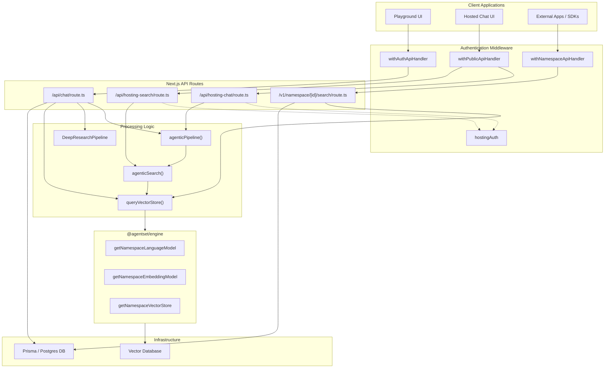
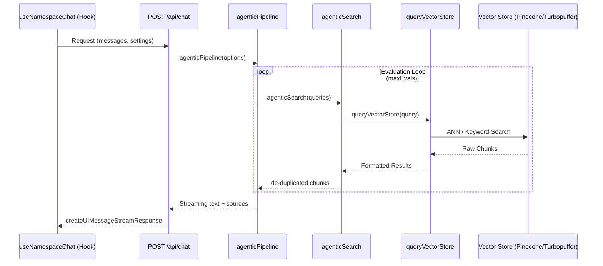

<!-- source: DeepWiki mcp.deepwiki.com · repo agentset-ai/agentset · page 4.3 Chat and Search API Endpoints · fetched 2026-10-27 -->

# Chat and Search API Endpoints

<details>
<summary>Relevant source files</summary>

The following files were used as context for generating this wiki page:

- [.env.example](.env.example)
- [apps/web/src/app/api/(internal-api)/chat/route.ts](apps/web/src/app/api/(internal-api)/chat/route.ts)
- [apps/web/src/app/api/(internal-api)/hosting-chat/route.ts](apps/web/src/app/api/(internal-api)/hosting-chat/route.ts)
- [apps/web/src/app/api/(internal-api)/hosting-search/route.ts](apps/web/src/app/api/(internal-api)/hosting-search/route.ts)
- [apps/web/src/app/api/(public-api)/v1/namespace/[namespaceId]/search/route.ts](apps/web/src/app/api/(public-api)/v1/namespace/[namespaceId]/search/route.ts)
- [apps/web/src/app/app.agentset.ai/(dashboard)/[slug]/[namespaceSlug]/playground/chat-settings.tsx](apps/web/src/app/app.agentset.ai/(dashboard)/[slug]/[namespaceSlug]/playground/chat-settings.tsx)
- [apps/web/src/components/chat/chat-input-modes.tsx](apps/web/src/components/chat/chat-input-modes.tsx)
- [apps/web/src/components/chat/chat-model.tsx](apps/web/src/components/chat/chat-model.tsx)
- [apps/web/src/components/chat/chat-settings.store.ts](apps/web/src/components/chat/chat-settings.store.ts)
- [apps/web/src/components/chat/message-editor.tsx](apps/web/src/components/chat/message-editor.tsx)
- [apps/web/src/components/chat/use-chat.ts](apps/web/src/components/chat/use-chat.ts)
- [apps/web/src/components/chat/use-hosting-chat.ts](apps/web/src/components/chat/use-hosting-chat.ts)
- [apps/web/src/components/llm-selector.tsx](apps/web/src/components/llm-selector.tsx)
- [apps/web/src/components/reranker-selector.tsx](apps/web/src/components/reranker-selector.tsx)
- [apps/web/src/env.ts](apps/web/src/env.ts)
- [apps/web/src/instrumentation-client.ts](apps/web/src/instrumentation-client.ts)
- [apps/web/src/lib/agentic/index.ts](apps/web/src/lib/agentic/index.ts)
- [apps/web/src/lib/agentic/search.ts](apps/web/src/lib/agentic/search.ts)
- [packages/engine/package.json](packages/engine/package.json)
- [packages/engine/src/env.ts](packages/engine/src/env.ts)
- [packages/ui/src/components/ai-elements/model-selector.tsx](packages/ui/src/components/ai-elements/model-selector.tsx)
- [packages/ui/src/components/ai-elements/reasoning.tsx](packages/ui/src/components/ai-elements/reasoning.tsx)
- [turbo.json](turbo.json)

</details>


## Purpose and Scope

This document details the chat and search API endpoints that process user queries, retrieve relevant information from vector stores, and generate responses using language models. AgentSet provides multiple endpoints to serve different use cases:

1.  **Internal Chat API** (`/api/chat`) - Primary playground endpoint with multiple processing modes (Direct, Agentic, Deep Research).
2.  **Hosting Chat API** (`/api/hosting-chat`) - Public-facing chat for hosted namespaces.
3.  **Hosting Search API** (`/api/hosting-search`) - Agentic search endpoint for hosted interfaces.
4.  **Public Search API** (`/api/v1/namespace/[namespaceId]/search`) - REST API for direct vector search.

For information about the agentic search pipeline implementation, see page 4.2. For vector search mechanics, see page 4.1.

## Overview

The chat and search endpoints serve as the primary interface between client applications and the RAG system's retrieval and generation capabilities. Chat endpoints support streaming responses with generated text, while search endpoints return structured result sets. All endpoints support usage tracking and flexible configuration of retrieval parameters.

### Chat and Search Endpoints Architecture



**Sources:** [apps/web/src/app/api/(internal-api)/chat/route.ts:57-237](), [apps/web/src/app/api/(internal-api)/hosting-chat/route.ts:68-136](), [apps/web/src/app/api/(internal-api)/hosting-search/route.ts:21-111](), [apps/web/src/app/api/(public-api)/v1/namespace/[namespaceId]/search/route.ts:19-110]()

## Internal Chat Endpoint

### Endpoint Configuration

The primary chat endpoint is located at `/api/chat` and serves the playground interface.

| Property | Value |
| :--- | :--- |
| **Route Path** | `/api/chat` |
| **HTTP Method** | POST |
| **Authentication** | `withAuthApiHandler` (Session-based) |
| **Max Duration** | 120 seconds |
| **Preferred Region** | `iad1` (close to DB) |
| **Request Schema** | `chatSchema` |
| **Response Type** | Streaming (`createUIMessageStreamResponse`) |

**Sources:** [apps/web/src/app/api/(internal-api)/chat/route.ts:54-57](), [apps/web/src/app/api/(internal-api)/chat/route.ts:31-31]()

### Request Parameters

The internal chat endpoint accepts a request body validated by `chatSchema`:

| Parameter | Type | Required | Description |
| :--- | :--- | :--- | :--- |
| `messages` | `MyUIMessage[]` | Yes | Message history with role and content |
| `mode` | `string` | No | `"direct"`, `"agentic"`, or `"deepResearch"` |
| `llmModel` | `string` | No | LLM identifier (e.g., GPT-4o) |
| `topK` | `number` | No | Number of chunks to retrieve |
| `rerank` | `boolean` | No | Enable reranking |
| `systemPrompt` | `string` | No | Custom instructions for the model |
| `temperature` | `number` | No | LLM temperature (default 0) |

**Sources:** [apps/web/src/app/api/(internal-api)/chat/route.ts:31-31](), [apps/web/src/components/chat/chat-settings.store.ts:33-41]()

### Processing Modes

#### 1. Direct Mode (Default)
Performs a single vector search. If chat history exists, it uses `CONDENSE_SYSTEM_PROMPT` to turn history into a standalone query before searching.

```typescript
// Condensed query generation
query = (await generateText({
  model: languageModel,
  prompt: CONDENSE_SYSTEM_PROMPT.compile({
    question: lastMessage,
    chatHistory: CONDENSE_USER_PROMPT.compile({ ... })
  }),
})).text;
```

**Sources:** [apps/web/src/app/api/(internal-api)/chat/route.ts:82-107]()

#### 2. Agentic Mode
Invokes `agenticPipeline` from `src/lib/agentic/index.ts`. This mode iteratively generates queries, evaluates retrieved chunks, and repeats until the answer is sufficient or the `maxEvals` limit (default 2) is reached.

**Sources:** [apps/web/src/app/api/(internal-api)/chat/route.ts:142-171](), [apps/web/src/lib/agentic/index.ts:29-45]()

#### 3. Deep Research Mode
Uses `DeepResearchPipeline` for complex queries requiring multi-step planning and synthesis.

**Sources:** [apps/web/src/app/api/(internal-api)/chat/route.ts:109-140]()

## Hosting Chat and Search

These endpoints serve public-facing interfaces configured via the `Hosting` model in the database.

### Hosting Chat API (`/api/hosting-chat`)
Standard streaming chat for public users. It defaults to **Agentic Mode** and uses the `hosting.llmConfig` and `hosting.systemPrompt` defined in the dashboard.

**Sources:** [apps/web/src/app/api/(internal-api)/hosting-chat/route.ts:112-132]()

### Hosting Search API (`/api/hosting-search`)
Returns structured JSON results instead of a text stream. It uses `agenticSearch` to perform multi-query retrieval and returns a de-duplicated list of chunks.

```typescript
const result = await agenticSearch({
  model: languageModel,
  queryOptions: { ... },
  messages: [{ role: "user", content: body.query }],
});

return makeApiSuccessResponse({
  data: {
    totalQueries: result.totalQueries,
    queries: result.queries,
    chunks: Object.values(result.chunks),
  },
});
```

**Sources:** [apps/web/src/app/api/(internal-api)/hosting-search/route.ts:80-109]()

## Public Search Endpoint

The endpoint `/api/v1/namespace/[namespaceId]/search` allows direct programmatic access to the vector store.

### Features
*   **Authentication:** Requires an API Key via `withNamespaceApiHandler`.
*   **Mode Support:** Supports `semantic`, `keyword`, and `hybrid` search (keyword/hybrid require Turbopuffer).
*   **Reranking:** Optional integration with Cohere reranking models.
*   **Usage Limits:** Enforces `organization.searchLimit` based on the subscription plan.

**Sources:** [apps/web/src/app/api/(public-api)/v1/namespace/[namespaceId]/search/route.ts:19-57](), [apps/web/src/app/api/(public-api)/v1/namespace/[namespaceId]/search/route.ts:74-81]()

## Usage Tracking and Billing

AgentSet tracks usage across all endpoints to enforce subscription limits and provide analytics.

### Tracking Implementation
Usage is tracked asynchronously using Vercel's `waitUntil` to avoid blocking the API response.

| Endpoint | Logic | Database Update |
| :--- | :--- | :--- |
| `/api/chat` | `incrementUsage` | `totalPlaygroundUsage` + `searchUsage` |
| `/api/hosting-chat` | `incrementUsage` | `searchUsage` (Organization level) |
| `/v1/namespace/search` | Direct Update | `searchUsage` (Organization level) |

```typescript
const incrementUsage = (namespaceId: string, queries: number) => {
  waitUntil(
    (async () => {
      await db.namespace.update({
        where: { id: namespaceId },
        data: {
          totalPlaygroundUsage: { increment: 1 },
          organization: { update: { searchUsage: { increment: queries } } },
        },
      });
    })(),
  );
};
```

**Sources:** [apps/web/src/app/api/(internal-api)/chat/route.ts:33-52](), [apps/web/src/app/api/(public-api)/v1/namespace/[namespaceId]/search/route.ts:90-102]()

## Data Flow: Client to Vector Store

The following diagram illustrates how a request from the `useNamespaceChat` hook flows through the system to the underlying vector store.



**Sources:** [apps/web/src/components/chat/use-chat.ts:12-41](), [apps/web/src/lib/agentic/index.ts:51-133](), [apps/web/src/lib/agentic/search.ts:12-102](), [packages/engine/src/index.ts]() (via `queryVectorStore` export).

## Frontend Configuration

The playground UI uses a Zustand store `useChatSettings` to manage parameters sent to the `/api/chat` endpoint.

*   **Default Settings:** `topK: 50`, `rerankLimit: 15`, `mode: "agentic"`, `temperature: 0`.
*   **Persistence:** Settings are persisted in local storage under the key `chat-settings`.
*   **Transport:** The `useNamespaceChat` hook uses `DefaultChatTransport` to inject these settings into the request body.

**Sources:** [apps/web/src/components/chat/chat-settings.store.ts:33-41](), [apps/web/src/components/chat/use-chat.ts:15-35]()

---

