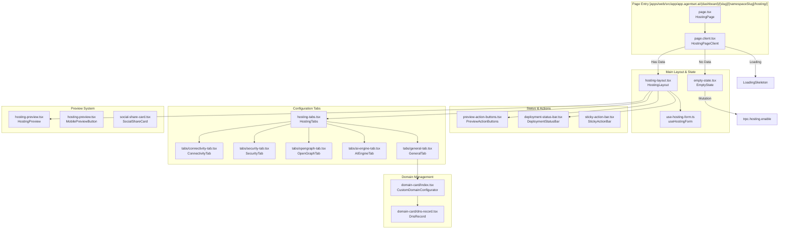
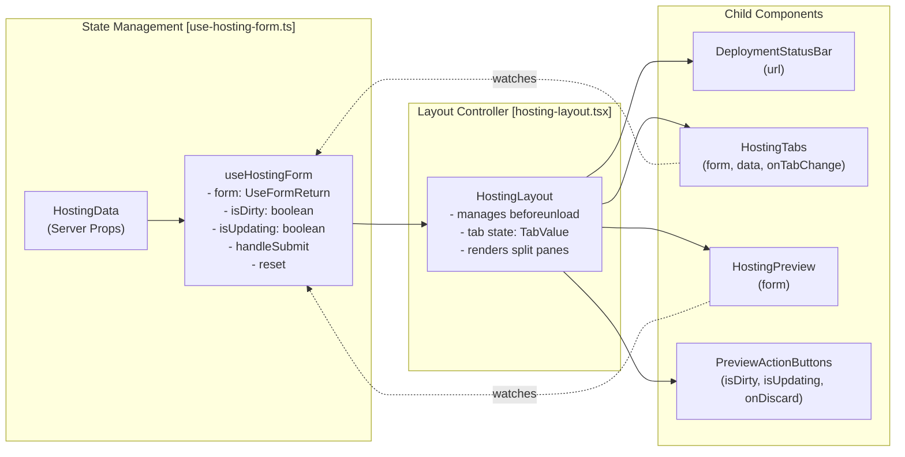

<!-- source: DeepWiki mcp.deepwiki.com · repo agentset-ai/agentset · page 5.2 Hosting UI Components · fetched 2026-10-27 -->

# Hosting UI Components

Relevant source files

The following files were used as context for generating this wiki page:

- [apps/web/src/app/app.agentset.ai/(dashboard)/[slug]/[namespaceSlug]/hosting/components/deployment-status-bar.tsx](apps/web/src/app/app.agentset.ai/(dashboard)/[slug]/[namespaceSlug]/hosting/components/deployment-status-bar.tsx)
- [apps/web/src/app/app.agentset.ai/(dashboard)/[slug]/[namespaceSlug]/hosting/components/hosting-layout.tsx](apps/web/src/app/app.agentset.ai/(dashboard)/[slug]/[namespaceSlug]/hosting/components/hosting-layout.tsx)
- [apps/web/src/app/app.agentset.ai/(dashboard)/[slug]/[namespaceSlug]/hosting/components/hosting-preview.tsx](apps/web/src/app/app.agentset.ai/(dashboard)/[slug]/[namespaceSlug]/hosting/components/hosting-preview.tsx)
- [apps/web/src/app/app.agentset.ai/(dashboard)/[slug]/[namespaceSlug]/hosting/components/hosting-tabs.tsx](apps/web/src/app/app.agentset.ai/(dashboard)/[slug]/[namespaceSlug]/hosting/components/hosting-tabs.tsx)
- [apps/web/src/app/app.agentset.ai/(dashboard)/[slug]/[namespaceSlug]/hosting/components/preview-action-buttons.tsx](apps/web/src/app/app.agentset.ai/(dashboard)/[slug]/[namespaceSlug]/hosting/components/preview-action-buttons.tsx)
- [apps/web/src/app/app.agentset.ai/(dashboard)/[slug]/[namespaceSlug]/hosting/components/sticky-action-bar.tsx](apps/web/src/app/app.agentset.ai/(dashboard)/[slug]/[namespaceSlug]/hosting/components/sticky-action-bar.tsx)
- [apps/web/src/app/app.agentset.ai/(dashboard)/[slug]/[namespaceSlug]/hosting/components/tabs/general-tab.tsx](apps/web/src/app/app.agentset.ai/(dashboard)/[slug]/[namespaceSlug]/hosting/components/tabs/general-tab.tsx)
- [apps/web/src/app/app.agentset.ai/(dashboard)/[slug]/[namespaceSlug]/hosting/components/tabs/opengraph-tab.tsx](apps/web/src/app/app.agentset.ai/(dashboard)/[slug]/[namespaceSlug]/hosting/components/tabs/opengraph-tab.tsx)
- [apps/web/src/app/app.agentset.ai/(dashboard)/[slug]/[namespaceSlug]/hosting/domain-card/dns-record.tsx](apps/web/src/app/app.agentset.ai/(dashboard)/[slug]/[namespaceSlug]/hosting/domain-card/dns-record.tsx)
- [apps/web/src/app/app.agentset.ai/(dashboard)/[slug]/[namespaceSlug]/hosting/domain-card/index.tsx](apps/web/src/app/app.agentset.ai/(dashboard)/[slug]/[namespaceSlug]/hosting/domain-card/index.tsx)
- [apps/web/src/app/app.agentset.ai/(dashboard)/[slug]/[namespaceSlug]/hosting/empty-state.tsx](apps/web/src/app/app.agentset.ai/(dashboard)/[slug]/[namespaceSlug]/hosting/empty-state.tsx)
- [apps/web/src/app/app.agentset.ai/(dashboard)/[slug]/[namespaceSlug]/hosting/page.client.tsx](apps/web/src/app/app.agentset.ai/(dashboard)/[slug]/[namespaceSlug]/hosting/page.client.tsx)
- [apps/web/src/app/app.agentset.ai/(dashboard)/[slug]/[namespaceSlug]/hosting/page.tsx](apps/web/src/app/app.agentset.ai/(dashboard)/[slug]/[namespaceSlug]/hosting/page.tsx)
- [apps/web/src/components/list-input.tsx](apps/web/src/components/list-input.tsx)
- [apps/web/src/components/search-chunk.tsx](apps/web/src/components/search-chunk.tsx)
- [apps/web/src/components/sortable-list.tsx](apps/web/src/components/sortable-list.tsx)
- [apps/web/src/server/api/routers/hosting.ts](apps/web/src/server/api/routers/hosting.ts)

## Purpose and Scope

This document describes the UI component architecture for the hosting configuration interface, which allows users to customize and manage their public-facing chat deployments. The system provides a form-based editor with live preview, deployment status tracking, unsaved changes handling, and custom domain configuration.

The hosting UI is built around the `HostingLayout` component, which integrates form state management via `useHostingForm` with a responsive split-pane preview system.

## Architecture Overview

The hosting UI implements a split-pane layout with configuration on the left and live preview on the right. The system uses `react-hook-form` for state management and provides real-time preview updates, unsaved changes warnings, and responsive mobile layouts.

### System Architecture Diagram

**Sources:** [apps/web/src/app/app.agentset.ai/(dashboard)/[slug]/[namespaceSlug]/hosting/page.tsx:1-11](), [apps/web/src/app/app.agentset.ai/(dashboard)/[slug]/[namespaceSlug]/hosting/page.client.tsx:12-30](), [apps/web/src/app/app.agentset.ai/(dashboard)/[slug]/[namespaceSlug]/hosting/components/hosting-layout.tsx:17-84]()

## Component Hierarchy and Data Flow

The hosting UI follows a unidirectional data flow pattern where the `HostingLayout` component manages form state and distributes it to child components for rendering and preview.

**Sources:** [apps/web/src/app/app.agentset.ai/(dashboard)/[slug]/[namespaceSlug]/hosting/components/hosting-layout.tsx:17-84]()

## Form State Management

The `HostingLayout` component receives `HostingData` as props and initializes the form using the `useHostingForm` hook [apps/web/src/app/app.agentset.ai/(dashboard)/[slug]/[namespaceSlug]/hosting/components/hosting-layout.tsx:18-19](). This hook provides:

| Property | Type | Purpose |
|----------|------|---------|
| `form` | `UseFormReturn<HostingFormValues>` | React Hook Form instance for all hosting fields |
| `handleSubmit` | `(e: FormEvent) => Promise<void>` | Form submission handler with API mutation |
| `isUpdating` | `boolean` | Loading state during save operation |
| `isDirty` | `boolean` | Tracks whether form has unsaved changes |
| `reset` | `() => void` | Resets form to original values |

The layout manages an `activeTab` state to control which configuration section is displayed [apps/web/src/app/app.agentset.ai/(dashboard)/[slug]/[namespaceSlug]/hosting/components/hosting-layout.tsx:20]().

**Sources:** [apps/web/src/app/app.agentset.ai/(dashboard)/[slug]/[namespaceSlug]/hosting/components/hosting-layout.tsx:17-20]()

## Unsaved Changes Protection

The component implements browser-level unsaved changes protection using the `beforeunload` event. When `isDirty` is true, navigating away or closing the tab triggers a confirmation dialog:

The message constant is defined as: `"You have unsaved changes. Are you sure you want to leave?"` [apps/web/src/app/app.agentset.ai/(dashboard)/[slug]/[namespaceSlug]/hosting/components/hosting-layout.tsx:14-15]().

The effect sets up the listener on mount and cleans it up on unmount [apps/web/src/app/app.agentset.ai/(dashboard)/[slug]/[namespaceSlug]/hosting/components/hosting-layout.tsx:22-37]().

**Sources:** [apps/web/src/app/app.agentset.ai/(dashboard)/[slug]/[namespaceSlug]/hosting/components/hosting-layout.tsx:22-37]()

## Split-Pane Layout Architecture

The layout implements a responsive two-pane design with configuration on the left (60% width) and preview on the right (40% width).

### Desktop Layout Structure

| Section | Width | Component | Purpose |
|---------|-------|-----------|---------|
| Configuration Pane | `flex-6` (60%) | `ScrollArea` with tabs | Form fields for all settings [apps/web/src/app/app.agentset.ai/(dashboard)/[slug]/[namespaceSlug]/hosting/components/hosting-layout.tsx:55-59]() |
| Preview Pane | `flex-4` (40%) | Static container | Live preview or social card preview [apps/web/src/app/app.agentset.ai/(dashboard)/[slug]/[namespaceSlug]/hosting/components/hosting-layout.tsx:62-76]() |

The preview pane has class `hidden lg:block` to hide it on mobile [apps/web/src/app/app.agentset.ai/(dashboard)/[slug]/[namespaceSlug]/hosting/components/hosting-layout.tsx:62]().

**Sources:** [apps/web/src/app/app.agentset.ai/(dashboard)/[slug]/[namespaceSlug]/hosting/components/hosting-layout.tsx:46-84]()

## Preview System

The layout conditionally renders different preview components based on the active tab via `renderPreviewPane` [apps/web/src/app/app.agentset.ai/(dashboard)/[slug]/[namespaceSlug]/hosting/components/hosting-layout.tsx:41-44]().

- **Default Preview** (`HostingPreview`): Live chat interface preview for general branding and AI behavior [apps/web/src/app/app.agentset.ai/(dashboard)/[slug]/[namespaceSlug]/hosting/components/hosting-layout.tsx:43]().
- **Social Preview** (`SocialSharePreview`): Open Graph metadata preview using `SocialShareCard` [apps/web/src/app/app.agentset.ai/(dashboard)/[slug]/[namespaceSlug]/hosting/components/hosting-layout.tsx:42]().

The `SocialSharePreview` wrapper adds a "Social Preview" header and centers the card [apps/web/src/app/app.agentset.ai/(dashboard)/[slug]/[namespaceSlug]/hosting/components/hosting-layout.tsx:86-104]().

**Sources:** [apps/web/src/app/app.agentset.ai/(dashboard)/[slug]/[namespaceSlug]/hosting/components/hosting-layout.tsx:41-44](), [apps/web/src/app/app.agentset.ai/(dashboard)/[slug]/[namespaceSlug]/hosting/components/hosting-layout.tsx:86-104]()

## Deployment Status Bar

The `DeploymentStatusBar` displays the live deployment URL with visual indicators:

- **Pulsing Indicator**: A green dot with `animate-ping` signifies the deployment is live [apps/web/src/app/app.agentset.ai/(dashboard)/[slug]/[namespaceSlug]/hosting/components/deployment-status-bar.tsx:20-23]().
- **Action Buttons**: Includes "Copy URL" (using `useCopyToClipboard`) and "Visit" (external link) [apps/web/src/app/app.agentset.ai/(dashboard)/[slug]/[namespaceSlug]/hosting/components/deployment-status-bar.tsx:37-56]().

The URL is constructed as `APP_DOMAIN + HOSTING_PREFIX + data.slug` [apps/web/src/app/app.agentset.ai/(dashboard)/[slug]/[namespaceSlug]/hosting/components/hosting-layout.tsx:39]().

**Sources:** [apps/web/src/app/app.agentset.ai/(dashboard)/[slug]/[namespaceSlug]/hosting/components/deployment-status-bar.tsx:1-59]()

## Configuration Tab System

The hosting configuration is organized into five main tabs managed by `HostingTabs` [apps/web/src/app/app.agentset.ai/(dashboard)/[slug]/[namespaceSlug]/hosting/components/hosting-tabs.tsx:15-20]():

1.  **General (`branding`)**: Brand name, welcome messages, and custom domain [apps/web/src/app/app.agentset.ai/(dashboard)/[slug]/[namespaceSlug]/hosting/components/tabs/general-tab.tsx]().
2.  **AI (`ai-behavior`)**: System prompts and model configuration via `AIEngineTab` [apps/web/src/app/app.agentset.ai/(dashboard)/[slug]/[namespaceSlug]/hosting/components/tabs/ai-engine-tab.tsx]().
3.  **Security (`access`)**: Authentication and access controls via `SecurityTab` [apps/web/src/app/app.agentset.ai/(dashboard)/[slug]/[namespaceSlug]/hosting/components/tabs/security-tab.tsx]().
4.  **Open Graph (`opengraph`)**: Social sharing metadata via `OpenGraphTab` [apps/web/src/app/app.agentset.ai/(dashboard)/[slug]/[namespaceSlug]/hosting/components/tabs/opengraph-tab.tsx]().
5.  **Advanced (`other`)**: Connectivity and other settings via `ConnectivityTab` [apps/web/src/app/app.agentset.ai/(dashboard)/[slug]/[namespaceSlug]/hosting/components/tabs/connectivity-tab.tsx]().

**Sources:** [apps/web/src/app/app.agentset.ai/(dashboard)/[slug]/[namespaceSlug]/hosting/components/hosting-tabs.tsx:38-73]()

## Custom Domain UI

Custom domain management is handled by the `CustomDomainConfigurator` (and `useDomainStatus` hook) within the General tab.

### Domain Status and DNS Records
The UI dynamically displays DNS instructions based on the verification status returned by `trpc.domain.checkStatus` [apps/web/src/app/app.agentset.ai/(dashboard)/[slug]/[namespaceSlug]/hosting/domain-card/index.tsx:32-38]().

| Status | Component Action |
|--------|------------------|
| **Pending Verification** | Shows TXT record requirements [apps/web/src/app/app.agentset.ai/(dashboard)/[slug]/[namespaceSlug]/hosting/domain-card/index.tsx:65-87](). |
| **Conflicting DNS Records** | Lists conflicting records and recommended A/CNAME updates [apps/web/src/app/app.agentset.ai/(dashboard)/[slug]/[namespaceSlug]/hosting/domain-card/index.tsx:88-123](). |
| **Invalid Configuration** | Provides tabs for A Record (apex) or CNAME (subdomain) setup [apps/web/src/app/app.agentset.ai/(dashboard)/[slug]/[namespaceSlug]/hosting/domain-card/index.tsx:133-164](). |

DNS values use standard constants: `A_VALUE = "76.76.21.21"` and `CNAME_VALUE = "cname.${SHORT_DOMAIN}"` [apps/web/src/app/app.agentset.ai/(dashboard)/[slug]/[namespaceSlug]/hosting/domain-card/index.tsx:25-26]().

**Sources:** [apps/web/src/app/app.agentset.ai/(dashboard)/[slug]/[namespaceSlug]/hosting/domain-card/index.tsx:1-168]()

## Shared UI Utilities

### Sortable List
Used for managing ordered items like "Example Questions". It utilizes `@dnd-kit` for drag-and-drop functionality and `useFieldArray` from `react-hook-form` for state sync [apps/web/src/components/sortable-list.tsx:56-59](). It manages `virtualIds` to ensure stable keys during reordering [apps/web/src/components/sortable-list.tsx:52-54]().

### Search Chunk Preview
The `SearchChunk` component (used in playground/preview) renders retrieved context with metadata. It includes a `CollapsibleMetadata` component for inspecting JSON attributes [apps/web/src/components/search-chunk.tsx:7-34]().

**Sources:** [apps/web/src/components/sortable-list.tsx:1-227](), [apps/web/src/components/search-chunk.tsx:36-122]()

---

