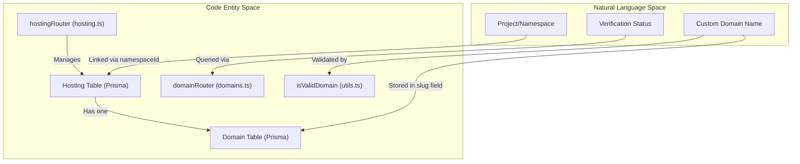
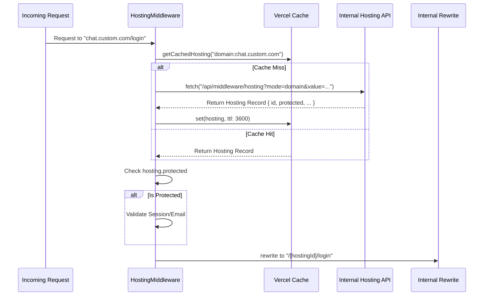
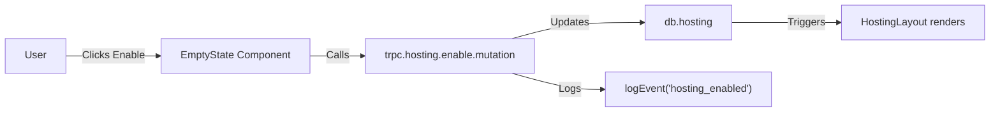

<!-- source: DeepWiki mcp.deepwiki.com · repo agentset-ai/agentset · page 5.3 Domain Management · fetched 2026-10-27 -->

# Domain Management

<details>
<summary>Relevant source files</summary>

The following files were used as context for generating this wiki page:

- [apps/web/src/app/api/(internal-api)/middleware/default-org/route.ts](apps/web/src/app/api/(internal-api)/middleware/default-org/route.ts)
- [apps/web/src/app/api/(internal-api)/middleware/hosting/member/route.ts](apps/web/src/app/api/(internal-api)/middleware/hosting/member/route.ts)
- [apps/web/src/app/api/(internal-api)/middleware/hosting/route.ts](apps/web/src/app/api/(internal-api)/middleware/hosting/route.ts)
- [apps/web/src/app/app.agentset.ai/(dashboard)/[slug]/[namespaceSlug]/hosting/domain-card/dns-record.tsx](apps/web/src/app/app.agentset.ai/(dashboard)/[slug]/[namespaceSlug]/hosting/domain-card/dns-record.tsx)
- [apps/web/src/app/app.agentset.ai/(dashboard)/[slug]/[namespaceSlug]/hosting/empty-state.tsx](apps/web/src/app/app.agentset.ai/(dashboard)/[slug]/[namespaceSlug]/hosting/empty-state.tsx)
- [apps/web/src/app/app.agentset.ai/(dashboard)/[slug]/[namespaceSlug]/hosting/page.client.tsx](apps/web/src/app/app.agentset.ai/(dashboard)/[slug]/[namespaceSlug]/hosting/page.client.tsx)
- [apps/web/src/app/hosting-not-found/page.tsx](apps/web/src/app/hosting-not-found/page.tsx)
- [apps/web/src/components/list-input.tsx](apps/web/src/components/list-input.tsx)
- [apps/web/src/components/search-chunk.tsx](apps/web/src/components/search-chunk.tsx)
- [apps/web/src/components/sortable-list.tsx](apps/web/src/components/sortable-list.tsx)
- [apps/web/src/lib/api/hosting-auth.ts](apps/web/src/lib/api/hosting-auth.ts)
- [apps/web/src/lib/api/session.ts](apps/web/src/lib/api/session.ts)
- [apps/web/src/lib/domains/remove-domain.ts](apps/web/src/lib/domains/remove-domain.ts)
- [apps/web/src/lib/domains/utils.ts](apps/web/src/lib/domains/utils.ts)
- [apps/web/src/lib/internal-api.ts](apps/web/src/lib/internal-api.ts)
- [apps/web/src/lib/middleware/app.ts](apps/web/src/lib/middleware/app.ts)
- [apps/web/src/lib/middleware/get-session.ts](apps/web/src/lib/middleware/get-session.ts)
- [apps/web/src/lib/middleware/hosting.ts](apps/web/src/lib/middleware/hosting.ts)
- [apps/web/src/lib/middleware/internal-api.ts](apps/web/src/lib/middleware/internal-api.ts)
- [apps/web/src/server/api/routers/domains.ts](apps/web/src/server/api/routers/domains.ts)
- [apps/web/src/server/api/routers/hosting.ts](apps/web/src/server/api/routers/hosting.ts)

</details>


This document details the custom domain configuration system within the Hosting feature. Domain Management allows organizations to map custom domains (e.g., `chat.example.com`) to their hosted namespace chat interfaces, providing a branded experience instead of using default system slugs.

## Overview

The AgentSet Hosting System enables namespace owners to deploy AI assistants on their own domains. The system manages the relationship between a `Namespace`, its `Hosting` configuration, and a `Domain` record. It handles domain validation, DNS instruction generation, and status monitoring.

### Domain Configuration Data Flow

The following diagram maps the relationship between high-level concepts and the corresponding code entities.



**Sources:** [apps/web/src/server/api/routers/hosting.ts:37-70](), [apps/web/src/lib/domains/utils.ts:15-22](), [apps/web/src/lib/middleware/hosting.ts:14-21]()

---

## Domain Validation and Utilities

Before a domain is added to the system, it undergoes validation to ensure it follows standard formatting and does not conflict with existing records.

### Key Validation Functions

| Function | File | Purpose |
|----------|------|---------|
| `isValidDomain` | [lib/domains/utils.ts:15-22]() | Uses `validDomainRegex` to check if the string is a valid FQDN. |
| `domainExists` | [lib/domains/utils.ts:24-35]() | Checks the `db.domain` table to see if the slug is already in use. |
| `validateDomain` | [lib/domains/utils.ts:37-56]() | Orchestrates validation and returns standardized error codes (e.g., `conflict`, `unprocessable_entity`). |
| `getApexDomain` | [lib/domains/utils.ts:58-85]() | Extracts the root domain (e.g., `example.com` from `sub.example.com`) while handling complex TLDs. |

**Sources:** [apps/web/src/lib/domains/utils.ts:12-85]()

---

## Hosting and Domain Relationship

A domain is always associated with a `Hosting` record, which in turn belongs to a `Namespace`. Access is controlled at the namespace level.

### Namespace Access Verification
All mutations in the `hostingRouter` and `domainRouter` utilize `verifyNamespaceAccess` to ensure the current user belongs to the organization owning the namespace.

```typescript
const verifyNamespaceAccess = async (ctx: ProtectedProcedureContext, namespaceId: string) => {
  const namespace = await ctx.db.namespace.findFirst({
    where: {
      id: namespaceId,
      organization: {
        members: { some: { userId: ctx.session.user.id } },
      },
    },
  });
  // ... throws TRPCError if not found
};
```

**Sources:** [apps/web/src/server/api/routers/hosting.ts:13-34](), [apps/web/src/lib/api/session.ts:43-65]()

---

## Routing and Middleware

The system uses Next.js Middleware to route traffic from custom domains to the correct internal hosting IDs.

### Hosting Middleware Logic

When a request hits the application, the `HostingMiddleware` identifies if it is a custom domain or a path-based slug.



**Sources:** [apps/web/src/lib/middleware/hosting.ts:112-205](), [apps/web/src/lib/middleware/app.ts:52-60]()

### Internal API Security
Middleware-to-API communication is secured using the `INTERNAL_MIDDLEWARE_SECRET_HEADER` (`x-agentset-middleware-secret`), which is validated against the `BETTER_AUTH_SECRET` using `timingSafeEqual`.

**Sources:** [apps/web/src/lib/internal-api.ts:6-16](), [apps/web/src/lib/middleware/internal-api.ts:4-10]()

---

## Verification and DNS Setup

Custom domains require DNS verification through a third-party provider (Vercel). The application provides the necessary records (A, CNAME, TXT) to the user.

### DNS Record Requirements
- **Apex Domains**: Typically require an **A record** pointing to the platform's load balancer IP.
- **Subdomains**: Typically require a **CNAME record** pointing to the platform's proxy address.
- **Verification**: A **TXT record** is often required to prove ownership before SSL certificates are issued.

The `callVercelApi` utility is used to interface with the external domain management service to provision these records and check their status.

**Sources:** [apps/web/src/lib/domains/utils.ts:87-110]()

---

## User Interface Flow

The domain management UI is part of the Hosting dashboard. It transitions from an empty state to a management layout.

### Implementation Components

| Component | File | Role |
|-----------|------|------|
| `HostingPageClient` | [hosting/page.client.tsx]() | Main entry point; fetches hosting data via `trpc.hosting.get`. |
| `EmptyState` | [hosting/empty-state.tsx]() | Displayed when hosting is disabled; contains the "Enable" mutation trigger. |
| `HostingLayout` | [hosting/components/hosting-layout.tsx]() | The primary interface for configured hosting. |
| `SortableList` | [components/sortable-list.tsx]() | Used for managing `allowedEmails` and `allowedEmailDomains` in protected mode. |

### Domain Enablement Sequence



**Sources:** [apps/web/src/app/app.agentset.ai/(dashboard)/[slug]/[namespaceSlug]/hosting/page.client.tsx:12-30](), [apps/web/src/app/app.agentset.ai/(dashboard)/[slug]/[namespaceSlug]/hosting/empty-state.tsx:19-48](), [apps/web/src/components/sortable-list.tsx:40-59]()

---

## Access Control for Hosted Domains

If a domain is marked as `protected`, the system enforces authentication and email-based authorization.

### Authorization Logic (`hostingAuth`)
1. **Public Access**: If `hosting.protected` is false, access is granted immediately.
2. **Session Check**: If protected, a valid session must exist.
3. **Email Whitelist**: The user's email must be in `allowedEmails` or their domain in `allowedEmailDomains`.
4. **Organization Membership**: As a fallback, if the user is a member of the organization owning the namespace, access is granted.

**Sources:** [apps/web/src/lib/api/hosting-auth.ts:9-57](), [apps/web/src/lib/middleware/hosting.ts:164-201]()

---

