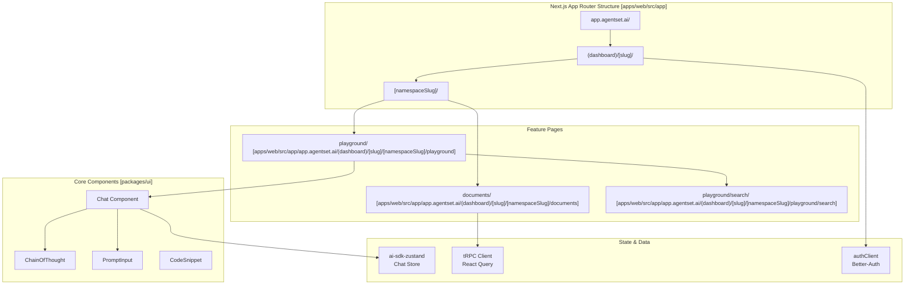

<!-- source: DeepWiki mcp.deepwiki.com · repo agentset-ai/agentset · page 6 Frontend Architecture · fetched 2026-10-27 -->

# Frontend Architecture

Relevant source files

The following files were used as context for generating this wiki page:

- [apps/web/src/app/app.agentset.ai/(dashboard)/[slug]/[namespaceSlug]/page.client.tsx](apps/web/src/app/app.agentset.ai/(dashboard)/[slug]/[namespaceSlug]/page.client.tsx)
- [apps/web/src/app/app.agentset.ai/(dashboard)/[slug]/[namespaceSlug]/playground/chat-actions.tsx](apps/web/src/app/app.agentset.ai/(dashboard)/[slug]/[namespaceSlug]/playground/chat-actions.tsx)
- [apps/web/src/app/app.agentset.ai/(dashboard)/[slug]/[namespaceSlug]/playground/search/page.client.tsx](apps/web/src/app/app.agentset.ai/(dashboard)/[slug]/[namespaceSlug]/playground/search/page.client.tsx)
- [apps/web/src/app/app.agentset.ai/(dashboard)/[slug]/[namespaceSlug]/playground/search/page.tsx](apps/web/src/app/app.agentset.ai/(dashboard)/[slug]/[namespaceSlug]/playground/search/page.tsx)
- [apps/web/src/components/app-sidebar/index.tsx](apps/web/src/components/app-sidebar/index.tsx)
- [apps/web/src/components/app-sidebar/links.ts](apps/web/src/components/app-sidebar/links.ts)
- [apps/web/src/components/app-sidebar/nav-items.tsx](apps/web/src/components/app-sidebar/nav-items.tsx)
- [apps/web/src/components/chat/message-status.tsx](apps/web/src/components/chat/message-status.tsx)
- [apps/web/src/styles/globals.css](apps/web/src/styles/globals.css)
- [packages/ui/src/components/ai-elements/chain-of-thought.tsx](packages/ui/src/components/ai-elements/chain-of-thought.tsx)
- [packages/ui/src/components/ai-elements/prompt-input.tsx](packages/ui/src/components/ai-elements/prompt-input.tsx)
- [packages/ui/src/components/ai-elements/shimmer.tsx](packages/ui/src/components/ai-elements/shimmer.tsx)
- [packages/ui/src/components/ai-elements/snippet.tsx](packages/ui/src/components/ai-elements/snippet.tsx)
- [packages/ui/src/components/ui/skeleton.tsx](packages/ui/src/components/ui/skeleton.tsx)

This page documents the frontend architecture of the AgentSet web application, including the Next.js App Router structure, state management patterns, and key user interface components. The frontend is built using Next.js with React 19 and follows a component-based architecture organized into dashboard, playground, and document management systems.

## Overview

The AgentSet frontend is organized around three main feature areas, supported by a shared component library in `packages/ui`.

| Feature Area | Purpose | Key Components |
|-------------|---------|----------------|
| **Chat Interface** | Interactive conversation with RAG system | `Chat`, `MessageStatus`, `ChainOfThought`, `PromptInput` |
| **Playground** | Testing and configuration tools | `ChatActions`, `ChatSettings`, `ApiDialog`, `ChunkExplorerPageClient` |
| **Document Management** | Upload, monitor, and manage documents | `JobsPageClient`, `PaginatedTable`, `IngestModal` |

The application follows Next.js App Router conventions with hierarchical context providers for organization and namespace scope.

**Diagram: Frontend Architecture Overview**

Sources: [apps/web/src/app/app.agentset.ai/(dashboard)/[slug]/[namespaceSlug]/playground/search/page.tsx:1-12](), [apps/web/src/components/app-sidebar/links.ts:38-137](), [packages/ui/src/components/ai-elements/chain-of-thought.tsx:44-72]()

## Application Navigation and Layout

### Sidebar and Routing
The application uses a dynamic sidebar that shifts context based on the current URL path. The `AppSidebar` component identifies the `activeArea` (profile, namespace, or dashboard) to render relevant navigation items [apps/web/src/components/app-sidebar/index.tsx:32-36]().

- **Dashboard Items**: Organization-level links like Team, Webhooks, and Billing [apps/web/src/components/app-sidebar/links.ts:38-80]().
- **Namespace Items**: Resource-specific links like Documents, Connectors, and Playground [apps/web/src/components/app-sidebar/links.ts:82-137]().

### Styling System
The UI is styled using Tailwind CSS with a customized Shadcn UI theme defined in OKLCH color space for better accessibility and dark mode support [apps/web/src/styles/globals.css:10-81]().

Sources: [apps/web/src/components/app-sidebar/index.tsx:28-76](), [apps/web/src/components/app-sidebar/links.ts:1-167](), [apps/web/src/styles/globals.css:1-143]()

## State Management

The frontend employs a decentralized state management approach:

| State Type | Technology | Purpose |
|-----------|-----------|---------|
| **Chat Messages** | `ai-sdk-zustand` | Message history, streaming state, and UI parts management [apps/web/src/app/app.agentset.ai/(dashboard)/[slug]/[namespaceSlug]/playground/chat-actions.tsx:20-25](). |
| **Server Data** | React Query (via tRPC) | API data fetching for documents, search results, and namespace stats [apps/web/src/app/app.agentset.ai/(dashboard)/[slug]/[namespaceSlug]/playground/search/page.client.tsx:43-59](). |
| **Authentication** | `authClient` | Managing user sessions and active organization context [apps/web/src/components/app-sidebar/index.tsx:79](). |

### Playground Search and Explorer
The Search Playground (`ChunkExplorerPageClient`) demonstrates the integration of tRPC with React Query. It allows users to test retrieval parameters like `topK`, `rerank`, and `rerankModel` in real-time [apps/web/src/app/app.agentset.ai/(dashboard)/[slug]/[namespaceSlug]/playground/search/page.client.tsx:32-59]().

Sources: [apps/web/src/app/app.agentset.ai/(dashboard)/[slug]/[namespaceSlug]/playground/chat-actions.tsx:1-82](), [apps/web/src/app/app.agentset.ai/(dashboard)/[slug]/[namespaceSlug]/playground/search/page.client.tsx:31-73](), [apps/web/src/components/app-sidebar/index.tsx:78-91]()

## Shared AI Components

AgentSet uses a specialized set of UI components designed for AI interactions, located in `packages/ui/src/components/ai-elements`.

### Chain of Thought (CoT)
The `ChainOfThought` component handles the display of internal reasoning steps and search queries. It uses a collapsible interface with a `Shimmer` effect to indicate active processing [packages/ui/src/components/ai-elements/chain-of-thought.tsx:82-114]().

### Message Status
The `MessageStatus` component maps internal data parts (like `generating-queries` or `searching`) to user-friendly labels and icons within the `ChainOfThought` display [apps/web/src/components/chat/message-status.tsx:19-32]().

### Prompt Input
The `PromptInput` system is a sophisticated multi-modal input handler. It supports:
- Text input with auto-expanding textarea.
- File attachments with blob URL management and cleanup [packages/ui/src/components/ai-elements/prompt-input.tsx:176-239]().
- Command-style menus for specialized actions.

Sources: [packages/ui/src/components/ai-elements/chain-of-thought.tsx:1-233](), [apps/web/src/components/chat/message-status.tsx:1-81](), [packages/ui/src/components/ai-elements/prompt-input.tsx:100-260]()

## Child Pages

For detailed documentation on specific frontend systems, refer to the following pages:

- **[Document Management UI](#6.1)**: Details on the documents dashboard, job tracking, and paginated tables.
- **[Ingestion Modal System](#6.2)**: Architecture of the multi-source ingestion forms (Files, Crawl, YouTube).
- **[Namespace and Demo System](#6.3)**: Documentation on the namespace creation wizard and playground templates.
- **[Chat UI Components](#6.4)**: Deep dive into message rendering, citations, and the shared chat component library.

Sources: [apps/web/src/app/app.agentset.ai/(dashboard)/[slug]/[namespaceSlug]/page.client.tsx:88-172](), [apps/web/src/app/app.agentset.ai/(dashboard)/[slug]/[namespaceSlug]/playground/chat-actions.tsx:51-78]()

---

