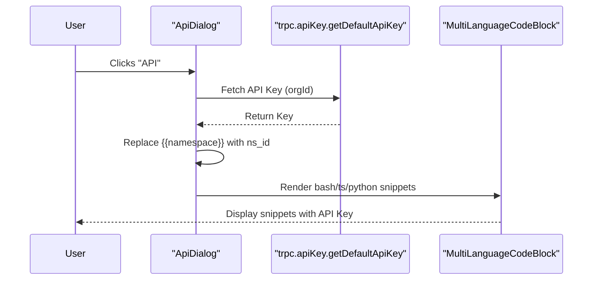

<!-- source: DeepWiki mcp.deepwiki.com · repo agentset-ai/agentset · page 6.1 Document Management UI · fetched 2026-10-27 -->

# Document Management UI

<details>
<summary>Relevant source files</summary>

The following files were used as context for generating this wiki page:

- [apps/web/src/app/app.agentset.ai/(dashboard)/[slug]/[namespaceSlug]/documents/actions.tsx](apps/web/src/app/app.agentset.ai/(dashboard)/[slug]/[namespaceSlug]/documents/actions.tsx)
- [apps/web/src/app/app.agentset.ai/(dashboard)/[slug]/[namespaceSlug]/documents/api-ingest-modal.tsx](apps/web/src/app/app.agentset.ai/(dashboard)/[slug]/[namespaceSlug]/documents/api-ingest-modal.tsx)
- [apps/web/src/app/app.agentset.ai/(dashboard)/[slug]/[namespaceSlug]/documents/columns.tsx](apps/web/src/app/app.agentset.ai/(dashboard)/[slug]/[namespaceSlug]/documents/columns.tsx)
- [apps/web/src/app/app.agentset.ai/(dashboard)/[slug]/[namespaceSlug]/documents/config-modal.tsx](apps/web/src/app/app.agentset.ai/(dashboard)/[slug]/[namespaceSlug]/documents/config-modal.tsx)
- [apps/web/src/app/app.agentset.ai/(dashboard)/[slug]/[namespaceSlug]/documents/document-actions.tsx](apps/web/src/app/app.agentset.ai/(dashboard)/[slug]/[namespaceSlug]/documents/document-actions.tsx)
- [apps/web/src/app/app.agentset.ai/(dashboard)/[slug]/[namespaceSlug]/documents/document-size-tooltip.tsx](apps/web/src/app/app.agentset.ai/(dashboard)/[slug]/[namespaceSlug]/documents/document-size-tooltip.tsx)
- [apps/web/src/app/app.agentset.ai/(dashboard)/[slug]/[namespaceSlug]/documents/documents-columns.tsx](apps/web/src/app/app.agentset.ai/(dashboard)/[slug]/[namespaceSlug]/documents/documents-columns.tsx)
- [apps/web/src/app/app.agentset.ai/(dashboard)/[slug]/[namespaceSlug]/documents/ingest-modal/use-ingest.ts](apps/web/src/app/app.agentset.ai/(dashboard)/[slug]/[namespaceSlug]/documents/ingest-modal/use-ingest.ts)
- [apps/web/src/app/app.agentset.ai/(dashboard)/[slug]/[namespaceSlug]/documents/page.client.tsx](apps/web/src/app/app.agentset.ai/(dashboard)/[slug]/[namespaceSlug]/documents/page.client.tsx)
- [apps/web/src/app/app.agentset.ai/(dashboard)/[slug]/[namespaceSlug]/documents/page.tsx](apps/web/src/app/app.agentset.ai/(dashboard)/[slug]/[namespaceSlug]/documents/page.tsx)
- [apps/web/src/app/app.agentset.ai/(dashboard)/[slug]/[namespaceSlug]/documents/paginated-table-header.tsx](apps/web/src/app/app.agentset.ai/(dashboard)/[slug]/[namespaceSlug]/documents/paginated-table-header.tsx)
- [apps/web/src/app/app.agentset.ai/(dashboard)/[slug]/[namespaceSlug]/documents/paginated-table.tsx](apps/web/src/app/app.agentset.ai/(dashboard)/[slug]/[namespaceSlug]/documents/paginated-table.tsx)
- [apps/web/src/app/app.agentset.ai/(dashboard)/[slug]/[namespaceSlug]/documents/use-documents.ts](apps/web/src/app/app.agentset.ai/(dashboard)/[slug]/[namespaceSlug]/documents/use-documents.ts)
- [apps/web/src/app/app.agentset.ai/(dashboard)/[slug]/[namespaceSlug]/documents/use-jobs.ts](apps/web/src/app/app.agentset.ai/(dashboard)/[slug]/[namespaceSlug]/documents/use-jobs.ts)
- [apps/web/src/app/app.agentset.ai/(dashboard)/[slug]/[namespaceSlug]/documents/use-pending-jobs.ts](apps/web/src/app/app.agentset.ai/(dashboard)/[slug]/[namespaceSlug]/documents/use-pending-jobs.ts)
- [apps/web/src/app/app.agentset.ai/(dashboard)/[slug]/[namespaceSlug]/playground/api-dialog.tsx](apps/web/src/app/app.agentset.ai/(dashboard)/[slug]/[namespaceSlug]/playground/api-dialog.tsx)
- [apps/web/src/lib/code-examples/playground.ts](apps/web/src/lib/code-examples/playground.ts)
- [apps/web/src/lib/cursor.ts](apps/web/src/lib/cursor.ts)
- [apps/web/src/openapi/responses.ts](apps/web/src/openapi/responses.ts)
- [apps/web/src/server/api/routers/documents.ts](apps/web/src/server/api/routers/documents.ts)
- [packages/engine/src/index.ts](packages/engine/src/index.ts)
- [packages/engine/src/partition/index.ts](packages/engine/src/partition/index.ts)
- [packages/engine/src/partition/types.ts](packages/engine/src/partition/types.ts)
- [packages/ui/src/components/timestamp-tooltip.tsx](packages/ui/src/components/timestamp-tooltip.tsx)
- [packages/ui/src/components/ui/data-table.tsx](packages/ui/src/components/ui/data-table.tsx)
- [packages/utils/src/format.ts](packages/utils/src/format.ts)
- [packages/validation/src/document-payload/index.ts](packages/validation/src/document-payload/index.ts)
- [packages/validation/src/ingest-payload/config.ts](packages/validation/src/ingest-payload/config.ts)

</details>


## Purpose and Scope

The Document Management UI provides the primary interface for managing the ingestion lifecycle and processed data within a namespace. Located at the `/documents` route, it features a dual-tabbed interface for monitoring high-level **Ingest Jobs** and granular **Documents**. The UI provides real-time status tracking, multi-select filtering, paginated data tables, and administrative actions like re-ingestion and deletion.

For background processing details, see [Document Processing]() and [Background Job Processing](). For the upload interface, see [Ingestion Modal System]().

---

## Page Architecture

The Document Management UI is a client-side interactive dashboard built with Next.js, utilizing tRPC for data fetching and TanStack Table for data representation.

### Component Hierarchy

```mermaid
graph TD
    "DocumentsPage[page.tsx]" --> "DashboardPageWrapper"
    "DashboardPageWrapper" --> "JobsPageClient[page.client.tsx]"
    "JobsPageClient" --> "Tabs[Tabs]"
    
    "Tabs" --> "TabsList"
    "TabsList" --> "DocsTrigger[Documents Tab]"
    "TabsList" --> "JobsTrigger[Jobs Tab]"
    
    "Tabs" --> "JobsContent[TabsContent: jobs]"
    "JobsContent" --> "JobsHeader[PaginatedTableHeader]"
    "JobsContent" --> "JobsTable[PaginatedTable]"
    "JobsTable" --> "JobActions[JobActions]"
    "JobsTable" --> "ConfigModal[ConfigModal]"
    "JobsContent" --> "DocsDialog[DocumentsDialog]"
    
    "Tabs" --> "DocsContent[TabsContent: documents]"
    "DocsContent" --> "DocsHeader[PaginatedTableHeader]"
    "DocsContent" --> "DocsTable[PaginatedTable]"
    "DocsTable" --> "DocActions[DocumentActions]"
    "DocsTable" --> "ChunksDrawer[ChunksDrawer]"
    "DocsContent" --> "PendingAlert[Alert: Pending Jobs]"
```

**Sources:** [apps/web/src/app/app.agentset.ai/(dashboard)/[slug]/[namespaceSlug]/documents/page.client.tsx:27-148](), [apps/web/src/app/app.agentset.ai/(dashboard)/[slug]/[namespaceSlug]/documents/page.tsx:7-19]()

### Core Components

| Component | File | Responsibility |
| :--- | :--- | :--- |
| `JobsPageClient` | `page.client.tsx` | Main entry point; manages tab state (`jobs` vs `documents`). |
| `PaginatedTable` | `paginated-table.tsx` | Generic wrapper for `DataTable` with cursor-based navigation. |
| `PaginatedTableHeader` | `paginated-table-header.tsx` | Contains status filters and manual refresh controls. |
| `DocumentsDialog` | `page.client.tsx` | A modal triggered from the Jobs tab to view documents belonging to a specific job. |
| `JobActions` / `DocumentActions` | `actions.tsx` / `document-actions.tsx` | Dropdown menus for Copy ID, Re-ingest, Download, and Delete. |

**Sources:** [apps/web/src/app/app.agentset.ai/(dashboard)/[slug]/[namespaceSlug]/documents/page.client.tsx:27-63](), [apps/web/src/app/app.agentset.ai/(dashboard)/[slug]/[namespaceSlug]/documents/document-actions.tsx:29-149]()

---

## State and Data Flow

The UI uses a hook-based architecture to sync client state with the PostgreSQL database via tRPC.

### Data Fetching Hooks

The UI implements two primary hooks for data synchronization: `useJobs` and `useDocuments`. Both utilize `useCursorPagination` for opaque cursor-based navigation.

```mermaid
graph LR
    subgraph "Client State"
        "useJobs" -- "statuses[]" --> "trpc.ingestJob.all"
        "useDocuments" -- "statuses[]" --> "trpc.document.all"
    end
    
    subgraph "Server Logic"
        "trpc.ingestJob.all" -- "Prisma" --> "DB_IngestJob"
        "trpc.document.all" -- "Prisma" --> "DB_Document"
    end
    
    "useJobs" -- "refetchInterval: 15s" --> "trpc.ingestJob.all"
    "useDocuments" -- "refetchInterval: 15s" --> "trpc.document.all"
```

**Sources:** [apps/web/src/app/app.agentset.ai/(dashboard)/[slug]/[namespaceSlug]/documents/use-jobs.ts:29-43](), [apps/web/src/app/app.agentset.ai/(dashboard)/[slug]/[namespaceSlug]/documents/use-documents.ts:28-43]()

### Pagination and Filtering

- **Cursor-based Pagination**: Uses `useCursorPagination` to handle `forward` and `backward` navigation. Cursors are encoded as `id:timestamp` strings. [apps/web/src/lib/cursor.ts:17-20]()
- **Status Filtering**: Both hooks maintain a `statuses` array. Changing filters triggers a `reset()` of the pagination cursor to return to the first page. [apps/web/src/app/app.agentset.ai/(dashboard)/[slug]/[namespaceSlug]/documents/use-jobs.ts:45-48]()
- **Auto-Refresh**: Queries use a 15-second `refetchInterval` to provide near real-time updates on background processing progress. [apps/web/src/app/app.agentset.ai/(dashboard)/[slug]/[namespaceSlug]/documents/use-jobs.ts:39]()

---

## Jobs Management

The Jobs tab focuses on the high-level ingestion request. An `IngestJob` can contain multiple documents (e.g., a multi-file upload or a web crawl).

### Jobs Table Columns
The `columns.tsx` file defines how job data is rendered:
- **Expand**: Triggers `setExpandedJobId` to open the `DocumentsDialog`. [apps/web/src/app/app.agentset.ai/(dashboard)/[slug]/[namespaceSlug]/documents/columns.tsx:54-83]()
- **Status**: Maps `IngestJobStatus` to themed badges (e.g., `COMPLETED` -> `Ready`). [apps/web/src/app/app.agentset.ai/(dashboard)/[slug]/[namespaceSlug]/documents/columns.tsx:101-121]()
- **Duration**: Calculates time elapsed between `queuedAt` and `completedAt`/`failedAt`. [apps/web/src/app/app.agentset.ai/(dashboard)/[slug]/[namespaceSlug]/documents/columns.tsx:159-171]()
- **Config**: Opens `ConfigModal` to view the specific parser settings used for that job. [apps/web/src/app/app.agentset.ai/(dashboard)/[slug]/[namespaceSlug]/documents/columns.tsx:173-178]()

### Job Actions
Implemented in `JobActions`, users can:
1. **Re-ingest**: Calls `trpc.ingestJob.reIngest` to restart the processing pipeline for the job's payload. [apps/web/src/app/app.agentset.ai/(dashboard)/[slug]/[namespaceSlug]/documents/actions.tsx:50-64]()
2. **Delete**: Calls `trpc.ingestJob.delete`. This is a destructive action that removes the job record and all child documents from the vector store. [apps/web/src/app/app.agentset.ai/(dashboard)/[slug]/[namespaceSlug]/documents/actions.tsx:33-48]()

**Sources:** [apps/web/src/app/app.agentset.ai/(dashboard)/[slug]/[namespaceSlug]/documents/columns.tsx:53-183](), [apps/web/src/app/app.agentset.ai/(dashboard)/[slug]/[namespaceSlug]/documents/actions.tsx:27-131]()

---

## Document Management

The Documents tab (and the `DocumentsDialog` within the Jobs tab) provides granular control over individual files and text blobs.

### Document Columns
Defined in `documents-columns.tsx`:
- **Type Icon**: Displays icons based on `mimeType` (e.g., `BookTextIcon` for PDFs, `GlobeIcon` for crawled pages). [apps/web/src/app/app.agentset.ai/(dashboard)/[slug]/[namespaceSlug]/documents/documents-columns.tsx:44-78]()
- **Size Metrics**: Displays Page, Token, Character, and Chunk counts using `DocumentSizeTooltip`. [apps/web/src/app/app.agentset.ai/(dashboard)/[slug]/[namespaceSlug]/documents/documents-columns.tsx:157-174]()
- **Chunks**: The "View" button opens `ChunksDrawer` to inspect the actual text partitions stored in the vector database. [apps/web/src/app/app.agentset.ai/(dashboard)/[slug]/[namespaceSlug]/documents/documents-columns.tsx:207-234]()

### Document Actions
Implemented in `DocumentActions`:
- **Download**: For `MANAGED_FILE` sources, generates a presigned S3 URL via `trpc.document.getFileDownloadUrl`. [apps/web/src/app/app.agentset.ai/(dashboard)/[slug]/[namespaceSlug]/documents/document-actions.tsx:57-66]()
- **Open File**: For external `FILE` sources, opens the direct `fileUrl`. [apps/web/src/app/app.agentset.ai/(dashboard)/[slug]/[namespaceSlug]/documents/document-actions.tsx:118-125]()
- **Delete**: Calls `trpc.document.delete`, which queues the document for removal from both PostgreSQL and the vector store. [apps/web/src/app/app.agentset.ai/(dashboard)/[slug]/[namespaceSlug]/documents/document-actions.tsx:35-55]()

**Sources:** [apps/web/src/app/app.agentset.ai/(dashboard)/[slug]/[namespaceSlug]/documents/documents-columns.tsx:102-239](), [apps/web/src/app/app.agentset.ai/(dashboard)/[slug]/[namespaceSlug]/documents/document-actions.tsx:29-149]()

---

## API Ingestion Modal

The `ApiIngestModal` (and the underlying `ApiDialog`) provides developers with ready-to-use code snippets for integrating ingestion into their own applications.

### Implementation Detail
The component fetches the organization's default API key and replaces placeholders in template strings.



**Sources:** [apps/web/src/app/app.agentset.ai/(dashboard)/[slug]/[namespaceSlug]/playground/api-dialog.tsx:38-50](), [apps/web/src/app/app.agentset.ai/(dashboard)/[slug]/[namespaceSlug]/documents/api-ingest-modal.tsx:14-45]()

---

## Configuration Management

Documents and Jobs store parser configuration in a `config` JSON field. The `getPartitionDocumentBody` utility in the engine merges job-level and document-level configurations before sending them to the partitioning service.

### Configuration Merging Logic
1. **Metadata**: Document-level metadata overrides job-level metadata. [packages/engine/src/partition/index.ts:78-86]()
2. **Parser Options**: Merges settings like `mode` (fast/balanced/accurate), `chunkSize`, and `languageCode`. [packages/engine/src/partition/index.ts:88-113]()

### Validation Schema
The `baseConfigSchema` defines the allowed parameters:
- `chunkSize`: Integer (min 32).
- `mode`: Enum (`fast`, `balanced`, `accurate`).
- `chartUnderstanding`: Boolean for enabling OCR on charts.

**Sources:** [packages/engine/src/partition/index.ts:25-119](), [packages/validation/src/ingest-payload/config.ts:5-64]()

---

