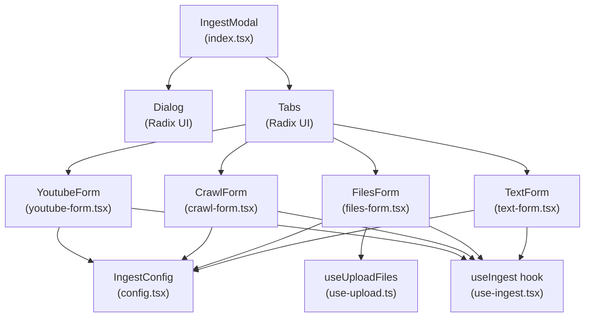
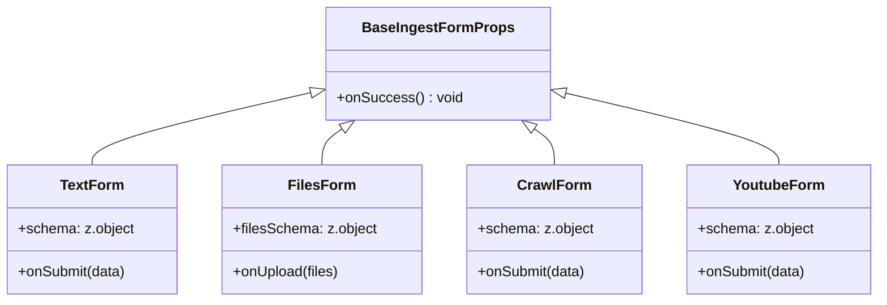
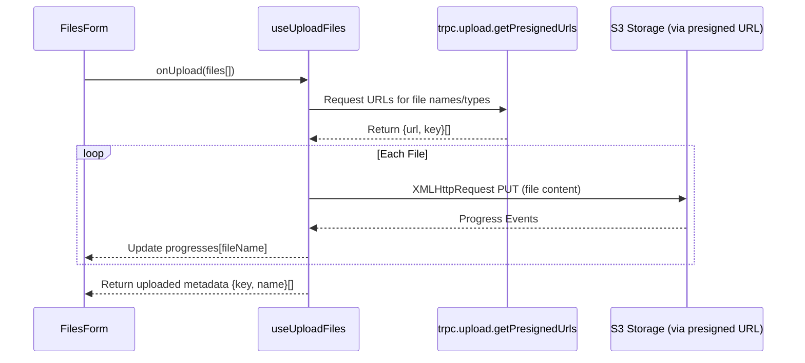

<!-- source: DeepWiki mcp.deepwiki.com · repo agentset-ai/agentset · page 6.2 Ingestion Modal System · fetched 2026-10-27 -->

# Ingestion Modal System

Relevant source files

The following files were used as context for generating this wiki page:

- [apps/web/scripts/migrate-azure-config.ts](apps/web/scripts/migrate-azure-config.ts)
- [apps/web/src/app/api/(public-api)/v1/namespace/[namespaceId]/uploads/batch/route.ts](apps/web/src/app/api/(public-api)/v1/namespace/[namespaceId]/uploads/batch/route.ts)
- [apps/web/src/app/api/(public-api)/v1/namespace/[namespaceId]/uploads/route.ts](apps/web/src/app/api/(public-api)/v1/namespace/[namespaceId]/uploads/route.ts)
- [apps/web/src/app/app.agentset.ai/(dashboard)/[slug]/[namespaceSlug]/documents/ingest-modal/config.tsx](apps/web/src/app/app.agentset.ai/(dashboard)/[slug]/[namespaceSlug]/documents/ingest-modal/config.tsx)
- [apps/web/src/app/app.agentset.ai/(dashboard)/[slug]/[namespaceSlug]/documents/ingest-modal/crawl-form.tsx](apps/web/src/app/app.agentset.ai/(dashboard)/[slug]/[namespaceSlug]/documents/ingest-modal/crawl-form.tsx)
- [apps/web/src/app/app.agentset.ai/(dashboard)/[slug]/[namespaceSlug]/documents/ingest-modal/files-form.tsx](apps/web/src/app/app.agentset.ai/(dashboard)/[slug]/[namespaceSlug]/documents/ingest-modal/files-form.tsx)
- [apps/web/src/app/app.agentset.ai/(dashboard)/[slug]/[namespaceSlug]/documents/ingest-modal/index.tsx](apps/web/src/app/app.agentset.ai/(dashboard)/[slug]/[namespaceSlug]/documents/ingest-modal/index.tsx)
- [apps/web/src/app/app.agentset.ai/(dashboard)/[slug]/[namespaceSlug]/documents/ingest-modal/shared.tsx](apps/web/src/app/app.agentset.ai/(dashboard)/[slug]/[namespaceSlug]/documents/ingest-modal/shared.tsx)
- [apps/web/src/app/app.agentset.ai/(dashboard)/[slug]/[namespaceSlug]/documents/ingest-modal/text-form.tsx](apps/web/src/app/app.agentset.ai/(dashboard)/[slug]/[namespaceSlug]/documents/ingest-modal/text-form.tsx)
- [apps/web/src/app/app.agentset.ai/(dashboard)/[slug]/[namespaceSlug]/documents/ingest-modal/youtube-form.tsx](apps/web/src/app/app.agentset.ai/(dashboard)/[slug]/[namespaceSlug]/documents/ingest-modal/youtube-form.tsx)
- [apps/web/src/components/create-namespace/models.ts](apps/web/src/components/create-namespace/models.ts)
- [apps/web/src/hooks/use-upload.ts](apps/web/src/hooks/use-upload.ts)
- [apps/web/src/lib/api/tenant.ts](apps/web/src/lib/api/tenant.ts)
- [apps/web/src/lib/file-types.ts](apps/web/src/lib/file-types.ts)
- [apps/web/src/openapi/v1/utils.ts](apps/web/src/openapi/v1/utils.ts)
- [apps/web/src/schemas/api/upload.ts](apps/web/src/schemas/api/upload.ts)
- [apps/web/src/schemas/chat.ts](apps/web/src/schemas/chat.ts)
- [apps/web/src/server/api/routers/uploads.ts](apps/web/src/server/api/routers/uploads.ts)
- [apps/web/src/services/uploads.ts](apps/web/src/services/uploads.ts)
- [packages/ui/src/icons/turbopuffer.tsx](packages/ui/src/icons/turbopuffer.tsx)
- [packages/validation/src/vector-store/index.ts](packages/validation/src/vector-store/index.ts)

The Ingestion Modal System is the frontend interface for creating document ingestion jobs. It provides a tabbed dialog with four distinct ingestion methods (files, text, website crawl, YouTube) and a shared configuration system for customizing chunking, metadata, and processing options.

This page covers the modal UI architecture, form validation, file upload handling, and configuration extraction.

---

## Modal Architecture

The ingestion modal is implemented as a `Dialog` component with a `Tabs` interface, allowing users to switch between ingestion types without closing the modal.

### Component Hierarchy

**Sources**: [apps/web/src/app/app.agentset.ai/(dashboard)/[slug]/[namespaceSlug]/documents/ingest-modal/index.tsx:28-40](), [apps/web/src/app/app.agentset.ai/(dashboard)/[slug]/[namespaceSlug]/documents/ingest-modal/config.tsx:76-80]()

### IngestModal Component

The `IngestModal` component manages the high-level state of the ingestion flow:

| Responsibility | Implementation |
|---------------|----------------|
| Modal visibility | `useState` for `isOpen` [index.tsx:43]() |
| Tab state | `useState` for `activeTab` [index.tsx:44-45]() |
| Success handling | `handleSuccess` callback invalidates `trpc.ingestJob.all` and shows toast [index.tsx:51-57]() |
| Usage limits | Disables button if `isFreePlan` and `totalPages >= pagesLimit` [index.tsx:62-64]() |
| Mutation tracking | Prevents closing modal if `queryClient.isMutating` is active [index.tsx:59-60]() |

The modal uses a declarative configuration for its tabs:
- **Files**: `FilesForm` [index.tsx:29]()
- **Text**: `TextForm` [index.tsx:30]()
- **Website**: `CrawlForm` [index.tsx:31]()
- **YouTube**: `YoutubeForm` [index.tsx:32]()

**Sources**: [apps/web/src/app/app.agentset.ai/(dashboard)/[slug]/[namespaceSlug]/documents/ingest-modal/index.tsx:28-64]()

---

## Form Types and Validation

Each form is built using `react-hook-form` via the `useZodForm` hook, extending a base `configSchema` from `@agentset/validation`.

### Form Pattern Mapping

### TextForm
Used for raw text ingestion. It requires a minimum of 10 characters [text-form.tsx:26](). It sends a `TEXT` payload containing the raw string [text-form.tsx:44-48]().

### FilesForm
Handles both local file uploads and remote file URLs. 
- **Upload Mode**: Uses `useUploadFiles` to get presigned URLs and perform `PUT` requests to S3 [use-upload.ts:57-85]().
- **Remote Mode**: Accepts an array of URLs [files-form.tsx:48]().
- **Validation**: Includes a `superRefine` to ensure at least one file/URL is provided based on the selected `sourceType` [files-form.tsx:51-79]().

### CrawlForm
Configures web crawling.
- **Parameters**: `maxDepth` (default 5), `limit` (default 50), `includePaths`, and `excludePaths` [crawl-form.tsx:26-38]().
- **Headers**: Supports custom request headers via a JSON textarea [crawl-form.tsx:226-233]().

### YoutubeForm
Ingests video transcripts.
- **Validation**: Uses a regex to enforce YouTube hostnames (`www.youtube.com` or `youtu.be`) [youtube-form.tsx:32]().
- **Settings**: Allows selecting `transcriptLanguages` and toggling `includeMetadata` [youtube-form.tsx:37-38]().

**Sources**: [apps/web/src/app/app.agentset.ai/(dashboard)/[slug]/[namespaceSlug]/documents/ingest-modal/text-form.tsx:23-51](), [apps/web/src/app/app.agentset.ai/(dashboard)/[slug]/[namespaceSlug]/documents/ingest-modal/files-form.tsx:41-79](), [apps/web/src/app/app.agentset.ai/(dashboard)/[slug]/[namespaceSlug]/documents/ingest-modal/crawl-form.tsx:31-41](), [apps/web/src/app/app.agentset.ai/(dashboard)/[slug]/[namespaceSlug]/documents/ingest-modal/youtube-form.tsx:26-40]()

---

## IngestConfig and Shared Components

The `IngestConfig` component provides a unified interface for advanced processing settings across all forms.

### Shared Logic: extractConfig
The `extractConfig` function in `shared.tsx` filters out default values before sending the payload to the API. It only includes values that differ from defaults (e.g., `chunkSize !== 2048`) to keep the request payload lean [shared.tsx:20-47]().

### Configuration Options
| Field | UI Component | Description |
|-------|--------------|-------------|
| `metadata` | `Textarea` | JSON input for custom document metadata [config.tsx:91-122]() |
| `chunkSize` | `Input` | Token size for text splitting (default 2048) [config.tsx:124-144]() |
| `languageCode` | `Select` | Explicit language selection for extraction [config.tsx:148-176]() |
| `mode` | `RadioGroup` | Processing depth: `fast`, `balanced`, or `accurate` [files-form.tsx:125-151]() |

### DynamicArrayField
A reusable component for managing list-based inputs (like URLs or path prefixes). It uses `form.watch` to track the array state and provides `addItem` and `removeItem` functions to modify the form state [shared.tsx:60-135]().

**Sources**: [apps/web/src/app/app.agentset.ai/(dashboard)/[slug]/[namespaceSlug]/documents/ingest-modal/config.tsx:84-213](), [apps/web/src/app/app.agentset.ai/(dashboard)/[slug]/[namespaceSlug]/documents/ingest-modal/shared.tsx:19-135]()

---

## File Upload Handling

The system uses a two-step process for file uploads: presigning and direct S3 upload.

### Upload Data Flow

### Technical Implementation
1. **Validation**: The `uploadFileSchema` ensures file extensions and MIME types are supported and that the size does not exceed `MAX_UPLOAD_SIZE` [schemas/api/upload.ts:9-43]().
2. **Presigning**: `createUpload` (server-side) generates a storage key in the format `namespaces/${namespaceId}/${filename}${ext}` and returns a presigned URL [services/uploads.ts:39-69]().
3. **Progress Tracking**: `uploadWithProgress` uses the `XMLHttpRequest` `progress` event to update a percent-completed state [use-upload.ts:6-42]().

**Sources**: [apps/web/src/hooks/use-upload.ts:6-102](), [apps/web/src/services/uploads.ts:39-69](), [apps/web/src/schemas/api/upload.ts:9-43]()

---

