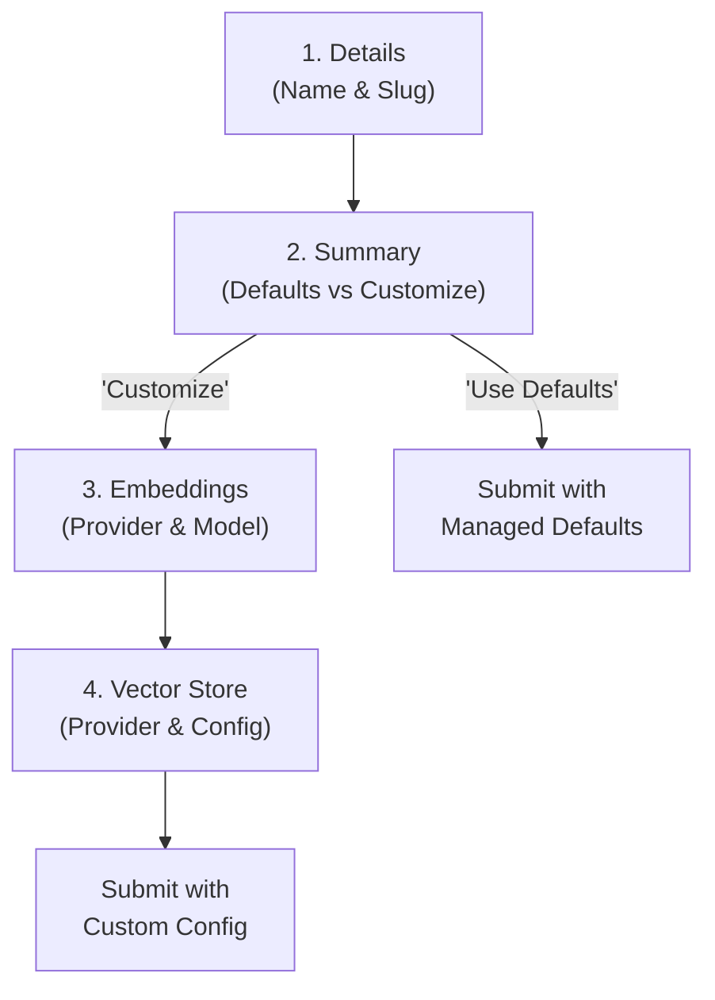
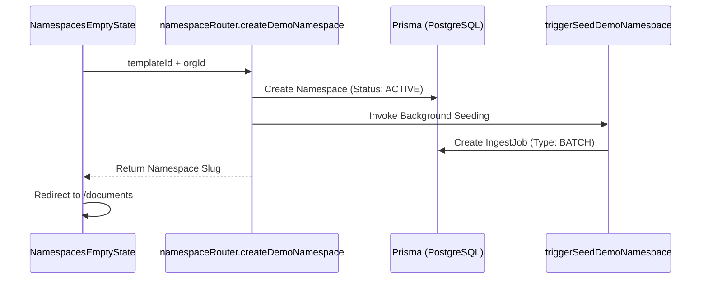
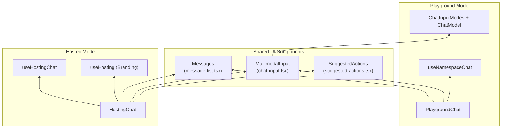

<!-- source: DeepWiki mcp.deepwiki.com · repo agentset-ai/agentset · page 6.3 Namespace and Demo System · fetched 2026-10-27 -->

# Namespace and Demo System

Relevant source files

The following files were used as context for generating this wiki page:

- [apps/web/src/app/app.agentset.ai/(dashboard)/[slug]/[namespaceSlug]/connectors/add-connector.tsx](apps/web/src/app/app.agentset.ai/(dashboard)/[slug]/[namespaceSlug]/connectors/add-connector.tsx)
- [apps/web/src/app/app.agentset.ai/(dashboard)/[slug]/namespaces-empty-state.tsx](apps/web/src/app/app.agentset.ai/(dashboard)/[slug]/namespaces-empty-state.tsx)
- [apps/web/src/app/app.agentset.ai/(dashboard)/[slug]/page.client.tsx](apps/web/src/app/app.agentset.ai/(dashboard)/[slug]/page.client.tsx)
- [apps/web/src/app/app.agentset.ai/(dashboard)/[slug]/settings/page.client.tsx](apps/web/src/app/app.agentset.ai/(dashboard)/[slug]/settings/page.client.tsx)
- [apps/web/src/components/chat/chat-input.tsx](apps/web/src/components/chat/chat-input.tsx)
- [apps/web/src/components/chat/index.tsx](apps/web/src/components/chat/index.tsx)
- [apps/web/src/components/chat/message-actions/index.tsx](apps/web/src/components/chat/message-actions/index.tsx)
- [apps/web/src/components/chat/message-actions/logs.tsx](apps/web/src/components/chat/message-actions/logs.tsx)
- [apps/web/src/components/chat/message.tsx](apps/web/src/components/chat/message.tsx)
- [apps/web/src/components/chat/messages.tsx](apps/web/src/components/chat/messages.tsx)
- [apps/web/src/components/chat/overview.tsx](apps/web/src/components/chat/overview.tsx)
- [apps/web/src/components/chat/suggested-actions.tsx](apps/web/src/components/chat/suggested-actions.tsx)
- [apps/web/src/components/create-namespace/details-step.tsx](apps/web/src/components/create-namespace/details-step.tsx)
- [apps/web/src/components/create-namespace/embedding-step.tsx](apps/web/src/components/create-namespace/embedding-step.tsx)
- [apps/web/src/components/create-namespace/index.tsx](apps/web/src/components/create-namespace/index.tsx)
- [apps/web/src/components/create-namespace/summary-step.tsx](apps/web/src/components/create-namespace/summary-step.tsx)
- [apps/web/src/components/create-namespace/vector-store-step.tsx](apps/web/src/components/create-namespace/vector-store-step.tsx)
- [apps/web/src/components/dashboard-page-wrapper/index.tsx](apps/web/src/components/dashboard-page-wrapper/index.tsx)
- [apps/web/src/hooks/use-zod-form.ts](apps/web/src/hooks/use-zod-form.ts)
- [apps/web/src/server/api/routers/namespaces.ts](apps/web/src/server/api/routers/namespaces.ts)
- [packages/db/prisma/migrations/20260211215619_add_demo_id/migration.sql](packages/db/prisma/migrations/20260211215619_add_demo_id/migration.sql)
- [packages/demo/eslint.config.js](packages/demo/eslint.config.js)
- [packages/demo/package.json](packages/demo/package.json)
- [packages/demo/src/index.ts](packages/demo/src/index.ts)
- [packages/demo/tsconfig.json](packages/demo/tsconfig.json)
- [packages/ui/src/components/radio-button.tsx](packages/ui/src/components/radio-button.tsx)
- [packages/ui/src/components/ui/separator.tsx](packages/ui/src/components/ui/separator.tsx)

## Purpose and Scope

This document describes the namespace creation and management system in Agentset, including the multi-step creation wizard, demo templates, empty state experiences, and the dual-mode chat interface (Playground vs. Hosted). Namespaces serve as isolated data containers within an organization, each with its own configuration for embeddings, vector stores, documents, and chat interfaces.

The namespace system is implemented across multiple layers:
- **API Router**: `namespaceRouter` handles CRUD and demo seeding [apps/web/src/server/api/routers/namespaces.ts:50-194]().
- **Creation Wizard**: `CreateNamespaceDialog` manages the multi-step state machine [apps/web/src/components/create-namespace/index.tsx:56-196]().
- **Demo Templates**: Defined in the `@agentset/demo` package [packages/demo/src/index.ts:5-113]().
- **Chat Interface**: Shared components for Playground and Hosted modes [apps/web/src/components/chat/index.tsx:17-23]().

---

## Namespace Creation Wizard

The namespace creation process uses a multi-step modal (`CreateNamespaceDialog`) that guides users through configuring their data container.

### Creation State Machine

The wizard transitions through four primary states, managed by the `step` state variable [apps/web/src/components/create-namespace/index.tsx:74]().

### Wizard Steps Implementation

1.  **Details Step**: Captures the namespace `name` and auto-generates a `slug` using the `toSlug` utility [apps/web/src/components/create-namespace/details-step.tsx]().
2.  **Summary Step**: Offers a "Quick Start" with managed defaults (Managed OpenAI + Managed Turbopuffer) or allows deep customization [apps/web/src/components/create-namespace/summary-step.tsx]().
3.  **Embedding Step**: Allows selection of providers (OpenAI, Azure, etc.) and specific models. It uses `EmbeddingConfigSchema` for validation [apps/web/src/components/create-namespace/embedding-step.tsx:32-50]().
4.  **Vector Store Step**: Configures the storage backend. Supports `MANAGED_TURBOPUFFER`, `MANAGED_PINECONE`, or self-hosted options with API keys and environment details [apps/web/src/components/create-namespace/vector-store-step.tsx:46-100]().

**Sources:** [apps/web/src/components/create-namespace/index.tsx:26-54](), [apps/web/src/components/create-namespace/embedding-step.tsx:1-106](), [apps/web/src/components/create-namespace/vector-store-step.tsx:1-102]()

---

## Demo Template System

Demo templates allow users to quickly populate a namespace with sample data (PDFs or Markdown) and pre-defined example questions.

### Template Definitions

Templates are stored in `DEMO_TEMPLATES` within the `packages/demo` package. Each template includes an `ingestJob` payload which specifies the source files for seeding [packages/demo/src/index.ts:5-113]().

| Template ID | Target Data Type | Sample Files |
| :--- | :--- | :--- |
| `academic-research` | PDF | Attention is All You Need, BERT paper [packages/demo/src/index.ts:17-34]() |
| `financial-reports` | PDF | NVIDIA 2025 Q1-Q4 Earnings [packages/demo/src/index.ts:47-75]() |
| `technical-documentation` | Markdown | OpenAI API Docs (Chat, Errors, Rate Limits) [packages/demo/src/index.ts:89-111]() |

### Seeding Workflow

When a template is selected, the system executes a background seeding process via Trigger.dev.

**Sources:** [apps/web/src/server/api/routers/namespaces.ts:195-274](), [packages/demo/src/index.ts:122-128]()

---

## Empty States and Dashboard

The dashboard adapts based on whether the organization has existing namespaces.

### NamespacesEmptyState
If `namespaces.length === 0`, the `NamespacesEmptyState` component is rendered [apps/web/src/app/app.agentset.ai/(dashboard)/[slug]/page.client.tsx:87-89](). It features:
- A primary action button to open the `CreateNamespaceDialog`.
- A grid of `TemplateCard` components that trigger the `createDemoNamespace` mutation [apps/web/src/app/app.agentset.ai/(dashboard)/[slug]/namespaces-empty-state.tsx:21-58]().

### Namespace Cards
When namespaces exist, they are displayed in a responsive grid. Each card shows the `totalPages` and `totalDocuments` count [apps/web/src/app/app.agentset.ai/(dashboard)/[slug]/page.client.tsx:93-118]().

**Sources:** [apps/web/src/app/app.agentset.ai/(dashboard)/[slug]/page.client.tsx:66-122](), [apps/web/src/app/app.agentset.ai/(dashboard)/[slug]/namespaces-empty-state.tsx:105-135]()

---

## Chat Interface: Playground vs. Hosted

The chat interface is a unified component (`Chat`) that branches into two distinct modes based on the `type` prop [apps/web/src/components/chat/index.tsx:17-23]().

### Playground Mode
Used by internal team members to test RAG performance and agentic behavior.
- **Hook**: Uses `useNamespaceChat()` [apps/web/src/components/chat/index.tsx:26]().
- **Tools**: Includes `ChatInputModes` (Agentic/Direct/Deep Research) and `ChatModel` selection [apps/web/src/components/chat/chat-input.tsx:75-79]().
- **Logs**: Assistant messages include a "Logs" action to view retrieval metadata [apps/web/src/components/chat/message-actions/index.tsx:63-72]().

### Hosted Mode
The public-facing interface for end-users, typically deployed on custom domains.
- **Hook**: Uses `useHostingChat()` [apps/web/src/components/chat/index.tsx:55]().
- **Branding**: Sourced from `useHosting()` context (logo, welcome message, example questions) [apps/web/src/components/chat/index.tsx:56]().
- **Restrictions**: No model or mode selection tools are visible in the input footer [apps/web/src/components/chat/chat-input.tsx:80-82]().

### Component Architecture

**Sources:** [apps/web/src/components/chat/index.tsx:25-74](), [apps/web/src/components/chat/chat-input.tsx:23-94](), [apps/web/src/components/chat/message-actions/index.tsx:48-74]()

---

## Data Flow: Chat Message Submission

The submission process leverages `ai-sdk-zustand` to manage the message lifecycle and streaming status.

1.  **Input Capture**: `MultimodalInput` captures text and handles the "Stop" functionality if `status === "streaming"` [apps/web/src/components/chat/chat-input.tsx:33-39]().
2.  **Event Logging**: The `chat_message_sent` event is fired via `logEvent` [apps/web/src/components/chat/chat-input.tsx:44-48]().
3.  **Transmission**: `sendMessage()` is invoked with a `user` role and `text` part [apps/web/src/components/chat/chat-input.tsx:50-58]().
4.  **Rendering**: `PreviewMessage` iterates through `message.parts`. It renders `reasoning` parts (chain-of-thought) using `MessageReasoning` and `text` parts using the `Markdown` component [apps/web/src/components/chat/message.tsx:54-106]().
5.  **Actions**: Assistant messages provide `handleCopy`, `handleRegenerate`, and `ExportAction` [apps/web/src/components/chat/message-actions/index.tsx:31-61]().

**Sources:** [apps/web/src/components/chat/chat-input.tsx:1-96](), [apps/web/src/components/chat/message.tsx:18-118](), [apps/web/src/components/chat/message-actions/index.tsx:1-85]()

---

