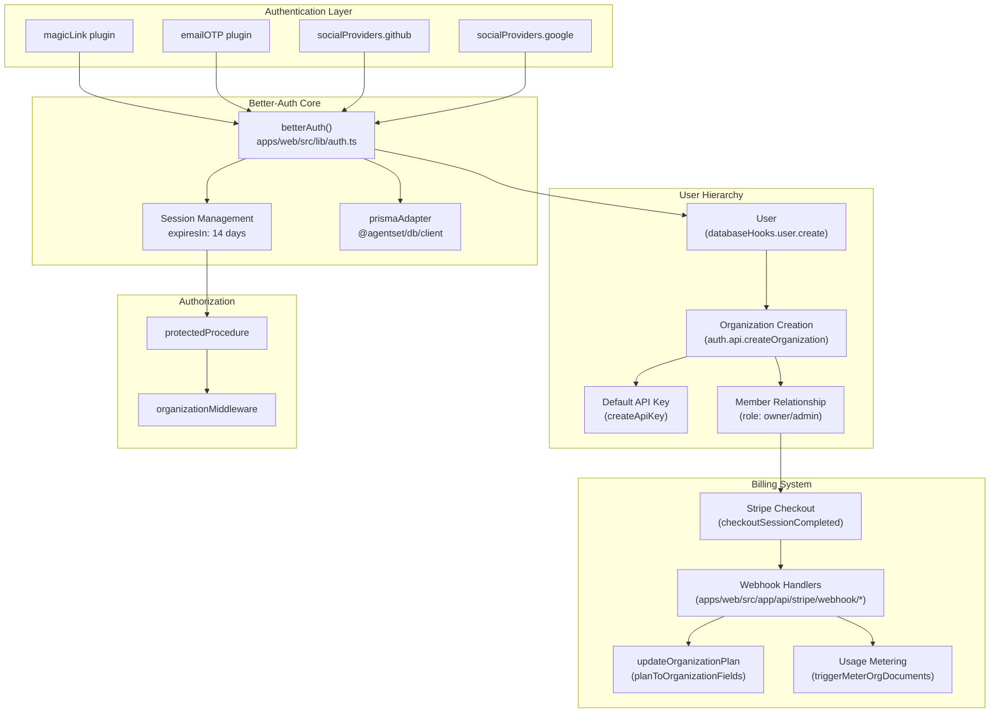
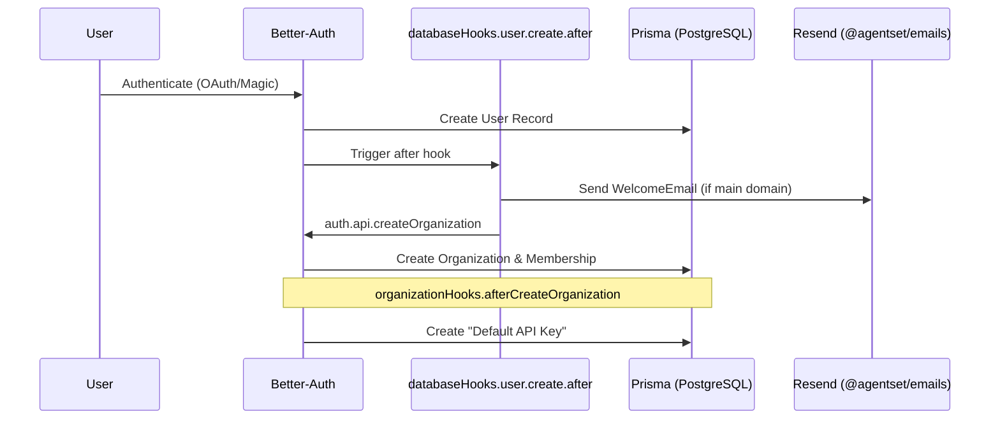

<!-- source: DeepWiki mcp.deepwiki.com · repo agentset-ai/agentset · page 7 Authentication and Billing · fetched 2026-10-27 -->

# Authentication and Billing

Relevant source files

The following files were used as context for generating this wiki page:

- [apps/web/src/app/api/(internal-api)/stripe/webhook/checkout-session-completed.ts](apps/web/src/app/api/(internal-api)/stripe/webhook/checkout-session-completed.ts)
- [apps/web/src/app/api/(internal-api)/stripe/webhook/customer-subscription-deleted.ts](apps/web/src/app/api/(internal-api)/stripe/webhook/customer-subscription-deleted.ts)
- [apps/web/src/app/api/(internal-api)/stripe/webhook/customer-subscription-updated.ts](apps/web/src/app/api/(internal-api)/stripe/webhook/customer-subscription-updated.ts)
- [apps/web/src/app/api/(internal-api)/stripe/webhook/invoice-payment-failed.ts](apps/web/src/app/api/(internal-api)/stripe/webhook/invoice-payment-failed.ts)
- [apps/web/src/app/api/(internal-api)/stripe/webhook/utils.ts](apps/web/src/app/api/(internal-api)/stripe/webhook/utils.ts)
- [apps/web/src/lib/auth.ts](apps/web/src/lib/auth.ts)
- [packages/emails/package.json](packages/emails/package.json)
- [packages/emails/src/index.ts](packages/emails/src/index.ts)
- [packages/emails/src/templates/welcome-email.tsx](packages/emails/src/templates/welcome-email.tsx)
- [packages/stripe/src/functions.ts](packages/stripe/src/functions.ts)
- [packages/stripe/src/plans.ts](packages/stripe/src/plans.ts)

This document covers the authentication and billing systems in AgentSet, including user authentication via magic links and OAuth, the user/organization hierarchy, Stripe billing integration, subscription lifecycle management, and resource limit enforcement. This is an overview of the entire authentication and billing architecture. For detailed information about specific subsystems, see:
- [Authentication System](#7.1) for Better-Auth configuration and user onboarding
- [Billing and Subscriptions](#7.2) for Stripe checkout flow and webhook handlers
- [Authorization and Resource Limits](#7.3) for middleware patterns and limit enforcement

## Architecture Overview

AgentSet implements a passwordless authentication system using Better-Auth with magic links and OAuth providers. The system creates a hierarchical multi-tenant structure where users belong to organizations through membership relationships, and organizations contain namespaces for data isolation. Billing is managed through Stripe with webhook-driven subscription lifecycle management and usage-based metering for the Pro plan.

**Authentication and Billing System Architecture**

Sources: [apps/web/src/lib/auth.ts:27-194](), [apps/web/src/app/api/(internal-api)/stripe/webhook/checkout-session-completed.ts:20-143]()

## Better-Auth Configuration

The authentication system is configured using the `betterAuth` function in `apps/web/src/lib/auth.ts`. The `makeAuth` function handles multi-environment setups, including custom base URLs for hosted chat interfaces.

### Core Configuration

| Configuration | Value | Purpose |
|--------------|-------|---------|
| Database Adapter | `prismaAdapter(db, { provider: "postgresql" })` | Integrates with PostgreSQL via Prisma [apps/web/src/lib/auth.ts:29-31]() |
| Session Expiry | `60 * 60 * 24 * 14` (14 days) | Session duration for authenticated users [apps/web/src/lib/auth.ts:35-37]() |
| Social Providers | GitHub, Google | OAuth integration for streamlined login [apps/web/src/lib/auth.ts:45-54]() |
| Plugins | `organization`, `magicLink`, `emailOTP` | Extends core auth with multi-tenancy and passwordless flows [apps/web/src/lib/auth.ts:55-106]() |

The system supports four authentication methods:

1. **Magic Link**: Sends a login link via `LoginEmail` [apps/web/src/lib/auth.ts:85-93]().
2. **Email OTP**: Sends a one-time code via `OTPEmail` for sign-in [apps/web/src/lib/auth.ts:94-105]().
3. **GitHub/Google OAuth**: Social login with automatic account linking [apps/web/src/lib/auth.ts:107-113]().

Sources: [apps/web/src/lib/auth.ts:27-114]()

### Email Integration

Authentication and transactional emails are managed in the `@agentset/emails` package and sent via the `sendEmail` utility [packages/emails/src/index.ts:1-12]().

| Email Template | Trigger | Source |
|-----------|----------|---------|
| `LoginEmail` | Magic link requested | [apps/web/src/lib/auth.ts:90]() |
| `OTPEmail` | OTP sign-in requested | [apps/web/src/lib/auth.ts:101]() |
| `WelcomeEmail` | New user created (main app only) | [apps/web/src/lib/auth.ts:147]() |
| `InviteUserEmail` | Organization invitation sent | [apps/web/src/lib/auth.ts:74]() |
| `UpgradeEmail` | Successful Stripe checkout | [apps/web/src/app/api/(internal-api)/stripe/webhook/checkout-session-completed.ts:119]() |

Sources: [apps/web/src/lib/auth.ts:68-105](), [packages/emails/src/index.ts:1-12](), [packages/emails/src/templates/welcome-email.tsx:5-65]()

## User Creation and Organization Setup

The system uses `databaseHooks` to automate the onboarding process when a user first signs up.

**User Onboarding Flow**

Key onboarding steps:
- **Referrer Tracking**: Captures `referrerDomain` if the user signs up through a hosted namespace [apps/web/src/lib/auth.ts:126-138]().
- **Default Organization**: Automatically creates an organization for every new user [apps/web/src/lib/auth.ts:158-164]().
- **Default API Key**: The `afterCreateOrganization` hook ensures an API key is ready for immediate use [apps/web/src/lib/auth.ts:59-67]().
- **Active Organization**: Upon session creation, the system identifies the user's most recent organization and sets it as the `activeOrganizationId` in the session [apps/web/src/lib/auth.ts:170-190]().

Sources: [apps/web/src/lib/auth.ts:122-193]()

## User and Organization Hierarchy

AgentSet follows a multi-tenant model where resources are isolated by organizations.

### Member Roles
The `organization` plugin manages membership roles. Webhook handlers specifically target users with `owner` or `admin` roles for billing notifications [apps/web/src/app/api/(internal-api)/stripe/webhook/checkout-session-completed.ts:104]().

### Organization State and Billing
The `Organization` model tracks subscription status and usage limits:
- `plan`: Current tier (e.g., `free`, `pro`) [apps/web/src/app/api/(internal-api)/stripe/webhook/utils.ts:103]().
- `stripeId`: The Stripe Customer ID [apps/web/src/app/api/(internal-api)/stripe/webhook/checkout-session-completed.ts:87]().
- `pagesLimit` & `searchLimit`: Enforced resource boundaries [packages/stripe/src/functions.ts:36-37]().
- `paymentFailedAt`: Tracks billing issues to restrict access [apps/web/src/app/api/(internal-api)/stripe/webhook/invoice-payment-failed.ts:64]().

Sources: [apps/web/src/app/api/(internal-api)/stripe/webhook/checkout-session-completed.ts:82-108](), [packages/stripe/src/functions.ts:33-41]()

## Stripe Billing Integration

The platform offers `Free`, `Pro`, and `Enterprise` plans. Plan definitions and their associated Stripe price IDs are centralized in `packages/stripe/src/plans.ts`.

### Plan Tiers and Limits

| Plan | Pages Limit | Search Limit | API Rate Limit |
|------|-------------|--------------|----------------|
| **Free** | 1,000 | 10,000 | 60/min |
| **Pro** | 10,000 | Unlimited | 600/min |
| **Enterprise** | Custom | Custom | Custom |

Sources: [packages/stripe/src/plans.ts:16-98]()

### Subscription Lifecycle (Webhooks)

Stripe webhooks synchronize the external billing state with the internal database.

| Event | Handler Function | Action |
|-------|------------------|--------|
| `checkout.session.completed` | `checkoutSessionCompleted` | Upgrades organization to paid plan, sets `stripeId`, triggers usage metering [apps/web/src/app/api/(internal-api)/stripe/webhook/checkout-session-completed.ts:20-143](). |
| `customer.subscription.updated` | `customerSubscriptionUpdated` | Handles plan changes and processes cancellation feedback [apps/web/src/app/api/(internal-api)/stripe/webhook/customer-subscription-updated.ts:8-68](). |
| `customer.subscription.deleted` | `customerSubscriptionDeleted` | Downgrades organization to `FREE_PLAN`, disables webhooks, and sends feedback emails [apps/web/src/app/api/(internal-api)/stripe/webhook/customer-subscription-deleted.ts:16-111](). |
| `invoice.payment_failed` | `invoicePaymentFailed` | Sets `paymentFailedAt` and notifies owners [apps/web/src/app/api/(internal-api)/stripe/webhook/invoice-payment-failed.ts:7-88](). |

### Usage Metering
For the Pro plan, AgentSet uses metered billing for ingested pages. The `triggerMeterOrgDocuments` job is invoked upon subscription to sync current document counts with Stripe [apps/web/src/app/api/(internal-api)/stripe/webhook/checkout-session-completed.ts:132-134]().

Sources: [apps/web/src/app/api/(internal-api)/stripe/webhook/utils.ts:78-158](), [packages/stripe/src/plans.ts:100-116]()

## Resource Limits and Enforcement

Limits are mapped from Stripe plans to database fields using `planToOrganizationFields` [packages/stripe/src/functions.ts:33-41]().

1. **Plan Mapping**: When a plan changes, `updateOrganizationPlan` updates the `Organization` record with new `pagesLimit`, `searchLimit`, and `apiRatelimit` [apps/web/src/app/api/(internal-api)/stripe/webhook/utils.ts:119-131]().
2. **Feature Gating**: Certain features, like Webhooks, are explicitly disabled for the Free plan [apps/web/src/app/api/(internal-api)/stripe/webhook/utils.ts:136-147]().
3. **Cache Invalidation**: The system uses `revalidateOrganizationCache` to ensure limit changes take effect immediately across the application by purging Next.js tags like `org:{id}` and `apiKey:{key}` [apps/web/src/app/api/(internal-api)/stripe/webhook/utils.ts:57-76]().

Sources: [apps/web/src/app/api/(internal-api)/stripe/webhook/utils.ts:57-147](), [packages/stripe/src/functions.ts:33-41]()

---

