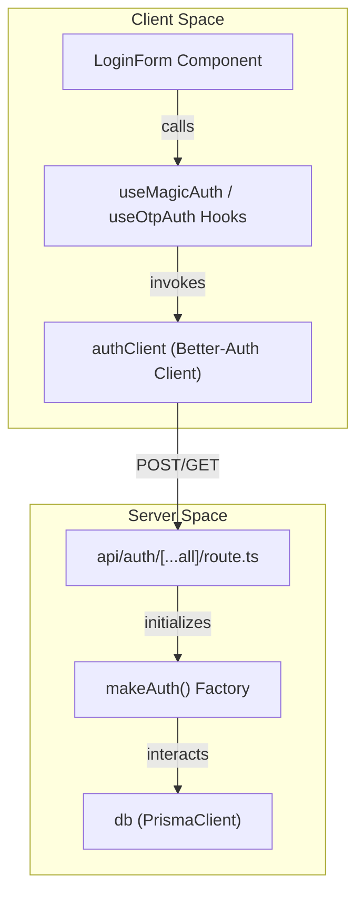
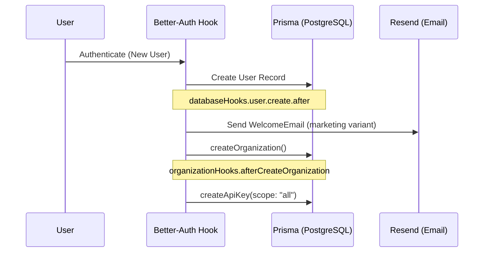

<!-- source: DeepWiki mcp.deepwiki.com · repo agentset-ai/agentset · page 7.1 Authentication System · fetched 2026-10-27 -->

# Authentication System

<details>
<summary>Relevant source files</summary>

The following files were used as context for generating this wiki page:

- [apps/web/src/app/[hostingId]/(defaultLayout)/search/use-search.ts](apps/web/src/app/[hostingId]/(defaultLayout)/search/use-search.ts)
- [apps/web/src/app/[hostingId]/login/login-form.tsx](apps/web/src/app/[hostingId]/login/login-form.tsx)
- [apps/web/src/app/[hostingId]/login/page.tsx](apps/web/src/app/[hostingId]/login/page.tsx)
- [apps/web/src/app/api/(internal-api)/auth/[...all]/route.ts](apps/web/src/app/api/(internal-api)/auth/[...all]/route.ts)
- [apps/web/src/app/api/(internal-api)/stripe/webhook/invoice-payment-failed.ts](apps/web/src/app/api/(internal-api)/stripe/webhook/invoice-payment-failed.ts)
- [apps/web/src/app/app.agentset.ai/(dashboard)/[slug]/[namespaceSlug]/connectors/empty-state.tsx](apps/web/src/app/app.agentset.ai/(dashboard)/[slug]/[namespaceSlug]/connectors/empty-state.tsx)
- [apps/web/src/app/app.agentset.ai/login/login-form.tsx](apps/web/src/app/app.agentset.ai/login/login-form.tsx)
- [apps/web/src/app/app.agentset.ai/login/page.tsx](apps/web/src/app/app.agentset.ai/login/page.tsx)
- [apps/web/src/hooks/use-auth.ts](apps/web/src/hooks/use-auth.ts)
- [apps/web/src/lib/auth-client.ts](apps/web/src/lib/auth-client.ts)
- [apps/web/src/lib/auth.ts](apps/web/src/lib/auth.ts)
- [packages/emails/package.json](packages/emails/package.json)
- [packages/emails/src/index.ts](packages/emails/src/index.ts)
- [packages/emails/src/templates/email-otp.tsx](packages/emails/src/templates/email-otp.tsx)
- [packages/emails/src/templates/welcome-email.tsx](packages/emails/src/templates/welcome-email.tsx)
- [packages/ui/src/components/client-only.tsx](packages/ui/src/components/client-only.tsx)
- [packages/ui/src/components/ui/input-otp.tsx](packages/ui/src/components/ui/input-otp.tsx)

</details>


## Purpose and Scope

This document describes the authentication system for the AgentSet platform, including user authentication methods, session management, user onboarding flow, and integration with the organization hierarchy. The system is built on [Better-Auth](https://better-auth.com) and supports passwordless authentication methods including magic links, email OTP, and OAuth providers (GitHub/Google).

The system handles authentication for both the main dashboard (`app.agentset.ai`) and custom hosted chat interfaces, supporting multi-tenant session isolation and referrer tracking.

**Sources:** [apps/web/src/lib/auth.ts:1-208](), [apps/web/src/app/api/(internal-api)/auth/[...all]/route.ts:1-21]()

---

## Better-Auth Framework

AgentSet utilizes Better-Auth for session handling and identity management. The framework is integrated via a Prisma adapter to store data in the PostgreSQL database.

### Core Configuration

The authentication instance is initialized via the `makeAuth` factory function. This allows the system to dynamically adjust `baseURL` and `trustedOrigins` based on whether the request originates from the main app or a hosted namespace domain.

| Configuration | Value | Purpose |
|---------------|-------|---------|
| `appName` | "Agentset" | Application identifier used in emails and UI |
| `database` | `prismaAdapter(db)` | Persistence layer using `PrismaClient` [apps/web/src/lib/auth.ts:29-31]() |
| `session.expiresIn` | 14 days | Duration before session tokens expire [apps/web/src/lib/auth.ts:36-36]() |
| `advanced.useSecureCookies` | `true` | Enforces `Secure` flag on session cookies [apps/web/src/lib/auth.ts:33-33]() |

**Sources:** [apps/web/src/lib/auth.ts:24-54]()

### Data Flow and Code Entities

The following diagram maps the authentication request flow to specific code entities within the `apps/web` package.



**Sources:** [apps/web/src/app/app.agentset.ai/login/login-form.tsx:25-53](), [apps/web/src/hooks/use-auth.ts:36-174](), [apps/web/src/lib/auth-client.ts:1-5](), [apps/web/src/app/api/(internal-api)/auth/[...all]/route.ts:6-20]()

---

## Authentication Methods

AgentSet implements a passwordless strategy to simplify user onboarding and enhance security.

### Magic Link and OTP

The system provides two primary email-based flows:
1.  **Magic Link**: Sends a unique URL that authenticates the user upon clicking.
2.  **Email OTP**: Sends a 6-digit code that the user enters into an `InputOTP` component.

The `useOtpAuth` hook manages the state for sending and verifying these codes using `authClient.emailOtp.sendVerificationOtp` and `authClient.signIn.emailOtp`.

**Sources:** [apps/web/src/hooks/use-auth.ts:112-174](), [apps/web/src/lib/auth.ts:85-105]()

### OAuth Providers

AgentSet supports social login via GitHub and Google. Account linking is enabled, allowing users to sign in with different providers as long as the email addresses match.

```typescript
socialProviders: {
  github: {
    clientId: env.GITHUB_CLIENT_ID,
    clientSecret: env.GITHUB_CLIENT_SECRET,
  },
  google: {
    clientId: env.GOOGLE_CLIENT_ID,
    clientSecret: env.GOOGLE_CLIENT_SECRET,
  },
}
```

**Sources:** [apps/web/src/lib/auth.ts:45-54](), [apps/web/src/hooks/use-auth.ts:69-110]()

---

## User Onboarding and Lifecycle

When a new user authenticates for the first time, several automated processes are triggered via `databaseHooks`.

### Onboarding Workflow

1.  **Referrer Tracking**: If the user signs up through a hosted chat interface, the `referrerDomain` is saved to the user record in the `before` hook.
2.  **Welcome Email**: A `WelcomeEmail` is dispatched via the `after` hook (only if on the default app URL).
3.  **Organization Creation**: Every new user is automatically assigned a "First Organization" with a unique slug.
4.  **API Key Generation**: The `organization` plugin's `afterCreateOrganization` hook generates a "Default API Key" for the new organization.



**Sources:** [apps/web/src/lib/auth.ts:122-167](), [apps/web/src/lib/auth.ts:57-67](), [packages/emails/src/templates/welcome-email.tsx:5-65]()

---

## Session and Organization Management

### Active Organization Logic

To support multi-tenancy, sessions are enriched with an `activeOrganizationId`. The system automatically resolves the most recently created organization for the user during session creation.

```typescript
// apps/web/src/lib/auth.ts:168-193
async before(session) {
  const org = await db.organization.findFirst({
    where: {
      members: { some: { userId: session.userId } },
    },
    orderBy: { createdAt: "desc" },
  });
  return {
    data: { ...session, activeOrganizationId: org?.id },
  };
}
```

### Session Retrieval

Server-side components and API routes retrieve the current session using the `getSession` helper, which is wrapped in React's `cache` for request-level memoization.

**Sources:** [apps/web/src/lib/auth.ts:199-207]()

---

## Authentication UI Components

The frontend provides specialized login forms for both the main application and hosted interfaces.

### LoginForm Architecture

The `LoginForm` component handles state transitions between email entry, magic link confirmation, and OTP entry. It utilizes the following UI components from the `@agentset/ui` package:
- `InputOTP`: A specialized 6-slot input for verification codes.
- `Button`: Supports `isLoading` states during authentication mutations.
- `Alert`: Displays error messages such as `INVALID_TOKEN` for expired magic links.

**Sources:** [apps/web/src/app/app.agentset.ai/login/login-form.tsx:25-75](), [packages/ui/src/components/ui/input-otp.tsx:9-28]()

### Redirection Logic

The `useRedirectParam` hook extracts the `r` query parameter from the URL to ensure users are returned to their intended destination (e.g., a specific namespace) after successful authentication.

**Sources:** [apps/web/src/hooks/use-auth.ts:8-18]()

---

## Email Integration

The authentication system relies on `@agentset/emails` to deliver transactional messages.

| Template | File Path | Trigger |
| :--- | :--- | :--- |
| `LoginEmail` | `packages/emails/src/templates/login.tsx` | Magic Link request |
| `OTPEmail` | `packages/emails/src/templates/email-otp.tsx` | OTP code request |
| `InviteUserEmail` | `packages/emails/src/templates/invite-user.tsx` | Organization member invitation |
| `WelcomeEmail` | `packages/emails/src/templates/welcome-email.tsx` | New user signup |

**Sources:** [packages/emails/src/index.ts:1-11](), [apps/web/src/lib/auth.ts:68-105]()

---

