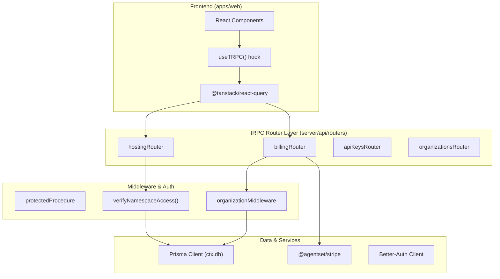
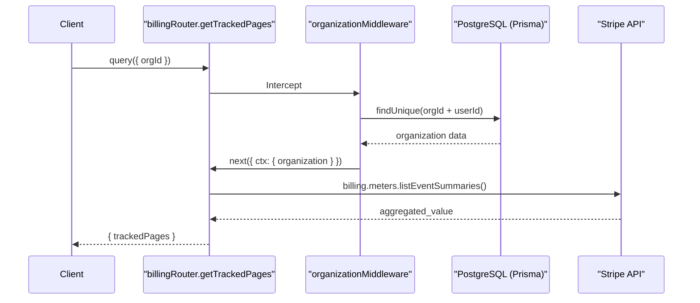
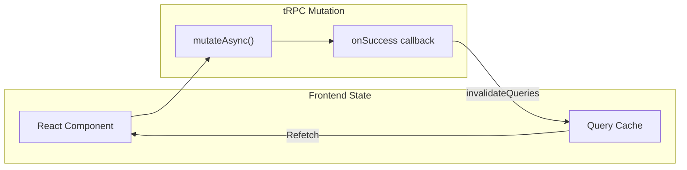

<!-- source: DeepWiki mcp.deepwiki.com · repo agentset-ai/agentset · page 8.1 tRPC Routers · fetched 2026-10-27 -->

# tRPC Routers

Relevant source files

The following files were used as context for generating this wiki page:

- [apps/web/src/app/app.agentset.ai/(dashboard)/[slug]/[namespaceSlug]/hosting/domain-card/dns-record.tsx](apps/web/src/app/app.agentset.ai/(dashboard)/[slug]/[namespaceSlug]/hosting/domain-card/dns-record.tsx)
- [apps/web/src/app/app.agentset.ai/(dashboard)/[slug]/[namespaceSlug]/hosting/empty-state.tsx](apps/web/src/app/app.agentset.ai/(dashboard)/[slug]/[namespaceSlug]/hosting/empty-state.tsx)
- [apps/web/src/app/app.agentset.ai/(dashboard)/[slug]/[namespaceSlug]/hosting/page.client.tsx](apps/web/src/app/app.agentset.ai/(dashboard)/[slug]/[namespaceSlug]/hosting/page.client.tsx)
- [apps/web/src/app/app.agentset.ai/(dashboard)/[slug]/billing/_components/usage/index.tsx](apps/web/src/app/app.agentset.ai/(dashboard)/[slug]/billing/_components/usage/index.tsx)
- [apps/web/src/app/app.agentset.ai/(dashboard)/[slug]/billing/invoices/page.tsx](apps/web/src/app/app.agentset.ai/(dashboard)/[slug]/billing/invoices/page.tsx)
- [apps/web/src/app/app.agentset.ai/(dashboard)/[slug]/billing/upgrade/page.client.tsx](apps/web/src/app/app.agentset.ai/(dashboard)/[slug]/billing/upgrade/page.client.tsx)
- [apps/web/src/app/app.agentset.ai/(dashboard)/[slug]/billing/upgrade/page.tsx](apps/web/src/app/app.agentset.ai/(dashboard)/[slug]/billing/upgrade/page.tsx)
- [apps/web/src/app/app.agentset.ai/(dashboard)/[slug]/settings/api-keys/create-api-key.tsx](apps/web/src/app/app.agentset.ai/(dashboard)/[slug]/settings/api-keys/create-api-key.tsx)
- [apps/web/src/app/app.agentset.ai/(dashboard)/[slug]/team/member-card.tsx](apps/web/src/app/app.agentset.ai/(dashboard)/[slug]/team/member-card.tsx)
- [apps/web/src/app/app.agentset.ai/(dashboard)/[slug]/team/page.client.tsx](apps/web/src/app/app.agentset.ai/(dashboard)/[slug]/team/page.client.tsx)
- [apps/web/src/app/app.agentset.ai/(dashboard)/[slug]/team/role-selector.tsx](apps/web/src/app/app.agentset.ai/(dashboard)/[slug]/team/role-selector.tsx)
- [apps/web/src/components/list-input.tsx](apps/web/src/components/list-input.tsx)
- [apps/web/src/components/search-chunk.tsx](apps/web/src/components/search-chunk.tsx)
- [apps/web/src/components/sortable-list.tsx](apps/web/src/components/sortable-list.tsx)
- [apps/web/src/hooks/use-organization.ts](apps/web/src/hooks/use-organization.ts)
- [apps/web/src/lib/prompt.ts](apps/web/src/lib/prompt.ts)
- [apps/web/src/lib/prompts.ts](apps/web/src/lib/prompts.ts)
- [apps/web/src/server/api/routers/api-keys.ts](apps/web/src/server/api/routers/api-keys.ts)
- [apps/web/src/server/api/routers/billing.ts](apps/web/src/server/api/routers/billing.ts)
- [apps/web/src/server/api/routers/hosting.ts](apps/web/src/server/api/routers/hosting.ts)
- [apps/web/src/server/api/routers/organizations.ts](apps/web/src/server/api/routers/organizations.ts)
- [apps/web/src/services/api-key/create.ts](apps/web/src/services/api-key/create.ts)

## Purpose and Scope

This document describes the tRPC router architecture in AgentSet, which provides type-safe, RPC-style communication between the Next.js frontend and backend services. tRPC routers expose server-side procedures that are called from the client with full TypeScript type inference and runtime validation via Zod.

## Router Architecture

The tRPC API layer consists of multiple domain-specific routers. Each router is created using `createTRPCRouter` and exposes procedures protected by session-based authentication middleware.

### System Overview

**Sources:** [apps/web/src/server/api/routers/hosting.ts:1-71](), [apps/web/src/server/api/routers/billing.ts:1-50](), [apps/web/src/app/app.agentset.ai/(dashboard)/[slug]/[namespaceSlug]/hosting/page.client.tsx:1-30]()

## Hosting Router

The `hostingRouter` manages public chat interfaces for namespaces. It handles configuration for custom domains, branding, and deployment status.

### Implementation Details
The router uses a `verifyNamespaceAccess` helper to ensure the authenticated user belongs to the organization owning the target namespace [apps/web/src/server/api/routers/hosting.ts:13-34]().

| Procedure | Type | Input Schema | Purpose |
|-----------|------|--------------|---------|
| `get` | `query` | `{ namespaceId: string }` | Fetch hosting config for a namespace [apps/web/src/server/api/routers/hosting.ts:38-41]() |
| `enable` | `mutation` | `{ namespaceId: string }` | Initialize hosting for a namespace [apps/web/src/server/api/routers/hosting.ts:42-50]() |
| `update` | `mutation` | `updateHostingSchema` | Modify branding and SEO settings [apps/web/src/server/api/routers/hosting.ts:51-60]() |
| `delete` | `mutation` | `{ namespaceId: string }` | Remove hosting deployment [apps/web/src/server/api/routers/hosting.ts:61-69]() |

**Sources:** [apps/web/src/server/api/routers/hosting.ts:13-70]()

## Billing Router

The `billingRouter` manages Stripe subscriptions, usage metering, and checkout sessions. It introduces a specialized `organizationMiddleware` to inject organization context into procedures.

### Organization Middleware
This middleware validates that the user is a member of the requested organization and attaches the organization object (including `stripeId` and `plan`) to the tRPC context [apps/web/src/server/api/routers/billing.ts:16-48]().

### Usage Metering
The `getTrackedPages` procedure integrates with Stripe's Billing Meters API to fetch real-time usage data for the current billing cycle [apps/web/src/server/api/routers/billing.ts:69-139]().

**Sources:** [apps/web/src/server/api/routers/billing.ts:16-139]()

## API Keys Router

The `apiKeysRouter` manages organization-level credentials for the ingestion API. It strictly enforces role-based access control (RBAC), requiring `admin` or `owner` roles for management operations.

### RBAC Enforcement
Procedures like `getApiKeys` and `createApiKey` manually verify the user's role within the organization before proceeding [apps/web/src/server/api/routers/api-keys.ts:16-29]().

| Procedure | Role Required | Behavior |
|-----------|---------------|----------|
| `getApiKeys` | Admin/Owner | Lists keys with sensitive values omitted [apps/web/src/server/api/routers/api-keys.ts:31-40]() |
| `createApiKey` | Admin/Owner | Generates new key via `createApiKey` service [apps/web/src/server/api/routers/api-keys.ts:67-84]() |
| `deleteApiKey` | Admin/Owner | Deletes key and invalidates cache tags [apps/web/src/server/api/routers/api-keys.ts:85-108]() |

**Sources:** [apps/web/src/server/api/routers/api-keys.ts:7-109]()

## Organization Router

The `organizationsRouter` handles high-level organization management and membership listing.

### Membership and Roles
The `getBySlug` procedure identifies the user's specific role (`isAdmin`, `isOwner`) and returns the `currentMemberId` for use in frontend permission checks [apps/web/src/server/api/routers/organizations.ts:41-81]().

### Deletion Safety
The `delete` mutation prevents accidental data loss by checking if an organization is already in a `DELETING` status before calling the `deleteOrganization` service [apps/web/src/server/api/routers/organizations.ts:123-157]().

**Sources:** [apps/web/src/server/api/routers/organizations.ts:9-158]()

## Client-Side Integration Patterns

The frontend utilizes `@tanstack/react-query` hooks generated by tRPC for data fetching and mutations.

### Query Pattern
Components use `queryOptions` to define fetch logic, enabling seamless integration with standard React Query hooks:
[apps/web/src/app/app.agentset.ai/(dashboard)/[slug]/[namespaceSlug]/hosting/page.client.tsx:15-19]()

### Mutation and Cache Invalidation
After a successful mutation, the `queryClient` is used to invalidate relevant queries, triggering a UI refresh:
[apps/web/src/app/app.agentset.ai/(dashboard)/[slug]/settings/api-keys/create-api-key.tsx:36-53]()

**Sources:** [apps/web/src/app/app.agentset.ai/(dashboard)/[slug]/settings/api-keys/create-api-key.tsx:36-53](), [apps/web/src/app/app.agentset.ai/(dashboard)/[slug]/[namespaceSlug]/hosting/empty-state.tsx:24-42]()

## Type-Safe API Design

All procedures utilize Zod for input validation, ensuring that the frontend cannot send malformed data to the backend.

### Shared Schemas
Routers often import schemas from a centralized `schemas` directory to ensure consistency between the API and form validation:
[apps/web/src/server/api/routers/hosting.ts:2]()
[apps/web/src/server/api/routers/hosting.ts:52]()

### Contextual Typing
Procedures are typed using `ProtectedProcedureContext`, which provides TypeScript with the structure of the authenticated session and database client [apps/web/src/server/api/routers/hosting.ts:1]().

**Sources:** [apps/web/src/server/api/routers/hosting.ts:1-12](), [apps/web/src/server/api/routers/billing.ts:17-21]()

---

