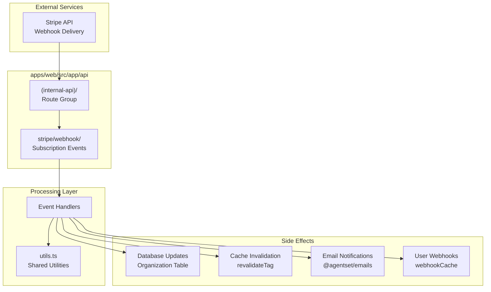
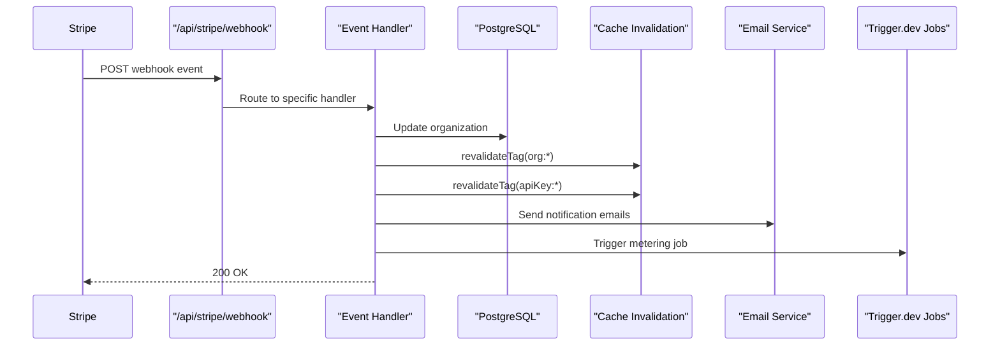
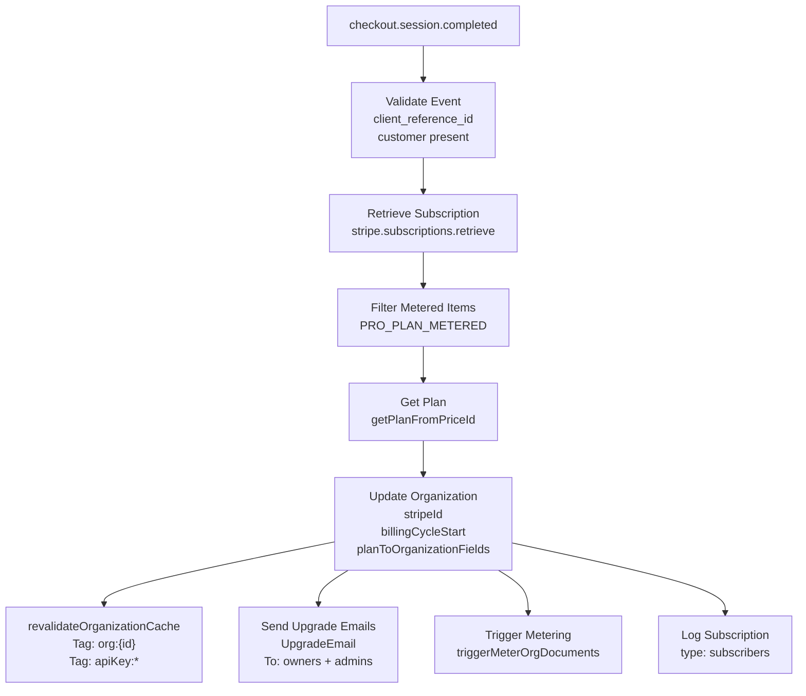
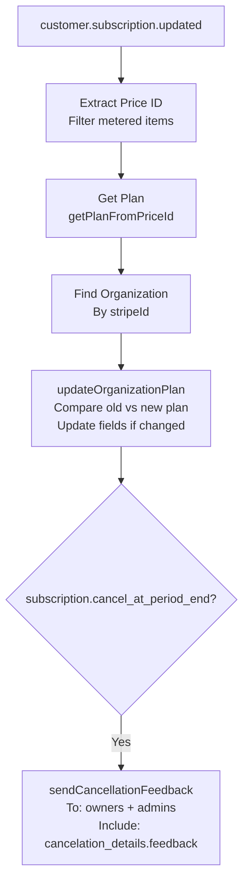
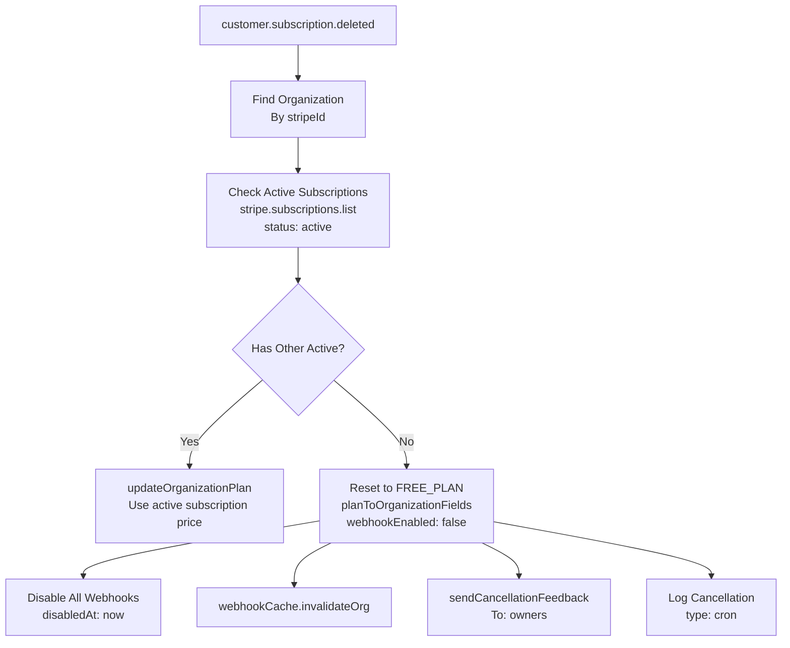
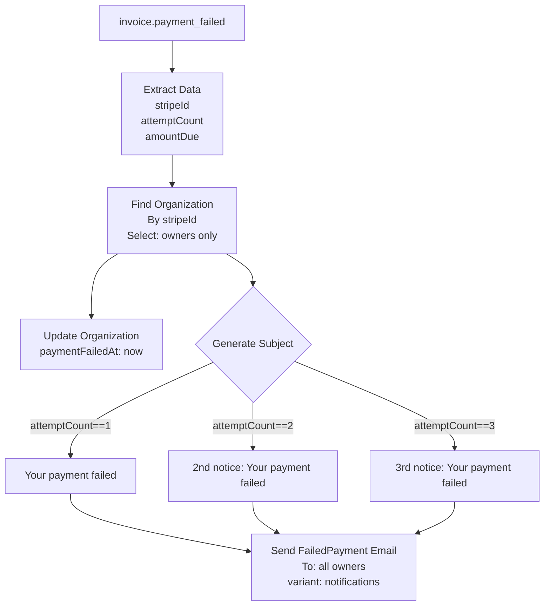
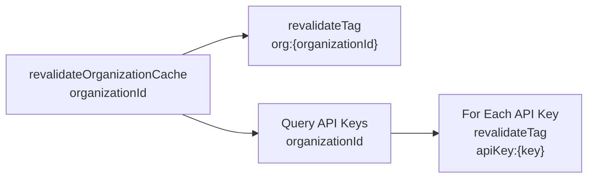
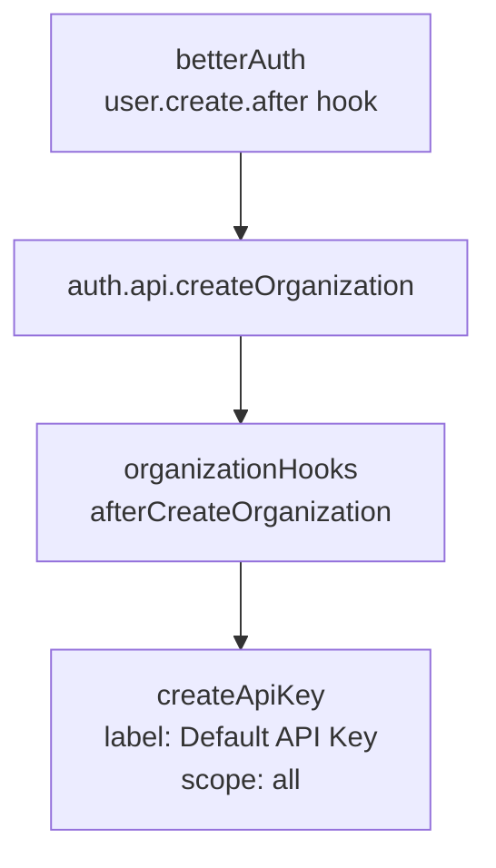
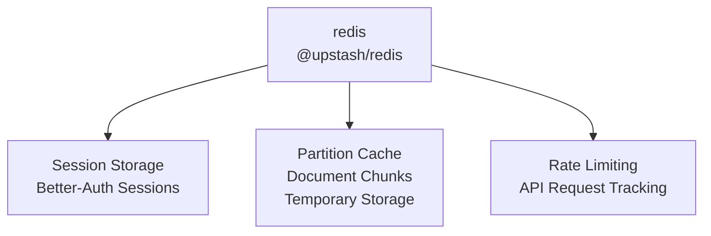

<!-- source: DeepWiki mcp.deepwiki.com · repo agentset-ai/agentset · page 8.2 Internal API Routes · fetched 2026-10-27 -->

# Internal API Routes

Relevant source files

The following files were used as context for generating this wiki page:

- [apps/web/src/app/app.agentset.ai/(dashboard)/[slug]/[namespaceSlug]/connectors/page.tsx](apps/web/src/app/app.agentset.ai/(dashboard)/[slug]/[namespaceSlug]/connectors/page.tsx)
- [apps/web/src/lib/redis.ts](apps/web/src/lib/redis.ts)

This document covers the internal API routes used for system operations, webhook processing, and inter-service communication. These routes are distinct from the tRPC-based API (see [tRPC Routers](#8.1)) and the public REST API (see [Public API and OpenAPI](#8.3)). Internal API routes handle events from external services, perform background operations, and facilitate internal system workflows.

The primary internal routes documented here are:
- **Stripe webhook handlers** for subscription lifecycle management.
- **Redis-based caching operations** invoked during webhook processing.
- **Email notification triggers** from webhook events.

## Internal API Structure

Internal API routes are located under the `apps/web/src/app/api/(internal-api)/` directory. The parenthetical directory name `(internal-api)` is a Next.js route group that excludes this segment from the URL path while organizing related routes together.

**Sources:** [apps/web/src/app/api/(internal-api)/stripe/webhook/utils.ts:1-132](), [apps/web/src/app/api/(internal-api)/stripe/webhook/checkout-session-completed.ts:1-126]()

## Stripe Webhook System

The Stripe webhook system handles subscription lifecycle events and updates organization billing status in response to external payment events. All webhook handlers follow a consistent pattern: validate the event, update database state, invalidate caches, and trigger side effects.

### Webhook Event Flow

**Sources:** [apps/web/src/app/api/(internal-api)/stripe/webhook/checkout-session-completed.ts:18-125](), [apps/web/src/app/api/(internal-api)/stripe/webhook/utils.ts:55-74]()

### Webhook Handler: checkout.session.completed

The `checkout.session.completed` event fires when a customer successfully completes a Stripe Checkout session. This handler creates or updates the organization's subscription, sets their Stripe customer ID, and initializes usage metering.

#### Processing Logic

1. **Validation**: Verify `client_reference_id` (organizationId) and `customer` are present [apps/web/src/app/api/(internal-api)/stripe/webhook/checkout-session-completed.ts:25-32]().
2. **Price Extraction**: Retrieve subscription and filter out metered price items (Pro plan metering) [apps/web/src/app/api/(internal-api)/stripe/webhook/checkout-session-completed.ts:35-45]().
3. **Database Update**: Set `stripeId`, `billingCycleStart`, clear `paymentFailedAt`, and apply plan limits [apps/web/src/app/api/(internal-api)/stripe/webhook/checkout-session-completed.ts:67-93]().
4. **Cache Invalidation**: Call `revalidateOrganizationCache()` to invalidate org and API key caches [apps/web/src/app/api/(internal-api)/stripe/webhook/checkout-session-completed.ts:95]().
5. **Side Effects**: Send upgrade emails to owners/admins, trigger `meterIngestedPages` job, and log subscription [apps/web/src/app/api/(internal-api)/stripe/webhook/checkout-session-completed.ts:97-123]().

**Sources:** [apps/web/src/app/api/(internal-api)/stripe/webhook/checkout-session-completed.ts:18-125]()

### Webhook Handler: customer.subscription.updated

This handler processes subscription changes including plan upgrades, downgrades, and cancellations. It detects when users cancel their subscription (but remain active until period end) and sends feedback requests.

#### Key Operations

**Cancellation Detection:**
- Checks if `status === "active"` AND `cancel_at_period_end === true` [apps/web/src/app/api/(internal-api)/stripe/webhook/customer-subscription-updated.ts:72-74]().
- Extracts `cancellation_details.feedback` (Stripe's structured feedback) [apps/web/src/app/api/(internal-api)/stripe/webhook/customer-subscription-updated.ts:78]().
- Calls `sendCancellationFeedback()` with owners and reason [apps/web/src/app/api/(internal-api)/stripe/webhook/customer-subscription-updated.ts:80-83]().

**Sources:** [apps/web/src/app/api/(internal-api)/stripe/webhook/customer-subscription-updated.ts:10-85](), [apps/web/src/app/api/(internal-api)/stripe/webhook/utils.ts:14-53]()

### Webhook Handler: customer.subscription.deleted

Handles the deletion of a subscription, typically after a canceled subscription reaches its period end. This handler resets the organization to the free plan and disables webhooks.

#### Multi-Subscription Handling

**Multi-Subscription Support:**
- The handler checks for other active subscriptions before downgrading [apps/web/src/app/api/(internal-api)/stripe/webhook/customer-subscription-deleted.ts:59-75]().
- If another subscription exists, it updates to that plan instead of resetting to free.

**Webhook Disabling:**
- Sets `disabledAt` timestamp on all webhooks for the organization [apps/web/src/app/api/(internal-api)/stripe/webhook/customer-subscription-deleted.ts:91-98]().
- Sets `webhookEnabled: false` on the organization [apps/web/src/app/api/(internal-api)/stripe/webhook/customer-subscription-deleted.ts:87]().
- Calls `webhookCache.invalidateOrg()` to clear cached webhook configurations [apps/web/src/app/api/(internal-api)/stripe/webhook/customer-subscription-deleted.ts:99]().

**Sources:** [apps/web/src/app/api/(internal-api)/stripe/webhook/customer-subscription-deleted.ts:16-111]()

### Webhook Handler: invoice.payment_failed

Processes failed payment attempts and notifies organization owners. This handler tracks payment failure status and sends escalating notifications based on attempt count.

**Escalation Logic:**
- Generates progressively urgent subject lines based on `attemptCount` [apps/web/src/app/api/(internal-api)/stripe/webhook/invoice-payment-failed.ts:70-76]().
- Sets `paymentFailedAt` timestamp to track failed state [apps/web/src/app/api/(internal-api)/stripe/webhook/invoice-payment-failed.ts:64]().
- Filters to `role: "owner"` only for payment notifications [apps/web/src/app/api/(internal-api)/stripe/webhook/invoice-payment-failed.ts:43]().

**Sources:** [apps/web/src/app/api/(internal-api)/stripe/webhook/invoice-payment-failed.ts:7-88]()

## Shared Webhook Utilities

The `utils.ts` file provides shared functionality used across all webhook handlers, ensuring consistent cache invalidation, plan updates, and email notifications.

### Cache Revalidation System

The `revalidateOrganizationCache()` function invalidates Next.js cache tags for an organization and all its API keys:

**Implementation Details:**
- Uses `waitUntil()` to defer cache invalidation without blocking the response [apps/web/src/app/api/(internal-api)/stripe/webhook/utils.ts:56-58]().
- Revalidates `org:{organizationId}` tag with `"max"` duration [apps/web/src/app/api/(internal-api)/stripe/webhook/utils.ts:58]().
- Queries all API keys for the organization and revalidates each [apps/web/src/app/api/(internal-api)/stripe/webhook/utils.ts:60-71]().

**Sources:** [apps/web/src/app/api/(internal-api)/stripe/webhook/utils.ts:55-74]()

### Plan Update Utility

The `updateOrganizationPlan()` function handles the complex logic of changing an organization's plan:

**Key Operations:**

| Step | Action | Source |
|------|--------|--------|
| 1. Resolve Plan | Call `getPlanFromPriceId()` to map price to plan | [apps/web/src/app/api/(internal-api)/stripe/webhook/utils.ts:83]() |
| 2. Check Plan Change | Compare `organization.plan` to `newPlan.name` | [apps/web/src/app/api/(internal-api)/stripe/webhook/utils.ts:91]() |
| 3. Update Organization | Apply `planToOrganizationFields()`, clear `paymentFailedAt` | [apps/web/src/app/api/(internal-api)/stripe/webhook/utils.ts:92-104]() |
| 4. Webhook Disabling | If downgrading to FREE, disable webhooks | [apps/web/src/app/api/(internal-api)/stripe/webhook/utils.ts:88-120]() |
| 5. Cache Invalidation | Call `revalidateOrganizationCache()` | [apps/web/src/app/api/(internal-api)/stripe/webhook/utils.ts:106]() |

**Sources:** [apps/web/src/app/api/(internal-api)/stripe/webhook/utils.ts:76-131]()

## Integration with Authentication System

The authentication system (Better-Auth) creates webhooks during organization creation through database hooks:

**Key Integration Points:**
- `afterCreateOrganization` hook automatically creates default API key [apps/web/src/lib/auth.ts:58-66]().
- After user creation, automatically create default organization [apps/web/src/lib/auth.ts:158-164]().
- Before session creation, set `activeOrganizationId` to user's newest organization [apps/web/src/lib/auth.ts:172-182]().

**Sources:** [apps/web/src/lib/auth.ts:24-195]()

## Redis Integration

Redis plays a critical role in internal operations through the `redis` client initialized in `apps/web/src/lib/redis.ts`.

### Redis Usage Patterns

**Configuration:**
- Initialize Redis with Upstash URL and token from environment [apps/web/src/lib/redis.ts:4-7]().
- Used by Better-Auth for session storage (14-day expiry configured) [apps/web/src/lib/auth.ts:35-37]().
- Referenced in document processing pipeline for temporary chunk storage (see [Ingestion Workflow](#3.1)).

**Sources:** [apps/web/src/lib/redis.ts:1-7](), [apps/web/src/lib/auth.ts:35-37]()

## Comparison: Internal vs Public vs tRPC APIs

| Aspect | Internal API Routes | tRPC Routers | Public REST API |
|--------|-------------------|--------------|-----------------|
| **Location** | `apps/web/src/app/api/(internal-api)/` | `apps/web/src/server/api/routers/` | `apps/web/src/app/api/` |
| **Authentication** | Stripe signature verification | Better-Auth session | API key (Organization API Key) |
| **Consumers** | External services (Stripe) | Frontend application | Customer applications |

**Sources:** [apps/web/src/app/api/(internal-api)/stripe/webhook/checkout-session-completed.ts:1-126](), [apps/web/src/server/api/routers/billing.ts:1-302]()

---

