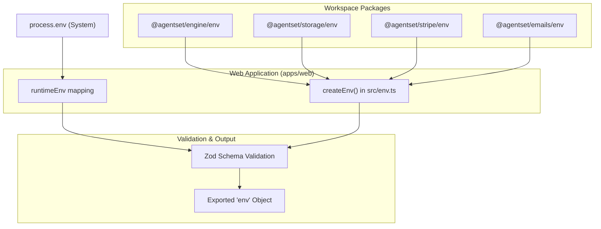
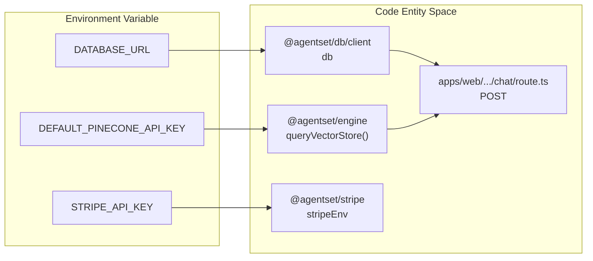

<!-- source: DeepWiki mcp.deepwiki.com · repo agentset-ai/agentset · page 9.1 Environment Configuration · fetched 2026-10-27 -->

# Environment Configuration

Relevant source files

The following files were used as context for generating this wiki page:

- [.cursor/rules/project-structure.mdc](.cursor/rules/project-structure.mdc)
- [.env.example](.env.example)
- [apps/web/src/app/api/(internal-api)/chat/route.ts](apps/web/src/app/api/(internal-api)/chat/route.ts)
- [apps/web/src/app/api/(internal-api)/hosting-chat/route.ts](apps/web/src/app/api/(internal-api)/hosting-chat/route.ts)
- [apps/web/src/app/api/(internal-api)/hosting-search/route.ts](apps/web/src/app/api/(internal-api)/hosting-search/route.ts)
- [apps/web/src/app/api/(public-api)/v1/namespace/[namespaceId]/search/route.ts](apps/web/src/app/api/(public-api)/v1/namespace/[namespaceId]/search/route.ts)
- [apps/web/src/env.ts](apps/web/src/env.ts)
- [apps/web/src/instrumentation-client.ts](apps/web/src/instrumentation-client.ts)
- [apps/web/src/lib/agentic/index.ts](apps/web/src/lib/agentic/index.ts)
- [apps/web/src/lib/agentic/search.ts](apps/web/src/lib/agentic/search.ts)
- [packages/engine/package.json](packages/engine/package.json)
- [packages/engine/src/env.ts](packages/engine/src/env.ts)
- [turbo.json](turbo.json)

This document describes how AgentSet manages environment variables across its monorepo using `@t3-oss/env-nextjs`. The system provides type-safe validation, distributed configuration across packages, and integration with the build system to ensure required variables are present before the application starts.

## Purpose and Scope

AgentSet utilizes a decentralized environment configuration model where each core package (e.g., `engine`, `storage`, `stripe`) defines its own validation schema. The main web application (`apps/web`) aggregates these schemas, creating a unified, type-safe environment object. This prevents runtime crashes due to missing configuration and provides IDE autocomplete for all environment variables.

## Environment Validation Architecture

The architecture relies on a hierarchical extension pattern. The root environment configuration in the web app extends schemas from internal workspace packages.

### Environment Flow Diagram

The following diagram illustrates how variables flow from the system environment through Zod validation into the application code.

**Sources:** [apps/web/src/env.ts:1-10](), [packages/engine/src/env.ts:1-4]()

### Implementation with @t3-oss/env-nextjs

The web application uses `createEnv` to merge local schemas with those from dependencies. This ensures that if `packages/engine` requires a variable like `DEFAULT_PINECONE_API_KEY`, the web app will fail to start if it is missing.

[apps/web/src/env.ts:9-89]()

Key features of this implementation:
- **`extends`**: Inherits schemas from `@agentset/engine/env`, `@agentset/storage/env`, etc. [apps/web/src/env.ts:10-10]()
- **`server`**: Variables restricted to the server-side context (e.g., `DATABASE_URL`, `BETTER_AUTH_SECRET`). [apps/web/src/env.ts:24-51]()
- **`shared`**: Variables available in both client and server contexts (e.g., `NODE_ENV`). [apps/web/src/env.ts:11-23]()
- **`runtimeEnv`**: Explicitly maps `process.env` keys to the schema to support Next.js edge runtime and static optimization. [apps/web/src/env.ts:53-85]()

**Sources:** [apps/web/src/env.ts:9-89](), [packages/engine/src/env.ts:4-43]()

## Required Configuration by Package

### Engine Package (@agentset/engine)
The engine package handles RAG operations, embeddings, and vector store interactions. It requires keys for managed providers.

| Variable | Type | Description |
| :--- | :--- | :--- |
| `DEFAULT_PINECONE_API_KEY` | string | API key for the default Pinecone instance |
| `DEFAULT_PINECONE_HOST` | url | Host URL for the default Pinecone instance |
| `DEFAULT_TURBOPUFFER_API_KEY` | string | API key for Turbopuffer vector store |
| `DEFAULT_AZURE_API_KEY` | string | API key for Azure OpenAI services |
| `DEFAULT_COHERE_API_KEY` | string | API key for Cohere (used for Reranking) |
| `PARTITION_API_URL` | url | Endpoint for the document partitioning/ingestion service |

**Sources:** [packages/engine/src/env.ts:5-22](), [.env.example:16-31]()

### Web Application (apps/web)
The web app manages authentication, database connections, and third-party integrations like Stripe and PostHog.

| Variable | Type | Description |
| :--- | :--- | :--- |
| `DATABASE_URL` | url | PostgreSQL connection string |
| `BETTER_AUTH_SECRET` | string | Secret for session encryption in Better-Auth |
| `GITHUB_CLIENT_ID` | string | OAuth ID for GitHub login |
| `REDIS_URL` | url | Connection URL for Upstash/Redis caching |
| `STRIPE_WEBHOOK_SECRET` | string | Secret for verifying Stripe webhook signatures |
| `TRIGGER_SECRET_KEY` | string | Secret key for Trigger.dev background jobs |
| `NEXT_PUBLIC_POSTHOG_KEY` | string | Client-side analytics key for PostHog |

**Sources:** [apps/web/src/env.ts:24-51](), [.env.example:1-12]()

## Build System and Cache Invalidation

AgentSet uses **Turborepo** to orchestrate builds. Environment variables are integrated into the build pipeline to ensure cache consistency.

### Global Environment Mapping

The `turbo.json` file defines `globalEnv`, which tells Turbo which variables affect the build output. If any of these change, Turbo invalidates the cache and forces a rebuild.

[turbo.json:73-120]()

### Code Entity Space: Environment Mapping

The following diagram bridges the "Natural Language" configuration concepts to the specific code entities that consume them.

**Sources:** [apps/web/src/app/api/(internal-api)/chat/route.ts:23-29](), [packages/engine/src/env.ts:6-6](), [turbo.json:79-91]()

## Development Workflow

### Local Setup
1. Copy `.env.example` to `.env` in the root directory. [.env.example:1-59]()
2. Fill in the required keys for local development (e.g., `DATABASE_URL`, `BETTER_AUTH_SECRET`).
3. The monorepo uses `bun` as the package manager. Scripts are typically run from the root. [.cursor/rules/project-structure.mdc:39-42]()

### Validation Skipping
In certain environments like CI or during linting, full environment validation is undesirable. The configuration allows skipping via:
- `process.env.CI`: Set automatically by GitHub Actions or Vercel. [apps/web/src/env.ts:86-87]()
- `process.env.SKIP_ENV_VALIDATION`: Used in the engine package. [packages/engine/src/env.ts:41-41]()

**Sources:** [apps/web/src/env.ts:86-88](), [packages/engine/src/env.ts:41-41]()

---

