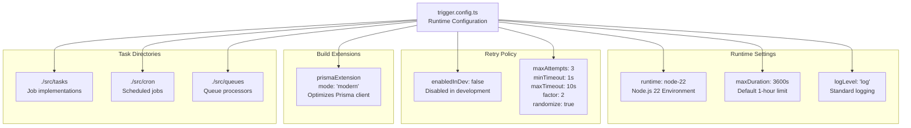
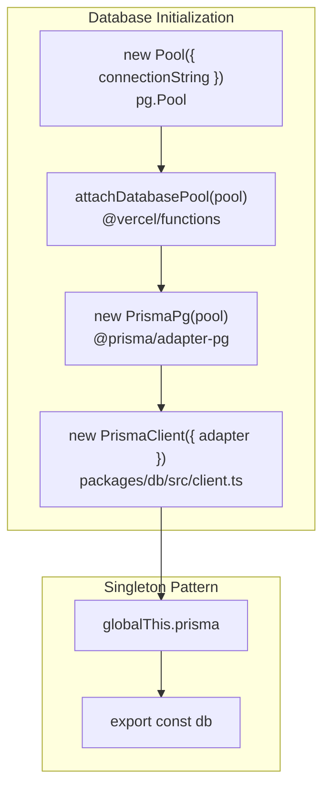
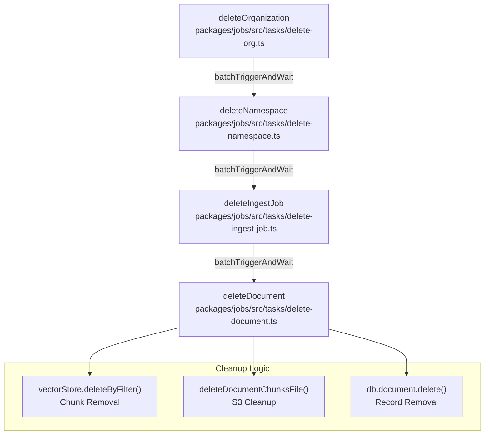

<!-- source: DeepWiki mcp.deepwiki.com · repo agentset-ai/agentset · page 9.2 Job Orchestration with Trigger.dev · fetched 2026-10-27 -->

# Job Orchestration with Trigger.dev

<details>
<summary>Relevant source files</summary>

The following files were used as context for generating this wiki page:

- [apps/web/scripts/populate-document-namespace-id.ts](apps/web/scripts/populate-document-namespace-id.ts)
- [packages/db/.gitignore](packages/db/.gitignore)
- [packages/db/prisma/schema/schema.prisma](packages/db/prisma/schema/schema.prisma)
- [packages/db/src/client.ts](packages/db/src/client.ts)
- [packages/db/src/index.ts](packages/db/src/index.ts)
- [packages/jobs/src/db.ts](packages/jobs/src/db.ts)
- [packages/jobs/src/schema.ts](packages/jobs/src/schema.ts)
- [packages/jobs/src/tasks/delete-document.ts](packages/jobs/src/tasks/delete-document.ts)
- [packages/jobs/src/tasks/delete-ingest-job.ts](packages/jobs/src/tasks/delete-ingest-job.ts)
- [packages/jobs/src/tasks/delete-namespace.ts](packages/jobs/src/tasks/delete-namespace.ts)
- [packages/jobs/src/tasks/delete-org.ts](packages/jobs/src/tasks/delete-org.ts)
- [packages/jobs/src/tasks/ingest.ts](packages/jobs/src/tasks/ingest.ts)
- [packages/jobs/src/tasks/process-document.ts](packages/jobs/src/tasks/process-document.ts)
- [packages/jobs/src/tasks/re-ingest.ts](packages/jobs/src/tasks/re-ingest.ts)
- [packages/jobs/trigger.config.ts](packages/jobs/trigger.config.ts)

</details>


This document describes the configuration and architecture of background job processing using Trigger.dev, a platform for orchestrating long-running tasks with reliability, retries, and observability. The system uses Trigger.dev to handle document ingestion, processing, deletion, and other asynchronous operations that cannot run within HTTP request timeouts.

For information about the ingestion workflow that these jobs implement, see [3.1](). For webhook emission that occurs during job execution, see [9.3]().

---

## Configuration Architecture

The Trigger.dev runtime is configured in [packages/jobs/trigger.config.ts:4-27]() with settings that apply to all background tasks in the system.



**Sources:** [packages/jobs/trigger.config.ts:4-27]()

### Runtime Configuration

The configuration specifies:
- **Runtime**: Node.js 22 for optimal performance and modern JavaScript features [packages/jobs/trigger.config.ts:6-6]()
- **Max Duration**: 3600 seconds (1 hour) as the default timeout for tasks [packages/jobs/trigger.config.ts:8-8]()
- **Log Level**: Standard logging for operational visibility [packages/jobs/trigger.config.ts:7-7]()
- **Retry Policy**: Exponential backoff with randomization (2x factor, 1s-10s range) for 3 attempts [packages/jobs/trigger.config.ts:9-18]()

### Build Optimizations

The `prismaExtension` is applied with `mode: "modern"` to optimize the Prisma client for Trigger.dev's deployment environment [packages/jobs/trigger.config.ts:21-23](). This extension ensures Prisma is properly bundled and initialized in the serverless runtime.

**Sources:** [packages/jobs/trigger.config.ts:19-25]()

---

## Database Client Configuration

The database client is initialized using the PostgreSQL adapter for Prisma and integrated with Vercel's connection pooling.



**Sources:** [packages/db/src/client.ts:7-28]()

### Connection Management

The `createPrismaClient` function at [packages/db/src/client.ts:7-19]() sets up the connection:
- It uses a `Pool` from the `pg` package [packages/db/src/client.ts:9-9]().
- It attaches the pool to Vercel functions for optimized connection management [packages/db/src/client.ts:10-10]().
- It configures logging based on the environment, enabling `query`, `error`, and `warn` in development [packages/db/src/client.ts:14-17]().

The client is exported as a singleton `db` at [packages/db/src/client.ts:25-25]() to prevent multiple connection pools during hot reloads in development.

**Sources:** [packages/db/src/client.ts:7-28]()

---

## Job Schema Definitions

Job schemas define the payload structure, trigger functions, and priority assignment for each background task type. All schemas are defined in [packages/jobs/src/schema.ts]().

### Priority Management

The `getPriorityByPlan()` function at [packages/jobs/src/schema.ts:13-17]() assigns task priority based on organization subscription tier:

| Plan | Priority | Effect |
|------|----------|--------|
| Enterprise | `undefined` | Highest priority (executes immediately) |
| Pro | `3600 * 24` (24 hours) | High priority |
| Starter/Free | `3600 * 16` (16 hours) | Standard priority |

Lower priority values execute first in Trigger.dev's queue system. This ensures paying customers receive faster processing.

### Ingestion Job Schema

The main ingestion job schema at [packages/jobs/src/schema.ts:19-32]() defines the payload validation using Zod:

```typescript
export const triggerIngestionJobBodySchema = z.object({
  jobId: z.string(),
  organizationId: z.string(),
});
```

The trigger function at [packages/jobs/src/schema.ts:25-32]() applies tags and priority:
- **Tags**: `job_${body.jobId}` allows tracking all runs for a specific ingestion job.
- **Priority**: Determined by the organization's plan.

**Sources:** [packages/jobs/src/schema.ts:13-32]()

---

## Task Implementation Patterns

Tasks are implemented using `schemaTask()` from `@trigger.dev/sdk`, which provides type-safe payload validation, error handling, and lifecycle hooks.

### Ingestion Task (`ingestJob`)

The `ingestJob` task at [packages/jobs/src/tasks/ingest.ts:33-88]() (and following) orchestrates the entire ingestion pipeline:

- **ID**: `trigger-ingestion-job` [packages/jobs/src/tasks/ingest.ts:34-34]()
- **Concurrency**: 90 parallel runs [packages/jobs/src/tasks/ingest.ts:37-37]()
- **Max Duration**: 12 hours [packages/jobs/src/tasks/ingest.ts:35-35]()

**Execution Flow for Crawling:**
1. It creates a wait token for external partition callbacks [packages/jobs/src/tasks/ingest.ts:137-137]().
2. It calls the Partition API with the crawl configuration [packages/jobs/src/tasks/ingest.ts:160-167]().
3. it waits for the token to be resolved by the partition service [packages/jobs/src/tasks/ingest.ts:173-175]().
4. It processes the resulting documents, checking for organization limits [packages/jobs/src/tasks/ingest.ts:180-202]().
5. It batch triggers `processDocument` tasks for each valid document [packages/jobs/src/tasks/ingest.ts:230-234]().

**Sources:** [packages/jobs/src/tasks/ingest.ts:33-235]()

### Document Processing Task (`processDocument`)

The `processDocument` task at [packages/jobs/src/tasks/process-document.ts:72-130]() (and following) handles embedding generation and vector storage:

- **ID**: `trigger-document-job` [packages/jobs/src/tasks/process-document.ts:73-73]()
- **Concurrency**: 90 parallel runs [packages/jobs/src/tasks/process-document.ts:76-76]()

**Batch Processing Pattern:**
The task uses a `processBatch` function at [packages/jobs/src/tasks/process-document.ts:34-70]() to:
1. Generate embeddings for a batch of chunks using `embedMany` [packages/jobs/src/tasks/process-document.ts:48-52]().
2. Map chunks to include metadata and embeddings [packages/jobs/src/tasks/process-document.ts:54-64]().
3. Upsert the batch to the configured vector store [packages/jobs/src/tasks/process-document.ts:67-67]().

**Sources:** [packages/jobs/src/tasks/process-document.ts:34-130]()

---

## Deletion Task Hierarchy

Deletion tasks follow a hierarchical parent-child pattern to ensure proper cascade deletion and resource cleanup across S3, vector stores, and the database.



**Sources:** [packages/jobs/src/tasks/delete-org.ts:59-69](), [packages/jobs/src/tasks/delete-namespace.ts:63-74](), [packages/jobs/src/tasks/delete-ingest-job.ts:88-106](), [packages/jobs/src/tasks/delete-document.ts:94-128]()

### Hierarchical Cleanup Details

- **`deleteOrganization`**: Deletes organization webhooks and invalidates cache before triggering namespace deletions [packages/jobs/src/tasks/delete-org.ts:41-46]().
- **`deleteNamespace`**: Removes hosting assets (logos, OG images) from S3 and deletes the namespace record [packages/jobs/src/tasks/delete-namespace.ts:78-96]().
- **`deleteIngestJob`**: Updates job status to `DELETING` and triggers document deletions [packages/jobs/src/tasks/delete-ingest-job.ts:53-91]().
- **`deleteDocument`**: Handles the final cleanup of vector chunks, S3 files (`chunks.json`), and images [packages/jobs/src/tasks/delete-document.ts:94-128]().

### Rate Limiting

The system implements rate limiting for Pinecone operations to avoid API throttling [packages/jobs/src/tasks/delete-document.ts:72-91](). It uses an Upstash `Ratelimit.tokenBucket` (5 tokens per 1s) keyed by namespace ID [packages/jobs/src/tasks/delete-document.ts:85-89]().

**Sources:** [packages/jobs/src/tasks/delete-document.ts:72-91]()

---

## Re-ingestion Workflow

The `reIngestJob` task at [packages/jobs/src/tasks/re-ingest.ts:13-220]() allows re-processing existing documents.

1. It updates the `IngestJob` status to `PROCESSING` [packages/jobs/src/tasks/re-ingest.ts:99-99]().
2. It resets all document statuses to `QUEUED_FOR_RESYNC` [packages/jobs/src/tasks/re-ingest.ts:111-111]().
3. It triggers `processDocument` tasks with the `cleanup: true` flag [packages/jobs/src/tasks/re-ingest.ts:142-142](), ensuring old vector chunks are removed before new ones are inserted.
4. It updates the total page counts for the namespace and organization after completion [packages/jobs/src/tasks/re-ingest.ts:203-212]().

**Sources:** [packages/jobs/src/tasks/re-ingest.ts:13-220]()

---

## Error Handling and Webhooks

Tasks implement the `onFailure` handler to update database state and emit error webhooks when failures occur.

- **Ingest Failures**: Updates `IngestJob` status to `FAILED` and emits `ingest_job.error` [packages/jobs/src/tasks/ingest.ts:43-75]().
- **Document Failures**: Updates `Document` status to `FAILED` and emits `document.error` [packages/jobs/src/tasks/process-document.ts:82-118]().

The `onFailure` handlers catch `Prisma.PrismaClientKnownRequestError` with code `P2025` to ignore errors if a record was deleted during processing [packages/jobs/src/tasks/process-document.ts:121-125]().

**Sources:** [packages/jobs/src/tasks/process-document.ts:82-128](), [packages/jobs/src/tasks/ingest.ts:43-86]()

---

