# Page: Overview

# Overview

<details>
<summary>Relevant source files</summary>

The following files were used as context for generating this wiki page:

- [.github/ISSUE_TEMPLATE/bug_report.md](.github/ISSUE_TEMPLATE/bug_report.md)
- [.github/ISSUE_TEMPLATE/feature_request.md](.github/ISSUE_TEMPLATE/feature_request.md)
- [.github/assets/.gitkeep](.github/assets/.gitkeep)
- [.github/assets/readme-cover.png](.github/assets/readme-cover.png)
- [.github/assets/screenshot.png](.github/assets/screenshot.png)
- [.github/assets/star-us.png](.github/assets/star-us.png)
- [LICENSE.md](LICENSE.md)
- [README.md](README.md)
- [apps/web/next.config.ts](apps/web/next.config.ts)
- [apps/web/package.json](apps/web/package.json)
- [bun.lock](bun.lock)
- [package.json](package.json)
- [packages/db/package.json](packages/db/package.json)
- [packages/jobs/package.json](packages/jobs/package.json)
- [packages/ui/package.json](packages/ui/package.json)
- [packages/ui/src/components/image-uploader.tsx](packages/ui/src/components/image-uploader.tsx)

</details>


This document provides a high-level introduction to the AgentSet platform, explaining its purpose, architecture, and organization. It serves as the entry point for understanding how the system is structured and how its major components interact.

For detailed information about specific subsystems, see:
- Architecture details: [Architecture Overview](#1.1)
- Repository organization: [Monorepo Structure](#1.2)
- Technology choices: [Technology Stack](#1.3)
- Data storage: [Data Layer](#2)
- Document processing: [Document Processing](#3)
- Search and RAG: [RAG and Search System](#4)

## What is AgentSet

AgentSet is an open-source platform for building, evaluating, and deploying production-ready Retrieval-Augmented Generation (RAG) and agentic applications. The platform provides end-to-end tooling for document ingestion, vector indexing, semantic search, chat playgrounds, and public hosting with custom domains [README.md:33-35]().

The platform is built as a multi-tenant application where each organization can create isolated namespaces containing their own documents and configurations [README.md:46](). It is model-agnostic, supporting various LLM providers, embedding models, and vector stores [README.md:41-42]().

**Sources:** [README.md:1-48](), [apps/web/package.json:1-86]()

## Core Capabilities

AgentSet provides the following primary capabilities:

| Capability | Description | Key Components |
|------------|-------------|----------------|
| **Document Ingestion** | Upload files, crawl websites, ingest YouTube videos, or submit text directly | `@agentset/jobs` package, Trigger.dev tasks |
| **Vector Search** | Semantic search across ingested documents using multiple vector store providers | `@agentset/engine` package, Pinecone/Turbopuffer |
| **Chat Interfaces** | Interactive chat with RAG-enhanced responses, supports agentic reasoning | `apps/web` routes, AI SDK integration |
| **Public Hosting** | Deploy chat interfaces with custom domains and branding | `Hosting` configuration, Vercel deployment |
| **API Access** | RESTful API with OpenAPI spec and typed SDKs | `zod-openapi` integration, Next.js API routes |
| **Multi-tenancy** | Organization and namespace isolation with resource limits | `Better-Auth`, Prisma schema models |

**Sources:** [README.md:39-47](), [apps/web/package.json:19-70](), [bun.lock:14-447]()

## System Architecture

AgentSet follows a three-layer architecture with clear separation of concerns:

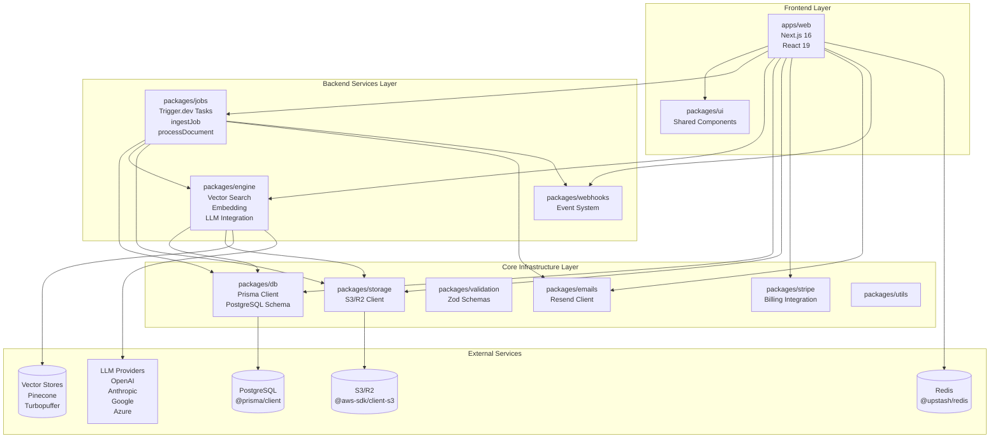

**Frontend Layer** (`apps/web`): Next.js application providing dashboard UI, chat interfaces, and API routes [apps/web/package.json:54](). Built with React 19 and Server Components [package.json:59-64]().

**Backend Services Layer**: Stateless compute services that handle resource-intensive operations:
- `packages/jobs`: Background job processing via Trigger.dev orchestration [packages/jobs/package.json:30]().
- `packages/engine`: AI/ML capabilities including vector search, embeddings, and LLM interactions [packages/engine/package.json:147-154]().
- `packages/webhooks`: Event notification system for external integrations [apps/web/package.json:31]().

**Core Infrastructure Layer**: Foundational packages providing shared functionality:
- `packages/db`: Prisma ORM with PostgreSQL schema and type-safe database client [packages/db/package.json:26-33]().
- `packages/storage`: S3-compatible file storage abstraction [packages/storage/package.json:205-206]().
- `packages/validation`: Shared Zod schemas for runtime validation [package.json:47-49]().
- `packages/stripe`: Stripe integration for billing and subscription management [apps/web/package.json:26]().

**Sources:** [apps/web/package.json:19-31](), [bun.lock:14-447](), [apps/web/next.config.ts:24-37]()

## Package Architecture and Dependencies

The monorepo is organized as a Bun workspace with the following structure:

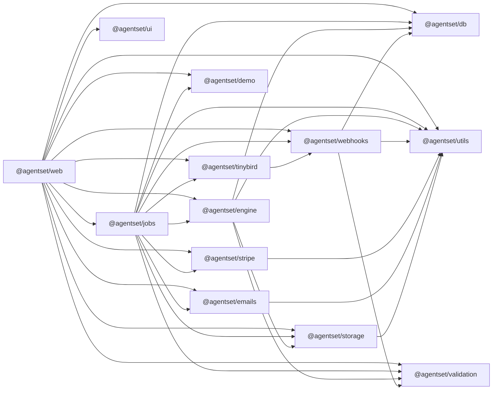

**Key Dependency Patterns:**
- `apps/web` consumes all packages, serving as the main application entry point [apps/web/package.json:20-31]().
- `packages/jobs` depends on most packages to coordinate background processing [packages/jobs/package.json:20-29]().
- `packages/engine` is isolated with minimal dependencies (db, storage, validation, utils) [packages/engine/package.json:143-146]().
- Core packages like `@agentset/utils` and `@agentset/validation` have no internal dependencies, ensuring clean separation [packages/storage/package.json:204]().

**Sources:** [package.json:36-66](), [bun.lock:4-447](), [apps/web/package.json:20-31]()

## Technology Stack

AgentSet is built on modern, production-grade technologies:

### Frontend Stack

| Technology | Version | Purpose |
|------------|---------|---------|
| **Next.js** | 16.1.6 | React framework with App Router and API routes [apps/web/package.json:54]() |
| **React** | 19.2.3 | UI library with latest concurrent features [package.json:60]() |
| **tRPC** | 11.7.2 | End-to-end type-safe APIs [package.json:53-55]() |
| **TanStack Query** | 5.90.18 | Data fetching and state management [package.json:52]() |
| **AI SDK** | 5.0.44 | Vercel AI SDK for streaming LLM responses [package.json:51]() |
| **Tailwind CSS** | 4.1.18 | Utility-first CSS framework [package.json:45]() |
| **Better Auth** | 1.4.13 | Authentication framework [apps/web/package.json:48]() |

### Backend Stack

| Technology | Version | Purpose |
|------------|---------|---------|
| **Prisma** | 7.4.1 | ORM with type-safe database client [packages/db/package.json:28]() |
| **Trigger.dev** | 4.3.0 | Job orchestration and background tasks [packages/jobs/package.json:30]() |
| **PostgreSQL** | - | Primary database (via `@prisma/adapter-pg`) [packages/db/package.json:27]() |
| **Redis** | - | Session storage and caching (via `@upstash/redis`) [apps/web/package.json:44]() |
| **Bun** | 1.3.6 | JavaScript runtime and package manager [package.json:4]() |
| **Zod** | 4.3.6 | Schema validation and type inference [package.json:47]() |

### AI/ML Stack

| Technology | Purpose |
|------------|---------|
| **OpenAI** | Embeddings and chat models [packages/engine/package.json:150]() |
| **Anthropic** | Claude models for chat [packages/engine/package.json:147]() |
| **Google AI** | Gemini models for chat [packages/engine/package.json:149]() |
| **Azure OpenAI** | Enterprise OpenAI deployments [packages/engine/package.json:148]() |
| **Voyage AI** | Specialized embedding models [packages/engine/package.json:156]() |
| **Cohere** | Reranking services [packages/engine/package.json:155]() |
| **Pinecone** | Serverless vector database [packages/engine/package.json:152]() |
| **Turbopuffer** | High-performance vector database [packages/engine/package.json:154]() |

**Sources:** [apps/web/package.json:19-70](), [package.json:42-66](), [packages/engine/package.json:142-159]()

## Development Workflow

AgentSet uses Turbo for monorepo orchestration and Bun for fast package management:

```bash
# Install dependencies
bun install

# Database operations
bun db:deploy      # Run migrations [package.json:12]
bun db:studio      # Open Prisma Studio [package.json:13]
bun db:generate    # Generate Prisma Client [package.json:15]

# Development
bun dev            # Watch all packages [package.json:17]
bun dev:web        # Run only web app [package.json:18]
bun dev:emails     # Preview email templates [package.json:19]

# Build and deployment
bun build          # Build all packages [package.json:9]
bun typecheck      # Type check all packages [package.json:26]
bun lint           # Lint all packages [package.json:22]
```

### Environment Configuration

AgentSet uses `@t3-oss/env-nextjs` for type-safe environment variable management [apps/web/package.json:38](). Configuration is validated during the build process, preventing runtime errors due to missing secrets [apps/web/next.config.ts:2-4]().

**Sources:** [package.json:8-27](), [apps/web/package.json:6-17](), [apps/web/next.config.ts:1-59]()

## Multi-Tenancy Model

AgentSet implements a hierarchical multi-tenant architecture managed via Prisma [packages/db/package.json:31-33]().

**Isolation Boundaries:**
- **Organization**: Billing boundary, resource limits, and team membership.
- **Namespace**: Logical container for documents, embeddings, and vector store configurations.
- **Document**: Individual content units tracked via `IngestJob` status.

Each namespace maintains its own configuration for embedding models and vector store providers, enabling organizations to tailor their RAG pipeline to specific use cases.

**Sources:** [README.md:46](), [packages/db/package.json:1-46](), [packages/jobs/package.json:20-35]()

## Key Entry Points

Understanding AgentSet's codebase requires familiarity with these key entry points:

### Web Application Routes

| Route Pattern | Purpose |
|---------------|---------|
| `/apps/web/src/app` | Main dashboard and chat interfaces |
| `/apps/web/src/app/api` | Internal and public API endpoints |
| `/apps/web/src/app/api/stripe/webhook` | Stripe payment event handling [package.json:16]() |

### Background Job Tasks

| Task Name | Purpose |
|-----------|---------|
| `trigger:dev` | Runs Trigger.dev in development mode [packages/jobs/package.json:6]() |
| `trigger:deploy` | Deploys background jobs to Trigger.dev cloud [packages/jobs/package.json:7]() |

### Core Service Packages

| Package | Purpose |
|----------|----------|
| `@agentset/engine` | AI/ML core: LLM providers, vector stores, and embeddings [packages/engine/package.json:141]() |
| `@agentset/db` | Database client and schema management [packages/db/package.json:2]() |
| `@agentset/ui` | Shared UI component library based on shadcn/ui [packages/ui/package.json:2]() |

**Sources:** [package.json:8-27](), [apps/web/package.json:1-86](), [packages/jobs/package.json:1-47]()

---

# Page: Architecture Overview

# Architecture Overview

<details>
<summary>Relevant source files</summary>

The following files were used as context for generating this wiki page:

- [.cursor/rules/project-structure.mdc](.cursor/rules/project-structure.mdc)
- [.github/ISSUE_TEMPLATE/bug_report.md](.github/ISSUE_TEMPLATE/bug_report.md)
- [.github/ISSUE_TEMPLATE/feature_request.md](.github/ISSUE_TEMPLATE/feature_request.md)
- [.github/assets/.gitkeep](.github/assets/.gitkeep)
- [.github/assets/readme-cover.png](.github/assets/readme-cover.png)
- [.github/assets/screenshot.png](.github/assets/screenshot.png)
- [.github/assets/star-us.png](.github/assets/star-us.png)
- [LICENSE.md](LICENSE.md)
- [README.md](README.md)
- [apps/web/next.config.ts](apps/web/next.config.ts)
- [apps/web/package.json](apps/web/package.json)
- [bun.lock](bun.lock)
- [package.json](package.json)
- [packages/db/package.json](packages/db/package.json)
- [packages/jobs/package.json](packages/jobs/package.json)
- [packages/ui/package.json](packages/ui/package.json)
- [packages/ui/src/components/image-uploader.tsx](packages/ui/src/components/image-uploader.tsx)

</details>


## Purpose and Scope

This document describes the overall system architecture of the AgentSet platform, including its three-layer design (frontend, backend services, and core infrastructure), multi-tenancy model, and how components interact. This page provides a high-level view of the system structure and package organization.

For details on specific subsystems, see:
- Monorepo structure and build system: [Monorepo Structure](#1.2)
- Database schema and data model: [Database Schema](#2.1)
- Document processing pipeline: [Document Processing](#3)
- RAG and search implementation: [RAG and Search System](#4)
- External service integrations: [9.3 External Service Integration]()

---

## System Architecture

AgentSet is structured as a monorepo with clear separation of concerns across three primary architectural layers:

1. **Frontend Layer**: Next.js application providing the user interface.
2. **Backend Services Layer**: Compute-intensive operations for document processing and AI/ML.
3. **Core Infrastructure Layer**: Foundational services for data access, validation, and shared utilities.

The platform implements a multi-tenant architecture where organizations contain namespaces, which serve as isolated data containers with independent configuration for embeddings, vector stores, and file storage.

### Three-Layer Architecture

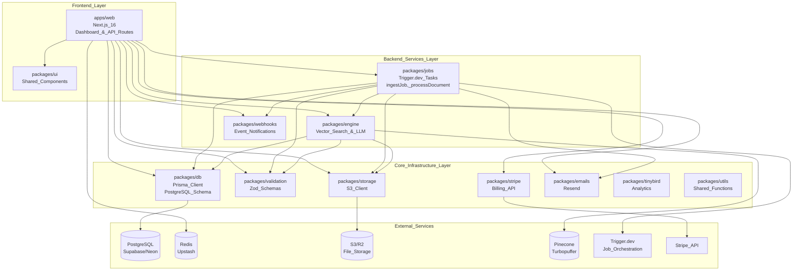

**Sources**: [package.json:1-67](), [apps/web/package.json:1-86](), [bun.lock:1-447]()

---

## Frontend Layer

The frontend layer consists of the Next.js application (`apps/web`) and shared UI components (`packages/ui`).

### apps/web - Next.js Application

The primary application is built with Next.js 16 and implements:
- **Server Components**: Dashboard pages, authentication flows, settings.
- **API Routes**: tRPC endpoints, public REST API, webhook handlers.
- **Client Components**: Interactive chat interface, document management UI.

Key dependencies in [apps/web/package.json:19-70]():
- `next` (16.1.6) - Framework.
- `@trpc/server`, `@trpc/client` - Type-safe API layer.
- `ai` - Vercel AI SDK for streaming LLM responses.
- `better-auth` - Authentication system.
- `@upstash/redis`, `@upstash/ratelimit` - Session and rate limiting.
- `posthog-js`, `posthog-node` - Analytics.

### packages/ui - Shared Components

Provides reusable UI components built on Radix UI:
- Form components: `input`, `textarea`, `select`, `checkbox`.
- Data display: `data-table`, `avatar`, `badge`.
- Feedback: `dialog`, `alert`, `sonner` (toast notifications).
- Custom: `image-uploader`, `file-uploader`, `copy-button`.

The `ImageUploader` component [packages/ui/src/components/image-uploader.tsx:51-227]() demonstrates the frontend architecture: it uses the `useFileUpload` hook [packages/ui/src/components/image-uploader.tsx:73-87]() for file handling, client-side image compression with `browser-image-compression` [packages/ui/src/components/image-uploader.tsx:12-31](), and base64 encoding for state management.

**Sources**: [apps/web/package.json:1-86](), [packages/ui/package.json:1-109](), [packages/ui/src/components/image-uploader.tsx:1-227]()

---

## Backend Services Layer

The backend services layer handles compute-intensive operations independently from the web application, enabling horizontal scaling.

### packages/jobs - Background Job Processing

Implements the document processing pipeline using Trigger.dev. Core tasks include:

| Task Name | Purpose | Batch Size |
|-----------|---------|------------|
| `ingestJob` | Orchestrates ingestion, creates document records | N/A |
| `processDocument` | Generates embeddings, upserts to vector stores | Spawned in batches |
| `deleteIngestJob` | Cascading deletion of ingestion data | N/A |
| `deleteDocument` | Removes document from vector store and S3 | N/A |

Job dependencies in [packages/jobs/package.json:19-35]():
- `@trigger.dev/sdk` (4.3.0) - Job orchestration framework.
- `@agentset/db`, `@agentset/engine`, `@agentset/storage` - Core services.
- `@agentset/webhooks` - Event emission.
- `@upstash/redis` - Temporary chunk storage during partitioning.

### packages/engine - AI/ML Processing

Provides abstractions for vector search, embeddings, and LLM interactions. It integrates multiple AI providers:

**Vector Store Abstraction**: Unified interface for Pinecone and Turbopuffer implementations.
- Supports `@pinecone-database/pinecone` (5.1.1) [packages/engine/package.json:152]().
- Supports `@turbopuffer/turbopuffer` (1.10.0) [packages/engine/package.json:154]().

**Embedding Generation**: Multi-provider support via `voyage-ai-provider`, `cohere-ai`, and Azure/OpenAI [packages/engine/package.json:147-156]().

**LLM Integration**: Uses Vercel AI SDK with provider adapters:
- `@ai-sdk/anthropic`, `@ai-sdk/openai`, `@ai-sdk/google`, `@ai-sdk/azure` [packages/engine/package.json:147-150]().

**Sources**: [packages/jobs/package.json:1-47](), [packages/engine/package.json:141-158](), [bun.lock:139-168]()

---

## Core Infrastructure Layer

The core infrastructure provides foundational services shared across all layers.

### packages/db - Database Client

Exposes Prisma client with multiple entry points as defined in [packages/db/package.json:5-12]():

| Export Path | Purpose |
|-------------|---------|
| `@agentset/db` | Main entry point |
| `@agentset/db/client` | PrismaClient singleton instance |
| `@agentset/db/trigger` | Trigger.dev-specific client integration |
| `@agentset/db/types` | Generated Prisma types |
| `@agentset/db/schemas` | Zod validation schemas |

The client uses `@prisma/adapter-pg` [packages/db/package.json:27]() for connection pooling.

### packages/storage - S3 Integration

Provides S3 client wrapper using `@aws-sdk/client-s3` [packages/storage/package.json:205]() for Cloudflare R2 or AWS S3:
- File upload with presigned URLs [packages/storage/package.json:206]().
- Chunk storage for document processing.

**Sources**: [packages/db/package.json:1-46](), [packages/storage/package.json:201-217](), [bun.lock:84-102]()

---

## Multi-Tenancy Model

The platform implements multi-tenancy through a hierarchical data model where `Organization` is the root tenant and `Namespace` is the data isolation boundary.

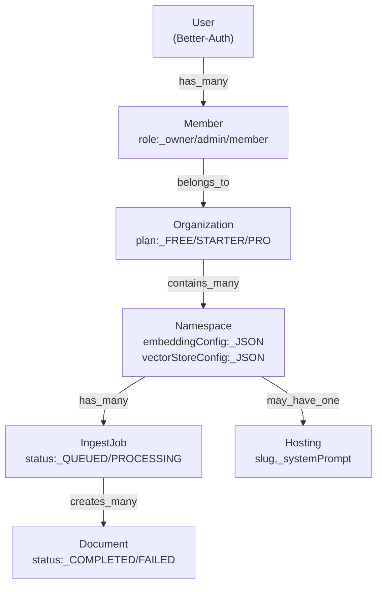

### Isolation Boundaries

**Organization Level**:
- Billing and subscription management via `@agentset/stripe`.
- Team membership via `Member` table with roles.

**Namespace Level**:
- Independent vector store instances (Pinecone namespace or Turbopuffer namespace).
- Separate embedding model configuration stored in `embeddingConfig`.
- Independent hosting configuration for public chat interfaces.

**Sources**: [README.md:33-48](), [bun.lock:14-83](), [.cursor/rules/project-structure.mdc:177-190]()

---

## Component Interaction Patterns

### Request Flow: Web App → tRPC → Database

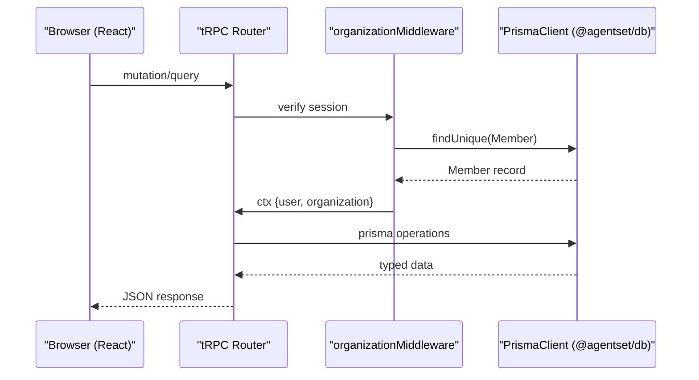

### Request Flow: Document Ingestion

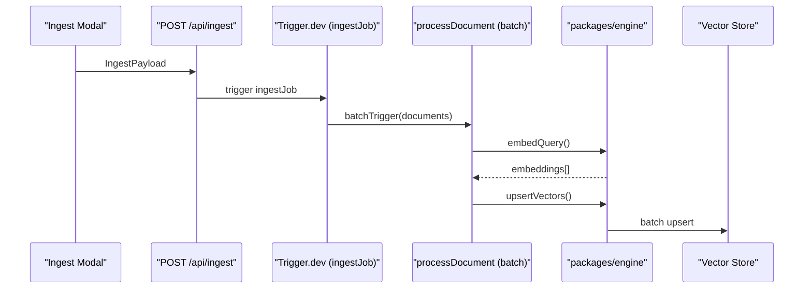

**Sources**: [apps/web/package.json:19-70](), [packages/jobs/package.json:19-35](), [packages/engine/package.json:141-158]()

---

## Package Dependency Graph

The monorepo structure enforces dependency directionality to prevent circular imports as defined in [.cursor/rules/project-structure.mdc:185-190]().

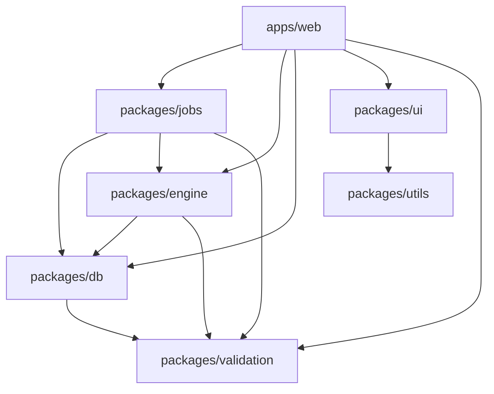

### Build Orchestration

Turbo [package.json:8-27]() orchestrates builds:
- `turbo run build`: Builds all packages in dependency order.
- `turbo watch dev`: Development mode with hot reload.
- Transpilation: Next.js is configured to transpile workspace packages directly [apps/web/next.config.ts:24-37]().

**Sources**: [package.json:1-67](), [apps/web/next.config.ts:1-59](), [.cursor/rules/project-structure.mdc:130-141]()

---

# Page: Monorepo Structure

# Monorepo Structure

<details>
<summary>Relevant source files</summary>

The following files were used as context for generating this wiki page:

- [.cursor/mcp.json](.cursor/mcp.json)
- [.cursor/rules/animations.mdc](.cursor/rules/animations.mdc)
- [.cursor/rules/project-structure.mdc](.cursor/rules/project-structure.mdc)
- [.cursor/rules/shadcn.mdc](.cursor/rules/shadcn.mdc)
- [.cursor/rules/tailwind.mdc](.cursor/rules/tailwind.mdc)
- [apps/web/next.config.ts](apps/web/next.config.ts)
- [apps/web/package.json](apps/web/package.json)
- [apps/web/src/app/app.agentset.ai/(dashboard)/[slug]/webhooks/layout.tsx](apps/web/src/app/app.agentset.ai/(dashboard)/[slug]/webhooks/layout.tsx)
- [apps/web/src/app/app.agentset.ai/(dashboard)/[slug]/webhooks/new/page.tsx](apps/web/src/app/app.agentset.ai/(dashboard)/[slug]/webhooks/new/page.tsx)
- [apps/web/src/app/app.agentset.ai/(dashboard)/[slug]/webhooks/page.tsx](apps/web/src/app/app.agentset.ai/(dashboard)/[slug]/webhooks/page.tsx)
- [apps/web/src/app/robots.ts](apps/web/src/app/robots.ts)
- [bun.lock](bun.lock)
- [package.json](package.json)
- [packages/db/package.json](packages/db/package.json)
- [packages/jobs/package.json](packages/jobs/package.json)
- [packages/ui/package.json](packages/ui/package.json)
- [packages/ui/src/components/image-uploader.tsx](packages/ui/src/components/image-uploader.tsx)

</details>


## Purpose and Scope

This document details the physical organization of the Agentset monorepo, including workspace configuration, package dependencies, catalog-based dependency management, and build orchestration. Agentset uses **Bun** as its primary package manager and runtime, with **Turborepo** managing the build pipeline and caching.

## Workspace Organization

The Agentset monorepo uses Bun workspaces with a three-tier directory structure defined in the root [package.json:36-41]():

```json
"workspaces": {
  "packages": [
    "apps/*",
    "packages/*",
    "tooling/*"
  ]
}
```

### Directory Structure

```mermaid
graph TB
    subgraph "Root"
        Root["/"]
    end
    
    subgraph "Applications Layer"
        AppsDir["apps/"]
        Web["apps/web<br/>Next.js Application"]
    end
    
    subgraph "Core Packages Layer"
        PackagesDir["packages/"]
        DB["packages/db<br/>Prisma Client & Migrations"]
        Engine["packages/engine<br/>RAG Engine & Vector Store"]
        Jobs["packages/jobs<br/>Trigger.dev Background Tasks"]
        Storage["packages/storage<br/>S3 File Utilities"]
        Stripe["packages/stripe<br/>Billing Integration"]
        Emails["packages/emails<br/>React Email Templates"]
        UI["packages/ui<br/>Shared Shadcn Components"]
        Utils["packages/utils<br/>Shared Helpers"]
        Validation["packages/validation<br/>Shared Zod Schemas"]
        Webhooks["packages/webhooks<br/>Webhook Handlers"]
        Tinybird["packages/tinybird<br/>Analytics & Warehousing"]
    end
    
    subgraph "Tooling Layer"
        ToolingDir["tooling/"]
        ESLint["tooling/eslint<br/>Shared Lint Config"]
        Prettier["tooling/prettier<br/>Formatting Config"]
        TSConfig["tooling/typescript<br/>Base TS Configs"]
    end
    
    Root --> AppsDir
    Root --> PackagesDir
    Root --> ToolingDir
    
    AppsDir --> Web
    
    PackagesDir --> DB
    PackagesDir --> Engine
    PackagesDir --> Jobs
    PackagesDir --> Storage
    PackagesDir --> Stripe
    PackagesDir --> Emails
    PackagesDir --> UI
    PackagesDir --> Utils
    PackagesDir --> Validation
    PackagesDir --> Webhooks
    PackagesDir --> Tinybird
    
    ToolingDir --> ESLint
    ToolingDir --> Prettier
    ToolingDir --> TSConfig
```

**Sources:** [package.json:36-41](), [.cursor/rules/project-structure.mdc:13-33]()

### Package Types

The monorepo contains three categories of packages, all using the `@agentset/*` namespace:

| Category | Purpose | Packages |
|----------|---------|----------|
| **Applications** | Deployable services | `@agentset/web` |
| **Core Packages** | Shared logic & infrastructure | `db`, `engine`, `jobs`, `storage`, `stripe`, `emails`, `ui`, `utils`, `validation`, `webhooks`, `tinybird`, `demo` |
| **Tooling** | Dev environment config | `eslint-config`, `prettier-config`, `tsconfig` |

Packages are configured to export specific entry points. For example, `@agentset/db` provides separate exports for the client, types, and browser-safe schemas [packages/db/package.json:5-12]().

**Sources:** [apps/web/package.json:2-3](), [packages/db/package.json:2-12](), [packages/jobs/package.json:2-3]()

## Package Dependencies

### Dependency Graph (Code Entity Space)

The following diagram illustrates how the core code entities (packages) depend on one another.

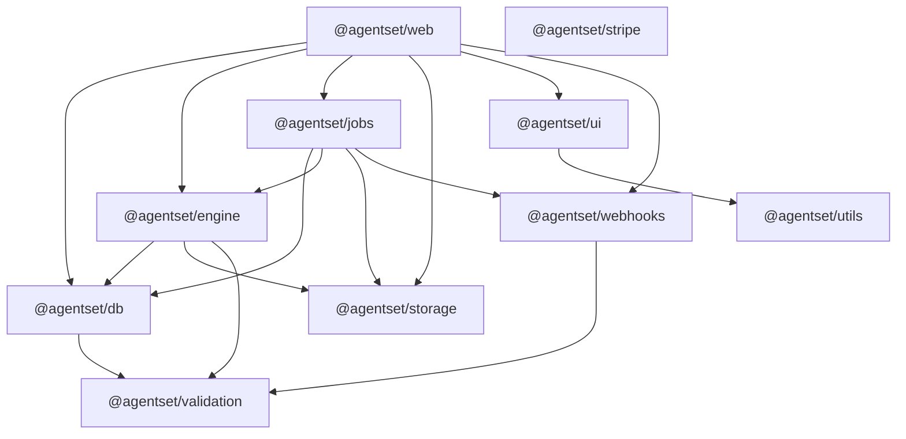

**Sources:** [apps/web/package.json:19-31](), [packages/jobs/package.json:19-29](), [packages/engine/package.json:142-146]()

### Workspace Management

Internal dependencies are linked using the `workspace:*` protocol [apps/web/package.json:20-31](). This ensures that changes in a package like `@agentset/ui` are immediately reflected in `@agentset/web` without requiring a publish step.

To facilitate local development, the Next.js configuration in `apps/web` uses the `transpilePackages` option to automatically handle these local workspace dependencies [apps/web/next.config.ts:24-37]().

**Sources:** [apps/web/package.json:20-31](), [apps/web/next.config.ts:24-37]()

## Catalog-Based Dependency Management

Agentset uses Bun's **Catalog** feature to centralize versions of external dependencies across the monorepo, preventing version drift. These are defined in the root [package.json:42-65]().

### Standard Catalog

The primary catalog [package.json:42-57]() standardizes versions for core libraries:

| Dependency | Version | Reference Syntax |
|------------|---------|------------------|
| `typescript` | ^5.9.3 | `"typescript": "catalog:"` |
| `zod` | 4.3.6 | `"zod": "catalog:"` |
| `ai` | ^5.0.44 | `"ai": "catalog:"` |
| `@trpc/server` | ^11.7.2 | `"@trpc/server": "catalog:"` |
| `vitest` | ^3.2.4 | `"vitest": "catalog:"` |

### React19 Catalog

A specialized catalog manages the React 19 ecosystem [package.json:58-65]():

```json
"catalogs": {
  "react19": {
    "react": "19.2.3",
    "react-dom": "19.2.3",
    "@types/react": "19.2.6"
  }
}
```

Packages reference this using `"react": "catalog:react19"` [apps/web/package.json:57-58]().

**Sources:** [package.json:42-65](), [apps/web/package.json:38-42](), [apps/web/package.json:57-58]()

## Build Orchestration with Turborepo

Turborepo is used to manage the build pipeline and cache results locally and in CI.

### Task Execution Flow

The root `package.json` provides scripts that delegate to `turbo` [package.json:8-27]():

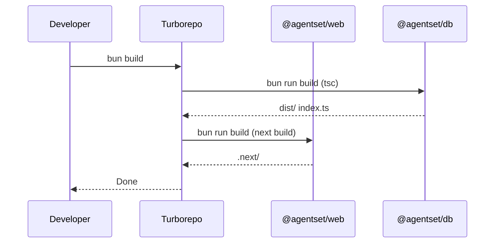

| Command | Internal Logic |
|---------|----------------|
| `bun build` | `turbo run build` [package.json:9]() |
| `bun dev` | `turbo watch dev --continue` [package.json:17]() |
| `bun db:generate` | `turbo -F @agentset/db db:generate` [package.json:15]() |
| `bun typecheck` | `turbo run typecheck` [package.json:26]() |

### Environment Handling

Environment variables are managed at the root in a `.env` file. Package scripts often reference this file directly using Bun's `--env-file` flag to ensure consistent configuration [apps/web/package.json:7-16](), [packages/db/package.json:20-23]().

**Sources:** [package.json:8-27](), [apps/web/package.json:7-16](), [packages/db/package.json:20-23]()

## Key Package Implementation Details

### `@agentset/ui` (Shared Components)
This package exports individual UI components based on **Shadcn UI**. It uses a granular export strategy [packages/ui/package.json:5-62](), allowing apps to import only what they need:
- `./button`: [packages/ui/package.json:29]()
- `./data-table`: [packages/ui/package.json:34]()
- `./ai/*`: [packages/ui/package.json:60]()

### `@agentset/db` (Data Layer)
Manages the Prisma schema and client. It provides a `db:generate` script to sync the Prisma client with the schema [packages/db/package.json:20]().

### `@agentset/jobs` (Background Processing)
Contains the **Trigger.dev** task definitions. It depends on nearly all other packages to perform actions like document ingestion, email sending, and vector indexing [packages/jobs/package.json:19-29]().

**Sources:** [packages/ui/package.json:5-62](), [packages/db/package.json:20](), [packages/jobs/package.json:19-29]()

---

# Page: Technology Stack

# Technology Stack

<details>
<summary>Relevant source files</summary>

The following files were used as context for generating this wiki page:

- [.env.example](.env.example)
- [apps/web/next.config.ts](apps/web/next.config.ts)
- [apps/web/package.json](apps/web/package.json)
- [apps/web/src/app/api/(internal-api)/chat/route.ts](apps/web/src/app/api/(internal-api)/chat/route.ts)
- [apps/web/src/app/api/(internal-api)/hosting-chat/route.ts](apps/web/src/app/api/(internal-api)/hosting-chat/route.ts)
- [apps/web/src/app/api/(internal-api)/hosting-search/route.ts](apps/web/src/app/api/(internal-api)/hosting-search/route.ts)
- [apps/web/src/app/api/(public-api)/v1/namespace/[namespaceId]/search/route.ts](apps/web/src/app/api/(public-api)/v1/namespace/[namespaceId]/search/route.ts)
- [apps/web/src/env.ts](apps/web/src/env.ts)
- [apps/web/src/instrumentation-client.ts](apps/web/src/instrumentation-client.ts)
- [apps/web/src/lib/agentic/index.ts](apps/web/src/lib/agentic/index.ts)
- [apps/web/src/lib/agentic/search.ts](apps/web/src/lib/agentic/search.ts)
- [apps/web/src/server/api/routers/search.ts](apps/web/src/server/api/routers/search.ts)
- [bun.lock](bun.lock)
- [package.json](package.json)
- [packages/db/package.json](packages/db/package.json)
- [packages/engine/package.json](packages/engine/package.json)
- [packages/engine/src/env.ts](packages/engine/src/env.ts)
- [packages/engine/src/vector-store/common/vector-store.ts](packages/engine/src/vector-store/common/vector-store.ts)
- [packages/engine/src/vector-store/index.ts](packages/engine/src/vector-store/index.ts)
- [packages/engine/src/vector-store/pinecone/index.ts](packages/engine/src/vector-store/pinecone/index.ts)
- [packages/engine/src/vector-store/query.ts](packages/engine/src/vector-store/query.ts)
- [packages/engine/src/vector-store/turbopuffer/index.ts](packages/engine/src/vector-store/turbopuffer/index.ts)
- [packages/jobs/package.json](packages/jobs/package.json)
- [packages/ui/package.json](packages/ui/package.json)
- [packages/ui/src/components/image-uploader.tsx](packages/ui/src/components/image-uploader.tsx)
- [packages/validation/src/vector-store/turbopuffer.ts](packages/validation/src/vector-store/turbopuffer.ts)
- [turbo.json](turbo.json)

</details>


This document provides a comprehensive overview of the technologies, frameworks, libraries, and external services used throughout the AgentSet codebase. It covers the monorepo structure, frontend and backend frameworks, AI/ML integrations, data persistence layers, and development tooling.

## Core Framework Stack

AgentSet is built on a modern TypeScript stack centered around **Next.js 15** as the full-stack framework. The application layer uses **React 19** for UI rendering, leveraging both Server and Client Components. Type safety is enforced through **TypeScript** across all packages.

| Technology | Version | Purpose |
|------------|---------|---------|
| Next.js | `^16.1.6` | Full-stack framework with App Router [apps/web/package.json:54]() |
| React | `19.2.3` | UI rendering library (Catalog) [package.json:60]() |
| TypeScript | `^5.9.3` | Type-safe language (Catalog) [package.json:46]() |
| Tailwind CSS | `^4.1.18` | Utility-first CSS framework [package.json:45]() |
| tRPC | `^11.7.2` | Type-safe API layer (Catalog) [package.json:53-55]() |
| TanStack Query | `^5.90.18` | Server state management (Catalog) [package.json:52]() |
| Zustand | `^5.0.10` | Client state management [apps/web/package.json:70]() |
| AI SDK | `^5.0.44` | Streaming AI responses and chat logic [package.json:51]() |

### Frontend & API Interaction
The frontend uses `@agentset/ui` as a shared component library built on **Radix UI** primitives and **Tailwind CSS**. The tRPC stack enables end-to-end type safety between the Next.js client and server components by inferring types from routers defined in the backend.

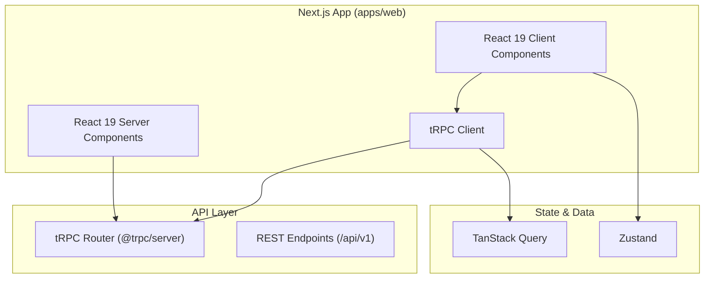
**Sources:** [apps/web/package.json:32-70](), [package.json:51-63]()

## AI and Machine Learning Stack

The AI stack is abstracted within the `@agentset/engine` package. It uses the **Vercel AI SDK** to provide a unified interface for multiple LLM providers.

### LLM Providers
AgentSet supports a wide array of models through specialized provider packages:
- **OpenAI**: `@ai-sdk/openai` [packages/engine/package.json:150]()
- **Anthropic**: `@ai-sdk/anthropic` [packages/engine/package.json:147]()
- **Google**: `@ai-sdk/google` [packages/engine/package.json:149]()
- **Azure**: `@ai-sdk/azure` [packages/engine/package.json:148]()

### RAG and Search Components
- **Reranking**: Integrated via `cohere-ai` [packages/engine/package.json:155]() and `zeroentropy` [packages/engine/package.json:157]().
- **Embedding**: Managed through abstractions in the engine, supporting providers like Voyage AI [packages/engine/package.json:156]().
- **Agentic Pipeline**: Implemented in `apps/web/src/lib/agentic/index.ts`, which uses `agenticSearch` to iteratively generate queries and evaluate results [apps/web/src/lib/agentic/index.ts:67-82]().

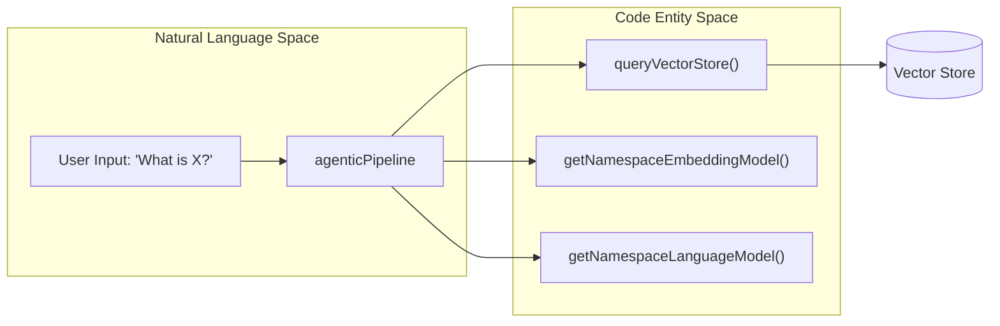
**Sources:** [apps/web/src/lib/agentic/index.ts:138-190](), [apps/web/src/app/api/(internal-api)/chat/route.ts:76-80]()

## Data Layer

AgentSet utilizes a multi-layered data architecture for metadata, vector embeddings, and caching.

### Relational Database
**Prisma** serves as the ORM, connecting to a **PostgreSQL** database. It uses the `@prisma/adapter-pg` for efficient connection handling [packages/db/package.json:27]().
- **Schema**: Defined in `packages/db/prisma/schema` [packages/db/package.json:32]().
- **Client**: A singleton `PrismaClient` is exported from `@agentset/db/client` [packages/db/package.json:9]().

### Vector Stores
The system supports multiple vector database backends through a common `VectorStore` interface [packages/engine/src/vector-store/common/vector-store.ts]():
- **Pinecone**: Standard vector storage implementation [packages/engine/package.json:152]().
- **Turbopuffer**: High-performance vector storage with hybrid search (BM25 + ANN) and Reciprocal Rank Fusion (RRF) [packages/engine/src/vector-store/turbopuffer/index.ts:61-78]().

### Caching and Rate Limiting
- **Upstash Redis**: Used for global state and temporary storage during ingestion [packages/jobs/package.json:32]().
- **Upstash Ratelimit**: Implements sliding window rate limiting for API protection [apps/web/package.json:43]().

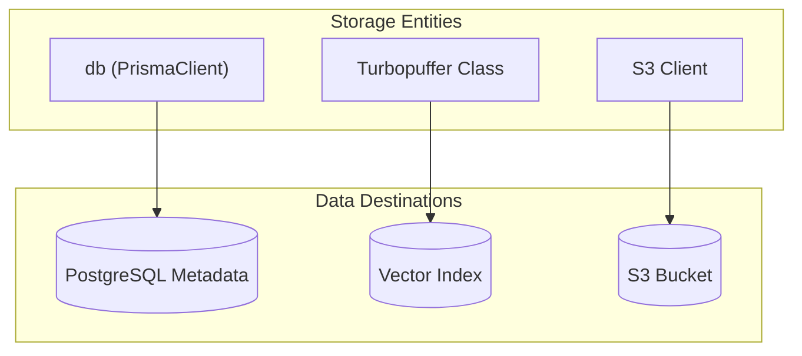
**Sources:** [packages/db/src/client.ts](), [packages/engine/src/vector-store/turbopuffer/index.ts:28](), [packages/storage/package.json:205]()

## Job Orchestration

Background tasks such as document ingestion, embedding generation, and status updates are managed by **Trigger.dev**.

- **SDK**: `@trigger.dev/sdk` [packages/jobs/package.json:30]().
- **Execution**: Jobs are defined in the `packages/jobs` workspace and triggered via the Trigger.dev platform [packages/jobs/package.json:6-7]().
- **Context**: The `prismaExtension` for Trigger.dev ensures that database transactions and job contexts are correctly linked during execution.

**Sources:** [packages/jobs/package.json:1-47](), [turbo.json:60-63]()

## Infrastructure and Tooling

### Monorepo Management
The repository is managed using **Bun** workspaces and **TurboRepo** for task orchestration.
- **Bun**: Used as the package manager (`bun@1.3.6`) and test runner [package.json:4]().
- **Turbo**: Handles build caching and parallel execution of scripts like `build`, `lint`, and `typecheck` [package.json:9-27]().

### External Services
- **Authentication**: `better-auth` for session management and OAuth [apps/web/package.json:48]().
- **Billing**: `stripe` for subscription management and usage tracking [apps/web/package.json:26]().
- **Analytics**: `posthog-js` and `posthog-node` for client and server-side event tracking [apps/web/package.json:55-56]().
- **Emails**: `resend` for transactional email delivery [apps/web/package.json:59]().
- **File Storage**: AWS S3 (or compatible) via `@aws-sdk/client-s3` [packages/storage/package.json:205]().

**Sources:** [package.json:1-67](), [apps/web/package.json:19-71](), [turbo.json:73-120]()

---

# Page: Data Layer

# Data Layer

<details>
<summary>Relevant source files</summary>

The following files were used as context for generating this wiki page:

- [apps/web/scripts/populate-document-namespace-id.ts](apps/web/scripts/populate-document-namespace-id.ts)
- [packages/db/.gitignore](packages/db/.gitignore)
- [packages/db/prisma/migrations/20250413055012_add_limits_and_plans/migration.sql](packages/db/prisma/migrations/20250413055012_add_limits_and_plans/migration.sql)
- [packages/db/prisma/migrations/20250413055328_make_org_slug_required/migration.sql](packages/db/prisma/migrations/20250413055328_make_org_slug_required/migration.sql)
- [packages/db/prisma/migrations/20251202045758_update_auth_schema/migration.sql](packages/db/prisma/migrations/20251202045758_update_auth_schema/migration.sql)
- [packages/db/prisma/migrations/20260118061102_webhooks/migration.sql](packages/db/prisma/migrations/20260118061102_webhooks/migration.sql)
- [packages/db/prisma/migrations/20260118131244_add_webhook_enabled/migration.sql](packages/db/prisma/migrations/20260118131244_add_webhook_enabled/migration.sql)
- [packages/db/prisma/migrations/20260208232321_add_member_user_id_idx/migration.sql](packages/db/prisma/migrations/20260208232321_add_member_user_id_idx/migration.sql)
- [packages/db/prisma/schema/auth.prisma](packages/db/prisma/schema/auth.prisma)
- [packages/db/prisma/schema/namespace.prisma](packages/db/prisma/schema/namespace.prisma)
- [packages/db/prisma/schema/organization.prisma](packages/db/prisma/schema/organization.prisma)
- [packages/db/prisma/schema/schema.prisma](packages/db/prisma/schema/schema.prisma)
- [packages/db/prisma/schema/webhook.prisma](packages/db/prisma/schema/webhook.prisma)
- [packages/db/src/client.ts](packages/db/src/client.ts)
- [packages/db/src/index.ts](packages/db/src/index.ts)
- [packages/jobs/src/db.ts](packages/jobs/src/db.ts)
- [packages/jobs/trigger.config.ts](packages/jobs/trigger.config.ts)

</details>


## Purpose and Scope

The Data Layer encompasses all data persistence mechanisms in the AgentSet platform. This includes the primary PostgreSQL database (accessed via Prisma ORM) for relational metadata, vector databases for semantic search, Redis for temporary caching, and S3-compatible storage for files. This page provides a high-level overview of the data architecture and how these components interact to support multi-tenant RAG operations.

For detailed information about specific aspects of the data layer:
- **Database Schema**: Documenting the Prisma models, multi-tenant hierarchy, and status enums. See [Database Schema](#2.1).
- **Database Client Configuration**: Explaining the `PrismaClient` setup, connection pooling, and Trigger.dev integration. See [Database Client Configuration](#2.2).
- **Vector Store System**: Documenting the abstraction layer for Pinecone and Turbopuffer. See [Vector Store System](#2.3).

## Data Architecture Overview

The data layer follows a multi-store architecture where different types of data are stored in specialized systems optimized for their access patterns. PostgreSQL serves as the authoritative source of truth for configuration and metadata, while vector stores handle the high-dimensional embeddings required for retrieval.

### System Data Flow

The following diagram illustrates how the core application components interact with various data persistence layers.

**Diagram: Data Persistence Mapping**
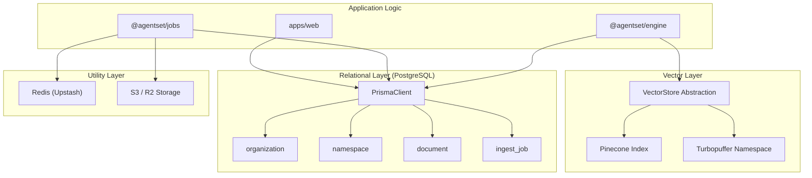
**Sources:** [packages/db/src/client.ts:7-25](), [packages/db/prisma/schema/namespace.prisma:6-49](), [packages/jobs/src/db.ts:1-31]()

## PostgreSQL and Prisma Integration

PostgreSQL is the primary relational store. The project uses Prisma as an ORM with a modular schema design located in `packages/db/prisma/schema/`.

### Core Entity Hierarchy

The data model is built around a multi-tenant hierarchy designed to isolate data between organizations and projects (namespaces).

| Entity | Description | Key Code Reference |
| :--- | :--- | :--- |
| **Organization** | The top-level tenant. Owns members, billing, and namespaces. | [packages/db/prisma/schema/organization.prisma:6-48]() |
| **Namespace** | A logical container for a specific RAG project. Stores embedding and vector store configs. | [packages/db/prisma/schema/namespace.prisma:6-49]() |
| **Document** | Individual content units (files, text, URLs) belonging to a namespace. | [apps/web/scripts/populate-document-namespace-id.ts:16-23]() |
| **Hosting** | Configuration for public-facing chat interfaces linked to a namespace. | [packages/db/prisma/schema/namespace.prisma:51-91]() |

**Sources:** [packages/db/prisma/schema/organization.prisma:6-48](), [packages/db/prisma/schema/namespace.prisma:6-91]()

### Database Client and Lifecycle

The `PrismaClient` is managed as a singleton in the web application to prevent connection exhaustion. In the background job environment (`Trigger.dev`), a specialized lifecycle management pattern is used to handle task pauses and resumes.

**Diagram: Code Entity to Database Connection**
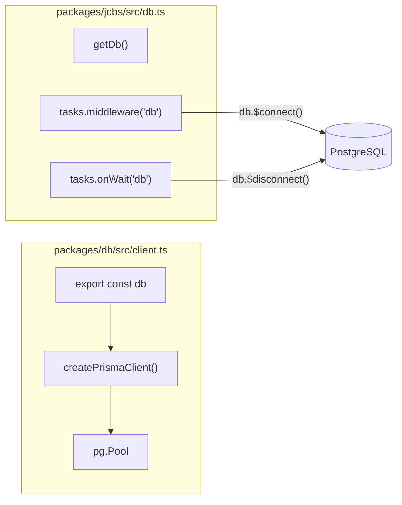
**Sources:** [packages/db/src/client.ts:7-25](), [packages/jobs/src/db.ts:12-30]()

## Vector and Keyword Stores

While metadata lives in PostgreSQL, document content is partitioned into vector stores for semantic retrieval. 

- **Vector Stores**: The system supports multiple providers (Pinecone, Turbopuffer). Configuration is stored as JSON in the `Namespace` model ([packages/db/prisma/schema/namespace.prisma:18-18]()).
- **Hybrid Search**: The `keywordEnabled` flag on the `Namespace` model indicates if hybrid (semantic + keyword) search is active ([packages/db/prisma/schema/namespace.prisma:36-36]()).

For details on the implementation of these search providers, see [Vector Store System](#2.3).

## Auxiliary Storage Layers

### Redis Caching
Redis is utilized primarily within the `@agentset/jobs` package for managing intermediate state during document ingestion and for rate-limiting. It acts as a high-speed buffer for data that does not require long-term persistence in PostgreSQL.

### S3 File Storage
S3-compatible storage is used for the physical persistence of uploaded files. The `Namespace` model tracks `fileStoreConfig` to determine where a specific project's raw assets are stored ([packages/db/prisma/schema/namespace.prisma:20-21]()).

**Sources:** [packages/db/prisma/schema/namespace.prisma:14-21](), [packages/jobs/trigger.config.ts:4-27]()

---

# Page: Database Schema

# Database Schema

<details>
<summary>Relevant source files</summary>

The following files were used as context for generating this wiki page:

- [apps/web/scripts/populate-document-namespace-id.ts](apps/web/scripts/populate-document-namespace-id.ts)
- [packages/db/.gitignore](packages/db/.gitignore)
- [packages/db/prisma/migrations/20250413055012_add_limits_and_plans/migration.sql](packages/db/prisma/migrations/20250413055012_add_limits_and_plans/migration.sql)
- [packages/db/prisma/migrations/20250413055328_make_org_slug_required/migration.sql](packages/db/prisma/migrations/20250413055328_make_org_slug_required/migration.sql)
- [packages/db/prisma/migrations/20251202045758_update_auth_schema/migration.sql](packages/db/prisma/migrations/20251202045758_update_auth_schema/migration.sql)
- [packages/db/prisma/migrations/20260118061102_webhooks/migration.sql](packages/db/prisma/migrations/20260118061102_webhooks/migration.sql)
- [packages/db/prisma/migrations/20260118131244_add_webhook_enabled/migration.sql](packages/db/prisma/migrations/20260118131244_add_webhook_enabled/migration.sql)
- [packages/db/prisma/migrations/20260208232321_add_member_user_id_idx/migration.sql](packages/db/prisma/migrations/20260208232321_add_member_user_id_idx/migration.sql)
- [packages/db/prisma/schema/auth.prisma](packages/db/prisma/schema/auth.prisma)
- [packages/db/prisma/schema/document.prisma](packages/db/prisma/schema/document.prisma)
- [packages/db/prisma/schema/ingest-job.prisma](packages/db/prisma/schema/ingest-job.prisma)
- [packages/db/prisma/schema/namespace.prisma](packages/db/prisma/schema/namespace.prisma)
- [packages/db/prisma/schema/organization.prisma](packages/db/prisma/schema/organization.prisma)
- [packages/db/prisma/schema/schema.prisma](packages/db/prisma/schema/schema.prisma)
- [packages/db/prisma/schema/webhook.prisma](packages/db/prisma/schema/webhook.prisma)
- [packages/db/src/client.ts](packages/db/src/client.ts)
- [packages/db/src/index.ts](packages/db/src/index.ts)
- [packages/jobs/src/db.ts](packages/jobs/src/db.ts)
- [packages/jobs/trigger.config.ts](packages/jobs/trigger.config.ts)

</details>


## Purpose and Scope

This document provides a comprehensive reference for the AgentSet database schema implemented using Prisma ORM with PostgreSQL. It covers all models, relationships, enums, indexes, and constraints that define the platform's data layer. The schema implements a multi-tenant architecture with hierarchical resource organization and flexible JSON-based configuration.

For information about the database client configuration and connection management, see [Database Client Configuration](2.2). For vector store data management, see [Vector Store System](2.3).

## Overview

The AgentSet database schema is organized around a four-tier tenant hierarchy: `User` → `Organization` → `Namespace` → `Document`. This structure enables multi-tenancy with strong data isolation, role-based access control, and aggregate usage tracking for billing purposes.

### Core Characteristics

- **Multi-tenant architecture**: Organizations serve as the primary tenant boundary [packages/db/prisma/schema/organization.prisma:6-48]().
- **Flexible configuration**: JSON fields store provider-specific settings for embeddings, vector stores, and LLMs [packages/db/prisma/schema/namespace.prisma:14-21]().
- **Aggregate counters**: Denormalized metrics track usage (documents, pages, search usage) at multiple levels for performance [packages/db/prisma/schema/organization.prisma:20-28]().
- **Cascading deletes**: Foreign key constraints ensure referential integrity during deletion [packages/db/prisma/schema/namespace.prisma:12-12]().
- **Status tracking**: Enums manage entity lifecycle states (ACTIVE, DELETING, PROCESSING) [packages/db/prisma/schema/document.prisma:1-13]().

Sources: [packages/db/prisma/schema/namespace.prisma](), [packages/db/prisma/schema/organization.prisma](), [packages/db/prisma/schema/document.prisma](), [packages/db/prisma/schema/ingest-job.prisma]()

## Entity Relationship Diagram

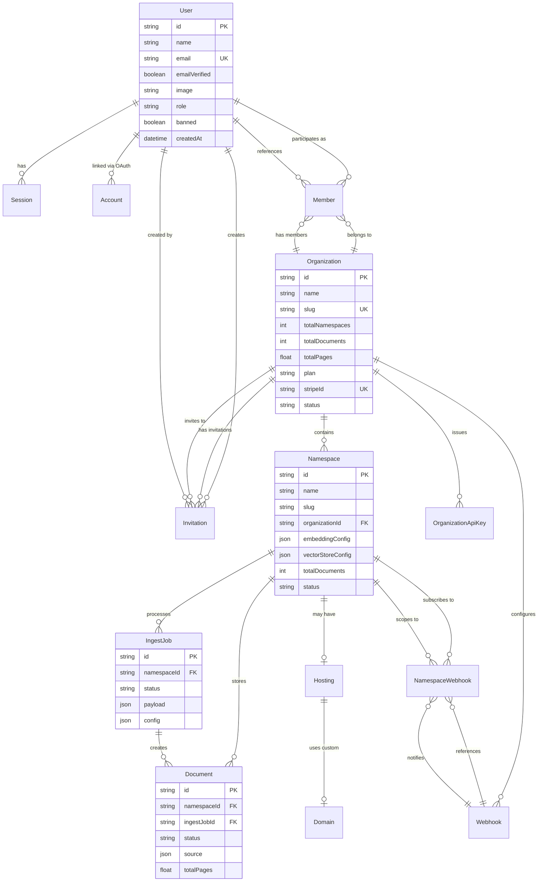

Sources: [packages/db/prisma/schema/auth.prisma](), [packages/db/prisma/schema/organization.prisma](), [packages/db/prisma/schema/namespace.prisma](), [packages/db/prisma/schema/document.prisma](), [packages/db/prisma/schema/ingest-job.prisma]()

## Tenant Hierarchy and Multi-Tenancy

The schema implements a hierarchical multi-tenant model where data isolation occurs at the `Organization` level, with further segmentation into `Namespace` containers.

### Hierarchy Structure

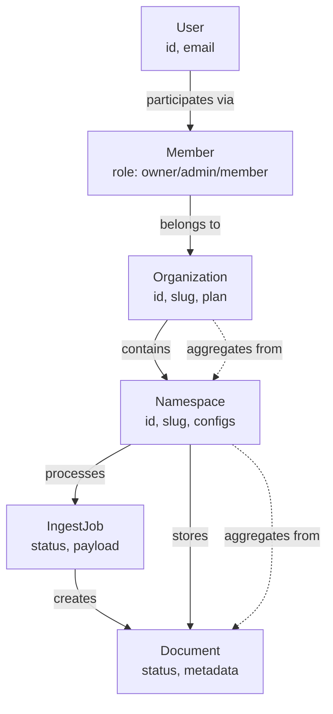

**Hierarchy Levels:**

| Level | Model | Primary Key | Tenant Boundary | Access Control |
|-------|-------|-------------|-----------------|----------------|
| 1 | `User` | `id` (string) | N/A | Better-Auth sessions |
| 2 | `Member` | `id` (string) | N/A | Role-based: owner/admin/member |
| 3 | `Organization` | `id` (string) | ✓ Primary tenant | Via `Member` relationship |
| 4 | `Namespace` | `id` (string) | Sub-tenant | Via `organizationId` FK |
| 5 | `IngestJob` | `id` (string) | Inherits from Namespace | Via `namespaceId` FK |
| 6 | `Document` | `id` (string) | Inherits from Namespace | Via `namespaceId` FK |

**Unique Constraints:**
- `Organization.slug` must be globally unique [packages/db/prisma/schema/organization.prisma:44-44]().
- `Namespace.slug` must be unique within an organization: `@@unique([organizationId, slug])` [packages/db/prisma/schema/namespace.prisma:45-45]().
- `Document.externalId` must be unique within a namespace: `@@unique([namespaceId, externalId])` [packages/db/prisma/schema/document.prisma:56-56]().

Sources: [packages/db/prisma/schema/organization.prisma:1-92](), [packages/db/prisma/schema/namespace.prisma:6-49](), [packages/db/prisma/schema/document.prisma:56-56]()

## Ingestion Models

Data ingestion is tracked via `IngestJob` and `Document` models, both using comprehensive status enums to manage background processing states.

### Document Model

The `Document` model represents an individual piece of content (file, text, URL) within a namespace.

```prisma
model Document {
  id         String  @id @default(cuid())
  externalId String?
  status     DocumentStatus @default(BACKLOG)
  source     Json
  config     Json?
  namespaceId String
  namespace   Namespace @relation(fields: [namespaceId], references: [id], onDelete: Cascade)
  ingestJobId String
  ingestJob   IngestJob @relation(fields: [ingestJobId], references: [id], onDelete: Cascade)
  totalPages      Float @default(0.0)
  // ... timestamps and indexes
}
```

**DocumentStatus Enum:**
- `BACKLOG`, `QUEUED`, `PROCESSING`, `COMPLETED`, `FAILED`, `DELETING` [packages/db/prisma/schema/document.prisma:1-13]().

### IngestJob Model

The `IngestJob` groups documents created during a single ingestion request (e.g., a crawl resulting in multiple pages).

```prisma
model IngestJob {
  id String @id @default(cuid())
  namespaceId String
  status IngestJobStatus @default(BACKLOG)
  payload Json
  config  Json?
  documents Document[]
  // ... timestamps
}
```

Sources: [packages/db/prisma/schema/document.prisma:15-66](), [packages/db/prisma/schema/ingest-job.prisma:15-55]()

## Organization and Membership

Organizations are the primary tenant boundary. Users participate in organizations through the `Member` relationship.

### Organization Model

```prisma
model Organization {
  id   String  @id
  name String
  slug String
  totalNamespaces Int @default(0)
  totalDocuments  Int @default(0)
  totalPages Float @default(0.0)
  plan              String    @default("free")
  stripeId          String?   @unique
  status OrganizationStatus @default(ACTIVE)
  // ... limits and timestamps
}
```

**Aggregate Counters:**
- `totalDocuments`, `totalPages`: Rolled up from child entities to enforce plan limits [packages/db/prisma/schema/organization.prisma:20-25]().
- `searchUsage`: Incremented on search requests to track monthly volume [packages/db/prisma/schema/organization.prisma:27-27]().

Sources: [packages/db/prisma/schema/organization.prisma:1-48]()

### Member Model

The `Member` model implements the many-to-many relationship between users and organizations.

```prisma
model Member {
  id             String       @id
  organizationId String
  userId         String
  role           String       @default("member")
  // ... relations
}
```

Sources: [packages/db/prisma/schema/organization.prisma:63-75]()

## Namespace and Hosting

### Namespace Model

The `Namespace` model serves as an isolated data container with its own configuration.

```prisma
model Namespace {
  id   String @id @default(cuid())
  organizationId String
  embeddingConfig Json?
  vectorStoreConfig Json?
  fileStoreConfig Json?
  status NamespaceStatus @default(ACTIVE)
  hosting Hosting?
  // ... aggregate counts
}
```

**JSON Configuration:**
- `embeddingConfig`: Provider (OpenAI/Voyage), model, and dimensions [packages/db/prisma/schema/namespace.prisma:15-15]().
- `vectorStoreConfig`: Provider (Pinecone/Turbopuffer) and index details [packages/db/prisma/schema/namespace.prisma:18-18]().

Sources: [packages/db/prisma/schema/namespace.prisma:6-49]()

### Hosting and Domain

The `Hosting` model enables public chat interfaces for a namespace.

```prisma
model Hosting {
  id          String    @id @default(cuid())
  namespaceId String    @unique
  slug        String?   @unique
  systemPrompt String?  @db.Text
  llmConfig    Json?
  domain       Domain?
  // ... branding and access control
}
```

**Custom Domains:**
The `Domain` model tracks verified custom domains mapped to a hosted chat interface [packages/db/prisma/schema/namespace.prisma:93-107]().

Sources: [packages/db/prisma/schema/namespace.prisma:51-107]()

## Database Client Configuration

The `PrismaClient` is instantiated as a singleton and uses the `@prisma/adapter-pg` for connection pooling.

```typescript
const createPrismaClient = () => {
  const connectionString = process.env.DATABASE_URL!;
  const pool = new Pool({ connectionString });
  attachDatabasePool(pool);

  return new PrismaClient({
    adapter: new PrismaPg(pool),
    // ... log config
  });
};
```

**Trigger.dev Integration:**
In background jobs, the Prisma client is managed via middleware to ensure proper connection lifecycle during task execution [packages/jobs/src/db.ts:12-18]().

Sources: [packages/db/src/client.ts:7-19](), [packages/jobs/src/db.ts:1-31](), [packages/jobs/trigger.config.ts:19-25]()

## Indexes and Query Optimization

The schema includes strategic indexes for multi-tenant performance:

- **Namespace-centric Document Queries**: `@@index([namespaceId, status, createdAt(sort: Desc), id(sort: Desc)])` [packages/db/prisma/schema/document.prisma:59-59]().
- **Job-centric Document Queries**: `@@index([ingestJobId, status, createdAt(sort: Desc), id(sort: Desc)])` [packages/db/prisma/schema/document.prisma:63-63]().
- **Organization Status Filtering**: `@@index([status])` on `Organization` and `Namespace` [packages/db/prisma/schema/organization.prisma:46-46](), [packages/db/prisma/schema/namespace.prisma:46-46]().
- **Billing Polling**: `@@index(usageLastChecked(sort: Asc))` for efficient cron job selection [packages/db/prisma/schema/organization.prisma:45-45]().

Sources: [packages/db/prisma/schema/document.prisma:56-65](), [packages/db/prisma/schema/organization.prisma:44-47](), [packages/db/prisma/schema/namespace.prisma:45-48]()

---

# Page: Database Client Configuration

# Database Client Configuration

<details>
<summary>Relevant source files</summary>

The following files were used as context for generating this wiki page:

- [apps/web/scripts/populate-document-namespace-id.ts](apps/web/scripts/populate-document-namespace-id.ts)
- [packages/db/.gitignore](packages/db/.gitignore)
- [packages/db/eslint.config.js](packages/db/eslint.config.js)
- [packages/db/prisma/schema/schema.prisma](packages/db/prisma/schema/schema.prisma)
- [packages/db/src/client.ts](packages/db/src/client.ts)
- [packages/db/src/index.ts](packages/db/src/index.ts)
- [packages/db/tsconfig.json](packages/db/tsconfig.json)
- [packages/jobs/src/db.ts](packages/jobs/src/db.ts)
- [packages/jobs/trigger.config.ts](packages/jobs/trigger.config.ts)

</details>


## Purpose and Scope

This document explains the Prisma database client configuration used throughout the AgentSet codebase. It covers the creation and initialization of the `PrismaClient`, connection pooling using the `pg` adapter with Vercel's database pool attachment, the global singleton pattern to prevent connection exhaustion, and specialized integration for **Trigger.dev** background job contexts. For information about the database schema itself, see [2.1 Database Schema]().

---

## Client Creation and Initialization

### Connection Pooling and Adapter Setup

The database client is initialized using the `PrismaPg` adapter, which allows Prisma to communicate with PostgreSQL via the `pg` driver's connection pool. This is specifically integrated with Vercel's infrastructure using `attachDatabasePool`.

#### Initialization Flow

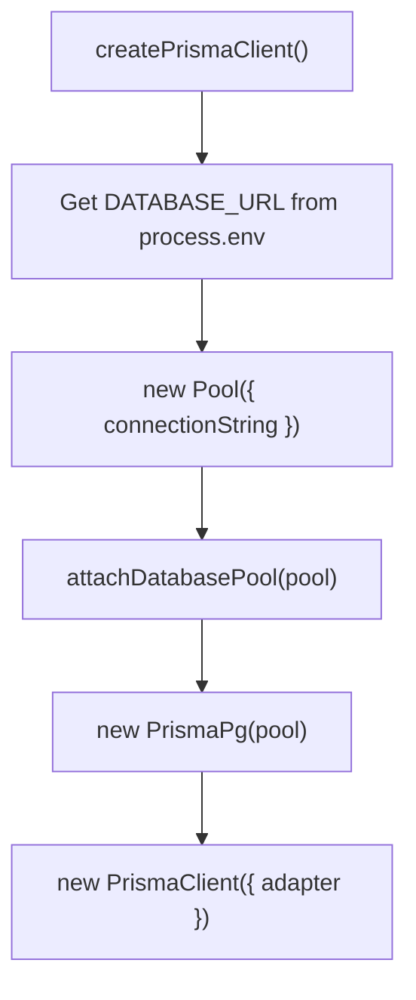

**Implementation Details**

Sources: [packages/db/src/client.ts:7-19]()

The `createPrismaClient` function performs the following steps:
1.  **Connection String**: Retrieves the `DATABASE_URL` from environment variables [packages/db/src/client.ts:8]().
2.  **Pool Creation**: Instantiates a new `Pool` from the `pg` package [packages/db/src/client.ts:9]().
3.  **Vercel Optimization**: Calls `attachDatabasePool(pool)` to manage connection persistence in serverless environments [packages/db/src/client.ts:10]().
4.  **Adapter Injection**: Passes the `PrismaPg` adapter into the `PrismaClient` constructor [packages/db/src/client.ts:13]().

### Logging Configuration

The client is configured with environment-aware logging levels to balance visibility and performance:

| Environment | Log Levels | Purpose |
| :--- | :--- | :--- |
| **Development** | `query`, `error`, `warn` | Full visibility into generated SQL and potential issues. |
| **Production** | `error` | Minimize log noise and overhead while capturing failures. |

Sources: [packages/db/src/client.ts:14-17]()

---

## Global Singleton Pattern

To prevent exhausting database connections during development (where Hot Module Replacement might otherwise instantiate multiple clients), the system employs a global singleton pattern.

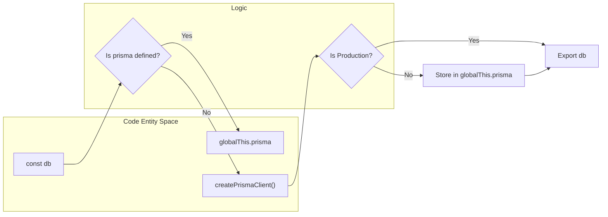

**Singleton Implementation**

Sources: [packages/db/src/client.ts:21-27]()

1.  **Global Object**: A `globalForPrisma` object is defined on `globalThis` to persist the client across module reloads [packages/db/src/client.ts:21-23]().
2.  **Initialization**: The `db` constant is assigned either the existing global instance or a newly created one [packages/db/src/client.ts:25]().
3.  **Persistence**: In non-production environments, the newly created client is saved back to the global object [packages/db/src/client.ts:27]().

---

## Trigger.dev Integration

Background jobs require a specialized database lifecycle because they may be paused and resumed by the **Trigger.dev** engine.

### Task Middleware and Locals

The jobs package uses Trigger.dev `locals` to provide a thread-safe, task-scoped database client.

Sources: [packages/jobs/src/db.ts:1-18]()

*   **`DbLocal`**: A local storage container for the database client [packages/jobs/src/db.ts:6]().
*   **`getDb()`**: A utility function to retrieve the client instance for the current task execution context [packages/jobs/src/db.ts:8-10]().
*   **`tasks.middleware`**: Automatically initializes and cleans up the database connection for every job run [packages/jobs/src/db.ts:12-18]().

### Lifecycle Hooks

Because jobs can enter a "waiting" state (e.g., waiting for an external webhook or delay), the client must manage connections to avoid holding them open unnecessarily.

| Hook | Function | Action |
| :--- | :--- | :--- |
| **Middleware Start** | `db.$connect()` | Opens connection before task logic runs [packages/jobs/src/db.ts:15](). |
| **Middleware End** | `db.$disconnect()` | Closes connection after task logic finishes [packages/jobs/src/db.ts:17](). |
| **`onWait`** | `db.$disconnect()` | Closes connection when the run is paused [packages/jobs/src/db.ts:21-24](). |
| **`onResume`** | `db.$connect()` | Re-establishes connection when the run resumes [packages/jobs/src/db.ts:27-30](). |

### Build Configuration

The `trigger.config.ts` includes a Prisma extension to ensure the client is correctly bundled and generated for the job runtime.

Sources: [packages/jobs/trigger.config.ts:19-25]()

```typescript
build: {
  extensions: [
    prismaExtension({
      mode: "modern",
    }),
  ],
},
```

---

## Data Flow and Exports

The `@agentset/db` package acts as the central source of truth for data access. It exports the client, schemas, and generated types.

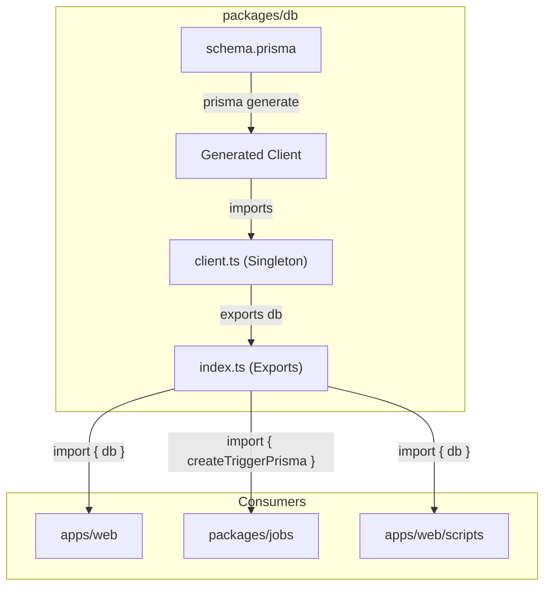

**Key Export Locations**
*   **Client Instance**: `db` is exported for general use in the web application and scripts [packages/db/src/client.ts:25]().
*   **Generated Types**: All Prisma-generated models and types are re-exported from the package root [packages/db/src/index.ts:1-4]().
*   **Scripts**: Direct usage of the client can be seen in utility scripts like `populate-document-namespace-id.ts` [apps/web/scripts/populate-document-namespace-id.ts:1-3]().

Sources: [packages/db/src/index.ts:1-4](), [apps/web/scripts/populate-document-namespace-id.ts:1-3]()

---

# Page: Vector Store System

# Vector Store System

<details>
<summary>Relevant source files</summary>

The following files were used as context for generating this wiki page:

- [apps/web/src/server/api/routers/search.ts](apps/web/src/server/api/routers/search.ts)
- [apps/web/src/services/namespaces/validate.ts](apps/web/src/services/namespaces/validate.ts)
- [packages/db/src/types/prisma.ts](packages/db/src/types/prisma.ts)
- [packages/engine/src/embedding/index.ts](packages/engine/src/embedding/index.ts)
- [packages/engine/src/llm/index.ts](packages/engine/src/llm/index.ts)
- [packages/engine/src/rerank/cohere.ts](packages/engine/src/rerank/cohere.ts)
- [packages/engine/src/rerank/common.ts](packages/engine/src/rerank/common.ts)
- [packages/engine/src/rerank/index.ts](packages/engine/src/rerank/index.ts)
- [packages/engine/src/vector-store/common/vector-store.ts](packages/engine/src/vector-store/common/vector-store.ts)
- [packages/engine/src/vector-store/index.ts](packages/engine/src/vector-store/index.ts)
- [packages/engine/src/vector-store/pinecone/index.ts](packages/engine/src/vector-store/pinecone/index.ts)
- [packages/engine/src/vector-store/query.ts](packages/engine/src/vector-store/query.ts)
- [packages/engine/src/vector-store/turbopuffer/index.ts](packages/engine/src/vector-store/turbopuffer/index.ts)
- [packages/validation/src/llm/constants.ts](packages/validation/src/llm/constants.ts)
- [packages/validation/src/vector-store/turbopuffer.ts](packages/validation/src/vector-store/turbopuffer.ts)

</details>


## Purpose and Scope

This document describes the vector store abstraction layer in the `@agentset/engine` package, which provides a provider-agnostic interface for storing and querying document embeddings. The system supports multiple vector database implementations including Pinecone and Turbopuffer, with configurable managed and self-hosted options. The vector store system supports semantic search (vector similarity), keyword search (BM25 full-text search via Turbopuffer), and hybrid search (combining both with reciprocal rank fusion). For information about the document ingestion process that creates these embeddings, see page 3.1 (Ingestion Workflow). For the higher-level search system that uses vector stores, see page 4.1 (Vector Search).

Sources: [packages/engine/src/vector-store/common/vector-store.ts:1-91](), [packages/engine/src/vector-store/index.ts:1-76]()

## Architecture Overview

The vector store system uses an abstract class pattern to provide a uniform interface across different vector database providers. The `VectorStore` abstract class defines the core operations, while concrete implementations (`Pinecone`, `Turbopuffer`) handle provider-specific details.

### Natural Language Space to Code Entity Space

The following diagram bridges the conceptual "Natural Language Space" (Search queries, Metadata) to the "Code Entity Space" (Classes, Functions, and specific API Clients).

```mermaid
graph TD
    subgraph "Natural Language Space"
        UserQuery["'How do I use AgentSet?'"]
        MetadataFilter["'documentId == doc_123'"]
    end

    subgraph "Code Entity Space"
        VS_Interface["VectorStore Interface [packages/engine/src/vector-store/common/vector-store.ts]"]
        QueryVS["queryVectorStore() [packages/engine/src/vector-store/query.ts]"]
        
        subgraph "Implementations"
            PineconeImpl["Pinecone Class [packages/engine/src/vector-store/pinecone/index.ts]"]
            TurboImpl["Turbopuffer Class [packages/engine/src/vector-store/turbopuffer/index.ts]"]
        end

        subgraph "External Clients"
            PC_Client["PineconeClient [Index]"]
            TP_Client["TurbopufferClient [Namespace]"]
        end
    end

    UserQuery --> QueryVS
    MetadataFilter --> QueryVS
    QueryVS --> VS_Interface
    VS_Interface --> PineconeImpl
    VS_Interface --> TurboImpl
    PineconeImpl --> PC_Client
    TurboImpl --> TP_Client
```

Diagram: Mapping Language Queries to Vector Store Entities

Sources: 
- [packages/engine/src/vector-store/common/vector-store.ts:73-91]()
- [packages/engine/src/vector-store/pinecone/index.ts:19-156]()
- [packages/engine/src/vector-store/turbopuffer/index.ts:28-274]()
- [packages/engine/src/vector-store/query.ts:17-59]()

## Factory Pattern and Configuration

The `getNamespaceVectorStore` function acts as a factory that instantiates the appropriate vector store implementation based on namespace configuration. It supports both managed (Agentset-hosted) and self-hosted vector databases.

### Namespace and Tenant Isolation

Vector data is isolated at two levels:

1. **Namespace Level**: Each namespace maintains its own isolated section in the vector database
2. **Tenant Level**: Within a namespace, data can be optionally segmented by tenant ID

Namespace identifiers follow provider-specific patterns:

| Provider | Pattern | Max Length | Example |
|----------|---------|------------|---------|
| Pinecone | `agentset:{namespaceId}${tenantId ? \`:\${tenantId}\` : ""}` | Unlimited | `agentset:ns_abc123:tenant_xyz` |
| Turbopuffer | `as_{namespaceId}${tenantId ? \`_\${tenantId}\` : ""}` | 128 chars | `as_ns_abc123_tenant_xyz` |

**Note**: The Turbopuffer namespace pattern allows for a maximum combined length of 93 characters when using the longest possible namespace ID (25 chars) and tenant ID (64 chars), leaving room for the `as_` prefix and separators [packages/engine/src/vector-store/turbopuffer/index.ts:46-49]().

```mermaid
flowchart TD
    getNamespaceVectorStore["getNamespaceVectorStore(namespace, tenant) [packages/engine/src/vector-store/index.ts]"]
    
    getNamespaceVectorStore --> CheckConfig["Read namespace.vectorStoreConfig"]
    CheckConfig -->|"null"| DefaultManaged["Default to MANAGED_TURBOPUFFER"]
    CheckConfig -->|"exists"| CheckProvider["Check config.provider"]
    
    CheckProvider -->|"MANAGED_PINECONE"| LoadPinecone["Import Pinecone class"]
    CheckProvider -->|"PINECONE"| LoadPinecone
    CheckProvider -->|"MANAGED_TURBOPUFFER"| LoadTurbopuffer["Import Turbopuffer class"]
    CheckProvider -->|"TURBOPUFFER"| LoadTurbopuffer
    
    DefaultManaged --> LoadTurbopuffer
    
    LoadPinecone --> SetPineconeEnv["Set apiKey and indexHost"]
    LoadTurbopuffer --> SetTurbopufferEnv["Set apiKey and region"]
    
    SetPineconeEnv --> CreatePinecone["new Pinecone()"]
    SetTurbopufferEnv --> CreateTurbopuffer["new Turbopuffer()"]
```

Diagram: Vector Store Factory Pattern

Sources: 
- [packages/engine/src/vector-store/index.ts:6-75]()
- [packages/engine/src/vector-store/pinecone/index.ts:23-38]()
- [packages/engine/src/vector-store/turbopuffer/index.ts:35-53]()

## Vector Store Interface

The `VectorStore` abstract class defines a standardized interface that all implementations must follow.

### Core Methods

| Method | Parameters | Return Type | Description |
|--------|-----------|-------------|-------------|
| `query` | `VectorStoreQueryOptions` | `Promise<VectorStoreQueryResponse>` | Search for relevant chunks using semantic, keyword, or hybrid search |
| `upsert` | `VectorStoreUpsertOptions` | `Promise<void>` | Insert or update document chunks with embeddings |
| `deleteByIds` | `string \| string[]` | `Promise<{deleted?: number}>` | Delete specific chunks by ID |
| `getDimensions` | none | `Promise<number \| "ANY">` | Return supported embedding dimensions |
| `supportsKeyword` | none | `boolean` | Indicates if provider supports keyword/full-text search |

Sources: [packages/engine/src/vector-store/common/vector-store.ts:73-91]()

### Query Options

The `VectorStoreQueryOptions` interface supports three search modes:

```typescript
interface VectorStoreQueryOptions<Filter = VectorFilter> {
  id?: string;
  topK: number;
  filter?: Filter;
  includeMetadata?: boolean;
  minScore?: number;
  consistency?: "eventual" | "strong";
  mode: { type: "semantic"; vector: number[] } 
      | { type: "keyword"; text: string } 
      | { type: "hybrid"; vector: number[]; text: string };
}
```

Sources: [packages/engine/src/vector-store/common/vector-store.ts:14-36]()

## Implementation Details

### Pinecone Implementation

The `Pinecone` class wraps the Pinecone SDK. It currently does not support keyword or hybrid modes [packages/engine/src/vector-store/pinecone/index.ts:45-47]().

**Key Features:**
- Uses `PineconeFilterTranslator` to convert generic filters to Pinecone's metadata format [packages/engine/src/vector-store/pinecone/index.ts:21]().
- Uses `client.query` for similarity search [packages/engine/src/vector-store/pinecone/index.ts:50]().
- `getDimensions()` calls `describeIndexStats()` [packages/engine/src/vector-store/pinecone/index.ts:149]().

Sources: [packages/engine/src/vector-store/pinecone/index.ts:19-156]()

### Turbopuffer Implementation

The `Turbopuffer` class supports semantic (ANN), keyword (BM25), and hybrid search.

**Key Features:**
- **Schema Management**: Sends a schema on first write, enabling `full_text_search` on the `text` field [packages/engine/src/vector-store/turbopuffer/index.ts:15-26]().
- **Hybrid Search**: Uses `multiQuery` to fetch both vector and text results, then fuses them using `reciprocalRankFusion` [packages/engine/src/vector-store/turbopuffer/index.ts:119-140]().
- **Distance Normalization**: Converts Turbopuffer's cosine distance (0-2) to a similarity score (0-1) via `(2 - distance) / 2` [packages/engine/src/vector-store/turbopuffer/index.ts:82-84]().

```mermaid
sequenceDiagram
    participant VS as "Turbopuffer Class"
    participant TP as "Turbopuffer SDK"
    
    VS->>TP: multiQuery([vectorQuery, textQuery])
    TP-->>VS: [vectorRows, textRows]
    VS->>VS: reciprocalRankFusion()
    Note over VS: score = 1/(k+rank)
    VS-->>VS: Sorted Results
```

Diagram: Turbopuffer Hybrid Search Logic

Sources: 
- [packages/engine/src/vector-store/turbopuffer/index.ts:61-78]()
- [packages/engine/src/vector-store/turbopuffer/index.ts:119-140]()

## Query Helper and Reranking

The `queryVectorStore` function is the primary entry point for retrieval. It coordinates embedding the query string and optionally reranking the results.

### Code Entity Integration

The following diagram shows how the high-level search API interacts with the vector store and reranking logic.

```mermaid
flowchart TD
    SearchRouter["searchRouter.search [apps/web/src/server/api/routers/search.ts]"]
    QueryVS["queryVectorStore() [packages/engine/src/vector-store/query.ts]"]
    Embed["ai.embed()"]
    Rerank["rerank() [packages/engine/src/rerank/index.ts]"]
    Cohere["CohereReranker [packages/engine/src/rerank/cohere.ts]"]

    SearchRouter --> QueryVS
    QueryVS --> Embed
    QueryVS --> VS_Query["VectorStore.query()"]
    QueryVS --> Rerank
    Rerank --> Cohere
```

Diagram: Search and Reranking Data Flow

Sources: 
- [apps/web/src/server/api/routers/search.ts:26-59]()
- [packages/engine/src/vector-store/query.ts:17-59]()
- [packages/engine/src/rerank/cohere.ts:6-33]()

### Validation and Dimensions

Before a namespace is fully configured, the system validates that the selected embedding model's dimensions match the vector store's dimensions using `validateVectorStoreConfig` [apps/web/src/services/namespaces/validate.ts:29-66]().

- **OpenAI text-embedding-3-large**: 3072 dimensions [apps/web/src/services/namespaces/validate.ts:14]().
- **Turbopuffer**: Returns `"ANY"`, effectively matching any embedding model [packages/engine/src/vector-store/turbopuffer/index.ts:247]().
- **Pinecone**: Returns the specific index dimension [packages/engine/src/vector-store/pinecone/index.ts:150]().

Sources: 
- [apps/web/src/services/namespaces/validate.ts:9-27]()
- [apps/web/src/services/namespaces/validate.ts:29-66]()
- [packages/engine/src/vector-store/pinecone/index.ts:148-151]()
- [packages/engine/src/vector-store/turbopuffer/index.ts:246-248]()

---

# Page: Document Processing

# Document Processing

<details>
<summary>Relevant source files</summary>

The following files were used as context for generating this wiki page:

- [apps/web/src/app/api/(public-api)/v1/namespace/[namespaceId]/ingest-jobs/route.ts](apps/web/src/app/api/(public-api)/v1/namespace/[namespaceId]/ingest-jobs/route.ts)
- [apps/web/src/server/api/routers/ingest-jobs.ts](apps/web/src/server/api/routers/ingest-jobs.ts)
- [apps/web/src/services/documents/delete.ts](apps/web/src/services/documents/delete.ts)
- [apps/web/src/services/ingest-jobs/create.ts](apps/web/src/services/ingest-jobs/create.ts)
- [apps/web/src/services/ingest-jobs/delete.ts](apps/web/src/services/ingest-jobs/delete.ts)
- [packages/jobs/src/schema.ts](packages/jobs/src/schema.ts)
- [packages/jobs/src/tasks/delete-document.ts](packages/jobs/src/tasks/delete-document.ts)
- [packages/jobs/src/tasks/delete-ingest-job.ts](packages/jobs/src/tasks/delete-ingest-job.ts)
- [packages/jobs/src/tasks/delete-namespace.ts](packages/jobs/src/tasks/delete-namespace.ts)
- [packages/jobs/src/tasks/delete-org.ts](packages/jobs/src/tasks/delete-org.ts)
- [packages/jobs/src/tasks/ingest.ts](packages/jobs/src/tasks/ingest.ts)
- [packages/jobs/src/tasks/process-document.ts](packages/jobs/src/tasks/process-document.ts)
- [packages/jobs/src/tasks/re-ingest.ts](packages/jobs/src/tasks/re-ingest.ts)

</details>


The document processing system handles the ingestion, parsing, chunking, embedding, and storage of documents into vector databases. It supports multiple input types (files, text, URLs, YouTube videos) and implements a scalable two-tier job architecture for parallel processing. This system forms the foundation for retrieval operations in the RAG pipeline.

For information about the RAG search and retrieval system that queries these processed documents, see [RAG and Search System](#4). For details about the background job orchestration infrastructure, see [Background Job Processing](#3.2).

## System Purpose and Scope

The document processing system orchestrates the complete lifecycle of documents from initial ingestion through embedding generation and storage in vector databases. Key responsibilities include:

- **Multi-format ingestion**: Accept text, files, URLs (via crawling), and YouTube videos
- **Parallel processing**: Distribute document processing across concurrent background jobs
- **Chunking and embedding**: Transform documents into searchable vector representations
- **Metadata tracking**: Maintain status, metrics (pages, tokens, chunks), and error information
- **Resource cleanup**: Delete documents and their associated vectors when requested
- **Re-ingestion**: Reprocess existing documents with updated configurations

The system handles documents within the context of **IngestJobs**, which serve as containers for one or more related documents. Each IngestJob tracks configuration, status, and aggregate metrics across all its documents.

Sources: [packages/jobs/src/tasks/ingest.ts:33-600](), [packages/jobs/src/tasks/process-document.ts:72-422](), [apps/web/src/services/ingest-jobs/create.ts:14-192]()

## Document Types and Input Sources

The system supports six distinct document input types, each with specialized handling:

| Input Type | Payload Type | Description | Max Count per Job |
|------------|-------------|-------------|-------------------|
| Text | `TEXT` | Raw text content provided directly | Single document |
| File URL | `FILE` | Publicly accessible file URL | Single document |
| Managed File | `MANAGED_FILE` | Pre-uploaded file in S3 storage | Single document |
| Batch | `BATCH` | Multiple files/managed files | Multiple documents |
| Web Crawl | `CRAWL` | Website crawling with depth/path controls | Multiple documents |
| YouTube | `YOUTUBE` | YouTube video transcripts | Multiple documents |

**Single Document Types** (`TEXT`, `FILE`, `MANAGED_FILE`) create one document per IngestJob and are processed immediately after job creation.

**Multi-Document Types** (`BATCH`, `CRAWL`, `YOUTUBE`) undergo pre-processing where an external Partition API extracts content and generates multiple documents. These types support advanced configuration options like chunking parameters and metadata extraction.

The `BATCH` type allows combining multiple files into a single IngestJob for efficient processing, with automatic deduplication of file URLs and managed file keys [apps/web/src/services/ingest-jobs/create.ts:29-46]().

Sources: [apps/web/src/services/ingest-jobs/create.ts:27-103](), [packages/jobs/src/tasks/ingest.ts:135-445]()

## Two-Tier Job Architecture

```mermaid
graph TB
    subgraph "API Layer"
        CREATE["createIngestJob<br/>(apps/web/src/services/ingest-jobs/create.ts)"]
    end
    
    subgraph "Orchestration Tier"
        INGEST_TASK["ingestJob Task<br/>ID: trigger-ingestion-job<br/>(packages/jobs/src/tasks/ingest.ts)"]
        TRIGGER_FN["triggerIngestionJob()"]
    end
    
    subgraph "Processing Tier"
        PROCESS_TASK["processDocument Task<br/>ID: trigger-document-job<br/>(packages/jobs/src/tasks/process-document.ts)"]
        BATCH_TRIGGER["processDocument.batchTriggerAndWait()"]
    end
    
    subgraph "External Services"
        PARTITION_API["Partition API<br/>/crawl, /youtube, /ingest endpoints"]
        EMBEDDING["Embedding Models<br/>getNamespaceEmbeddingModel()"]
        VECTOR_STORE["Vector Stores<br/>getNamespaceVectorStore()"]
    end
    
    subgraph "Storage"
        DB[("PostgreSQL<br/>IngestJob & Document records")]
        REDIS[("Redis<br/>Temp partition results")]
        S3[("S3<br/>chunks.json files")]
    end
    
    CREATE --> |"Creates IngestJob record"| DB
    CREATE --> |"Triggers job"| TRIGGER_FN
    TRIGGER_FN --> INGEST_TASK
    
    INGEST_TASK --> |"CRAWL/YOUTUBE<br/>wait.forToken()"| PARTITION_API
    PARTITION_API --> |"Stores batches"| REDIS
    PARTITION_API --> |"Stores documents"| S3
    
    INGEST_TASK --> |"Creates Document records"| DB
    INGEST_TASK --> |"Batch spawns (30/batch)"| BATCH_TRIGGER
    BATCH_TRIGGER --> PROCESS_TASK
    
    PROCESS_TASK --> |"FILE/TEXT/MANAGED_FILE<br/>getPartitionDocumentBody()"| PARTITION_API
    PROCESS_TASK --> |"getChunksJsonFromS3()"| S3
    PROCESS_TASK --> |"embedMany()"| EMBEDDING
    PROCESS_TASK --> |"vectorStore.upsert()"| VECTOR_STORE
    PROCESS_TASK --> |"Updates status"| DB
```

**Diagram: Two-Tier Job Architecture with Task IDs**

The processing system implements a hierarchical job structure:

1. **Orchestration Tier (`ingestJob`)**: The `ingestJob` task [packages/jobs/src/tasks/ingest.ts:33-600]() coordinates the overall ingestion:
   - Validates the IngestJob configuration
   - Handles pre-processing for `CRAWL` and `YOUTUBE` types via Partition API
   - Creates Document records in PostgreSQL
   - Spawns multiple `processDocument` tasks in batches of 30

2. **Processing Tier (`processDocument`)**: Each `processDocument` task [packages/jobs/src/tasks/process-document.ts:72-422]() processes a single document:
   - Retrieves chunks from S3 [packages/jobs/src/tasks/process-document.ts:210-216]()
   - Generates embeddings in batches of 30 chunks [packages/jobs/src/tasks/process-document.ts:32-70]()
   - Upserts vectors to the configured vector store [packages/jobs/src/tasks/process-document.ts:67]()
   - Updates document status and metrics

This architecture enables **horizontal scaling** by processing up to 90 concurrent documents (per the queue concurrency limit) while maintaining transactional consistency for metadata in PostgreSQL.

Sources: [packages/jobs/src/tasks/ingest.ts:33-600](), [packages/jobs/src/tasks/process-document.ts:72-422](), [packages/jobs/src/schema.ts:19-32](), [packages/jobs/src/schema.ts:54-72]()

## Document Lifecycle and Status Transitions

```mermaid
stateDiagram-v2
    [*] --> QUEUED: createIngestJob()
    
    QUEUED --> PRE_PROCESSING: ingestJob starts<br/>(FILE/TEXT/MANAGED_FILE)
    QUEUED --> PROCESSING: ingestJob starts<br/>(CRAWL/YOUTUBE pre-partitioned)
    
    PRE_PROCESSING --> PROCESSING: Partition API complete
    
    PROCESSING --> COMPLETED: Processing successful
    PROCESSING --> FAILED: Processing error
    
    COMPLETED --> QUEUED_FOR_RESYNC: reIngestJob triggered
    FAILED --> QUEUED_FOR_RESYNC: reIngestJob triggered
    
    QUEUED_FOR_RESYNC --> PROCESSING: Re-processing starts
    
    QUEUED --> QUEUED_FOR_DELETE: deleteDocument()
    COMPLETED --> QUEUED_FOR_DELETE: deleteDocument()
    FAILED --> QUEUED_FOR_DELETE: deleteDocument()
    
    QUEUED_FOR_DELETE --> DELETING: deleteDocument task starts
    DELETING --> [*]: Cleanup complete
    
    note right of QUEUED
        DocumentStatus.QUEUED
        webhook: document.queued
    end note
    
    note right of PRE_PROCESSING
        DocumentStatus.PRE_PROCESSING
        Partition API called
    end note
    
    note right of PROCESSING
        DocumentStatus.PROCESSING
        webhook: document.processing
        Embedding generation
    end note
    
    note right of COMPLETED
        DocumentStatus.COMPLETED
        webhook: document.ready
    end note
    
    note right of FAILED
        DocumentStatus.FAILED
        webhook: document.error
    end note
```

**Diagram: Document Status State Machine with DocumentStatus Enum Values**

### Status Descriptions

| Status | Enum Value | Description | Webhook Event |
|--------|-----------|-------------|---------------|
| Queued | `QUEUED` | Document created, awaiting processing | `document.queued` |
| Pre-processing | `PRE_PROCESSING` | Partition API processing file (FILE/TEXT/MANAGED_FILE only) | None |
| Processing | `PROCESSING` | Generating embeddings and upserting to vector store | `document.processing` |
| Completed | `COMPLETED` | Successfully processed and stored | `document.ready` |
| Failed | `FAILED` | Processing error occurred | `document.error` |
| Queued for Resync | `QUEUED_FOR_RESYNC` | Marked for re-processing | `document.queued_for_resync` |
| Queued for Delete | `QUEUED_FOR_DELETE` | Marked for deletion | `document.queued_for_deletion` |
| Deleting | `DELETING` | Cleanup in progress | None |

The status field uses the `DocumentStatus` enum [packages/jobs/src/tasks/process-document.ts:11-16]() from the database schema. Each transition updates corresponding timestamp fields (`processingAt`, `failedAt`, `completedAt`) to track processing duration [packages/jobs/src/tasks/process-document.ts:134-140]().

**IngestJobs** follow a parallel lifecycle using `IngestJobStatus` with states like `QUEUED`, `PRE_PROCESSING`, `PROCESSING`, `COMPLETED`, `FAILED`, `QUEUED_FOR_RESYNC`, `QUEUED_FOR_DELETE`, `DELETING` [packages/jobs/src/tasks/ingest.ts:12-14]().

Sources: [packages/jobs/src/tasks/process-document.ts:130-169](), [packages/jobs/src/tasks/process-document.ts:82-128](), [packages/jobs/src/tasks/ingest.ts:33-124]()

## Partition API Integration

Documents requiring external parsing (files, crawled pages, YouTube videos) interact with the Partition API, a separate service responsible for extraction and chunking.

### Async Processing Flow

The Partition API uses an asynchronous callback pattern with Trigger.dev's `wait.forToken()` mechanism:

1. **Initiate request**: Post to `/crawl` or `/youtube` endpoint with `trigger_token_id` and `trigger_access_token` [packages/jobs/src/tasks/ingest.ts:160-172]().
2. **Receive call ID**: API returns `{ call_id: string }` immediately.
3. **Wait for callback**: Task suspends using `wait.forToken()` [packages/jobs/src/tasks/ingest.ts:173-175]().
4. **Resume on completion**: Partition API calls back to Trigger.dev with results.
5. **Process results**: Task continues with partition data to create document records [packages/jobs/src/tasks/ingest.ts:191-235]().

For multi-document types, the Partition API stores results in S3 as `chunks.json` files [packages/jobs/src/tasks/process-document.ts:210-216]().

Sources: [packages/jobs/src/tasks/ingest.ts:136-178](), [packages/jobs/src/tasks/process-document.ts:210-216]()

## Embedding Generation and Vector Storage

### Batch Processing Strategy

Document chunks are embedded and stored in batches to optimize throughput:

```mermaid
graph LR
    subgraph "Chunk Batching"
        CHUNKS["Document Chunks<br/>(from S3)"]
        BATCH1["Batch 1<br/>(30 chunks)"]
        BATCH2["Batch 2<br/>(30 chunks)"]
        BATCH_N["Batch N<br/>(remaining)"]
        
        CHUNKS --> BATCH1
        CHUNKS --> BATCH2
        CHUNKS --> BATCH_N
    end
    
    subgraph "processBatch() Function"
        EMBED["embedMany()<br/>(ai SDK)"]
        UPSERT["vectorStore.upsert()<br/>(batch operation)"]
        
        EMBED --> UPSERT
    end
    
    BATCH1 --> EMBED
    BATCH2 --> EMBED
    BATCH_N --> EMBED
    
    UPSERT --> PINECONE["Pinecone Index"]
    UPSERT --> TURBOPUFFER["Turbopuffer Namespace"]
```

**Diagram: Embedding Batch Processing Pipeline**

The `processBatch` helper function [packages/jobs/src/tasks/process-document.ts:34-70]() handles each batch:

1. **Embed chunks**: Call `embedMany()` from the AI SDK with the configured embedding model [packages/jobs/src/tasks/process-document.ts:48-52]().
2. **Merge metadata**: Combine document-level and chunk-level metadata [packages/jobs/src/tasks/process-document.ts:54-63]().
3. **Upsert vectors**: Write vectors to the vector store [packages/jobs/src/tasks/process-document.ts:67]().

The `BATCH_SIZE` constant is set to 30 [packages/jobs/src/tasks/process-document.ts:32]() to balance API rate limits and processing speed.

### Rate Limiting for Pinecone

Pinecone imposes a limit of 5 requests per second per namespace. The system implements rate limiting for both document processing cleanup and deletion operations:

```typescript
// Rate limit for cleanup operations
await rateLimit(
  {
    queue: "process-document-cleanup",
    concurrencyKey: document.tenantId
      ? `${ingestJob.namespace.id}:${document.tenantId}`
      : ingestJob.namespace.id,
  },
  Ratelimit.tokenBucket(5, "1s", 5),
);
```

This ensures tenant-aware rate limiting [packages/jobs/src/tasks/process-document.ts:185-194]() when multi-tenancy is enabled, preventing throttling.

Sources: [packages/jobs/src/tasks/process-document.ts:34-70](), [packages/jobs/src/tasks/delete-document.ts:74-91]()

## Document Re-ingestion

The re-ingestion flow allows reprocessing existing documents with updated configurations or to recover from failures.

The `reIngestJob` task [packages/jobs/src/tasks/re-ingest.ts:13-220]() orchestrates re-processing:

1. **Fetch documents**: Retrieve all documents for the IngestJob [packages/jobs/src/tasks/re-ingest.ts:78-92]().
2. **Reset statuses**: Update all documents to `QUEUED_FOR_RESYNC` [packages/jobs/src/tasks/re-ingest.ts:108-119]().
3. **Trigger processing**: Call `processDocument.batchTriggerAndWait()` with `cleanup: true` flag [packages/jobs/src/tasks/re-ingest.ts:138-150]().
4. **Clean up vectors**: The `cleanup` flag causes `processDocument` to delete existing vectors before re-embedding [packages/jobs/src/tasks/process-document.ts:177-199]().

Sources: [packages/jobs/src/tasks/re-ingest.ts:13-220](), [packages/jobs/src/tasks/process-document.ts:177-199](), [apps/web/src/server/api/routers/ingest-jobs.ts:172-248]()

## Deletion and Cleanup Workflows

The system implements hierarchical deletion following the organization structure:

**Organization → Namespace → IngestJob → Document**

### Document Deletion

The `deleteDocument` task [packages/jobs/src/tasks/delete-document.ts:17-158]() performs comprehensive cleanup:

1. **Update status**: Set to `DELETING` [packages/jobs/src/tasks/delete-document.ts:64-70]().
2. **Rate limit**: Apply Pinecone rate limits if needed [packages/jobs/src/tasks/delete-document.ts:74-91]().
3. **Delete vectors**: Remove all chunks from vector store by document ID filter [packages/jobs/src/tasks/delete-document.ts:100-102]().
4. **Delete S3 objects**: 
   - `chunks.json` file [packages/jobs/src/tasks/delete-document.ts:105-112]().
   - Associated images [packages/jobs/src/tasks/delete-document.ts:115-116]().
   - Managed file if `source.type === "MANAGED_FILE"` [packages/jobs/src/tasks/delete-document.ts:119-122]().
5. **Delete database record**: Remove from PostgreSQL [packages/jobs/src/tasks/delete-document.ts:125-128]().

### IngestJob Deletion

The `deleteIngestJob` task [packages/jobs/src/tasks/delete-ingest-job.ts:13-163]() cascades to all documents:

1. Update status to `DELETING` [packages/jobs/src/tasks/delete-ingest-job.ts:53-59]().
2. Trigger `deleteDocument.batchTriggerAndWait()` in batches of 30 [packages/jobs/src/tasks/delete-ingest-job.ts:88-106]().
3. Aggregate deleted document and page counts.
4. Delete IngestJob record and decrement namespace/organization counters [packages/jobs/src/tasks/delete-ingest-job.ts:109-139]().

Sources: [packages/jobs/src/tasks/delete-document.ts:17-158](), [packages/jobs/src/tasks/delete-ingest-job.ts:13-163](), [packages/jobs/src/tasks/delete-namespace.ts:13-110]()

## Usage Metering and Billing

The system tracks resource usage at multiple levels. For Pro plan organizations, the `processDocument` task reports pages to Stripe via `meterIngestedPages` [packages/jobs/src/tasks/process-document.ts:19]().

### Metric Tracking

The system maintains real-time counters in PostgreSQL:

| Level | Metrics | Updated On |
|-------|---------|-----------|
| **Document** | `totalPages`, `totalTokens`, `totalChunks` | Processing completion |
| **Namespace** | `totalDocuments`, `totalPages`, `totalIngestJobs` | Creation/deletion |
| **Organization** | `totalDocuments`, `totalPages`, `totalIngestJobs` | Creation/deletion |

These counters enable fast limit checks [apps/web/src/server/api/routers/ingest-jobs.ts:118-126]().

Sources: [packages/jobs/src/tasks/process-document.ts:391-410](), [packages/jobs/src/tasks/ingest.ts:447-480]()

## Configuration and Validation

Configuration is validated at job creation [apps/web/src/services/ingest-jobs/create.ts:109-139]() and filtered based on payload type. Deprecated fields are automatically removed to maintain backwards compatibility [apps/web/src/services/ingest-jobs/create.ts:132-138]().

For detailed validation rules and configuration options, see [Ingestion Validation and Configuration](#3.3).

Sources: [apps/web/src/services/ingest-jobs/create.ts:109-139](), [packages/jobs/src/schema.ts:54-72]()

## Error Handling and Recovery

Both `ingestJob` and `processDocument` implement `onFailure` handlers that:

1. Extract error message from the exception [packages/jobs/src/tasks/process-document.ts:85-86]().
2. Update database status to `FAILED` [packages/jobs/src/tasks/process-document.ts:91-95]().
3. Emit error webhook (`ingest_job.error` or `document.error`) [packages/jobs/src/tasks/process-document.ts:112-118]().

Tasks are configured with `maxAttempts: 1` [packages/jobs/src/tasks/process-document.ts:79](), meaning no automatic retries, which prevents double-counting in billing metrics.

Sources: [packages/jobs/src/tasks/process-document.ts:82-128](), [packages/jobs/src/tasks/ingest.ts:43-85]()

---

# Page: Ingestion Workflow

# Ingestion Workflow

<details>
<summary>Relevant source files</summary>

The following files were used as context for generating this wiki page:

- [apps/web/src/app/api/(public-api)/v1/namespace/[namespaceId]/ingest-jobs/route.ts](apps/web/src/app/api/(public-api)/v1/namespace/[namespaceId]/ingest-jobs/route.ts)
- [apps/web/src/lib/redis.ts](apps/web/src/lib/redis.ts)
- [apps/web/src/server/api/routers/ingest-jobs.ts](apps/web/src/server/api/routers/ingest-jobs.ts)
- [apps/web/src/services/documents/delete.ts](apps/web/src/services/documents/delete.ts)
- [apps/web/src/services/ingest-jobs/create.ts](apps/web/src/services/ingest-jobs/create.ts)
- [apps/web/src/services/ingest-jobs/delete.ts](apps/web/src/services/ingest-jobs/delete.ts)
- [packages/jobs/src/schema.ts](packages/jobs/src/schema.ts)
- [packages/jobs/src/tasks/delete-document.ts](packages/jobs/src/tasks/delete-document.ts)
- [packages/jobs/src/tasks/delete-ingest-job.ts](packages/jobs/src/tasks/delete-ingest-job.ts)
- [packages/jobs/src/tasks/delete-namespace.ts](packages/jobs/src/tasks/delete-namespace.ts)
- [packages/jobs/src/tasks/delete-org.ts](packages/jobs/src/tasks/delete-org.ts)
- [packages/jobs/src/tasks/ingest.ts](packages/jobs/src/tasks/ingest.ts)
- [packages/jobs/src/tasks/process-document.ts](packages/jobs/src/tasks/process-document.ts)
- [packages/jobs/src/tasks/re-ingest.ts](packages/jobs/src/tasks/re-ingest.ts)

</details>


## Purpose and Scope

This document describes the end-to-end ingestion workflow that processes user-submitted content into searchable vector embeddings. It covers job creation, document type handling, the two-tier job architecture (`ingestJob` orchestrator and `processDocument` workers), partition API integration, and status lifecycle management.

For information about the Trigger.dev job processing implementation and error handling, see [Background Job Processing](#3.2). For validation schemas and configuration options, see [Ingestion Validation and Configuration](#3.3).

## Overview

The ingestion workflow implements a hierarchical job processing pattern where a parent `ingestJob` task orchestrates the creation and validation of documents, while child `processDocument` tasks handle the actual embedding generation and vector storage for each individual document. This architecture enables parallel processing of hundreds of documents while maintaining transactional consistency for metadata.

The workflow supports five primary document types:
- **TEXT**: Plain text content submitted directly.
- **FILE**: External file URLs.
- **MANAGED_FILE**: Files uploaded to AgentSet's S3 storage.
- **CRAWL**: Website crawling with depth/path filtering.
- **YOUTUBE**: YouTube video transcript extraction.
- **BATCH**: Multiple files or URLs in a single job.

## Ingestion Flow Diagram

```mermaid
flowchart TB
    subgraph "API Layer [Code Entity Space]"
        CREATE["createIngestJob<br/>apps/web/src/services/ingest-jobs/create.ts"]
        VALIDATE["createIngestJobSchema<br/>Validation & Deduplication"]
    end
    
    subgraph "Database [Prisma Client]"
        DB_CREATE["IngestJob Record<br/>status: QUEUED"]
        DB_NS["Namespace Update<br/>totalIngestJobs++"]
    end
    
    subgraph "Trigger.dev Orchestration [Background Jobs]"
        TRIGGER["triggerIngestionJob<br/>packages/jobs/src/schema.ts"]
        INGEST_TASK["ingestJob Task<br/>packages/jobs/src/tasks/ingest.ts"]
    end
    
    subgraph "Webhook System"
        WH_QUEUED["emitIngestJobWebhook<br/>trigger: ingest_job.queued"]
    end
    
    CREATE --> VALIDATE
    VALIDATE --> DB_CREATE
    DB_CREATE --> DB_NS
    DB_NS --> TRIGGER
    TRIGGER --> INGEST_TASK
    CREATE --> WH_QUEUED
```

**Sources**: [apps/web/src/services/ingest-jobs/create.ts:14-192](), [packages/jobs/src/schema.ts:19-32](), [packages/jobs/src/tasks/ingest.ts:33-42]()

## Job Creation

The ingestion workflow begins when a user submits content through the API or Dashboard. The `createIngestJob` service in the web application validates the request, creates database records, and triggers the background job.

### Validation and Preprocessing

The service performs several validation steps before creating the job:

| Validation Step | Purpose | Implementation |
|----------------|---------|----------------|
| Payload Type Validation | Ensures valid document type | [apps/web/src/services/ingest-jobs/create.ts:29-103]() |
| File Deduplication | Removes duplicate URLs/keys in BATCH | [apps/web/src/services/ingest-jobs/create.ts:33-46]() |
| File Existence Check | Verifies MANAGED_FILE keys exist in S3 | [apps/web/src/services/ingest-jobs/create.ts:50-63]() |
| Config Filtering | Removes unsupported fields per type | [apps/web/src/services/ingest-jobs/create.ts:109-138]() |

For `MANAGED_FILE` payloads, the service calls `checkFileExists` to ensure the key is present in storage [apps/web/src/services/ingest-jobs/create.ts:92-95](). For `BATCH` payloads, it iterates through items to deduplicate files and URLs [apps/web/src/services/ingest-jobs/create.ts:30-46]().

**Sources**: [apps/web/src/services/ingest-jobs/create.ts:14-139]()

### Database Transaction

Job creation executes a database transaction that creates the `IngestJob` record with `QUEUED` status and increments counters on the Namespace and Organization [apps/web/src/services/ingest-jobs/create.ts:140-164]().

```typescript
const [job] = await db.$transaction([
  db.ingestJob.create({
    data: {
      namespace: { connect: { id: namespaceId } },
      tenantId,
      status: IngestJobStatus.QUEUED,
      name: data.name,
      config: config,
      externalId: data.externalId,
      payload: finalPayload,
    },
  }),
  db.namespace.update({
    where: { id: namespaceId },
    data: {
      totalIngestJobs: { increment: 1 },
      organization: {
        update: { totalIngestJobs: { increment: 1 } },
      },
    },
  }),
]);
```

**Sources**: [apps/web/src/services/ingest-jobs/create.ts:140-164]()

### Trigger.dev Job Invocation

After database creation, the service triggers the background job using `triggerIngestionJob` [apps/web/src/services/ingest-jobs/create.ts:166-172](). The job priority is determined by the organization's plan (Enterprise, Pro, or Free) [packages/jobs/src/schema.ts:13-17](). Finally, it emits an `ingest_job.queued` webhook [apps/web/src/services/ingest-jobs/create.ts:181-189]().

**Sources**: [apps/web/src/services/ingest-jobs/create.ts:166-189](), [packages/jobs/src/schema.ts:13-32]()

## Document Type Handling

The `ingestJob` task (defined in `packages/jobs/src/tasks/ingest.ts`) handles different document types with specialized processing flows.

### Document Type Processing Flow

```mermaid
flowchart TB
    START["ingestJob Task Start<br/>packages/jobs/src/tasks/ingest.ts"]
    FETCH["db.ingestJob.findUnique<br/>Get Namespace & Org Config"]
    PRE["Update Status<br/>PRE_PROCESSING"]
    
    subgraph "Type-Specific Processing"
        CRAWL["CRAWL Type<br/>POST /crawl<br/>Partition API"]
        YOUTUBE["YOUTUBE Type<br/>POST /youtube<br/>Partition API"]
        TEXT["TEXT/FILE/MANAGED_FILE<br/>Direct Creation"]
        BATCH["BATCH Type<br/>Loop Creation"]
    end
    
    DOCS["db.document.createManyAndReturn<br/>status: QUEUED<br/>Batch: 20"]
    PROCESSING["Update Job Status<br/>PROCESSING"]
    SPAWN["processDocument.batchTriggerAndWait<br/>Batch Size: 30"]
    
    START --> FETCH
    FETCH --> PRE
    PRE --> CRAWL
    PRE --> YOUTUBE
    PRE --> TEXT
    PRE --> BATCH
    
    CRAWL --> DOCS
    YOUTUBE --> DOCS
    TEXT --> DOCS
    BATCH --> DOCS
    
    DOCS --> PROCESSING
    PROCESSING --> SPAWN
```

**Sources**: [packages/jobs/src/tasks/ingest.ts:88-530]()

### CRAWL and YOUTUBE Processing

Website crawling and YouTube ingestion utilize the Partition API:

1. **Token Creation**: Creates a wait token for async callback (2-hour timeout) [packages/jobs/src/tasks/ingest.ts:137]().
2. **API Call**: POSTs to `${env.PARTITION_API_URL}/crawl` or `/youtube` with `CrawlPartitionBody` or `YoutubePartitionBody` [packages/jobs/src/tasks/ingest.ts:160-167]().
3. **Wait for Result**: Uses `wait.forToken` to pause execution until the Partition API returns the results [packages/jobs/src/tasks/ingest.ts:173-175]().
4. **Limit Enforcement**: Checks organization page limits. Documents exceeding limits are marked `FAILED` with "Pages limit exceeded" [packages/jobs/src/tasks/ingest.ts:185-221]().

**Sources**: [packages/jobs/src/tasks/ingest.ts:136-338]()

### Single Document and BATCH Types

For `TEXT`, `FILE`, and `MANAGED_FILE`, the task creates a single document record [packages/jobs/src/tasks/ingest.ts:339-408](). For `BATCH`, it iterates through the items in chunks of 20 to create document records [packages/jobs/src/tasks/ingest.ts:409-444]().

**Sources**: [packages/jobs/src/tasks/ingest.ts:339-444]()

## Two-Tier Job Architecture

The ingestion system uses a parent-child task pattern to enable massive parallelism while maintaining coordination.

### Architecture Overview

- **Parent Task (`ingestJob`)**: Orchestrates the workflow, handles Partition API calls for crawling, creates `Document` records, and manages batching of child tasks [packages/jobs/src/tasks/ingest.ts:33-586]().
- **Child Task (`processDocument`)**: Handles the actual chunking (if not pre-chunked), embedding generation, and vector store upserts for a single document [packages/jobs/src/tasks/process-document.ts:72-421]().

### Batch Spawning Pattern

The `ingestJob` task spawns child tasks in batches of 30 using `processDocument.batchTriggerAndWait()` [packages/jobs/src/tasks/ingest.ts:494-511](). This pattern prevents overwhelming the queue while maintaining high throughput.

**Sources**: [packages/jobs/src/tasks/ingest.ts:491-528](), [packages/jobs/src/tasks/process-document.ts:72-81]()

## Document Processing Task

The `processDocument` task (defined in `packages/jobs/src/tasks/process-document.ts`) is responsible for the final steps of ingestion.

### Processing Flow

```mermaid
flowchart TB
    START["processDocument Task<br/>packages/jobs/src/tasks/process-document.ts"]
    WH_PROC["emitDocumentWebhook<br/>trigger: document.processing"]
    
    MODELS["getNamespaceEmbeddingModel<br/>getNamespaceVectorStore"]
    
    CLEANUP{"cleanup flag?"}
    DELETE_OLD["vectorStore.deleteByFilter<br/>documentId"]
    
    TYPE{"Source Type?"}
    
    subgraph "Pre-partitioned (CRAWL/YOUTUBE)"
        S3_FETCH["getChunksJsonFromS3<br/>Fetch chunks.json"]
    end
    
    subgraph "Partition Required (TEXT/FILE/MANAGED_FILE)"
        PARTITION["POST /ingest<br/>Partition API"]
        REDIS_FETCH["Fetch batches from Redis"]
    end
    
    BATCH_LOOP["processBatch<br/>Batch Size: 30"]
    EMBED["embedMany<br/>Generate Embeddings"]
    UPSERT["vectorStore.upsert<br/>Upsert to Pinecone/Turbopuffer"]
    
    METER["meterIngestedPages<br/>Stripe Metering"]
    WH_READY["emitDocumentWebhook<br/>trigger: document.ready"]
    
    START --> WH_PROC
    WH_PROC --> MODELS
    MODELS --> CLEANUP
    CLEANUP -->|Yes| DELETE_OLD
    CLEANUP -->|No| TYPE
    DELETE_OLD --> TYPE
    
    TYPE -->|CRAWL/YOUTUBE| S3_FETCH
    S3_FETCH --> BATCH_LOOP
    
    TYPE -->|TEXT/FILE/MANAGED_FILE| PARTITION
    PARTITION --> REDIS_FETCH
    REDIS_FETCH --> BATCH_LOOP
    
    BATCH_LOOP --> EMBED
    EMBED --> UPSERT
    UPSERT --> METER
    METER --> WH_READY
```

**Sources**: [packages/jobs/src/tasks/process-document.ts:130-421]()

### Embedding and Vector Storage

The `processBatch` function generates embeddings using `embedMany` and upserts them to the vector store [packages/jobs/src/tasks/process-document.ts:34-70]().

1. **Embeddings**: Calls the configured embedding model (e.g., OpenAI, Voyage) [packages/jobs/src/tasks/process-document.ts:48-52]().
2. **Metadata**: Merges chunk metadata with any extra metadata provided in the job config [packages/jobs/src/tasks/process-document.ts:54-62]().
3. **Upsert**: Calls `vectorStore.upsert` to store the chunks and embeddings [packages/jobs/src/tasks/process-document.ts:67]().

**Sources**: [packages/jobs/src/tasks/process-document.ts:34-70]()

### Cleanup and Re-processing

If the `cleanup` flag is true, the task calls `vectorStore.deleteByFilter` to remove existing vectors for the document before re-indexing [packages/jobs/src/tasks/process-document.ts:177-199](). For Pinecone providers, a rate limit of 5 requests per second is applied [packages/jobs/src/tasks/process-document.ts:180-194]().

**Sources**: [packages/jobs/src/tasks/process-document.ts:177-199]()

## Webhook Emissions

The ingestion workflow emits webhooks at key lifecycle events to enable external system integrations.

| Event Trigger | Description | Code Location |
|---------------|-------------|---------------|
| `ingest_job.queued` | Job record created and queued | [apps/web/src/services/ingest-jobs/create.ts:181-189]() |
| `ingest_job.processing` | Job starts processing documents | [packages/jobs/src/tasks/ingest.ts:482-489]() |
| `ingest_job.ready` | Job completed successfully | [packages/jobs/src/tasks/ingest.ts:553-560]() |
| `ingest_job.error` | Job failed | [packages/jobs/src/tasks/ingest.ts:68-75]() |
| `document.processing` | Document task starts | [packages/jobs/src/tasks/process-document.ts:162-168]() |
| `document.ready` | Document successfully indexed | [packages/jobs/src/tasks/process-document.ts:382-389]() |
| `document.error` | Document processing failed | [packages/jobs/src/tasks/process-document.ts:112-118]() |

**Sources**: [packages/jobs/src/tasks/ingest.ts:27-28](), [packages/jobs/src/tasks/process-document.ts:30]()

## Re-ingestion and Deletion

### Re-ingestion Flow
Users can trigger a re-ingestion via the `reIngest` mutation [apps/web/src/server/api/routers/ingest-jobs.ts:172-248](). This triggers the `reIngestJob` task, which resets document statuses and spawns `processDocument` tasks with the `cleanup` flag enabled [packages/jobs/src/tasks/re-ingest.ts:13-220]().

### Deletion Flow
- **Document Deletion**: The `deleteDocument` task removes vector chunks, `chunks.json` from S3, and any associated images [packages/jobs/src/tasks/delete-document.ts:17-158]().
- **Ingest Job Deletion**: The `deleteIngestJob` task batch triggers deletion for all documents associated with the job before deleting the job record itself [packages/jobs/src/tasks/delete-ingest-job.ts:13-163]().

**Sources**: [packages/jobs/src/tasks/re-ingest.ts:13-220](), [packages/jobs/src/tasks/delete-document.ts:17-158](), [packages/jobs/src/tasks/delete-ingest-job.ts:13-163]()

---

# Page: Background Job Processing

# Background Job Processing

<details>
<summary>Relevant source files</summary>

The following files were used as context for generating this wiki page:

- [apps/web/src/app/api/(internal-api)/stripe/webhook/invoice-payment-succeeded.ts](apps/web/src/app/api/(internal-api)/stripe/webhook/invoice-payment-succeeded.ts)
- [apps/web/src/app/api/(internal-api)/stripe/webhook/route.ts](apps/web/src/app/api/(internal-api)/stripe/webhook/route.ts)
- [apps/web/src/lib/webhook/emit.ts](apps/web/src/lib/webhook/emit.ts)
- [packages/jobs/src/cron/usage.ts](packages/jobs/src/cron/usage.ts)
- [packages/jobs/src/schema.ts](packages/jobs/src/schema.ts)
- [packages/jobs/src/tasks/delete-document.ts](packages/jobs/src/tasks/delete-document.ts)
- [packages/jobs/src/tasks/delete-ingest-job.ts](packages/jobs/src/tasks/delete-ingest-job.ts)
- [packages/jobs/src/tasks/delete-namespace.ts](packages/jobs/src/tasks/delete-namespace.ts)
- [packages/jobs/src/tasks/delete-org.ts](packages/jobs/src/tasks/delete-org.ts)
- [packages/jobs/src/tasks/ingest.ts](packages/jobs/src/tasks/ingest.ts)
- [packages/jobs/src/tasks/meter-org-documents.ts](packages/jobs/src/tasks/meter-org-documents.ts)
- [packages/jobs/src/tasks/process-document.ts](packages/jobs/src/tasks/process-document.ts)
- [packages/jobs/src/tasks/re-ingest.ts](packages/jobs/src/tasks/re-ingest.ts)
- [packages/jobs/src/tasks/send-webhook.ts](packages/jobs/src/tasks/send-webhook.ts)
- [packages/jobs/src/webhook.ts](packages/jobs/src/webhook.ts)
- [packages/stripe/src/meters.ts](packages/stripe/src/meters.ts)
- [packages/webhooks/package.json](packages/webhooks/package.json)
- [packages/webhooks/src/emit.ts](packages/webhooks/src/emit.ts)
- [packages/webhooks/src/failure.ts](packages/webhooks/src/failure.ts)
- [packages/webhooks/src/index.ts](packages/webhooks/src/index.ts)
- [packages/webhooks/src/schemas.ts](packages/webhooks/src/schemas.ts)
- [packages/webhooks/src/server.ts](packages/webhooks/src/server.ts)
- [packages/webhooks/src/types.ts](packages/webhooks/src/types.ts)

</details>


## Purpose and Scope

This document describes the background job processing system built on Trigger.dev, which handles all asynchronous operations in AgentSet including document ingestion, processing, deletion, and re-ingestion workflows. The system is designed to handle high-concurrency tasks such as vector embedding generation and multi-tenant data cleanup while providing reliable status tracking and webhook notifications.

Sources: [packages/jobs/src/tasks/ingest.ts:1-33](), [packages/jobs/src/tasks/process-document.ts:1-72]()

## Trigger.dev Integration

AgentSet uses Trigger.dev as its job orchestration platform, providing reliable background job execution with automatic retries, concurrency management, and long-running task support.

### Configuration

The Trigger.dev configuration is defined in `trigger.config.ts` with the following settings:

| Setting | Value | Purpose |
|---------|-------|---------|
| Runtime | `node-22` | Node.js version 22 |
| Max Duration | 3600 seconds (1 hour) | Default task timeout |
| Retry Policy | Max 3 attempts, exponential backoff | Automatic failure recovery |
| Build Extensions | Prisma extension | Enables Prisma client generation |
| Task Directories | `./src/tasks`, `./src/cron`, `./src/queues` | Task discovery locations |

Sources: [packages/jobs/trigger.config.ts:1-28]()

### Task Definition Pattern

All tasks use the `schemaTask` pattern with Zod schema validation:

```typescript
export const taskName = schemaTask({
  id: "task-identifier",
  maxDuration: 60 * 60, // seconds
  queue: {
    concurrencyLimit: 90
  },
  retry: {
    maxAttempts: 1
  },
  schema: zodSchema,
  onFailure: async ({ payload, error }) => {
    // Failure handling
  },
  run: async (payload, context) => {
    // Task execution
  }
});
```

Sources: [packages/jobs/src/tasks/ingest.ts:33-87](), [packages/jobs/src/tasks/process-document.ts:72-129]()

## Task Architecture

### Task Registry

The job system implements multiple specialized tasks:

| Task ID | Purpose | Max Duration | Concurrency Limit |
|---------|---------|--------------|-------------------|
| `trigger-ingestion-job` | Orchestrates document ingestion | 12 hours | 90 |
| `trigger-document-job` | Processes individual documents | 3 hours | 90 |
| `delete-document-job` | Deletes single documents | 30 minutes | 90 |
| `delete-ingest-job` | Deletes ingest jobs and documents | 30 minutes | 50 |
| `delete-namespace-job` | Deletes namespaces and contents | 30 minutes | 50 |
| `delete-organization-job` | Deletes organizations and contents | 30 minutes | 50 |
| `re-ingest-job` | Re-processes existing documents | 12 hours | 90 |
| `send-webhook` | Sends webhook notifications | Default | 100 |
| `seed-demo-namespace` | Seeds demo content | Default | Default |
| `meter-org-documents-job` | Meters usage to Stripe | 30 minutes | 50 |

Sources: [packages/jobs/src/schema.ts:19-186](), [packages/jobs/src/tasks/send-webhook.ts:25-30]()

### Task Hierarchy and Orchestration

```mermaid
graph TB
    subgraph "EntryPoints"
        CREATE["createIngestJob<br/>apps/web/src/services"]
        DELETE_DOC["deleteDocument<br/>apps/web/src/services"]
        DELETE_JOB["deleteIngestJob<br/>apps/web/src/services"]
        RE_INGEST["triggerReIngestJob<br/>packages/jobs/src/schema.ts"]
    end
    
    subgraph "OrchestratorTasks"
        INGEST["ingestJob<br/>TRIGGER_INGESTION_JOB_ID<br/>packages/jobs/src/tasks/ingest.ts"]
        RE_INGEST_TASK["reIngestJob<br/>RE_INGEST_JOB_ID<br/>packages/jobs/src/tasks/re-ingest.ts"]
        DELETE_JOB_TASK["deleteIngestJob<br/>DELETE_INGEST_JOB_ID<br/>packages/jobs/src/tasks/delete-ingest-job.ts"]
        DELETE_NS["deleteNamespace<br/>DELETE_NAMESPACE_JOB_ID<br/>packages/jobs/src/tasks/delete-namespace.ts"]
        DELETE_ORG["deleteOrganization<br/>DELETE_ORGANIZATION_JOB_ID<br/>packages/jobs/src/tasks/delete-org.ts"]
    end
    
    subgraph "WorkerTasks"
        PROCESS["processDocument<br/>TRIGGER_DOCUMENT_JOB_ID<br/>packages/jobs/src/tasks/process-document.ts"]
        DELETE_DOC_TASK["deleteDocument<br/>DELETE_DOCUMENT_JOB_ID<br/>packages/jobs/src/tasks/delete-document.ts"]
    end
    
    subgraph "SupportTasks"
        WEBHOOK["sendWebhookTask<br/>SEND_WEBHOOK_JOB_ID<br/>packages/jobs/src/tasks/send-webhook.ts"]
        METER["meterOrgDocuments<br/>METER_ORG_DOCUMENTS_JOB_ID<br/>packages/jobs/src/tasks/meter-org-documents.ts"]
    end
    
    CREATE --> INGEST
    RE_INGEST --> RE_INGEST_TASK
    DELETE_JOB --> DELETE_JOB_TASK
    
    INGEST --> |"batchTriggerAndWait<br/>30 per batch"| PROCESS
    RE_INGEST_TASK --> |"batchTriggerAndWait<br/>30 per batch"| PROCESS
    DELETE_JOB_TASK --> |"batchTriggerAndWait<br/>30 per batch"| DELETE_DOC_TASK
    DELETE_NS --> |"batchTriggerAndWait<br/>30 per batch"| DELETE_JOB_TASK
    DELETE_ORG --> |"batchTriggerAndWait<br/>30 per batch"| DELETE_NS
    
    DELETE_DOC --> DELETE_DOC_TASK
    
    INGEST --> WEBHOOK
    PROCESS --> WEBHOOK
    DELETE_DOC_TASK --> WEBHOOK
    DELETE_JOB_TASK --> WEBHOOK
    
    PROCESS --> METER
```

**Task Hierarchy and Orchestration**

The system implements a two-tier orchestration pattern where parent tasks spawn and wait for batches of child tasks. The `ingestJob` and `reIngestJob` tasks orchestrate multiple `processDocument` tasks, while deletion tasks follow a hierarchical cascade (Organization → Namespace → IngestJob → Document).

Sources: [packages/jobs/src/tasks/ingest.ts:491-528](), [packages/jobs/src/tasks/re-ingest.ts:134-172](), [packages/jobs/src/tasks/delete-ingest-job.ts:84-107](), [packages/jobs/src/tasks/delete-namespace.ts:58-75](), [packages/jobs/src/tasks/delete-org.ts:54-70]()

### Priority Queueing

Tasks are prioritized based on the organization's plan:

```typescript
const getPriorityByPlan = (plan: string) => {
  if (isEnterprisePlan(plan)) return; // Highest priority
  if (isProPlan(plan)) return 3600 * 24; // 24 hours
  return 3600 * 16; // 16 hours (Free plan)
};
```

Lower numeric values indicate higher priority. Enterprise plan jobs execute with default (highest) priority.

Sources: [packages/jobs/src/schema.ts:13-17]()

## Document Processing Pipeline

### IngestJob Task

The `ingestJob` task orchestrates the entire ingestion process:

```mermaid
stateDiagram-v2
    [*] --> QUEUED: Job Created
    QUEUED --> PRE_PROCESSING: Task Starts
    PRE_PROCESSING --> CreateDocuments: Partition Content
    CreateDocuments --> PROCESSING: Documents Created
    PROCESSING --> SpawnWorkers: Batch Trigger
    SpawnWorkers --> WaitForWorkers: batchTriggerAndWait
    WaitForWorkers --> COMPLETED: All Success
    WaitForWorkers --> FAILED: Any Failures
    COMPLETED --> [*]
    FAILED --> [*]
    
    PRE_PROCESSING --> FAILED: Partition Error
    CreateDocuments --> FAILED: Creation Error
```

**IngestJob Status Flow**

Sources: [packages/jobs/src/tasks/ingest.ts:88-131](), [packages/jobs/src/tasks/ingest.ts:546-584]()

### ProcessDocument Task

The `processDocument` task handles individual document processing:

**Processing Stages:**

1. **Status Update**: Document status set to `PROCESSING` [packages/jobs/src/tasks/process-document.ts:134-139]().
2. **Configuration Loading**: Retrieve embedding model and vector store for the namespace [packages/jobs/src/tasks/process-document.ts:170-174]().
3. **Cleanup (Optional)**: If `cleanup` is requested, existing chunks for the document are deleted from the vector store [packages/jobs/src/tasks/process-document.ts:177-199]().
4. **Content Processing**:
   - **Pre-partitioned** (CRAWLED_PAGE, YOUTUBE_VIDEO): Load pre-calculated chunks from S3 [packages/jobs/src/tasks/process-document.ts:205-256]().
   - **Other types**: Call Partition API, wait for result [packages/jobs/src/tasks/process-document.ts:258-356]().
5. **Embedding Generation**: Process chunks in batches of 30 using the `embedMany` function [packages/jobs/src/tasks/process-document.ts:34-52]().
6. **Vector Store Upsert**: Store embeddings and metadata in the configured vector store [packages/jobs/src/tasks/process-document.ts:66-67]().
7. **Status Finalization**: Update to `COMPLETED` or `FAILED` [packages/jobs/src/tasks/process-document.ts:358-380]().
8. **Usage Metering**: Log ingested pages to Stripe for Pro plans [packages/jobs/src/tasks/process-document.ts:392-410]().

Sources: [packages/jobs/src/tasks/process-document.ts:130-422]()

### Batch Processing Strategy

Documents are processed in batches using `batchTriggerAndWait` to manage concurrency and ensure the parent task waits for completion:

```typescript
const chunks = chunkArray(documentsIds, BATCH_SIZE);
for (const chunk of chunks) {
  const handles = await processDocument.batchTriggerAndWait(
    chunk.map((documentId) => ({
      payload: {
        documentId: documentId,
        ingestJob: ingestionJob,
      },
      options: {
        tags: [`doc_${documentId}`],
        priority: ctx.run.priority,
      },
    })),
  );
  // ... check handle status
}
```

The batch size is 30 documents per batch, allowing parallel processing while respecting concurrency limits.

Sources: [packages/jobs/src/tasks/ingest.ts:31](), [packages/jobs/src/tasks/ingest.ts:491-528]()

## Webhook Integration

### Event Emission

Webhooks are emitted at key lifecycle events for both ingest jobs and documents. The system uses the `emitDocumentWebhook` and `emitIngestJobWebhook` helpers which eventually trigger the `sendWebhookTask`.

**Key Webhook Triggers:**
- `document.processing`: Emitted when a document starts being processed [packages/jobs/src/tasks/process-document.ts:162-168]().
- `document.error`: Emitted if processing fails [packages/jobs/src/tasks/process-document.ts:112-118]().
- `ingest_job.error`: Emitted if the orchestration job fails [packages/jobs/src/tasks/ingest.ts:69-75]().
- `document.deleted`: Emitted after successful deletion [packages/jobs/src/tasks/delete-document.ts:132-149]().

Sources: [packages/jobs/src/webhook.ts:1-50](), [packages/jobs/src/tasks/send-webhook.ts:25-31]()

### Webhook Delivery and Retries

The `sendWebhookTask` handles the actual HTTP POST to user-defined URLs with signature verification and exponential backoff:

```typescript
retry: {
  byStatus: {
    "300-599": {
      strategy: "backoff",
      maxAttempts: MAX_RETRY_ATTEMPTS, // 10
      factor: 12,
      minTimeoutInMs: 12_000,
      maxTimeoutInMs: 86_400_000, // 24 hour cap
    },
  },
}
```

If a webhook consistently fails, it is disabled after reaching a threshold (configured via `WEBHOOK_FAILURE_DISABLE_THRESHOLD`), and the organization owner is notified via email.

Sources: [packages/jobs/src/tasks/send-webhook.ts:23-66](), [packages/jobs/src/tasks/send-webhook.ts:96-153]()

## Deletion Workflows

### Hierarchical Cascade

Deletion follows a strict parent-child pattern where parent tasks trigger and wait for all child tasks before completing their own cleanup.

```mermaid
graph TB
    ORG["deleteOrganization<br/>packages/jobs/src/tasks/delete-org.ts"]
    NS["deleteNamespace<br/>packages/jobs/src/tasks/delete-namespace.ts"]
    JOB["deleteIngestJob<br/>packages/jobs/src/tasks/delete-ingest-job.ts"]
    DOC["deleteDocument<br/>packages/jobs/src/tasks/delete-document.ts"]
    
    ORG --> |"Batch: 30 namespaces"| NS
    NS --> |"Batch: 30 jobs"| JOB
    JOB --> |"Batch: 30 documents"| DOC
    
    subgraph "DocumentCleanup"
        DOC_STATUS["Update Status:<br/>DELETING"]
        DOC_VECTOR["Delete Vector Chunks<br/>vectorStore.deleteByFilter"]
        DOC_S3["Delete chunks.json<br/>S3 cleanup"]
        DOC_IMAGES["Delete Images<br/>images bucket"]
    end
    
    JOB --> JOB_STATUS["Update Status:<br/>DELETING"]
    DOC --> DOC_STATUS
    DOC --> DOC_VECTOR
    DOC --> DOC_S3
    DOC --> DOC_IMAGES
```

Sources: [packages/jobs/src/tasks/delete-ingest-job.ts:84-107](), [packages/jobs/src/tasks/delete-document.ts:93-122]()

### Rate Limiting for Vector Stores

Pinecone has a limit of 5 requests per second per namespace. The system implements rate limiting using `Ratelimit.tokenBucket` to avoid provider throttling:

```typescript
if (
  vectorStoreProvider === "MANAGED_PINECONE" ||
  vectorStoreProvider === "PINECONE"
) {
  await rateLimit(
    {
      queue: "delete-document",
      concurrencyKey: document.tenantId
        ? `${namespace.id}:${document.tenantId}`
        : namespace.id,
    },
    Ratelimit.tokenBucket(5, "1s", 5),
  );
}
```

Sources: [packages/jobs/src/tasks/delete-document.ts:72-91](), [packages/jobs/src/tasks/process-document.ts:178-194]()

## Re-ingestion Workflow

The `reIngestJob` task allows re-processing existing documents, which is useful for schema changes or vector store migrations.

**Re-ingestion Process:**
1. Fetch all documents associated with the `ingestJobId` [packages/jobs/src/tasks/re-ingest.ts:78-92]().
2. Reset statuses to `QUEUED_FOR_RESYNC` in a database transaction [packages/jobs/src/tasks/re-ingest.ts:95-120]().
3. Batch trigger `processDocument` tasks with the `cleanup: true` flag enabled [packages/jobs/src/tasks/re-ingest.ts:138-150]().
4. Upon completion, update the namespace and organization page counts based on the `pagesDelta` returned by the workers [packages/jobs/src/tasks/re-ingest.ts:183-213]().

Sources: [packages/jobs/src/tasks/re-ingest.ts:1-220]()

## Usage Metering

Usage is metered to Stripe for organizations on paid plans. This happens both in real-time after document processing and via a recurring maintenance task.

### Real-time Metering
In `processDocument`, the system calls `meterIngestedPages` to report the total pages of a new document to Stripe [packages/jobs/src/tasks/process-document.ts:392-410]().

### Bulk Metering
The `meterOrgDocuments` task performs a full reconciliation of an organization's documents, iterating through all namespaces and documents in batches of 300 to ensure Stripe usage reflects the actual stored page counts [packages/jobs/src/tasks/meter-org-documents.ts:18-148]().

Sources: [packages/jobs/src/tasks/meter-org-documents.ts:16-148](), [packages/stripe/src/meters.ts:35-66]()

---

# Page: Ingestion Validation and Configuration

# Ingestion Validation and Configuration

<details>
<summary>Relevant source files</summary>

The following files were used as context for generating this wiki page:

- [apps/web/src/app/app.agentset.ai/(dashboard)/[slug]/[namespaceSlug]/documents/actions.tsx](apps/web/src/app/app.agentset.ai/(dashboard)/[slug]/[namespaceSlug]/documents/actions.tsx)
- [apps/web/src/app/app.agentset.ai/(dashboard)/[slug]/[namespaceSlug]/documents/document-actions.tsx](apps/web/src/app/app.agentset.ai/(dashboard)/[slug]/[namespaceSlug]/documents/document-actions.tsx)
- [apps/web/src/app/app.agentset.ai/(dashboard)/[slug]/[namespaceSlug]/documents/ingest-modal/use-ingest.ts](apps/web/src/app/app.agentset.ai/(dashboard)/[slug]/[namespaceSlug]/documents/ingest-modal/use-ingest.ts)
- [apps/web/src/app/openapi.json/route.ts](apps/web/src/app/openapi.json/route.ts)
- [apps/web/src/lib/code-examples/ingest.ts](apps/web/src/lib/code-examples/ingest.ts)
- [apps/web/src/openapi/index.ts](apps/web/src/openapi/index.ts)
- [apps/web/src/openapi/v1/ingest-jobs/create-job.ts](apps/web/src/openapi/v1/ingest-jobs/create-job.ts)
- [apps/web/src/openapi/v1/ingest-jobs/reingest-job.ts](apps/web/src/openapi/v1/ingest-jobs/reingest-job.ts)
- [apps/web/src/schemas/api/document.ts](apps/web/src/schemas/api/document.ts)
- [apps/web/src/schemas/api/ingest-job.ts](apps/web/src/schemas/api/ingest-job.ts)
- [apps/web/src/server/api/routers/documents.ts](apps/web/src/server/api/routers/documents.ts)
- [internal-docs/analytics-events.md](internal-docs/analytics-events.md)
- [packages/db/src/schemas.ts](packages/db/src/schemas.ts)
- [packages/emails/src/env.ts](packages/emails/src/env.ts)
- [packages/engine/src/index.ts](packages/engine/src/index.ts)
- [packages/engine/src/partition/index.ts](packages/engine/src/partition/index.ts)
- [packages/engine/src/partition/types.ts](packages/engine/src/partition/types.ts)
- [packages/validation/src/document-payload/index.ts](packages/validation/src/document-payload/index.ts)
- [packages/validation/src/ingest-payload/batch.ts](packages/validation/src/ingest-payload/batch.ts)
- [packages/validation/src/ingest-payload/config.ts](packages/validation/src/ingest-payload/config.ts)
- [packages/validation/src/ingest-payload/crawl.ts](packages/validation/src/ingest-payload/crawl.ts)
- [packages/validation/src/ingest-payload/file.ts](packages/validation/src/ingest-payload/file.ts)
- [packages/validation/src/ingest-payload/index.ts](packages/validation/src/ingest-payload/index.ts)
- [packages/validation/src/ingest-payload/managed-file.ts](packages/validation/src/ingest-payload/managed-file.ts)
- [packages/validation/src/ingest-payload/text.ts](packages/validation/src/ingest-payload/text.ts)
- [packages/validation/src/ingest-payload/utils.ts](packages/validation/src/ingest-payload/utils.ts)
- [packages/validation/src/ingest-payload/youtube.ts](packages/validation/src/ingest-payload/youtube.ts)
- [packages/validation/src/language.ts](packages/validation/src/language.ts)

</details>


## Purpose and Scope

This document describes the validation and configuration system for document ingestion in AgentSet. The validation layer, implemented in `packages/validation`, provides type-safe Zod schemas that enforce correctness for ingestion payloads, configuration options, and document properties across the entire ingestion pipeline.

The validation system serves three primary functions:
1.  **Input validation** for API requests via `ingestJobPayloadInputSchema` [packages/validation/src/ingest-payload/index.ts:71-83]().
2.  **Data reading** via `ingestJobPayloadSchema` (lenient validation for existing jobs) [packages/validation/src/ingest-payload/index.ts:59-68]().
3.  **Type generation** for TypeScript type safety throughout the codebase [packages/validation/src/ingest-payload/index.ts:85-89]().

For information about how these validated payloads flow through the ingestion workflow, see [3.1 Ingestion Workflow](). For details on how background jobs process these payloads, see [3.2 Background Job Processing]().

**Sources:** [packages/validation/src/ingest-payload/index.ts:1-90]()

---

## Validation Architecture

The validation system uses Zod v4 with a discriminated union pattern to support multiple ingestion types. The architecture distinguishes between strict input validation (for creating jobs) and lenient validation (for reading existing jobs from the database).

### Schema Types and Hierarchy

Title: Ingestion Schema Hierarchy
```mermaid
graph TB
    subgraph "Input Schemas (Strict)"
        INPUT["ingestJobPayloadInputSchema"]
        TEXT_INPUT["textPayloadInputSchema"]
        FILE_INPUT["filePayloadSchema"]
        MANAGED_INPUT["managedFilePayloadSchema"]
        CRAWL_INPUT["crawlPayloadSchema"]
        YOUTUBE_INPUT["youtubePayloadSchema"]
        BATCH_INPUT["batchPayloadInputSchema"]
    end
    
    subgraph "Storage Schemas (Lenient)"
        STORAGE["ingestJobPayloadSchema"]
        TEXT_STORAGE["textPayloadSchema"]
        FILE_STORAGE["filePayloadSchema"]
        MANAGED_STORAGE["managedFilePayloadSchema"]
        CRAWL_STORAGE["crawlPayloadSchema"]
        YOUTUBE_STORAGE["youtubePayloadSchema"]
        BATCH_STORAGE["batchPayloadSchema"]
    end
    
    subgraph "Configuration"
        BASE_CONFIG["baseConfigSchema"]
        CONFIG["configSchema"]
        NAME["ingestJobNameSchema"]
        EXTERNAL_ID["externalIdSchema"]
    end
    
    subgraph "TypeScript Types"
        PAYLOAD_TYPE["IngestJobPayload"]
        PAYLOAD_INPUT_TYPE["IngestJobPayloadInput"]
        CONFIG_TYPE["IngestJobConfig"]
        BATCH_ITEM_TYPE["IngestJobBatchItem"]
    end
    
    INPUT -->|"discriminatedUnion"| TEXT_INPUT
    INPUT -->|"discriminatedUnion"| FILE_INPUT
    INPUT -->|"discriminatedUnion"| MANAGED_INPUT
    INPUT -->|"discriminatedUnion"| CRAWL_INPUT
    INPUT -->|"discriminatedUnion"| YOUTUBE_INPUT
    INPUT -->|"discriminatedUnion"| BATCH_INPUT
    
    STORAGE -->|"discriminatedUnion"| TEXT_STORAGE
    STORAGE -->|"discriminatedUnion"| FILE_STORAGE
    STORAGE -->|"discriminatedUnion"| MANAGED_STORAGE
    STORAGE -->|"discriminatedUnion"| CRAWL_STORAGE
    STORAGE -->|"discriminatedUnion"| YOUTUBE_STORAGE
    STORAGE -->|"discriminatedUnion"| BATCH_STORAGE
    
    BASE_CONFIG -->|"extends"| CONFIG
    
    INPUT -->|"z.infer"| PAYLOAD_INPUT_TYPE
    STORAGE -->|"z.infer"| PAYLOAD_TYPE
    CONFIG -->|"z.infer"| CONFIG_TYPE
    BATCH_STORAGE -->|"items[number]"| BATCH_ITEM_TYPE
```

**Sources:** [packages/validation/src/ingest-payload/index.ts:59-89](), [packages/validation/src/ingest-payload/text.ts:13-30]()

### Discriminated Union Pattern

The validation system uses Zod's `discriminatedUnion` with the `type` field as the discriminator [packages/validation/src/ingest-payload/index.ts:60](). This enables type-safe payload handling where TypeScript can narrow the payload type based on the `type` field value.

| Discriminator Value | Input Schema | Storage Schema | Purpose |
|---------------------|--------------|----------------|---------|
| `TEXT` | `textPayloadInputSchema` | `textPayloadSchema` | Direct text content ingestion |
| `FILE` | `filePayloadSchema` | `filePayloadSchema` | External file URL ingestion |
| `MANAGED_FILE` | `managedFilePayloadSchema` | `managedFilePayloadSchema` | S3-stored file references |
| `CRAWL` | `crawlPayloadSchema` | `crawlPayloadSchema` | Web crawling ingestion |
| `YOUTUBE` | `youtubePayloadSchema` | `youtubePayloadSchema` | YouTube video ingestion |
| `BATCH` | `batchPayloadInputSchema` | `batchPayloadSchema` | Batch processing multiple items |

**Sources:** [packages/validation/src/ingest-payload/index.ts:59-83](), [packages/validation/src/ingest-payload/text.ts:6-10]()

---

## Configuration Schema

The configuration schema (`configSchema`) controls ingestion processing behavior and is based on `baseConfigSchema` [packages/validation/src/ingest-payload/config.ts:5]().

### Supported Ingestion Options

The `baseConfigSchema` defines parameters for chunking, parsing, and metadata [packages/validation/src/ingest-payload/config.ts:5-64]():

| Option | Type | Description |
|--------|------|-------------|
| `chunkSize` | `int` | Character count per chunk (min 32, default 2048) [packages/validation/src/ingest-payload/config.ts:6-12](). |
| `delimiter` | `string` | Custom delimiter for text separation [packages/validation/src/ingest-payload/config.ts:13-16](). |
| `metadata` | `record` | Key-value pairs (string, number, boolean, string[]) [packages/validation/src/ingest-payload/config.ts:17-25](). |
| `languageCode` | `enum` | ISO language code for text processing [packages/validation/src/ingest-payload/config.ts:26-30](). |
| `mode` | `enum` | Processing mode: `fast`, `balanced`, or `accurate` [packages/validation/src/ingest-payload/config.ts:31-38](). |
| `disableImageExtraction`| `boolean`| Disables image extraction from documents [packages/validation/src/ingest-payload/config.ts:39-44](). |
| `chartUnderstanding` | `boolean` | Enables data extraction from charts [packages/validation/src/ingest-payload/config.ts:51-56](). |

### Deprecated Parameters
Several legacy parameters are maintained for backward compatibility but are ignored by the current pipeline: `forceOcr`, `disableOcrMath`, `useLlm`, `chunkOverlap`, `maxChunkSize`, and `strategy` [packages/validation/src/ingest-payload/config.ts:69-159]().

**Sources:** [packages/validation/src/ingest-payload/config.ts:5-160]()

---

## Partition Configuration Utility

The `getPartitionDocumentBody` function in `packages/engine` serves as the primary utility for converting validated document configurations into a `PartitionBody` for the partition API [packages/engine/src/partition/index.ts:25-37]().

### Data Flow: Config to Partition Body

Title: Configuration Extraction for Partitioning
```mermaid
graph LR
    subgraph "Code Entity Space"
        DOC["Document Entity"]
        JOB_CONFIG["IngestJob.config"]
        MERGE["mergedConfig"]
        BODY["PartitionBody"]
    end

    DOC -->|"document.config"| MERGE
    JOB_CONFIG -->|"ingestJobConfig"| MERGE
    
    MERGE -->|"chunkSize"| CHUNK["ChunkOptions"]
    MERGE -->|"languageCode"| CHUNK
    
    MERGE -->|"mode"| PARSE["ParseOptions"]
    MERGE -->|"chartUnderstanding"| PARSE
    
    CHUNK --> BODY
    PARSE --> BODY
    DOC -->|"source.type"| BODY
```

The utility merges `ingestJobConfig` and `documentConfig`, with the document-level configuration taking precedence [packages/engine/src/partition/index.ts:88-91](). It then filters undefined values to construct `ChunkOptions` and `ParseOptions` [packages/engine/src/partition/index.ts:93-116]().

**Sources:** [packages/engine/src/partition/index.ts:25-119](), [packages/engine/src/partition/types.ts:1-110]()

---

## API and UI Integration

The validation schemas are utilized by the tRPC routers and the frontend ingestion modal to ensure data consistency.

### Document and Job Actions

The `documentsRouter` provides procedures for querying and deleting documents, using `getDocumentsSchema` for input validation [apps/web/src/server/api/routers/documents.ts:14-20]().

- **Delete Document**: Calls the `deleteDocument` service after verifying namespace access [apps/web/src/server/api/routers/documents.ts:68-109]().
- **Download URL**: Generates presigned URLs for managed files [apps/web/src/server/api/routers/documents.ts:152-192]().

### Frontend Validation

The UI components like `DocumentActions` and `JobActions` trigger these mutations [apps/web/src/app/app.agentset.ai/(dashboard)/[slug]/[namespaceSlug]/documents/document-actions.tsx:29-55]().

Title: UI to Backend Action Flow
```mermaid
sequenceDiagram
    participant UI as "DocumentActions (UI)"
    participant TRPC as "documentsRouter (Server)"
    participant VAL as "Validation (Zod)"
    participant DB as "Prisma/PostgreSQL"

    UI->>TRPC: delete({ documentId, namespaceId })
    TRPC->>VAL: parse(input)
    VAL-->>TRPC: Validated Input
    TRPC->>DB: findUnique(document)
    TRPC->>DB: update(status: DELETING)
    TRPC-->>UI: Success Toast
```

**Sources:** [apps/web/src/server/api/routers/documents.ts:13-193](), [apps/web/src/app/app.agentset.ai/(dashboard)/[slug]/[namespaceSlug]/documents/document-actions.tsx:29-149](), [apps/web/src/app/app.agentset.ai/(dashboard)/[slug]/[namespaceSlug]/documents/actions.tsx:27-144]()

---

## Analytics and Event Tracking

Ingestion and deletion events are tracked via PostHog to monitor system usage.

- **`document_ingested`**: Captured when text, files, or URLs are submitted [internal-docs/analytics-events.md:111-132]().
- **`document_deleted`**: Logged when a document is removed [apps/web/src/app/app.agentset.ai/(dashboard)/[slug]/[namespaceSlug]/documents/document-actions.tsx:38-42]().

**Sources:** [internal-docs/analytics-events.md:111-148](), [apps/web/src/app/app.agentset.ai/(dashboard)/[slug]/[namespaceSlug]/documents/document-actions.tsx:38-42]()

---

# Page: RAG and Search System

# RAG and Search System

<details>
<summary>Relevant source files</summary>

The following files were used as context for generating this wiki page:

- [.env.example](.env.example)
- [apps/web/src/app/api/(internal-api)/chat/route.ts](apps/web/src/app/api/(internal-api)/chat/route.ts)
- [apps/web/src/app/api/(internal-api)/hosting-chat/route.ts](apps/web/src/app/api/(internal-api)/hosting-chat/route.ts)
- [apps/web/src/app/api/(internal-api)/hosting-search/route.ts](apps/web/src/app/api/(internal-api)/hosting-search/route.ts)
- [apps/web/src/app/api/(public-api)/v1/namespace/[namespaceId]/search/route.ts](apps/web/src/app/api/(public-api)/v1/namespace/[namespaceId]/search/route.ts)
- [apps/web/src/env.ts](apps/web/src/env.ts)
- [apps/web/src/instrumentation-client.ts](apps/web/src/instrumentation-client.ts)
- [apps/web/src/lib/agentic/index.ts](apps/web/src/lib/agentic/index.ts)
- [apps/web/src/lib/agentic/search.ts](apps/web/src/lib/agentic/search.ts)
- [apps/web/src/server/api/routers/search.ts](apps/web/src/server/api/routers/search.ts)
- [packages/engine/package.json](packages/engine/package.json)
- [packages/engine/src/env.ts](packages/engine/src/env.ts)
- [packages/engine/src/vector-store/common/vector-store.ts](packages/engine/src/vector-store/common/vector-store.ts)
- [packages/engine/src/vector-store/index.ts](packages/engine/src/vector-store/index.ts)
- [packages/engine/src/vector-store/pinecone/index.ts](packages/engine/src/vector-store/pinecone/index.ts)
- [packages/engine/src/vector-store/query.ts](packages/engine/src/vector-store/query.ts)
- [packages/engine/src/vector-store/turbopuffer/index.ts](packages/engine/src/vector-store/turbopuffer/index.ts)
- [packages/validation/src/vector-store/turbopuffer.ts](packages/validation/src/vector-store/turbopuffer.ts)
- [turbo.json](turbo.json)

</details>


## Purpose and Scope

This document describes Agentset's Retrieval-Augmented Generation (RAG) and search system architecture. It covers the vector search mechanism, agentic pipeline for iterative retrieval, query generation and evaluation, and the API endpoints that expose these capabilities. This page focuses on the retrieval and answer generation logic.

For information about the underlying vector store implementations and embedding models, see [Vector Store System](#2.3). For document processing and ingestion that populates the vector stores, see [Document Processing](#3). For the frontend chat interface that consumes these APIs, see [Document Management UI](#6.1).

---

## System Architecture Overview

The RAG system implements a multi-mode retrieval architecture supporting three distinct approaches: direct vector search, agentic search with iterative query refinement, and deep research mode. All modes query the vector stores populated during document ingestion and generate responses using language models.

**System Architecture: RAG Pipeline Modes and Data Flow**

```mermaid
graph TB
    subgraph "Entry Points"
        ChatAPI["/api/chat"]
        PublicSearchAPI["/api/v1/namespace/:id/search"]
        HostingChatAPI["/api/hosting-chat"]
        HostingSearchAPI["/api/hosting-search"]
    end
    
    subgraph "Mode Selection"
        NormalMode["Normal Mode<br/>Direct RAG"]
        AgenticMode["Agentic Mode<br/>Iterative Search"]
        DeepResearchMode["Deep Research Mode<br/>Multi-query Planning"]
    end
    
    subgraph "Core Functions"
        QueryVectorStore["queryVectorStore()<br/>packages/engine/src/vector-store/query.ts"]
        AgenticPipeline["agenticPipeline()<br/>apps/web/src/lib/agentic/index.ts"]
        AgenticSearch["agenticSearch()<br/>apps/web/src/lib/agentic/search.ts"]
        DeepResearchPipeline["DeepResearchPipeline<br/>apps/web/src/lib/deep-research/index.ts"]
    end
    
    subgraph "Retrieval Layer"
        VectorStore["VectorStore<br/>Turbopuffer/Pinecone"]
        EmbeddingModel["EmbeddingModel<br/>getNamespaceEmbeddingModel()"]
        Reranker["Reranker<br/>getRerankingModel()"]
    end
    
    subgraph "LLM Operations"
        GenerateQueries["generateQueries()<br/>Query Generation"]
        EvaluateQueries["evaluateQueries()<br/>Result Evaluation"]
        StreamText["streamText()<br/>Answer Generation"]
    end
    
    subgraph "Response"
        UIMessageStream["UIMessageStream<br/>Streaming Response"]
        Sources["Sources + Citations<br/>QueryVectorStoreResult"]
    end
    
    ChatAPI --> NormalMode
    ChatAPI --> AgenticMode
    ChatAPI --> DeepResearchMode
    PublicSearchAPI --> QueryVectorStore
    HostingChatAPI --> AgenticMode
    HostingSearchAPI --> AgenticSearch
    
    NormalMode --> QueryVectorStore
    AgenticMode --> AgenticPipeline
    DeepResearchMode --> DeepResearchPipeline
    
    AgenticPipeline --> AgenticSearch
    AgenticSearch --> GenerateQueries
    AgenticSearch --> EvaluateQueries
    
    QueryVectorStore --> EmbeddingModel
    QueryVectorStore --> VectorStore
    QueryVectorStore --> Reranker
    
    AgenticSearch --> QueryVectorStore
    
    GenerateQueries --> StreamText
    EvaluateQueries --> StreamText
    QueryVectorStore --> StreamText
    
    AgenticPipeline --> UIMessageStream
    DeepResearchPipeline --> UIMessageStream
    NormalMode --> UIMessageStream
    
    UIMessageStream --> Sources
```

**Sources:** [apps/web/src/lib/agentic/index.ts:29-136](), [apps/web/src/app/api/(internal-api)/chat/route.ts:57-237](), [apps/web/src/lib/agentic/search.ts:1-116](), [packages/engine/src/vector-store/query.ts:17-59]()

---

## Query Vector Store

The `queryVectorStore` function provides the foundational semantic search capability. It embeds the user's query, searches the vector store, and optionally applies reranking to improve result quality. For details, see [Vector Search](#4.1).

**Query Vector Store Flow**

```mermaid
flowchart LR
    Query["User Query<br/>(string)"]
    Embed["embed()<br/>ai package"]
    VectorSearch["VectorStore.query()<br/>packages/engine/src/vector-store/common/vector-store.ts"]
    Rerank["rerank()<br/>packages/engine/src/rerank/index.ts"]
    Results["QueryVectorStoreResult<br/>{results, query, unorderedIds}"]
    
    Query --> Embed
    Embed --> VectorSearch
    VectorSearch --> Rerank
    Rerank --> Results
    VectorSearch -.no rerank.-> Results
```

The function signature and key operations:

| Operation | Location | Description |
|-----------|----------|-------------|
| `queryVectorStore()` | `packages/engine/src/vector-store/query.ts` | Main entry point for vector search |
| `embed()` | `ai` package | Converts query text to vector embedding [packages/engine/src/vector-store/query.ts:23-26]() |
| `vectorStore.query()` | `packages/engine/src/vector-store/common/vector-store.ts` | Abstract interface for provider-specific queries |
| Reranking | `packages/engine/src/rerank/index.ts` | Optional re-scoring using Cohere or ZeroEntropy [packages/engine/src/vector-store/query.ts:45-52]() |

**Parameters:**

```typescript
export type QueryVectorStoreOptions = Omit<VectorStoreQueryOptions, "mode"> & {
  query: string;
  embeddingModel: EmbeddingModel;
  vectorStore: VectorStore;
  rerank?: false | { model?: RerankingModel; limit?: number };
  mode?: VectorStoreQueryOptions["mode"]["type"];
  consistency?: VectorStoreQueryOptions["consistency"];
};
```

The reranking step, when enabled, takes the initial `topK` results and re-scores them using a dedicated reranking model, returning only the top `limit` results with improved relevance scores.

**Sources:** [packages/engine/src/vector-store/query.ts:8-59](), [packages/engine/src/vector-store/common/vector-store.ts:73-90](), [packages/engine/src/vector-store/turbopuffer/index.ts:86-179]()

---

## Agentic Search Pipeline

The agentic search system implements iterative retrieval with LLM-driven query generation and evaluation. For details, see [Agentic Pipeline](#4.2).

**Agentic Search Iteration Loop**

```mermaid
flowchart TB
    Start["Start<br/>User Message"]
    GenerateQueries["generateQueries()<br/>LLM generates search queries"]
    ExecuteSearches["Execute Searches<br/>Parallel vector + keyword queries"]
    AccumulateChunks["Accumulate Chunks<br/>Deduplicate by chunk ID"]
    EvaluateResults["evaluateQueries()<br/>LLM evaluates: can answer?"]
    CheckBudget{"Token Budget<br/>Exceeded?"}
    CheckIterations{"maxEvals<br/>Reached?"}
    ReturnResults["Return Results<br/>{chunks, queries, totalQueries}"]
    
    Start --> GenerateQueries
    GenerateQueries --> ExecuteSearches
    ExecuteSearches --> AccumulateChunks
    AccumulateChunks --> EvaluateResults
    EvaluateResults --> CheckBudget
    CheckBudget -->|No| CheckIterations
    CheckIterations -->|No| GenerateQueries
    CheckBudget -->|Yes| ReturnResults
    CheckIterations -->|Yes| ReturnResults
    EvaluateResults -.Can Answer.-> ReturnResults
```

**Key Functions and Their Roles:**

| Function | File | Purpose |
|----------|------|---------|
| `agenticSearch()` | `apps/web/src/lib/agentic/search.ts` | Orchestrates the iterative search loop [apps/web/src/lib/agentic/search.ts:12-115]() |
| `agenticPipeline()` | `apps/web/src/lib/agentic/index.ts` | Higher-level wrapper for streaming response generation [apps/web/src/lib/agentic/index.ts:29-136]() |

The loop terminates when the evaluation determines the question can be answered, or when `maxEvals` (default 2-3) or `tokenBudget` (default 4096) are reached [apps/web/src/lib/agentic/index.ts:38-39]().

**Sources:** [apps/web/src/lib/agentic/search.ts:1-116](), [apps/web/src/lib/agentic/index.ts:29-136]()

---

## Chat and Search API Endpoints

The system exposes multiple chat and search endpoints that support different modes and access patterns. For details, see [Chat and Search API Endpoints](#4.3).

**Chat API Endpoint Comparison**

| Endpoint | Auth | Modes Supported | Configuration Source |
|----------|------|-----------------|---------------------|
| `/api/chat` | Session (`withAuthApiHandler`) | direct, agentic, deepResearch | Request body [apps/web/src/app/api/(internal-api)/chat/route.ts:57-237]() |
| `/api/hosting-chat` | Public + `hostingAuth` | agentic only | Hosting config in DB [apps/web/src/app/api/(internal-api)/hosting-chat/route.ts:68-136]() |
| `/v1/namespace/:id/search` | Namespace API Key | semantic, keyword | Request body [apps/web/src/app/api/(public-api)/v1/namespace/[namespaceId]/search/route.ts:19-110]() |

**Internal Chat API (`/api/chat`):**

The main chat endpoint supports three modes:

1. **Direct Mode**: Performs a single vector search using `queryVectorStore()` [apps/web/src/app/api/(internal-api)/chat/route.ts:174-190]().
2. **Agentic Mode**: Uses `agenticPipeline()` for multi-query iterative search [apps/web/src/app/api/(internal-api)/chat/route.ts:142-171]().
3. **Deep Research Mode**: Uses `DeepResearchPipeline` for complex, multi-step planning and answering [apps/web/src/app/api/(internal-api)/chat/route.ts:109-140]().

**Usage Tracking:**

All chat endpoints increment usage counters for both the namespace and the organization via the `db.namespace.update` and `db.organization.update` calls, typically wrapped in `waitUntil()` for performance [apps/web/src/app/api/(internal-api)/chat/route.ts:33-52]().

**Sources:** [apps/web/src/app/api/(internal-api)/chat/route.ts:1-237](), [apps/web/src/app/api/(internal-api)/hosting-chat/route.ts:1-136](), [apps/web/src/app/api/(public-api)/v1/namespace/[namespaceId]/search/route.ts:1-110](), [apps/web/src/app/api/(internal-api)/hosting-search/route.ts:1-112]()

---

# Page: Vector Search

# Vector Search

<details>
<summary>Relevant source files</summary>

The following files were used as context for generating this wiki page:

- [apps/web/src/server/api/routers/search.ts](apps/web/src/server/api/routers/search.ts)
- [apps/web/src/services/namespaces/validate.ts](apps/web/src/services/namespaces/validate.ts)
- [packages/db/src/types/prisma.ts](packages/db/src/types/prisma.ts)
- [packages/engine/src/embedding/index.ts](packages/engine/src/embedding/index.ts)
- [packages/engine/src/llm/index.ts](packages/engine/src/llm/index.ts)
- [packages/engine/src/rerank/cohere.ts](packages/engine/src/rerank/cohere.ts)
- [packages/engine/src/rerank/common.ts](packages/engine/src/rerank/common.ts)
- [packages/engine/src/rerank/index.ts](packages/engine/src/rerank/index.ts)
- [packages/engine/src/vector-store/common/vector-store.ts](packages/engine/src/vector-store/common/vector-store.ts)
- [packages/engine/src/vector-store/index.ts](packages/engine/src/vector-store/index.ts)
- [packages/engine/src/vector-store/pinecone/index.ts](packages/engine/src/vector-store/pinecone/index.ts)
- [packages/engine/src/vector-store/query.ts](packages/engine/src/vector-store/query.ts)
- [packages/engine/src/vector-store/turbopuffer/index.ts](packages/engine/src/vector-store/turbopuffer/index.ts)
- [packages/validation/src/llm/constants.ts](packages/validation/src/llm/constants.ts)
- [packages/validation/src/vector-store/turbopuffer.ts](packages/validation/src/vector-store/turbopuffer.ts)

</details>


## Purpose and Scope

This document describes the vector search system in AgentSet, which provides the core retrieval capabilities for the RAG (Retrieval-Augmented Generation) pipeline. The vector search system abstracts multiple vector store providers (Pinecone and Turbopuffer) behind a unified interface, supporting semantic search, keyword search, and hybrid search strategies.

For information about the agentic reasoning that uses vector search results, see [Agentic Pipeline](#4.2). For details on the chat and search API endpoints, see [Chat and Search API Endpoints](#4.3).

---

## Vector Store Abstraction Layer

AgentSet implements a provider-agnostic vector store interface through the abstract `VectorStore` class. This abstraction enables namespaces to use different vector store backends while maintaining consistent query and management interfaces throughout the application.

### Class Architecture

The following diagram illustrates the relationship between the base `VectorStore` class and its concrete implementations.

Title: Vector Store Class Hierarchy
```mermaid
classDiagram
    class VectorStore {
        <<abstract>>
        +query(options) Promise~VectorStoreQueryResponse~
        +upsert(options) Promise~void~
        +deleteByIds(ids) Promise~deleted~
        +deleteByFilter(filter) Promise~deleted~
        +deleteNamespace() Promise~deleted~
        +getDimensions() Promise~number|ANY~
        +warmCache() Promise~UNSUPPORTED|void~
        +supportsKeyword() boolean
    }
    
    class Pinecone {
        -client: Index
        -filterTranslator: PineconeFilterTranslator
        +query(options)
        +upsert(options)
        +deleteByIds(ids)
        +deleteByFilter(filter)
        +deleteNamespace()
        +getDimensions()
        +warmCache()
        +supportsKeyword() false
    }
    
    class Turbopuffer {
        -client: Namespace
        -filterTranslator: TurbopufferFilterTranslator
        -didSendSchema: boolean
        +query(options)
        +upsert(options)
        +deleteByIds(ids)
        +deleteByFilter(filter)
        +deleteNamespace()
        +getDimensions()
        +warmCache()
        +supportsKeyword() true
        -reciprocalRankFusion(resultLists, k)
        -normalizeDistance(distance)
    }
    
    VectorStore <|-- Pinecone
    VectorStore <|-- Turbopuffer
```

**Sources:** [packages/engine/src/vector-store/common/vector-store.ts:73-90](), [packages/engine/src/vector-store/pinecone/index.ts:19-22](), [packages/engine/src/vector-store/turbopuffer/index.ts:28-33]()

### Core Interfaces

The vector store abstraction defines several key types for handling query input and output:

| Type | Description |
|------|-------------|
| `VectorStoreQueryOptions` | Query parameters including mode (semantic/keyword/hybrid), topK, filters, score thresholds, and consistency levels. |
| `VectorStoreUpsertOptions` | Batch upsert parameters containing an array of `chunks` with `documentId`, raw chunk data, and the generated `embedding`. |
| `VectorStoreResult` | Individual search result containing the chunk `id`, `text`, `metadata`, and calculated `score` or `rerankScore`. |
| `VectorStoreQueryResponse` | An array of `VectorStoreResult` objects returned from a query. |

**Sources:** [packages/engine/src/vector-store/common/vector-store.ts:14-58]()

---

## Query Modes

The vector store system supports three distinct query modes, each optimized for different retrieval scenarios.

Title: Search Mode Logic Flow
```mermaid
graph TB
    Query["Query Request"]
    
    subgraph "Mode Selection"
        Semantic["Semantic Mode<br/>type: 'semantic'"]
        Keyword["Keyword Mode<br/>type: 'keyword'"]
        Hybrid["Hybrid Mode<br/>type: 'hybrid'"]
    end
    
    subgraph "Search Strategies"
        ANN["ANN Vector Search<br/>Cosine Distance"]
        BM25["BM25 Keyword Search<br/>Full-text Search"]
        RRF["Reciprocal Rank Fusion<br/>Combine Results"]
    end
    
    subgraph "Results Processing"
        Filter["Filter by minScore"]
        Normalize["Normalize Distances"]
        Return["Return Results"]
    end
    
    Query --> Semantic
    Query --> Keyword
    Query --> Hybrid
    
    Semantic --> ANN
    Keyword --> BM25
    Hybrid --> ANN
    Hybrid --> BM25
    
    ANN --> RRF
    BM25 --> RRF
    
    RRF --> Filter
    ANN --> Filter
    BM25 --> Filter
    
    Filter --> Normalize
    Normalize --> Return
```

**Sources:** [packages/engine/src/vector-store/common/vector-store.ts:22-36](), [packages/engine/src/vector-store/turbopuffer/index.ts:104-140]()

### Semantic Search

Semantic search performs approximate nearest neighbor (ANN) search using cosine distance between the query embedding and stored document embeddings.

*   **Pinecone:** Uses native vector search. [packages/engine/src/vector-store/pinecone/index.ts:50-56]()
*   **Turbopuffer:** Uses `rank_by: ["vector", "ANN", vector]` with `cosine_distance`. [packages/engine/src/vector-store/turbopuffer/index.ts:107-111]()
*   **Normalization:** Turbopuffer cosine distances (0 to 2) are normalized to similarity scores (0 to 1) via `(2 - distance) / 2`. [packages/engine/src/vector-store/turbopuffer/index.ts:82-84]()

### Keyword Search (BM25)

Keyword search uses the BM25 algorithm for full-text search. This is currently **only supported by Turbopuffer**. Pinecone will throw an error if this mode is requested. [packages/engine/src/vector-store/pinecone/index.ts:44-47]()

In Turbopuffer, the `text` attribute is configured with `full_text_search: true` in the schema to enable this capability. [packages/engine/src/vector-store/turbopuffer/index.ts:17-20]()

### Hybrid Search with Reciprocal Rank Fusion (RRF)

Hybrid search combines semantic and keyword results. In Turbopuffer, this is implemented using `multiQuery` to fetch both ANN and BM25 results, which are then fused using the `reciprocalRankFusion` method. [packages/engine/src/vector-store/turbopuffer/index.ts:116-140]()

The RRF algorithm calculates a fused score: `score = Σ (1 / (k + rank))`, where `k` is a constant (set to the requested `topK`). [packages/engine/src/vector-store/turbopuffer/index.ts:61-78]()

---

## Pinecone Implementation

The Pinecone implementation provides integration with Pinecone's managed vector database service.

Title: Pinecone Search Data Flow
```mermaid
graph LR
    subgraph "Namespace Construction"
        NamespaceId["namespaceId"]
        TenantId["tenantId (optional)"]
        Format["Format: agentset:namespaceId:tenantId"]
    end
    
    subgraph "PineconeClient"
        Client["PineconeClient"]
        Index["Index (via indexHost)"]
        Namespace["Namespace"]
    end
    
    subgraph "Operations"
        Query["query()"]
        Upsert["upsert()"]
        Delete["deleteByIds()<br/>deleteByFilter()<br/>deleteNamespace()"]
    end
    
    NamespaceId --> Format
    TenantId --> Format
    Format --> Client
    Client --> Index
    Index --> Namespace
    Namespace --> Query
    Namespace --> Upsert
    Namespace --> Delete
```

**Sources:** [packages/engine/src/vector-store/pinecone/index.ts:23-38]()

### Configuration and Multi-tenancy

Pinecone namespaces follow the pattern: `agentset:{namespaceId}:{tenantId}`. [packages/engine/src/vector-store/pinecone/index.ts:34]()

The system supports multiple Pinecone provider types:
*   `MANAGED_PINECONE_OLD`: Uses `DEFAULT_PINECONE_API_KEY`.
*   `MANAGED_PINECONE`: Uses `SECONDARY_PINECONE_API_KEY`.
*   `PINECONE`: Uses user-provided `apiKey` and `indexHost`.

**Sources:** [packages/engine/src/vector-store/index.ts:25-49]()

---

## Turbopuffer Implementation

Turbopuffer is the primary vector store for AgentSet, supporting advanced features like native hybrid search and schema management.

### Schema Configuration

Turbopuffer requires a schema definition for its attributes. AgentSet defines `id`, `text` (for BM25), and `_node_content`. [packages/engine/src/vector-store/turbopuffer/index.ts:15-26]()

The schema is sent during the first `upsert` operation if it hasn't been initialized yet. [packages/engine/src/vector-store/turbopuffer/index.ts:186-201]()

### Namespace Naming

Turbopuffer namespaces follow the pattern: `as_{namespaceId}_{tenantId}`. [packages/engine/src/vector-store/turbopuffer/index.ts:49]()

---

## Query Flow and Reranking

The `queryVectorStore` function orchestrates the retrieval process, transforming natural language queries into ranked code/document entities.

Title: Natural Language to Entity Retrieval Pipeline
```mermaid
sequenceDiagram
    participant User as "User Query (Natural Language)"
    participant Engine as "queryVectorStore (packages/engine)"
    participant Embed as "EmbeddingModel (ai)"
    participant VS as "VectorStore (Turbopuffer/Pinecone)"
    participant Rerank as "Reranker (Cohere/ZeroEntropy)"

    User->>Engine: "How do I use RRF?"
    Engine->>Embed: embed(query)
    Embed-->>Engine: [0.12, -0.05, ...] (Vector Space)
    
    Engine->>VS: query(vector, text, topK)
    Note over VS: Performs ANN / BM25 Search
    VS-->>Engine: VectorStoreResult[] (Code Entity Space)
    
    alt rerank == true
        Engine->>Rerank: rerank(results, query)
        Rerank-->>Engine: reranked Results[]
    end
    
    Engine-->>User: Final Results with Metadata
```

**Sources:** [packages/engine/src/vector-store/query.ts:17-59]()

### Reranking Integration

AgentSet supports post-retrieval reranking to improve precision. If enabled, the system uses models like `CohereReranker` to re-score the initial results from the vector store based on the original query string. [packages/engine/src/rerank/cohere.ts:6-33](), [packages/engine/src/vector-store/query.ts:43-52]()

---

## Validation and Consistency

### Dimension Validation

During namespace setup, AgentSet validates that the embedding model dimensions match the vector store's expected dimensions. For example, `text-embedding-3-large` (3072) must match the target index. [apps/web/src/services/namespaces/validate.ts:9-61]()

### Consistency Levels

Turbopuffer supports consistency levels:
*   `eventual`: Lower latency, default for most operations.
*   `strong`: Used for immediate consistency (e.g., in the search playground). [packages/engine/src/vector-store/turbopuffer/index.ts:101](), [apps/web/src/server/api/routers/search.ts:52]()

**Sources:** [packages/engine/src/vector-store/turbopuffer/index.ts:101](), [apps/web/src/server/api/routers/search.ts:52]()

---

# Page: Agentic Pipeline

# Agentic Pipeline

<details>
<summary>Relevant source files</summary>

The following files were used as context for generating this wiki page:

- [.env.example](.env.example)
- [apps/web/src/app/api/(internal-api)/chat/route.ts](apps/web/src/app/api/(internal-api)/chat/route.ts)
- [apps/web/src/app/api/(internal-api)/chat/schema.ts](apps/web/src/app/api/(internal-api)/chat/schema.ts)
- [apps/web/src/app/api/(internal-api)/hosting-chat/route.ts](apps/web/src/app/api/(internal-api)/hosting-chat/route.ts)
- [apps/web/src/app/api/(internal-api)/hosting-search/route.ts](apps/web/src/app/api/(internal-api)/hosting-search/route.ts)
- [apps/web/src/app/api/(public-api)/v1/namespace/[namespaceId]/search/route.ts](apps/web/src/app/api/(public-api)/v1/namespace/[namespaceId]/search/route.ts)
- [apps/web/src/env.ts](apps/web/src/env.ts)
- [apps/web/src/instrumentation-client.ts](apps/web/src/instrumentation-client.ts)
- [apps/web/src/lib/agentic/index.ts](apps/web/src/lib/agentic/index.ts)
- [apps/web/src/lib/agentic/prompts.ts](apps/web/src/lib/agentic/prompts.ts)
- [apps/web/src/lib/agentic/search.ts](apps/web/src/lib/agentic/search.ts)
- [apps/web/src/lib/agentic/utils.ts](apps/web/src/lib/agentic/utils.ts)
- [packages/engine/package.json](packages/engine/package.json)
- [packages/engine/src/env.ts](packages/engine/src/env.ts)
- [packages/validation/src/llm/index.ts](packages/validation/src/llm/index.ts)
- [packages/validation/src/re-ranker/index.ts](packages/validation/src/re-ranker/index.ts)
- [turbo.json](turbo.json)

</details>


## Purpose and Scope

The Agentic Pipeline implements an iterative multi-query retrieval and evaluation loop that enhances answer quality through:

- LLM-powered query generation producing multiple search queries (semantic and keyword types)
- Parallel vector search execution with optional reranking
- Result evaluation to determine information sufficiency
- Token budget management to control context size
- Streaming response generation with source attribution

The pipeline is invoked when processing mode is set to `"agentic"` in chat API endpoints. For direct single-query retrieval, see [Vector Search](4.1). For API integration, see [Chat and Search API Endpoints](4.3).

Sources: [apps/web/src/lib/agentic/index.ts:29-136](), [apps/web/src/lib/agentic/search.ts:12-102]()

## System Overview

The Agentic Pipeline is invoked by chat and search API endpoints when "agentic" mode is selected. It acts as an orchestrator between the user interface, language model, vector store, and keyword store.

### Diagram: Agentic Pipeline System Context

```mermaid
graph TB
    User["User"] -->|"POST with mode=agentic"| ChatAPI["/api/chat/route.ts"]
    User -->|"POST"| HostingAPI["/api/hosting-chat/route.ts"]
    
    ChatAPI -->|"agenticPipeline()"| AgenticPipeline["agenticPipeline<br/>apps/web/src/lib/agentic/index.ts"]
    HostingAPI -->|"agenticPipeline()"| AgenticPipeline
    
    AgenticPipeline -->|"createUIMessageStream"| MessageStream["UIMessageStream<br/>Vercel AI SDK"]
    AgenticPipeline -->|"agenticSearch()"| AgenticSearch["agenticSearch<br/>apps/web/src/lib/agentic/search.ts"]
    
    AgenticSearch -->|"generateQueries()"| LLM["LanguageModel<br/>OpenAI/Anthropic/etc"]
    AgenticSearch -->|"evaluateQueries()"| LLM
    AgenticSearch -->|"queryVectorStore()"| VectorStore["queryVectorStore<br/>@agentset/engine"]
    
    AgenticPipeline -->|"streamText()"| LLM
    
    MessageStream -->|"SSE stream"| User

    style AgenticPipeline fill:#f9f9f9
    style AgenticSearch fill:#f9f9f9
```

Sources: [apps/web/src/lib/agentic/index.ts:29-136](), [apps/web/src/app/api/(internal-api)/chat/route.ts:142-170](), [apps/web/src/app/api/(internal-api)/hosting-chat/route.ts:112-134]()

## Pipeline Workflow

The Agentic Pipeline executes an iterative search-evaluate-refine loop:

1. **Initialization**: A `UIMessageStream` is created with status annotations for progress tracking [apps/web/src/lib/agentic/index.ts:51-64]().
2. **Query Generation Phase**: The LLM generates multiple search queries (semantic/keyword types) via `generateQueries()` [apps/web/src/lib/agentic/search.ts:36-37]().
3. **Search Execution**: Queries are executed in parallel via `queryVectorStore()`, with the original user message also included in the first loop [apps/web/src/lib/agentic/search.ts:48-73]().
4. **Result Deduplication**: Chunks are deduplicated by ID across all search results [apps/web/src/lib/agentic/search.ts:80-83]().
5. **Evaluation Phase**: The LLM evaluates if retrieved chunks are sufficient via `evaluateQueries()` [apps/web/src/lib/agentic/search.ts:86-90]().
6. **Iteration**: If evaluation fails and budget allows, return to step 2 (up to `maxEvals` iterations) [apps/web/src/lib/agentic/search.ts:35-94]().
7. **Response Synthesis**: Retrieved chunks are formatted and passed to `streamText()` for final answer generation [apps/web/src/lib/agentic/index.ts:104-121]().

### Diagram: Agentic Pipeline Execution Flow

```mermaid
sequenceDiagram
    participant API as "API Route"
    participant Pipeline as "agenticPipeline()"
    participant Search as "agenticSearch()"
    participant GenQ as "generateQueries()"
    participant EvalQ as "evaluateQueries()"
    participant VS as "queryVectorStore()"
    participant LLM as "streamText()"
    participant Stream as "UIMessageStream"

    API->>Pipeline: Call with options
    Pipeline->>Stream: create stream
    Pipeline->>Stream: write start message
    Pipeline->>Stream: write status: generating-queries
    
    Pipeline->>Search: agenticSearch()
    
    loop maxEvals iterations
        Search->>GenQ: generate search queries
        GenQ->>Search: return queries
        Search->>Stream: write status: searching (with queries)
        
        par Parallel Search
            Search->>VS: query 1 (original message)
            Search->>VS: query 2 (generated)
            Search->>VS: query N (generated)
        end
        
        VS->>Search: return results
        Search->>Search: deduplicate by chunk ID
        
        Search->>EvalQ: evaluate chunks
        EvalQ->>Search: canAnswer + token count
        
        alt canAnswer OR tokenBudget exceeded
            Search-->>Pipeline: break loop
        end
    end
    
    Search->>Pipeline: return chunks, queries, totalQueries
    Pipeline->>API: call afterQueries callback
    
    Pipeline->>Stream: write status: generating-answer
    Pipeline->>Stream: write data-agentset-sources
    Pipeline->>LLM: streamText with formatted chunks
    LLM->>Stream: merge streaming response
    
    Stream->>API: return response
```

Sources: [apps/web/src/lib/agentic/index.ts:46-127](), [apps/web/src/lib/agentic/search.ts:12-102]()

## Implementation Details

### Core Functions and Types

The pipeline consists of two primary functions:

#### agenticPipeline()

The main orchestrator that manages streaming response generation. Located in [apps/web/src/lib/agentic/index.ts:29-136]().

| Parameter              | Type                                      | Description                                      |
|------------------------|-------------------------------------------|--------------------------------------------------|
| `model`                | `LanguageModel`                           | LLM for query generation and answer synthesis    |
| `queryOptions`         | `Omit<QueryVectorStoreOptions, "query">`  | Vector search options (embeddings, reranking)    |
| `systemPrompt`         | `string` (optional)                       | System prompt for final answer generation        |
| `messagesWithoutQuery` | `ModelMessage[]`                          | Chat history (excluding current query)           |
| `lastMessage`          | `string`                                  | Current user query                               |
| `afterQueries`         | `(totalQueries: number) => void` (optional) | Callback for usage tracking                    |
| `maxEvals`             | `number` (default: 2)                     | Maximum evaluation iterations                    |
| `tokenBudget`          | `number` (default: 4096)                  | Token limit for evaluation loop                  |

**Returns:** `Response` (streaming via Server-Sent Events)

#### generateAgenticResponse()

Non-streaming variant for programmatic use. Located in [apps/web/src/lib/agentic/index.ts:138-190]().

**Returns:** `{ answer: string, sources: QueryVectorStoreResult["results"] }`

#### Diagram: Function Call Graph

```mermaid
graph TB
    ChatAPI["/api/chat/route.ts"] -->|"mode=agentic"| AP["agenticPipeline()"]
    HostingAPI["/api/hosting-chat/route.ts"] --> AP
    
    AP --> CUIS["createUIMessageStream()"]
    AP --> AS["agenticSearch()"]
    AP --> ST["streamText()"]
    AP --> FS["formatSources()"]
    
    AS --> GQ["generateQueries()"]
    AS --> QVS["queryVectorStore()"]
    AS --> EQ["evaluateQueries()"]
    
    GQ -->|"uses"| GT["generateText()"]
    EQ -->|"uses"| GT
    
    GAR["generateAgenticResponse()"] --> AS
    GAR --> GT2["generateText()"]
    
    style AP fill:#f9f9f9
    style AS fill:#f9f9f9
```

Sources: [apps/web/src/lib/agentic/index.ts:17-192](), [apps/web/src/lib/agentic/search.ts:12-102]()

### Iterative Search Process (agenticSearch)

The core search loop is implemented in [apps/web/src/lib/agentic/search.ts:12-102]().

#### Query Generation (`generateQueries`)

Located in [apps/web/src/lib/agentic/utils.ts:30-56](). It uses the `GENERATE_QUERIES_PROMPT` to ask the LLM for appropriate search queries based on chat history.

- Supports both semantic (vector) and keyword (BM25) search types.
- Uses a Zod schema to parse the LLM's JSON response [apps/web/src/lib/agentic/utils.ts:19-26]().

#### Result Evaluation (`evaluateQueries`)

Located in [apps/web/src/lib/agentic/utils.ts:62-85](). It uses the `EVALUATE_QUERIES_PROMPT` to determine if the retrieved sources are sufficient to answer the user's question.

#### Response Formatting (`formatSources`)

Located in [apps/web/src/lib/agentic/utils.ts:13-17](). Formats chunks into an XML-like structure:

```
<source_1>
...content...
</source_1>
```

Sources: [apps/web/src/lib/agentic/search.ts:12-102](), [apps/web/src/lib/agentic/utils.ts:1-85]()

## Deep Research Pipeline

The `DeepResearchPipeline` class provides a more intensive search mode. It is initialized with separate LLM configurations for JSON parsing, planning, summary, and answering [apps/web/src/app/api/(internal-api)/chat/route.ts:110-140]().

Unlike the standard agentic pipeline, `DeepResearchPipeline` is designed for complex, multi-step information gathering. It is invoked when `body.mode === "deepResearch"` in the chat API [apps/web/src/app/api/(internal-api)/chat/route.ts:109]().

Sources: [apps/web/src/app/api/(internal-api)/chat/route.ts:109-140](), [apps/web/src/lib/deep-research/index.ts]()

## Status Annotations and UI Integration

The pipeline emits structured status updates to enable real-time UI feedback.

| Status                | Emitted At                          | Data                                    |
|-----------------------|-------------------------------------|-----------------------------------------|
| `generating-queries`  | Beginning of search loop            | `{ value: "generating-queries" }`       |
| `searching`           | After each query generation         | `{ value: "searching", queries: string[] }` |
| `generating-answer`   | Before final response synthesis     | `{ value: "generating-answer" }`        |
| `data-agentset-sources` | After search completion           | `{ results: Chunk[], logs?: QueryLog[] }` |

Sources: [apps/web/src/lib/agentic/index.ts:61-102](), [apps/web/src/types/ai.ts:1-25]()

## Error Handling and Resilience

### Stream Error Handler

The `UIMessageStream` includes an `onError` callback that catches exceptions:

```typescript
onError(error) {
  console.error(error);
  return "An error occurred";
}
```

Located in [apps/web/src/lib/agentic/index.ts:129-132]().

### Token Budget Exhaustion

The loop tracks `totalTokens` consumed by LLM calls (query generation and evaluation). If `totalTokens >= tokenBudget`, the search loop breaks early to prevent excessive cost [apps/web/src/lib/agentic/search.ts:93]().

Sources: [apps/web/src/lib/agentic/index.ts:129-132](), [apps/web/src/lib/agentic/search.ts:91-94]()

## Performance Considerations

- **Parallel Search**: All queries generated in a single iteration are executed in parallel using `Promise.all` [apps/web/src/lib/agentic/search.ts:49-74]().
- **Deduplication**: Results are deduplicated by chunk ID across all iterations to ensure the final context window is efficient [apps/web/src/lib/agentic/search.ts:80-83]().
- **Streaming**: The response is streamed back to the client using `createUIMessageStreamResponse`, providing immediate feedback as the answer is synthesized [apps/web/src/lib/agentic/index.ts:135]().

Sources: [apps/web/src/lib/agentic/index.ts:135](), [apps/web/src/lib/agentic/search.ts:49-84]()

---

# Page: Chat and Search API Endpoints

# Chat and Search API Endpoints

<details>
<summary>Relevant source files</summary>

The following files were used as context for generating this wiki page:

- [.env.example](.env.example)
- [apps/web/src/app/api/(internal-api)/chat/route.ts](apps/web/src/app/api/(internal-api)/chat/route.ts)
- [apps/web/src/app/api/(internal-api)/hosting-chat/route.ts](apps/web/src/app/api/(internal-api)/hosting-chat/route.ts)
- [apps/web/src/app/api/(internal-api)/hosting-search/route.ts](apps/web/src/app/api/(internal-api)/hosting-search/route.ts)
- [apps/web/src/app/api/(public-api)/v1/namespace/[namespaceId]/search/route.ts](apps/web/src/app/api/(public-api)/v1/namespace/[namespaceId]/search/route.ts)
- [apps/web/src/app/app.agentset.ai/(dashboard)/[slug]/[namespaceSlug]/playground/chat-settings.tsx](apps/web/src/app/app.agentset.ai/(dashboard)/[slug]/[namespaceSlug]/playground/chat-settings.tsx)
- [apps/web/src/components/chat/chat-input-modes.tsx](apps/web/src/components/chat/chat-input-modes.tsx)
- [apps/web/src/components/chat/chat-model.tsx](apps/web/src/components/chat/chat-model.tsx)
- [apps/web/src/components/chat/chat-settings.store.ts](apps/web/src/components/chat/chat-settings.store.ts)
- [apps/web/src/components/chat/message-editor.tsx](apps/web/src/components/chat/message-editor.tsx)
- [apps/web/src/components/chat/use-chat.ts](apps/web/src/components/chat/use-chat.ts)
- [apps/web/src/components/chat/use-hosting-chat.ts](apps/web/src/components/chat/use-hosting-chat.ts)
- [apps/web/src/components/llm-selector.tsx](apps/web/src/components/llm-selector.tsx)
- [apps/web/src/components/reranker-selector.tsx](apps/web/src/components/reranker-selector.tsx)
- [apps/web/src/env.ts](apps/web/src/env.ts)
- [apps/web/src/instrumentation-client.ts](apps/web/src/instrumentation-client.ts)
- [apps/web/src/lib/agentic/index.ts](apps/web/src/lib/agentic/index.ts)
- [apps/web/src/lib/agentic/search.ts](apps/web/src/lib/agentic/search.ts)
- [packages/engine/package.json](packages/engine/package.json)
- [packages/engine/src/env.ts](packages/engine/src/env.ts)
- [packages/ui/src/components/ai-elements/model-selector.tsx](packages/ui/src/components/ai-elements/model-selector.tsx)
- [packages/ui/src/components/ai-elements/reasoning.tsx](packages/ui/src/components/ai-elements/reasoning.tsx)
- [turbo.json](turbo.json)

</details>


## Purpose and Scope

This document details the chat and search API endpoints that process user queries, retrieve relevant information from vector stores, and generate responses using language models. AgentSet provides multiple endpoints to serve different use cases:

1.  **Internal Chat API** (`/api/chat`) - Primary playground endpoint with multiple processing modes (Direct, Agentic, Deep Research).
2.  **Hosting Chat API** (`/api/hosting-chat`) - Public-facing chat for hosted namespaces.
3.  **Hosting Search API** (`/api/hosting-search`) - Agentic search endpoint for hosted interfaces.
4.  **Public Search API** (`/api/v1/namespace/[namespaceId]/search`) - REST API for direct vector search.

For information about the agentic search pipeline implementation, see page 4.2. For vector search mechanics, see page 4.1.

## Overview

The chat and search endpoints serve as the primary interface between client applications and the RAG system's retrieval and generation capabilities. Chat endpoints support streaming responses with generated text, while search endpoints return structured result sets. All endpoints support usage tracking and flexible configuration of retrieval parameters.

### Chat and Search Endpoints Architecture

```mermaid
flowchart TB
    subgraph Clients["Client Applications"]
        Playground["Playground UI"]
        HostedUI["Hosted Chat UI"]
        ExternalApp["External Apps / SDKs"]
    end
    
    subgraph AuthLayer["Authentication Middleware"]
        withAuthApiHandler["withAuthApiHandler"]
        withPublicApiHandler["withPublicApiHandler"]
        hostingAuth["hostingAuth"]
        withNamespaceApiHandler["withNamespaceApiHandler"]
    end
    
    subgraph Endpoints["Next.js API Routes"]
        ChatRoute["/api/chat/route.ts"]
        HostingChatRoute["/api/hosting-chat/route.ts"]
        HostingSearchRoute["/api/hosting-search/route.ts"]
        PublicSearchRoute["/v1/namespace/[id]/search/route.ts"]
    end
    
    subgraph Processing["Processing Logic"]
        queryVectorStore["queryVectorStore()"]
        agenticPipeline["agenticPipeline()"]
        agenticSearch["agenticSearch()"]
        DeepResearchPipeline["DeepResearchPipeline"]
    end
    
    subgraph Engine["@agentset/engine"]
        getNamespaceLanguageModel["getNamespaceLanguageModel"]
        getNamespaceEmbeddingModel["getNamespaceEmbeddingModel"]
        getNamespaceVectorStore["getNamespaceVectorStore"]
    end
    
    subgraph Data["Infrastructure"]
        VectorStore["Vector Database"]
        Postgres["Prisma / Postgres DB"]
    end
    
    Playground --> withAuthApiHandler
    HostedUI --> withPublicApiHandler
    ExternalApp --> withNamespaceApiHandler
    
    withAuthApiHandler --> ChatRoute
    withPublicApiHandler --> HostingChatRoute
    withPublicApiHandler --> HostingSearchRoute
    withNamespaceApiHandler --> PublicSearchRoute
    
    HostingChatRoute -.-> hostingAuth
    HostingSearchRoute -.-> hostingAuth
    
    ChatRoute --> agenticPipeline
    ChatRoute --> DeepResearchPipeline
    ChatRoute --> queryVectorStore
    
    HostingChatRoute --> agenticPipeline
    HostingSearchRoute --> agenticSearch
    PublicSearchRoute --> queryVectorStore
    
    agenticPipeline --> agenticSearch
    agenticSearch --> queryVectorStore
    
    queryVectorStore --> Engine
    Engine --> VectorStore
    
    ChatRoute --> Postgres
    PublicSearchRoute --> Postgres
```

**Sources:** [apps/web/src/app/api/(internal-api)/chat/route.ts:57-237](), [apps/web/src/app/api/(internal-api)/hosting-chat/route.ts:68-136](), [apps/web/src/app/api/(internal-api)/hosting-search/route.ts:21-111](), [apps/web/src/app/api/(public-api)/v1/namespace/[namespaceId]/search/route.ts:19-110]()

## Internal Chat Endpoint

### Endpoint Configuration

The primary chat endpoint is located at `/api/chat` and serves the playground interface.

| Property | Value |
| :--- | :--- |
| **Route Path** | `/api/chat` |
| **HTTP Method** | POST |
| **Authentication** | `withAuthApiHandler` (Session-based) |
| **Max Duration** | 120 seconds |
| **Preferred Region** | `iad1` (close to DB) |
| **Request Schema** | `chatSchema` |
| **Response Type** | Streaming (`createUIMessageStreamResponse`) |

**Sources:** [apps/web/src/app/api/(internal-api)/chat/route.ts:54-57](), [apps/web/src/app/api/(internal-api)/chat/route.ts:31-31]()

### Request Parameters

The internal chat endpoint accepts a request body validated by `chatSchema`:

| Parameter | Type | Required | Description |
| :--- | :--- | :--- | :--- |
| `messages` | `MyUIMessage[]` | Yes | Message history with role and content |
| `mode` | `string` | No | `"direct"`, `"agentic"`, or `"deepResearch"` |
| `llmModel` | `string` | No | LLM identifier (e.g., GPT-4o) |
| `topK` | `number` | No | Number of chunks to retrieve |
| `rerank` | `boolean` | No | Enable reranking |
| `systemPrompt` | `string` | No | Custom instructions for the model |
| `temperature` | `number` | No | LLM temperature (default 0) |

**Sources:** [apps/web/src/app/api/(internal-api)/chat/route.ts:31-31](), [apps/web/src/components/chat/chat-settings.store.ts:33-41]()

### Processing Modes

#### 1. Direct Mode (Default)
Performs a single vector search. If chat history exists, it uses `CONDENSE_SYSTEM_PROMPT` to turn history into a standalone query before searching.

```typescript
// Condensed query generation
query = (await generateText({
  model: languageModel,
  prompt: CONDENSE_SYSTEM_PROMPT.compile({
    question: lastMessage,
    chatHistory: CONDENSE_USER_PROMPT.compile({ ... })
  }),
})).text;
```

**Sources:** [apps/web/src/app/api/(internal-api)/chat/route.ts:82-107]()

#### 2. Agentic Mode
Invokes `agenticPipeline` from `src/lib/agentic/index.ts`. This mode iteratively generates queries, evaluates retrieved chunks, and repeats until the answer is sufficient or the `maxEvals` limit (default 2) is reached.

**Sources:** [apps/web/src/app/api/(internal-api)/chat/route.ts:142-171](), [apps/web/src/lib/agentic/index.ts:29-45]()

#### 3. Deep Research Mode
Uses `DeepResearchPipeline` for complex queries requiring multi-step planning and synthesis.

**Sources:** [apps/web/src/app/api/(internal-api)/chat/route.ts:109-140]()

## Hosting Chat and Search

These endpoints serve public-facing interfaces configured via the `Hosting` model in the database.

### Hosting Chat API (`/api/hosting-chat`)
Standard streaming chat for public users. It defaults to **Agentic Mode** and uses the `hosting.llmConfig` and `hosting.systemPrompt` defined in the dashboard.

**Sources:** [apps/web/src/app/api/(internal-api)/hosting-chat/route.ts:112-132]()

### Hosting Search API (`/api/hosting-search`)
Returns structured JSON results instead of a text stream. It uses `agenticSearch` to perform multi-query retrieval and returns a de-duplicated list of chunks.

```typescript
const result = await agenticSearch({
  model: languageModel,
  queryOptions: { ... },
  messages: [{ role: "user", content: body.query }],
});

return makeApiSuccessResponse({
  data: {
    totalQueries: result.totalQueries,
    queries: result.queries,
    chunks: Object.values(result.chunks),
  },
});
```

**Sources:** [apps/web/src/app/api/(internal-api)/hosting-search/route.ts:80-109]()

## Public Search Endpoint

The endpoint `/api/v1/namespace/[namespaceId]/search` allows direct programmatic access to the vector store.

### Features
*   **Authentication:** Requires an API Key via `withNamespaceApiHandler`.
*   **Mode Support:** Supports `semantic`, `keyword`, and `hybrid` search (keyword/hybrid require Turbopuffer).
*   **Reranking:** Optional integration with Cohere reranking models.
*   **Usage Limits:** Enforces `organization.searchLimit` based on the subscription plan.

**Sources:** [apps/web/src/app/api/(public-api)/v1/namespace/[namespaceId]/search/route.ts:19-57](), [apps/web/src/app/api/(public-api)/v1/namespace/[namespaceId]/search/route.ts:74-81]()

## Usage Tracking and Billing

AgentSet tracks usage across all endpoints to enforce subscription limits and provide analytics.

### Tracking Implementation
Usage is tracked asynchronously using Vercel's `waitUntil` to avoid blocking the API response.

| Endpoint | Logic | Database Update |
| :--- | :--- | :--- |
| `/api/chat` | `incrementUsage` | `totalPlaygroundUsage` + `searchUsage` |
| `/api/hosting-chat` | `incrementUsage` | `searchUsage` (Organization level) |
| `/v1/namespace/search` | Direct Update | `searchUsage` (Organization level) |

```typescript
const incrementUsage = (namespaceId: string, queries: number) => {
  waitUntil(
    (async () => {
      await db.namespace.update({
        where: { id: namespaceId },
        data: {
          totalPlaygroundUsage: { increment: 1 },
          organization: { update: { searchUsage: { increment: queries } } },
        },
      });
    })(),
  );
};
```

**Sources:** [apps/web/src/app/api/(internal-api)/chat/route.ts:33-52](), [apps/web/src/app/api/(public-api)/v1/namespace/[namespaceId]/search/route.ts:90-102]()

## Data Flow: Client to Vector Store

The following diagram illustrates how a request from the `useNamespaceChat` hook flows through the system to the underlying vector store.

```mermaid
sequenceDiagram
    participant UI as useNamespaceChat (Hook)
    participant Route as POST /api/chat
    participant Pipeline as agenticPipeline
    participant Search as agenticSearch
    participant Engine as queryVectorStore
    participant VS as Vector Store (Pinecone/Turbopuffer)

    UI->>Route: Request (messages, settings)
    Route->>Pipeline: agenticPipeline(options)
    loop Evaluation Loop (maxEvals)
        Pipeline->>Search: agenticSearch(queries)
        Search->>Engine: queryVectorStore(query)
        Engine->>VS: ANN / Keyword Search
        VS-->>Engine: Raw Chunks
        Engine-->>Search: Formatted Results
        Search-->>Pipeline: de-duplicated chunks
    end
    Pipeline-->>Route: Streaming text + sources
    Route-->>UI: createUIMessageStreamResponse
```

**Sources:** [apps/web/src/components/chat/use-chat.ts:12-41](), [apps/web/src/lib/agentic/index.ts:51-133](), [apps/web/src/lib/agentic/search.ts:12-102](), [packages/engine/src/index.ts]() (via `queryVectorStore` export).

## Frontend Configuration

The playground UI uses a Zustand store `useChatSettings` to manage parameters sent to the `/api/chat` endpoint.

*   **Default Settings:** `topK: 50`, `rerankLimit: 15`, `mode: "agentic"`, `temperature: 0`.
*   **Persistence:** Settings are persisted in local storage under the key `chat-settings`.
*   **Transport:** The `useNamespaceChat` hook uses `DefaultChatTransport` to inject these settings into the request body.

**Sources:** [apps/web/src/components/chat/chat-settings.store.ts:33-41](), [apps/web/src/components/chat/use-chat.ts:15-35]()

---

# Page: Hosting System

# Hosting System

<details>
<summary>Relevant source files</summary>

The following files were used as context for generating this wiki page:

- [apps/web/src/app/app.agentset.ai/(dashboard)/[slug]/[namespaceSlug]/hosting/components/deployment-status-bar.tsx](apps/web/src/app/app.agentset.ai/(dashboard)/[slug]/[namespaceSlug]/hosting/components/deployment-status-bar.tsx)
- [apps/web/src/app/app.agentset.ai/(dashboard)/[slug]/[namespaceSlug]/hosting/components/hosting-layout.tsx](apps/web/src/app/app.agentset.ai/(dashboard)/[slug]/[namespaceSlug]/hosting/components/hosting-layout.tsx)
- [apps/web/src/app/app.agentset.ai/(dashboard)/[slug]/[namespaceSlug]/hosting/components/hosting-preview.tsx](apps/web/src/app/app.agentset.ai/(dashboard)/[slug]/[namespaceSlug]/hosting/components/hosting-preview.tsx)
- [apps/web/src/app/app.agentset.ai/(dashboard)/[slug]/[namespaceSlug]/hosting/components/hosting-tabs.tsx](apps/web/src/app/app.agentset.ai/(dashboard)/[slug]/[namespaceSlug]/hosting/components/hosting-tabs.tsx)
- [apps/web/src/app/app.agentset.ai/(dashboard)/[slug]/[namespaceSlug]/hosting/components/preview-action-buttons.tsx](apps/web/src/app/app.agentset.ai/(dashboard)/[slug]/[namespaceSlug]/hosting/components/preview-action-buttons.tsx)
- [apps/web/src/app/app.agentset.ai/(dashboard)/[slug]/[namespaceSlug]/hosting/components/sticky-action-bar.tsx](apps/web/src/app/app.agentset.ai/(dashboard)/[slug]/[namespaceSlug]/hosting/components/sticky-action-bar.tsx)
- [apps/web/src/app/app.agentset.ai/(dashboard)/[slug]/[namespaceSlug]/hosting/components/tabs/general-tab.tsx](apps/web/src/app/app.agentset.ai/(dashboard)/[slug]/[namespaceSlug]/hosting/components/tabs/general-tab.tsx)
- [apps/web/src/app/app.agentset.ai/(dashboard)/[slug]/[namespaceSlug]/hosting/components/tabs/opengraph-tab.tsx](apps/web/src/app/app.agentset.ai/(dashboard)/[slug]/[namespaceSlug]/hosting/components/tabs/opengraph-tab.tsx)
- [apps/web/src/app/app.agentset.ai/(dashboard)/[slug]/[namespaceSlug]/hosting/domain-card/dns-record.tsx](apps/web/src/app/app.agentset.ai/(dashboard)/[slug]/[namespaceSlug]/hosting/domain-card/dns-record.tsx)
- [apps/web/src/app/app.agentset.ai/(dashboard)/[slug]/[namespaceSlug]/hosting/domain-card/index.tsx](apps/web/src/app/app.agentset.ai/(dashboard)/[slug]/[namespaceSlug]/hosting/domain-card/index.tsx)
- [apps/web/src/app/app.agentset.ai/(dashboard)/[slug]/[namespaceSlug]/hosting/empty-state.tsx](apps/web/src/app/app.agentset.ai/(dashboard)/[slug]/[namespaceSlug]/hosting/empty-state.tsx)
- [apps/web/src/app/app.agentset.ai/(dashboard)/[slug]/[namespaceSlug]/hosting/page.client.tsx](apps/web/src/app/app.agentset.ai/(dashboard)/[slug]/[namespaceSlug]/hosting/page.client.tsx)
- [apps/web/src/app/app.agentset.ai/(dashboard)/[slug]/[namespaceSlug]/hosting/page.tsx](apps/web/src/app/app.agentset.ai/(dashboard)/[slug]/[namespaceSlug]/hosting/page.tsx)
- [apps/web/src/components/list-input.tsx](apps/web/src/components/list-input.tsx)
- [apps/web/src/components/search-chunk.tsx](apps/web/src/components/search-chunk.tsx)
- [apps/web/src/components/sortable-list.tsx](apps/web/src/components/sortable-list.tsx)
- [apps/web/src/server/api/routers/hosting.ts](apps/web/src/server/api/routers/hosting.ts)

</details>


## Purpose and Scope

The Hosting System enables namespaces to be deployed as standalone, customer-facing chat interfaces. When hosting is enabled for a namespace, Agentset generates a public URL where end users can interact with the AI assistant without accessing the main dashboard. This allows organizations to embed AI capabilities into their own workflows or share knowledge bases with external users via custom branding and domains.

For details on specific configuration fields like system prompts and LLM settings, see [Hosting Configuration](#5.1). For details on the UI architecture and preview system, see [Hosting UI Components](#5.2). For details on setting up custom DNS records, see [Domain Management](#5.3).

**Sources:** [apps/web/src/app/app.agentset.ai/(dashboard)/[slug]/[namespaceSlug]/hosting/empty-state.tsx:51-65](), [apps/web/src/app/app.agentset.ai/(dashboard)/[slug]/[namespaceSlug]/hosting/components/hosting-layout.tsx:17-84]()

## System Architecture

The hosting system creates a public interface layer on top of existing namespace resources. The dashboard provides a management interface that interacts with the `hostingRouter` to persist configurations.

### Hosting System Components

```mermaid
graph TB
    subgraph "Dashboard Management (Code Entity Space)"
        HostingPage["HostingPage<br/>hosting/page.tsx"]
        HostingLayout["HostingLayout<br/>hosting-layout.tsx"]
        UseHostingForm["useHostingForm<br/>form state & logic"]
        EmptyState["EmptyState<br/>hosting/empty-state.tsx"]
    end
    
    subgraph "Backend API (Code Entity Space)"
        HostingRouter["hostingRouter<br/>routers/hosting.ts"]
        VerifyAccess["verifyNamespaceAccess<br/>Auth Middleware"]
        EnableService["enableHosting<br/>services/hosting/enable"]
        UpdateService["updateHosting<br/>services/hosting/update"]
    end
    
    subgraph "Public Interface"
        HostedChat["Public Chat UI<br/>/h/{slug}"]
        HostingChatAPI["hosting-chat API<br/>/api/hosting-chat"]
    end
    
    subgraph "Persistence"
        PrismaDB["Prisma Client<br/>db.hosting"]
    end
    
    HostingPage --> HostingLayout
    HostingPage --> EmptyState
    HostingLayout --> UseHostingForm
    
    EmptyState --> HostingRouter
    UseHostingForm --> HostingRouter
    
    HostingRouter --> VerifyAccess
    HostingRouter --> EnableService
    HostingRouter --> UpdateService
    
    EnableService --> PrismaDB
    UpdateService --> PrismaDB
    
    HostedChat --> HostingChatAPI
    HostingChatAPI --> PrismaDB
```

**Sources:** [apps/web/src/server/api/routers/hosting.ts:37-70](), [apps/web/src/app/app.agentset.ai/(dashboard)/[slug]/[namespaceSlug]/hosting/page.client.tsx:12-30](), [apps/web/src/app/app.agentset.ai/(dashboard)/[slug]/[namespaceSlug]/hosting/components/hosting-layout.tsx:17-52]()

## Lifecycle and State Management

### Enabling Hosting
If a namespace does not have hosting active, the `HostingPageClient` renders an `EmptyState` component [apps/web/src/app/app.agentset.ai/(dashboard)/[slug]/[namespaceSlug]/hosting/page.client.tsx:25-27](). Clicking "Enable" triggers the `hosting.enable` mutation [apps/web/src/app/app.agentset.ai/(dashboard)/[slug]/[namespaceSlug]/hosting/empty-state.tsx:44-48](), which creates a record in the database and updates the local cache.

### Configuration and Preview
Once enabled, the `HostingLayout` manages a multi-tab configuration form [apps/web/src/app/app.agentset.ai/(dashboard)/[slug]/[namespaceSlug]/hosting/components/hosting-tabs.tsx:28-49](). It features a split-pane view on desktop:
- **Left Pane:** Configuration tabs (Branding, AI Behavior, Security, etc.) [apps/web/src/app/app.agentset.ai/(dashboard)/[slug]/[namespaceSlug]/hosting/components/hosting-layout.tsx:55-59]().
- **Right Pane:** A real-time `HostingPreview` that reflects form state before saving [apps/web/src/app/app.agentset.ai/(dashboard)/[slug]/[namespaceSlug]/hosting/components/hosting-layout.tsx:62-76]().

### Unsaved Changes Protection
The system tracks the `isDirty` state of the form. If a user attempts to close the window with unsaved changes, a `beforeunload` listener triggers a confirmation browser dialog [apps/web/src/app/app.agentset.ai/(dashboard)/[slug]/[namespaceSlug]/hosting/components/hosting-layout.tsx:22-37]().

**Sources:** [apps/web/src/app/app.agentset.ai/(dashboard)/[slug]/[namespaceSlug]/hosting/components/hosting-layout.tsx:18-37](), [apps/web/src/app/app.agentset.ai/(dashboard)/[slug]/[namespaceSlug]/hosting/components/preview-action-buttons.tsx:12-41]()

## Key Feature Areas

### Branding and UI
Users can customize the visual identity of the chat interface, including the title, logo, and welcome messages. The system also supports Open Graph metadata configuration for social sharing [apps/web/src/app/app.agentset.ai/(dashboard)/[slug]/[namespaceSlug]/hosting/components/tabs/opengraph-tab.tsx:1-10]().
For details, see [Hosting UI Components](#5.2).

### AI Behavior and Security
The hosting configuration allows overriding the default system prompt, selecting specific LLM models, and defining example questions using a `SortableList` component [apps/web/src/components/sortable-list.tsx:40-50](). Security settings allow for password protection or email domain whitelisting.
For details, see [Hosting Configuration](#5.1).

### Domain and Connectivity
By default, deployments are hosted on a system subdomain (e.g., `app.agentset.ai/h/{slug}`). Organizations can connect custom apex domains or subdomains. The `useDomainStatus` hook polls the backend to verify DNS records like CNAME and A records [apps/web/src/app/app.agentset.ai/(dashboard)/[slug]/[namespaceSlug]/hosting/domain-card/index.tsx:28-47]().
For details, see [Domain Management](#5.3).

## Data Integration Flow

The following diagram illustrates how the frontend form data flows through the tRPC router into the Prisma database.

```mermaid
sequenceDiagram
    participant UI as HostingLayout
    participant Hook as useHostingForm
    participant Router as hostingRouter (tRPC)
    participant DB as Prisma (db.hosting)

    UI->>Hook: handleSubmit(data)
    Hook->>Router: update({ namespaceId, ...input })
    Router->>Router: verifyNamespaceAccess(ctx, namespaceId)
    Note over Router: Uses findFirst on namespace + org members
    Router->>DB: update({ where: { namespaceId }, data: input })
    DB-->>Router: Updated Record
    Router-->>Hook: Success Response
    Hook->>UI: Reset isDirty state
```

**Sources:** [apps/web/src/server/api/routers/hosting.ts:13-34](), [apps/web/src/server/api/routers/hosting.ts:51-60](), [apps/web/src/app/app.agentset.ai/(dashboard)/[slug]/[namespaceSlug]/hosting/components/hosting-layout.tsx:18-19]()

## Deployment Status
The `DeploymentStatusBar` provides immediate feedback on the live status of the deployment, offering a "Copy URL" utility and a "Visit" link to the public interface [apps/web/src/app/app.agentset.ai/(dashboard)/[slug]/[namespaceSlug]/hosting/components/deployment-status-bar.tsx:10-59]().

**Sources:** [apps/web/src/app/app.agentset.ai/(dashboard)/[slug]/[namespaceSlug]/hosting/components/deployment-status-bar.tsx:1-59]()

---

# Page: Hosting Configuration

# Hosting Configuration

<details>
<summary>Relevant source files</summary>

The following files were used as context for generating this wiki page:

- [apps/web/src/app/api/(public-api)/v1/namespace/[namespaceId]/hosting/route.ts](apps/web/src/app/api/(public-api)/v1/namespace/[namespaceId]/hosting/route.ts)
- [apps/web/src/app/app.agentset.ai/(dashboard)/[slug]/[namespaceSlug]/hosting/components/social-share-card.tsx](apps/web/src/app/app.agentset.ai/(dashboard)/[slug]/[namespaceSlug]/hosting/components/social-share-card.tsx)
- [apps/web/src/app/app.agentset.ai/(dashboard)/[slug]/[namespaceSlug]/hosting/components/tabs/ai-engine-tab.tsx](apps/web/src/app/app.agentset.ai/(dashboard)/[slug]/[namespaceSlug]/hosting/components/tabs/ai-engine-tab.tsx)
- [apps/web/src/app/app.agentset.ai/(dashboard)/[slug]/[namespaceSlug]/hosting/components/tabs/connectivity-tab.tsx](apps/web/src/app/app.agentset.ai/(dashboard)/[slug]/[namespaceSlug]/hosting/components/tabs/connectivity-tab.tsx)
- [apps/web/src/app/app.agentset.ai/(dashboard)/[slug]/[namespaceSlug]/hosting/components/tabs/security-tab.tsx](apps/web/src/app/app.agentset.ai/(dashboard)/[slug]/[namespaceSlug]/hosting/components/tabs/security-tab.tsx)
- [apps/web/src/app/app.agentset.ai/(dashboard)/[slug]/[namespaceSlug]/hosting/domain-card/dns-record.tsx](apps/web/src/app/app.agentset.ai/(dashboard)/[slug]/[namespaceSlug]/hosting/domain-card/dns-record.tsx)
- [apps/web/src/app/app.agentset.ai/(dashboard)/[slug]/[namespaceSlug]/hosting/empty-state.tsx](apps/web/src/app/app.agentset.ai/(dashboard)/[slug]/[namespaceSlug]/hosting/empty-state.tsx)
- [apps/web/src/app/app.agentset.ai/(dashboard)/[slug]/[namespaceSlug]/hosting/page.client.tsx](apps/web/src/app/app.agentset.ai/(dashboard)/[slug]/[namespaceSlug]/hosting/page.client.tsx)
- [apps/web/src/app/app.agentset.ai/(dashboard)/[slug]/[namespaceSlug]/hosting/use-hosting-form.ts](apps/web/src/app/app.agentset.ai/(dashboard)/[slug]/[namespaceSlug]/hosting/use-hosting-form.ts)
- [apps/web/src/components/list-input.tsx](apps/web/src/components/list-input.tsx)
- [apps/web/src/components/search-chunk.tsx](apps/web/src/components/search-chunk.tsx)
- [apps/web/src/components/sortable-list.tsx](apps/web/src/components/sortable-list.tsx)
- [apps/web/src/schemas/api/hosting.ts](apps/web/src/schemas/api/hosting.ts)
- [apps/web/src/server/api/routers/hosting.ts](apps/web/src/server/api/routers/hosting.ts)
- [apps/web/src/server/api/trpc.ts](apps/web/src/server/api/trpc.ts)
- [apps/web/src/services/hosting/delete.ts](apps/web/src/services/hosting/delete.ts)
- [apps/web/src/services/hosting/enable.ts](apps/web/src/services/hosting/enable.ts)
- [apps/web/src/services/hosting/get.ts](apps/web/src/services/hosting/get.ts)
- [apps/web/src/services/hosting/update.ts](apps/web/src/services/hosting/update.ts)

</details>


This page documents the hosting configuration model and the user interface used to manage it. The hosting system allows a namespace to be deployed as a public-facing chat interface with custom branding, specific LLM/reranking parameters, and Open Graph metadata.

## Overview

The hosting configuration is managed through a multi-tab interface in the dashboard. It allows users to enable hosting for a namespace, which creates a `Hosting` record in the database. This record defines how the AI assistant behaves and appears on its public URL or custom domain.

The data flow for managing hosting configuration is as follows:

```mermaid
graph TD
    subgraph "Frontend (Next.js)"
        [HostingPageClient] -- "useQuery" --> [trpc.hosting.get]
        [HostingLayout] -- "useHostingForm" --> [HostingFormValues]
        [AIEngineTab] -- "Form Fields" --> [useHostingForm]
    end

    subgraph "Backend (tRPC Router)"
        [trpc.hosting.get] -- "calls" --> [getHosting]
        [trpc.hosting.update] -- "calls" --> [updateHosting]
    end

    subgraph "Services & DB"
        [getHosting] -- "SELECT" --> [db.hosting]
        [updateHosting] -- "UPDATE" --> [db.hosting]
        [updateHosting] -- "Uploads" --> [S3_Storage]
    end

    [HostingFormValues] -- "Mutation" --> [trpc.hosting.update]
```

**Sources:** [apps/web/src/app/app.agentset.ai/(dashboard)/[slug]/[namespaceSlug]/hosting/page.client.tsx:12-30](), [apps/web/src/server/api/routers/hosting.ts:37-70](), [apps/web/src/services/hosting/update.ts:13-19]()

## Configuration Data Model

The hosting configuration is governed by `HostingSchema`, which defines the structure of the hosted assistant's metadata and engine settings.

### Schema Fields

| Category | Field | Type | Description |
| :--- | :--- | :--- | :--- |
| **Branding** | `title` | `string` | The title displayed on the hosted interface. |
| | `slug` | `string` | Unique URL segment for the hosted page. |
| | `logo` | `url` | Custom logo image URL. |
| **AI Engine** | `systemPrompt` | `string` | Instructions defining the assistant's behavior. |
| | `llmConfig` | `JSON` | LLM model selection (e.g., GPT-4o). |
| | `rerankConfig` | `JSON` | Reranker model and document limit settings. |
| | `topK` | `number` | Number of documents retrieved from vector store. |
| **UI/UX** | `welcomeMessage` | `string` | Initial message shown to users. |
| | `exampleQuestions`| `string[]`| Suggested questions for the chat interface. |
| | `exampleSearchQueries`| `string[]`| Suggested queries for the search interface. |
| **Metadata** | `ogTitle` | `string` | Open Graph title for social sharing. |
| | `ogDescription` | `string` | Open Graph description for social sharing. |
| | `ogImage` | `url` | Open Graph image URL. |
| **Security** | `protected` | `boolean` | Whether authentication is required to access. |

**Sources:** [apps/web/src/schemas/api/hosting.ts:11-123]()

## AI and Retrieval Configuration

The `AIEngineTab` component provides the interface for fine-tuning the RAG pipeline for the hosted assistant.

### LLM and System Prompt
Users can select the specific LLM model used for generation. The `systemPrompt` is compiled and sent with every chat request to define the "personality" and constraints of the assistant.

### Retrieval and Reranking
The configuration allows control over the retrieval depth and precision:
*   **Top K**: The number of initial document chunks retrieved from the vector store (default 50). [apps/web/src/schemas/api/hosting.ts:101-102]()
*   **Reranker Model**: The model used to re-score retrieved chunks for relevance. [apps/web/src/app/app.agentset.ai/(dashboard)/[slug]/[namespaceSlug]/hosting/components/tabs/ai-engine-tab.tsx:99-115]()
*   **Rerank Limit**: The final number of chunks passed to the LLM after reranking (default 15). [apps/web/src/schemas/api/hosting.ts:83-84]()

### Citation Path
The `citationMetadataPath` allows users to specify which field in their document metadata should be used as the display name for citations (e.g., `title` or `source_url`). [apps/web/src/app/app.agentset.ai/(dashboard)/[slug]/[namespaceSlug]/hosting/components/tabs/ai-engine-tab.tsx:165-181]()

**Sources:** [apps/web/src/app/app.agentset.ai/(dashboard)/[slug]/[namespaceSlug]/hosting/components/tabs/ai-engine-tab.tsx:29-186](), [apps/web/src/schemas/api/hosting.ts:75-102]()

## Implementation Details

### Form Management
The configuration uses `react-hook-form` with a Zod resolver. The `useHostingForm` hook handles the complex logic of tracking dirty states, performing mutations via tRPC, and managing image uploads for logos and OG images.

```mermaid
classDiagram
    class useHostingForm {
        +form: UseFormReturn
        +handleSubmit()
        +isUpdating: boolean
        +isDirty: boolean
        +onSubmit(newData)
    }
    class updateHosting {
        +uploadImage(path, base64)
        +db.hosting.update(data)
        +getCache().expireTag(tag)
    }
    useHostingForm ..> updateHosting : calls via tRPC
```

### Image Uploads
When a user updates the logo or OG image, the `updateHosting` service detects if the input is a base64 string. If so, it uses `uploadImage` from `@agentset/storage` to persist the asset to S3 before updating the database record with the new URL. It also cleans up old assets using `deleteAsset`.

**Sources:** [apps/web/src/app/app.agentset.ai/(dashboard)/[slug]/[namespaceSlug]/hosting/use-hosting-form.ts:44-152](), [apps/web/src/services/hosting/update.ts:38-54](), [apps/web/src/services/hosting/update.ts:103-112]()

### API Access
Hosting configuration can also be managed via the Public REST API. The endpoints support standard CRUD operations and use the `withNamespaceApiHandler` middleware to ensure the API key has access to the requested namespace.

*   `GET /v1/namespace/[namespaceId]/hosting`: Retrieve current config.
*   `POST /v1/namespace/[namespaceId]/hosting`: Enable hosting.
*   `PATCH /v1/namespace/[namespaceId]/hosting`: Update configuration.
*   `DELETE /v1/namespace/[namespaceId]/hosting`: Disable hosting.

**Sources:** [apps/web/src/app/api/(public-api)/v1/namespace/[namespaceId]/hosting/route.ts:13-98]()

## Components Summary

*   **HostingLayout**: The main container that manages the sidebar tabs and the "Save Changes" footer logic.
*   **EmptyState**: Shown when hosting is not yet enabled for a namespace. It triggers the `enable` mutation. [apps/web/src/app/app.agentset.ai/(dashboard)/[slug]/[namespaceSlug]/hosting/empty-state.tsx:19-101]()
*   **SortableList**: A utility component using `@dnd-kit` to allow users to reorder example questions and search queries. [apps/web/src/components/sortable-list.tsx:40-171]()
*   **SocialShareCard**: A preview component that shows how the assistant will look when shared on social media using the configured OG metadata.

**Sources:** [apps/web/src/app/app.agentset.ai/(dashboard)/[slug]/[namespaceSlug]/hosting/page.client.tsx:25-29](), [apps/web/src/components/sortable-list.tsx:40-50]()

---

# Page: Hosting UI Components

# Hosting UI Components

<details>
<summary>Relevant source files</summary>

The following files were used as context for generating this wiki page:

- [apps/web/src/app/app.agentset.ai/(dashboard)/[slug]/[namespaceSlug]/hosting/components/deployment-status-bar.tsx](apps/web/src/app/app.agentset.ai/(dashboard)/[slug]/[namespaceSlug]/hosting/components/deployment-status-bar.tsx)
- [apps/web/src/app/app.agentset.ai/(dashboard)/[slug]/[namespaceSlug]/hosting/components/hosting-layout.tsx](apps/web/src/app/app.agentset.ai/(dashboard)/[slug]/[namespaceSlug]/hosting/components/hosting-layout.tsx)
- [apps/web/src/app/app.agentset.ai/(dashboard)/[slug]/[namespaceSlug]/hosting/components/hosting-preview.tsx](apps/web/src/app/app.agentset.ai/(dashboard)/[slug]/[namespaceSlug]/hosting/components/hosting-preview.tsx)
- [apps/web/src/app/app.agentset.ai/(dashboard)/[slug]/[namespaceSlug]/hosting/components/hosting-tabs.tsx](apps/web/src/app/app.agentset.ai/(dashboard)/[slug]/[namespaceSlug]/hosting/components/hosting-tabs.tsx)
- [apps/web/src/app/app.agentset.ai/(dashboard)/[slug]/[namespaceSlug]/hosting/components/preview-action-buttons.tsx](apps/web/src/app/app.agentset.ai/(dashboard)/[slug]/[namespaceSlug]/hosting/components/preview-action-buttons.tsx)
- [apps/web/src/app/app.agentset.ai/(dashboard)/[slug]/[namespaceSlug]/hosting/components/sticky-action-bar.tsx](apps/web/src/app/app.agentset.ai/(dashboard)/[slug]/[namespaceSlug]/hosting/components/sticky-action-bar.tsx)
- [apps/web/src/app/app.agentset.ai/(dashboard)/[slug]/[namespaceSlug]/hosting/components/tabs/general-tab.tsx](apps/web/src/app/app.agentset.ai/(dashboard)/[slug]/[namespaceSlug]/hosting/components/tabs/general-tab.tsx)
- [apps/web/src/app/app.agentset.ai/(dashboard)/[slug]/[namespaceSlug]/hosting/components/tabs/opengraph-tab.tsx](apps/web/src/app/app.agentset.ai/(dashboard)/[slug]/[namespaceSlug]/hosting/components/tabs/opengraph-tab.tsx)
- [apps/web/src/app/app.agentset.ai/(dashboard)/[slug]/[namespaceSlug]/hosting/domain-card/dns-record.tsx](apps/web/src/app/app.agentset.ai/(dashboard)/[slug]/[namespaceSlug]/hosting/domain-card/dns-record.tsx)
- [apps/web/src/app/app.agentset.ai/(dashboard)/[slug]/[namespaceSlug]/hosting/domain-card/index.tsx](apps/web/src/app/app.agentset.ai/(dashboard)/[slug]/[namespaceSlug]/hosting/domain-card/index.tsx)
- [apps/web/src/app/app.agentset.ai/(dashboard)/[slug]/[namespaceSlug]/hosting/empty-state.tsx](apps/web/src/app/app.agentset.ai/(dashboard)/[slug]/[namespaceSlug]/hosting/empty-state.tsx)
- [apps/web/src/app/app.agentset.ai/(dashboard)/[slug]/[namespaceSlug]/hosting/page.client.tsx](apps/web/src/app/app.agentset.ai/(dashboard)/[slug]/[namespaceSlug]/hosting/page.client.tsx)
- [apps/web/src/app/app.agentset.ai/(dashboard)/[slug]/[namespaceSlug]/hosting/page.tsx](apps/web/src/app/app.agentset.ai/(dashboard)/[slug]/[namespaceSlug]/hosting/page.tsx)
- [apps/web/src/components/list-input.tsx](apps/web/src/components/list-input.tsx)
- [apps/web/src/components/search-chunk.tsx](apps/web/src/components/search-chunk.tsx)
- [apps/web/src/components/sortable-list.tsx](apps/web/src/components/sortable-list.tsx)
- [apps/web/src/server/api/routers/hosting.ts](apps/web/src/server/api/routers/hosting.ts)

</details>


## Purpose and Scope

This document describes the UI component architecture for the hosting configuration interface, which allows users to customize and manage their public-facing chat deployments. The system provides a form-based editor with live preview, deployment status tracking, unsaved changes handling, and custom domain configuration.

The hosting UI is built around the `HostingLayout` component, which integrates form state management via `useHostingForm` with a responsive split-pane preview system.

## Architecture Overview

The hosting UI implements a split-pane layout with configuration on the left and live preview on the right. The system uses `react-hook-form` for state management and provides real-time preview updates, unsaved changes warnings, and responsive mobile layouts.

### System Architecture Diagram

```mermaid
graph TB
    subgraph "Page Entry [apps/web/src/app/app.agentset.ai/(dashboard)/[slug]/[namespaceSlug]/hosting/]"
        PAGE["page.tsx<br/>HostingPage"]
        PAGE_CLIENT["page.client.tsx<br/>HostingPageClient"]
    end
    
    subgraph "Main Layout & State"
        LAYOUT["hosting-layout.tsx<br/>HostingLayout"]
        FORM_HOOK["use-hosting-form.ts<br/>useHostingForm"]
        EMPTY["empty-state.tsx<br/>EmptyState"]
    end
    
    subgraph "Status & Actions"
        STATUS["deployment-status-bar.tsx<br/>DeploymentStatusBar"]
        ACTIONS["preview-action-buttons.tsx<br/>PreviewActionButtons"]
        STICKY["sticky-action-bar.tsx<br/>StickyActionBar"]
    end
    
    subgraph "Configuration Tabs"
        TABS["hosting-tabs.tsx<br/>HostingTabs"]
        GENERAL["tabs/general-tab.tsx<br/>GeneralTab"]
        AI["tabs/ai-engine-tab.tsx<br/>AIEngineTab"]
        OG["tabs/opengraph-tab.tsx<br/>OpenGraphTab"]
        SECURITY["tabs/security-tab.tsx<br/>SecurityTab"]
        CONNECT["tabs/connectivity-tab.tsx<br/>ConnectivityTab"]
    end
    
    subgraph "Preview System"
        PREVIEW["hosting-preview.tsx<br/>HostingPreview"]
        MOBILE["hosting-preview.tsx<br/>MobilePreviewButton"]
        SOCIAL["social-share-card.tsx<br/>SocialShareCard"]
    end
    
    subgraph "Domain Management"
        DOMAIN["domain-card/index.tsx<br/>CustomDomainConfigurator"]
        DNS["domain-card/dns-record.tsx<br/>DnsRecord"]
    end
    
    PAGE --> PAGE_CLIENT
    PAGE_CLIENT -->|Loading| SKELETON["LoadingSkeleton"]
    PAGE_CLIENT -->|No Data| EMPTY
    PAGE_CLIENT -->|Has Data| LAYOUT
    
    LAYOUT --> FORM_HOOK
    LAYOUT --> STATUS
    LAYOUT --> ACTIONS
    LAYOUT --> TABS
    LAYOUT --> PREVIEW
    
    TABS --> GENERAL
    TABS --> AI
    TABS --> OG
    TABS --> SECURITY
    TABS --> CONNECT
    
    GENERAL --> DOMAIN
    DOMAIN --> DNS
    
    EMPTY -->|Mutation| ENABLE["trpc.hosting.enable"]
```

**Sources:** [apps/web/src/app/app.agentset.ai/(dashboard)/[slug]/[namespaceSlug]/hosting/page.tsx:1-11](), [apps/web/src/app/app.agentset.ai/(dashboard)/[slug]/[namespaceSlug]/hosting/page.client.tsx:12-30](), [apps/web/src/app/app.agentset.ai/(dashboard)/[slug]/[namespaceSlug]/hosting/components/hosting-layout.tsx:17-84]()

## Component Hierarchy and Data Flow

The hosting UI follows a unidirectional data flow pattern where the `HostingLayout` component manages form state and distributes it to child components for rendering and preview.

```mermaid
graph LR
    subgraph "State Management [use-hosting-form.ts]"
        DATA["HostingData<br/>(Server Props)"]
        FORM_HOOK["useHostingForm<br/>- form: UseFormReturn<br/>- isDirty: boolean<br/>- isUpdating: boolean<br/>- handleSubmit<br/>- reset"]
    end
    
    subgraph "Layout Controller [hosting-layout.tsx]"
        LAYOUT["HostingLayout<br/>- manages beforeunload<br/>- tab state: TabValue<br/>- renders split panes"]
    end
    
    subgraph "Child Components"
        STATUS["DeploymentStatusBar<br/>(url)"]
        TABS["HostingTabs<br/>(form, data, onTabChange)"]
        PREVIEW["HostingPreview<br/>(form)"]
        ACTIONS["PreviewActionButtons<br/>(isDirty, isUpdating, onDiscard)"]
    end
    
    DATA --> FORM_HOOK
    FORM_HOOK --> LAYOUT
    LAYOUT --> STATUS
    LAYOUT --> TABS
    LAYOUT --> PREVIEW
    LAYOUT --> ACTIONS
    
    TABS -.watches.-> FORM_HOOK
    PREVIEW -.watches.-> FORM_HOOK
```

**Sources:** [apps/web/src/app/app.agentset.ai/(dashboard)/[slug]/[namespaceSlug]/hosting/components/hosting-layout.tsx:17-84]()

## Form State Management

The `HostingLayout` component receives `HostingData` as props and initializes the form using the `useHostingForm` hook [apps/web/src/app/app.agentset.ai/(dashboard)/[slug]/[namespaceSlug]/hosting/components/hosting-layout.tsx:18-19](). This hook provides:

| Property | Type | Purpose |
|----------|------|---------|
| `form` | `UseFormReturn<HostingFormValues>` | React Hook Form instance for all hosting fields |
| `handleSubmit` | `(e: FormEvent) => Promise<void>` | Form submission handler with API mutation |
| `isUpdating` | `boolean` | Loading state during save operation |
| `isDirty` | `boolean` | Tracks whether form has unsaved changes |
| `reset` | `() => void` | Resets form to original values |

The layout manages an `activeTab` state to control which configuration section is displayed [apps/web/src/app/app.agentset.ai/(dashboard)/[slug]/[namespaceSlug]/hosting/components/hosting-layout.tsx:20]().

**Sources:** [apps/web/src/app/app.agentset.ai/(dashboard)/[slug]/[namespaceSlug]/hosting/components/hosting-layout.tsx:17-20]()

## Unsaved Changes Protection

The component implements browser-level unsaved changes protection using the `beforeunload` event. When `isDirty` is true, navigating away or closing the tab triggers a confirmation dialog:

The message constant is defined as: `"You have unsaved changes. Are you sure you want to leave?"` [apps/web/src/app/app.agentset.ai/(dashboard)/[slug]/[namespaceSlug]/hosting/components/hosting-layout.tsx:14-15]().

The effect sets up the listener on mount and cleans it up on unmount [apps/web/src/app/app.agentset.ai/(dashboard)/[slug]/[namespaceSlug]/hosting/components/hosting-layout.tsx:22-37]().

**Sources:** [apps/web/src/app/app.agentset.ai/(dashboard)/[slug]/[namespaceSlug]/hosting/components/hosting-layout.tsx:22-37]()

## Split-Pane Layout Architecture

The layout implements a responsive two-pane design with configuration on the left (60% width) and preview on the right (40% width).

### Desktop Layout Structure

| Section | Width | Component | Purpose |
|---------|-------|-----------|---------|
| Configuration Pane | `flex-6` (60%) | `ScrollArea` with tabs | Form fields for all settings [apps/web/src/app/app.agentset.ai/(dashboard)/[slug]/[namespaceSlug]/hosting/components/hosting-layout.tsx:55-59]() |
| Preview Pane | `flex-4` (40%) | Static container | Live preview or social card preview [apps/web/src/app/app.agentset.ai/(dashboard)/[slug]/[namespaceSlug]/hosting/components/hosting-layout.tsx:62-76]() |

The preview pane has class `hidden lg:block` to hide it on mobile [apps/web/src/app/app.agentset.ai/(dashboard)/[slug]/[namespaceSlug]/hosting/components/hosting-layout.tsx:62]().

**Sources:** [apps/web/src/app/app.agentset.ai/(dashboard)/[slug]/[namespaceSlug]/hosting/components/hosting-layout.tsx:46-84]()

## Preview System

The layout conditionally renders different preview components based on the active tab via `renderPreviewPane` [apps/web/src/app/app.agentset.ai/(dashboard)/[slug]/[namespaceSlug]/hosting/components/hosting-layout.tsx:41-44]().

- **Default Preview** (`HostingPreview`): Live chat interface preview for general branding and AI behavior [apps/web/src/app/app.agentset.ai/(dashboard)/[slug]/[namespaceSlug]/hosting/components/hosting-layout.tsx:43]().
- **Social Preview** (`SocialSharePreview`): Open Graph metadata preview using `SocialShareCard` [apps/web/src/app/app.agentset.ai/(dashboard)/[slug]/[namespaceSlug]/hosting/components/hosting-layout.tsx:42]().

The `SocialSharePreview` wrapper adds a "Social Preview" header and centers the card [apps/web/src/app/app.agentset.ai/(dashboard)/[slug]/[namespaceSlug]/hosting/components/hosting-layout.tsx:86-104]().

**Sources:** [apps/web/src/app/app.agentset.ai/(dashboard)/[slug]/[namespaceSlug]/hosting/components/hosting-layout.tsx:41-44](), [apps/web/src/app/app.agentset.ai/(dashboard)/[slug]/[namespaceSlug]/hosting/components/hosting-layout.tsx:86-104]()

## Deployment Status Bar

The `DeploymentStatusBar` displays the live deployment URL with visual indicators:

- **Pulsing Indicator**: A green dot with `animate-ping` signifies the deployment is live [apps/web/src/app/app.agentset.ai/(dashboard)/[slug]/[namespaceSlug]/hosting/components/deployment-status-bar.tsx:20-23]().
- **Action Buttons**: Includes "Copy URL" (using `useCopyToClipboard`) and "Visit" (external link) [apps/web/src/app/app.agentset.ai/(dashboard)/[slug]/[namespaceSlug]/hosting/components/deployment-status-bar.tsx:37-56]().

The URL is constructed as `APP_DOMAIN + HOSTING_PREFIX + data.slug` [apps/web/src/app/app.agentset.ai/(dashboard)/[slug]/[namespaceSlug]/hosting/components/hosting-layout.tsx:39]().

**Sources:** [apps/web/src/app/app.agentset.ai/(dashboard)/[slug]/[namespaceSlug]/hosting/components/deployment-status-bar.tsx:1-59]()

## Configuration Tab System

The hosting configuration is organized into five main tabs managed by `HostingTabs` [apps/web/src/app/app.agentset.ai/(dashboard)/[slug]/[namespaceSlug]/hosting/components/hosting-tabs.tsx:15-20]():

1.  **General (`branding`)**: Brand name, welcome messages, and custom domain [apps/web/src/app/app.agentset.ai/(dashboard)/[slug]/[namespaceSlug]/hosting/components/tabs/general-tab.tsx]().
2.  **AI (`ai-behavior`)**: System prompts and model configuration via `AIEngineTab` [apps/web/src/app/app.agentset.ai/(dashboard)/[slug]/[namespaceSlug]/hosting/components/tabs/ai-engine-tab.tsx]().
3.  **Security (`access`)**: Authentication and access controls via `SecurityTab` [apps/web/src/app/app.agentset.ai/(dashboard)/[slug]/[namespaceSlug]/hosting/components/tabs/security-tab.tsx]().
4.  **Open Graph (`opengraph`)**: Social sharing metadata via `OpenGraphTab` [apps/web/src/app/app.agentset.ai/(dashboard)/[slug]/[namespaceSlug]/hosting/components/tabs/opengraph-tab.tsx]().
5.  **Advanced (`other`)**: Connectivity and other settings via `ConnectivityTab` [apps/web/src/app/app.agentset.ai/(dashboard)/[slug]/[namespaceSlug]/hosting/components/tabs/connectivity-tab.tsx]().

**Sources:** [apps/web/src/app/app.agentset.ai/(dashboard)/[slug]/[namespaceSlug]/hosting/components/hosting-tabs.tsx:38-73]()

## Custom Domain UI

Custom domain management is handled by the `CustomDomainConfigurator` (and `useDomainStatus` hook) within the General tab.

### Domain Status and DNS Records
The UI dynamically displays DNS instructions based on the verification status returned by `trpc.domain.checkStatus` [apps/web/src/app/app.agentset.ai/(dashboard)/[slug]/[namespaceSlug]/hosting/domain-card/index.tsx:32-38]().

| Status | Component Action |
|--------|------------------|
| **Pending Verification** | Shows TXT record requirements [apps/web/src/app/app.agentset.ai/(dashboard)/[slug]/[namespaceSlug]/hosting/domain-card/index.tsx:65-87](). |
| **Conflicting DNS Records** | Lists conflicting records and recommended A/CNAME updates [apps/web/src/app/app.agentset.ai/(dashboard)/[slug]/[namespaceSlug]/hosting/domain-card/index.tsx:88-123](). |
| **Invalid Configuration** | Provides tabs for A Record (apex) or CNAME (subdomain) setup [apps/web/src/app/app.agentset.ai/(dashboard)/[slug]/[namespaceSlug]/hosting/domain-card/index.tsx:133-164](). |

DNS values use standard constants: `A_VALUE = "76.76.21.21"` and `CNAME_VALUE = "cname.${SHORT_DOMAIN}"` [apps/web/src/app/app.agentset.ai/(dashboard)/[slug]/[namespaceSlug]/hosting/domain-card/index.tsx:25-26]().

**Sources:** [apps/web/src/app/app.agentset.ai/(dashboard)/[slug]/[namespaceSlug]/hosting/domain-card/index.tsx:1-168]()

## Shared UI Utilities

### Sortable List
Used for managing ordered items like "Example Questions". It utilizes `@dnd-kit` for drag-and-drop functionality and `useFieldArray` from `react-hook-form` for state sync [apps/web/src/components/sortable-list.tsx:56-59](). It manages `virtualIds` to ensure stable keys during reordering [apps/web/src/components/sortable-list.tsx:52-54]().

### Search Chunk Preview
The `SearchChunk` component (used in playground/preview) renders retrieved context with metadata. It includes a `CollapsibleMetadata` component for inspecting JSON attributes [apps/web/src/components/search-chunk.tsx:7-34]().

**Sources:** [apps/web/src/components/sortable-list.tsx:1-227](), [apps/web/src/components/search-chunk.tsx:36-122]()

---

# Page: Domain Management

# Domain Management

<details>
<summary>Relevant source files</summary>

The following files were used as context for generating this wiki page:

- [apps/web/src/app/api/(internal-api)/middleware/default-org/route.ts](apps/web/src/app/api/(internal-api)/middleware/default-org/route.ts)
- [apps/web/src/app/api/(internal-api)/middleware/hosting/member/route.ts](apps/web/src/app/api/(internal-api)/middleware/hosting/member/route.ts)
- [apps/web/src/app/api/(internal-api)/middleware/hosting/route.ts](apps/web/src/app/api/(internal-api)/middleware/hosting/route.ts)
- [apps/web/src/app/app.agentset.ai/(dashboard)/[slug]/[namespaceSlug]/hosting/domain-card/dns-record.tsx](apps/web/src/app/app.agentset.ai/(dashboard)/[slug]/[namespaceSlug]/hosting/domain-card/dns-record.tsx)
- [apps/web/src/app/app.agentset.ai/(dashboard)/[slug]/[namespaceSlug]/hosting/empty-state.tsx](apps/web/src/app/app.agentset.ai/(dashboard)/[slug]/[namespaceSlug]/hosting/empty-state.tsx)
- [apps/web/src/app/app.agentset.ai/(dashboard)/[slug]/[namespaceSlug]/hosting/page.client.tsx](apps/web/src/app/app.agentset.ai/(dashboard)/[slug]/[namespaceSlug]/hosting/page.client.tsx)
- [apps/web/src/app/hosting-not-found/page.tsx](apps/web/src/app/hosting-not-found/page.tsx)
- [apps/web/src/components/list-input.tsx](apps/web/src/components/list-input.tsx)
- [apps/web/src/components/search-chunk.tsx](apps/web/src/components/search-chunk.tsx)
- [apps/web/src/components/sortable-list.tsx](apps/web/src/components/sortable-list.tsx)
- [apps/web/src/lib/api/hosting-auth.ts](apps/web/src/lib/api/hosting-auth.ts)
- [apps/web/src/lib/api/session.ts](apps/web/src/lib/api/session.ts)
- [apps/web/src/lib/domains/remove-domain.ts](apps/web/src/lib/domains/remove-domain.ts)
- [apps/web/src/lib/domains/utils.ts](apps/web/src/lib/domains/utils.ts)
- [apps/web/src/lib/internal-api.ts](apps/web/src/lib/internal-api.ts)
- [apps/web/src/lib/middleware/app.ts](apps/web/src/lib/middleware/app.ts)
- [apps/web/src/lib/middleware/get-session.ts](apps/web/src/lib/middleware/get-session.ts)
- [apps/web/src/lib/middleware/hosting.ts](apps/web/src/lib/middleware/hosting.ts)
- [apps/web/src/lib/middleware/internal-api.ts](apps/web/src/lib/middleware/internal-api.ts)
- [apps/web/src/server/api/routers/domains.ts](apps/web/src/server/api/routers/domains.ts)
- [apps/web/src/server/api/routers/hosting.ts](apps/web/src/server/api/routers/hosting.ts)

</details>


This document details the custom domain configuration system within the Hosting feature. Domain Management allows organizations to map custom domains (e.g., `chat.example.com`) to their hosted namespace chat interfaces, providing a branded experience instead of using default system slugs.

## Overview

The AgentSet Hosting System enables namespace owners to deploy AI assistants on their own domains. The system manages the relationship between a `Namespace`, its `Hosting` configuration, and a `Domain` record. It handles domain validation, DNS instruction generation, and status monitoring.

### Domain Configuration Data Flow

The following diagram maps the relationship between high-level concepts and the corresponding code entities.

```mermaid
graph TD
    subgraph "Natural Language Space"
        UserDomain["Custom Domain Name"]
        Namespace["Project/Namespace"]
        Status["Verification Status"]
    end

    subgraph "Code Entity Space"
        DB_Domain["Domain Table (Prisma)"]
        DB_Hosting["Hosting Table (Prisma)"]
        TRPC_Hosting["hostingRouter (hosting.ts)"]
        TRPC_Domain["domainRouter (domains.ts)"]
        Utils["isValidDomain (utils.ts)"]
    end

    UserDomain -->|"Validated by"| Utils
    UserDomain -->|"Stored in slug field"| DB_Domain
    Namespace -->|"Linked via namespaceId"| DB_Hosting
    DB_Hosting -->|"Has one"| DB_Domain
    Status -->|"Queried via"| TRPC_Domain
    TRPC_Hosting -->|"Manages"| DB_Hosting
```

**Sources:** [apps/web/src/server/api/routers/hosting.ts:37-70](), [apps/web/src/lib/domains/utils.ts:15-22](), [apps/web/src/lib/middleware/hosting.ts:14-21]()

---

## Domain Validation and Utilities

Before a domain is added to the system, it undergoes validation to ensure it follows standard formatting and does not conflict with existing records.

### Key Validation Functions

| Function | File | Purpose |
|----------|------|---------|
| `isValidDomain` | [lib/domains/utils.ts:15-22]() | Uses `validDomainRegex` to check if the string is a valid FQDN. |
| `domainExists` | [lib/domains/utils.ts:24-35]() | Checks the `db.domain` table to see if the slug is already in use. |
| `validateDomain` | [lib/domains/utils.ts:37-56]() | Orchestrates validation and returns standardized error codes (e.g., `conflict`, `unprocessable_entity`). |
| `getApexDomain` | [lib/domains/utils.ts:58-85]() | Extracts the root domain (e.g., `example.com` from `sub.example.com`) while handling complex TLDs. |

**Sources:** [apps/web/src/lib/domains/utils.ts:12-85]()

---

## Hosting and Domain Relationship

A domain is always associated with a `Hosting` record, which in turn belongs to a `Namespace`. Access is controlled at the namespace level.

### Namespace Access Verification
All mutations in the `hostingRouter` and `domainRouter` utilize `verifyNamespaceAccess` to ensure the current user belongs to the organization owning the namespace.

```typescript
const verifyNamespaceAccess = async (ctx: ProtectedProcedureContext, namespaceId: string) => {
  const namespace = await ctx.db.namespace.findFirst({
    where: {
      id: namespaceId,
      organization: {
        members: { some: { userId: ctx.session.user.id } },
      },
    },
  });
  // ... throws TRPCError if not found
};
```

**Sources:** [apps/web/src/server/api/routers/hosting.ts:13-34](), [apps/web/src/lib/api/session.ts:43-65]()

---

## Routing and Middleware

The system uses Next.js Middleware to route traffic from custom domains to the correct internal hosting IDs.

### Hosting Middleware Logic

When a request hits the application, the `HostingMiddleware` identifies if it is a custom domain or a path-based slug.

```mermaid
sequenceDiagram
    participant Req as Incoming Request
    participant Mid as HostingMiddleware
    participant Cache as Vercel Cache
    participant API as Internal Hosting API
    participant Target as Internal Rewrite

    Req->>Mid: Request to "chat.custom.com/login"
    Mid->>Cache: getCachedHosting("domain:chat.custom.com")
    alt Cache Miss
        Mid->>API: fetch("/api/middleware/hosting?mode=domain&value=...")
        API-->>Mid: Return Hosting Record { id, protected, ... }
        Mid->>Cache: set(hosting, ttl: 3600)
    else Cache Hit
        Cache-->>Mid: Return Hosting Record
    end

    Mid->>Mid: Check hosting.protected
    alt Is Protected
        Mid->>Mid: Validate Session/Email
    end

    Mid->>Target: rewrite to "/[hostingId]/login"
```

**Sources:** [apps/web/src/lib/middleware/hosting.ts:112-205](), [apps/web/src/lib/middleware/app.ts:52-60]()

### Internal API Security
Middleware-to-API communication is secured using the `INTERNAL_MIDDLEWARE_SECRET_HEADER` (`x-agentset-middleware-secret`), which is validated against the `BETTER_AUTH_SECRET` using `timingSafeEqual`.

**Sources:** [apps/web/src/lib/internal-api.ts:6-16](), [apps/web/src/lib/middleware/internal-api.ts:4-10]()

---

## Verification and DNS Setup

Custom domains require DNS verification through a third-party provider (Vercel). The application provides the necessary records (A, CNAME, TXT) to the user.

### DNS Record Requirements
- **Apex Domains**: Typically require an **A record** pointing to the platform's load balancer IP.
- **Subdomains**: Typically require a **CNAME record** pointing to the platform's proxy address.
- **Verification**: A **TXT record** is often required to prove ownership before SSL certificates are issued.

The `callVercelApi` utility is used to interface with the external domain management service to provision these records and check their status.

**Sources:** [apps/web/src/lib/domains/utils.ts:87-110]()

---

## User Interface Flow

The domain management UI is part of the Hosting dashboard. It transitions from an empty state to a management layout.

### Implementation Components

| Component | File | Role |
|-----------|------|------|
| `HostingPageClient` | [hosting/page.client.tsx]() | Main entry point; fetches hosting data via `trpc.hosting.get`. |
| `EmptyState` | [hosting/empty-state.tsx]() | Displayed when hosting is disabled; contains the "Enable" mutation trigger. |
| `HostingLayout` | [hosting/components/hosting-layout.tsx]() | The primary interface for configured hosting. |
| `SortableList` | [components/sortable-list.tsx]() | Used for managing `allowedEmails` and `allowedEmailDomains` in protected mode. |

### Domain Enablement Sequence

```mermaid
graph LR
    User["User"] -->|"Clicks Enable"| EmptyState["EmptyState Component"]
    EmptyState -->|"Calls"| EnableMut["trpc.hosting.enable.mutation"]
    EnableMut -->|"Updates"| DB["db.hosting"]
    EnableMut -->|"Logs"| PH["logEvent('hosting_enabled')"]
    DB -->|"Triggers"| UI["HostingLayout renders"]
```

**Sources:** [apps/web/src/app/app.agentset.ai/(dashboard)/[slug]/[namespaceSlug]/hosting/page.client.tsx:12-30](), [apps/web/src/app/app.agentset.ai/(dashboard)/[slug]/[namespaceSlug]/hosting/empty-state.tsx:19-48](), [apps/web/src/components/sortable-list.tsx:40-59]()

---

## Access Control for Hosted Domains

If a domain is marked as `protected`, the system enforces authentication and email-based authorization.

### Authorization Logic (`hostingAuth`)
1. **Public Access**: If `hosting.protected` is false, access is granted immediately.
2. **Session Check**: If protected, a valid session must exist.
3. **Email Whitelist**: The user's email must be in `allowedEmails` or their domain in `allowedEmailDomains`.
4. **Organization Membership**: As a fallback, if the user is a member of the organization owning the namespace, access is granted.

**Sources:** [apps/web/src/lib/api/hosting-auth.ts:9-57](), [apps/web/src/lib/middleware/hosting.ts:164-201]()

---

# Page: Frontend Architecture

# Frontend Architecture

<details>
<summary>Relevant source files</summary>

The following files were used as context for generating this wiki page:

- [apps/web/src/app/app.agentset.ai/(dashboard)/[slug]/[namespaceSlug]/page.client.tsx](apps/web/src/app/app.agentset.ai/(dashboard)/[slug]/[namespaceSlug]/page.client.tsx)
- [apps/web/src/app/app.agentset.ai/(dashboard)/[slug]/[namespaceSlug]/playground/chat-actions.tsx](apps/web/src/app/app.agentset.ai/(dashboard)/[slug]/[namespaceSlug]/playground/chat-actions.tsx)
- [apps/web/src/app/app.agentset.ai/(dashboard)/[slug]/[namespaceSlug]/playground/search/page.client.tsx](apps/web/src/app/app.agentset.ai/(dashboard)/[slug]/[namespaceSlug]/playground/search/page.client.tsx)
- [apps/web/src/app/app.agentset.ai/(dashboard)/[slug]/[namespaceSlug]/playground/search/page.tsx](apps/web/src/app/app.agentset.ai/(dashboard)/[slug]/[namespaceSlug]/playground/search/page.tsx)
- [apps/web/src/components/app-sidebar/index.tsx](apps/web/src/components/app-sidebar/index.tsx)
- [apps/web/src/components/app-sidebar/links.ts](apps/web/src/components/app-sidebar/links.ts)
- [apps/web/src/components/app-sidebar/nav-items.tsx](apps/web/src/components/app-sidebar/nav-items.tsx)
- [apps/web/src/components/chat/message-status.tsx](apps/web/src/components/chat/message-status.tsx)
- [apps/web/src/styles/globals.css](apps/web/src/styles/globals.css)
- [packages/ui/src/components/ai-elements/chain-of-thought.tsx](packages/ui/src/components/ai-elements/chain-of-thought.tsx)
- [packages/ui/src/components/ai-elements/prompt-input.tsx](packages/ui/src/components/ai-elements/prompt-input.tsx)
- [packages/ui/src/components/ai-elements/shimmer.tsx](packages/ui/src/components/ai-elements/shimmer.tsx)
- [packages/ui/src/components/ai-elements/snippet.tsx](packages/ui/src/components/ai-elements/snippet.tsx)
- [packages/ui/src/components/ui/skeleton.tsx](packages/ui/src/components/ui/skeleton.tsx)

</details>


This page documents the frontend architecture of the AgentSet web application, including the Next.js App Router structure, state management patterns, and key user interface components. The frontend is built using Next.js with React 19 and follows a component-based architecture organized into dashboard, playground, and document management systems.

## Overview

The AgentSet frontend is organized around three main feature areas, supported by a shared component library in `packages/ui`.

| Feature Area | Purpose | Key Components |
|-------------|---------|----------------|
| **Chat Interface** | Interactive conversation with RAG system | `Chat`, `MessageStatus`, `ChainOfThought`, `PromptInput` |
| **Playground** | Testing and configuration tools | `ChatActions`, `ChatSettings`, `ApiDialog`, `ChunkExplorerPageClient` |
| **Document Management** | Upload, monitor, and manage documents | `JobsPageClient`, `PaginatedTable`, `IngestModal` |

The application follows Next.js App Router conventions with hierarchical context providers for organization and namespace scope.

```mermaid
graph TB
    subgraph "Next.js App Router Structure [apps/web/src/app]"
        AppLayout["app.agentset.ai/"]
        Dashboard["(dashboard)/[slug]/"]
        Namespace["[namespaceSlug]/"]
    end
    
    subgraph "Feature Pages"
        Playground["playground/ [apps/web/src/app/app.agentset.ai/(dashboard)/[slug]/[namespaceSlug]/playground]"]
        Documents["documents/ [apps/web/src/app/app.agentset.ai/(dashboard)/[slug]/[namespaceSlug]/documents]"]
        Search["playground/search/ [apps/web/src/app/app.agentset.ai/(dashboard)/[slug]/[namespaceSlug]/playground/search]"]
    end
    
    subgraph "Core Components [packages/ui]"
        Chat["Chat Component"]
        CoT["ChainOfThought"]
        Prompt["PromptInput"]
        Snippet["CodeSnippet"]
    end
    
    subgraph "State & Data"
        AiSdkZustand["ai-sdk-zustand<br/>Chat Store"]
        TRPCClient["tRPC Client<br/>React Query"]
        AuthClient["authClient<br/>Better-Auth"]
    end
    
    AppLayout --> Dashboard
    Dashboard --> Namespace
    Namespace --> Playground
    Namespace --> Documents
    Playground --> Search
    
    Playground --> Chat
    Chat --> CoT
    Chat --> Prompt
    
    Chat --> AiSdkZustand
    Documents --> TRPCClient
    Dashboard --> AuthClient
```

**Diagram: Frontend Architecture Overview**

Sources: [apps/web/src/app/app.agentset.ai/(dashboard)/[slug]/[namespaceSlug]/playground/search/page.tsx:1-12](), [apps/web/src/components/app-sidebar/links.ts:38-137](), [packages/ui/src/components/ai-elements/chain-of-thought.tsx:44-72]()

## Application Navigation and Layout

### Sidebar and Routing
The application uses a dynamic sidebar that shifts context based on the current URL path. The `AppSidebar` component identifies the `activeArea` (profile, namespace, or dashboard) to render relevant navigation items [apps/web/src/components/app-sidebar/index.tsx:32-36]().

- **Dashboard Items**: Organization-level links like Team, Webhooks, and Billing [apps/web/src/components/app-sidebar/links.ts:38-80]().
- **Namespace Items**: Resource-specific links like Documents, Connectors, and Playground [apps/web/src/components/app-sidebar/links.ts:82-137]().

### Styling System
The UI is styled using Tailwind CSS with a customized Shadcn UI theme defined in OKLCH color space for better accessibility and dark mode support [apps/web/src/styles/globals.css:10-81]().

Sources: [apps/web/src/components/app-sidebar/index.tsx:28-76](), [apps/web/src/components/app-sidebar/links.ts:1-167](), [apps/web/src/styles/globals.css:1-143]()

## State Management

The frontend employs a decentralized state management approach:

| State Type | Technology | Purpose |
|-----------|-----------|---------|
| **Chat Messages** | `ai-sdk-zustand` | Message history, streaming state, and UI parts management [apps/web/src/app/app.agentset.ai/(dashboard)/[slug]/[namespaceSlug]/playground/chat-actions.tsx:20-25](). |
| **Server Data** | React Query (via tRPC) | API data fetching for documents, search results, and namespace stats [apps/web/src/app/app.agentset.ai/(dashboard)/[slug]/[namespaceSlug]/playground/search/page.client.tsx:43-59](). |
| **Authentication** | `authClient` | Managing user sessions and active organization context [apps/web/src/components/app-sidebar/index.tsx:79](). |

### Playground Search and Explorer
The Search Playground (`ChunkExplorerPageClient`) demonstrates the integration of tRPC with React Query. It allows users to test retrieval parameters like `topK`, `rerank`, and `rerankModel` in real-time [apps/web/src/app/app.agentset.ai/(dashboard)/[slug]/[namespaceSlug]/playground/search/page.client.tsx:32-59]().

Sources: [apps/web/src/app/app.agentset.ai/(dashboard)/[slug]/[namespaceSlug]/playground/chat-actions.tsx:1-82](), [apps/web/src/app/app.agentset.ai/(dashboard)/[slug]/[namespaceSlug]/playground/search/page.client.tsx:31-73](), [apps/web/src/components/app-sidebar/index.tsx:78-91]()

## Shared AI Components

AgentSet uses a specialized set of UI components designed for AI interactions, located in `packages/ui/src/components/ai-elements`.

### Chain of Thought (CoT)
The `ChainOfThought` component handles the display of internal reasoning steps and search queries. It uses a collapsible interface with a `Shimmer` effect to indicate active processing [packages/ui/src/components/ai-elements/chain-of-thought.tsx:82-114]().

### Message Status
The `MessageStatus` component maps internal data parts (like `generating-queries` or `searching`) to user-friendly labels and icons within the `ChainOfThought` display [apps/web/src/components/chat/message-status.tsx:19-32]().

### Prompt Input
The `PromptInput` system is a sophisticated multi-modal input handler. It supports:
- Text input with auto-expanding textarea.
- File attachments with blob URL management and cleanup [packages/ui/src/components/ai-elements/prompt-input.tsx:176-239]().
- Command-style menus for specialized actions.

Sources: [packages/ui/src/components/ai-elements/chain-of-thought.tsx:1-233](), [apps/web/src/components/chat/message-status.tsx:1-81](), [packages/ui/src/components/ai-elements/prompt-input.tsx:100-260]()

## Child Pages

For detailed documentation on specific frontend systems, refer to the following pages:

- **[Document Management UI](#6.1)**: Details on the documents dashboard, job tracking, and paginated tables.
- **[Ingestion Modal System](#6.2)**: Architecture of the multi-source ingestion forms (Files, Crawl, YouTube).
- **[Namespace and Demo System](#6.3)**: Documentation on the namespace creation wizard and playground templates.
- **[Chat UI Components](#6.4)**: Deep dive into message rendering, citations, and the shared chat component library.

Sources: [apps/web/src/app/app.agentset.ai/(dashboard)/[slug]/[namespaceSlug]/page.client.tsx:88-172](), [apps/web/src/app/app.agentset.ai/(dashboard)/[slug]/[namespaceSlug]/playground/chat-actions.tsx:51-78]()

---

# Page: Document Management UI

# Document Management UI

<details>
<summary>Relevant source files</summary>

The following files were used as context for generating this wiki page:

- [apps/web/src/app/app.agentset.ai/(dashboard)/[slug]/[namespaceSlug]/documents/actions.tsx](apps/web/src/app/app.agentset.ai/(dashboard)/[slug]/[namespaceSlug]/documents/actions.tsx)
- [apps/web/src/app/app.agentset.ai/(dashboard)/[slug]/[namespaceSlug]/documents/api-ingest-modal.tsx](apps/web/src/app/app.agentset.ai/(dashboard)/[slug]/[namespaceSlug]/documents/api-ingest-modal.tsx)
- [apps/web/src/app/app.agentset.ai/(dashboard)/[slug]/[namespaceSlug]/documents/columns.tsx](apps/web/src/app/app.agentset.ai/(dashboard)/[slug]/[namespaceSlug]/documents/columns.tsx)
- [apps/web/src/app/app.agentset.ai/(dashboard)/[slug]/[namespaceSlug]/documents/config-modal.tsx](apps/web/src/app/app.agentset.ai/(dashboard)/[slug]/[namespaceSlug]/documents/config-modal.tsx)
- [apps/web/src/app/app.agentset.ai/(dashboard)/[slug]/[namespaceSlug]/documents/document-actions.tsx](apps/web/src/app/app.agentset.ai/(dashboard)/[slug]/[namespaceSlug]/documents/document-actions.tsx)
- [apps/web/src/app/app.agentset.ai/(dashboard)/[slug]/[namespaceSlug]/documents/document-size-tooltip.tsx](apps/web/src/app/app.agentset.ai/(dashboard)/[slug]/[namespaceSlug]/documents/document-size-tooltip.tsx)
- [apps/web/src/app/app.agentset.ai/(dashboard)/[slug]/[namespaceSlug]/documents/documents-columns.tsx](apps/web/src/app/app.agentset.ai/(dashboard)/[slug]/[namespaceSlug]/documents/documents-columns.tsx)
- [apps/web/src/app/app.agentset.ai/(dashboard)/[slug]/[namespaceSlug]/documents/ingest-modal/use-ingest.ts](apps/web/src/app/app.agentset.ai/(dashboard)/[slug]/[namespaceSlug]/documents/ingest-modal/use-ingest.ts)
- [apps/web/src/app/app.agentset.ai/(dashboard)/[slug]/[namespaceSlug]/documents/page.client.tsx](apps/web/src/app/app.agentset.ai/(dashboard)/[slug]/[namespaceSlug]/documents/page.client.tsx)
- [apps/web/src/app/app.agentset.ai/(dashboard)/[slug]/[namespaceSlug]/documents/page.tsx](apps/web/src/app/app.agentset.ai/(dashboard)/[slug]/[namespaceSlug]/documents/page.tsx)
- [apps/web/src/app/app.agentset.ai/(dashboard)/[slug]/[namespaceSlug]/documents/paginated-table-header.tsx](apps/web/src/app/app.agentset.ai/(dashboard)/[slug]/[namespaceSlug]/documents/paginated-table-header.tsx)
- [apps/web/src/app/app.agentset.ai/(dashboard)/[slug]/[namespaceSlug]/documents/paginated-table.tsx](apps/web/src/app/app.agentset.ai/(dashboard)/[slug]/[namespaceSlug]/documents/paginated-table.tsx)
- [apps/web/src/app/app.agentset.ai/(dashboard)/[slug]/[namespaceSlug]/documents/use-documents.ts](apps/web/src/app/app.agentset.ai/(dashboard)/[slug]/[namespaceSlug]/documents/use-documents.ts)
- [apps/web/src/app/app.agentset.ai/(dashboard)/[slug]/[namespaceSlug]/documents/use-jobs.ts](apps/web/src/app/app.agentset.ai/(dashboard)/[slug]/[namespaceSlug]/documents/use-jobs.ts)
- [apps/web/src/app/app.agentset.ai/(dashboard)/[slug]/[namespaceSlug]/documents/use-pending-jobs.ts](apps/web/src/app/app.agentset.ai/(dashboard)/[slug]/[namespaceSlug]/documents/use-pending-jobs.ts)
- [apps/web/src/app/app.agentset.ai/(dashboard)/[slug]/[namespaceSlug]/playground/api-dialog.tsx](apps/web/src/app/app.agentset.ai/(dashboard)/[slug]/[namespaceSlug]/playground/api-dialog.tsx)
- [apps/web/src/lib/code-examples/playground.ts](apps/web/src/lib/code-examples/playground.ts)
- [apps/web/src/lib/cursor.ts](apps/web/src/lib/cursor.ts)
- [apps/web/src/openapi/responses.ts](apps/web/src/openapi/responses.ts)
- [apps/web/src/server/api/routers/documents.ts](apps/web/src/server/api/routers/documents.ts)
- [packages/engine/src/index.ts](packages/engine/src/index.ts)
- [packages/engine/src/partition/index.ts](packages/engine/src/partition/index.ts)
- [packages/engine/src/partition/types.ts](packages/engine/src/partition/types.ts)
- [packages/ui/src/components/timestamp-tooltip.tsx](packages/ui/src/components/timestamp-tooltip.tsx)
- [packages/ui/src/components/ui/data-table.tsx](packages/ui/src/components/ui/data-table.tsx)
- [packages/utils/src/format.ts](packages/utils/src/format.ts)
- [packages/validation/src/document-payload/index.ts](packages/validation/src/document-payload/index.ts)
- [packages/validation/src/ingest-payload/config.ts](packages/validation/src/ingest-payload/config.ts)

</details>


## Purpose and Scope

The Document Management UI provides the primary interface for managing the ingestion lifecycle and processed data within a namespace. Located at the `/documents` route, it features a dual-tabbed interface for monitoring high-level **Ingest Jobs** and granular **Documents**. The UI provides real-time status tracking, multi-select filtering, paginated data tables, and administrative actions like re-ingestion and deletion.

For background processing details, see [Document Processing]() and [Background Job Processing](). For the upload interface, see [Ingestion Modal System]().

---

## Page Architecture

The Document Management UI is a client-side interactive dashboard built with Next.js, utilizing tRPC for data fetching and TanStack Table for data representation.

### Component Hierarchy

```mermaid
graph TD
    "DocumentsPage[page.tsx]" --> "DashboardPageWrapper"
    "DashboardPageWrapper" --> "JobsPageClient[page.client.tsx]"
    "JobsPageClient" --> "Tabs[Tabs]"
    
    "Tabs" --> "TabsList"
    "TabsList" --> "DocsTrigger[Documents Tab]"
    "TabsList" --> "JobsTrigger[Jobs Tab]"
    
    "Tabs" --> "JobsContent[TabsContent: jobs]"
    "JobsContent" --> "JobsHeader[PaginatedTableHeader]"
    "JobsContent" --> "JobsTable[PaginatedTable]"
    "JobsTable" --> "JobActions[JobActions]"
    "JobsTable" --> "ConfigModal[ConfigModal]"
    "JobsContent" --> "DocsDialog[DocumentsDialog]"
    
    "Tabs" --> "DocsContent[TabsContent: documents]"
    "DocsContent" --> "DocsHeader[PaginatedTableHeader]"
    "DocsContent" --> "DocsTable[PaginatedTable]"
    "DocsTable" --> "DocActions[DocumentActions]"
    "DocsTable" --> "ChunksDrawer[ChunksDrawer]"
    "DocsContent" --> "PendingAlert[Alert: Pending Jobs]"
```

**Sources:** [apps/web/src/app/app.agentset.ai/(dashboard)/[slug]/[namespaceSlug]/documents/page.client.tsx:27-148](), [apps/web/src/app/app.agentset.ai/(dashboard)/[slug]/[namespaceSlug]/documents/page.tsx:7-19]()

### Core Components

| Component | File | Responsibility |
| :--- | :--- | :--- |
| `JobsPageClient` | `page.client.tsx` | Main entry point; manages tab state (`jobs` vs `documents`). |
| `PaginatedTable` | `paginated-table.tsx` | Generic wrapper for `DataTable` with cursor-based navigation. |
| `PaginatedTableHeader` | `paginated-table-header.tsx` | Contains status filters and manual refresh controls. |
| `DocumentsDialog` | `page.client.tsx` | A modal triggered from the Jobs tab to view documents belonging to a specific job. |
| `JobActions` / `DocumentActions` | `actions.tsx` / `document-actions.tsx` | Dropdown menus for Copy ID, Re-ingest, Download, and Delete. |

**Sources:** [apps/web/src/app/app.agentset.ai/(dashboard)/[slug]/[namespaceSlug]/documents/page.client.tsx:27-63](), [apps/web/src/app/app.agentset.ai/(dashboard)/[slug]/[namespaceSlug]/documents/document-actions.tsx:29-149]()

---

## State and Data Flow

The UI uses a hook-based architecture to sync client state with the PostgreSQL database via tRPC.

### Data Fetching Hooks

The UI implements two primary hooks for data synchronization: `useJobs` and `useDocuments`. Both utilize `useCursorPagination` for opaque cursor-based navigation.

```mermaid
graph LR
    subgraph "Client State"
        "useJobs" -- "statuses[]" --> "trpc.ingestJob.all"
        "useDocuments" -- "statuses[]" --> "trpc.document.all"
    end
    
    subgraph "Server Logic"
        "trpc.ingestJob.all" -- "Prisma" --> "DB_IngestJob"
        "trpc.document.all" -- "Prisma" --> "DB_Document"
    end
    
    "useJobs" -- "refetchInterval: 15s" --> "trpc.ingestJob.all"
    "useDocuments" -- "refetchInterval: 15s" --> "trpc.document.all"
```

**Sources:** [apps/web/src/app/app.agentset.ai/(dashboard)/[slug]/[namespaceSlug]/documents/use-jobs.ts:29-43](), [apps/web/src/app/app.agentset.ai/(dashboard)/[slug]/[namespaceSlug]/documents/use-documents.ts:28-43]()

### Pagination and Filtering

- **Cursor-based Pagination**: Uses `useCursorPagination` to handle `forward` and `backward` navigation. Cursors are encoded as `id:timestamp` strings. [apps/web/src/lib/cursor.ts:17-20]()
- **Status Filtering**: Both hooks maintain a `statuses` array. Changing filters triggers a `reset()` of the pagination cursor to return to the first page. [apps/web/src/app/app.agentset.ai/(dashboard)/[slug]/[namespaceSlug]/documents/use-jobs.ts:45-48]()
- **Auto-Refresh**: Queries use a 15-second `refetchInterval` to provide near real-time updates on background processing progress. [apps/web/src/app/app.agentset.ai/(dashboard)/[slug]/[namespaceSlug]/documents/use-jobs.ts:39]()

---

## Jobs Management

The Jobs tab focuses on the high-level ingestion request. An `IngestJob` can contain multiple documents (e.g., a multi-file upload or a web crawl).

### Jobs Table Columns
The `columns.tsx` file defines how job data is rendered:
- **Expand**: Triggers `setExpandedJobId` to open the `DocumentsDialog`. [apps/web/src/app/app.agentset.ai/(dashboard)/[slug]/[namespaceSlug]/documents/columns.tsx:54-83]()
- **Status**: Maps `IngestJobStatus` to themed badges (e.g., `COMPLETED` -> `Ready`). [apps/web/src/app/app.agentset.ai/(dashboard)/[slug]/[namespaceSlug]/documents/columns.tsx:101-121]()
- **Duration**: Calculates time elapsed between `queuedAt` and `completedAt`/`failedAt`. [apps/web/src/app/app.agentset.ai/(dashboard)/[slug]/[namespaceSlug]/documents/columns.tsx:159-171]()
- **Config**: Opens `ConfigModal` to view the specific parser settings used for that job. [apps/web/src/app/app.agentset.ai/(dashboard)/[slug]/[namespaceSlug]/documents/columns.tsx:173-178]()

### Job Actions
Implemented in `JobActions`, users can:
1. **Re-ingest**: Calls `trpc.ingestJob.reIngest` to restart the processing pipeline for the job's payload. [apps/web/src/app/app.agentset.ai/(dashboard)/[slug]/[namespaceSlug]/documents/actions.tsx:50-64]()
2. **Delete**: Calls `trpc.ingestJob.delete`. This is a destructive action that removes the job record and all child documents from the vector store. [apps/web/src/app/app.agentset.ai/(dashboard)/[slug]/[namespaceSlug]/documents/actions.tsx:33-48]()

**Sources:** [apps/web/src/app/app.agentset.ai/(dashboard)/[slug]/[namespaceSlug]/documents/columns.tsx:53-183](), [apps/web/src/app/app.agentset.ai/(dashboard)/[slug]/[namespaceSlug]/documents/actions.tsx:27-131]()

---

## Document Management

The Documents tab (and the `DocumentsDialog` within the Jobs tab) provides granular control over individual files and text blobs.

### Document Columns
Defined in `documents-columns.tsx`:
- **Type Icon**: Displays icons based on `mimeType` (e.g., `BookTextIcon` for PDFs, `GlobeIcon` for crawled pages). [apps/web/src/app/app.agentset.ai/(dashboard)/[slug]/[namespaceSlug]/documents/documents-columns.tsx:44-78]()
- **Size Metrics**: Displays Page, Token, Character, and Chunk counts using `DocumentSizeTooltip`. [apps/web/src/app/app.agentset.ai/(dashboard)/[slug]/[namespaceSlug]/documents/documents-columns.tsx:157-174]()
- **Chunks**: The "View" button opens `ChunksDrawer` to inspect the actual text partitions stored in the vector database. [apps/web/src/app/app.agentset.ai/(dashboard)/[slug]/[namespaceSlug]/documents/documents-columns.tsx:207-234]()

### Document Actions
Implemented in `DocumentActions`:
- **Download**: For `MANAGED_FILE` sources, generates a presigned S3 URL via `trpc.document.getFileDownloadUrl`. [apps/web/src/app/app.agentset.ai/(dashboard)/[slug]/[namespaceSlug]/documents/document-actions.tsx:57-66]()
- **Open File**: For external `FILE` sources, opens the direct `fileUrl`. [apps/web/src/app/app.agentset.ai/(dashboard)/[slug]/[namespaceSlug]/documents/document-actions.tsx:118-125]()
- **Delete**: Calls `trpc.document.delete`, which queues the document for removal from both PostgreSQL and the vector store. [apps/web/src/app/app.agentset.ai/(dashboard)/[slug]/[namespaceSlug]/documents/document-actions.tsx:35-55]()

**Sources:** [apps/web/src/app/app.agentset.ai/(dashboard)/[slug]/[namespaceSlug]/documents/documents-columns.tsx:102-239](), [apps/web/src/app/app.agentset.ai/(dashboard)/[slug]/[namespaceSlug]/documents/document-actions.tsx:29-149]()

---

## API Ingestion Modal

The `ApiIngestModal` (and the underlying `ApiDialog`) provides developers with ready-to-use code snippets for integrating ingestion into their own applications.

### Implementation Detail
The component fetches the organization's default API key and replaces placeholders in template strings.

```mermaid
sequenceDiagram
    participant User
    participant Dialog as "ApiDialog"
    participant tRPC as "trpc.apiKey.getDefaultApiKey"
    participant Code as "MultiLanguageCodeBlock"

    User->>Dialog: Clicks "API"
    Dialog->>tRPC: Fetch API Key (orgId)
    tRPC-->>Dialog: Return Key
    Dialog->>Dialog: Replace {{namespace}} with ns_id
    Dialog->>Code: Render bash/ts/python snippets
    Code-->>User: Display snippets with API Key
```

**Sources:** [apps/web/src/app/app.agentset.ai/(dashboard)/[slug]/[namespaceSlug]/playground/api-dialog.tsx:38-50](), [apps/web/src/app/app.agentset.ai/(dashboard)/[slug]/[namespaceSlug]/documents/api-ingest-modal.tsx:14-45]()

---

## Configuration Management

Documents and Jobs store parser configuration in a `config` JSON field. The `getPartitionDocumentBody` utility in the engine merges job-level and document-level configurations before sending them to the partitioning service.

### Configuration Merging Logic
1. **Metadata**: Document-level metadata overrides job-level metadata. [packages/engine/src/partition/index.ts:78-86]()
2. **Parser Options**: Merges settings like `mode` (fast/balanced/accurate), `chunkSize`, and `languageCode`. [packages/engine/src/partition/index.ts:88-113]()

### Validation Schema
The `baseConfigSchema` defines the allowed parameters:
- `chunkSize`: Integer (min 32).
- `mode`: Enum (`fast`, `balanced`, `accurate`).
- `chartUnderstanding`: Boolean for enabling OCR on charts.

**Sources:** [packages/engine/src/partition/index.ts:25-119](), [packages/validation/src/ingest-payload/config.ts:5-64]()

---

# Page: Ingestion Modal System

# Ingestion Modal System

<details>
<summary>Relevant source files</summary>

The following files were used as context for generating this wiki page:

- [apps/web/scripts/migrate-azure-config.ts](apps/web/scripts/migrate-azure-config.ts)
- [apps/web/src/app/api/(public-api)/v1/namespace/[namespaceId]/uploads/batch/route.ts](apps/web/src/app/api/(public-api)/v1/namespace/[namespaceId]/uploads/batch/route.ts)
- [apps/web/src/app/api/(public-api)/v1/namespace/[namespaceId]/uploads/route.ts](apps/web/src/app/api/(public-api)/v1/namespace/[namespaceId]/uploads/route.ts)
- [apps/web/src/app/app.agentset.ai/(dashboard)/[slug]/[namespaceSlug]/documents/ingest-modal/config.tsx](apps/web/src/app/app.agentset.ai/(dashboard)/[slug]/[namespaceSlug]/documents/ingest-modal/config.tsx)
- [apps/web/src/app/app.agentset.ai/(dashboard)/[slug]/[namespaceSlug]/documents/ingest-modal/crawl-form.tsx](apps/web/src/app/app.agentset.ai/(dashboard)/[slug]/[namespaceSlug]/documents/ingest-modal/crawl-form.tsx)
- [apps/web/src/app/app.agentset.ai/(dashboard)/[slug]/[namespaceSlug]/documents/ingest-modal/files-form.tsx](apps/web/src/app/app.agentset.ai/(dashboard)/[slug]/[namespaceSlug]/documents/ingest-modal/files-form.tsx)
- [apps/web/src/app/app.agentset.ai/(dashboard)/[slug]/[namespaceSlug]/documents/ingest-modal/index.tsx](apps/web/src/app/app.agentset.ai/(dashboard)/[slug]/[namespaceSlug]/documents/ingest-modal/index.tsx)
- [apps/web/src/app/app.agentset.ai/(dashboard)/[slug]/[namespaceSlug]/documents/ingest-modal/shared.tsx](apps/web/src/app/app.agentset.ai/(dashboard)/[slug]/[namespaceSlug]/documents/ingest-modal/shared.tsx)
- [apps/web/src/app/app.agentset.ai/(dashboard)/[slug]/[namespaceSlug]/documents/ingest-modal/text-form.tsx](apps/web/src/app/app.agentset.ai/(dashboard)/[slug]/[namespaceSlug]/documents/ingest-modal/text-form.tsx)
- [apps/web/src/app/app.agentset.ai/(dashboard)/[slug]/[namespaceSlug]/documents/ingest-modal/youtube-form.tsx](apps/web/src/app/app.agentset.ai/(dashboard)/[slug]/[namespaceSlug]/documents/ingest-modal/youtube-form.tsx)
- [apps/web/src/components/create-namespace/models.ts](apps/web/src/components/create-namespace/models.ts)
- [apps/web/src/hooks/use-upload.ts](apps/web/src/hooks/use-upload.ts)
- [apps/web/src/lib/api/tenant.ts](apps/web/src/lib/api/tenant.ts)
- [apps/web/src/lib/file-types.ts](apps/web/src/lib/file-types.ts)
- [apps/web/src/openapi/v1/utils.ts](apps/web/src/openapi/v1/utils.ts)
- [apps/web/src/schemas/api/upload.ts](apps/web/src/schemas/api/upload.ts)
- [apps/web/src/schemas/chat.ts](apps/web/src/schemas/chat.ts)
- [apps/web/src/server/api/routers/uploads.ts](apps/web/src/server/api/routers/uploads.ts)
- [apps/web/src/services/uploads.ts](apps/web/src/services/uploads.ts)
- [packages/ui/src/icons/turbopuffer.tsx](packages/ui/src/icons/turbopuffer.tsx)
- [packages/validation/src/vector-store/index.ts](packages/validation/src/vector-store/index.ts)

</details>


The Ingestion Modal System is the frontend interface for creating document ingestion jobs. It provides a tabbed dialog with four distinct ingestion methods (files, text, website crawl, YouTube) and a shared configuration system for customizing chunking, metadata, and processing options.

This page covers the modal UI architecture, form validation, file upload handling, and configuration extraction.

---

## Modal Architecture

The ingestion modal is implemented as a `Dialog` component with a `Tabs` interface, allowing users to switch between ingestion types without closing the modal.

### Component Hierarchy

```mermaid
graph TB
    IngestModal["IngestModal<br/>(index.tsx)"]
    Dialog["Dialog<br/>(Radix UI)"]
    Tabs["Tabs<br/>(Radix UI)"]
    
    TextForm["TextForm<br/>(text-form.tsx)"]
    FilesForm["FilesForm<br/>(files-form.tsx)"]
    CrawlForm["CrawlForm<br/>(crawl-form.tsx)"]
    YoutubeForm["YoutubeForm<br/>(youtube-form.tsx)"]
    
    IngestConfig["IngestConfig<br/>(config.tsx)"]
    
    useIngest["useIngest hook<br/>(use-ingest.tsx)"]
    useUploadFiles["useUploadFiles<br/>(use-upload.ts)"]
    
    IngestModal --> Dialog
    IngestModal --> Tabs
    
    Tabs --> TextForm
    Tabs --> FilesForm
    Tabs --> CrawlForm
    Tabs --> YoutubeForm
    
    TextForm --> IngestConfig
    FilesForm --> IngestConfig
    CrawlForm --> IngestConfig
    YoutubeForm --> IngestConfig
    
    TextForm --> useIngest
    FilesForm --> useIngest
    FilesForm --> useUploadFiles
    CrawlForm --> useIngest
    YoutubeForm --> useIngest
```

**Sources**: [apps/web/src/app/app.agentset.ai/(dashboard)/[slug]/[namespaceSlug]/documents/ingest-modal/index.tsx:28-40](), [apps/web/src/app/app.agentset.ai/(dashboard)/[slug]/[namespaceSlug]/documents/ingest-modal/config.tsx:76-80]()

### IngestModal Component

The `IngestModal` component manages the high-level state of the ingestion flow:

| Responsibility | Implementation |
|---------------|----------------|
| Modal visibility | `useState` for `isOpen` [index.tsx:43]() |
| Tab state | `useState` for `activeTab` [index.tsx:44-45]() |
| Success handling | `handleSuccess` callback invalidates `trpc.ingestJob.all` and shows toast [index.tsx:51-57]() |
| Usage limits | Disables button if `isFreePlan` and `totalPages >= pagesLimit` [index.tsx:62-64]() |
| Mutation tracking | Prevents closing modal if `queryClient.isMutating` is active [index.tsx:59-60]() |

The modal uses a declarative configuration for its tabs:
- **Files**: `FilesForm` [index.tsx:29]()
- **Text**: `TextForm` [index.tsx:30]()
- **Website**: `CrawlForm` [index.tsx:31]()
- **YouTube**: `YoutubeForm` [index.tsx:32]()

**Sources**: [apps/web/src/app/app.agentset.ai/(dashboard)/[slug]/[namespaceSlug]/documents/ingest-modal/index.tsx:28-64]()

---

## Form Types and Validation

Each form is built using `react-hook-form` via the `useZodForm` hook, extending a base `configSchema` from `@agentset/validation`.

### Form Pattern Mapping

```mermaid
classDiagram
    class BaseIngestFormProps {
        +onSuccess() void
    }
    class TextForm {
        +schema: z.object
        +onSubmit(data)
    }
    class FilesForm {
        +filesSchema: z.object
        +onUpload(files)
    }
    class CrawlForm {
        +schema: z.object
        +onSubmit(data)
    }
    class YoutubeForm {
        +schema: z.object
        +onSubmit(data)
    }
    BaseIngestFormProps <|-- TextForm
    BaseIngestFormProps <|-- FilesForm
    BaseIngestFormProps <|-- CrawlForm
    BaseIngestFormProps <|-- YoutubeForm
```

### TextForm
Used for raw text ingestion. It requires a minimum of 10 characters [text-form.tsx:26](). It sends a `TEXT` payload containing the raw string [text-form.tsx:44-48]().

### FilesForm
Handles both local file uploads and remote file URLs. 
- **Upload Mode**: Uses `useUploadFiles` to get presigned URLs and perform `PUT` requests to S3 [use-upload.ts:57-85]().
- **Remote Mode**: Accepts an array of URLs [files-form.tsx:48]().
- **Validation**: Includes a `superRefine` to ensure at least one file/URL is provided based on the selected `sourceType` [files-form.tsx:51-79]().

### CrawlForm
Configures web crawling.
- **Parameters**: `maxDepth` (default 5), `limit` (default 50), `includePaths`, and `excludePaths` [crawl-form.tsx:26-38]().
- **Headers**: Supports custom request headers via a JSON textarea [crawl-form.tsx:226-233]().

### YoutubeForm
Ingests video transcripts.
- **Validation**: Uses a regex to enforce YouTube hostnames (`www.youtube.com` or `youtu.be`) [youtube-form.tsx:32]().
- **Settings**: Allows selecting `transcriptLanguages` and toggling `includeMetadata` [youtube-form.tsx:37-38]().

**Sources**: [apps/web/src/app/app.agentset.ai/(dashboard)/[slug]/[namespaceSlug]/documents/ingest-modal/text-form.tsx:23-51](), [apps/web/src/app/app.agentset.ai/(dashboard)/[slug]/[namespaceSlug]/documents/ingest-modal/files-form.tsx:41-79](), [apps/web/src/app/app.agentset.ai/(dashboard)/[slug]/[namespaceSlug]/documents/ingest-modal/crawl-form.tsx:31-41](), [apps/web/src/app/app.agentset.ai/(dashboard)/[slug]/[namespaceSlug]/documents/ingest-modal/youtube-form.tsx:26-40]()

---

## IngestConfig and Shared Components

The `IngestConfig` component provides a unified interface for advanced processing settings across all forms.

### Shared Logic: extractConfig
The `extractConfig` function in `shared.tsx` filters out default values before sending the payload to the API. It only includes values that differ from defaults (e.g., `chunkSize !== 2048`) to keep the request payload lean [shared.tsx:20-47]().

### Configuration Options
| Field | UI Component | Description |
|-------|--------------|-------------|
| `metadata` | `Textarea` | JSON input for custom document metadata [config.tsx:91-122]() |
| `chunkSize` | `Input` | Token size for text splitting (default 2048) [config.tsx:124-144]() |
| `languageCode` | `Select` | Explicit language selection for extraction [config.tsx:148-176]() |
| `mode` | `RadioGroup` | Processing depth: `fast`, `balanced`, or `accurate` [files-form.tsx:125-151]() |

### DynamicArrayField
A reusable component for managing list-based inputs (like URLs or path prefixes). It uses `form.watch` to track the array state and provides `addItem` and `removeItem` functions to modify the form state [shared.tsx:60-135]().

**Sources**: [apps/web/src/app/app.agentset.ai/(dashboard)/[slug]/[namespaceSlug]/documents/ingest-modal/config.tsx:84-213](), [apps/web/src/app/app.agentset.ai/(dashboard)/[slug]/[namespaceSlug]/documents/ingest-modal/shared.tsx:19-135]()

---

## File Upload Handling

The system uses a two-step process for file uploads: presigning and direct S3 upload.

### Upload Data Flow

```mermaid
sequenceDiagram
    participant UI as FilesForm
    participant Hook as useUploadFiles
    participant tRPC as trpc.upload.getPresignedUrls
    participant S3 as S3 Storage (via presigned URL)

    UI->>Hook: onUpload(files[])
    Hook->>tRPC: Request URLs for file names/types
    tRPC-->>Hook: Return {url, key}[]
    loop Each File
        Hook->>S3: XMLHttpRequest PUT (file content)
        S3-->>Hook: Progress Events
        Hook-->>UI: Update progresses[fileName]
    end
    Hook-->>UI: Return uploaded metadata {key, name}[]
```

### Technical Implementation
1. **Validation**: The `uploadFileSchema` ensures file extensions and MIME types are supported and that the size does not exceed `MAX_UPLOAD_SIZE` [schemas/api/upload.ts:9-43]().
2. **Presigning**: `createUpload` (server-side) generates a storage key in the format `namespaces/${namespaceId}/${filename}${ext}` and returns a presigned URL [services/uploads.ts:39-69]().
3. **Progress Tracking**: `uploadWithProgress` uses the `XMLHttpRequest` `progress` event to update a percent-completed state [use-upload.ts:6-42]().

**Sources**: [apps/web/src/hooks/use-upload.ts:6-102](), [apps/web/src/services/uploads.ts:39-69](), [apps/web/src/schemas/api/upload.ts:9-43]()

---

# Page: Namespace and Demo System

# Namespace and Demo System

<details>
<summary>Relevant source files</summary>

The following files were used as context for generating this wiki page:

- [apps/web/src/app/app.agentset.ai/(dashboard)/[slug]/[namespaceSlug]/connectors/add-connector.tsx](apps/web/src/app/app.agentset.ai/(dashboard)/[slug]/[namespaceSlug]/connectors/add-connector.tsx)
- [apps/web/src/app/app.agentset.ai/(dashboard)/[slug]/namespaces-empty-state.tsx](apps/web/src/app/app.agentset.ai/(dashboard)/[slug]/namespaces-empty-state.tsx)
- [apps/web/src/app/app.agentset.ai/(dashboard)/[slug]/page.client.tsx](apps/web/src/app/app.agentset.ai/(dashboard)/[slug]/page.client.tsx)
- [apps/web/src/app/app.agentset.ai/(dashboard)/[slug]/settings/page.client.tsx](apps/web/src/app/app.agentset.ai/(dashboard)/[slug]/settings/page.client.tsx)
- [apps/web/src/components/chat/chat-input.tsx](apps/web/src/components/chat/chat-input.tsx)
- [apps/web/src/components/chat/index.tsx](apps/web/src/components/chat/index.tsx)
- [apps/web/src/components/chat/message-actions/index.tsx](apps/web/src/components/chat/message-actions/index.tsx)
- [apps/web/src/components/chat/message-actions/logs.tsx](apps/web/src/components/chat/message-actions/logs.tsx)
- [apps/web/src/components/chat/message.tsx](apps/web/src/components/chat/message.tsx)
- [apps/web/src/components/chat/messages.tsx](apps/web/src/components/chat/messages.tsx)
- [apps/web/src/components/chat/overview.tsx](apps/web/src/components/chat/overview.tsx)
- [apps/web/src/components/chat/suggested-actions.tsx](apps/web/src/components/chat/suggested-actions.tsx)
- [apps/web/src/components/create-namespace/details-step.tsx](apps/web/src/components/create-namespace/details-step.tsx)
- [apps/web/src/components/create-namespace/embedding-step.tsx](apps/web/src/components/create-namespace/embedding-step.tsx)
- [apps/web/src/components/create-namespace/index.tsx](apps/web/src/components/create-namespace/index.tsx)
- [apps/web/src/components/create-namespace/summary-step.tsx](apps/web/src/components/create-namespace/summary-step.tsx)
- [apps/web/src/components/create-namespace/vector-store-step.tsx](apps/web/src/components/create-namespace/vector-store-step.tsx)
- [apps/web/src/components/dashboard-page-wrapper/index.tsx](apps/web/src/components/dashboard-page-wrapper/index.tsx)
- [apps/web/src/hooks/use-zod-form.ts](apps/web/src/hooks/use-zod-form.ts)
- [apps/web/src/server/api/routers/namespaces.ts](apps/web/src/server/api/routers/namespaces.ts)
- [packages/db/prisma/migrations/20260211215619_add_demo_id/migration.sql](packages/db/prisma/migrations/20260211215619_add_demo_id/migration.sql)
- [packages/demo/eslint.config.js](packages/demo/eslint.config.js)
- [packages/demo/package.json](packages/demo/package.json)
- [packages/demo/src/index.ts](packages/demo/src/index.ts)
- [packages/demo/tsconfig.json](packages/demo/tsconfig.json)
- [packages/ui/src/components/radio-button.tsx](packages/ui/src/components/radio-button.tsx)
- [packages/ui/src/components/ui/separator.tsx](packages/ui/src/components/ui/separator.tsx)

</details>


## Purpose and Scope

This document describes the namespace creation and management system in Agentset, including the multi-step creation wizard, demo templates, empty state experiences, and the dual-mode chat interface (Playground vs. Hosted). Namespaces serve as isolated data containers within an organization, each with its own configuration for embeddings, vector stores, documents, and chat interfaces.

The namespace system is implemented across multiple layers:
- **API Router**: `namespaceRouter` handles CRUD and demo seeding [apps/web/src/server/api/routers/namespaces.ts:50-194]().
- **Creation Wizard**: `CreateNamespaceDialog` manages the multi-step state machine [apps/web/src/components/create-namespace/index.tsx:56-196]().
- **Demo Templates**: Defined in the `@agentset/demo` package [packages/demo/src/index.ts:5-113]().
- **Chat Interface**: Shared components for Playground and Hosted modes [apps/web/src/components/chat/index.tsx:17-23]().

---

## Namespace Creation Wizard

The namespace creation process uses a multi-step modal (`CreateNamespaceDialog`) that guides users through configuring their data container.

### Creation State Machine

The wizard transitions through four primary states, managed by the `step` state variable [apps/web/src/components/create-namespace/index.tsx:74]().

```mermaid
graph TD
    Step_Details["1. Details<br/>(Name & Slug)"]
    Step_Summary["2. Summary<br/>(Defaults vs Customize)"]
    Step_Embeddings["3. Embeddings<br/>(Provider & Model)"]
    Step_VectorStore["4. Vector Store<br/>(Provider & Config)"]
    
    Submit_Default["Submit with<br/>Managed Defaults"]
    Submit_Custom["Submit with<br/>Custom Config"]

    Step_Details --> Step_Summary
    Step_Summary -->|'Use Defaults'| Submit_Default
    Step_Summary -->|'Customize'| Step_Embeddings
    Step_Embeddings --> Step_VectorStore
    Step_VectorStore --> Submit_Custom
```

### Wizard Steps Implementation

1.  **Details Step**: Captures the namespace `name` and auto-generates a `slug` using the `toSlug` utility [apps/web/src/components/create-namespace/details-step.tsx]().
2.  **Summary Step**: Offers a "Quick Start" with managed defaults (Managed OpenAI + Managed Turbopuffer) or allows deep customization [apps/web/src/components/create-namespace/summary-step.tsx]().
3.  **Embedding Step**: Allows selection of providers (OpenAI, Azure, etc.) and specific models. It uses `EmbeddingConfigSchema` for validation [apps/web/src/components/create-namespace/embedding-step.tsx:32-50]().
4.  **Vector Store Step**: Configures the storage backend. Supports `MANAGED_TURBOPUFFER`, `MANAGED_PINECONE`, or self-hosted options with API keys and environment details [apps/web/src/components/create-namespace/vector-store-step.tsx:46-100]().

**Sources:** [apps/web/src/components/create-namespace/index.tsx:26-54](), [apps/web/src/components/create-namespace/embedding-step.tsx:1-106](), [apps/web/src/components/create-namespace/vector-store-step.tsx:1-102]()

---

## Demo Template System

Demo templates allow users to quickly populate a namespace with sample data (PDFs or Markdown) and pre-defined example questions.

### Template Definitions

Templates are stored in `DEMO_TEMPLATES` within the `packages/demo` package. Each template includes an `ingestJob` payload which specifies the source files for seeding [packages/demo/src/index.ts:5-113]().

| Template ID | Target Data Type | Sample Files |
| :--- | :--- | :--- |
| `academic-research` | PDF | Attention is All You Need, BERT paper [packages/demo/src/index.ts:17-34]() |
| `financial-reports` | PDF | NVIDIA 2025 Q1-Q4 Earnings [packages/demo/src/index.ts:47-75]() |
| `technical-documentation` | Markdown | OpenAI API Docs (Chat, Errors, Rate Limits) [packages/demo/src/index.ts:89-111]() |

### Seeding Workflow

When a template is selected, the system executes a background seeding process via Trigger.dev.

```mermaid
sequenceDiagram
    participant UI as NamespacesEmptyState
    participant API as namespaceRouter.createDemoNamespace
    participant DB as Prisma (PostgreSQL)
    participant Job as triggerSeedDemoNamespace
    
    UI->>API: templateId + orgId
    API->>DB: Create Namespace (Status: ACTIVE)
    API->>Job: Invoke Background Seeding
    Job->>DB: Create IngestJob (Type: BATCH)
    API-->>UI: Return Namespace Slug
    UI->>UI: Redirect to /documents
```

**Sources:** [apps/web/src/server/api/routers/namespaces.ts:195-274](), [packages/demo/src/index.ts:122-128]()

---

## Empty States and Dashboard

The dashboard adapts based on whether the organization has existing namespaces.

### NamespacesEmptyState
If `namespaces.length === 0`, the `NamespacesEmptyState` component is rendered [apps/web/src/app/app.agentset.ai/(dashboard)/[slug]/page.client.tsx:87-89](). It features:
- A primary action button to open the `CreateNamespaceDialog`.
- A grid of `TemplateCard` components that trigger the `createDemoNamespace` mutation [apps/web/src/app/app.agentset.ai/(dashboard)/[slug]/namespaces-empty-state.tsx:21-58]().

### Namespace Cards
When namespaces exist, they are displayed in a responsive grid. Each card shows the `totalPages` and `totalDocuments` count [apps/web/src/app/app.agentset.ai/(dashboard)/[slug]/page.client.tsx:93-118]().

**Sources:** [apps/web/src/app/app.agentset.ai/(dashboard)/[slug]/page.client.tsx:66-122](), [apps/web/src/app/app.agentset.ai/(dashboard)/[slug]/namespaces-empty-state.tsx:105-135]()

---

## Chat Interface: Playground vs. Hosted

The chat interface is a unified component (`Chat`) that branches into two distinct modes based on the `type` prop [apps/web/src/components/chat/index.tsx:17-23]().

### Playground Mode
Used by internal team members to test RAG performance and agentic behavior.
- **Hook**: Uses `useNamespaceChat()` [apps/web/src/components/chat/index.tsx:26]().
- **Tools**: Includes `ChatInputModes` (Agentic/Direct/Deep Research) and `ChatModel` selection [apps/web/src/components/chat/chat-input.tsx:75-79]().
- **Logs**: Assistant messages include a "Logs" action to view retrieval metadata [apps/web/src/components/chat/message-actions/index.tsx:63-72]().

### Hosted Mode
The public-facing interface for end-users, typically deployed on custom domains.
- **Hook**: Uses `useHostingChat()` [apps/web/src/components/chat/index.tsx:55]().
- **Branding**: Sourced from `useHosting()` context (logo, welcome message, example questions) [apps/web/src/components/chat/index.tsx:56]().
- **Restrictions**: No model or mode selection tools are visible in the input footer [apps/web/src/components/chat/chat-input.tsx:80-82]().

### Component Architecture

```mermaid
graph BT
    subgraph "Shared UI Components"
        Messages["Messages<br/>(message-list.tsx)"]
        Input["MultimodalInput<br/>(chat-input.tsx)"]
        Suggested["SuggestedActions<br/>(suggested-actions.tsx)"]
    end

    subgraph "Playground Mode"
        P_Chat["PlaygroundChat"]
        P_Hook["useNamespaceChat"]
        P_Tools["ChatInputModes + ChatModel"]
    end

    subgraph "Hosted Mode"
        H_Chat["HostingChat"]
        H_Hook["useHostingChat"]
        H_Context["useHosting (Branding)"]
    end

    P_Chat --> P_Hook
    P_Chat --> Messages
    P_Chat --> Input
    Input --> P_Tools

    H_Chat --> H_Hook
    H_Chat --> H_Context
    H_Chat --> Messages
    H_Chat --> Input
    H_Chat --> Suggested
```

**Sources:** [apps/web/src/components/chat/index.tsx:25-74](), [apps/web/src/components/chat/chat-input.tsx:23-94](), [apps/web/src/components/chat/message-actions/index.tsx:48-74]()

---

## Data Flow: Chat Message Submission

The submission process leverages `ai-sdk-zustand` to manage the message lifecycle and streaming status.

1.  **Input Capture**: `MultimodalInput` captures text and handles the "Stop" functionality if `status === "streaming"` [apps/web/src/components/chat/chat-input.tsx:33-39]().
2.  **Event Logging**: The `chat_message_sent` event is fired via `logEvent` [apps/web/src/components/chat/chat-input.tsx:44-48]().
3.  **Transmission**: `sendMessage()` is invoked with a `user` role and `text` part [apps/web/src/components/chat/chat-input.tsx:50-58]().
4.  **Rendering**: `PreviewMessage` iterates through `message.parts`. It renders `reasoning` parts (chain-of-thought) using `MessageReasoning` and `text` parts using the `Markdown` component [apps/web/src/components/chat/message.tsx:54-106]().
5.  **Actions**: Assistant messages provide `handleCopy`, `handleRegenerate`, and `ExportAction` [apps/web/src/components/chat/message-actions/index.tsx:31-61]().

**Sources:** [apps/web/src/components/chat/chat-input.tsx:1-96](), [apps/web/src/components/chat/message.tsx:18-118](), [apps/web/src/components/chat/message-actions/index.tsx:1-85]()

---

# Page: Chat UI Components

# Chat UI Components

<details>
<summary>Relevant source files</summary>

The following files were used as context for generating this wiki page:

- [apps/web/src/app/[hostingId]/(defaultLayout)/header.tsx](apps/web/src/app/[hostingId]/(defaultLayout)/header.tsx)
- [apps/web/src/app/[hostingId]/(defaultLayout)/search/page.tsx](apps/web/src/app/[hostingId]/(defaultLayout)/search/page.tsx)
- [apps/web/src/app/app.agentset.ai/(dashboard)/[slug]/[namespaceSlug]/playground/chat-settings.tsx](apps/web/src/app/app.agentset.ai/(dashboard)/[slug]/[namespaceSlug]/playground/chat-settings.tsx)
- [apps/web/src/components/chat/chat-input-modes.tsx](apps/web/src/components/chat/chat-input-modes.tsx)
- [apps/web/src/components/chat/chat-input.tsx](apps/web/src/components/chat/chat-input.tsx)
- [apps/web/src/components/chat/chat-model.tsx](apps/web/src/components/chat/chat-model.tsx)
- [apps/web/src/components/chat/chat-settings.store.ts](apps/web/src/components/chat/chat-settings.store.ts)
- [apps/web/src/components/chat/citation-button.tsx](apps/web/src/components/chat/citation-button.tsx)
- [apps/web/src/components/chat/citation-modal.tsx](apps/web/src/components/chat/citation-modal.tsx)
- [apps/web/src/components/chat/index.tsx](apps/web/src/components/chat/index.tsx)
- [apps/web/src/components/chat/markdown.tsx](apps/web/src/components/chat/markdown.tsx)
- [apps/web/src/components/chat/message-actions/export-utils.ts](apps/web/src/components/chat/message-actions/export-utils.ts)
- [apps/web/src/components/chat/message-actions/export.tsx](apps/web/src/components/chat/message-actions/export.tsx)
- [apps/web/src/components/chat/message-actions/index.tsx](apps/web/src/components/chat/message-actions/index.tsx)
- [apps/web/src/components/chat/message-actions/logs.tsx](apps/web/src/components/chat/message-actions/logs.tsx)
- [apps/web/src/components/chat/message-editor.tsx](apps/web/src/components/chat/message-editor.tsx)
- [apps/web/src/components/chat/message-reasoning.tsx](apps/web/src/components/chat/message-reasoning.tsx)
- [apps/web/src/components/chat/message.tsx](apps/web/src/components/chat/message.tsx)
- [apps/web/src/components/chat/messages.tsx](apps/web/src/components/chat/messages.tsx)
- [apps/web/src/components/chat/overview.tsx](apps/web/src/components/chat/overview.tsx)
- [apps/web/src/components/chat/remark-citations.ts](apps/web/src/components/chat/remark-citations.ts)
- [apps/web/src/components/chat/suggested-actions.tsx](apps/web/src/components/chat/suggested-actions.tsx)
- [apps/web/src/components/chat/use-chat.ts](apps/web/src/components/chat/use-chat.ts)
- [apps/web/src/components/chat/use-hosting-chat.ts](apps/web/src/components/chat/use-hosting-chat.ts)
- [apps/web/src/components/llm-selector.tsx](apps/web/src/components/llm-selector.tsx)
- [apps/web/src/components/reranker-selector.tsx](apps/web/src/components/reranker-selector.tsx)
- [packages/ui/src/components/ai-elements/conversation.tsx](packages/ui/src/components/ai-elements/conversation.tsx)
- [packages/ui/src/components/ai-elements/model-selector.tsx](packages/ui/src/components/ai-elements/model-selector.tsx)
- [packages/ui/src/components/ai-elements/reasoning.tsx](packages/ui/src/components/ai-elements/reasoning.tsx)
- [packages/utils/src/string.ts](packages/utils/src/string.ts)

</details>


The Chat UI in AgentSet is a shared library of components used across both the internal Namespace Playground and the public-facing Hosted Chat interfaces. It leverages `ai-sdk-zustand` for state management and provides a rich set of features including markdown rendering with citations, message editing, and detailed execution logs.

## Core Architecture and Data Flow

The chat system is split into two primary entry points: `PlaygroundChat` and `HostingChat`, both encapsulated within the main `Chat` component [apps/web/src/components/chat/index.tsx:17-23](). While they share the same rendering logic for messages, they differ in how they initialize their respective chat hooks (`useNamespaceChat` vs `useHostingChat`) and how they handle initial states like "empty" views.

### Chat Implementation Diagram

This diagram illustrates the relationship between the UI components and the underlying state management/hooks.

```mermaid
graph TD
    subgraph "UI Layer"
        Chat["Chat (index.tsx)"]
        Messages["Messages (messages.tsx)"]
        Message["PreviewMessage (message.tsx)"]
        Input["MultimodalInput (chat-input.tsx)"]
        Actions["MessageActions (message-actions/index.tsx)"]
    end

    subgraph "State & Logic"
        ZustandStore["ai-sdk-zustand Store"]
        NamespaceHook["useNamespaceChat (use-chat.ts)"]
        HostingHook["useHostingChat (use-hosting-chat.ts)"]
        SettingsStore["useChatSettings (chat-settings.store.ts)"]
    end

    subgraph "Backend Communication"
        ChatAPI["/api/chat"]
        HostingAPI["/api/hosting-chat"]
    end

    Chat --> NamespaceHook
    Chat --> HostingHook
    Chat --> Messages
    Chat --> Input
    Messages --> Message
    Message --> Actions
    
    NamespaceHook -.-> ChatAPI
    HostingHook -.-> HostingAPI
    NamespaceHook -- "reads" --> SettingsStore
    Input -- "sends" --> ZustandStore
```

**Sources:** [apps/web/src/components/chat/index.tsx:17-74](), [apps/web/src/components/chat/use-chat.ts:9-42](), [apps/web/src/components/chat/chat-settings.store.ts:59-114]()

---

## Message Rendering and Markdown

Messages are rendered via `PreviewMessage`, which handles both `user` and `assistant` roles [apps/web/src/components/chat/message.tsx:18-24]().

### Markdown with Citations
The `Markdown` component uses a custom `remarkCitations` plugin to detect citation patterns in the LLM response [apps/web/src/components/chat/markdown.tsx:15-16]().
- **Citations:** When a citation is detected, it renders a `CitationButton` [apps/web/src/components/chat/markdown.tsx:29-31]().
- **Citation Modal:** Clicking a citation opens the `CitationModal`, which displays the raw source text and a JSON view of the source metadata [apps/web/src/components/chat/citation-modal.tsx:58-131]().
- **Hosting Customization:** In hosted mode, citations can be mapped to specific metadata fields (e.g., a "filename" or "url") using `hosting.citationMetadataPath` [apps/web/src/components/chat/citation-modal.tsx:32-53]().

### Reasoning and Status
For agentic workflows, the UI supports:
- **MessageReasoning:** Displays the "thinking" process of the model [apps/web/src/components/chat/message.tsx:58-66]().
- **MessageStatus:** Shows the current state of the assistant's processing (e.g., searching, reranking) [apps/web/src/components/chat/message.tsx:49]().

**Sources:** [apps/web/src/components/chat/message.tsx:53-107](), [apps/web/src/components/chat/markdown.tsx:17-37](), [apps/web/src/components/chat/citation-modal.tsx:22-56]()

---

## Message Actions and Tools

Every assistant message includes a set of actions for interacting with the response.

| Action | Component / Function | Description |
| :--- | :--- | :--- |
| **Copy** | `handleCopy` | Extracts text from message parts and copies to clipboard [apps/web/src/components/chat/message-actions/index.tsx:31-41](). |
| **Regenerate** | `handleRegenerate` | Triggers the `regenerate` function from the chat store [apps/web/src/components/chat/message-actions/index.tsx:43-45](). |
| **Export** | `ExportAction` | Allows exporting the conversation [apps/web/src/components/chat/message-actions/index.tsx:61](). |
| **Logs** | `MessageLogs` | (Playground only) Shows internal execution logs, retrieved from the message metadata [apps/web/src/components/chat/message-actions/index.tsx:63-72](). |
| **Edit** | `MessageEditor` | Users can edit their own messages, which updates the chat history and triggers a re-submission [apps/web/src/components/chat/message.tsx:73-80](). |

**Sources:** [apps/web/src/components/chat/message-actions/index.tsx:18-84](), [apps/web/src/components/chat/message.tsx:97-104]()

---

## Chat Settings Store

The `useChatSettings` store manages the configuration for the chat playground. It is a persisted Zustand store that tracks settings per `namespaceId` [apps/web/src/components/chat/chat-settings.store.ts:59-60]().

### Configuration Schema
The `NamespaceState` interface defines the tunable parameters:
- `topK`: Number of initial vector matches to retrieve [apps/web/src/components/chat/chat-settings.store.ts:13]().
- `rerankLimit`: Number of results to keep after reranking [apps/web/src/components/chat/chat-settings.store.ts:14]().
- `mode`: Processing mode (`normal`, `agentic`, or `deepResearch`) [apps/web/src/components/chat/chat-settings.store.ts:17]().
- `llmModel` & `rerankModel`: Selected model identifiers [apps/web/src/components/chat/chat-settings.store.ts:18-19]().

### Request Integration
When a message is sent via `useNamespaceChat`, the hook pulls the current state from `useChatSettings.getState()` and injects these parameters into the request body sent to `/api/chat` [apps/web/src/components/chat/use-chat.ts:15-35]().

```mermaid
sequenceDiagram
    participant UI as Chat Input
    participant Store as ChatSettings Store
    participant Hook as useNamespaceChat
    participant API as /api/chat

    UI->>Hook: sendMessage(text)
    Hook->>Store: getState(namespaceId)
    Store-->>Hook: { topK, mode, llmModel, ... }
    Hook->>API: POST body: { messages, topK, mode, ... }
```

**Sources:** [apps/web/src/components/chat/chat-settings.store.ts:12-41](), [apps/web/src/components/chat/use-chat.ts:12-36]()

---

## Interactive Components

### Multimodal Input
The `MultimodalInput` (memoized as `PureMultimodalInput`) serves as the primary interface for user interaction. It handles:
- **Submission:** Dispatches the message to the chat store and logs a `chat_message_sent` event [apps/web/src/components/chat/chat-input.tsx:33-61]().
- **Streaming Control:** If the status is `streaming`, the submit button changes to a "stop" action that halts the LLM generation [apps/web/src/components/chat/chat-input.tsx:35-39]().
- **Tools:** In playground mode, it renders `ChatInputModes` and `ChatModel` selectors within the input footer [apps/web/src/components/chat/chat-input.tsx:75-79]().

### Suggested Actions
When a chat is empty, `SuggestedActions` renders clickable buttons based on the namespace's demo template or the hosting configuration [apps/web/src/components/chat/suggested-actions.tsx:12-54](). Clicking an action automatically sends the associated text as the first message [apps/web/src/components/chat/suggested-actions.tsx:35-43]().

**Sources:** [apps/web/src/components/chat/chat-input.tsx:23-94](), [apps/web/src/components/chat/suggested-actions.tsx:12-56](), [apps/web/src/components/chat/index.tsx:45-47]()

---

# Page: Authentication and Billing

# Authentication and Billing

<details>
<summary>Relevant source files</summary>

The following files were used as context for generating this wiki page:

- [apps/web/src/app/api/(internal-api)/stripe/webhook/checkout-session-completed.ts](apps/web/src/app/api/(internal-api)/stripe/webhook/checkout-session-completed.ts)
- [apps/web/src/app/api/(internal-api)/stripe/webhook/customer-subscription-deleted.ts](apps/web/src/app/api/(internal-api)/stripe/webhook/customer-subscription-deleted.ts)
- [apps/web/src/app/api/(internal-api)/stripe/webhook/customer-subscription-updated.ts](apps/web/src/app/api/(internal-api)/stripe/webhook/customer-subscription-updated.ts)
- [apps/web/src/app/api/(internal-api)/stripe/webhook/invoice-payment-failed.ts](apps/web/src/app/api/(internal-api)/stripe/webhook/invoice-payment-failed.ts)
- [apps/web/src/app/api/(internal-api)/stripe/webhook/utils.ts](apps/web/src/app/api/(internal-api)/stripe/webhook/utils.ts)
- [apps/web/src/lib/auth.ts](apps/web/src/lib/auth.ts)
- [packages/emails/package.json](packages/emails/package.json)
- [packages/emails/src/index.ts](packages/emails/src/index.ts)
- [packages/emails/src/templates/welcome-email.tsx](packages/emails/src/templates/welcome-email.tsx)
- [packages/stripe/src/functions.ts](packages/stripe/src/functions.ts)
- [packages/stripe/src/plans.ts](packages/stripe/src/plans.ts)

</details>


This document covers the authentication and billing systems in AgentSet, including user authentication via magic links and OAuth, the user/organization hierarchy, Stripe billing integration, subscription lifecycle management, and resource limit enforcement. This is an overview of the entire authentication and billing architecture. For detailed information about specific subsystems, see:
- [Authentication System](#7.1) for Better-Auth configuration and user onboarding
- [Billing and Subscriptions](#7.2) for Stripe checkout flow and webhook handlers
- [Authorization and Resource Limits](#7.3) for middleware patterns and limit enforcement

## Architecture Overview

AgentSet implements a passwordless authentication system using Better-Auth with magic links and OAuth providers. The system creates a hierarchical multi-tenant structure where users belong to organizations through membership relationships, and organizations contain namespaces for data isolation. Billing is managed through Stripe with webhook-driven subscription lifecycle management and usage-based metering for the Pro plan.

```mermaid
graph TB
    subgraph "Authentication Layer"
        MAGIC["magicLink plugin"]
        OTP["emailOTP plugin"]
        GITHUB["socialProviders.github"]
        GOOGLE["socialProviders.google"]
    end
    
    subgraph "Better-Auth Core"
        AUTH["betterAuth()<br/>apps/web/src/lib/auth.ts"]
        SESSION_MGR["Session Management<br/>expiresIn: 14 days"]
        PRISMA_ADAPTER["prismaAdapter<br/>@agentset/db/client"]
    end
    
    subgraph "User Hierarchy"
        USER["User<br/>(databaseHooks.user.create)"]
        ORG_CREATION["Organization Creation<br/>(auth.api.createOrganization)"]
        API_KEY_GEN["Default API Key<br/>(createApiKey)"]
        MEMBER["Member Relationship<br/>(role: owner/admin)"]
    end
    
    subgraph "Billing System"
        STRIPE_CHECKOUT["Stripe Checkout<br/>(checkoutSessionCompleted)"]
        WEBHOOKS["Webhook Handlers<br/>(apps/web/src/app/api/stripe/webhook/*)"]
        PLAN_UPDATE["updateOrganizationPlan<br/>(planToOrganizationFields)"]
        USAGE_METER["Usage Metering<br/>(triggerMeterOrgDocuments)"]
    end
    
    subgraph "Authorization"
        PROTECTED["protectedProcedure"]
        ORG_MIDDLEWARE["organizationMiddleware"]
    end
    
    MAGIC --> AUTH
    OTP --> AUTH
    GITHUB --> AUTH
    GOOGLE --> AUTH
    
    AUTH --> SESSION_MGR
    AUTH --> PRISMA_ADAPTER
    AUTH --> USER
    
    USER --> ORG_CREATION
    ORG_CREATION --> API_KEY_GEN
    ORG_CREATION --> MEMBER
    
    MEMBER --> STRIPE_CHECKOUT
    STRIPE_CHECKOUT --> WEBHOOKS
    WEBHOOKS --> PLAN_UPDATE
    WEBHOOKS --> USAGE_METER
    
    SESSION_MGR --> PROTECTED
    PROTECTED --> ORG_MIDDLEWARE
```

**Authentication and Billing System Architecture**

Sources: [apps/web/src/lib/auth.ts:27-194](), [apps/web/src/app/api/(internal-api)/stripe/webhook/checkout-session-completed.ts:20-143]()

## Better-Auth Configuration

The authentication system is configured using the `betterAuth` function in `apps/web/src/lib/auth.ts`. The `makeAuth` function handles multi-environment setups, including custom base URLs for hosted chat interfaces.

### Core Configuration

| Configuration | Value | Purpose |
|--------------|-------|---------|
| Database Adapter | `prismaAdapter(db, { provider: "postgresql" })` | Integrates with PostgreSQL via Prisma [apps/web/src/lib/auth.ts:29-31]() |
| Session Expiry | `60 * 60 * 24 * 14` (14 days) | Session duration for authenticated users [apps/web/src/lib/auth.ts:35-37]() |
| Social Providers | GitHub, Google | OAuth integration for streamlined login [apps/web/src/lib/auth.ts:45-54]() |
| Plugins | `organization`, `magicLink`, `emailOTP` | Extends core auth with multi-tenancy and passwordless flows [apps/web/src/lib/auth.ts:55-106]() |

The system supports four authentication methods:

1. **Magic Link**: Sends a login link via `LoginEmail` [apps/web/src/lib/auth.ts:85-93]().
2. **Email OTP**: Sends a one-time code via `OTPEmail` for sign-in [apps/web/src/lib/auth.ts:94-105]().
3. **GitHub/Google OAuth**: Social login with automatic account linking [apps/web/src/lib/auth.ts:107-113]().

Sources: [apps/web/src/lib/auth.ts:27-114]()

### Email Integration

Authentication and transactional emails are managed in the `@agentset/emails` package and sent via the `sendEmail` utility [packages/emails/src/index.ts:1-12]().

| Email Template | Trigger | Source |
|-----------|----------|---------|
| `LoginEmail` | Magic link requested | [apps/web/src/lib/auth.ts:90]() |
| `OTPEmail` | OTP sign-in requested | [apps/web/src/lib/auth.ts:101]() |
| `WelcomeEmail` | New user created (main app only) | [apps/web/src/lib/auth.ts:147]() |
| `InviteUserEmail` | Organization invitation sent | [apps/web/src/lib/auth.ts:74]() |
| `UpgradeEmail` | Successful Stripe checkout | [apps/web/src/app/api/(internal-api)/stripe/webhook/checkout-session-completed.ts:119]() |

Sources: [apps/web/src/lib/auth.ts:68-105](), [packages/emails/src/index.ts:1-12](), [packages/emails/src/templates/welcome-email.tsx:5-65]()

## User Creation and Organization Setup

The system uses `databaseHooks` to automate the onboarding process when a user first signs up.

```mermaid
sequenceDiagram
    participant User
    participant BA as Better-Auth
    participant Hook as databaseHooks.user.create.after
    participant DB as Prisma (PostgreSQL)
    participant Email as Resend (@agentset/emails)
    
    User->>BA: Authenticate (OAuth/Magic)
    BA->>DB: Create User Record
    BA->>Hook: Trigger after hook
    Hook->>Email: Send WelcomeEmail (if main domain)
    Hook->>BA: auth.api.createOrganization
    BA->>DB: Create Organization & Membership
    Note over BA,DB: organizationHooks.afterCreateOrganization
    BA->>DB: Create "Default API Key"
```

**User Onboarding Flow**

Key onboarding steps:
- **Referrer Tracking**: Captures `referrerDomain` if the user signs up through a hosted namespace [apps/web/src/lib/auth.ts:126-138]().
- **Default Organization**: Automatically creates an organization for every new user [apps/web/src/lib/auth.ts:158-164]().
- **Default API Key**: The `afterCreateOrganization` hook ensures an API key is ready for immediate use [apps/web/src/lib/auth.ts:59-67]().
- **Active Organization**: Upon session creation, the system identifies the user's most recent organization and sets it as the `activeOrganizationId` in the session [apps/web/src/lib/auth.ts:170-190]().

Sources: [apps/web/src/lib/auth.ts:122-193]()

## User and Organization Hierarchy

AgentSet follows a multi-tenant model where resources are isolated by organizations.

### Member Roles
The `organization` plugin manages membership roles. Webhook handlers specifically target users with `owner` or `admin` roles for billing notifications [apps/web/src/app/api/(internal-api)/stripe/webhook/checkout-session-completed.ts:104]().

### Organization State and Billing
The `Organization` model tracks subscription status and usage limits:
- `plan`: Current tier (e.g., `free`, `pro`) [apps/web/src/app/api/(internal-api)/stripe/webhook/utils.ts:103]().
- `stripeId`: The Stripe Customer ID [apps/web/src/app/api/(internal-api)/stripe/webhook/checkout-session-completed.ts:87]().
- `pagesLimit` & `searchLimit`: Enforced resource boundaries [packages/stripe/src/functions.ts:36-37]().
- `paymentFailedAt`: Tracks billing issues to restrict access [apps/web/src/app/api/(internal-api)/stripe/webhook/invoice-payment-failed.ts:64]().

Sources: [apps/web/src/app/api/(internal-api)/stripe/webhook/checkout-session-completed.ts:82-108](), [packages/stripe/src/functions.ts:33-41]()

## Stripe Billing Integration

The platform offers `Free`, `Pro`, and `Enterprise` plans. Plan definitions and their associated Stripe price IDs are centralized in `packages/stripe/src/plans.ts`.

### Plan Tiers and Limits

| Plan | Pages Limit | Search Limit | API Rate Limit |
|------|-------------|--------------|----------------|
| **Free** | 1,000 | 10,000 | 60/min |
| **Pro** | 10,000 | Unlimited | 600/min |
| **Enterprise** | Custom | Custom | Custom |

Sources: [packages/stripe/src/plans.ts:16-98]()

### Subscription Lifecycle (Webhooks)

Stripe webhooks synchronize the external billing state with the internal database.

| Event | Handler Function | Action |
|-------|------------------|--------|
| `checkout.session.completed` | `checkoutSessionCompleted` | Upgrades organization to paid plan, sets `stripeId`, triggers usage metering [apps/web/src/app/api/(internal-api)/stripe/webhook/checkout-session-completed.ts:20-143](). |
| `customer.subscription.updated` | `customerSubscriptionUpdated` | Handles plan changes and processes cancellation feedback [apps/web/src/app/api/(internal-api)/stripe/webhook/customer-subscription-updated.ts:8-68](). |
| `customer.subscription.deleted` | `customerSubscriptionDeleted` | Downgrades organization to `FREE_PLAN`, disables webhooks, and sends feedback emails [apps/web/src/app/api/(internal-api)/stripe/webhook/customer-subscription-deleted.ts:16-111](). |
| `invoice.payment_failed` | `invoicePaymentFailed` | Sets `paymentFailedAt` and notifies owners [apps/web/src/app/api/(internal-api)/stripe/webhook/invoice-payment-failed.ts:7-88](). |

### Usage Metering
For the Pro plan, AgentSet uses metered billing for ingested pages. The `triggerMeterOrgDocuments` job is invoked upon subscription to sync current document counts with Stripe [apps/web/src/app/api/(internal-api)/stripe/webhook/checkout-session-completed.ts:132-134]().

Sources: [apps/web/src/app/api/(internal-api)/stripe/webhook/utils.ts:78-158](), [packages/stripe/src/plans.ts:100-116]()

## Resource Limits and Enforcement

Limits are mapped from Stripe plans to database fields using `planToOrganizationFields` [packages/stripe/src/functions.ts:33-41]().

1. **Plan Mapping**: When a plan changes, `updateOrganizationPlan` updates the `Organization` record with new `pagesLimit`, `searchLimit`, and `apiRatelimit` [apps/web/src/app/api/(internal-api)/stripe/webhook/utils.ts:119-131]().
2. **Feature Gating**: Certain features, like Webhooks, are explicitly disabled for the Free plan [apps/web/src/app/api/(internal-api)/stripe/webhook/utils.ts:136-147]().
3. **Cache Invalidation**: The system uses `revalidateOrganizationCache` to ensure limit changes take effect immediately across the application by purging Next.js tags like `org:{id}` and `apiKey:{key}` [apps/web/src/app/api/(internal-api)/stripe/webhook/utils.ts:57-76]().

Sources: [apps/web/src/app/api/(internal-api)/stripe/webhook/utils.ts:57-147](), [packages/stripe/src/functions.ts:33-41]()

---

# Page: Authentication System

# Authentication System

<details>
<summary>Relevant source files</summary>

The following files were used as context for generating this wiki page:

- [apps/web/src/app/[hostingId]/(defaultLayout)/search/use-search.ts](apps/web/src/app/[hostingId]/(defaultLayout)/search/use-search.ts)
- [apps/web/src/app/[hostingId]/login/login-form.tsx](apps/web/src/app/[hostingId]/login/login-form.tsx)
- [apps/web/src/app/[hostingId]/login/page.tsx](apps/web/src/app/[hostingId]/login/page.tsx)
- [apps/web/src/app/api/(internal-api)/auth/[...all]/route.ts](apps/web/src/app/api/(internal-api)/auth/[...all]/route.ts)
- [apps/web/src/app/api/(internal-api)/stripe/webhook/invoice-payment-failed.ts](apps/web/src/app/api/(internal-api)/stripe/webhook/invoice-payment-failed.ts)
- [apps/web/src/app/app.agentset.ai/(dashboard)/[slug]/[namespaceSlug]/connectors/empty-state.tsx](apps/web/src/app/app.agentset.ai/(dashboard)/[slug]/[namespaceSlug]/connectors/empty-state.tsx)
- [apps/web/src/app/app.agentset.ai/login/login-form.tsx](apps/web/src/app/app.agentset.ai/login/login-form.tsx)
- [apps/web/src/app/app.agentset.ai/login/page.tsx](apps/web/src/app/app.agentset.ai/login/page.tsx)
- [apps/web/src/hooks/use-auth.ts](apps/web/src/hooks/use-auth.ts)
- [apps/web/src/lib/auth-client.ts](apps/web/src/lib/auth-client.ts)
- [apps/web/src/lib/auth.ts](apps/web/src/lib/auth.ts)
- [packages/emails/package.json](packages/emails/package.json)
- [packages/emails/src/index.ts](packages/emails/src/index.ts)
- [packages/emails/src/templates/email-otp.tsx](packages/emails/src/templates/email-otp.tsx)
- [packages/emails/src/templates/welcome-email.tsx](packages/emails/src/templates/welcome-email.tsx)
- [packages/ui/src/components/client-only.tsx](packages/ui/src/components/client-only.tsx)
- [packages/ui/src/components/ui/input-otp.tsx](packages/ui/src/components/ui/input-otp.tsx)

</details>


## Purpose and Scope

This document describes the authentication system for the AgentSet platform, including user authentication methods, session management, user onboarding flow, and integration with the organization hierarchy. The system is built on [Better-Auth](https://better-auth.com) and supports passwordless authentication methods including magic links, email OTP, and OAuth providers (GitHub/Google).

The system handles authentication for both the main dashboard (`app.agentset.ai`) and custom hosted chat interfaces, supporting multi-tenant session isolation and referrer tracking.

**Sources:** [apps/web/src/lib/auth.ts:1-208](), [apps/web/src/app/api/(internal-api)/auth/[...all]/route.ts:1-21]()

---

## Better-Auth Framework

AgentSet utilizes Better-Auth for session handling and identity management. The framework is integrated via a Prisma adapter to store data in the PostgreSQL database.

### Core Configuration

The authentication instance is initialized via the `makeAuth` factory function. This allows the system to dynamically adjust `baseURL` and `trustedOrigins` based on whether the request originates from the main app or a hosted namespace domain.

| Configuration | Value | Purpose |
|---------------|-------|---------|
| `appName` | "Agentset" | Application identifier used in emails and UI |
| `database` | `prismaAdapter(db)` | Persistence layer using `PrismaClient` [apps/web/src/lib/auth.ts:29-31]() |
| `session.expiresIn` | 14 days | Duration before session tokens expire [apps/web/src/lib/auth.ts:36-36]() |
| `advanced.useSecureCookies` | `true` | Enforces `Secure` flag on session cookies [apps/web/src/lib/auth.ts:33-33]() |

**Sources:** [apps/web/src/lib/auth.ts:24-54]()

### Data Flow and Code Entities

The following diagram maps the authentication request flow to specific code entities within the `apps/web` package.

```mermaid
graph TD
    subgraph "Client Space"
        UI["LoginForm Component"]
        HOOK["useMagicAuth / useOtpAuth Hooks"]
        CLIENT["authClient (Better-Auth Client)"]
    end

    subgraph "Server Space"
        ROUTE["api/auth/[...all]/route.ts"]
        MAKE_AUTH["makeAuth() Factory"]
        DB_CLIENT["db (PrismaClient)"]
    end

    UI -->|calls| HOOK
    HOOK -->|invokes| CLIENT
    CLIENT -->|POST/GET| ROUTE
    ROUTE -->|initializes| MAKE_AUTH
    MAKE_AUTH -->|interacts| DB_CLIENT
```

**Sources:** [apps/web/src/app/app.agentset.ai/login/login-form.tsx:25-53](), [apps/web/src/hooks/use-auth.ts:36-174](), [apps/web/src/lib/auth-client.ts:1-5](), [apps/web/src/app/api/(internal-api)/auth/[...all]/route.ts:6-20]()

---

## Authentication Methods

AgentSet implements a passwordless strategy to simplify user onboarding and enhance security.

### Magic Link and OTP

The system provides two primary email-based flows:
1.  **Magic Link**: Sends a unique URL that authenticates the user upon clicking.
2.  **Email OTP**: Sends a 6-digit code that the user enters into an `InputOTP` component.

The `useOtpAuth` hook manages the state for sending and verifying these codes using `authClient.emailOtp.sendVerificationOtp` and `authClient.signIn.emailOtp`.

**Sources:** [apps/web/src/hooks/use-auth.ts:112-174](), [apps/web/src/lib/auth.ts:85-105]()

### OAuth Providers

AgentSet supports social login via GitHub and Google. Account linking is enabled, allowing users to sign in with different providers as long as the email addresses match.

```typescript
socialProviders: {
  github: {
    clientId: env.GITHUB_CLIENT_ID,
    clientSecret: env.GITHUB_CLIENT_SECRET,
  },
  google: {
    clientId: env.GOOGLE_CLIENT_ID,
    clientSecret: env.GOOGLE_CLIENT_SECRET,
  },
}
```

**Sources:** [apps/web/src/lib/auth.ts:45-54](), [apps/web/src/hooks/use-auth.ts:69-110]()

---

## User Onboarding and Lifecycle

When a new user authenticates for the first time, several automated processes are triggered via `databaseHooks`.

### Onboarding Workflow

1.  **Referrer Tracking**: If the user signs up through a hosted chat interface, the `referrerDomain` is saved to the user record in the `before` hook.
2.  **Welcome Email**: A `WelcomeEmail` is dispatched via the `after` hook (only if on the default app URL).
3.  **Organization Creation**: Every new user is automatically assigned a "First Organization" with a unique slug.
4.  **API Key Generation**: The `organization` plugin's `afterCreateOrganization` hook generates a "Default API Key" for the new organization.

```mermaid
sequenceDiagram
    participant U as User
    participant BA as Better-Auth Hook
    participant DB as Prisma (PostgreSQL)
    participant E as Resend (Email)

    U->>BA: Authenticate (New User)
    BA->>DB: Create User Record
    Note over BA, DB: databaseHooks.user.create.after
    BA->>E: Send WelcomeEmail (marketing variant)
    BA->>DB: createOrganization()
    Note over BA, DB: organizationHooks.afterCreateOrganization
    BA->>DB: createApiKey(scope: "all")
```

**Sources:** [apps/web/src/lib/auth.ts:122-167](), [apps/web/src/lib/auth.ts:57-67](), [packages/emails/src/templates/welcome-email.tsx:5-65]()

---

## Session and Organization Management

### Active Organization Logic

To support multi-tenancy, sessions are enriched with an `activeOrganizationId`. The system automatically resolves the most recently created organization for the user during session creation.

```typescript
// apps/web/src/lib/auth.ts:168-193
async before(session) {
  const org = await db.organization.findFirst({
    where: {
      members: { some: { userId: session.userId } },
    },
    orderBy: { createdAt: "desc" },
  });
  return {
    data: { ...session, activeOrganizationId: org?.id },
  };
}
```

### Session Retrieval

Server-side components and API routes retrieve the current session using the `getSession` helper, which is wrapped in React's `cache` for request-level memoization.

**Sources:** [apps/web/src/lib/auth.ts:199-207]()

---

## Authentication UI Components

The frontend provides specialized login forms for both the main application and hosted interfaces.

### LoginForm Architecture

The `LoginForm` component handles state transitions between email entry, magic link confirmation, and OTP entry. It utilizes the following UI components from the `@agentset/ui` package:
- `InputOTP`: A specialized 6-slot input for verification codes.
- `Button`: Supports `isLoading` states during authentication mutations.
- `Alert`: Displays error messages such as `INVALID_TOKEN` for expired magic links.

**Sources:** [apps/web/src/app/app.agentset.ai/login/login-form.tsx:25-75](), [packages/ui/src/components/ui/input-otp.tsx:9-28]()

### Redirection Logic

The `useRedirectParam` hook extracts the `r` query parameter from the URL to ensure users are returned to their intended destination (e.g., a specific namespace) after successful authentication.

**Sources:** [apps/web/src/hooks/use-auth.ts:8-18]()

---

## Email Integration

The authentication system relies on `@agentset/emails` to deliver transactional messages.

| Template | File Path | Trigger |
| :--- | :--- | :--- |
| `LoginEmail` | `packages/emails/src/templates/login.tsx` | Magic Link request |
| `OTPEmail` | `packages/emails/src/templates/email-otp.tsx` | OTP code request |
| `InviteUserEmail` | `packages/emails/src/templates/invite-user.tsx` | Organization member invitation |
| `WelcomeEmail` | `packages/emails/src/templates/welcome-email.tsx` | New user signup |

**Sources:** [packages/emails/src/index.ts:1-11](), [apps/web/src/lib/auth.ts:68-105]()

---

# Page: Billing and Subscriptions

# Billing and Subscriptions

<details>
<summary>Relevant source files</summary>

The following files were used as context for generating this wiki page:

- [apps/web/src/app/api/(internal-api)/stripe/webhook/checkout-session-completed.ts](apps/web/src/app/api/(internal-api)/stripe/webhook/checkout-session-completed.ts)
- [apps/web/src/app/api/(internal-api)/stripe/webhook/customer-subscription-deleted.ts](apps/web/src/app/api/(internal-api)/stripe/webhook/customer-subscription-deleted.ts)
- [apps/web/src/app/api/(internal-api)/stripe/webhook/customer-subscription-updated.ts](apps/web/src/app/api/(internal-api)/stripe/webhook/customer-subscription-updated.ts)
- [apps/web/src/app/api/(internal-api)/stripe/webhook/invoice-payment-succeeded.ts](apps/web/src/app/api/(internal-api)/stripe/webhook/invoice-payment-succeeded.ts)
- [apps/web/src/app/api/(internal-api)/stripe/webhook/route.ts](apps/web/src/app/api/(internal-api)/stripe/webhook/route.ts)
- [apps/web/src/app/api/(internal-api)/stripe/webhook/utils.ts](apps/web/src/app/api/(internal-api)/stripe/webhook/utils.ts)
- [apps/web/src/app/app.agentset.ai/(dashboard)/[slug]/billing/_components/usage/index.tsx](apps/web/src/app/app.agentset.ai/(dashboard)/[slug]/billing/_components/usage/index.tsx)
- [apps/web/src/app/app.agentset.ai/(dashboard)/[slug]/billing/invoices/page.tsx](apps/web/src/app/app.agentset.ai/(dashboard)/[slug]/billing/invoices/page.tsx)
- [apps/web/src/app/app.agentset.ai/(dashboard)/[slug]/billing/upgrade/page.client.tsx](apps/web/src/app/app.agentset.ai/(dashboard)/[slug]/billing/upgrade/page.client.tsx)
- [apps/web/src/app/app.agentset.ai/(dashboard)/[slug]/billing/upgrade/page.tsx](apps/web/src/app/app.agentset.ai/(dashboard)/[slug]/billing/upgrade/page.tsx)
- [apps/web/src/hooks/use-organization.ts](apps/web/src/hooks/use-organization.ts)
- [apps/web/src/server/api/routers/billing.ts](apps/web/src/server/api/routers/billing.ts)
- [packages/jobs/src/cron/usage.ts](packages/jobs/src/cron/usage.ts)
- [packages/jobs/src/tasks/meter-org-documents.ts](packages/jobs/src/tasks/meter-org-documents.ts)
- [packages/stripe/src/functions.ts](packages/stripe/src/functions.ts)
- [packages/stripe/src/meters.ts](packages/stripe/src/meters.ts)
- [packages/stripe/src/plans.ts](packages/stripe/src/plans.ts)

</details>


This document describes the Stripe-based billing and subscription system in AgentSet. It covers subscription lifecycle management, plan tiers and limits, webhook event processing, usage metering, and the billing API.

For authentication and user management, see [7.1 Authentication System](). For resource limit enforcement and authorization checks, see [7.3 Authorization and Resource Limits]().

---

## Overview

AgentSet implements a subscription-based billing model using Stripe. Billing is organization-scoped, meaning subscriptions and payment methods are attached to organizations rather than individual users. The system supports three plan tiers (FREE, PRO, ENTERPRISE) with different resource limits and features. Stripe webhooks drive subscription lifecycle events, updating organization records in PostgreSQL and triggering email notifications.

**Key Components:**
- **Stripe Integration**: `packages/stripe` provides Stripe client configuration and plan definitions in `plans.ts`.
- **Webhook Handlers**: Process Stripe events (`checkout.session.completed`, `customer.subscription.updated`, etc.) located in `apps/web/src/app/api/(internal-api)/stripe/webhook/`.
- **Billing Router**: tRPC endpoints for subscription management (`billingRouter` at [apps/web/src/server/api/routers/billing.ts]()).
- **Usage Metering**: Tracks ingested pages via Stripe Metering API for Pro plan billing.
- **Email Notifications**: Sends confirmation emails for subscription changes and feedback requests for cancellations.

Sources: [apps/web/src/server/api/routers/billing.ts:50-248](), [packages/stripe/src/plans.ts:16-81]()

---

## Subscription Architecture

```mermaid
graph TB
    subgraph "User Interface"
        BillingPage["PlanUsage Component<br/>billing/_components/usage/index.tsx"]
        UpgradeUI["UpgradePageClient<br/>billing/upgrade/page.client.tsx"]
    end
    
    subgraph "tRPC API Layer"
        BillingRouter["billingRouter<br/>apps/web/src/server/api/routers/billing.ts"]
        UpgradeMutation["upgrade mutation"]
        InvoicesQuery["invoices query"]
    end
    
    subgraph "Stripe Services"
        CheckoutSession["stripe.checkout.sessions.create"]
        BillingPortal["stripe.billingPortal.sessions.create"]
        MetersAPI["stripe.billing.meters"]
    end
    
    subgraph "Webhook Handlers"
        CheckoutCompleted["checkoutSessionCompleted<br/>checkout-session-completed.ts"]
        SubUpdated["customerSubscriptionUpdated<br/>customer-subscription-updated.ts"]
        SubDeleted["customerSubscriptionDeleted<br/>customer-subscription-deleted.ts"]
    end
    
    subgraph "Database Updates"
        OrgUpdate["Organization.update<br/>stripeId, plan, limits"]
        WebhookDisable["Webhook.updateMany<br/>disabledAt"]
    end
    
    subgraph "Background Tasks"
        UsageCron["usageCronJob<br/>packages/jobs/src/cron/usage.ts"]
        MeterJob["meterOrgDocuments<br/>packages/jobs/src/tasks/meter-org-documents.ts"]
    end
    
    BillingPage --> BillingRouter
    UpgradeUI --> UpgradeMutation
    
    UpgradeMutation --> CheckoutSession
    UpgradeMutation --> BillingPortal
    
    CheckoutSession --> CheckoutCompleted
    CheckoutCompleted --> OrgUpdate
    CheckoutCompleted --> MeterJob
    
    SubUpdated --> OrgUpdate
    SubDeleted --> OrgUpdate
    SubDeleted --> WebhookDisable
    
    UsageCron --> OrgUpdate
```

The billing system follows a webhook-driven architecture. User actions in the UI trigger Stripe API calls via tRPC mutations, which create Checkout Sessions or redirect to the Billing Portal. Stripe processes payments asynchronously and sends webhook events back to AgentSet, where dedicated handlers update organization records and trigger notifications.

Sources: [apps/web/src/server/api/routers/billing.ts:140-225](), [apps/web/src/app/api/(internal-api)/stripe/webhook/checkout-session-completed.ts:20-143]()

---

## Plan Tiers and Limits

AgentSet offers three subscription tiers defined in `packages/stripe/src/plans.ts`:

| Feature | FREE | PRO | ENTERPRISE |
|---------|------|-----|------------|
| **Pages Limit** | 1,000 | 10,000 | Unlimited |
| **Retrievals** | 10,000 /mo | Unlimited | Unlimited |
| **API Rate Limit** | 60 req/min | 600 req/min | Custom |
| **Webhooks** | ❌ | ✅ | ✅ |
| **Additional Pages** | ❌ | $0.01 /page | Custom |
| **Billing Model** | Free | Flat rate + Metered | Custom |

**Plan Implementation:**

Plans are defined in `PLANS` [packages/stripe/src/plans.ts:16-81](). The `PRO_PLAN_METERED` [packages/stripe/src/plans.ts:100-116]() handles usage-based billing for ingested pages beyond the base quota.

When a subscription is created or updated, the webhook handler calls `updateOrganizationPlan` which uses `planToOrganizationFields` to map plan definitions to database fields [apps/web/src/app/api/(internal-api)/stripe/webhook/utils.ts:78-158]().

Sources: [packages/stripe/src/plans.ts:16-116](), [apps/web/src/app/api/(internal-api)/stripe/webhook/utils.ts:78-158]()

---

## Stripe Checkout Flow

```mermaid
sequenceDiagram
    participant User
    participant UpgradeUI as "UpgradePageClient"
    participant BillingRouter as "billingRouter.upgrade"
    participant Stripe as "Stripe API"
    participant Webhook as "checkoutSessionCompleted"
    participant DB as "PostgreSQL"
    
    User->>UpgradeUI: Select Plan & Period
    UpgradeUI->>BillingRouter: mutation.mutate({plan, period})
    
    alt Existing Stripe Customer & Active Sub
        BillingRouter->>Stripe: billingPortal.sessions.create()
        Stripe-->>BillingRouter: {url: portal_url}
        BillingRouter-->>User: Redirect to Portal
    else New Customer or Canceled Sub
        BillingRouter->>Stripe: checkout.sessions.create()
        Stripe-->>BillingRouter: {sessionId}
        BillingRouter-->>User: Redirect to Stripe Checkout
    end
    
    User->>Stripe: Complete Payment
    Stripe->>Webhook: POST /api/stripe/webhook (checkout.session.completed)
    
    Webhook->>Stripe: subscriptions.retrieve()
    Webhook->>DB: Organization.update({stripeId, plan, limits})
    Webhook->>DB: triggerMeterOrgDocuments job
```

### Checkout Session Creation
The `upgrade` mutation [apps/web/src/server/api/routers/billing.ts:140-225]() handles:
1. **Subscription Updates**: If `stripeId` and an active subscription exist, it generates a Stripe Billing Portal URL for a `subscription_update` flow [apps/web/src/server/api/routers/billing.ts:167-179]().
2. **New Subscriptions**: Creates a Checkout Session. For the Pro plan, it adds the metered price ID as an additional line item [apps/web/src/server/api/routers/billing.ts:200-208]().

### Post-Checkout Processing
The `checkoutSessionCompleted` handler [apps/web/src/app/api/(internal-api)/stripe/webhook/checkout-session-completed.ts:20-143]():
- Retrieves the subscription to extract the `priceId`.
- Updates the `Organization` in the database with the `stripeId`, `billingCycleStart` (set to today's date), and plan data [apps/web/src/app/api/(internal-api)/stripe/webhook/checkout-session-completed.ts:82-108]().
- Sends an `UpgradeEmail` to organization members [apps/web/src/app/api/(internal-api)/stripe/webhook/checkout-session-completed.ts:113-131]().
- Triggers the `triggerMeterOrgDocuments` background job to sync existing page counts to Stripe [apps/web/src/app/api/(internal-api)/stripe/webhook/checkout-session-completed.ts:132-134]().

Sources: [apps/web/src/server/api/routers/billing.ts:140-225](), [apps/web/src/app/api/(internal-api)/stripe/webhook/checkout-session-completed.ts:20-143]()

---

## Webhook Event Handlers

### customer.subscription.updated
**Handler**: [apps/web/src/app/api/(internal-api)/stripe/webhook/customer-subscription-updated.ts:8-68]()
- Updates the organization's plan fields via `updateOrganizationPlan`.
- Detects if the subscription was set to cancel at the period end (`cancel_at_period_end`).
- If canceling, sends feedback request email via `sendCancellationFeedback` [apps/web/src/app/api/(internal-api)/stripe/webhook/customer-subscription-updated.ts:59-67]().

### customer.subscription.deleted
**Handler**: [apps/web/src/app/api/(internal-api)/stripe/webhook/customer-subscription-deleted.ts:16-111]()
- Checks if the customer has any other active subscriptions [apps/web/src/app/api/(internal-api)/stripe/webhook/customer-subscription-deleted.ts:60-75]().
- If none, downgrades the organization to the `FREE_PLAN` [apps/web/src/app/api/(internal-api)/stripe/webhook/customer-subscription-deleted.ts:80-89]().
- Disables all organization webhooks by setting `disabledAt` [apps/web/src/app/api/(internal-api)/stripe/webhook/customer-subscription-deleted.ts:91-98]().

### Shared Utilities (`utils.ts`)
- **`updateOrganizationPlan`**: Filters out metered items to find the base plan price, retrieves the plan definition, and updates the `Organization` record [apps/web/src/app/api/(internal-api)/stripe/webhook/utils.ts:78-158]().
- **`revalidateOrganizationCache`**: Uses `revalidateTag` to purge cached organization and API key data in Next.js [apps/web/src/app/api/(internal-api)/stripe/webhook/utils.ts:57-76]().

Sources: [apps/web/src/app/api/(internal-api)/stripe/webhook/customer-subscription-updated.ts:8-68](), [apps/web/src/app/api/(internal-api)/stripe/webhook/customer-subscription-deleted.ts:16-111](), [apps/web/src/app/api/(internal-api)/stripe/webhook/utils.ts:1-158]()

---

## Usage Metering and Tracking

AgentSet tracks usage (specifically ingested pages) and reports it to Stripe for the Pro plan.

### Reporting Usage to Stripe
- **`meterIngestedPages`**: Sends a single document's page count as a `meterEvent` to Stripe [packages/stripe/src/meters.ts:6-28](). It uses the document ID as an idempotency `identifier`.
- **`meterDocumentsPages`**: Batch reports multiple documents using `meterEventStream` [packages/stripe/src/meters.ts:35-66]().
- **`meterOrgDocuments` Task**: A Trigger.dev job that iterates through all documents in an organization and syncs their page counts to Stripe [packages/jobs/src/tasks/meter-org-documents.ts:18-148]().

### Usage Reset and Cron
The **`usageCronJob`** [packages/jobs/src/cron/usage.ts:8-122]() runs daily at noon UTC. It:
- Identifies organizations whose billing cycle resets today based on `billingCycleStart` [packages/jobs/src/cron/usage.ts:53-62]().
- Resets `searchUsage` to 0 for those organizations [packages/jobs/src/cron/usage.ts:68-79]().

### UI Tracking
The `PlanUsage` component [apps/web/src/app/app.agentset.ai/(dashboard)/[slug]/billing/_components/usage/index.tsx:27-118]() fetches tracked pages directly from Stripe via the `getTrackedPages` tRPC query [apps/web/src/server/api/routers/billing.ts:69-139](). This query lists `meterEventSummaries` for the current billing period to show "billed this cycle" in the UI [apps/web/src/server/api/routers/billing.ts:120-134]().

Sources: [packages/stripe/src/meters.ts:1-66](), [packages/jobs/src/tasks/meter-org-documents.ts:18-148](), [packages/jobs/src/cron/usage.ts:8-122](), [apps/web/src/server/api/routers/billing.ts:69-139]()

---

# Page: Authorization and Resource Limits

# Authorization and Resource Limits

<details>
<summary>Relevant source files</summary>

The following files were used as context for generating this wiki page:

- [apps/web/src/app/api/(internal-api)/stripe/webhook/checkout-session-completed.ts](apps/web/src/app/api/(internal-api)/stripe/webhook/checkout-session-completed.ts)
- [apps/web/src/app/api/(internal-api)/stripe/webhook/customer-subscription-deleted.ts](apps/web/src/app/api/(internal-api)/stripe/webhook/customer-subscription-deleted.ts)
- [apps/web/src/app/api/(internal-api)/stripe/webhook/customer-subscription-updated.ts](apps/web/src/app/api/(internal-api)/stripe/webhook/customer-subscription-updated.ts)
- [apps/web/src/app/api/(internal-api)/stripe/webhook/utils.ts](apps/web/src/app/api/(internal-api)/stripe/webhook/utils.ts)
- [apps/web/src/app/api/(public-api)/v1/namespace/[namespaceId]/documents/[documentId]/route.ts](apps/web/src/app/api/(public-api)/v1/namespace/[namespaceId]/documents/[documentId]/route.ts)
- [apps/web/src/app/api/(public-api)/v1/namespace/[namespaceId]/documents/route.ts](apps/web/src/app/api/(public-api)/v1/namespace/[namespaceId]/documents/route.ts)
- [apps/web/src/app/api/(public-api)/v1/namespace/[namespaceId]/ingest-jobs/[jobId]/route.ts](apps/web/src/app/api/(public-api)/v1/namespace/[namespaceId]/ingest-jobs/[jobId]/route.ts)
- [apps/web/src/app/api/(public-api)/v1/namespace/[namespaceId]/route.ts](apps/web/src/app/api/(public-api)/v1/namespace/[namespaceId]/route.ts)
- [apps/web/src/app/api/(public-api)/v1/namespace/route.ts](apps/web/src/app/api/(public-api)/v1/namespace/route.ts)
- [apps/web/src/lib/api/api-key.ts](apps/web/src/lib/api/api-key.ts)
- [apps/web/src/lib/api/handler/base.ts](apps/web/src/lib/api/handler/base.ts)
- [apps/web/src/lib/api/handler/namespace.ts](apps/web/src/lib/api/handler/namespace.ts)
- [apps/web/src/services/pagination.ts](apps/web/src/services/pagination.ts)
- [packages/stripe/src/functions.ts](packages/stripe/src/functions.ts)
- [packages/stripe/src/plans.ts](packages/stripe/src/plans.ts)

</details>


This document describes the authorization system, resource limit enforcement, and billing integration in AgentSet. It covers the multi-tier authorization middleware used in both internal tRPC and public REST APIs, plan-based resource limits (pages, searches, API rate), and how Stripe webhooks synchronize subscription states with database limits.

---

## Authorization Middleware

AgentSet implements a robust authorization system that scales from internal dashboard actions to public API requests. The core logic resides in higher-order handlers that wrap route logic.

### Internal tRPC Middleware
For the dashboard, AgentSet uses tRPC middleware to verify sessions and organization membership.
*   **`protectedProcedure`**: Ensures a valid session exists via Better-Auth.
*   **`organizationMiddleware`**: Verifies the user is a member of the requested organization by checking the `Member` table [apps/web/src/server/api/routers/billing.ts:14-46]().

### Public API Handlers
For external integrations, AgentSet uses a specialized handler pattern that validates API keys and namespace access.

```mermaid
graph TD
    subgraph "API Request Flow"
        REQ["Incoming Request"] --> AUTH["withApiHandler<br/>(base.ts)"]
        AUTH --> KEY_VAL["getApiKeyInfo<br/>(api-key.ts)"]
        KEY_VAL --> NS_AUTH["withNamespaceApiHandler<br/>(namespace.ts)"]
    end

    subgraph "Logic & Validation"
        KEY_VAL -- "Validates" --> ORG_DATA["Org Plan & Limits<br/>(Organization model)"]
        NS_AUTH -- "Checks" --> NS_OWNER["Namespace.organizationId ==<br/>ApiKey.organizationId"]
        NS_AUTH -- "Cache" --> NS_CACHE["unstable_cache<br/>(5 min revalidate)"]
    end

    subgraph "Code Entities"
        BASE_H["withApiHandler<br/>apps/web/src/lib/api/handler/base.ts"]
        NS_H["withNamespaceApiHandler<br/>apps/web/src/lib/api/handler/namespace.ts"]
        KEY_F["getApiKeyInfo<br/>apps/web/src/lib/api/api-key.ts"]
    end

    REQ --> BASE_H
    BASE_H --> KEY_F
    KEY_F --> NS_H
```

**Sources:**
- [apps/web/src/lib/api/handler/namespace.ts:50-103]()
- [apps/web/src/lib/api/api-key.ts:5-37]()
- [apps/web/src/lib/api/handler/base.ts:1-20]()

### Namespace Access Verification
The `withNamespaceApiHandler` is the primary guard for resource-specific routes. It performs a lookup on the `Namespace` table, ensuring the status is `ACTIVE` and it belongs to the authenticated organization [apps/web/src/lib/api/handler/namespace.ts:25-48]().

---

## Resource Limits by Plan

Resource limits are defined in `packages/stripe/src/plans.ts` and enforced via the `Organization` model fields.

### Plan Definitions
The system supports three tiers: **Free**, **Pro**, and **Enterprise**.

| Resource | Free Plan | Pro Plan | Enterprise |
| :--- | :--- | :--- | :--- |
| **Pages** | 1,000 | 10,000 | Unlimited |
| **Retrievals** | 10,000 | Unlimited | Unlimited |
| **API Rate Limit** | 60/min | 600/min | Custom |
| **Webhooks** | Disabled | Enabled | Enabled |

**Sources:**
- [packages/stripe/src/plans.ts:16-81]()
- [packages/stripe/src/plans.ts:83-98]()

### Database Enforcement Fields
The `Organization` model tracks both the hard limits and current usage:
*   `pagesLimit` vs `totalPages` [apps/web/src/lib/api/api-key.ts:22-23]()
*   `searchLimit` vs `searchUsage` [apps/web/src/lib/api/api-key.ts:20-21]()
*   `apiRatelimit` [apps/web/src/lib/api/api-key.ts:19]()

---

## Billing and Subscription Lifecycle

AgentSet uses Stripe webhooks to keep the local database in sync with the user's subscription state.

### Webhook Handling Flow

```mermaid
graph LR
    subgraph "Stripe Events"
        CS_COMP["checkout.session.completed"]
        SUB_UPD["customer.subscription.updated"]
        SUB_DEL["customer.subscription.deleted"]
    end

    subgraph "Processing Logic"
        UTIL_UPD["updateOrganizationPlan<br/>(utils.ts)"]
        MAP_PLAN["planToOrganizationFields<br/>(packages/stripe)"]
    end

    subgraph "Database Entities"
        ORG_DB["db.organization.update"]
        WEBHOOK_DB["db.webhook.updateMany"]
    end

    CS_COMP --> UTIL_UPD
    SUB_UPD --> UTIL_UPD
    SUB_DEL --> UTIL_UPD
    
    UTIL_UPD --> MAP_PLAN
    MAP_PLAN --> ORG_DB
    
    SUB_DEL -- "Disable Features" --> WEBHOOK_DB
```

**Sources:**
- [apps/web/src/app/api/(internal-api)/stripe/webhook/utils.ts:78-158]()
- [apps/web/src/app/api/(internal-api)/stripe/webhook/checkout-session-completed.ts:20-143]()
- [apps/web/src/app/api/(internal-api)/stripe/webhook/customer-subscription-deleted.ts:16-111]()

### Plan Transitions
1.  **Upgrade**: When `checkoutSessionCompleted` is received, the `stripeId` is stored, and `planToOrganizationFields` maps the Stripe price ID to database limits like `pagesLimit` and `apiRatelimit` [apps/web/src/app/api/(internal-api)/stripe/webhook/checkout-session-completed.ts:82-91]().
2.  **Downgrade/Cancellation**: If a subscription is deleted, the organization is reset to the `FREE_PLAN` defaults [apps/web/src/app/api/(internal-api)/stripe/webhook/customer-subscription-deleted.ts:80-89]().
3.  **Feature Gating**: If an organization moves to a plan that doesn't support webhooks (e.g., Free), all existing webhooks are automatically disabled by setting `disabledAt` [apps/web/src/app/api/(internal-api)/stripe/webhook/utils.ts:136-147]().

---

## Usage Metering and Caching

### Page Metering
For Pro plans, AgentSet utilizes metered billing. Upon successful checkout, the system triggers a job to report the current document count to Stripe via `triggerMeterOrgDocuments` [apps/web/src/app/api/(internal-api)/stripe/webhook/checkout-session-completed.ts:132-134]().

### Cache Invalidation
To ensure limit changes are reflected immediately across the distributed edge environment, the system uses Next.js `revalidateTag`.
*   **Organization Cache**: Tagged as `org:${organizationId}` [apps/web/src/app/api/(internal-api)/stripe/webhook/utils.ts:60]().
*   **API Key Cache**: Tagged as `apiKey:${apiKey.key}` [apps/web/src/app/api/(internal-api)/stripe/webhook/utils.ts:72]().

**Sources:**
- [apps/web/src/app/api/(internal-api)/stripe/webhook/utils.ts:57-76]()
- [apps/web/src/lib/api/api-key.ts:31-36]()

---

# Page: API Architecture

# API Architecture

<details>
<summary>Relevant source files</summary>

The following files were used as context for generating this wiki page:

- [apps/web/src/app/api/(public-api)/v1/namespace/[namespaceId]/documents/[documentId]/route.ts](apps/web/src/app/api/(public-api)/v1/namespace/[namespaceId]/documents/[documentId]/route.ts)
- [apps/web/src/app/api/(public-api)/v1/namespace/[namespaceId]/documents/route.ts](apps/web/src/app/api/(public-api)/v1/namespace/[namespaceId]/documents/route.ts)
- [apps/web/src/app/api/(public-api)/v1/namespace/[namespaceId]/ingest-jobs/[jobId]/route.ts](apps/web/src/app/api/(public-api)/v1/namespace/[namespaceId]/ingest-jobs/[jobId]/route.ts)
- [apps/web/src/app/api/(public-api)/v1/namespace/[namespaceId]/route.ts](apps/web/src/app/api/(public-api)/v1/namespace/[namespaceId]/route.ts)
- [apps/web/src/app/api/(public-api)/v1/namespace/route.ts](apps/web/src/app/api/(public-api)/v1/namespace/route.ts)
- [apps/web/src/lib/api/api-key.ts](apps/web/src/lib/api/api-key.ts)
- [apps/web/src/lib/api/errors.ts](apps/web/src/lib/api/errors.ts)
- [apps/web/src/lib/api/handler/base.ts](apps/web/src/lib/api/handler/base.ts)
- [apps/web/src/lib/api/handler/namespace.ts](apps/web/src/lib/api/handler/namespace.ts)
- [apps/web/src/schemas/api/query.ts](apps/web/src/schemas/api/query.ts)
- [apps/web/turbo.json](apps/web/turbo.json)

</details>


This document describes the API layer of AgentSet, covering both the internal type-safe tRPC API used by the web dashboard and the public REST API used by external consumers. The architecture implements a dual-API pattern: tRPC provides compile-time type safety for internal operations, while REST endpoints with OpenAPI documentation serve external integrations.

For information about specific API endpoints and their usage patterns, see [tRPC Routers](#8.1), [Internal API Routes](#8.2), and [Public API and OpenAPI](#8.3). For authentication mechanisms, see [Authentication System](#7.1) and [Authorization and Resource Limits](#7.3).

## API Architecture Overview

AgentSet implements a dual API architecture to serve different consumer needs. The internal dashboard uses tRPC for type-safe, procedure-based communication, while external integrations consume a REST API with OpenAPI documentation.

### API Consumption Flow

```mermaid
graph TB
    subgraph "API Consumers"
        DASHBOARD["Dashboard UI<br/>(Next.js Client)"]
        SDK["SDK Clients<br/>(External)"]
        HTTP["HTTP Clients<br/>(Direct API)"]
    end
    
    subgraph "API Layer"
        TRPC["tRPC API<br/>Type-Safe Procedures"]
        REST["REST API<br/>/api/v1/*"]
    end
    
    subgraph "Authentication & Security"
        SESSION["Session Auth<br/>(Better-Auth)"]
        API_KEY["API Key Auth<br/>(Bearer Token)"]
        RATELIMIT["ratelimit()<br/>Upstash Redis"]
    end
    
    subgraph "Handlers & Middleware"
        PROTECTED["protectedProcedure<br/>Session Required"]
        BASE_HANDLER["withApiHandler<br/>API Key Validation"]
        NS_HANDLER["withNamespaceApiHandler<br/>Namespace Scoping"]
    end
    
    subgraph "Validation & Response"
        ZOD["Zod Schemas<br/>Runtime Validation"]
        ERR_HANDLER["handleApiError<br/>Standardized Errors"]
        SUCCESS_RESP["makeApiSuccessResponse<br/>JSON Wrapper"]
    end
    
    subgraph "Service Layer"
        SERVICES["Business Logic<br/>Services"]
        DB["db (PrismaClient)<br/>Database Access"]
    end
    
    DASHBOARD --> TRPC
    SDK --> REST
    HTTP --> REST
    
    TRPC --> SESSION
    REST --> API_KEY
    
    SESSION --> PROTECTED
    API_KEY --> BASE_HANDLER
    
    BASE_HANDLER --> RATELIMIT
    BASE_HANDLER --> NS_HANDLER
    
    TRPC --> ZOD
    REST --> ZOD
    
    NS_HANDLER --> SERVICES
    SERVICES --> DB
    
    SERVICES --> SUCCESS_RESP
    SERVICES --> ERR_HANDLER
```

**Sources:** [apps/web/src/lib/api/handler/base.ts:32-132](), [apps/web/src/lib/api/handler/namespace.ts:50-103](), [apps/web/src/lib/api/errors.ts:129-180]()

### Dual API Pattern

| Aspect | tRPC API | REST API |
|--------|----------|----------|
| **Primary Consumer** | Internal dashboard (Next.js) | External integrations, SDKs |
| **Type Safety** | Compile-time + runtime | Runtime only (via Zod) |
| **Authentication** | Session-based (cookies) | API key (Bearer token) |
| **Base Wrapper** | `protectedProcedure` | `withApiHandler` |
| **Namespace Scoping** | `verifyNamespaceAccess` | `withNamespaceApiHandler` |
| **Error Format** | tRPC error codes | `AgentsetApiError` (JSON) |
| **Rate Limiting** | Session-based limits | `ratelimit` (API key based) |

**Sources:** [apps/web/src/lib/api/handler/base.ts:59-92](), [apps/web/src/lib/api/handler/namespace.ts:54-79](), [apps/web/src/lib/api/errors.ts:80-97]()

## Public REST API (v1)

The public API is built using Next.js Route Handlers and a custom higher-order function pattern to ensure consistent authentication, rate limiting, and error handling.

### Handler Pattern

Public endpoints are wrapped in `withApiHandler` or `withNamespaceApiHandler`. These wrappers perform several critical tasks:
1. **API Key Validation**: Retrieves and caches API key info via `getApiKeyInfo` [apps/web/src/lib/api/api-key.ts:5-37]().
2. **Rate Limiting**: Enforces limits using Upstash Redis via the `ratelimit` utility [apps/web/src/lib/api/handler/base.ts:75-92]().
3. **Namespace Resolution**: `withNamespaceApiHandler` automatically validates that the requested `namespaceId` belongs to the authenticated organization [apps/web/src/lib/api/handler/namespace.ts:64-74]().
4. **Analytics**: Logs server events for API requests via `logServerEvent` [apps/web/src/lib/api/handler/base.ts:113-122]().

**Sources:** [apps/web/src/lib/api/handler/base.ts:32-132](), [apps/web/src/lib/api/handler/namespace.ts:50-103]()

### Standardized Responses and Errors

All REST endpoints return a standardized JSON structure. Success responses are generated via `makeApiSuccessResponse`, while errors are processed by `handleApiError`.

**Error Handling Logic:**
The system maps internal errors to HTTP status codes using the `AgentsetApiError` class [apps/web/src/lib/api/errors.ts:80-97]().
- **400 Bad Request**: Validation failures or malformed IDs.
- **401 Unauthorized**: Invalid or missing API keys.
- **404 Not Found**: Resource missing or out of scope.
- **422 Unprocessable Entity**: Zod validation errors [apps/web/src/lib/api/errors.ts:135-140]().
- **429 Rate Limit Exceeded**: Organization has exceeded its API quota.

**Sources:** [apps/web/src/lib/api/errors.ts:24-40](), [apps/web/src/lib/api/errors.ts:129-180]()

## Validation and Schemas

AgentSet uses Zod for runtime validation across all API layers. Schemas are categorized into Request (Input) and Response (Output) schemas.

### Key API Schemas

| Category | Schema Name | Purpose |
|----------|-------------|---------|
| **Namespace** | `createNamespaceSchema` | Validates vector store and embedding configs [apps/web/src/app/api/(public-api)/v1/namespace/route.ts:46-48](). |
| **Document** | `getDocumentsSchema` | Handles pagination and status filtering for document lists [apps/web/src/app/api/(public-api)/v1/namespace/[namespaceId]/documents/route.ts:11-21](). |
| **Query** | `queryVectorStoreSchema` | Validates search parameters like `topK`, `rerank`, and `minScore` [apps/web/src/schemas/api/query.ts:5-76](). |
| **Ingest** | `IngestJobSchema` | Defines the response structure for background ingestion tasks [apps/web/src/app/api/(public-api)/v1/namespace/[namespaceId]/ingest-jobs/[jobId]/route.ts:36-40](). |

**Sources:** [apps/web/src/schemas/api/query.ts:5-76](), [apps/web/src/app/api/(public-api)/v1/namespace/[namespaceId]/documents/route.ts:9-55]()

## Child Pages

For deep technical details on specific API components, refer to the following sub-pages:

*   **[tRPC Routers](#8.1)**: Detailed documentation of internal procedure-based APIs, middleware patterns, and the `namespaceRouter`.
*   **[Internal API Routes](#8.2)**: Coverage of non-public endpoints including webhooks (Stripe), Redis integrations, and background job triggers.
*   **[Public API and OpenAPI](#8.3)**: Comprehensive guide to the REST API, including OpenAPI specification generation, authentication scopes, and SDK examples.

---

# Page: tRPC Routers

# tRPC Routers

<details>
<summary>Relevant source files</summary>

The following files were used as context for generating this wiki page:

- [apps/web/src/app/app.agentset.ai/(dashboard)/[slug]/[namespaceSlug]/hosting/domain-card/dns-record.tsx](apps/web/src/app/app.agentset.ai/(dashboard)/[slug]/[namespaceSlug]/hosting/domain-card/dns-record.tsx)
- [apps/web/src/app/app.agentset.ai/(dashboard)/[slug]/[namespaceSlug]/hosting/empty-state.tsx](apps/web/src/app/app.agentset.ai/(dashboard)/[slug]/[namespaceSlug]/hosting/empty-state.tsx)
- [apps/web/src/app/app.agentset.ai/(dashboard)/[slug]/[namespaceSlug]/hosting/page.client.tsx](apps/web/src/app/app.agentset.ai/(dashboard)/[slug]/[namespaceSlug]/hosting/page.client.tsx)
- [apps/web/src/app/app.agentset.ai/(dashboard)/[slug]/billing/_components/usage/index.tsx](apps/web/src/app/app.agentset.ai/(dashboard)/[slug]/billing/_components/usage/index.tsx)
- [apps/web/src/app/app.agentset.ai/(dashboard)/[slug]/billing/invoices/page.tsx](apps/web/src/app/app.agentset.ai/(dashboard)/[slug]/billing/invoices/page.tsx)
- [apps/web/src/app/app.agentset.ai/(dashboard)/[slug]/billing/upgrade/page.client.tsx](apps/web/src/app/app.agentset.ai/(dashboard)/[slug]/billing/upgrade/page.client.tsx)
- [apps/web/src/app/app.agentset.ai/(dashboard)/[slug]/billing/upgrade/page.tsx](apps/web/src/app/app.agentset.ai/(dashboard)/[slug]/billing/upgrade/page.tsx)
- [apps/web/src/app/app.agentset.ai/(dashboard)/[slug]/settings/api-keys/create-api-key.tsx](apps/web/src/app/app.agentset.ai/(dashboard)/[slug]/settings/api-keys/create-api-key.tsx)
- [apps/web/src/app/app.agentset.ai/(dashboard)/[slug]/team/member-card.tsx](apps/web/src/app/app.agentset.ai/(dashboard)/[slug]/team/member-card.tsx)
- [apps/web/src/app/app.agentset.ai/(dashboard)/[slug]/team/page.client.tsx](apps/web/src/app/app.agentset.ai/(dashboard)/[slug]/team/page.client.tsx)
- [apps/web/src/app/app.agentset.ai/(dashboard)/[slug]/team/role-selector.tsx](apps/web/src/app/app.agentset.ai/(dashboard)/[slug]/team/role-selector.tsx)
- [apps/web/src/components/list-input.tsx](apps/web/src/components/list-input.tsx)
- [apps/web/src/components/search-chunk.tsx](apps/web/src/components/search-chunk.tsx)
- [apps/web/src/components/sortable-list.tsx](apps/web/src/components/sortable-list.tsx)
- [apps/web/src/hooks/use-organization.ts](apps/web/src/hooks/use-organization.ts)
- [apps/web/src/lib/prompt.ts](apps/web/src/lib/prompt.ts)
- [apps/web/src/lib/prompts.ts](apps/web/src/lib/prompts.ts)
- [apps/web/src/server/api/routers/api-keys.ts](apps/web/src/server/api/routers/api-keys.ts)
- [apps/web/src/server/api/routers/billing.ts](apps/web/src/server/api/routers/billing.ts)
- [apps/web/src/server/api/routers/hosting.ts](apps/web/src/server/api/routers/hosting.ts)
- [apps/web/src/server/api/routers/organizations.ts](apps/web/src/server/api/routers/organizations.ts)
- [apps/web/src/services/api-key/create.ts](apps/web/src/services/api-key/create.ts)

</details>


## Purpose and Scope

This document describes the tRPC router architecture in AgentSet, which provides type-safe, RPC-style communication between the Next.js frontend and backend services. tRPC routers expose server-side procedures that are called from the client with full TypeScript type inference and runtime validation via Zod.

## Router Architecture

The tRPC API layer consists of multiple domain-specific routers. Each router is created using `createTRPCRouter` and exposes procedures protected by session-based authentication middleware.

### System Overview

```mermaid
graph TB
    subgraph "Frontend (apps/web)"
        TRPCReact["useTRPC() hook"]
        ReactQuery["@tanstack/react-query"]
        Components["React Components"]
    end
    
    subgraph "tRPC Router Layer (server/api/routers)"
        HostingRouter["hostingRouter"]
        BillingRouter["billingRouter"]
        ApiKeyRouter["apiKeysRouter"]
        OrgRouter["organizationsRouter"]
    end
    
    subgraph "Middleware & Auth"
        ProtectedProc["protectedProcedure"]
        OrgMiddleware["organizationMiddleware"]
        VerifyAccess["verifyNamespaceAccess()"]
    end
    
    subgraph "Data & Services"
        Prisma["Prisma Client (ctx.db)"]
        Stripe["@agentset/stripe"]
        AuthClient["Better-Auth Client"]
    end
    
    Components --> TRPCReact
    TRPCReact --> ReactQuery
    ReactQuery --> HostingRouter
    ReactQuery --> BillingRouter
    
    HostingRouter --> VerifyAccess
    BillingRouter --> OrgMiddleware
    
    VerifyAccess --> Prisma
    OrgMiddleware --> Prisma
    BillingRouter --> Stripe
```

**Sources:** [apps/web/src/server/api/routers/hosting.ts:1-71](), [apps/web/src/server/api/routers/billing.ts:1-50](), [apps/web/src/app/app.agentset.ai/(dashboard)/[slug]/[namespaceSlug]/hosting/page.client.tsx:1-30]()

## Hosting Router

The `hostingRouter` manages public chat interfaces for namespaces. It handles configuration for custom domains, branding, and deployment status.

### Implementation Details
The router uses a `verifyNamespaceAccess` helper to ensure the authenticated user belongs to the organization owning the target namespace [apps/web/src/server/api/routers/hosting.ts:13-34]().

| Procedure | Type | Input Schema | Purpose |
|-----------|------|--------------|---------|
| `get` | `query` | `{ namespaceId: string }` | Fetch hosting config for a namespace [apps/web/src/server/api/routers/hosting.ts:38-41]() |
| `enable` | `mutation` | `{ namespaceId: string }` | Initialize hosting for a namespace [apps/web/src/server/api/routers/hosting.ts:42-50]() |
| `update` | `mutation` | `updateHostingSchema` | Modify branding and SEO settings [apps/web/src/server/api/routers/hosting.ts:51-60]() |
| `delete` | `mutation` | `{ namespaceId: string }` | Remove hosting deployment [apps/web/src/server/api/routers/hosting.ts:61-69]() |

**Sources:** [apps/web/src/server/api/routers/hosting.ts:13-70]()

## Billing Router

The `billingRouter` manages Stripe subscriptions, usage metering, and checkout sessions. It introduces a specialized `organizationMiddleware` to inject organization context into procedures.

### Organization Middleware
This middleware validates that the user is a member of the requested organization and attaches the organization object (including `stripeId` and `plan`) to the tRPC context [apps/web/src/server/api/routers/billing.ts:16-48]().

### Usage Metering
The `getTrackedPages` procedure integrates with Stripe's Billing Meters API to fetch real-time usage data for the current billing cycle [apps/web/src/server/api/routers/billing.ts:69-139]().

```mermaid
sequenceDiagram
    participant Client
    participant Router as "billingRouter.getTrackedPages"
    participant Middleware as "organizationMiddleware"
    participant DB as "PostgreSQL (Prisma)"
    participant Stripe as "Stripe API"

    Client->>Router: query({ orgId })
    Router->>Middleware: Intercept
    Middleware->>DB: findUnique(orgId + userId)
    DB-->>Middleware: organization data
    Middleware->>Router: next({ ctx: { organization } })
    Router->>Stripe: billing.meters.listEventSummaries()
    Stripe-->>Router: aggregated_value
    Router-->>Client: { trackedPages }
```

**Sources:** [apps/web/src/server/api/routers/billing.ts:16-139]()

## API Keys Router

The `apiKeysRouter` manages organization-level credentials for the ingestion API. It strictly enforces role-based access control (RBAC), requiring `admin` or `owner` roles for management operations.

### RBAC Enforcement
Procedures like `getApiKeys` and `createApiKey` manually verify the user's role within the organization before proceeding [apps/web/src/server/api/routers/api-keys.ts:16-29]().

| Procedure | Role Required | Behavior |
|-----------|---------------|----------|
| `getApiKeys` | Admin/Owner | Lists keys with sensitive values omitted [apps/web/src/server/api/routers/api-keys.ts:31-40]() |
| `createApiKey` | Admin/Owner | Generates new key via `createApiKey` service [apps/web/src/server/api/routers/api-keys.ts:67-84]() |
| `deleteApiKey` | Admin/Owner | Deletes key and invalidates cache tags [apps/web/src/server/api/routers/api-keys.ts:85-108]() |

**Sources:** [apps/web/src/server/api/routers/api-keys.ts:7-109]()

## Organization Router

The `organizationsRouter` handles high-level organization management and membership listing.

### Membership and Roles
The `getBySlug` procedure identifies the user's specific role (`isAdmin`, `isOwner`) and returns the `currentMemberId` for use in frontend permission checks [apps/web/src/server/api/routers/organizations.ts:41-81]().

### Deletion Safety
The `delete` mutation prevents accidental data loss by checking if an organization is already in a `DELETING` status before calling the `deleteOrganization` service [apps/web/src/server/api/routers/organizations.ts:123-157]().

**Sources:** [apps/web/src/server/api/routers/organizations.ts:9-158]()

## Client-Side Integration Patterns

The frontend utilizes `@tanstack/react-query` hooks generated by tRPC for data fetching and mutations.

### Query Pattern
Components use `queryOptions` to define fetch logic, enabling seamless integration with standard React Query hooks:
[apps/web/src/app/app.agentset.ai/(dashboard)/[slug]/[namespaceSlug]/hosting/page.client.tsx:15-19]()

### Mutation and Cache Invalidation
After a successful mutation, the `queryClient` is used to invalidate relevant queries, triggering a UI refresh:
[apps/web/src/app/app.agentset.ai/(dashboard)/[slug]/settings/api-keys/create-api-key.tsx:36-53]()

```mermaid
graph LR
    subgraph "Frontend State"
        UI["React Component"]
        Cache["Query Cache"]
    end
    
    subgraph "tRPC Mutation"
        Mutate["mutateAsync()"]
        OnSuccess["onSuccess callback"]
    end
    
    UI --> Mutate
    Mutate --> OnSuccess
    OnSuccess --> |"invalidateQueries"| Cache
    Cache --> |"Refetch"| UI
```

**Sources:** [apps/web/src/app/app.agentset.ai/(dashboard)/[slug]/settings/api-keys/create-api-key.tsx:36-53](), [apps/web/src/app/app.agentset.ai/(dashboard)/[slug]/[namespaceSlug]/hosting/empty-state.tsx:24-42]()

## Type-Safe API Design

All procedures utilize Zod for input validation, ensuring that the frontend cannot send malformed data to the backend.

### Shared Schemas
Routers often import schemas from a centralized `schemas` directory to ensure consistency between the API and form validation:
[apps/web/src/server/api/routers/hosting.ts:2]()
[apps/web/src/server/api/routers/hosting.ts:52]()

### Contextual Typing
Procedures are typed using `ProtectedProcedureContext`, which provides TypeScript with the structure of the authenticated session and database client [apps/web/src/server/api/routers/hosting.ts:1]().

**Sources:** [apps/web/src/server/api/routers/hosting.ts:1-12](), [apps/web/src/server/api/routers/billing.ts:17-21]()

---

# Page: Internal API Routes

# Internal API Routes

<details>
<summary>Relevant source files</summary>

The following files were used as context for generating this wiki page:

- [apps/web/src/app/app.agentset.ai/(dashboard)/[slug]/[namespaceSlug]/connectors/page.tsx](apps/web/src/app/app.agentset.ai/(dashboard)/[slug]/[namespaceSlug]/connectors/page.tsx)
- [apps/web/src/lib/redis.ts](apps/web/src/lib/redis.ts)

</details>


This document covers the internal API routes used for system operations, webhook processing, and inter-service communication. These routes are distinct from the tRPC-based API (see [tRPC Routers](#8.1)) and the public REST API (see [Public API and OpenAPI](#8.3)). Internal API routes handle events from external services, perform background operations, and facilitate internal system workflows.

The primary internal routes documented here are:
- **Stripe webhook handlers** for subscription lifecycle management.
- **Redis-based caching operations** invoked during webhook processing.
- **Email notification triggers** from webhook events.

## Internal API Structure

Internal API routes are located under the `apps/web/src/app/api/(internal-api)/` directory. The parenthetical directory name `(internal-api)` is a Next.js route group that excludes this segment from the URL path while organizing related routes together.

```mermaid
graph TB
    subgraph "apps/web/src/app/api"
        INTERNAL["(internal-api)/<br/>Route Group"]
        STRIPE["stripe/webhook/<br/>Subscription Events"]
    end
    
    subgraph "External Services"
        STRIPE_SERVICE["Stripe API<br/>Webhook Delivery"]
    end
    
    subgraph "Processing Layer"
        HANDLERS["Event Handlers"]
        UTILS["utils.ts<br/>Shared Utilities"]
    end
    
    subgraph "Side Effects"
        DB["Database Updates<br/>Organization Table"]
        CACHE["Cache Invalidation<br/>revalidateTag"]
        EMAIL["Email Notifications<br/>@agentset/emails"]
        WEBHOOKS["User Webhooks<br/>webhookCache"]
    end
    
    STRIPE_SERVICE --> INTERNAL
    INTERNAL --> STRIPE
    STRIPE --> HANDLERS
    HANDLERS --> UTILS
    
    HANDLERS --> DB
    HANDLERS --> CACHE
    HANDLERS --> EMAIL
    HANDLERS --> WEBHOOKS
```

**Sources:** [apps/web/src/app/api/(internal-api)/stripe/webhook/utils.ts:1-132](), [apps/web/src/app/api/(internal-api)/stripe/webhook/checkout-session-completed.ts:1-126]()

## Stripe Webhook System

The Stripe webhook system handles subscription lifecycle events and updates organization billing status in response to external payment events. All webhook handlers follow a consistent pattern: validate the event, update database state, invalidate caches, and trigger side effects.

### Webhook Event Flow

```mermaid
sequenceDiagram
    participant Stripe
    participant WebhookRoute as "/api/stripe/webhook"
    participant Handler as "Event Handler"
    participant DB as "PostgreSQL"
    participant Cache as "Cache Invalidation"
    participant Email as "Email Service"
    participant Jobs as "Trigger.dev Jobs"
    
    Stripe->>WebhookRoute: POST webhook event
    WebhookRoute->>Handler: Route to specific handler
    
    Handler->>DB: Update organization
    Handler->>Cache: revalidateTag(org:*)
    Handler->>Cache: revalidateTag(apiKey:*)
    Handler->>Email: Send notification emails
    Handler->>Jobs: Trigger metering job
    
    Handler-->>Stripe: 200 OK
```

**Sources:** [apps/web/src/app/api/(internal-api)/stripe/webhook/checkout-session-completed.ts:18-125](), [apps/web/src/app/api/(internal-api)/stripe/webhook/utils.ts:55-74]()

### Webhook Handler: checkout.session.completed

The `checkout.session.completed` event fires when a customer successfully completes a Stripe Checkout session. This handler creates or updates the organization's subscription, sets their Stripe customer ID, and initializes usage metering.

#### Processing Logic

1. **Validation**: Verify `client_reference_id` (organizationId) and `customer` are present [apps/web/src/app/api/(internal-api)/stripe/webhook/checkout-session-completed.ts:25-32]().
2. **Price Extraction**: Retrieve subscription and filter out metered price items (Pro plan metering) [apps/web/src/app/api/(internal-api)/stripe/webhook/checkout-session-completed.ts:35-45]().
3. **Database Update**: Set `stripeId`, `billingCycleStart`, clear `paymentFailedAt`, and apply plan limits [apps/web/src/app/api/(internal-api)/stripe/webhook/checkout-session-completed.ts:67-93]().
4. **Cache Invalidation**: Call `revalidateOrganizationCache()` to invalidate org and API key caches [apps/web/src/app/api/(internal-api)/stripe/webhook/checkout-session-completed.ts:95]().
5. **Side Effects**: Send upgrade emails to owners/admins, trigger `meterIngestedPages` job, and log subscription [apps/web/src/app/api/(internal-api)/stripe/webhook/checkout-session-completed.ts:97-123]().

```mermaid
graph TB
    EVENT["checkout.session.completed"]
    VALIDATE["Validate Event<br/>client_reference_id<br/>customer present"]
    SUBSCRIPTION["Retrieve Subscription<br/>stripe.subscriptions.retrieve"]
    FILTER["Filter Metered Items<br/>PRO_PLAN_METERED"]
    PLAN["Get Plan<br/>getPlanFromPriceId"]
    
    UPDATE["Update Organization<br/>stripeId<br/>billingCycleStart<br/>planToOrganizationFields"]
    CACHE["revalidateOrganizationCache<br/>Tag: org:{id}<br/>Tag: apiKey:*"]
    
    EMAIL["Send Upgrade Emails<br/>UpgradeEmail<br/>To: owners + admins"]
    METER["Trigger Metering<br/>triggerMeterOrgDocuments"]
    LOG["Log Subscription<br/>type: subscribers"]
    
    EVENT --> VALIDATE
    VALIDATE --> SUBSCRIPTION
    SUBSCRIPTION --> FILTER
    FILTER --> PLAN
    PLAN --> UPDATE
    UPDATE --> CACHE
    UPDATE --> EMAIL
    UPDATE --> METER
    UPDATE --> LOG
```

**Sources:** [apps/web/src/app/api/(internal-api)/stripe/webhook/checkout-session-completed.ts:18-125]()

### Webhook Handler: customer.subscription.updated

This handler processes subscription changes including plan upgrades, downgrades, and cancellations. It detects when users cancel their subscription (but remain active until period end) and sends feedback requests.

#### Key Operations

```mermaid
graph TB
    EVENT["customer.subscription.updated"]
    EXTRACT["Extract Price ID<br/>Filter metered items"]
    PLAN["Get Plan<br/>getPlanFromPriceId"]
    FIND["Find Organization<br/>By stripeId"]
    
    UPDATE["updateOrganizationPlan<br/>Compare old vs new plan<br/>Update fields if changed"]
    
    CANCEL_CHECK{"subscription.cancel_at_period_end?"}
    FEEDBACK["sendCancellationFeedback<br/>To: owners + admins<br/>Include: cancelation_details.feedback"]
    
    EVENT --> EXTRACT
    EXTRACT --> PLAN
    PLAN --> FIND
    FIND --> UPDATE
    UPDATE --> CANCEL_CHECK
    CANCEL_CHECK -->|Yes| FEEDBACK
```

**Cancellation Detection:**
- Checks if `status === "active"` AND `cancel_at_period_end === true` [apps/web/src/app/api/(internal-api)/stripe/webhook/customer-subscription-updated.ts:72-74]().
- Extracts `cancellation_details.feedback` (Stripe's structured feedback) [apps/web/src/app/api/(internal-api)/stripe/webhook/customer-subscription-updated.ts:78]().
- Calls `sendCancellationFeedback()` with owners and reason [apps/web/src/app/api/(internal-api)/stripe/webhook/customer-subscription-updated.ts:80-83]().

**Sources:** [apps/web/src/app/api/(internal-api)/stripe/webhook/customer-subscription-updated.ts:10-85](), [apps/web/src/app/api/(internal-api)/stripe/webhook/utils.ts:14-53]()

### Webhook Handler: customer.subscription.deleted

Handles the deletion of a subscription, typically after a canceled subscription reaches its period end. This handler resets the organization to the free plan and disables webhooks.

#### Multi-Subscription Handling

```mermaid
graph TB
    EVENT["customer.subscription.deleted"]
    FIND["Find Organization<br/>By stripeId"]
    CHECK["Check Active Subscriptions<br/>stripe.subscriptions.list<br/>status: active"]
    
    HAS_OTHER{"Has Other Active?"}
    UPDATE_OTHER["updateOrganizationPlan<br/>Use active subscription price"]
    
    RESET["Reset to FREE_PLAN<br/>planToOrganizationFields<br/>webhookEnabled: false"]
    DISABLE["Disable All Webhooks<br/>disabledAt: now"]
    INVALIDATE["webhookCache.invalidateOrg"]
    SEND_FEEDBACK["sendCancellationFeedback<br/>To: owners"]
    LOG["Log Cancellation<br/>type: cron"]
    
    EVENT --> FIND
    FIND --> CHECK
    CHECK --> HAS_OTHER
    HAS_OTHER -->|Yes| UPDATE_OTHER
    HAS_OTHER -->|No| RESET
    RESET --> DISABLE
    RESET --> INVALIDATE
    RESET --> SEND_FEEDBACK
    RESET --> LOG
```

**Multi-Subscription Support:**
- The handler checks for other active subscriptions before downgrading [apps/web/src/app/api/(internal-api)/stripe/webhook/customer-subscription-deleted.ts:59-75]().
- If another subscription exists, it updates to that plan instead of resetting to free.

**Webhook Disabling:**
- Sets `disabledAt` timestamp on all webhooks for the organization [apps/web/src/app/api/(internal-api)/stripe/webhook/customer-subscription-deleted.ts:91-98]().
- Sets `webhookEnabled: false` on the organization [apps/web/src/app/api/(internal-api)/stripe/webhook/customer-subscription-deleted.ts:87]().
- Calls `webhookCache.invalidateOrg()` to clear cached webhook configurations [apps/web/src/app/api/(internal-api)/stripe/webhook/customer-subscription-deleted.ts:99]().

**Sources:** [apps/web/src/app/api/(internal-api)/stripe/webhook/customer-subscription-deleted.ts:16-111]()

### Webhook Handler: invoice.payment_failed

Processes failed payment attempts and notifies organization owners. This handler tracks payment failure status and sends escalating notifications based on attempt count.

```mermaid
graph TB
    EVENT["invoice.payment_failed"]
    EXTRACT["Extract Data<br/>stripeId<br/>attemptCount<br/>amountDue"]
    FIND["Find Organization<br/>By stripeId<br/>Select: owners only"]
    
    UPDATE["Update Organization<br/>paymentFailedAt: now"]
    
    EMAIL_NOTICE{"Generate Subject"}
    NOTICE_1["Your payment failed"]
    NOTICE_2["2nd notice: Your payment failed"]
    NOTICE_3["3rd notice: Your payment failed"]
    
    SEND["Send FailedPayment Email<br/>To: all owners<br/>variant: notifications"]
    
    EVENT --> EXTRACT
    EXTRACT --> FIND
    FIND --> UPDATE
    FIND --> EMAIL_NOTICE
    
    EMAIL_NOTICE -->|attemptCount==1| NOTICE_1
    EMAIL_NOTICE -->|attemptCount==2| NOTICE_2
    EMAIL_NOTICE -->|attemptCount==3| NOTICE_3
    
    NOTICE_1 --> SEND
    NOTICE_2 --> SEND
    NOTICE_3 --> SEND
```

**Escalation Logic:**
- Generates progressively urgent subject lines based on `attemptCount` [apps/web/src/app/api/(internal-api)/stripe/webhook/invoice-payment-failed.ts:70-76]().
- Sets `paymentFailedAt` timestamp to track failed state [apps/web/src/app/api/(internal-api)/stripe/webhook/invoice-payment-failed.ts:64]().
- Filters to `role: "owner"` only for payment notifications [apps/web/src/app/api/(internal-api)/stripe/webhook/invoice-payment-failed.ts:43]().

**Sources:** [apps/web/src/app/api/(internal-api)/stripe/webhook/invoice-payment-failed.ts:7-88]()

## Shared Webhook Utilities

The `utils.ts` file provides shared functionality used across all webhook handlers, ensuring consistent cache invalidation, plan updates, and email notifications.

### Cache Revalidation System

The `revalidateOrganizationCache()` function invalidates Next.js cache tags for an organization and all its API keys:

```mermaid
graph LR
    FUNCTION["revalidateOrganizationCache<br/>organizationId"]
    ORG_TAG["revalidateTag<br/>org:{organizationId}"]
    QUERY["Query API Keys<br/>organizationId"]
    
    API_TAGS["For Each API Key<br/>revalidateTag<br/>apiKey:{key}"]
    
    FUNCTION --> ORG_TAG
    FUNCTION --> QUERY
    QUERY --> API_TAGS
```

**Implementation Details:**
- Uses `waitUntil()` to defer cache invalidation without blocking the response [apps/web/src/app/api/(internal-api)/stripe/webhook/utils.ts:56-58]().
- Revalidates `org:{organizationId}` tag with `"max"` duration [apps/web/src/app/api/(internal-api)/stripe/webhook/utils.ts:58]().
- Queries all API keys for the organization and revalidates each [apps/web/src/app/api/(internal-api)/stripe/webhook/utils.ts:60-71]().

**Sources:** [apps/web/src/app/api/(internal-api)/stripe/webhook/utils.ts:55-74]()

### Plan Update Utility

The `updateOrganizationPlan()` function handles the complex logic of changing an organization's plan:

**Key Operations:**

| Step | Action | Source |
|------|--------|--------|
| 1. Resolve Plan | Call `getPlanFromPriceId()` to map price to plan | [apps/web/src/app/api/(internal-api)/stripe/webhook/utils.ts:83]() |
| 2. Check Plan Change | Compare `organization.plan` to `newPlan.name` | [apps/web/src/app/api/(internal-api)/stripe/webhook/utils.ts:91]() |
| 3. Update Organization | Apply `planToOrganizationFields()`, clear `paymentFailedAt` | [apps/web/src/app/api/(internal-api)/stripe/webhook/utils.ts:92-104]() |
| 4. Webhook Disabling | If downgrading to FREE, disable webhooks | [apps/web/src/app/api/(internal-api)/stripe/webhook/utils.ts:88-120]() |
| 5. Cache Invalidation | Call `revalidateOrganizationCache()` | [apps/web/src/app/api/(internal-api)/stripe/webhook/utils.ts:106]() |

**Sources:** [apps/web/src/app/api/(internal-api)/stripe/webhook/utils.ts:76-131]()

## Integration with Authentication System

The authentication system (Better-Auth) creates webhooks during organization creation through database hooks:

```mermaid
graph TB
    USER_CREATED["betterAuth<br/>user.create.after hook"]
    CREATE_ORG["auth.api.createOrganization"]
    ORG_HOOK["organizationHooks<br/>afterCreateOrganization"]
    CREATE_KEY["createApiKey<br/>label: Default API Key<br/>scope: all"]
    
    USER_CREATED --> CREATE_ORG
    CREATE_ORG --> ORG_HOOK
    ORG_HOOK --> CREATE_KEY
```

**Key Integration Points:**
- `afterCreateOrganization` hook automatically creates default API key [apps/web/src/lib/auth.ts:58-66]().
- After user creation, automatically create default organization [apps/web/src/lib/auth.ts:158-164]().
- Before session creation, set `activeOrganizationId` to user's newest organization [apps/web/src/lib/auth.ts:172-182]().

**Sources:** [apps/web/src/lib/auth.ts:24-195]()

## Redis Integration

Redis plays a critical role in internal operations through the `redis` client initialized in `apps/web/src/lib/redis.ts`.

### Redis Usage Patterns

```mermaid
graph TB
    REDIS["redis<br/>@upstash/redis"]
    
    SESSION["Session Storage<br/>Better-Auth Sessions"]
    PARTITION["Partition Cache<br/>Document Chunks<br/>Temporary Storage"]
    RATE_LIMIT["Rate Limiting<br/>API Request Tracking"]
    
    REDIS --> SESSION
    REDIS --> PARTITION
    REDIS --> RATE_LIMIT
```

**Configuration:**
- Initialize Redis with Upstash URL and token from environment [apps/web/src/lib/redis.ts:4-7]().
- Used by Better-Auth for session storage (14-day expiry configured) [apps/web/src/lib/auth.ts:35-37]().
- Referenced in document processing pipeline for temporary chunk storage (see [Ingestion Workflow](#3.1)).

**Sources:** [apps/web/src/lib/redis.ts:1-7](), [apps/web/src/lib/auth.ts:35-37]()

## Comparison: Internal vs Public vs tRPC APIs

| Aspect | Internal API Routes | tRPC Routers | Public REST API |
|--------|-------------------|--------------|-----------------|
| **Location** | `apps/web/src/app/api/(internal-api)/` | `apps/web/src/server/api/routers/` | `apps/web/src/app/api/` |
| **Authentication** | Stripe signature verification | Better-Auth session | API key (Organization API Key) |
| **Consumers** | External services (Stripe) | Frontend application | Customer applications |

**Sources:** [apps/web/src/app/api/(internal-api)/stripe/webhook/checkout-session-completed.ts:1-126](), [apps/web/src/server/api/routers/billing.ts:1-302]()

---

# Page: Public API and OpenAPI

# Public API and OpenAPI

<details>
<summary>Relevant source files</summary>

The following files were used as context for generating this wiki page:

- [apps/web/src/app/api/(public-api)/v1/namespace/[namespaceId]/documents/[documentId]/chunks-download-url/route.ts](apps/web/src/app/api/(public-api)/v1/namespace/[namespaceId]/documents/[documentId]/chunks-download-url/route.ts)
- [apps/web/src/app/api/(public-api)/v1/namespace/[namespaceId]/documents/[documentId]/file-download-url/route.ts](apps/web/src/app/api/(public-api)/v1/namespace/[namespaceId]/documents/[documentId]/file-download-url/route.ts)
- [apps/web/src/app/api/(public-api)/v1/namespace/[namespaceId]/warm-up/route.ts](apps/web/src/app/api/(public-api)/v1/namespace/[namespaceId]/warm-up/route.ts)
- [apps/web/src/lib/api/errors.ts](apps/web/src/lib/api/errors.ts)
- [apps/web/src/openapi/v1/code-samples.ts](apps/web/src/openapi/v1/code-samples.ts)
- [apps/web/src/openapi/v1/documents/get-chunks-download-url.ts](apps/web/src/openapi/v1/documents/get-chunks-download-url.ts)
- [apps/web/src/openapi/v1/documents/get-document.ts](apps/web/src/openapi/v1/documents/get-document.ts)
- [apps/web/src/openapi/v1/documents/get-file-download-url.ts](apps/web/src/openapi/v1/documents/get-file-download-url.ts)
- [apps/web/src/openapi/v1/documents/index.ts](apps/web/src/openapi/v1/documents/index.ts)
- [apps/web/src/openapi/v1/documents/list-documents.ts](apps/web/src/openapi/v1/documents/list-documents.ts)
- [apps/web/src/openapi/v1/hosting/delete-hosting.ts](apps/web/src/openapi/v1/hosting/delete-hosting.ts)
- [apps/web/src/openapi/v1/hosting/enable-hosting.ts](apps/web/src/openapi/v1/hosting/enable-hosting.ts)
- [apps/web/src/openapi/v1/hosting/get-hosting.ts](apps/web/src/openapi/v1/hosting/get-hosting.ts)
- [apps/web/src/openapi/v1/hosting/index.ts](apps/web/src/openapi/v1/hosting/index.ts)
- [apps/web/src/openapi/v1/hosting/update-hosting.ts](apps/web/src/openapi/v1/hosting/update-hosting.ts)
- [apps/web/src/openapi/v1/index.ts](apps/web/src/openapi/v1/index.ts)
- [apps/web/src/openapi/v1/warm-up.ts](apps/web/src/openapi/v1/warm-up.ts)
- [apps/web/src/schemas/api/query.ts](apps/web/src/schemas/api/query.ts)
- [apps/web/turbo.json](apps/web/turbo.json)

</details>


This document covers the public-facing REST API for the Agentset platform. It details the OpenAPI specification generation, namespace and document management endpoints, authentication mechanisms, and provide technical implementation details for developers integrating with the platform.

---

## Overview

Agentset provides a comprehensive REST API for programmatic interaction with namespaces, documents, and search capabilities. The API is designed for high performance, with routes typically colocated in the `iad1` region to minimize latency with the primary PostgreSQL database.

| Category | Description | Primary Endpoints |
|----------|-------------|-------------------|
| **Namespaces** | Manage knowledge containers | `/v1/namespaces`, `/v1/namespace/{id}` |
| **Documents** | Ingest and manage source files/text | `/v1/namespace/{id}/documents` |
| **Search** | Query the vector and keyword stores | `/v1/namespace/{id}/search` |
| **Hosting** | Configure public chat interfaces | `/v1/namespace/{id}/hosting` |

**Sources:** [apps/web/src/openapi/v1/index.ts:11-19](), [apps/web/src/app/api/(public-api)/v1/namespace/[namespaceId]/search/route.ts:19]()

---

## OpenAPI Specification

The platform uses `zod-openapi` to generate a type-safe OpenAPI 3.0 specification directly from Zod schemas. This ensures that the documentation and the runtime validation remain in sync.

### Specification Structure
The specification is composed of modular path objects defined in `apps/web/src/openapi/v1`.

```mermaid
graph TD
    V1["v1Paths (v1/index.ts)"]
    NS["namespacesPaths"]
    DOCS["documentsPaths"]
    SEARCH["searchPaths"]
    HOST["hostingPaths"]
    JOBS["ingestJobsPaths"]
    
    V1 --> NS
    V1 --> DOCS
    V1 --> SEARCH
    V1 --> HOST
    V1 --> JOBS
    
    DOCS --> List["GET /documents"]
    DOCS --> Get["GET /documents/{id}"]
    DOCS --> Delete["DELETE /documents/{id}"]
    DOCS --> Chunks["POST /chunks-download-url"]
```

**Sources:** [apps/web/src/openapi/v1/index.ts:1-19](), [apps/web/src/openapi/v1/documents/index.ts:9-23]()

---

## Authentication and Error Handling

### Authentication
Public endpoints are protected via API Key authentication. The key must be provided in the `Authorization` header as a Bearer token. Internally, the `withNamespaceApiHandler` and `withPublicApiHandler` utilities extract and verify these tokens against the `Organization` and `ApiKey` tables.

**Sources:** [apps/web/src/openapi/v1/documents/get-file-download-url.ts:27](), [apps/web/src/app/api/(public-api)/v1/namespace/[namespaceId]/warm-up/route.ts:7-8]()

### Error Handling
Errors are standardized using the `AgentsetApiError` class and the `handleApiError` utility. Errors return a `success: false` payload with a specific `ErrorCode`.

| Error Code | HTTP Status | Description |
|------------|-------------|-------------|
| `bad_request` | 400 | Invalid input or unsupported operation |
| `unauthorized` | 401 | Missing or invalid API key |
| `not_found` | 404 | Resource (Namespace/Document) does not exist |
| `unprocessable_entity`| 422 | Zod validation failure |
| `rate_limit_exceeded` | 429 | Usage limits reached for the plan |

**Sources:** [apps/web/src/lib/api/errors.ts:8-36](), [apps/web/src/lib/api/errors.ts:129-180]()

---

## Document Management Endpoints

The API provides granular control over document lifecycles within a namespace.

### Retrieval and Downloads
Beyond basic metadata retrieval, the API supports generating presigned URLs for raw source files and processed chunks.

1.  **File Download:** `POST /v1/namespace/{id}/documents/{docId}/file-download-url`
    *   Only available for `MANAGED_FILE` source types.
    *   Uses `presignGetUrl` from `@agentset/storage`.
2.  **Chunks Download:** `POST /v1/namespace/{id}/documents/{docId}/chunks-download-url`
    *   Only available for documents with `DocumentStatus.COMPLETED`.
    *   Provides access to the JSON-serialized vector chunks stored in S3.

**Sources:** [apps/web/src/app/api/(public-api)/v1/namespace/[namespaceId]/documents/[documentId]/file-download-url/route.ts:9-49](), [apps/web/src/app/api/(public-api)/v1/namespace/[namespaceId]/documents/[documentId]/chunks-download-url/route.ts:10-54]()

### Warm-up API
For vector stores that support caching (e.g., specific Pinecone configurations), the `warm-up` endpoint triggers a cache pre-fill to reduce first-query latency.

**Route:** `POST /v1/namespace/[namespaceId]/warm-up`
**Implementation:** [apps/web/src/app/api/(public-api)/v1/namespace/[namespaceId]/warm-up/route.ts:7-23]()

---

## Search and Query Configuration

The search API uses a sophisticated schema to control retrieval behavior, including semantic similarity, keyword filtering, and reranking.

### Query Schema
The `queryVectorStoreSchema` defines the parameters for the `/search` endpoint:

| Parameter | Type | Default | Description |
|-----------|------|---------|-------------|
| `query` | string | - | The search string |
| `topK` | number | 10 | Number of raw results to fetch |
| `mode` | enum | "semantic"| "semantic" or "keyword" |
| `rerank` | boolean| true | Enable/disable reranking |
| `rerankModel`| string | - | Model for reranking (e.g., Cohere) |
| `minScore` | number | - | Minimum similarity threshold (0-1) |

**Sources:** [apps/web/src/schemas/api/query.ts:5-59](), [apps/web/src/schemas/api/query.ts:61-76]()

---

## SDK Integration Examples

Agentset generates SDK code samples for the OpenAPI documentation to facilitate developer onboarding.

### TypeScript Example: Downloading a Document
```typescript
const { url } = await ns.documents.getFileDownloadUrl("doc_123");
const file = await fetch(url);
fs.writeFileSync("file.pdf", Buffer.from(await file.arrayBuffer()));
```

### TypeScript Example: Updating Hosting
```typescript
const updatedHosting = await ns.hosting.update({
  title: "My Knowledge Base",
  welcomeMessage: "Welcome!",
  searchEnabled: true,
});
```

**Sources:** [apps/web/src/openapi/v1/documents/get-file-download-url.ts:28-32](), [apps/web/src/openapi/v1/hosting/update-hosting.ts:36-43]()

---

## Data Flow: Document Metadata Retrieval

```mermaid
sequenceDiagram
    participant Client as "External Client"
    participant API as "Public API Route"
    participant DB as "Prisma (PostgreSQL)"
    participant S3 as "S3 Storage"

    Client->>API: POST /v1/namespace/{id}/documents/{docId}/file-download-url
    API->>DB: db.document.findUnique({ id, namespaceId })
    DB-->>API: Document Record (source.key)
    
    alt Source Type is MANAGED_FILE
        API->>S3: presignGetUrl(source.key)
        S3-->>API: Presigned URL
        API-->>Client: 200 OK { url }
    else Source Type is Text/Web
        API-->>Client: 400 bad_request
    end
```

**Sources:** [apps/web/src/app/api/(public-api)/v1/namespace/[namespaceId]/documents/[documentId]/file-download-url/route.ts:19-48](), [apps/web/src/lib/api/errors.ts:129-152]()

---

# Page: Infrastructure and Configuration

# Infrastructure and Configuration

<details>
<summary>Relevant source files</summary>

The following files were used as context for generating this wiki page:

- [.env.example](.env.example)
- [apps/web/src/app/api/(internal-api)/chat/route.ts](apps/web/src/app/api/(internal-api)/chat/route.ts)
- [apps/web/src/app/api/(internal-api)/hosting-chat/route.ts](apps/web/src/app/api/(internal-api)/hosting-chat/route.ts)
- [apps/web/src/app/api/(internal-api)/hosting-search/route.ts](apps/web/src/app/api/(internal-api)/hosting-search/route.ts)
- [apps/web/src/app/api/(public-api)/v1/namespace/[namespaceId]/search/route.ts](apps/web/src/app/api/(public-api)/v1/namespace/[namespaceId]/search/route.ts)
- [apps/web/src/env.ts](apps/web/src/env.ts)
- [apps/web/src/instrumentation-client.ts](apps/web/src/instrumentation-client.ts)
- [apps/web/src/lib/agentic/index.ts](apps/web/src/lib/agentic/index.ts)
- [apps/web/src/lib/agentic/search.ts](apps/web/src/lib/agentic/search.ts)
- [apps/web/src/lib/redis.ts](apps/web/src/lib/redis.ts)
- [packages/engine/package.json](packages/engine/package.json)
- [packages/engine/src/env.ts](packages/engine/src/env.ts)
- [turbo.json](turbo.json)

</details>


This document covers the infrastructure setup, environment configuration system, and external service integrations for the AgentSet platform. It explains how environment variables are managed across packages, how the monorepo build system is configured, and how external services are integrated into the application. For information about specific job orchestration with Trigger.dev, see [Job Orchestration with Trigger.dev](#9.2). For details on individual external service implementations, see [External Service Integration](#9.3).

## Environment Configuration Architecture

AgentSet uses `@t3-oss/env-nextjs` to provide type-safe environment variable validation with Zod schemas. The system implements a hierarchical configuration pattern where the main web application extends environment configurations from multiple packages.

### Configuration Hierarchy

```mermaid
graph TB
    WEB_ENV["apps/web/src/env.ts<br/>Main Application Config"]
    EMAILS_ENV["packages/emails/src/env.ts<br/>Email Service Config"]
    ENGINE_ENV["packages/engine/src/env.ts<br/>AI/ML Config"]
    STORAGE_ENV["packages/storage/src/env.ts<br/>Storage Config"]
    STRIPE_ENV["packages/stripe/src/env.ts<br/>Billing Config"]
    
    ENV_FILE[".env<br/>Environment Variables"]
    
    WEB_ENV -->|extends| EMAILS_ENV
    WEB_ENV -->|extends| ENGINE_ENV
    WEB_ENV -->|extends| STORAGE_ENV
    WEB_ENV -->|extends| STRIPE_ENV
    
    ENV_FILE -.->|loaded by| WEB_ENV
    ENV_FILE -.->|loaded by| EMAILS_ENV
    ENV_FILE -.->|loaded by| ENGINE_ENV
    ENV_FILE -.->|loaded by| STORAGE_ENV
    ENV_FILE -.->|loaded by| STRIPE_ENV
    
    WEB_ENV --> SERVER_VARS["Server Variables<br/>DATABASE_URL<br/>BETTER_AUTH_SECRET<br/>REDIS_URL<br/>TRIGGER_SECRET_KEY"]
    WEB_ENV --> SHARED_VARS["Shared Variables<br/>NODE_ENV<br/>NEXT_PUBLIC_APP_NAME<br/>NEXT_PUBLIC_VERCEL_ENV"]
    WEB_ENV --> CLIENT_VARS["Client Variables<br/>(empty)"]
```

**Environment Configuration Layers**

Sources: [apps/web/src/env.ts:9-90]()

The main application environment configuration at [apps/web/src/env.ts:9-10]() extends configurations from specialized packages using the `extends` property. For example, the engine package defines specific AI and vector store variables at [packages/engine/src/env.ts:4-43]().

### Environment Variable Categories

AgentSet organizes environment variables into three categories:

| Category | Purpose | Access | Example Variables |
|----------|---------|--------|-------------------|
| **shared** | Available on both server and client | Both contexts | `NODE_ENV`, `NEXT_PUBLIC_APP_NAME`, `NEXT_PUBLIC_POSTHOG_KEY` |
| **server** | Server-side only, never exposed to client | Server only | `DATABASE_URL`, `BETTER_AUTH_SECRET`, `REDIS_URL`, `TRIGGER_SECRET_KEY` |
| **client** | Client-side, exposed in browser bundle | Client only | (currently empty in web app) |

Sources: [apps/web/src/env.ts:11-52]()

### Core Environment Variables

The web application requires these environment variables at [apps/web/src/env.ts:24-51]():

**Authentication & Authorization:**
- `BETTER_AUTH_SECRET`: Secret key for Better-Auth session signing [apps/web/src/env.ts:27]()
- `BETTER_AUTH_URL`: Base URL for authentication callbacks [apps/web/src/env.ts:28]()
- `GITHUB_CLIENT_ID`, `GITHUB_CLIENT_SECRET`: GitHub OAuth credentials [apps/web/src/env.ts:30-31]()
- `GOOGLE_CLIENT_ID`, `GOOGLE_CLIENT_SECRET`: Google OAuth credentials [apps/web/src/env.ts:33-34]()

**Data Layer:**
- `DATABASE_URL`: PostgreSQL connection string [apps/web/src/env.ts:25]()
- `REDIS_URL`, `REDIS_TOKEN`: Upstash Redis connection details [apps/web/src/env.ts:36-37]()

**External Services:**
- `STRIPE_WEBHOOK_SECRET`: Stripe webhook signature verification [apps/web/src/env.ts:39]()
- `TRIGGER_SECRET_KEY`: Trigger.dev API authentication [apps/web/src/env.ts:46]()
- `VERCEL_PROJECT_ID`, `VERCEL_TEAM_ID`, `VERCEL_API_TOKEN`: Vercel API access [apps/web/src/env.ts:48-50]()

**AI & Ingestion (via Engine):**
- `DEFAULT_PINECONE_API_KEY`, `DEFAULT_TURBOPUFFER_API_KEY`: Managed vector stores [packages/engine/src/env.ts:6-12]()
- `PARTITION_API_URL`, `PARTITION_API_KEY`: Document partitioning service [packages/engine/src/env.ts:20-21]()

## Monorepo Structure and Build System

AgentSet uses a monorepo architecture managed by Bun workspaces with Turbo for build orchestration.

### Workspace Organization

The root configuration defines workspace patterns for applications, packages, and tooling. Turbo manages task execution and caching for the entire monorepo.

```mermaid
graph TD
    subgraph "Turbo Tasks"
        BUILD["build"]
        DEV["dev"]
        LINT["lint"]
        TYPECHECK["typecheck"]
        JOBS["jobs"]
    end

    subgraph "Global Env (turbo.json)"
        DB_URL["DATABASE_URL"]
        REDIS["REDIS_URL"]
        TRIG_KEY["TRIGGER_SECRET_KEY"]
        LLM_KEYS["DEFAULT_*_API_KEY"]
    end

    BUILD -->|depends on| TOPO["^build"]
    LINT -->|depends on| TOPO_L["^build"]
    TYPECHECK -->|depends on| TOPO_T["^build"]
```

**Turbo Task Orchestration**

Sources: [turbo.json:4-72](), [turbo.json:73-120]()

Turbo is configured to track global environment variables at [turbo.json:73-120](), ensuring that cache hits are invalidated when sensitive infrastructure configurations change.

### Dependency Management

AgentSet uses Bun's workspace catalog feature to centralize version management for shared dependencies across the monorepo. For example, `@agentset/engine` utilizes the catalog for core AI and environment utilities [packages/engine/package.json:30-35]().

## External Services Integration

AgentSet integrates with multiple external services to provide RAG and agentic capabilities.

### AI and Vector Infrastructure

The platform supports multiple LLM and vector database providers, abstracted through the `@agentset/engine` package.

```mermaid
graph LR
    subgraph "Natural Language Space"
        USER_QUERY["User Query / Chat"]
        AGENT_REASONING["agenticSearch"]
    end

    subgraph "Code Entity Space"
        API_CHAT["/api/chat POST"]
        AGENT_PIPE["agenticPipeline"]
        VEC_STORE["queryVectorStore"]
        DB_CLIENT["PrismaClient (db)"]
    end

    USER_QUERY --> API_CHAT
    API_CHAT --> AGENT_PIPE
    AGENT_PIPE --> AGENT_REASONING
    AGENT_REASONING --> VEC_STORE
    VEC_STORE --> DB_CLIENT
```

**Query Execution Flow**

Sources: [apps/web/src/app/api/(internal-api)/chat/route.ts:57-171](), [apps/web/src/lib/agentic/index.ts:29-136](), [apps/web/src/lib/agentic/search.ts:12-102]()

The system integrates the following core infrastructure:

1.  **Vector Databases**: Support for Pinecone and Turbopuffer [packages/engine/package.json:29-31]().
2.  **LLM Providers**: Integration with OpenAI, Anthropic, Google, and Azure [packages/engine/package.json:24-27]().
3.  **Reranking**: Support for Cohere and ZeroEntropy [packages/engine/package.json:32-34]().
4.  **Analytics**: PostHog is initialized on the client for event tracking [apps/web/src/instrumentation-client.ts:1-11]().
5.  **Caching**: Upstash Redis is used for rate limiting and temporary data storage [apps/web/src/env.ts:36-37]().

### Chat and Search Endpoints

The infrastructure supports several specialized chat and search routes:

-   **Internal Chat**: `/api/chat` handles authenticated playground interactions, supporting `agentic` and `deepResearch` modes [apps/web/src/app/api/(internal-api)/chat/route.ts:83-140]().
-   **Hosted Chat**: `/api/hosting-chat` powers public-facing namespace deployments [apps/web/src/app/api/(internal-api)/hosting-chat/route.ts:68-136]().
-   **Public Search**: `/api/v1/namespace/[namespaceId]/search` provides REST access to vector retrieval [apps/web/src/app/api/(public-api)/v1/namespace/[namespaceId]/search/route.ts:19-110]().

For details on specific integrations, see [External Service Integration](#9.3).

---

# Page: Environment Configuration

# Environment Configuration

<details>
<summary>Relevant source files</summary>

The following files were used as context for generating this wiki page:

- [.cursor/rules/project-structure.mdc](.cursor/rules/project-structure.mdc)
- [.env.example](.env.example)
- [apps/web/src/app/api/(internal-api)/chat/route.ts](apps/web/src/app/api/(internal-api)/chat/route.ts)
- [apps/web/src/app/api/(internal-api)/hosting-chat/route.ts](apps/web/src/app/api/(internal-api)/hosting-chat/route.ts)
- [apps/web/src/app/api/(internal-api)/hosting-search/route.ts](apps/web/src/app/api/(internal-api)/hosting-search/route.ts)
- [apps/web/src/app/api/(public-api)/v1/namespace/[namespaceId]/search/route.ts](apps/web/src/app/api/(public-api)/v1/namespace/[namespaceId]/search/route.ts)
- [apps/web/src/env.ts](apps/web/src/env.ts)
- [apps/web/src/instrumentation-client.ts](apps/web/src/instrumentation-client.ts)
- [apps/web/src/lib/agentic/index.ts](apps/web/src/lib/agentic/index.ts)
- [apps/web/src/lib/agentic/search.ts](apps/web/src/lib/agentic/search.ts)
- [packages/engine/package.json](packages/engine/package.json)
- [packages/engine/src/env.ts](packages/engine/src/env.ts)
- [turbo.json](turbo.json)

</details>


This document describes how AgentSet manages environment variables across its monorepo using `@t3-oss/env-nextjs`. The system provides type-safe validation, distributed configuration across packages, and integration with the build system to ensure required variables are present before the application starts.

## Purpose and Scope

AgentSet utilizes a decentralized environment configuration model where each core package (e.g., `engine`, `storage`, `stripe`) defines its own validation schema. The main web application (`apps/web`) aggregates these schemas, creating a unified, type-safe environment object. This prevents runtime crashes due to missing configuration and provides IDE autocomplete for all environment variables.

## Environment Validation Architecture

The architecture relies on a hierarchical extension pattern. The root environment configuration in the web app extends schemas from internal workspace packages.

### Environment Flow Diagram

The following diagram illustrates how variables flow from the system environment through Zod validation into the application code.

```mermaid
graph TD
    subgraph "Workspace Packages"
        EngineEnv["@agentset/engine/env"]
        StorageEnv["@agentset/storage/env"]
        StripeEnv["@agentset/stripe/env"]
        EmailsEnv["@agentset/emails/env"]
    end

    subgraph "Web Application (apps/web)"
        CreateEnv["createEnv() in src/env.ts"]
        RuntimeEnv["runtimeEnv mapping"]
    end

    subgraph "Validation & Output"
        Zod["Zod Schema Validation"]
        TypedEnv["Exported 'env' Object"]
    end

    EngineEnv --> CreateEnv
    StorageEnv --> CreateEnv
    StripeEnv --> CreateEnv
    EmailsEnv --> CreateEnv

    process.env["process.env (System)"] --> RuntimeEnv
    RuntimeEnv --> Zod
    CreateEnv --> Zod
    Zod --> TypedEnv
```

**Sources:** [apps/web/src/env.ts:1-10](), [packages/engine/src/env.ts:1-4]()

### Implementation with @t3-oss/env-nextjs

The web application uses `createEnv` to merge local schemas with those from dependencies. This ensures that if `packages/engine` requires a variable like `DEFAULT_PINECONE_API_KEY`, the web app will fail to start if it is missing.

[apps/web/src/env.ts:9-89]()

Key features of this implementation:
- **`extends`**: Inherits schemas from `@agentset/engine/env`, `@agentset/storage/env`, etc. [apps/web/src/env.ts:10-10]()
- **`server`**: Variables restricted to the server-side context (e.g., `DATABASE_URL`, `BETTER_AUTH_SECRET`). [apps/web/src/env.ts:24-51]()
- **`shared`**: Variables available in both client and server contexts (e.g., `NODE_ENV`). [apps/web/src/env.ts:11-23]()
- **`runtimeEnv`**: Explicitly maps `process.env` keys to the schema to support Next.js edge runtime and static optimization. [apps/web/src/env.ts:53-85]()

**Sources:** [apps/web/src/env.ts:9-89](), [packages/engine/src/env.ts:4-43]()

## Required Configuration by Package

### Engine Package (@agentset/engine)
The engine package handles RAG operations, embeddings, and vector store interactions. It requires keys for managed providers.

| Variable | Type | Description |
| :--- | :--- | :--- |
| `DEFAULT_PINECONE_API_KEY` | string | API key for the default Pinecone instance |
| `DEFAULT_PINECONE_HOST` | url | Host URL for the default Pinecone instance |
| `DEFAULT_TURBOPUFFER_API_KEY` | string | API key for Turbopuffer vector store |
| `DEFAULT_AZURE_API_KEY` | string | API key for Azure OpenAI services |
| `DEFAULT_COHERE_API_KEY` | string | API key for Cohere (used for Reranking) |
| `PARTITION_API_URL` | url | Endpoint for the document partitioning/ingestion service |

**Sources:** [packages/engine/src/env.ts:5-22](), [.env.example:16-31]()

### Web Application (apps/web)
The web app manages authentication, database connections, and third-party integrations like Stripe and PostHog.

| Variable | Type | Description |
| :--- | :--- | :--- |
| `DATABASE_URL` | url | PostgreSQL connection string |
| `BETTER_AUTH_SECRET` | string | Secret for session encryption in Better-Auth |
| `GITHUB_CLIENT_ID` | string | OAuth ID for GitHub login |
| `REDIS_URL` | url | Connection URL for Upstash/Redis caching |
| `STRIPE_WEBHOOK_SECRET` | string | Secret for verifying Stripe webhook signatures |
| `TRIGGER_SECRET_KEY` | string | Secret key for Trigger.dev background jobs |
| `NEXT_PUBLIC_POSTHOG_KEY` | string | Client-side analytics key for PostHog |

**Sources:** [apps/web/src/env.ts:24-51](), [.env.example:1-12]()

## Build System and Cache Invalidation

AgentSet uses **Turborepo** to orchestrate builds. Environment variables are integrated into the build pipeline to ensure cache consistency.

### Global Environment Mapping

The `turbo.json` file defines `globalEnv`, which tells Turbo which variables affect the build output. If any of these change, Turbo invalidates the cache and forces a rebuild.

[turbo.json:73-120]()

### Code Entity Space: Environment Mapping

The following diagram bridges the "Natural Language" configuration concepts to the specific code entities that consume them.

```mermaid
graph LR
    subgraph "Environment Variable"
        DB_URL["DATABASE_URL"]
        PINECONE_KEY["DEFAULT_PINECONE_API_KEY"]
        STRIPE_KEY["STRIPE_API_KEY"]
    end

    subgraph "Code Entity Space"
        PrismaClient["@agentset/db/client<br/>db"]
        EngineQuery["@agentset/engine<br/>queryVectorStore()"]
        StripePkg["@agentset/stripe<br/>stripeEnv"]
        ChatRoute["apps/web/.../chat/route.ts<br/>POST"]
    end

    DB_URL --> PrismaClient
    PINECONE_KEY --> EngineQuery
    STRIPE_KEY --> StripePkg
    PrismaClient --> ChatRoute
    EngineQuery --> ChatRoute
```

**Sources:** [apps/web/src/app/api/(internal-api)/chat/route.ts:23-29](), [packages/engine/src/env.ts:6-6](), [turbo.json:79-91]()

## Development Workflow

### Local Setup
1. Copy `.env.example` to `.env` in the root directory. [.env.example:1-59]()
2. Fill in the required keys for local development (e.g., `DATABASE_URL`, `BETTER_AUTH_SECRET`).
3. The monorepo uses `bun` as the package manager. Scripts are typically run from the root. [.cursor/rules/project-structure.mdc:39-42]()

### Validation Skipping
In certain environments like CI or during linting, full environment validation is undesirable. The configuration allows skipping via:
- `process.env.CI`: Set automatically by GitHub Actions or Vercel. [apps/web/src/env.ts:86-87]()
- `process.env.SKIP_ENV_VALIDATION`: Used in the engine package. [packages/engine/src/env.ts:41-41]()

**Sources:** [apps/web/src/env.ts:86-88](), [packages/engine/src/env.ts:41-41]()

---

# Page: Job Orchestration with Trigger.dev

# Job Orchestration with Trigger.dev

<details>
<summary>Relevant source files</summary>

The following files were used as context for generating this wiki page:

- [apps/web/scripts/populate-document-namespace-id.ts](apps/web/scripts/populate-document-namespace-id.ts)
- [packages/db/.gitignore](packages/db/.gitignore)
- [packages/db/prisma/schema/schema.prisma](packages/db/prisma/schema/schema.prisma)
- [packages/db/src/client.ts](packages/db/src/client.ts)
- [packages/db/src/index.ts](packages/db/src/index.ts)
- [packages/jobs/src/db.ts](packages/jobs/src/db.ts)
- [packages/jobs/src/schema.ts](packages/jobs/src/schema.ts)
- [packages/jobs/src/tasks/delete-document.ts](packages/jobs/src/tasks/delete-document.ts)
- [packages/jobs/src/tasks/delete-ingest-job.ts](packages/jobs/src/tasks/delete-ingest-job.ts)
- [packages/jobs/src/tasks/delete-namespace.ts](packages/jobs/src/tasks/delete-namespace.ts)
- [packages/jobs/src/tasks/delete-org.ts](packages/jobs/src/tasks/delete-org.ts)
- [packages/jobs/src/tasks/ingest.ts](packages/jobs/src/tasks/ingest.ts)
- [packages/jobs/src/tasks/process-document.ts](packages/jobs/src/tasks/process-document.ts)
- [packages/jobs/src/tasks/re-ingest.ts](packages/jobs/src/tasks/re-ingest.ts)
- [packages/jobs/trigger.config.ts](packages/jobs/trigger.config.ts)

</details>


This document describes the configuration and architecture of background job processing using Trigger.dev, a platform for orchestrating long-running tasks with reliability, retries, and observability. The system uses Trigger.dev to handle document ingestion, processing, deletion, and other asynchronous operations that cannot run within HTTP request timeouts.

For information about the ingestion workflow that these jobs implement, see [3.1](). For webhook emission that occurs during job execution, see [9.3]().

---

## Configuration Architecture

The Trigger.dev runtime is configured in [packages/jobs/trigger.config.ts:4-27]() with settings that apply to all background tasks in the system.

```mermaid
graph TB
    CONFIG["trigger.config.ts<br/>Runtime Configuration"]
    
    subgraph "Runtime Settings"
        RUNTIME["runtime: node-22<br/>Node.js 22 Environment"]
        DURATION["maxDuration: 3600s<br/>Default 1-hour limit"]
        LOGLEVEL["logLevel: 'log'<br/>Standard logging"]
    end
    
    subgraph "Retry Policy"
        RETRY_ENABLED["enabledInDev: false<br/>Disabled in development"]
        RETRY_DEFAULT["maxAttempts: 3<br/>minTimeout: 1s<br/>maxTimeout: 10s<br/>factor: 2<br/>randomize: true"]
    end
    
    subgraph "Build Extensions"
        PRISMA_EXT["prismaExtension<br/>mode: 'modern'<br/>Optimizes Prisma client"]
    end
    
    subgraph "Task Directories"
        TASKS["./src/tasks<br/>Job implementations"]
        CRON["./src/cron<br/>Scheduled jobs"]
        QUEUES["./src/queues<br/>Queue processors"]
    end
    
    CONFIG --> RUNTIME
    CONFIG --> DURATION
    CONFIG --> LOGLEVEL
    CONFIG --> RETRY_ENABLED
    CONFIG --> RETRY_DEFAULT
    CONFIG --> PRISMA_EXT
    CONFIG --> TASKS
    CONFIG --> CRON
    CONFIG --> QUEUES
```

**Sources:** [packages/jobs/trigger.config.ts:4-27]()

### Runtime Configuration

The configuration specifies:
- **Runtime**: Node.js 22 for optimal performance and modern JavaScript features [packages/jobs/trigger.config.ts:6-6]()
- **Max Duration**: 3600 seconds (1 hour) as the default timeout for tasks [packages/jobs/trigger.config.ts:8-8]()
- **Log Level**: Standard logging for operational visibility [packages/jobs/trigger.config.ts:7-7]()
- **Retry Policy**: Exponential backoff with randomization (2x factor, 1s-10s range) for 3 attempts [packages/jobs/trigger.config.ts:9-18]()

### Build Optimizations

The `prismaExtension` is applied with `mode: "modern"` to optimize the Prisma client for Trigger.dev's deployment environment [packages/jobs/trigger.config.ts:21-23](). This extension ensures Prisma is properly bundled and initialized in the serverless runtime.

**Sources:** [packages/jobs/trigger.config.ts:19-25]()

---

## Database Client Configuration

The database client is initialized using the PostgreSQL adapter for Prisma and integrated with Vercel's connection pooling.

```mermaid
graph TB
    subgraph "Database Initialization"
        POOL["new Pool({ connectionString })<br/>pg.Pool"]
        ATTACH["attachDatabasePool(pool)<br/>@vercel/functions"]
        ADAPTER["new PrismaPg(pool)<br/>@prisma/adapter-pg"]
        CLIENT["new PrismaClient({ adapter })<br/>packages/db/src/client.ts"]
    end

    subgraph "Singleton Pattern"
        GLOBAL["globalThis.prisma"]
        EXPORT["export const db"]
    end

    POOL --> ATTACH
    ATTACH --> ADAPTER
    ADAPTER --> CLIENT
    CLIENT --> GLOBAL
    GLOBAL --> EXPORT
```

**Sources:** [packages/db/src/client.ts:7-28]()

### Connection Management

The `createPrismaClient` function at [packages/db/src/client.ts:7-19]() sets up the connection:
- It uses a `Pool` from the `pg` package [packages/db/src/client.ts:9-9]().
- It attaches the pool to Vercel functions for optimized connection management [packages/db/src/client.ts:10-10]().
- It configures logging based on the environment, enabling `query`, `error`, and `warn` in development [packages/db/src/client.ts:14-17]().

The client is exported as a singleton `db` at [packages/db/src/client.ts:25-25]() to prevent multiple connection pools during hot reloads in development.

**Sources:** [packages/db/src/client.ts:7-28]()

---

## Job Schema Definitions

Job schemas define the payload structure, trigger functions, and priority assignment for each background task type. All schemas are defined in [packages/jobs/src/schema.ts]().

### Priority Management

The `getPriorityByPlan()` function at [packages/jobs/src/schema.ts:13-17]() assigns task priority based on organization subscription tier:

| Plan | Priority | Effect |
|------|----------|--------|
| Enterprise | `undefined` | Highest priority (executes immediately) |
| Pro | `3600 * 24` (24 hours) | High priority |
| Starter/Free | `3600 * 16` (16 hours) | Standard priority |

Lower priority values execute first in Trigger.dev's queue system. This ensures paying customers receive faster processing.

### Ingestion Job Schema

The main ingestion job schema at [packages/jobs/src/schema.ts:19-32]() defines the payload validation using Zod:

```typescript
export const triggerIngestionJobBodySchema = z.object({
  jobId: z.string(),
  organizationId: z.string(),
});
```

The trigger function at [packages/jobs/src/schema.ts:25-32]() applies tags and priority:
- **Tags**: `job_${body.jobId}` allows tracking all runs for a specific ingestion job.
- **Priority**: Determined by the organization's plan.

**Sources:** [packages/jobs/src/schema.ts:13-32]()

---

## Task Implementation Patterns

Tasks are implemented using `schemaTask()` from `@trigger.dev/sdk`, which provides type-safe payload validation, error handling, and lifecycle hooks.

### Ingestion Task (`ingestJob`)

The `ingestJob` task at [packages/jobs/src/tasks/ingest.ts:33-88]() (and following) orchestrates the entire ingestion pipeline:

- **ID**: `trigger-ingestion-job` [packages/jobs/src/tasks/ingest.ts:34-34]()
- **Concurrency**: 90 parallel runs [packages/jobs/src/tasks/ingest.ts:37-37]()
- **Max Duration**: 12 hours [packages/jobs/src/tasks/ingest.ts:35-35]()

**Execution Flow for Crawling:**
1. It creates a wait token for external partition callbacks [packages/jobs/src/tasks/ingest.ts:137-137]().
2. It calls the Partition API with the crawl configuration [packages/jobs/src/tasks/ingest.ts:160-167]().
3. it waits for the token to be resolved by the partition service [packages/jobs/src/tasks/ingest.ts:173-175]().
4. It processes the resulting documents, checking for organization limits [packages/jobs/src/tasks/ingest.ts:180-202]().
5. It batch triggers `processDocument` tasks for each valid document [packages/jobs/src/tasks/ingest.ts:230-234]().

**Sources:** [packages/jobs/src/tasks/ingest.ts:33-235]()

### Document Processing Task (`processDocument`)

The `processDocument` task at [packages/jobs/src/tasks/process-document.ts:72-130]() (and following) handles embedding generation and vector storage:

- **ID**: `trigger-document-job` [packages/jobs/src/tasks/process-document.ts:73-73]()
- **Concurrency**: 90 parallel runs [packages/jobs/src/tasks/process-document.ts:76-76]()

**Batch Processing Pattern:**
The task uses a `processBatch` function at [packages/jobs/src/tasks/process-document.ts:34-70]() to:
1. Generate embeddings for a batch of chunks using `embedMany` [packages/jobs/src/tasks/process-document.ts:48-52]().
2. Map chunks to include metadata and embeddings [packages/jobs/src/tasks/process-document.ts:54-64]().
3. Upsert the batch to the configured vector store [packages/jobs/src/tasks/process-document.ts:67-67]().

**Sources:** [packages/jobs/src/tasks/process-document.ts:34-130]()

---

## Deletion Task Hierarchy

Deletion tasks follow a hierarchical parent-child pattern to ensure proper cascade deletion and resource cleanup across S3, vector stores, and the database.

```mermaid
graph TD
    ORG["deleteOrganization<br/>packages/jobs/src/tasks/delete-org.ts"]
    NS["deleteNamespace<br/>packages/jobs/src/tasks/delete-namespace.ts"]
    JOB["deleteIngestJob<br/>packages/jobs/src/tasks/delete-ingest-job.ts"]
    DOC["deleteDocument<br/>packages/jobs/src/tasks/delete-document.ts"]
    
    subgraph "Cleanup Logic"
        VEC["vectorStore.deleteByFilter()<br/>Chunk Removal"]
        S3["deleteDocumentChunksFile()<br/>S3 Cleanup"]
        DB["db.document.delete()<br/>Record Removal"]
    end

    ORG -->|"batchTriggerAndWait"| NS
    NS -->|"batchTriggerAndWait"| JOB
    JOB -->|"batchTriggerAndWait"| DOC
    DOC --> VEC
    DOC --> S3
    DOC --> DB
```

**Sources:** [packages/jobs/src/tasks/delete-org.ts:59-69](), [packages/jobs/src/tasks/delete-namespace.ts:63-74](), [packages/jobs/src/tasks/delete-ingest-job.ts:88-106](), [packages/jobs/src/tasks/delete-document.ts:94-128]()

### Hierarchical Cleanup Details

- **`deleteOrganization`**: Deletes organization webhooks and invalidates cache before triggering namespace deletions [packages/jobs/src/tasks/delete-org.ts:41-46]().
- **`deleteNamespace`**: Removes hosting assets (logos, OG images) from S3 and deletes the namespace record [packages/jobs/src/tasks/delete-namespace.ts:78-96]().
- **`deleteIngestJob`**: Updates job status to `DELETING` and triggers document deletions [packages/jobs/src/tasks/delete-ingest-job.ts:53-91]().
- **`deleteDocument`**: Handles the final cleanup of vector chunks, S3 files (`chunks.json`), and images [packages/jobs/src/tasks/delete-document.ts:94-128]().

### Rate Limiting

The system implements rate limiting for Pinecone operations to avoid API throttling [packages/jobs/src/tasks/delete-document.ts:72-91](). It uses an Upstash `Ratelimit.tokenBucket` (5 tokens per 1s) keyed by namespace ID [packages/jobs/src/tasks/delete-document.ts:85-89]().

**Sources:** [packages/jobs/src/tasks/delete-document.ts:72-91]()

---

## Re-ingestion Workflow

The `reIngestJob` task at [packages/jobs/src/tasks/re-ingest.ts:13-220]() allows re-processing existing documents.

1. It updates the `IngestJob` status to `PROCESSING` [packages/jobs/src/tasks/re-ingest.ts:99-99]().
2. It resets all document statuses to `QUEUED_FOR_RESYNC` [packages/jobs/src/tasks/re-ingest.ts:111-111]().
3. It triggers `processDocument` tasks with the `cleanup: true` flag [packages/jobs/src/tasks/re-ingest.ts:142-142](), ensuring old vector chunks are removed before new ones are inserted.
4. It updates the total page counts for the namespace and organization after completion [packages/jobs/src/tasks/re-ingest.ts:203-212]().

**Sources:** [packages/jobs/src/tasks/re-ingest.ts:13-220]()

---

## Error Handling and Webhooks

Tasks implement the `onFailure` handler to update database state and emit error webhooks when failures occur.

- **Ingest Failures**: Updates `IngestJob` status to `FAILED` and emits `ingest_job.error` [packages/jobs/src/tasks/ingest.ts:43-75]().
- **Document Failures**: Updates `Document` status to `FAILED` and emits `document.error` [packages/jobs/src/tasks/process-document.ts:82-118]().

The `onFailure` handlers catch `Prisma.PrismaClientKnownRequestError` with code `P2025` to ignore errors if a record was deleted during processing [packages/jobs/src/tasks/process-document.ts:121-125]().

**Sources:** [packages/jobs/src/tasks/process-document.ts:82-128](), [packages/jobs/src/tasks/ingest.ts:43-86]()

---

# Page: External Service Integration

# External Service Integration

<details>
<summary>Relevant source files</summary>

The following files were used as context for generating this wiki page:

- [.gitignore](.gitignore)
- [apps/web/src/lib/redis.ts](apps/web/src/lib/redis.ts)
- [packages/storage/src/s3/base.ts](packages/storage/src/s3/base.ts)
- [packages/storage/src/s3/document.ts](packages/storage/src/s3/document.ts)
- [packages/tinybird/README.md](packages/tinybird/README.md)
- [packages/tinybird/datasources/agentset_webhook_events.datasource](packages/tinybird/datasources/agentset_webhook_events.datasource)
- [packages/tinybird/package.json](packages/tinybird/package.json)
- [packages/tinybird/pipes/get_webhook_events.pipe](packages/tinybird/pipes/get_webhook_events.pipe)
- [packages/tinybird/src/client.ts](packages/tinybird/src/client.ts)
- [packages/tinybird/src/index.ts](packages/tinybird/src/index.ts)
- [packages/tinybird/src/webhook-events.ts](packages/tinybird/src/webhook-events.ts)
- [packages/utils/src/constants.ts](packages/utils/src/constants.ts)

</details>


This page catalogs all external service integrations in the AgentSet platform, documenting how services are configured, instantiated, and used across the codebase. For environment configuration details, see [Environment Configuration](#9.1). For job orchestration specifics, see [Job Orchestration with Trigger.dev](#9.2).

## Overview

AgentSet integrates with a comprehensive ecosystem of external services across four primary categories:

| Category | Services |
|----------|----------|
| **AI/ML** | OpenAI, Anthropic, Google AI, Azure OpenAI, Voyage AI, Cohere, ZeroEntropy |
| **Storage** | PostgreSQL (Supabase/Neon), Redis (Upstash), S3 (Cloudflare R2/AWS), Pinecone, Turbopuffer |
| **Infrastructure** | Vercel, Trigger.dev, Stripe, Resend, PostHog, Tinybird |
| **Authentication** | GitHub OAuth, Google OAuth, Better-Auth |

These integrations are distributed across packages based on functional boundaries, with the web application and job workers acting as primary consumers.

Sources: `apps/web/src/lib/redis.ts:1-8`(), `packages/storage/src/s3/base.ts:1-25`(), `packages/tinybird/src/client.ts:1-7`()

## Service Dependency Architecture

```mermaid
graph TB
    subgraph "apps/web"
        WEB["Next.js Application<br/>@agentset/web"]
        REDIS_CLIENT["redis<br/>apps/web/src/lib/redis.ts"]
    end
    
    subgraph "packages/jobs"
        JOBS["Background Jobs<br/>@agentset/jobs"]
    end
    
    subgraph "packages/storage"
        STORAGE["Storage Package<br/>@agentset/storage"]
        S3_CLIENT["s3Client<br/>packages/storage/src/s3/base.ts"]
    end
    
    subgraph "packages/tinybird"
        TB_PKG["Tinybird Package<br/>@agentset/tinybird"]
        TB_CLIENT["tb<br/>packages/tinybird/src/client.ts"]
    end
    
    subgraph "Storage Services"
        POSTGRES["PostgreSQL<br/>@prisma/client"]
        REDIS["Redis<br/>Upstash"]
        S3["S3/R2<br/>AWS SDK v3"]
    end
    
    subgraph "Infrastructure Services"
        TRIGGER["Trigger.dev<br/>@trigger.dev/sdk"]
        TINYBIRD["Tinybird<br/>@chronark/zod-bird"]
    end
    
    WEB --> POSTGRES
    WEB --> REDIS_CLIENT
    REDIS_CLIENT --> REDIS
    WEB --> TB_PKG
    
    JOBS --> POSTGRES
    JOBS --> TRIGGER
    JOBS --> STORAGE
    
    STORAGE --> S3_CLIENT
    S3_CLIENT --> S3
    
    TB_PKG --> TB_CLIENT
    TB_CLIENT --> TINYBIRD
```

Sources: `apps/web/src/lib/redis.ts:1-7`(), `packages/storage/src/s3/base.ts:18-25`(), `packages/tinybird/src/client.ts:1-7`()

## AI/ML Service Integration

### Embedding and LLM Providers
AgentSet supports multiple embedding and LLM providers through the Vercel AI SDK. Configuration is typically stored per-namespace in the `embeddingConfig` JSON field.

### Reranking Services
Reranking providers improve search result quality through semantic reordering. Supported providers include Cohere and ZeroEntropy, integrated within the engine package.

## Vector Store Integration

Vector stores are the core storage mechanism for document embeddings. AgentSet supports two vector databases with a unified abstraction layer.

### Pinecone Integration
The Pinecone integration provides semantic search capabilities. The namespace format follows a specific pattern: `agentset:${namespaceId}:${tenantId}`.

### Turbopuffer Integration
The Turbopuffer integration provides hybrid semantic + keyword search. It uses a specific schema for full-text search capabilities on the `text` field.

Sources: `packages/validation/src/vector-store/turbopuffer.ts:3-18`()

## Storage Services

### Object Storage (S3/R2)

Object storage is abstracted in the `@agentset/storage` package using AWS SDK v3. It supports any S3-compatible API, including Cloudflare R2.

**Implementation**:
The `s3Client` is initialized in `packages/storage/src/s3/base.ts` [18-25]() using `S3_ENDPOINT`, `S3_ACCESS_KEY`, and `S3_SECRET_KEY`.

**Key Operations**:
- **Presigned URLs**: Used for secure client-side uploads and downloads [packages/storage/src/s3/base.ts:35-55]().
- **Chunk Management**: Specific utilities for managing document chunks in S3, such as `getChunksJsonFromS3` [packages/storage/src/s3/document.ts:50-66]().
- **Cleanup**: `deleteObjectsByPrefix` allows for recursive deletion of document-related assets (images, chunks) [packages/storage/src/s3/base.ts:254-267]().

Sources: `packages/storage/src/s3/base.ts:1-278`(), `packages/storage/src/s3/document.ts:1-66`()

### Redis Cache

Redis is used for session management, rate limiting, and temporary job data.

**Implementation**:
The application uses `@upstash/redis` for HTTP-based Redis access, initialized in `apps/web/src/lib/redis.ts` [1-7]().

Sources: `apps/web/src/lib/redis.ts:1-7`()

## Infrastructure and Analytics

### Tinybird Analytics

Tinybird is used to store and query high-volume event data, specifically for webhook logging and analytics.

**Data Flow**:
1. **Ingestion**: Events are recorded via `recordWebhookEvent`, which targets the `agentset_webhook_events` datasource [packages/tinybird/src/webhook-events.ts:20-23]().
2. **Storage**: Data is stored in a `MergeTree` engine, partitioned by month [packages/tinybird/datasources/agentset_webhook_events.datasource:15-17]().
3. **Consumption**: The `get_webhook_events` pipe provides an endpoint to retrieve logs for specific webhooks [packages/tinybird/pipes/get_webhook_events.pipe:4-20]().

**Schema**:
The `webhookEventSchemaTB` defines the structure, including `event_id`, `webhook_id`, `task_id` (from Trigger.dev), and HTTP status codes [packages/tinybird/src/webhook-events.ts:8-18]().

Sources: `packages/tinybird/src/client.ts:1-7`(), `packages/tinybird/src/webhook-events.ts:1-32`(), `packages/tinybird/datasources/agentset_webhook_events.datasource:1-17`(), `packages/tinybird/pipes/get_webhook_events.pipe:1-20`()

### Trigger.dev Job Orchestration
Trigger.dev handles long-running background tasks like document ingestion and vector upserts. It provides the `task_id` used in analytics to correlate background processing with system events.

Sources: `packages/tinybird/src/webhook-events.ts:11`()

## Configuration Management

### Environment Variable Pattern

All external service integrations follow a consistent configuration pattern using `@t3-oss/env-nextjs`. Each package (web, engine, storage) maintains its own `env.ts` file to validate required variables for its specific integrations.

```mermaid
graph LR
    subgraph "Configuration Space"
        S3_VARS["S3_ENDPOINT<br/>S3_ACCESS_KEY"]
        TB_VARS["TINYBIRD_API_KEY<br/>TINYBIRD_API_URL"]
        REDIS_VARS["REDIS_URL<br/>REDIS_TOKEN"]
    end
    
    subgraph "Code Entity Space"
        S3_BASE["packages/storage/src/s3/base.ts<br/>s3Client instance"]
        TB_CLIENT_CODE["packages/tinybird/src/client.ts<br/>tb instance"]
        REDIS_CODE["apps/web/src/lib/redis.ts<br/>redis instance"]
    end
    
    S3_VARS --> S3_BASE
    TB_VARS --> TB_CLIENT_CODE
    REDIS_VARS --> REDIS_CODE
```

Sources: `packages/storage/src/s3/base.ts:16-25`(), `packages/tinybird/src/client.ts:1-7`(), `apps/web/src/lib/redis.ts:1-7`()

---

# Page: Analytics and Events

# Analytics and Events

<details>
<summary>Relevant source files</summary>

The following files were used as context for generating this wiki page:

- [.gitignore](.gitignore)
- [apps/web/src/lib/code-examples/ingest.ts](apps/web/src/lib/code-examples/ingest.ts)
- [apps/web/src/openapi/v1/ingest-jobs/create-job.ts](apps/web/src/openapi/v1/ingest-jobs/create-job.ts)
- [apps/web/src/openapi/v1/ingest-jobs/reingest-job.ts](apps/web/src/openapi/v1/ingest-jobs/reingest-job.ts)
- [internal-docs/analytics-events.md](internal-docs/analytics-events.md)
- [packages/tinybird/README.md](packages/tinybird/README.md)
- [packages/tinybird/datasources/agentset_webhook_events.datasource](packages/tinybird/datasources/agentset_webhook_events.datasource)
- [packages/tinybird/package.json](packages/tinybird/package.json)
- [packages/tinybird/pipes/get_webhook_events.pipe](packages/tinybird/pipes/get_webhook_events.pipe)
- [packages/tinybird/src/client.ts](packages/tinybird/src/client.ts)
- [packages/tinybird/src/index.ts](packages/tinybird/src/index.ts)
- [packages/tinybird/src/webhook-events.ts](packages/tinybird/src/webhook-events.ts)
- [packages/utils/src/constants.ts](packages/utils/src/constants.ts)
- [packages/validation/src/ingest-payload/batch.ts](packages/validation/src/ingest-payload/batch.ts)
- [packages/validation/src/ingest-payload/crawl.ts](packages/validation/src/ingest-payload/crawl.ts)
- [packages/validation/src/ingest-payload/file.ts](packages/validation/src/ingest-payload/file.ts)
- [packages/validation/src/ingest-payload/managed-file.ts](packages/validation/src/ingest-payload/managed-file.ts)
- [packages/validation/src/ingest-payload/text.ts](packages/validation/src/ingest-payload/text.ts)
- [packages/validation/src/ingest-payload/utils.ts](packages/validation/src/ingest-payload/utils.ts)
- [packages/validation/src/ingest-payload/youtube.ts](packages/validation/src/ingest-payload/youtube.ts)
- [packages/validation/src/language.ts](packages/validation/src/language.ts)

</details>


This page documents the analytics and event tracking infrastructure of AgentSet. The system provides visibility into user behavior, system performance, and API usage through a combination of PostHog for product analytics and Tinybird for high-volume webhook and API event logging.

## Overview

AgentSet employs a dual-layered analytics strategy to balance detailed product insights with high-performance event logging:

| System | Primary Purpose | Key Technologies |
| :--- | :--- | :--- |
| **Product Analytics** | User journey tracking, feature adoption, and conversion | PostHog (Client & Server SDKs) |
| **Operational Analytics** | Webhook delivery logs, API request monitoring, and usage metering | Tinybird, ClickHouse |
| **Internal Events** | Inter-service communication and background job triggers | Trigger.dev, Webhooks |

### Event Flow Architecture

```mermaid
graph TD
    subgraph "Client-Side (Next.js)"
        UI["UI Components"]
        PH_Client["PostHog Browser SDK"]
    end

    subgraph "Server-Side (Node.js)"
        API["Public API Endpoints"]
        TRPC["tRPC Routers"]
        PH_Server["PostHog Node SDK"]
        TB_Client["Tinybird SDK (@agentset/tinybird)"]
    end

    subgraph "Background Workers"
        Trigger["Trigger.dev Tasks"]
        WebhookSys["Webhook Delivery System"]
    end

    UI -- "UI Events (clicks, auth)" --> PH_Client
    TRPC -- "Management Events (create ns, delete doc)" --> PH_Server
    API -- "Usage Events (search, ingest)" --> PH_Server
    
    WebhookSys -- "Delivery Logs" --> TB_Client
    API -- "Request Logs" --> TB_Client
    
    TB_Client -- "High-volume Ingest" --> Tinybird["Tinybird (ClickHouse)"]
    PH_Client & PH_Server -- "Product Data" --> PostHog["PostHog Cloud"]
```

**Sources:** [internal-docs/analytics-events.md:1-240](), [packages/tinybird/src/webhook-events.ts:8-23]()

## PostHog Event Taxonomy

PostHog is used to track the lifecycle of users, organizations, and namespaces. Events are categorized by functional area to allow for granular funnel analysis.

### Core Event Categories

*   **Authentication:** Tracks login methods (Social vs. Magic Link) and session starts.
*   **Organization Management:** Monitors organization creation, updates, and team invitations.
*   **Namespace & Document Operations:** Captures the core value loop—creating namespaces, ingesting various document types (Text, File, URL, YouTube), and deletions.
*   **Chat & Search:** Tracks engagement in both the "Playground" and "Hosted" chat interfaces, including message length and usage of suggested actions.
*   **API Usage:** Server-side tracking of public API requests to monitor developer adoption and endpoint performance.

For a comprehensive list of event names and their specific JSON payloads, see [PostHog Event Tracking](#10.1).

**Sources:** [internal-docs/analytics-events.md:5-238]()

## Operational Analytics with Tinybird

While PostHog focuses on user behavior, Tinybird is utilized for high-frequency operational data that requires fast analytical queries, such as displaying webhook delivery logs to users in the dashboard.

### Webhook Event Logging

The `@agentset/tinybird` package defines the schema for recording webhook delivery attempts. This includes the request body sent to the user's endpoint and the response received.

[packages/tinybird/src/webhook-events.ts:8-18]()

```typescript
export const webhookEventSchemaTB = z.object({
  event_id: z.string(),
  webhook_id: z.string(),
  task_id: z.string(), // Trigger.dev task ID
  event: z.enum(WEBHOOK_TRIGGERS),
  url: z.string(),
  http_status: z.number(),
  request_body: z.string(),
  response_body: z.string(),
  timestamp: z.string(),
});
```

### Data Retrieval

AgentSet uses Tinybird "Pipes" to query these logs efficiently. For example, the `get_webhook_events` pipe allows the dashboard to fetch the last 100 delivery attempts for a specific webhook ID.

**Sources:** [packages/tinybird/src/webhook-events.ts:25-31](), [packages/tinybird/pipes/get_webhook_events.pipe:1-20]()

## Webhook System

The webhook system serves as the primary integration point for external applications to react to AgentSet events (e.g., `document.ingested`, `job.failed`).

### Execution and Reliability
Webhooks are dispatched via Trigger.dev tasks to ensure reliability through automatic retries and failure handling. Every attempt is logged to Tinybird to provide users with a transparent audit log of their integrations.

### Security
All outgoing webhook requests include an HMAC signature in the headers, allowing recipients to verify that the payload originated from AgentSet.

For details on event schemas and signature verification, see [Webhook System](#10.2).

**Sources:** [packages/tinybird/src/webhook-events.ts:1-23](), [apps/web/src/openapi/v1/ingest-jobs/create-job.ts:11-53]()

## Privacy and Data Handling

AgentSet adheres to a "privacy-first" approach for analytics:
1.  **PII Filtering:** Sensitive information like document content or raw chat messages is never sent to PostHog. Instead, metadata such as `messageLength` or `fileCount` is used.
2.  **Tenant Isolation:** Analytics events include `organizationId` or `tenantId` to allow for multi-tenant usage analysis while maintaining data boundaries.
3.  **Environment Separation:** Analytics are typically disabled or piped to different projects in development environments to prevent polluting production data.

**Sources:** [internal-docs/analytics-events.md:111-126](), [internal-docs/analytics-events.md:152-166]()

---

# Page: PostHog Event Tracking

# PostHog Event Tracking

<details>
<summary>Relevant source files</summary>

The following files were used as context for generating this wiki page:

- [.env.example](.env.example)
- [apps/web/src/app/api/(internal-api)/chat/route.ts](apps/web/src/app/api/(internal-api)/chat/route.ts)
- [apps/web/src/app/api/(internal-api)/hosting-chat/route.ts](apps/web/src/app/api/(internal-api)/hosting-chat/route.ts)
- [apps/web/src/app/api/(internal-api)/hosting-search/route.ts](apps/web/src/app/api/(internal-api)/hosting-search/route.ts)
- [apps/web/src/app/api/(public-api)/v1/namespace/[namespaceId]/search/route.ts](apps/web/src/app/api/(public-api)/v1/namespace/[namespaceId]/search/route.ts)
- [apps/web/src/env.ts](apps/web/src/env.ts)
- [apps/web/src/instrumentation-client.ts](apps/web/src/instrumentation-client.ts)
- [apps/web/src/lib/agentic/index.ts](apps/web/src/lib/agentic/index.ts)
- [apps/web/src/lib/agentic/search.ts](apps/web/src/lib/agentic/search.ts)
- [apps/web/src/lib/code-examples/ingest.ts](apps/web/src/lib/code-examples/ingest.ts)
- [apps/web/src/openapi/v1/ingest-jobs/create-job.ts](apps/web/src/openapi/v1/ingest-jobs/create-job.ts)
- [apps/web/src/openapi/v1/ingest-jobs/reingest-job.ts](apps/web/src/openapi/v1/ingest-jobs/reingest-job.ts)
- [internal-docs/analytics-events.md](internal-docs/analytics-events.md)
- [packages/engine/package.json](packages/engine/package.json)
- [packages/engine/src/env.ts](packages/engine/src/env.ts)
- [packages/validation/src/ingest-payload/batch.ts](packages/validation/src/ingest-payload/batch.ts)
- [packages/validation/src/ingest-payload/crawl.ts](packages/validation/src/ingest-payload/crawl.ts)
- [packages/validation/src/ingest-payload/file.ts](packages/validation/src/ingest-payload/file.ts)
- [packages/validation/src/ingest-payload/managed-file.ts](packages/validation/src/ingest-payload/managed-file.ts)
- [packages/validation/src/ingest-payload/text.ts](packages/validation/src/ingest-payload/text.ts)
- [packages/validation/src/ingest-payload/utils.ts](packages/validation/src/ingest-payload/utils.ts)
- [packages/validation/src/ingest-payload/youtube.ts](packages/validation/src/ingest-payload/youtube.ts)
- [packages/validation/src/language.ts](packages/validation/src/language.ts)
- [turbo.json](turbo.json)

</details>


This page details the analytics infrastructure and event taxonomy used in AgentSet. AgentSet utilizes **PostHog** for product analytics, capturing user behavior across the dashboard, hosted chat interfaces, and public API usage.

## Overview and Implementation

AgentSet implements a hybrid tracking model where events are captured both on the client (browser) and the server (Next.js API routes). This ensures a complete picture of the user journey, from UI interactions to automated API consumption.

### Key Infrastructure Components

1.  **PostHog Client**: Initialized using `NEXT_PUBLIC_POSTHOG_KEY` defined in the environment configuration [apps/web/src/env.ts:22-22]().
2.  **Client-Side Tracking**: Used for UI interactions like button clicks, modal opens, and navigation.
3.  **Server-Side Tracking**: Integrated into API handlers to track resource consumption and programmatic access.
4.  **Middleware/Handlers**: Higher-order functions like `withApiHandler` and `withNamespaceApiHandler` automatically inject tracking logic into REST endpoints [internal-docs/analytics-events.md:216-231]().

### Data Flow Diagram: Event Ingestion

This diagram illustrates how events flow from different parts of the AgentSet "Code Entity Space" into PostHog.

"Event Ingestion Flow"
```mermaid
graph TD
    subgraph "Client Space (Browser)"
        UI["React Components"]
        Hooks["use-auth.ts / useMagicAuth"]
        PH_Client["PostHog Browser SDK"]
    end

    subgraph "Server Space (Next.js)"
        API_Base["withApiHandler (base.ts)"]
        API_NS["withNamespaceApiHandler (namespace.ts)"]
        PH_Node["PostHog Node SDK"]
    end

    UI -- "Track UI Actions" --> PH_Client
    Hooks -- "auth_magic_link_sent" --> PH_Client
    
    API_Base -- "api_request" --> PH_Node
    API_NS -- "api_request" --> PH_Node

    PH_Client -- "HTTPS Capture" --> PostHog["PostHog Cloud/Self-Hosted"]
    PH_Node -- "HTTPS Capture" --> PostHog
```
Sources: [internal-docs/analytics-events.md:7-33](), [internal-docs/analytics-events.md:216-236](), [apps/web/src/env.ts:22-23]()

---

## Event Taxonomy

### 1. Authentication & Organization
These events track the top of the funnel and workspace management.

| Event Name | Trigger Point | Key Properties |
| :--- | :--- | :--- |
| `auth_magic_link_sent` | `useMagicAuth` hook | `email` |
| `auth_social_login` | `useGoogleAuth`, `useGithubAuth` | `provider` ("google", "github") |
| `organization_created` | `create-org-form.tsx` | `slug`, `name` |
| `organization_updated` | `settings/page.client.tsx` | `id`, `nameChanged`, `slugChanged` |

Sources: [internal-docs/analytics-events.md:7-66]()

### 2. Namespace & Document Management
These events monitor the core RAG lifecycle: creating data silos and ingesting content.

| Event Name | Trigger Point | Key Properties |
| :--- | :--- | :--- |
| `namespace_created` | `create-namespace/index.tsx` | `name`, `embeddingModel`, `vectorStore` |
| `document_ingested` | Ingest Modals (Text/Upload/URLs) | `type`, `fileCount`, `chunkSize`, `hasMetadata` |
| `document_deleted` | `document-actions.tsx` | `documentId`, `namespaceId`, `status` |

Sources: [internal-docs/analytics-events.md:70-148]()

### 3. Chat & Search Usage
AgentSet distinguishes between internal testing (Playground) and end-user consumption (Hosted/API).

"Chat and Search Tracking Logic"
```mermaid
graph TD
    subgraph "Chat Interfaces"
        PG["Playground (/playground)"]
        HC["Hosted Chat (/[hostingId])"]
    end

    subgraph "Tracking Logic"
        CMS["chat_message_sent"]
        CR["chat_reset"]
        IU["incrementUsage (DB Update)"]
    end

    PG -- "User Message" --> CMS
    HC -- "User Message" --> CMS
    PG -- "Clear Chat" --> CR
    
    subgraph "Usage Metering (Server)"
        AP["agenticPipeline"]
        QVS["queryVectorStore"]
    end

    AP -- "afterQueries callback" --> IU
    QVS -- "Post-process" --> IU
```
Sources: [apps/web/src/app/api/(internal-api)/chat/route.ts:33-52](), [apps/web/src/lib/agentic/index.ts:165-167](), [internal-docs/analytics-events.md:152-177]()

*   **`chat_message_sent`**: Captured in `chat-input.tsx`. Properties include `type` ("playground" | "hosted") and `messageLength` [internal-docs/analytics-events.md:152-166]().
*   **Usage Incrementing**: While PostHog tracks the *event*, the `db.namespace.update` call in `chat/route.ts` performs the actual billing/usage incrementing for `totalPlaygroundUsage` and `searchUsage` [apps/web/src/app/api/(internal-api)/chat/route.ts:33-52]().

### 4. Public API Tracking
API tracking is handled via server-side decorators to ensure every request is logged regardless of the client implementation.

*   **`api_request`**: Dispatched by `withApiHandler` [internal-docs/analytics-events.md:216-231]().
*   **Context Captured**:
    *   `routeName`: e.g., `POST /v1/namespace/[namespaceId]/search` [apps/web/src/app/api/(public-api)/v1/namespace/[namespaceId]/search/route.ts:109-109]().
    *   `statusCode`: The resulting HTTP response code.
    *   `tenantId` / `namespaceId`: Identifiers for the resource owner.

---

## Client vs. Server Tracking Split

AgentSet maintains a strict split to optimize performance and data accuracy.

### Client-Side (PostHog Browser SDK)
*   **Purpose**: User Experience (UX) analytics.
*   **Implementation**: Standard PostHog initialization in `apps/web/src/instrumentation-client.ts`.
*   **Examples**: `chat_suggested_action_clicked`, `team_invite_member_clicked` [internal-docs/analytics-events.md:185-256]().

### Server-Side (PostHog Node SDK)
*   **Purpose**: Reliable usage metrics and API monitoring.
*   **Implementation**: Injected into `withAuthApiHandler` and `withPublicApiHandler`.
*   **Why**: Client-side tracking can be blocked by ad-blockers; server-side tracking ensures that billing-relevant events (like API searches) are always recorded [apps/web/src/app/api/(public-api)/v1/namespace/[namespaceId]/search/route.ts:90-102]().

### Usage Metering vs. Analytics
It is important to note the distinction between **Analytics** (PostHog) and **Metering** (Database/Stripe).
*   **PostHog**: Tracks *that* a search happened for trend analysis.
*   **Prisma/DB**: Increments `searchUsage` in `db.organization` for enforcement of plan limits (e.g., `organization.searchLimit`) [apps/web/src/app/api/(public-api)/v1/namespace/[namespaceId]/search/route.ts:93-100]().

Sources: [apps/web/src/app/api/(public-api)/v1/namespace/[namespaceId]/search/route.ts:19-110](), [internal-docs/analytics-events.md:216-239]()

---

# Page: Webhook System

# Webhook System

<details>
<summary>Relevant source files</summary>

The following files were used as context for generating this wiki page:

- [apps/web/src/app/app.agentset.ai/(dashboard)/[slug]/webhooks/[webhookId]/edit/page.tsx](apps/web/src/app/app.agentset.ai/(dashboard)/[slug]/webhooks/[webhookId]/edit/page.tsx)
- [apps/web/src/app/app.agentset.ai/(dashboard)/[slug]/webhooks/[webhookId]/layout.tsx](apps/web/src/app/app.agentset.ai/(dashboard)/[slug]/webhooks/[webhookId]/layout.tsx)
- [apps/web/src/app/app.agentset.ai/(dashboard)/[slug]/webhooks/[webhookId]/page.tsx](apps/web/src/app/app.agentset.ai/(dashboard)/[slug]/webhooks/[webhookId]/page.tsx)
- [apps/web/src/app/app.agentset.ai/(dashboard)/[slug]/webhooks/page.client.tsx](apps/web/src/app/app.agentset.ai/(dashboard)/[slug]/webhooks/page.client.tsx)
- [apps/web/src/components/delete-confirmation.tsx](apps/web/src/components/delete-confirmation.tsx)
- [apps/web/src/components/webhooks/add-edit-webhook-form.tsx](apps/web/src/components/webhooks/add-edit-webhook-form.tsx)
- [apps/web/src/components/webhooks/no-events-placeholder.tsx](apps/web/src/components/webhooks/no-events-placeholder.tsx)
- [apps/web/src/components/webhooks/send-test-webhook-modal.tsx](apps/web/src/components/webhooks/send-test-webhook-modal.tsx)
- [apps/web/src/components/webhooks/webhook-card.tsx](apps/web/src/components/webhooks/webhook-card.tsx)
- [apps/web/src/components/webhooks/webhook-events.tsx](apps/web/src/components/webhooks/webhook-events.tsx)
- [apps/web/src/components/webhooks/webhook-header.tsx](apps/web/src/components/webhooks/webhook-header.tsx)
- [apps/web/src/components/webhooks/webhook-status.tsx](apps/web/src/components/webhooks/webhook-status.tsx)
- [apps/web/src/lib/webhook/create-webhook.ts](apps/web/src/lib/webhook/create-webhook.ts)
- [apps/web/src/lib/webhook/emit.ts](apps/web/src/lib/webhook/emit.ts)
- [apps/web/src/lib/webhook/update-webhook.ts](apps/web/src/lib/webhook/update-webhook.ts)
- [apps/web/src/server/api/routers/webhooks.ts](apps/web/src/server/api/routers/webhooks.ts)
- [packages/jobs/src/tasks/send-webhook.ts](packages/jobs/src/tasks/send-webhook.ts)
- [packages/jobs/src/webhook.ts](packages/jobs/src/webhook.ts)
- [packages/webhooks/package.json](packages/webhooks/package.json)
- [packages/webhooks/src/cache.ts](packages/webhooks/src/cache.ts)
- [packages/webhooks/src/emit.ts](packages/webhooks/src/emit.ts)
- [packages/webhooks/src/failure.ts](packages/webhooks/src/failure.ts)
- [packages/webhooks/src/index.ts](packages/webhooks/src/index.ts)
- [packages/webhooks/src/schemas.ts](packages/webhooks/src/schemas.ts)
- [packages/webhooks/src/server.ts](packages/webhooks/src/server.ts)
- [packages/webhooks/src/types.ts](packages/webhooks/src/types.ts)

</details>


The Webhook System in AgentSet provides a robust infrastructure for delivering real-time notifications to external services regarding document processing and ingestion job lifecycles. It includes features for secure delivery via HMAC signatures, automated retry logic with exponential backoff, and failure management that protects the system from unresponsive endpoints.

## System Architecture

The webhook infrastructure is split between the `@agentset/webhooks` package (logic and schemas), the `packages/jobs` package (delivery execution), and the Tinybird integration (event logging).

### Delivery Flow
The following diagram illustrates the lifecycle of a webhook event from the moment a trigger occurs in the engine to the final delivery and logging.

**Webhook Delivery Lifecycle**
```mermaid
sequenceDiagram
    participant E as Engine/Job
    participant W as emitWebhook (@agentset/webhooks)
    participant C as Redis Cache (webhookCache)
    participant D as PostgreSQL (db)
    participant J as Trigger.dev (sendWebhookTask)
    participant T as Tinybird (recordWebhookEvent)
    participant R as Remote Endpoint

    E->>W: triggerEvent(data)
    W->>C: getOrgWebhooks(orgId)
    alt Cache Miss
        C-->>W: null
        W->>D: fetchOrgWebhooksFromDb()
        D-->>W: webhooks[]
        W->>C: setOrgWebhooks(orgId, data)
    else Cache Hit
        C-->>W: webhooks[]
    end
    
    W->>W: filterWebhooks(trigger, namespaceId)
    W->>J: triggerSendWebhook(payloads[])
    
    Note over J: Task: sendWebhookTask
    J->>J: createWebhookSignature(secret, payload)
    
    loop Retry Logic (Max 10)
        J->>R: POST (with Agentset-Signature)
        R-->>J: HTTP Status
    end

    J->>T: recordWebhookEvent(logs)
    
    alt Success (2xx)
        J->>D: resetWebhookFailureCount()
    else Failure (4xx/5xx)
        J->>D: handleWebhookFailure()
        Note over J: May trigger Disable/Email
    end
```
Sources: [packages/webhooks/src/emit.ts:79-119](), [packages/jobs/src/tasks/send-webhook.ts:25-155](), [packages/webhooks/src/cache.ts:1-50]()

## Event Schemas and Triggers

Webhooks are triggered by specific events in the document and ingestion lifecycles. The system uses Zod schemas to ensure type safety and consistent payloads.

### Supported Triggers
Triggers are categorized into two levels:
1.  **Document Level**: `document.queued`, `document.processing`, `document.ready`, `document.error`, `document.deleted` [packages/webhooks/src/constants.ts:7-13]().
2.  **Ingest Job Level**: `ingest_job.queued`, `ingest_job.processing`, `ingest_job.ready`, `ingest_job.error`, `ingest_job.deleted` [packages/webhooks/src/constants.ts:15-21]().

### Payload Structure
All webhook POST requests follow a standard wrapper defined by `webhookPayloadSchema` [packages/webhooks/src/schemas.ts:74-83]():

| Field | Type | Description |
| :--- | :--- | :--- |
| `id` | `string` | Unique event ID prefixed with `evt_` [packages/webhooks/src/constants.ts:3](). |
| `event` | `enum` | The specific trigger type. |
| `createdAt` | `string` | ISO timestamp of the event. |
| `data` | `object` | The event-specific data (Document or IngestJob details). |

Sources: [packages/webhooks/src/schemas.ts:13-60](), [packages/webhooks/src/emit.ts:101-106]()

## HMAC Signature Verification

To ensure security, AgentSet signs every webhook payload using a secret key shared with the user. The signature is sent in the `Agentset-Signature` HTTP header [packages/jobs/src/tasks/send-webhook.ts:47]().

The signature is a `hex` encoded HMAC-SHA256 hash of the JSON stringified payload [packages/webhooks/src/signature.ts:1-15]().

**Signature Implementation Mapping**
```mermaid
graph TD
    subgraph "Code Entity Space"
        A["createWebhookSignature()"]
        B["packages/webhooks/src/signature.ts"]
        C["sendWebhookTask"]
        D["packages/jobs/src/tasks/send-webhook.ts"]
    end

    subgraph "Natural Language Space"
        E["HMAC Generation"]
        F["Task Execution"]
    end

    A --- B
    C --- D
    A -->|Called by| C
    E -.-> A
    F -.-> C
```
Sources: [packages/webhooks/src/signature.ts:1-15](), [packages/jobs/src/tasks/send-webhook.ts:36]()

## Delivery and Retry Logic

Webhook delivery is handled by `sendWebhookTask` via **Trigger.dev**.

### Retry Policy
The system implements a sophisticated retry strategy using exponential backoff to handle transient failures [packages/jobs/src/tasks/send-webhook.ts:52-65]():
*   **Max Attempts**: 10.
*   **Backoff Factor**: 12.
*   **Min Timeout**: 12 seconds.
*   **Max Timeout**: 24 hours.
*   **Trigger**: Any HTTP status between 300 and 599.

### Timeout
The initial fetch request has a hard timeout of 20 seconds [packages/jobs/src/tasks/send-webhook.ts:51]().

Sources: [packages/jobs/src/tasks/send-webhook.ts:23-66]()

## Failure Handling and Circuit Breaking

To prevent resource exhaustion on failing endpoints, the system tracks consecutive failures and automatically disables problematic webhooks.

### Failure Thresholds
*   **Threshold**: 20 consecutive failures [packages/webhooks/src/constants.ts:26]().
*   **Notification**: Organization owners receive an email notification when failures reach specific intervals (5, 10, 15) [packages/jobs/src/tasks/send-webhook.ts:113-128]().
*   **Auto-Disable**: Once the threshold is reached, `disableWebhook` is called, setting `disabledAt` in the database and sending a final notification [packages/jobs/src/tasks/send-webhook.ts:131-153]().

### State Management
The `handleWebhookFailure` function in `packages/webhooks/src/failure.ts` manages the incrementing of failure counts and determines if a webhook should be disabled [packages/jobs/src/tasks/send-webhook.ts:96-98](). Successes reset the `consecutiveFailures` counter to zero via `resetWebhookFailureCount` [packages/jobs/src/tasks/send-webhook.ts:91]().

Sources: [packages/jobs/src/tasks/send-webhook.ts:89-154](), [packages/webhooks/src/server.ts:1-20]()

## Tinybird Event Log

Every webhook attempt, regardless of success or failure, is logged to **Tinybird** for analytics and debugging purposes.

### Recorded Data
The `recordWebhookEvent` function captures the following metadata [packages/jobs/src/tasks/send-webhook.ts:78-87]():
*   `event_id`: The unique event identifier.
*   `webhook_id`: The ID of the target webhook.
*   `task_id`: The Trigger.dev run ID.
*   `http_status`: The status code returned by the endpoint.
*   `request_body`: The JSON payload sent.
*   `response_body`: The text response received from the remote server.

### User Interface
Users can view these logs in the dashboard via the `getEvents` tRPC procedure, which queries Tinybird and returns the history of deliveries for a specific webhook [apps/web/src/server/api/routers/webhooks.ts:112-141]().

Sources: [packages/jobs/src/tasks/send-webhook.ts:78-87](), [apps/web/src/server/api/routers/webhooks.ts:139]()

---

# Page: Glossary

# Glossary

<details>
<summary>Relevant source files</summary>

The following files were used as context for generating this wiki page:

- [.env.example](.env.example)
- [.github/ISSUE_TEMPLATE/bug_report.md](.github/ISSUE_TEMPLATE/bug_report.md)
- [.github/ISSUE_TEMPLATE/feature_request.md](.github/ISSUE_TEMPLATE/feature_request.md)
- [.github/assets/.gitkeep](.github/assets/.gitkeep)
- [.github/assets/readme-cover.png](.github/assets/readme-cover.png)
- [.github/assets/screenshot.png](.github/assets/screenshot.png)
- [.github/assets/star-us.png](.github/assets/star-us.png)
- [LICENSE.md](LICENSE.md)
- [README.md](README.md)
- [apps/web/src/app/api/(internal-api)/chat/route.ts](apps/web/src/app/api/(internal-api)/chat/route.ts)
- [apps/web/src/app/api/(internal-api)/hosting-chat/route.ts](apps/web/src/app/api/(internal-api)/hosting-chat/route.ts)
- [apps/web/src/app/api/(internal-api)/hosting-search/route.ts](apps/web/src/app/api/(internal-api)/hosting-search/route.ts)
- [apps/web/src/app/api/(internal-api)/stripe/webhook/checkout-session-completed.ts](apps/web/src/app/api/(internal-api)/stripe/webhook/checkout-session-completed.ts)
- [apps/web/src/app/api/(internal-api)/stripe/webhook/customer-subscription-deleted.ts](apps/web/src/app/api/(internal-api)/stripe/webhook/customer-subscription-deleted.ts)
- [apps/web/src/app/api/(internal-api)/stripe/webhook/customer-subscription-updated.ts](apps/web/src/app/api/(internal-api)/stripe/webhook/customer-subscription-updated.ts)
- [apps/web/src/app/api/(internal-api)/stripe/webhook/utils.ts](apps/web/src/app/api/(internal-api)/stripe/webhook/utils.ts)
- [apps/web/src/app/api/(public-api)/v1/namespace/[namespaceId]/search/route.ts](apps/web/src/app/api/(public-api)/v1/namespace/[namespaceId]/search/route.ts)
- [apps/web/src/app/openapi.json/route.ts](apps/web/src/app/openapi.json/route.ts)
- [apps/web/src/env.ts](apps/web/src/env.ts)
- [apps/web/src/instrumentation-client.ts](apps/web/src/instrumentation-client.ts)
- [apps/web/src/lib/agentic/index.ts](apps/web/src/lib/agentic/index.ts)
- [apps/web/src/lib/agentic/search.ts](apps/web/src/lib/agentic/search.ts)
- [apps/web/src/openapi/index.ts](apps/web/src/openapi/index.ts)
- [apps/web/src/schemas/api/document.ts](apps/web/src/schemas/api/document.ts)
- [apps/web/src/schemas/api/ingest-job.ts](apps/web/src/schemas/api/ingest-job.ts)
- [apps/web/src/server/api/routers/search.ts](apps/web/src/server/api/routers/search.ts)
- [packages/db/src/schemas.ts](packages/db/src/schemas.ts)
- [packages/emails/src/env.ts](packages/emails/src/env.ts)
- [packages/engine/package.json](packages/engine/package.json)
- [packages/engine/src/env.ts](packages/engine/src/env.ts)
- [packages/engine/src/vector-store/common/vector-store.ts](packages/engine/src/vector-store/common/vector-store.ts)
- [packages/engine/src/vector-store/index.ts](packages/engine/src/vector-store/index.ts)
- [packages/engine/src/vector-store/pinecone/index.ts](packages/engine/src/vector-store/pinecone/index.ts)
- [packages/engine/src/vector-store/query.ts](packages/engine/src/vector-store/query.ts)
- [packages/engine/src/vector-store/turbopuffer/index.ts](packages/engine/src/vector-store/turbopuffer/index.ts)
- [packages/jobs/src/schema.ts](packages/jobs/src/schema.ts)
- [packages/jobs/src/tasks/delete-document.ts](packages/jobs/src/tasks/delete-document.ts)
- [packages/jobs/src/tasks/delete-ingest-job.ts](packages/jobs/src/tasks/delete-ingest-job.ts)
- [packages/jobs/src/tasks/delete-namespace.ts](packages/jobs/src/tasks/delete-namespace.ts)
- [packages/jobs/src/tasks/delete-org.ts](packages/jobs/src/tasks/delete-org.ts)
- [packages/jobs/src/tasks/ingest.ts](packages/jobs/src/tasks/ingest.ts)
- [packages/jobs/src/tasks/process-document.ts](packages/jobs/src/tasks/process-document.ts)
- [packages/jobs/src/tasks/re-ingest.ts](packages/jobs/src/tasks/re-ingest.ts)
- [packages/stripe/src/functions.ts](packages/stripe/src/functions.ts)
- [packages/stripe/src/plans.ts](packages/stripe/src/plans.ts)
- [packages/validation/src/ingest-payload/index.ts](packages/validation/src/ingest-payload/index.ts)
- [packages/validation/src/vector-store/turbopuffer.ts](packages/validation/src/vector-store/turbopuffer.ts)
- [turbo.json](turbo.json)

</details>


This page defines codebase-specific terms, domain concepts, and technical jargon used throughout the AgentSet platform. It provides a bridge between high-level RAG (Retrieval-Augmented Generation) concepts and their specific implementations in the code.

## Core Domain Entities

### Namespace
The primary unit of isolation and configuration. A Namespace defines how documents are embedded, where they are stored (Vector Store), and which LLM models are used for querying.
*   **Implementation:** Defined in the Prisma schema as a `Namespace` model [packages/db/src/schemas.ts:1]().
*   **Role:** Acts as a container for `Documents` and `IngestJobs`. It holds `embeddingConfig` and `vectorStoreConfig` [packages/jobs/src/tasks/ingest.ts:95-100]().

### Organization
The top-level multi-tenancy entity. Organizations own Namespaces and are tied to billing plans (FREE, STARTER, PRO).
*   **Implementation:** `Organization` model [packages/db/src/schemas.ts:1]().
*   **Role:** Manages usage limits like `pagesLimit` and `searchUsage` [packages/jobs/src/tasks/ingest.ts:180-183]().

### Tenant ID
An optional identifier used for sub-partitioning data within a single Namespace. This allows a single Namespace to serve multiple end-customers while keeping their data logically separated in the vector store.
*   **Implementation:** Passed through `chatSchema` [apps/web/src/app/api/(internal-api)/chat/route.ts:58]() and used to generate vector store namespace suffixes [packages/engine/src/vector-store/turbopuffer/index.ts:49]().

---

## Ingestion Concepts

### Ingest Job
A background process managed by [Trigger.dev](https://trigger.dev) that handles the transformation of raw data (URLs, Files, YouTube videos) into searchable vector embeddings.
*   **Implementation:** `ingestJob` task [packages/jobs/src/tasks/ingest.ts:33]().
*   **Flow:** 
    1.  `PRE_PROCESSING`: Validating inputs and calling the Partition API.
    2.  `QUEUED`: Creating `Document` records.
    3.  `PROCESSING`: Chunking and embedding.

### Partition API
An external service (defined by `PARTITION_API_URL`) responsible for heavy-duty document parsing, crawling, and initial text extraction.
*   **Usage:** Called within `ingestJob` for `CRAWL` and `YOUTUBE` types [packages/jobs/src/tasks/ingest.ts:160-167]().

### Chunking
The process of splitting a document into smaller text segments to fit LLM context windows and improve retrieval granularity.
*   **Implementation:** Options are defined in `IngestConfig` and processed during the embedding phase [packages/jobs/src/tasks/process-document.ts:152-155]().

### Data Flow: Natural Language to Code Entities (Ingestion)

This diagram shows how a user's request to "Ingest a Website" translates into backend code structures.

```mermaid
graph TD
    subgraph "Natural Language Space"
        UserRequest["'Ingest https://example.com'"]
    end

    subgraph "Code Entity Space"
        UI["IngestionModal.tsx"] --> TRPC["namespaceRouter.ingest"]
        TRPC --> Job["ingestJob (packages/jobs/src/tasks/ingest.ts)"]
        Job --> PartAPI["Partition API (CrawlPartitionBody)"]
        PartAPI --> S3["S3 (chunks.json)"]
        S3 --> ProcDoc["processDocument (packages/jobs/src/tasks/process-document.ts)"]
        ProcDoc --> VS["VectorStore.upsert"]
    end

    UserRequest -.-> UI
```
**Sources:** [packages/jobs/src/tasks/ingest.ts:33-170](), [packages/jobs/src/tasks/process-document.ts:72-174](), [packages/validation/src/ingest-payload/index.ts:71-80]()

---

## RAG & Search Concepts

### Agentic Mode
A multi-step retrieval strategy where an LLM evaluates the initial query, generates multiple sub-queries if needed, and iteratively searches until it has enough context to answer.
*   **Implementation:** `agenticPipeline` [apps/web/src/lib/agentic/index.ts:29]().
*   **Logic:** Uses `agenticSearch` to generate queries and `formatSources` to present context to the final answering LLM [apps/web/src/lib/agentic/index.ts:67-114]().

### Deep Research
An advanced RAG mode that performs extensive planning and recursive searching to answer complex, multi-faceted questions.
*   **Implementation:** `DeepResearchPipeline` [apps/web/src/app/api/(internal-api)/chat/route.ts:110]().

### Hybrid Search
A search method combining Semantic (Vector) search and Keyword (BM25) search, fused together using Reciprocal Rank Fusion (RRF).
*   **Implementation:** `Turbopuffer.query` with `hybrid` mode [packages/engine/src/vector-store/turbopuffer/index.ts:115-140]().

### Reciprocal Rank Fusion (RRF)
An algorithm used to combine multiple ranked result lists (e.g., from vector search and keyword search) into a single ranked list without needing to normalize scores.
*   **Implementation:** `reciprocalRankFusion` function [packages/engine/src/vector-store/turbopuffer/index.ts:61-78]().

### Data Flow: Query to Response (RAG)

This diagram maps the journey of a user's question through the retrieval and generation pipeline.

```mermaid
graph TD
    subgraph "Natural Language Space"
        Question["'What is the refund policy?'"]
    end

    subgraph "Code Entity Space"
        ChatRoute["POST /api/chat (chat/route.ts)"]
        Condense["CONDENSE_SYSTEM_PROMPT"]
        Engine["queryVectorStore (packages/engine/src/vector-store/query.ts)"]
        VStore["Turbopuffer/Pinecone Implementation"]
        LLM["streamText (AI SDK)"]

        ChatRoute --> Condense
        Condense --> Engine
        Engine --> VStore
        VStore --> LLM
    end

    Question -.-> ChatRoute
```
**Sources:** [apps/web/src/app/api/(internal-api)/chat/route.ts:57-235](), [packages/engine/src/vector-store/turbopuffer/index.ts:86-179](), [apps/web/src/lib/agentic/index.ts:29-136]()

---

## Infrastructure & Technical Jargon

| Term | Definition | Code Pointer |
| :--- | :--- | :--- |
| **Trigger.dev** | The background job orchestration platform used for ingestion and deletions. | [packages/jobs/src/tasks/ingest.ts:33]() |
| **Turbopuffer** | A high-performance, serverless vector database used for storing embeddings. | [packages/engine/src/vector-store/turbopuffer/index.ts:28]() |
| **Prisma** | The ORM used for PostgreSQL metadata management. | [packages/db/src/schemas.ts:1]() |
| **AI SDK** | Vercel's library for interacting with LLMs and managing chat streams. | [apps/web/src/app/api/(internal-api)/chat/route.ts:16-21]() |
| **Metered Usage** | Usage-based billing where searches or pages are reported to Stripe. | [packages/jobs/src/tasks/process-document.ts:19]() |
| **Reciprocity** | In `Turbopuffer`, the distance metric used is often `cosine_distance`. | [packages/engine/src/vector-store/turbopuffer/index.ts:199]() |

---

## Billing & Lifecycle Terms

### Overage
Occurs when an organization exceeds its plan limits (e.g., `pagesLimit`). Non-free plans typically allow overage via metered billing.
*   **Logic:** Checked during ingestion in `ingestJob` [packages/jobs/src/tasks/ingest.ts:185-200]().

### Revalidation
The process of clearing cached organization or API key data, typically triggered by Stripe webhooks when a subscription changes.
*   **Implementation:** `revalidateOrganizationCache` [apps/web/src/app/api/(internal-api)/stripe/webhook/utils.ts:57]().

### Webhook Emission
The system sends HTTP callbacks to external URLs when document or ingestion job statuses change (e.g., `document.processing`, `document.error`).
*   **Implementation:** `emitDocumentWebhook` [packages/jobs/src/tasks/process-document.ts:162]().

**Sources:** [apps/web/src/app/api/(internal-api)/stripe/webhook/utils.ts:78-158](), [packages/jobs/src/tasks/ingest.ts:180-200](), [packages/jobs/src/tasks/process-document.ts:82-129]()