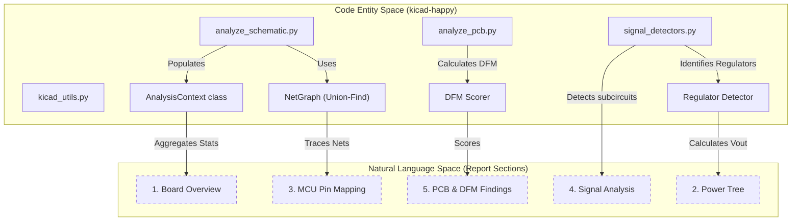
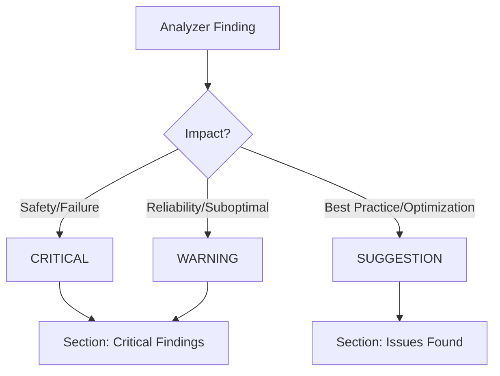

<!-- source: DeepWiki mcp.deepwiki.com · repo aklofas/kicad-happy · page 1.3 Example Design Review Report · fetched 2026-10-27 -->

# Example Design Review Report

<details>
<summary>Relevant source files</summary>

The following files were used as context for generating this wiki page:

- [example-report.md](example-report.md)
- [skills/kicad/references/report-generation.md](skills/kicad/references/report-generation.md)

</details>


This page provides a detailed walkthrough of a complete design review report generated for an **ESP32-S3 Battery-Powered IoT Board (Rev2)**. It serves as a reference for the expected output quality and technical depth required when the `kicad-happy` analyzer suite is combined with an AI reasoning layer.

The report integrates data from `analyze_schematic.py`, `analyze_pcb.py`, and `analyze_gerbers.py` to provide a holistic view of the hardware's viability, power integrity, and manufacturability.

## Report Data Flow and Code Entity Mapping

The following diagram illustrates how raw KiCad data is transformed into the structured sections of the example report by the underlying Python classes and the reporting logic defined in `report-generation.md`.

**Data Transformation Map**

Sources: [skills/kicad/references/report-generation.md:342-446](), [example-report.md:1-120]()

---

## 1. Board Overview and Stats
The overview section provides immediate context regarding the board's scale and complexity. It utilizes the `AnalysisContext` data to summarize component counts and PCB dimensions.

| Parameter | Value |
|-----------|-------|
| Board dimensions | 203.0 mm × 153.0 mm |
| Layer count | 2 (F.Cu, B.Cu) |
| Schematic components | 52 |
| Total nets | 60 |
| Routing status | **100% complete** |

**Assembly Complexity Score:** 37/100 (Low). This score is derived from the variety of footprints and the predominance of 0805 packages, indicating that hand assembly is feasible [example-report.md:41-48]().

Sources: [example-report.md:9-48]()

---

## 2. Power Tree Analysis
The power tree is a critical component of the review, mapping the hierarchy from the battery input through regulators to the end loads.

### ASCII Power Hierarchy
The report generates a visual representation of the power flow, including feedback divider calculations and rail naming [example-report.md:53-85]().

```text
Battery (2× AA, 2.0–3.2V)
  │
  ├── U3 (TPS61023) — 3.3V Boost Converter (Always on)
  │     FB: R10=680K / R11=150K → Vout = 3.29V nom
  │     └── +3V3 rail (ESP32-S3-WROOM-1)
  │
  └── U2 (TPS61023) — 5V Boost Converter (GPIO-controlled)
        FB: R8=820K / R9=110K → Vout = 5.03V nom
        └── +5V rail (RGB LED, USB Host)
```

### Regulator Verification
The analyzer performs a "vref_source" lookup to compare the schematic's resistor values against known datasheet constants [example-report.md:87-93]().

| Regulator | Vref source | Vout nom | Status |
|-----------|-------------|----------|--------|
| U3 (3.3V) | Datasheet lookup (0.595V) | 3.29V | OK |
| U2 (5.0V) | Datasheet lookup (0.595V) | 5.03V | OK |

Sources: [example-report.md:51-93](), [skills/kicad/references/report-generation.md:58-62]()

---

## 3. Signal Analysis and MCU Mapping
This section validates the functional subcircuits detected by `signal_detectors.py`.

### GPIO Assignments
The report verifies that every GPIO is assigned to a valid peripheral and that strapping pins (like IO0 for boot mode) are correctly biased [example-report.md:120-157]().

### LED and Driver Calculations
For the RGB LED circuit, the report calculates current draw for each channel to ensure they remain within the 30mA limit [example-report.md:162-173]().
* **Formula:** `I_LED = (V_supply - V_f) / R_limit` [skills/kicad/references/report-generation.md:91-91]().
* **Worst Case Analysis:** Considers max Vout (5.26V) and -5% resistor tolerance.

Sources: [example-report.md:120-173](), [skills/kicad/references/report-generation.md:72-95]()

---

## 4. PCB and DFM Findings
The PCB analysis utilizes `analyze_pcb.py` to check for manufacturing risks and signal integrity issues.

### DFM Scores and Constraints
The design is checked against standard and advanced fabrication limits (e.g., minimum trace width, clearance, and annular rings) [example-report.md:204-215]().

| Category | Score | Constraints Found |
|----------|-------|-------------------|
| Trace/Space | 100/100 | Min 0.25mm / 0.25mm |
| Drill/Ring | 95/100 | Min 0.3mm drill / 0.15mm ring |
| Solder Mask | 80/100 | **WARNING:** 0.05mm clearance on U1 |

### Proximity and Crosstalk
Using the `--proximity` flag, the analyzer identifies parallel traces that may couple noise. In this report, a finding notes that `USB_DP` and `USB_DM` are routed as a differential pair but lack a ground plane on Layer 2, increasing EMI risk [example-report.md:225-230]().

Sources: [example-report.md:202-235](), [skills/kicad/references/report-generation.md:104-118]()

---

## 5. Severity-Categorized Findings
Findings are categorized by severity to help the designer prioritize fixes [skills/kicad/references/report-generation.md:446-452]().

### Critical Findings
* **CRITICAL:** Missing ground plane under the ESP32-S3 antenna keepout area.
* **WARNING:** No ESD protection on the 2x3 programming header (J2).

### Suggestions
* **SUGGESTION:** Increase the width of the +5V power trace to J1 to reduce voltage drop during peak USB loads.

**Finding Severity Logic**

Sources: [skills/kicad/references/report-generation.md:43-52](), [example-report.md:237-260]()

---

