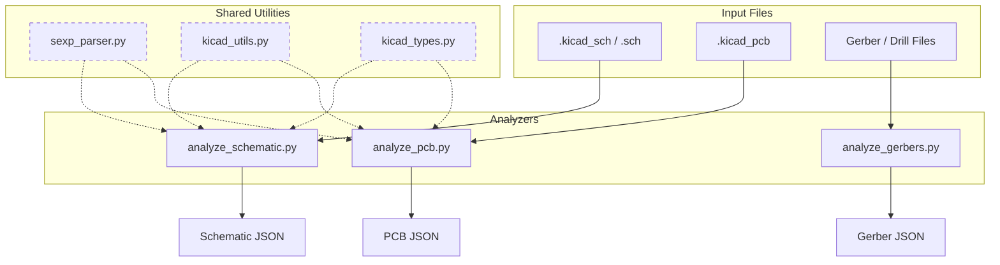
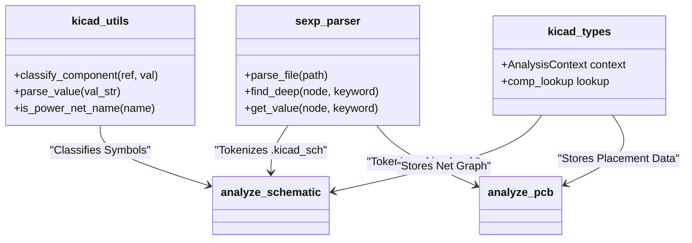

<!-- source: DeepWiki mcp.deepwiki.com · repo aklofas/kicad-happy · page 2 KiCad Analysis Scripts · fetched 2026-10-27 -->

# KiCad Analysis Scripts

Relevant source files

The following files were used as context for generating this wiki page:

- [skills/kicad/SKILL.md](skills/kicad/SKILL.md)
- [skills/kicad/scripts/README.md](skills/kicad/scripts/README.md)

The `kicad-happy` toolkit provides three core Python analysis scripts designed to extract deterministic, structured data from KiCad design files. These scripts serve as the "ground truth" layer for the AI-assisted design review workflow, converting complex EDA files into machine-readable JSON that can be analyzed for electrical correctness, manufacturing readiness, and signal integrity.

The suite is built on a shared parsing architecture and utility library to ensure consistency across schematic, PCB, and Gerber analysis.

### Core Analysis Pipeline

The scripts follow a tiered execution model where raw S-expression data is first parsed into memory, then transformed into high-level design entities (nets, components, footprints), and finally processed through specialized detection algorithms.

Sources: [skills/kicad/scripts/README.md:1-18](), [skills/kicad/SKILL.md:38-50]()

---

## 2.1 Schematic Analyzer (`analyze_schematic.py`)

The Schematic Analyzer is the most complex script in the suite, responsible for reconstructing the electrical intent of the design. It recursively traverses hierarchical sheets to build a global net graph using a union-find algorithm.

Key capabilities include:
*   **Component Extraction**: Identifying references, values, footprints, and MPNs.
*   **Net Graph Construction**: Resolving connectivity across local, global, and hierarchical labels.
*   **Subcircuit Detection**: Over 20 specialized detectors identify regulators, filters, op-amps, and communication buses.
*   **Power Analysis**: Estimating PDN impedance and auditing power sequencing.

For details, see [Schematic Analyzer (analyze_schematic.py)](#2.1).

Sources: [skills/kicad/SKILL.md:54-73](), [skills/kicad/scripts/README.md:7]()

---

## 2.2 PCB Layout Analyzer (`analyze_pcb.py`)

The PCB Layout Analyzer processes `.kicad_pcb` files to evaluate the physical implementation of the design. It translates relative pad positions into absolute board coordinates and performs spatial analysis to detect manufacturing risks.

Key capabilities include:
*   **Connectivity Verification**: Detecting unrouted nets and zone-aware continuity.
*   **DFM Scoring**: Evaluating the board against standard and advanced manufacturing limits (annular rings, clearances, tombstoning).
*   **Thermal Analysis**: Identifying thermal via density and zone stitching.
*   **Physical Audits**: Checking courtyard overlaps and component-to-edge clearances.

For details, see [PCB Layout Analyzer (analyze_pcb.py)](#2.2).

Sources: [skills/kicad/scripts/README.md:45-101](), [skills/kicad/SKILL.md:77-101]()

---

## 2.3 Gerber Analyzer (`analyze_gerbers.py`)

The Gerber Analyzer validates the final manufacturing outputs. Unlike the PCB analyzer which looks at design intent, this script parses the actual RS-274X and Excellon files to ensure the files sent to the fabricator are complete and consistent.

Key capabilities include:
*   **Layer Identification**: Using X2 attributes and file naming patterns to classify copper, mask, and silk layers.
*   **Alignment Verification**: Ensuring all layers share a common coordinate origin and scale.
*   **Drill Classification**: Distinguishing between plated (PTH) and non-plated (NPTH) holes.
*   **Staleness Detection**: Comparing timestamps between the PCB design file and the generated Gerber zip archive.

For details, see [Gerber Analyzer (analyze_gerbers.py)](#2.3).

Sources: [skills/kicad/scripts/README.md:115-117](), [skills/kicad/SKILL.md:103-118]()

---

## 2.4 Shared Utilities and Data Types

To maintain a "Single Source of Truth," the analyzers rely on a shared library of parsers and helper functions. This ensures that a component value or net name is interpreted identically whether it appears in a schematic or on a layout.

### Mapping Code Entities to Analysis Logic

The following diagram illustrates how shared code entities bridge the gap between raw file data and high-level analysis concepts.

### Key Shared Modules

| Module | Core Responsibility | Key Entities |
| :--- | :--- | :--- |
| `sexp_parser.py` | Low-level S-expression tokenization. | `parse_file()`, `find_all()`, `get_property()` |
| `kicad_utils.py` | Heuristic-based classification and string parsing. | `classify_component()`, `parse_value()`, `lookup_regulator_vref()` |
| `kicad_types.py` | Type definitions for cross-script data passing. | `AnalysisContext`, `NetInfo`, `Component` |

For details, see [Shared Utilities and Data Types](#2.4).

Sources: [skills/kicad/scripts/README.md:22-43](), [skills/kicad/scripts/README.md:11-12]()

---

