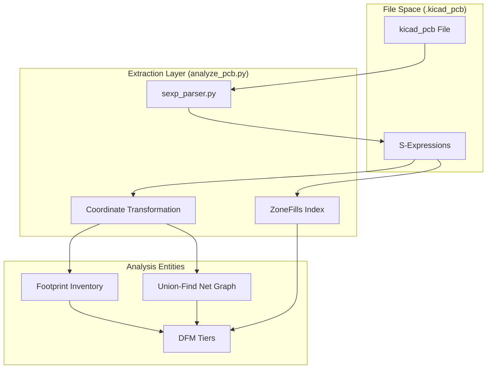
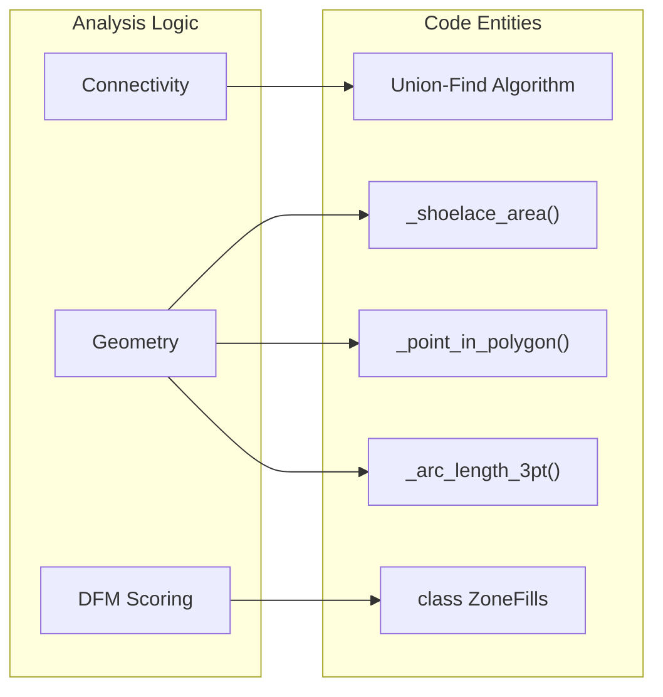

<!-- source: DeepWiki mcp.deepwiki.com · repo aklofas/kicad-happy · page 2.2 PCB Layout Analyzer (analyze_pcb.py) · fetched 2026-10-27 -->

# PCB Layout Analyzer (analyze_pcb.py)

Relevant source files

The following files were used as context for generating this wiki page:

- [skills/kicad/references/manual-pcb-parsing.md](skills/kicad/references/manual-pcb-parsing.md)
- [skills/kicad/references/pcb-layout-analysis.md](skills/kicad/references/pcb-layout-analysis.md)
- [skills/kicad/scripts/analyze_pcb.py](skills/kicad/scripts/analyze_pcb.py)
- [skills/kicad/scripts/methodology_pcb.md](skills/kicad/scripts/methodology_pcb.md)
- [skills/kicad/scripts/methodology_schematic.md](skills/kicad/scripts/methodology_schematic.md)

The PCB Layout Analyzer (`analyze_pcb.py`) is a comprehensive single-pass extraction tool designed to transform KiCad `.kicad_pcb` files into structured, machine-readable JSON [skills/kicad/scripts/analyze_pcb.py:1-15](). It serves as the physical grounding layer of the analysis pipeline, providing the raw data necessary for DFM (Design for Manufacturability) scoring, connectivity verification, and signal integrity assessments [skills/kicad/scripts/methodology_pcb.py:5-12]().

## Pipeline Overview

The analysis follows a deterministic sequence from raw S-expression parsing to high-level physical heuristics.

### 1. Extraction and Transformation
The analyzer uses `sexp_parser.py` to convert the Lisp-like KiCad format into nested Python lists [skills/kicad/scripts/methodology_pcb.py:15-18](). It supports both KiCad 6+ (`footprint`) and KiCad 5 (`module`) syntax [skills/kicad/scripts/methodology_pcb.py:21-26](). 

Key extraction entities include:
*   **Footprints**: Reference designators, positions, and 3D model paths [skills/kicad/scripts/methodology_pcb.py:50-71]().
*   **Pads**: Absolute coordinate calculation (applying footprint rotation/translation), shapes, and drill sizes [skills/kicad/scripts/methodology_pcb.py:73-83]().
*   **Routing**: Tracks (segments/arcs), vias (through/blind/micro), and copper zones [skills/kicad/scripts/methodology_pcb.py:88-106]().
*   **Board Geometry**: Bounding box calculation from the `Edge.Cuts` layer to determine board dimensions [skills/kicad/scripts/methodology_pcb.py:121-124]().

### 2. Connectivity Analysis
Connectivity is verified using a **Union-Find** algorithm. Points are snapped to a 1µm grid to account for floating-point rounding in the S-expression [skills/kicad/scripts/methodology_pcb.py:135-138](). The analyzer unions:
1.  Pads on the same net.
2.  Track start/end points.
3.  Vias across their layer spans.
4.  Pads covered by copper zones [skills/kicad/scripts/methodology_pcb.py:139-143]().

### 3. Spatial Copper Indexing
The `ZoneFills` class provides a spatial index for filled polygon data [skills/kicad/scripts/analyze_pcb.py:110-120](). This allows for `point_in_polygon` queries to determine if copper actually exists at a specific coordinate, which is critical for verifying thermal via effectiveness and plane continuity [skills/kicad/scripts/analyze_pcb.py:139-164]().

### PCB Analysis Data Flow
The following diagram illustrates how raw file entities are processed into the final analysis context.

**Diagram: PCB Entity Extraction Flow**

Sources: [skills/kicad/scripts/analyze_pcb.py:110-172](), [skills/kicad/scripts/methodology_pcb.py:15-49](), [skills/kicad/scripts/methodology_pcb.py:135-150]()

---

## Physical Layout Features

### DFM and Manufacturing Checks
The analyzer calculates physical metrics against manufacturer capability tiers. It identifies "Standard" vs "Advanced" fabrication requirements based on minimum trace widths, clearances, and annular rings.
*   **Tombstoning Risk**: Heuristic check for unbalanced copper on small SMD components (e.g., 0402 resistors) [skills/kicad/scripts/methodology_pcb.py:11]().
*   **Annular Rings**: Verification of pad-to-drill ratios to ensure drill breakout does not occur.
*   **Via-in-Pad**: Detection of vias placed directly on SMD pads, which can cause solder wicking issues.

For details, see [DFM Scoring and Manufacturing Checks](#2.2.1).

### Thermal and Power Analysis
*   **Thermal Vias**: Detection of via clusters under power pads (e.g., QFN thermal pads). The analyzer uses the `ZoneFills` index to verify these vias connect to internal planes [skills/kicad/scripts/analyze_pcb.py:110-120]().
*   **Current Capacity**: Uses track width and copper weight (from the `setup` block) to estimate ampacity based on IPC-2221 standards [skills/kicad/references/pcb-layout-analysis.md:152-164]().

### Signal Integrity and Proximity
*   **Crosstalk Detection**: When the `--proximity` flag is used, the analyzer identifies long parallel runs of tracks on different nets to flag potential inductive/capacitive coupling.
*   **Differential Pairs**: Identification of nets ending in `+`/`-` or `_P`/`_N` to verify length matching and gap consistency [skills/kicad/references/pcb-layout-analysis.md:110-123]().

### System Entity Mapping
This diagram maps high-level analysis concepts to the specific code entities responsible for them.

**Diagram: Logic to Code Mapping**

Sources: [skills/kicad/scripts/analyze_pcb.py:40-107](), [skills/kicad/scripts/analyze_pcb.py:110-120](), [skills/kicad/scripts/analyze_pcb.py:173-209](), [skills/kicad/scripts/methodology_pcb.py:135-150]()

---

## Child Pages
*   [DFM Scoring and Manufacturing Checks](#2.2.1) — Detailed breakdown of manufacturing limits, tombstoning heuristics, and fabrication tier mapping.

---

