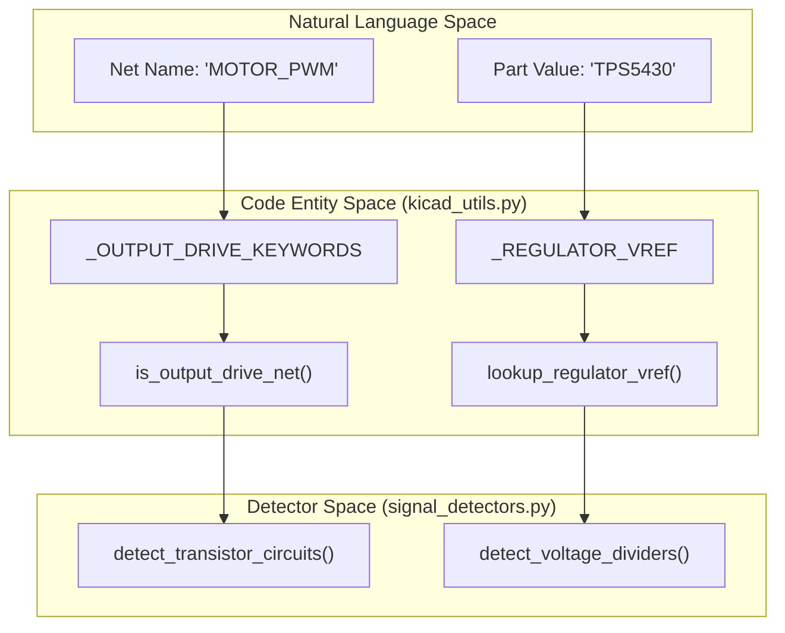
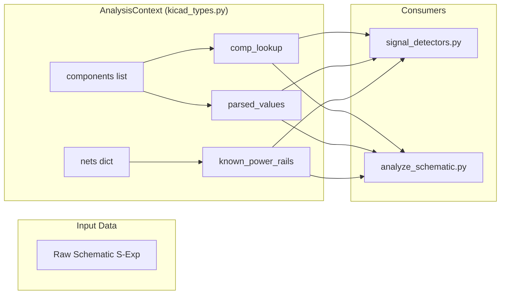

<!-- source: DeepWiki mcp.deepwiki.com · repo aklofas/kicad-happy · page 2.4 Shared Utilities and Data Types · fetched 2026-10-27 -->

# Shared Utilities and Data Types

Relevant source files

The following files were used as context for generating this wiki page:

- [skills/kicad/scripts/kicad_types.py](skills/kicad/scripts/kicad_types.py)
- [skills/kicad/scripts/kicad_utils.py](skills/kicad/scripts/kicad_utils.py)
- [skills/kicad/scripts/methodology_gerbers.md](skills/kicad/scripts/methodology_gerbers.md)
- [skills/kicad/scripts/sexp_parser.py](skills/kicad/scripts/sexp_parser.py)
- [skills/kicad/scripts/signal_detectors.py](skills/kicad/scripts/signal_detectors.py)

This page documents the shared library modules that provide the foundational data structures and utility functions for the `kicad-happy` analysis pipeline. These modules ensure consistent behavior across the schematic, PCB, and Gerber analyzers by centralizing S-expression parsing, component classification, and unit conversion.

## S-Expression Parser (`sexp_parser.py`)

The `sexp_parser.py` module provides a high-performance tokenizer and parser for KiCad's Lisp-like S-expression format. It transforms raw text into nested Python lists, allowing other scripts to query design data using a simplified API.

### Implementation Details
The parser uses a two-stage approach:
1.  **Tokenization**: The `_tokenize` function scans the input string, handling quoted strings (with escape characters) and unquoted atoms while stripping whitespace `[skills/kicad/scripts/sexp_parser.py:28-62]()`.
2.  **Recursive Descent**: The `_parse_tokens` function recursively builds nested lists. It includes bounds checking to handle truncated or malformed files gracefully `[skills/kicad/scripts/sexp_parser.py:65-79]()`.

### Key API Functions
| Function | Description |
| :--- | :--- |
| `parse_file(path)` | Reads and parses a `.kicad_sch` or `.kicad_pcb` file into a nested list structure `[skills/kicad/scripts/sexp_parser.py:22-25]()`. |
| `find_all(node, keyword)` | Returns all direct child lists starting with the specified keyword (e.g., finding all `symbol` blocks) `[skills/kicad/scripts/sexp_parser.py:81-88]()`. |
| `get_property(node, prop)` | Extracts the value of a specific named property, such as "Reference" or "Value" `[skills/kicad/scripts/sexp_parser.py:130-139]()`. |
| `get_at(node)` | Extracts `(x, y, angle)` coordinates from an `(at ...)` node, commonly used for component placement `[skills/kicad/scripts/sexp_parser.py:158-167]()`. |

**Sources:** `skills/kicad/scripts/sexp_parser.py`

---

## Shared Utilities (`kicad_utils.py`)

This module contains the "business logic" for interpreting KiCad data. It handles the messy realities of component naming conventions and coordinate drift.

### Component and Net Classification
The utilities provide heuristics to identify the function of components and nets based on their names and values:
*   **Regulator Vref Lookup**: The `_REGULATOR_VREF` table maps part number prefixes (e.g., `TPS5430`, `LM317`) to their internal reference voltages `[skills/kicad/scripts/kicad_utils.py:28-106]()`. This is used by `lookup_regulator_vref` to calculate expected output voltages from feedback dividers `[skills/kicad/scripts/kicad_utils.py:136-157]()`.
*   **Load Type Keywords**: `_LOAD_TYPE_KEYWORDS` identifies inductive or resistive loads (e.g., `MOTOR`, `HEATER`, `RELAY`) from net names to assist transistor drive analysis `[skills/kicad/scripts/kicad_utils.py:115-126]()`.
*   **Coordinate Snapping**: To combat floating-point errors introduced during rotation or mil-to-mm conversion, `snap_to_mil_grid` aligns coordinates back to the standard 1-mil grid `[skills/kicad/scripts/kicad_utils.py:20-22]()`.

### Data Flow: Natural Language to Code Entities
The following diagram illustrates how the utilities bridge raw schematic strings to structured classifications used by the detectors.

**Classification Mapping Logic**

**Sources:** `skills/kicad/scripts/kicad_utils.py`, `skills/kicad/scripts/signal_detectors.py`

---

## Analysis Data Types (`kicad_types.py`)

The `AnalysisContext` dataclass is the central state object passed throughout the analysis pipeline. It encapsulates the processed schematic data to prevent redundant computations.

### AnalysisContext Dataclass
Defined in `[skills/kicad/scripts/kicad_types.py:17-60]()`, this object is initialized once per schematic analysis.

| Attribute | Type | Description |
| :--- | :--- | :--- |
| `comp_lookup` | `dict[str, dict]` | O(1) lookup of component data by reference designator `[skills/kicad/scripts/kicad_types.py:30]()`. |
| `parsed_values` | `dict[str, float]` | Normalized numerical values for resistors (Ohms), capacitors (Farads), etc. `[skills/kicad/scripts/kicad_types.py:31]()`. |
| `known_power_rails` | `set[str]` | A set of net names identified as power rails via `#PWR` or `#FLG` symbols `[skills/kicad/scripts/kicad_types.py:32]()`. |
| `pin_net` | `dict` | Mapping of `(reference, pin_number)` to the resolved net name `[skills/kicad/scripts/kicad_types.py:29]()`. |

### Logic Flow: Context Initialization
When `AnalysisContext` is instantiated, its `__post_init__` method automatically populates the lookup tables:
1.  **Value Parsing**: Iterates through components and calls `parse_value` to populate `parsed_values` `[skills/kicad/scripts/kicad_types.py:38-42]()`.
2.  **Power Rail Detection**: Scans net pins for power symbols to populate `known_power_rails` `[skills/kicad/scripts/kicad_types.py:43-48]()`.

**Context Data Relationships**

**Sources:** `skills/kicad/scripts/kicad_types.py`, `skills/kicad/scripts/kicad_utils.py`

---

