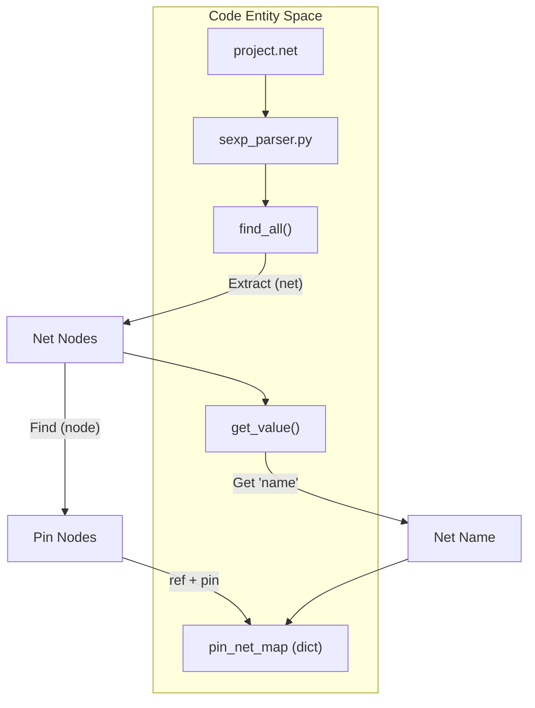
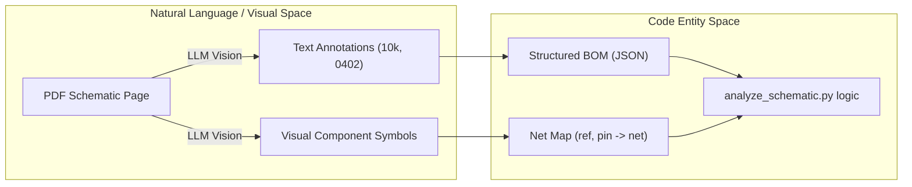

<!-- source: DeepWiki mcp.deepwiki.com · repo aklofas/kicad-happy · page 3.3 Supplementary Data Sources and Legacy Support · fetched 2026-10-27 -->

# Supplementary Data Sources and Legacy Support

Relevant source files

The following files were used as context for generating this wiki page:

- [.codex-plugin/plugin.json](.codex-plugin/plugin.json)
- [skills/element14/scripts/sync_datasheets_element14.py](skills/element14/scripts/sync_datasheets_element14.py)
- [skills/kicad/references/manual-schematic-parsing.md](skills/kicad/references/manual-schematic-parsing.md)
- [skills/kicad/references/pdf-schematic-extraction.md](skills/kicad/references/pdf-schematic-extraction.md)
- [skills/kicad/references/schematic-analysis.md](skills/kicad/references/schematic-analysis.md)
- [skills/kicad/references/supplementary-data-sources.md](skills/kicad/references/supplementary-data-sources.md)

This page details the mechanisms for recovering design data when primary schematic parsing is incomplete, specifically for legacy KiCad 5 designs. It covers the use of netlists, cache libraries, and PDF extraction workflows to ensure full analysis capability even when source library files are missing.

## Overview of Legacy Analysis Challenges

Modern KiCad 6+ designs (`.kicad_sch`) embed symbol information directly in the schematic file. Legacy KiCad 5 designs (`.sch`) rely on external `.lib` files. If these libraries are missing from a repository, `analyze_schematic.py` may produce incomplete component data, such as empty `pins` arrays or missing electrical types [skills/kicad/references/supplementary-data-sources.md:27-32]().

### Data Recovery Capabilities

| Format | Components | Nets | Pin-to-Net | Signal Analysis |
| :--- | :--- | :--- | :--- | :--- |
| **Modern (.kicad_sch)** | Full | Full | Full | Full |
| **Legacy (.sch)** | Full | Full | Partial* | Partial* |

*\*Requires supplementary data (Netlists or Cache Libs) to reach 100% coverage [skills/kicad/references/supplementary-data-sources.md:22-25]().*

## Netlist File (.net) Support

The KiCad 5 netlist is the most reliable supplementary source for legacy designs. It provides an explicit mapping of component pins to net names, bypassing the need for coordinate-based tracing or library lookups [skills/kicad/references/supplementary-data-sources.md:38-40]().

### Netlist Data Flow
The `sexp_parser.py` utility is used to traverse the S-expression structure of the `.net` file to build a `pin_net_map` [skills/kicad/references/supplementary-data-sources.md:85-109]().

### Netlist Extraction Logic

*Sources: [skills/kicad/references/supplementary-data-sources.md:87-109]()*

## Cache Library (-cache.lib) Integration

KiCad 5 projects typically include a `<project>-cache.lib` file. The analyzer automatically attempts to parse this file to recover pin definitions, including pin names, numbers, and electrical types [skills/kicad/references/supplementary-data-sources.md:121-127]().

### Pin Electrical Type Mapping
The analyzer maps legacy one-letter codes to functional types for signal analysis [skills/kicad/references/supplementary-data-sources.md:164-178]():

| Code | Type | Description |
| :--- | :--- | :--- |
| `I` | Input | Logic input |
| `O` | Output | Logic output |
| `B` | Bidirectional | I/O, GPIO |
| `W` | Power Input | VDD, GND (Consumer) |
| `w` | Power Output | Regulator Output (Source) |
| `P` | Passive | Resistor, Capacitor |

## PDF Schematic Extraction Workflow

When source files are unavailable (e.g., manufacturer reference designs), the system uses a multimodal LLM workflow to extract structured data from PDF schematics [skills/kicad/references/pdf-schematic-extraction.md:1-5]().

### Extraction Pipeline
1.  **Cataloging**: Identify sheet titles, key ICs, and power rails [skills/kicad/references/pdf-schematic-extraction.md:63-70]().
2.  **BOM Extraction**: Capture Reference, Value, MPN, and Footprint from schematic annotations or tables [skills/kicad/references/pdf-schematic-extraction.md:94-105]().
3.  **Connectivity Mapping**: Trace nets across pages using net labels and off-page connectors [skills/kicad/references/pdf-schematic-extraction.md:133-148]().
4.  **Translation**: Recreate the topology in KiCad using the extracted net map [skills/kicad/references/pdf-schematic-extraction.md:80-82]().

### PDF to KiCad Mapping

*Sources: [skills/kicad/references/pdf-schematic-extraction.md:53-86](), [skills/kicad/references/pdf-schematic-extraction.md:150-165]()*

## Standard Library Fallbacks (_STANDARD_LIB_PINS)

For common discrete components where library data is missing, the system utilizes a built-in fallback dictionary. This ensures that basic passives (R, C, L), diodes, and transistors still participate in signal analysis (e.g., voltage divider detection) even without a `.lib` or `.net` file [skills/kicad/references/supplementary-data-sources.md:27-32]().

### Fallback Implementation Logic
1.  Check if component has pin data from `.kicad_sch` or `.lib`.
2.  If empty, check `lib_id` against `_STANDARD_LIB_PINS`.
3.  Apply default pin mapping (e.g., Pin 1/2 for Resistors) to enable `signal_detectors.py` to function [skills/kicad/references/supplementary-data-sources.md:111-112]().

*Sources: [skills/kicad/references/supplementary-data-sources.md:27-32](), [skills/kicad/references/supplementary-data-sources.md:111-112]()*

---

