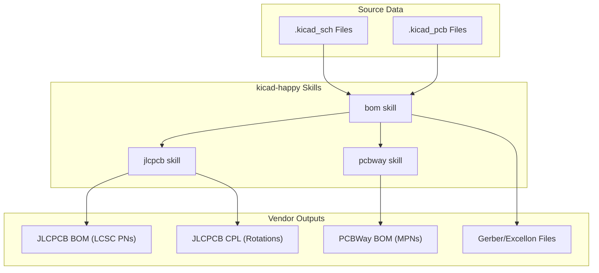
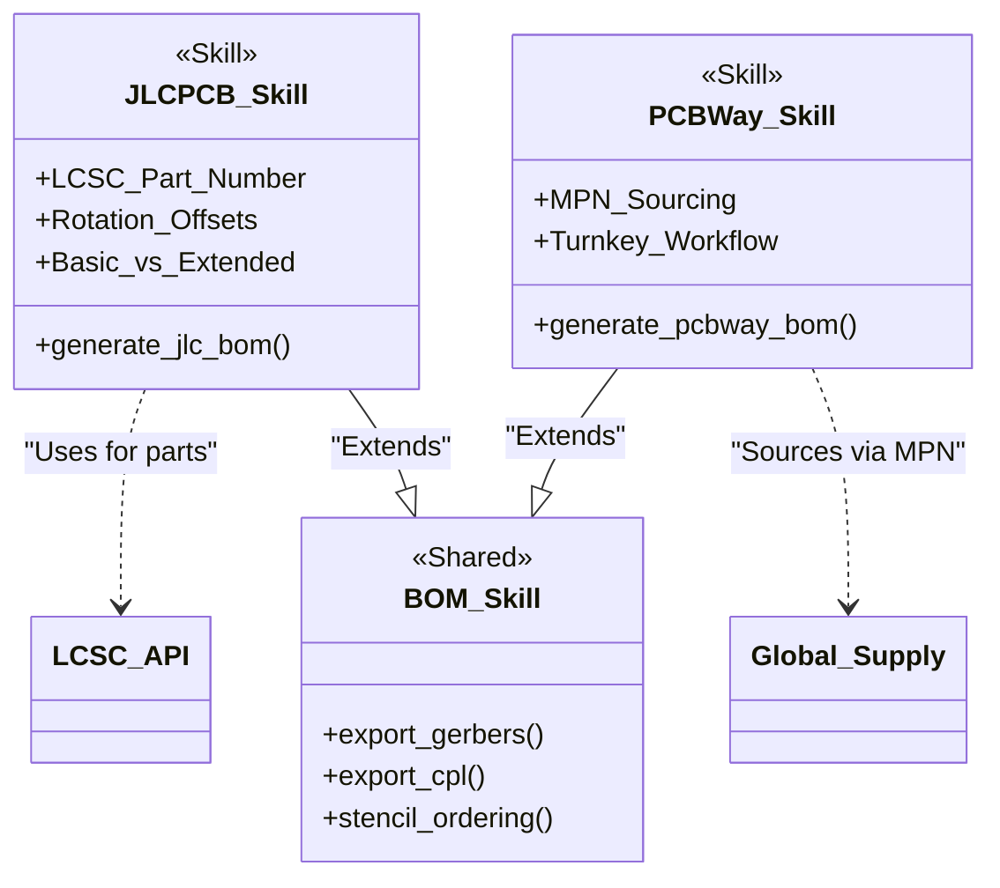

<!-- source: DeepWiki mcp.deepwiki.com · repo aklofas/kicad-happy · page 5.2 Fabrication Skills (JLCPCB and PCBWay) · fetched 2026-10-27 -->

# Fabrication Skills (JLCPCB and PCBWay)

Relevant source files

The following files were used as context for generating this wiki page:

- [LICENSE](LICENSE)
- [skills/jlcpcb/SKILL.md](skills/jlcpcb/SKILL.md)
- [skills/pcbway/SKILL.md](skills/pcbway/SKILL.md)

This page documents the integration of fabrication-specific skills within the `kicad-happy` ecosystem. It covers the technical requirements for exporting manufacturing data (BOM, CPL, Gerbers), Design for Manufacturing (DFM) constraints for major vendors, and the automation of ordering workflows for both JLCPCB and PCBWay.

## Overview of Fabrication Integration

The fabrication skills act as the final stage in the EDA pipeline, transforming analyzed design data into vendor-specific formats. While the `kicad` skill performs general analysis, the `jlcpcb` and `pcbway` skills provide the specific constraints required to move from a digital design to a physical board.

### Data Flow: Design to Fabrication

The following diagram illustrates how schematic and PCB data are transformed into fabrication outputs.

**Fabrication Data Transformation Flow**

**Sources:** [skills/jlcpcb/SKILL.md:12-21](), [skills/pcbway/SKILL.md:12-21]()

---

## JLCPCB Fabrication and Assembly

JLCPCB integration focuses on the LCSC ecosystem. Because JLCPCB and LCSC share ownership, the primary identifier for assembly is the LCSC Part Number.

### Component Placement List (CPL) and BOM
JLCPCB requires specific column headers and data formats for automated assembly.

*   **BOM Columns**: Must include `Designator`, `Comment` (Value), `Footprint`, and `LCSC Part #` [skills/jlcpcb/SKILL.md:44-53]().
*   **Rotation Offsets**: KiCad's footprint rotations often differ from JLCPCB's pick-and-place machine conventions. The `jlcpcb` skill documents common offsets that must be applied to the CPL file [skills/jlcpcb/SKILL.md:126-144]().

| Footprint Family | Typical JLCPCB Offset |
| :--- | :--- |
| SOT-23 / SOT-223 | +180° |
| SOIC / QFN | +90° |
| SMA/SMB Diodes | +180° |

### Assembly Part Tiers
JLCPCB categorizes parts into three tiers, affecting both cost and machine setup [skills/jlcpcb/SKILL.md:25-32]():
1.  **Basic**: ~698 common parts pre-loaded; no extra fee.
2.  **Preferred Extended**: Frequently used; no feeder loading fee in Economic mode.
3.  **Extended**: 300k+ parts; $3 fee per unique part.

### DFM Limits (JLCPCB)
The `kicad` skill uses these limits to score designs [skills/jlcpcb/SKILL.md:77-102]().

| Parameter | Standard (1-2 Layer) | Multi-layer (4+) |
| :--- | :--- | :--- |
| Min Trace/Spacing | 0.127mm (5mil) | 0.09mm (3.5mil) |
| Min Drill | 0.2mm | 0.15mm |
| Min Via Diameter | 0.45mm | 0.25mm |

**Sources:** [skills/jlcpcb/SKILL.md:25-32](), [skills/jlcpcb/SKILL.md:44-53](), [skills/jlcpcb/SKILL.md:77-102](), [skills/jlcpcb/SKILL.md:126-144]()

---

## PCBWay Fabrication and Assembly

PCBWay is utilized for turnkey assembly where parts are sourced globally via Manufacturer Part Numbers (MPN) rather than a specific vendor catalog like LCSC.

### Turnkey BOM Requirements
Unlike JLCPCB, PCBWay's primary key is the `MPN`. The BOM export must include [skills/pcbway/SKILL.md:58-70]():
*   **MPN**: Manufacturer Part Number.
*   **Manufacturer**: Brand name.
*   **Type**: `SMD`, `THT`, or `Hybrid`.

### DFM Limits (PCBWay)
PCBWay offers slightly tighter standard tolerances compared to JLCPCB's base tier [skills/pcbway/SKILL.md:80-105]().

| Parameter | Standard (1-2 Layer) |
| :--- | :--- |
| Min Trace/Spacing | 0.1mm (4mil) |
| Min Drill | 0.15mm |
| Min Annular Ring | 0.15mm (6mil) |

**Sources:** [skills/pcbway/SKILL.md:23-37](), [skills/pcbway/SKILL.md:46-70](), [skills/pcbway/SKILL.md:80-105]()

---

## Technical Implementation: API and Ordering

Both skills provide guidance on using official APIs for quoting and ordering, though access usually requires vendor approval.

### API Capabilities
The codebase references the following endpoints for automation [skills/jlcpcb/SKILL.md:67-76](), [skills/pcbway/SKILL.md:131-142]():
*   **Components API**: Real-time pricing and inventory.
*   **PCB/Quotation API**: Uploading Gerbers to receive instant pricing.
*   **Order Tracking**: Querying status of active production runs.

### Skill Entity Mapping
The following diagram maps the logical fabrication concepts to the specific skill entities and external resources used in the codebase.

**Code Entity Space: Fabrication Skills**

### Ordering Workflow Summary
1.  **DFM Check**: Run `analyze_pcb.py` to check against vendor limits (e.g., 5mil trace for JLC) [skills/jlcpcb/SKILL.md:16]().
2.  **BOM Prep**: Populate `LCSC` fields for JLCPCB or `MPN`/`Manufacturer` fields for PCBWay [skills/jlcpcb/SKILL.md:55-64](), [skills/pcbway/SKILL.md:72-77]().
3.  **Export**: Generate Gerbers, BOM, and CPL via the `bom` skill [skills/jlcpcb/SKILL.md:145-163]().
4.  **Upload**: Submit files to vendor web portals or via API for quoting [skills/pcbway/SKILL.md:143-163]().

**Sources:** [skills/jlcpcb/SKILL.md:67-76](), [skills/jlcpcb/SKILL.md:145-163](), [skills/pcbway/SKILL.md:131-142](), [skills/pcbway/SKILL.md:143-163]()

---

