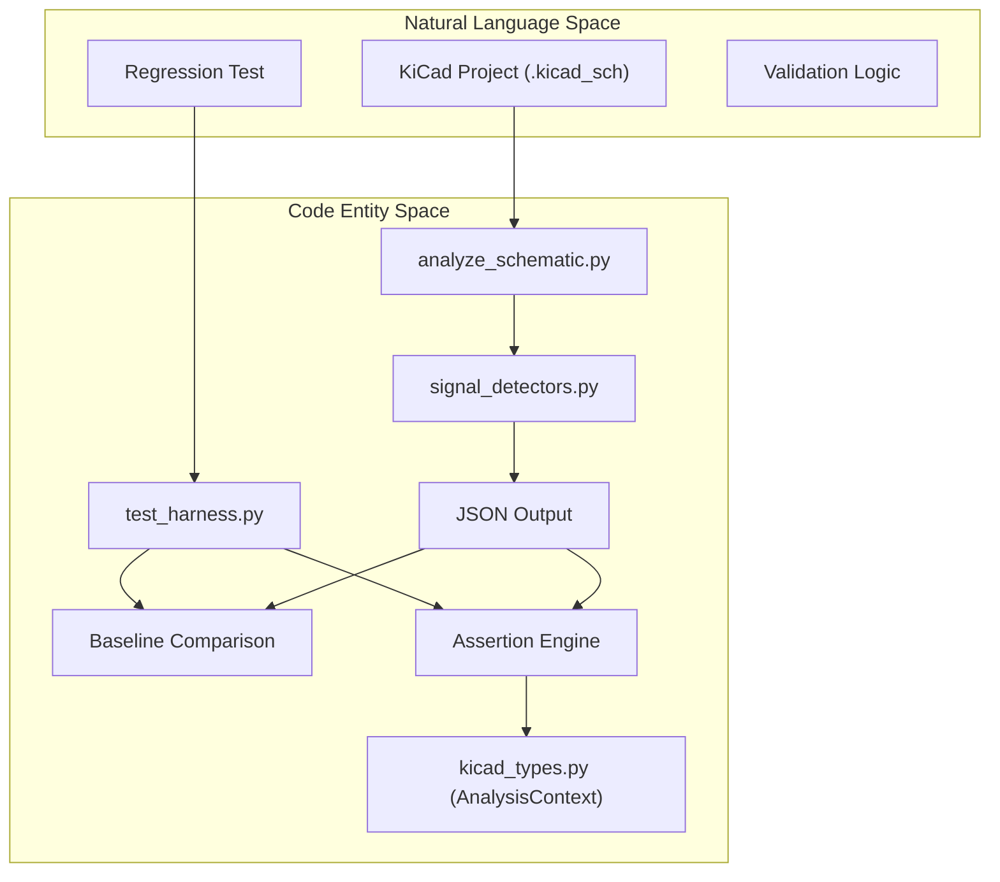
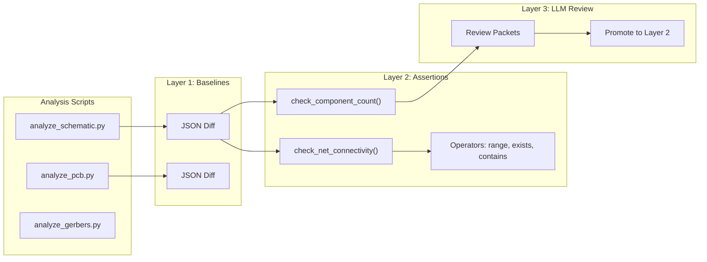

<!-- source: DeepWiki mcp.deepwiki.com · repo aklofas/kicad-happy · page 6 Testing and Validation · fetched 2026-10-27 -->

# Testing and Validation

Relevant source files

The following files were used as context for generating this wiki page:

- [how-it-works.md](how-it-works.md)
- [skills/kicad/scripts/README.md](skills/kicad/scripts/README.md)

The `kicad-happy` test harness is a comprehensive validation suite designed to ensure the deterministic extraction scripts (`analyze_schematic.py`, `analyze_pcb.py`, and `analyze_gerbers.py`) remain accurate across KiCad version updates and code refactors. The system leverages a massive corpus of real-world hardware projects to perform three-layer regression testing, moving from raw data snapshots to high-level semantic assertions.

## Test Corpus Overview

The testing infrastructure is built upon a diverse corpus of **1,053 schematics** and associated PCB layouts, organized into **25 functional categories** (e.g., MCU, Power, RF, Motor Control). This corpus ensures that the signal detectors in `signal_detectors.py` are exercised against a wide variety of design styles and component selections.

To maintain reproducibility, the test suite utilizes a **pinned-by-commit-hash** approach for external projects, ensuring that upstream changes to open-source hardware do not break the local baseline comparisons.

For details on corpus organization, see [Test Harness Architecture](#6.1).

## Three-Layer Regression Testing

The validation strategy employs three distinct layers to catch regressions at different levels of abstraction.

### Layer 1: Baselines (JSON Snapshots)
The first layer performs a structural diff between the current JSON output and a "known good" baseline. Any change in the extracted component properties, net connectivity, or detected subcircuits triggers a baseline mismatch. This ensures that refactoring the `sexp_parser.py` [skills/kicad/scripts/sexp_parser.py:1-42]() or `kicad_utils.py` [skills/kicad/scripts/kicad_utils.py:1-460]() does not inadvertently alter the data delivered to the AI agent.

### Layer 2: Assertions (Machine-Checkable Facts)
Assertions define explicit expectations about a design using operators like `range`, `min_count`, `exists`, and `contains_match`. For example, an assertion might verify that a specific buck regulator circuit always detects a `voltage_divider` on its feedback pin with a specific ratio.

### Layer 3: LLM Review (Semantic Validation)
The final layer uses "review packets" where an LLM evaluates the analysis findings against the original design intent. Valid findings from these reviews are promoted to permanent Layer 2 assertions to prevent future regressions of complex reasoning.

For details on implementation, see [Test Harness Architecture](#6.1).

## Development Cycle

The development cycle for new features or bug fixes is centered around the batch test suite. Developers follow a "net-graph-first" approach, where connectivity changes are validated before signal detection logic is updated.

### Feature Development Flow
1.  **Modify Extraction/Detection**: Update logic in `analyze_schematic.py` or `signal_detectors.py`.
2.  **Run Batch Suite**: Execute `test_all.py` (or equivalent local harness) to identify affected projects.
3.  **Calibrate Sensitivity**: Adjust detection thresholds (e.g., resistor tolerances in voltage dividers) to minimize false positives across the 1,000+ project corpus.
4.  **Update Baselines**: Once the change is verified as correct, the local baselines are updated to reflect the new improved state.

For a guide on extending the system, see [Adding New Detection Features](#6.2).

## System Architecture Diagrams

The following diagrams illustrate how the testing components map to the codebase and how the validation pipeline flows from raw files to verified assertions.

### Test Data Flow: From Source to Assertion
This diagram bridges the natural language concept of "Validation" to the specific Python entities responsible for data extraction and comparison.

**Sources:** [skills/kicad/scripts/README.md:1-19](), [how-it-works.md:19-49]()

### Regression Layer Mapping
This diagram shows how the three layers of testing interact with the core analysis scripts.

**Sources:** [how-it-works.md:5-15](), [how-it-works.md:118-132]()

## Running Tests Locally

The batch test suite can be run against the local corpus to verify changes before submission.

| Command | Purpose |
| :--- | :--- |
| `python3 test_harness.py --all` | Runs Layer 1 and Layer 2 tests for the entire corpus. |
| `python3 test_harness.py --category Power` | Runs tests only for projects in the 'Power' category. |
| `python3 test_harness.py --update-baselines` | Updates the JSON snapshots after a verified logic change. |

**Sources:** [how-it-works.md:19-51](), [skills/kicad/scripts/README.md:103-111]()

---
**Child Pages:**
- [Test Harness Architecture](#6.1)
- [Adding New Detection Features](#6.2)

---

