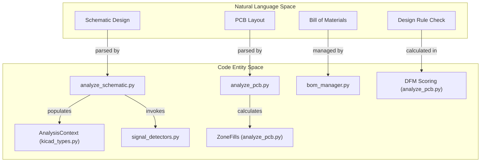
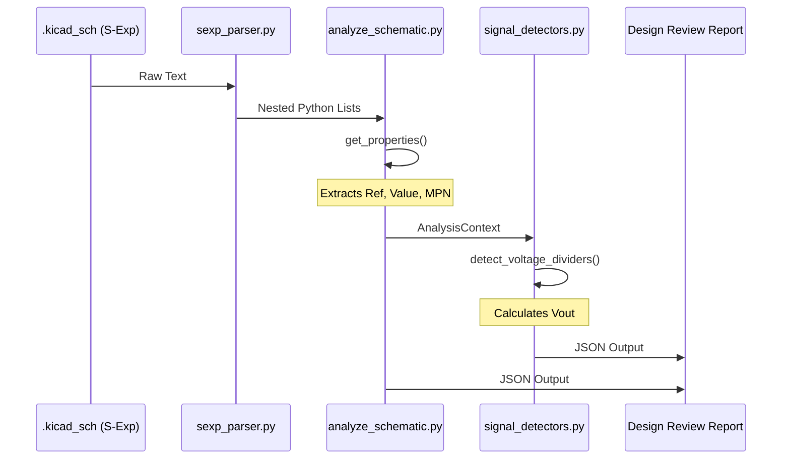

<!-- source: DeepWiki mcp.deepwiki.com · repo aklofas/kicad-happy · page 7 Glossary · fetched 2026-10-27 -->

# Glossary

Relevant source files

The following files were used as context for generating this wiki page:

- [README.md](README.md)
- [how-it-works.md](how-it-works.md)
- [skills/kicad/references/file-formats.md](skills/kicad/references/file-formats.md)
- [skills/kicad/references/gerber-parsing.md](skills/kicad/references/gerber-parsing.md)
- [skills/kicad/references/standards-compliance.md](skills/kicad/references/standards-compliance.md)
- [skills/kicad/scripts/analyze_gerbers.py](skills/kicad/scripts/analyze_gerbers.py)
- [skills/kicad/scripts/analyze_pcb.py](skills/kicad/scripts/analyze_pcb.py)
- [skills/kicad/scripts/analyze_schematic.py](skills/kicad/scripts/analyze_schematic.py)
- [skills/kicad/scripts/kicad_utils.py](skills/kicad/scripts/kicad_utils.py)
- [skills/kicad/scripts/sexp_parser.py](skills/kicad/scripts/sexp_parser.py)
- [skills/kicad/scripts/signal_detectors.py](skills/kicad/scripts/signal_detectors.py)

This page defines codebase-specific terminology, EDA jargon, and domain concepts used throughout the `kicad-happy` project. It serves as a technical reference for onboarding engineers to understand how physical PCB concepts map to specific data structures and functions in the analysis pipeline.

## 1. System Architecture & Core Concepts

The `kicad-happy` system follows a deterministic extraction pattern where KiCad design files are transformed into a queryable JSON state before any AI reasoning occurs.

### Natural Language to Code Entity Mapping

The following diagram bridges the gap between high-level EDA concepts and the specific Python entities that implement them.

**Diagram: EDA Concept to Code Mapping**

Sources: [skills/kicad/scripts/analyze_schematic.py:1-16](), [skills/kicad/scripts/analyze_pcb.py:1-15](), [skills/kicad/scripts/kicad_types.py:21-21](), [skills/kicad/scripts/signal_detectors.py:1-6]()

---

## 2. Schematic Analysis Terms

### AnalysisContext
A central dataclass used to pass the entire state of a parsed schematic to detector functions. It contains the component lookup table, net connectivity graph, and parsed value cache.
*   **Definition**: `AnalysisContext` in [skills/kicad/scripts/kicad_types.py:21-21]()
*   **Usage**: Passed to every function in `signal_detectors.py` [skills/kicad/scripts/signal_detectors.py:4-6]()

### Net Graph Construction (Union-Find)
The process of resolving electrical connectivity by merging coordinate points. Because KiCad stores wires as individual segments, the analyzer uses a "snap-to-grid" approach where endpoints within `COORD_EPSILON` (0.01mm) are considered the same electrical node.
*   **Implementation**: `snap_to_mil_grid` in [skills/kicad/scripts/kicad_utils.py:20-22]()
*   **Tolerance**: `COORD_EPSILON` defined in [skills/kicad/scripts/kicad_utils.py:12-12]()

### Signal Path Detectors
Pure functions that traverse the `AnalysisContext` to find specific circuit topologies (e.g., voltage dividers, filters, regulators).
*   **Location**: [skills/kicad/scripts/signal_detectors.py:108-110]()
*   **Example**: `detect_voltage_dividers` [skills/kicad/scripts/signal_detectors.py:111-113]()

### Vref Lookup
A deterministic table used to resolve the internal reference voltage of power regulators based on their part number or library ID. This prevents the AI from having to "guess" feedback ratios.
*   **Table**: `_REGULATOR_VREF` in [skills/kicad/scripts/kicad_utils.py:28-106]()
*   **Function**: `lookup_regulator_vref` in [skills/kicad/scripts/kicad_utils.py:136-142]()

---

## 3. PCB Layout & Fabrication Terms

### DFM (Design for Manufacturing)
Checks performed on the `.kicad_pcb` file to ensure the board can be produced by standard fab houses (e.g., JLCPCB, PCBWay).
*   **Scoring Logic**: Implemented in `analyze_pcb.py`.
*   **Checks**: Includes annular ring, via-in-pad, and clearance checks [skills/kicad/scripts/analyze_pcb.py:5-12]()

### ZoneFills
A spatial index used to determine if copper actually exists at a specific (x, y) coordinate. Since KiCad zones are stored as polygon outlines, `ZoneFills` uses a ray-casting point-in-polygon test to verify connectivity.
*   **Class**: `ZoneFills` in [skills/kicad/scripts/analyze_pcb.py:110-121]()
*   **Method**: `has_copper_at` in [skills/kicad/scripts/analyze_pcb.py:155-164]()

### Gerber X2 Attributes
Modern Gerber (RS-274X) extensions that embed metadata (like net names and component references) directly into the fabrication files.
*   **Parser**: `parse_gerber` in [skills/kicad/scripts/analyze_gerbers.py:36-45]()
*   **Attribute Extraction**: [skills/kicad/scripts/analyze_gerbers.py:85-92]()

---

## 4. Data Flow: From S-Expression to Report

The following diagram tracks how a single component (e.g., a resistor) moves through the system.

**Diagram: Component Data Flow**

Sources: [skills/kicad/scripts/sexp_parser.py:15-19](), [skills/kicad/scripts/analyze_schematic.py:101-110](), [skills/kicad/scripts/signal_detectors.py:111-121](), [how-it-works.md:19-49]()

---

## 5. Glossary Table

| Term | Definition | Code Pointer |
| :--- | :--- | :--- |
| **S-Expression** | The Lisp-like format KiCad uses for all files. | [skills/kicad/scripts/sexp_parser.py:1-6]() |
| **MPN** | Manufacturer Part Number. The primary key for sourcing. | [skills/kicad/scripts/analyze_schematic.py:63-67]() |
| **Union-Find** | Algorithm used to group pins into nets based on coordinates. | [how-it-works.md:29-29]() |
| **Aperture** | The "pen" shape used in Gerber files to draw traces or pads. | [skills/kicad/scripts/analyze_gerbers.py:126-145]() |
| **Shoelace Formula** | Mathematical method used to calculate the area of copper zones. | [skills/kicad/scripts/analyze_pcb.py:40-56]() |
| **Courtyard** | The physical boundary around a component to prevent overlaps. | [skills/kicad/references/file-formats.md:148-148]() |
| **Net Class** | A grouping of nets (e.g., Power, High Voltage) with shared rules. | [skills/kicad/scripts/kicad_utils.py:108-114]() |
| **Hierarchical Sheet** | A sub-sheet in a schematic, allowing for modular design. | [skills/kicad/scripts/analyze_schematic.py:104-107]() |

Sources: [skills/kicad/scripts/sexp_parser.py:1-6](), [skills/kicad/scripts/analyze_schematic.py:63-67](), [how-it-works.md:29-29](), [skills/kicad/scripts/analyze_gerbers.py:126-145](), [skills/kicad/scripts/analyze_pcb.py:40-56](), [skills/kicad/references/file-formats.md:148-148](), [skills/kicad/scripts/kicad_utils.py:108-114](), [skills/kicad/scripts/analyze_schematic.py:104-107]()