# Page: Overview

# Overview

<details>
<summary>Relevant source files</summary>

The following files were used as context for generating this wiki page:

- [README.md](README.md)
- [how-it-works.md](how-it-works.md)
- [skills/kicad/SKILL.md](skills/kicad/SKILL.md)

</details>


`kicad-happy` is a suite of AI coding agent skills designed to transform terminal-based LLMs (like Claude Code or OpenAI Codex) into specialized electronics design assistants. By bridging the gap between unstructured natural language and the rigid S-expression schemas of KiCad, it enables automated schematic analysis, PCB layout review, and BOM management.

The system relies on a "Deterministic Extraction + AI Reasoning" architecture. Pure Python scripts parse EDA files into high-fidelity JSON, which the AI then cross-references against manufacturer datasheets and industry standards (IPC/IEC) to produce professional-grade design reviews.

## System Architecture

The workflow is divided into a six-step pipeline that ensures data integrity by separating the extraction of "facts" from the "reasoning" performed by the LLM.

### The Analysis Pipeline

1.  **Parse**: S-expression files are converted into generic trees [how-it-works.md:21-23]().
2.  **Extract**: Components, hierarchical sheets, and properties are indexed [how-it-works.md:25-28]().
3.  **Detect**: 21 specialized signal path detectors identify subcircuits (regulators, filters, etc.) [how-it-works.md:31-45]().
4.  **Ground**: The agent fetches real-world datasheets via distributor APIs [how-it-works.md:53-58]().
5.  **Review**: AI cross-references the extracted netlist against datasheet specifications [how-it-works.md:59-67]().
6.  **Decide**: A structured report is generated with severity-categorized findings [how-it-works.md:69-71]().

### Natural Language to Code Entity Mapping

The following diagram maps high-level user intents to the underlying Python entities and data structures.

**Intent-to-Entity Mapping**
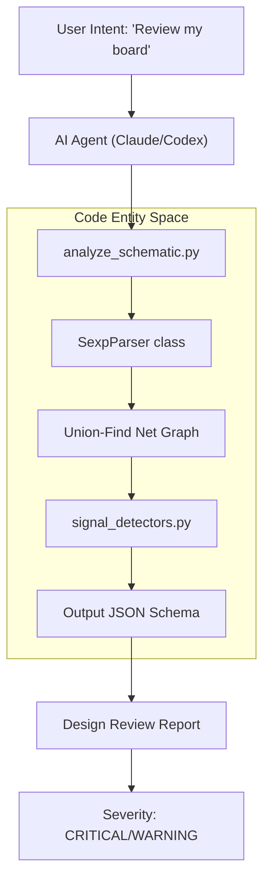
Sources: [skills/kicad/SKILL.md:38-49](), [how-it-works.md:5-16](), [how-it-works.md:19-51]()

## Core Capabilities

The project is organized into several "skills" that can be symlinked into an agent's environment [README.md:41-46]().

| Skill | Primary Code Entities | Purpose |
| :--- | :--- | :--- |
| **kicad** | `analyze_schematic.py`, `analyze_pcb.py` | Parses `.kicad_sch` and `.kicad_pcb` into structured data. |
| **bom** | `bom_manager.py`, `edit_properties.py` | Manages the 11-step BOM lifecycle and MPN synchronization. |
| **distributors** | `digikey`, `mouser`, `lcsc`, `element14` | API integration for part sourcing and datasheet retrieval. |
| **fab** | `jlcpcb`, `pcbway` | Validates designs against manufacturer-specific DFM limits. |

For details on the underlying logic, see [Project Purpose and Architecture](#1.1).

## AI-Assisted EDA Workflow

`kicad-happy` fits into the design cycle by providing a "second pair of eyes" before fabrication. It automates tedious checks like calculating voltage divider outputs, verifying regulator feedback resistors against $V_{ref}$ lookups, and checking decoupling capacitor proximity.

**Workflow Integration**
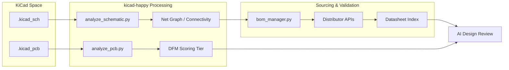
Sources: [README.md:91-117](), [skills/kicad/SKILL.md:54-70](), [how-it-works.md:59-67]()

## Navigation Map

This wiki is structured to guide you from initial setup to advanced design analysis:

*   **[Project Purpose and Architecture](#1.1)**: Deep dive into the deterministic parsing philosophy and the six-step pipeline.
*   **[Getting Started and Installation](#1.2)**: Guide on symlinking skills, setting up API keys (DigiKey, Mouser), and running your first analysis.
*   **[Example Design Review Report](#1.3)**: A walkthrough of an analysis of an ESP32-S3 board, showcasing the power tree and signal findings.
*   **[KiCad Analysis Scripts](#2)**: Technical details on the Python analyzers, S-expression parsing, and the 21 signal path detectors.
*   **[BOM Management](#4)**: How to use the BOM skill to sync MPNs and generate order files.
*   **[Component Sourcing and Datasheet Skills](#5)**: Documentation for the distributor API integrations and datasheet synchronization.
*   **[Testing and Validation](#6)**: Overview of the 1,000+ project test corpus and regression testing framework.

Sources: [README.md:9-20](), [README.md:34-68](), [skills/kicad/SKILL.md:8-20]()

---

# Page: Project Purpose and Architecture

# Project Purpose and Architecture

<details>
<summary>Relevant source files</summary>

The following files were used as context for generating this wiki page:

- [README.md](README.md)
- [how-it-works.md](how-it-works.md)

</details>


The `kicad-happy` project provides a suite of AI coding agent skills designed to transform a terminal-based agent (such as Claude Code or OpenAI Codex) into a specialized electronics design assistant [README.md:1-7](). The core philosophy is the strict separation of **deterministic data extraction** from **probabilistic AI reasoning** [how-it-works.md:5-15](). By using pure Python scripts to parse KiCad files into structured JSON, the system provides an auditable foundation that eliminates the hallucinations typically associated with LLMs processing raw CAD files.

### The Core Architecture: Separation of Concerns

The architecture is divided into two distinct layers:

1.  **Extraction Layer (Deterministic Python):** A set of analyzers that parse KiCad S-expressions and Gerber files. These scripts use standard algorithms (like Union-Find for net connectivity) to produce a "machine-readable" ground truth [how-it-works.md:7-15]().
2.  **Reasoning Layer (AI Agent):** The agent consumes the structured JSON, cross-references it with manufacturer datasheets fetched via distributor APIs, and applies engineering judgment to identify design flaws [how-it-works.md:59-68]().

#### System Entity Map: From Code to Natural Language
The following diagram illustrates how specific Python classes and functions in the codebase map to the high-level concepts used by the AI agent during a design review.

**Diagram: Entity Mapping (Code Space to Reasoning Space)**
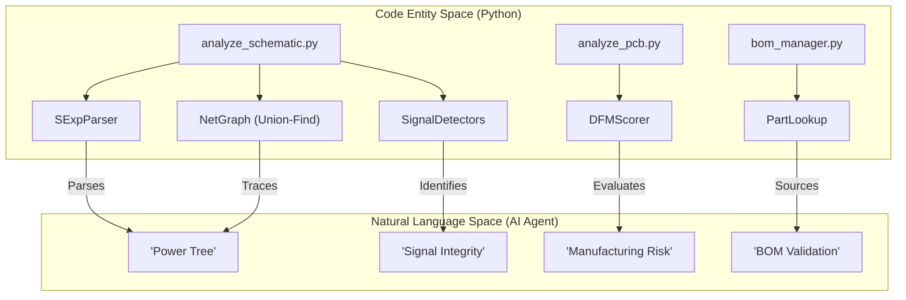
**Sources:** [how-it-works.md:19-51](), [README.md:11-20]()

---

### The Six-Step Analysis Pipeline

The end-to-end workflow follows a rigorous six-step pipeline to ensure accuracy and depth in the final design review.

#### 1. Parse (S-Expression Traversal)
The `analyze_schematic.py` script reads `.kicad_sch` files. It utilizes a generic `SExpParser` to handle KiCad versions 5 through 9 by focusing on the S-expression structure rather than a fixed schema [how-it-works.md:21-24](). It performs a breadth-first traversal of hierarchical sheets, remapping reference designators for multi-instance sub-sheets [how-it-works.md:25-26]().

#### 2. Extract (Component & Connectivity)
The analyzer extracts every component, including its value, footprint, and MPN [how-it-works.md:27-28](). Simultaneously, it builds a **Net Graph** using a union-find algorithm on pin coordinates. Points within 0.01mm are merged, and labels are unioned with the wires they touch to resolve net names [how-it-works.md:29-30]().

#### 3. Detect (Signal Path Identification)
A suite of 21 deterministic signal path detectors scans the net graph for specific circuit topologies [how-it-works.md:31-45]().
*   **Voltage Dividers:** Finds resistor pairs to compute ratios.
*   **Regulators:** Identifies ICs and their feedback networks to calculate $V_{out}$ based on $V_{ref}$ [how-it-works.md:37]().
*   **Buses:** Detects I2C, SPI, and CAN interfaces, including termination and pull-up checks [how-it-works.md:44]().

#### 4. Ground (Datasheet Integration)
The agent uses distributor skills (`digikey`, `mouser`, `lcsc`) to download PDFs for every component with a Manufacturer Part Number (MPN) [how-it-works.md:54-55](). This "grounds" the analysis in physical reality, allowing the agent to check if a design's calculated values (e.g., a 14.95V rail) match the actual component specifications (e.g., a 12V regulator) [how-it-works.md:57-59]().

#### 5. Review (Cross-Reference)
The agent performs a multi-domain verification:
*   **Schematic vs. PCB:** Ensures all nets are routed and decoupling caps are physically near their IC supply pins [how-it-works.md:65]().
*   **DFM Assessment:** The `analyze_pcb.py` script calculates tombstoning risks and thermal via adequacy [how-it-works.md:80-84]().

#### 6. Decide (Categorized Findings)
The final output is a structured report. Findings are categorized by severity: `CRITICAL`, `WARNING`, or `SUGGESTION` [how-it-works.md:67]().

**Diagram: Data Flow and Pipeline Logic**
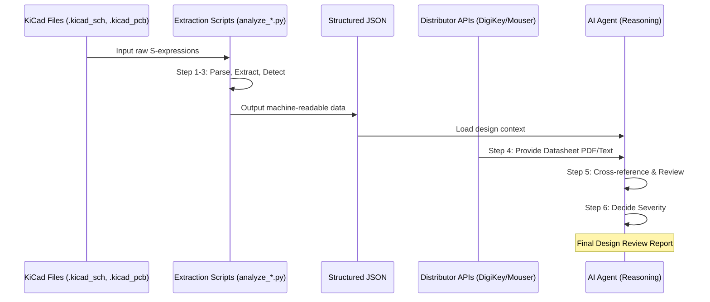
**Sources:** [how-it-works.md:17-72]()

---

### Avoiding Hallucination

The "hallucination gap" in AI EDA tools is typically caused by the model attempting to "read" complex CAD files directly. `kicad-happy` avoids this through three specific architectural choices:

| Feature | Implementation | Anti-Hallucination Benefit |
| :--- | :--- | :--- |
| **Deterministic Extraction** | `analyze_schematic.py` uses coordinate-based Union-Find [how-it-works.md:29](). | The agent doesn't "guess" connections; it receives a verified netlist. |
| **Auditable Data** | The intermediate JSON is human-readable [how-it-works.md:15](). | Users can verify the "ground truth" used by the AI. |
| **Reference Grounding** | Automatic datasheet fetching via `sync_datasheets.py` [README.md:15-18](). | The AI's conclusions are based on manufacturer specs, not its internal weights. |

**Sources:** [how-it-works.md:5-16](), [README.md:11-20]()

---

# Page: Getting Started and Installation

# Getting Started and Installation

<details>
<summary>Relevant source files</summary>

The following files were used as context for generating this wiki page:

- [.claude-plugin/plugin.json](.claude-plugin/plugin.json)
- [.codex-plugin/plugin.json](.codex-plugin/plugin.json)
- [README.md](README.md)
- [skills/kicad/SKILL.md](skills/kicad/SKILL.md)
- [skills/kicad/references/pdf-schematic-extraction.md](skills/kicad/references/pdf-schematic-extraction.md)

</details>


This page provides a technical guide for installing and configuring the `kicad-happy` skills for use with AI coding agents like Claude Code and OpenAI Codex. It covers the symlink-based installation architecture, API credential management for distributor integration, and the execution of initial design analyses.

## Installation Architecture

The `kicad-happy` toolkit is designed as a collection of "skills"—modular directories containing logic that an AI agent can execute. Installation relies on a symlink convention where the agent's local configuration directory points to the `skills/` subdirectory within the cloned repository.

### Skill Symlink Convention

AI agents typically look for executable skills in specific hidden directories within the user's home folder or project root. By symlinking rather than copying, any updates pulled via `git` are immediately available to the agent.

| Agent | Global Skill Path | Project-Specific Path |
| :--- | :--- | :--- |
| **Claude Code** | `~/.claude/skills/` | `<project-root>/.claude/skills/` |
| **OpenAI Codex** | `~/.codex/skills/` | `<project-root>/.codex/skills/` |

**Manual Installation Steps:**
1. Clone the repository: `git clone https://github.com/aklofas/kicad-happy.git` [README.md:38-39]()
2. Create the target directory: `mkdir -p ~/.claude/skills` [README.md:42]()
3. Symlink the desired skills:
```bash
for skill in kicad bom digikey mouser lcsc element14 jlcpcb pcbway; do
  ln -sf "$(pwd)/skills/$skill" ~/.claude/skills/$skill
done
```
[README.md:43-45]()

### System Dependencies
The core analysis scripts are written in pure Python 3 and have no mandatory external dependencies for basic KiCad file parsing [README.md:72](). However, advanced features require specific packages:

*   **`requests`**: Used for robust HTTP/2 handling during datasheet downloads [README.md:74]().
*   **`playwright`**: Required for JavaScript-heavy manufacturer sites (e.g., Broadcom, Espressif) [README.md:75]().
*   **`pdftotext` (poppler-utils)**: Enhances text extraction accuracy when validating component values against PDF datasheets [README.md:76]().

**Sources:** [README.md:22-68](), [README.md:70-77]()

---

## Configuration and API Keys

While the `kicad` skill functions without external access, the sourcing and datasheet skills (`digikey`, `mouser`, `element14`) perform best when configured with API credentials. Without these, the agent falls back to standard web searches, which may be less precise [README.md:80]().

### Distributor API Integration

| Distributor | Environment Variable | Auth Method |
| :--- | :--- | :--- |
| **DigiKey** | `DIGIKEY_CLIENT_ID`, `DIGIKEY_CLIENT_SECRET` | OAuth 2.0 [README.md:86]() |
| **Mouser** | `MOUSER_SEARCH_API_KEY` | Search API Key [README.md:87]() |
| **element14** | `ELEMENT14_API_KEY` | Partner API Key [README.md:88]() |
| **LCSC** | N/A | Community API (`jlcsearch`) [README.md:89]() |

### Data Flow: Natural Language to Code Execution

The following diagram illustrates how a user request triggers the skill infrastructure, moving from the AI's natural language understanding into the specific Python execution environment.

**Skill Execution Path**
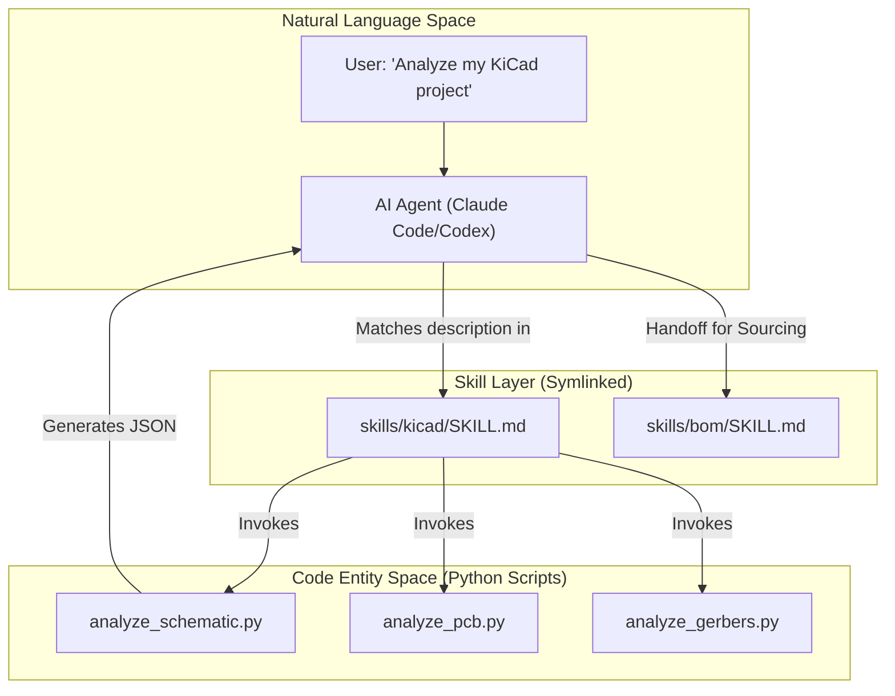
**Sources:** [skills/kicad/SKILL.md:1-20](), [skills/kicad/SKILL.md:38-50](), [README.md:91-95]()

---

## Running the First Analysis

Once installed, the primary entry point is the `analyze_schematic.py` script. The agent typically invokes this script to generate a structured JSON representation of the hardware design, which it then interprets to provide a human-readable review.

### Execution Flow

1.  **Parsing**: The script reads `.kicad_sch` (S-expression) or legacy `.sch` files [skills/kicad/SKILL.md:56-73]().
2.  **Extraction**: It extracts components, nets, and hierarchical sheet data [skills/kicad/SKILL.md:58-60]().
3.  **Detection**: Automated subcircuit detectors identify regulators, filters, and communication buses [skills/kicad/SKILL.md:61-66]().
4.  **Grounding**: The agent cross-references the extracted MPNs (Manufacturer Part Numbers) with distributor APIs to verify specifications [skills/kicad/SKILL.md:20]().

### Analysis Initialization Diagram

This diagram bridges the gap between the high-level analysis command and the specific data structures created in the `kicad-happy` codebase.

**Analysis Data Flow**
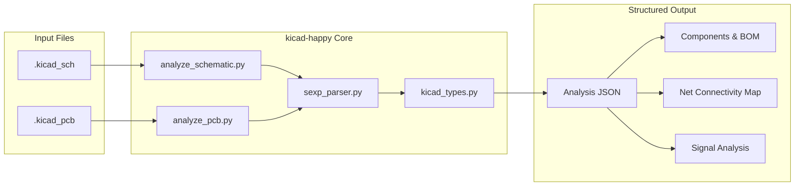

**Sources:** [skills/kicad/SKILL.md:54-71](), [README.md:97-116](), [skills/kicad/SKILL.md:38-50]()

### Verification Command
To verify the installation and view the available data schema, run the analyzer with the `--schema` flag. This outputs the exact field names and types that the AI agent uses for reasoning:

```bash
python3 skills/kicad/scripts/analyze_schematic.py --schema
```
[skills/kicad/SKILL.md:44-46]()

**Sources:** [skills/kicad/SKILL.md:40-52]()

---

# Page: Example Design Review Report

# Example Design Review Report

<details>
<summary>Relevant source files</summary>

The following files were used as context for generating this wiki page:

- [example-report.md](example-report.md)
- [skills/kicad/references/report-generation.md](skills/kicad/references/report-generation.md)

</details>


This page provides a detailed walkthrough of a complete design review report generated for an **ESP32-S3 Battery-Powered IoT Board (Rev2)**. It serves as a reference for the expected output quality and technical depth required when the `kicad-happy` analyzer suite is combined with an AI reasoning layer.

The report integrates data from `analyze_schematic.py`, `analyze_pcb.py`, and `analyze_gerbers.py` to provide a holistic view of the hardware's viability, power integrity, and manufacturability.

## Report Data Flow and Code Entity Mapping

The following diagram illustrates how raw KiCad data is transformed into the structured sections of the example report by the underlying Python classes and the reporting logic defined in `report-generation.md`.

**Data Transformation Map**
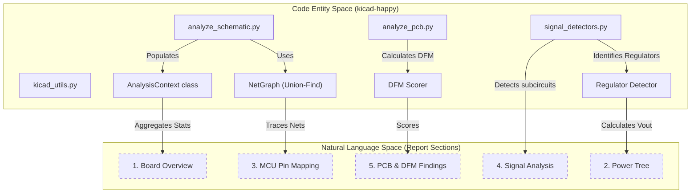
Sources: [skills/kicad/references/report-generation.md:342-446](), [example-report.md:1-120]()

---

## 1. Board Overview and Stats
The overview section provides immediate context regarding the board's scale and complexity. It utilizes the `AnalysisContext` data to summarize component counts and PCB dimensions.

| Parameter | Value |
|-----------|-------|
| Board dimensions | 203.0 mm × 153.0 mm |
| Layer count | 2 (F.Cu, B.Cu) |
| Schematic components | 52 |
| Total nets | 60 |
| Routing status | **100% complete** |

**Assembly Complexity Score:** 37/100 (Low). This score is derived from the variety of footprints and the predominance of 0805 packages, indicating that hand assembly is feasible [example-report.md:41-48]().

Sources: [example-report.md:9-48]()

---

## 2. Power Tree Analysis
The power tree is a critical component of the review, mapping the hierarchy from the battery input through regulators to the end loads.

### ASCII Power Hierarchy
The report generates a visual representation of the power flow, including feedback divider calculations and rail naming [example-report.md:53-85]().

```text
Battery (2× AA, 2.0–3.2V)
  │
  ├── U3 (TPS61023) — 3.3V Boost Converter (Always on)
  │     FB: R10=680K / R11=150K → Vout = 3.29V nom
  │     └── +3V3 rail (ESP32-S3-WROOM-1)
  │
  └── U2 (TPS61023) — 5V Boost Converter (GPIO-controlled)
        FB: R8=820K / R9=110K → Vout = 5.03V nom
        └── +5V rail (RGB LED, USB Host)
```

### Regulator Verification
The analyzer performs a "vref_source" lookup to compare the schematic's resistor values against known datasheet constants [example-report.md:87-93]().

| Regulator | Vref source | Vout nom | Status |
|-----------|-------------|----------|--------|
| U3 (3.3V) | Datasheet lookup (0.595V) | 3.29V | OK |
| U2 (5.0V) | Datasheet lookup (0.595V) | 5.03V | OK |

Sources: [example-report.md:51-93](), [skills/kicad/references/report-generation.md:58-62]()

---

## 3. Signal Analysis and MCU Mapping
This section validates the functional subcircuits detected by `signal_detectors.py`.

### GPIO Assignments
The report verifies that every GPIO is assigned to a valid peripheral and that strapping pins (like IO0 for boot mode) are correctly biased [example-report.md:120-157]().

### LED and Driver Calculations
For the RGB LED circuit, the report calculates current draw for each channel to ensure they remain within the 30mA limit [example-report.md:162-173]().
* **Formula:** `I_LED = (V_supply - V_f) / R_limit` [skills/kicad/references/report-generation.md:91-91]().
* **Worst Case Analysis:** Considers max Vout (5.26V) and -5% resistor tolerance.

Sources: [example-report.md:120-173](), [skills/kicad/references/report-generation.md:72-95]()

---

## 4. PCB and DFM Findings
The PCB analysis utilizes `analyze_pcb.py` to check for manufacturing risks and signal integrity issues.

### DFM Scores and Constraints
The design is checked against standard and advanced fabrication limits (e.g., minimum trace width, clearance, and annular rings) [example-report.md:204-215]().

| Category | Score | Constraints Found |
|----------|-------|-------------------|
| Trace/Space | 100/100 | Min 0.25mm / 0.25mm |
| Drill/Ring | 95/100 | Min 0.3mm drill / 0.15mm ring |
| Solder Mask | 80/100 | **WARNING:** 0.05mm clearance on U1 |

### Proximity and Crosstalk
Using the `--proximity` flag, the analyzer identifies parallel traces that may couple noise. In this report, a finding notes that `USB_DP` and `USB_DM` are routed as a differential pair but lack a ground plane on Layer 2, increasing EMI risk [example-report.md:225-230]().

Sources: [example-report.md:202-235](), [skills/kicad/references/report-generation.md:104-118]()

---

## 5. Severity-Categorized Findings
Findings are categorized by severity to help the designer prioritize fixes [skills/kicad/references/report-generation.md:446-452]().

### Critical Findings
* **CRITICAL:** Missing ground plane under the ESP32-S3 antenna keepout area.
* **WARNING:** No ESD protection on the 2x3 programming header (J2).

### Suggestions
* **SUGGESTION:** Increase the width of the +5V power trace to J1 to reduce voltage drop during peak USB loads.

**Finding Severity Logic**
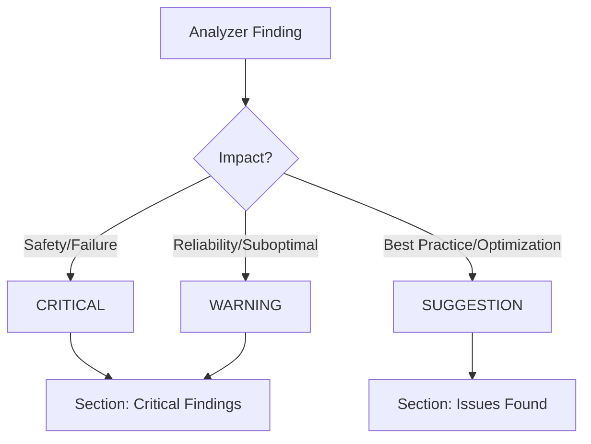
Sources: [skills/kicad/references/report-generation.md:43-52](), [example-report.md:237-260]()

---

# Page: KiCad Analysis Scripts

# KiCad Analysis Scripts

<details>
<summary>Relevant source files</summary>

The following files were used as context for generating this wiki page:

- [skills/kicad/SKILL.md](skills/kicad/SKILL.md)
- [skills/kicad/scripts/README.md](skills/kicad/scripts/README.md)

</details>


The `kicad-happy` toolkit provides three core Python analysis scripts designed to extract deterministic, structured data from KiCad design files. These scripts serve as the "ground truth" layer for the AI-assisted design review workflow, converting complex EDA files into machine-readable JSON that can be analyzed for electrical correctness, manufacturing readiness, and signal integrity.

The suite is built on a shared parsing architecture and utility library to ensure consistency across schematic, PCB, and Gerber analysis.

### Core Analysis Pipeline

The scripts follow a tiered execution model where raw S-expression data is first parsed into memory, then transformed into high-level design entities (nets, components, footprints), and finally processed through specialized detection algorithms.

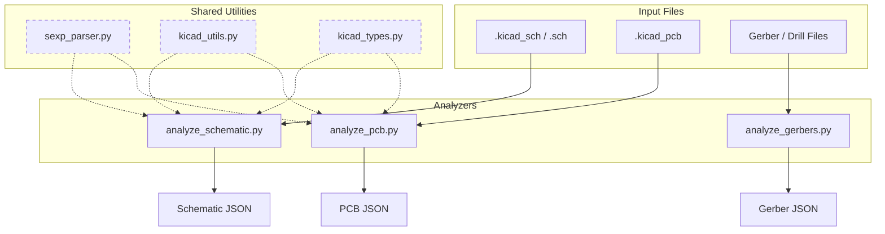
Sources: [skills/kicad/scripts/README.md:1-18](), [skills/kicad/SKILL.md:38-50]()

---

## 2.1 Schematic Analyzer (`analyze_schematic.py`)

The Schematic Analyzer is the most complex script in the suite, responsible for reconstructing the electrical intent of the design. It recursively traverses hierarchical sheets to build a global net graph using a union-find algorithm.

Key capabilities include:
*   **Component Extraction**: Identifying references, values, footprints, and MPNs.
*   **Net Graph Construction**: Resolving connectivity across local, global, and hierarchical labels.
*   **Subcircuit Detection**: Over 20 specialized detectors identify regulators, filters, op-amps, and communication buses.
*   **Power Analysis**: Estimating PDN impedance and auditing power sequencing.

For details, see [Schematic Analyzer (analyze_schematic.py)](#2.1).

Sources: [skills/kicad/SKILL.md:54-73](), [skills/kicad/scripts/README.md:7]()

---

## 2.2 PCB Layout Analyzer (`analyze_pcb.py`)

The PCB Layout Analyzer processes `.kicad_pcb` files to evaluate the physical implementation of the design. It translates relative pad positions into absolute board coordinates and performs spatial analysis to detect manufacturing risks.

Key capabilities include:
*   **Connectivity Verification**: Detecting unrouted nets and zone-aware continuity.
*   **DFM Scoring**: Evaluating the board against standard and advanced manufacturing limits (annular rings, clearances, tombstoning).
*   **Thermal Analysis**: Identifying thermal via density and zone stitching.
*   **Physical Audits**: Checking courtyard overlaps and component-to-edge clearances.

For details, see [PCB Layout Analyzer (analyze_pcb.py)](#2.2).

Sources: [skills/kicad/scripts/README.md:45-101](), [skills/kicad/SKILL.md:77-101]()

---

## 2.3 Gerber Analyzer (`analyze_gerbers.py`)

The Gerber Analyzer validates the final manufacturing outputs. Unlike the PCB analyzer which looks at design intent, this script parses the actual RS-274X and Excellon files to ensure the files sent to the fabricator are complete and consistent.

Key capabilities include:
*   **Layer Identification**: Using X2 attributes and file naming patterns to classify copper, mask, and silk layers.
*   **Alignment Verification**: Ensuring all layers share a common coordinate origin and scale.
*   **Drill Classification**: Distinguishing between plated (PTH) and non-plated (NPTH) holes.
*   **Staleness Detection**: Comparing timestamps between the PCB design file and the generated Gerber zip archive.

For details, see [Gerber Analyzer (analyze_gerbers.py)](#2.3).

Sources: [skills/kicad/scripts/README.md:115-117](), [skills/kicad/SKILL.md:103-118]()

---

## 2.4 Shared Utilities and Data Types

To maintain a "Single Source of Truth," the analyzers rely on a shared library of parsers and helper functions. This ensures that a component value or net name is interpreted identically whether it appears in a schematic or on a layout.

### Mapping Code Entities to Analysis Logic

The following diagram illustrates how shared code entities bridge the gap between raw file data and high-level analysis concepts.

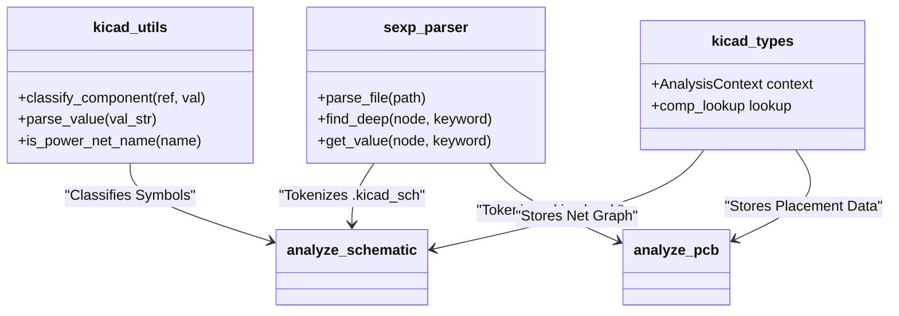

### Key Shared Modules

| Module | Core Responsibility | Key Entities |
| :--- | :--- | :--- |
| `sexp_parser.py` | Low-level S-expression tokenization. | `parse_file()`, `find_all()`, `get_property()` |
| `kicad_utils.py` | Heuristic-based classification and string parsing. | `classify_component()`, `parse_value()`, `lookup_regulator_vref()` |
| `kicad_types.py` | Type definitions for cross-script data passing. | `AnalysisContext`, `NetInfo`, `Component` |

For details, see [Shared Utilities and Data Types](#2.4).

Sources: [skills/kicad/scripts/README.md:22-43](), [skills/kicad/scripts/README.md:11-12]()

---

# Page: Schematic Analyzer (analyze_schematic.py)

# Schematic Analyzer (analyze_schematic.py)

<details>
<summary>Relevant source files</summary>

The following files were used as context for generating this wiki page:

- [.gitignore](.gitignore)
- [skills/element14/scripts/sync_datasheets_element14.py](skills/element14/scripts/sync_datasheets_element14.py)
- [skills/kicad/references/manual-pcb-parsing.md](skills/kicad/references/manual-pcb-parsing.md)
- [skills/kicad/references/manual-schematic-parsing.md](skills/kicad/references/manual-schematic-parsing.md)
- [skills/kicad/references/schematic-analysis.md](skills/kicad/references/schematic-analysis.md)
- [skills/kicad/scripts/analyze_schematic.py](skills/kicad/scripts/analyze_schematic.py)
- [skills/kicad/scripts/methodology_pcb.md](skills/kicad/scripts/methodology_pcb.md)
- [skills/kicad/scripts/methodology_schematic.md](skills/kicad/scripts/methodology_schematic.md)

</details>


The Schematic Analyzer is the primary extraction engine for KiCad schematic data. It performs a single-pass, deterministic crawl of `.kicad_sch` (and legacy `.sch`) files to transform graphical CAD data into a structured JSON representation. This output serves as the "ground truth" for subsequent AI-assisted design reviews and BOM management.

## Purpose and Scope

The analyzer provides a data extraction layer that avoids opinionated Design Rule Checking (DRC) in favor of neutral observations [skills/kicad/scripts/methodology_schematic.md:5-13](). Its primary goal is to provide a complete connectivity graph and component inventory, including:
- **Component Inventory:** BOM properties, footprints, and absolute positions.
- **Net Connectivity:** A resolved graph of all wires, labels, and power symbols.
- **Subcircuit Identification:** Automated detection of common circuit patterns (e.g., regulators, filters).
- **Design Statistics:** Component counts, net counts, and sheet hierarchy metadata.

### System Architecture

The analysis pipeline follows a modular approach to separate parsing from circuit logic:

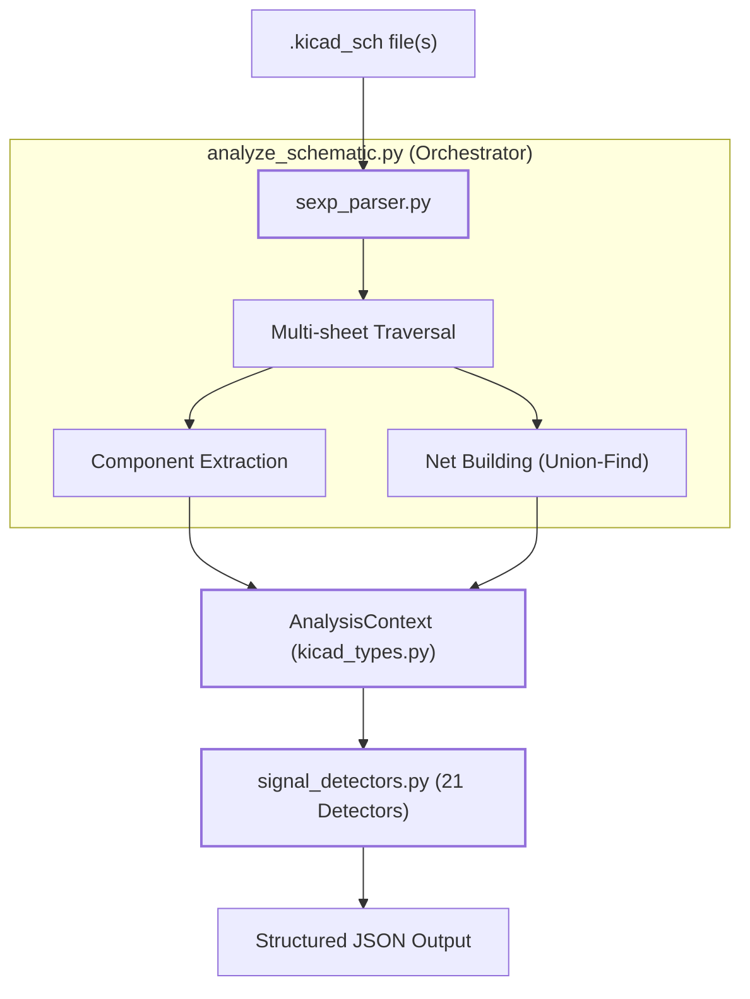
Sources: [skills/kicad/scripts/methodology_schematic.md:17-34]()

---

## Core Analysis Pipeline

### 1. S-Expression Parsing
The analyzer utilizes `sexp_parser.py` to convert KiCad's Lisp-like S-expression format into nested Python lists [skills/kicad/scripts/methodology_schematic.md:50-68](). This parser is schema-agnostic, treating all values as strings to maintain compatibility across KiCad versions 5 through 10 [skills/kicad/scripts/methodology_schematic.md:70-72]().

### 2. Hierarchical Sheet Traversal
KiCad designs often span multiple files. The analyzer performs a breadth-first traversal starting from the root sheet [skills/kicad/scripts/methodology_schematic.md:80-88]():
- **Multi-Instance Support:** If a sub-sheet is used multiple times (e.g., a multi-channel amplifier), the analyzer tracks unique instance UUIDs and remaps reference designators (e.g., `R1` becomes `R101` in instance 1) [skills/kicad/scripts/methodology_schematic.md:89-100]().
- **Sheet Isolation:** Elements are tagged with a `_sheet` index to prevent coordinate collisions between different physical pages [skills/kicad/scripts/methodology_schematic.md:102-105]().

### 3. Component and Pin Extraction
Each `(symbol ...)` block is converted into a component dictionary. A critical step is the **Pin Position Computation**, which transforms relative library coordinates into absolute schematic coordinates [skills/kicad/scripts/analyze_schematic.py:101-107]().
- **Transforms:** The logic accounts for symbol rotation, X/Y mirroring, and Y-axis inversion [skills/kicad/scripts/methodology_schematic.md:129-138]().
- **Multi-Unit Handling:** For components like quad op-amps or MCUs with separate power/IO units, the analyzer merges unit-specific pins with "Unit 0" pins (shared power/ground) [skills/kicad/scripts/analyze_schematic.py:144-159]().

### 4. Property Normalization
Because KiCad allows arbitrary field names, the analyzer uses fuzzy matching to extract Manufacturer Part Numbers (MPN) and distributor information. It checks common aliases like `mfr_no`, `part#`, or `digikey-pn` to populate the final BOM data [skills/kicad/scripts/analyze_schematic.py:63-87]().

---

## Connectivity and Signal Detection

The analyzer goes beyond simple netlisting by attempting to understand the *function* of the circuitry.

### Net Graph Construction
Connectivity is resolved using a **Union-Find algorithm** based on coordinate snapping. For a deep dive into how wires, junctions, and labels are merged into nets, see **[Net Building and Connectivity Resolution](#2.1.2)**.

### Signal Path Detectors
Once the net graph is built, the analyzer runs 21 specialized detectors from `signal_detectors.py` [skills/kicad/scripts/methodology_schematic.md:43](). These identify:
- **Power Trees:** LDOs, DC/DC converters, and voltage dividers.
- **Signal Integrity:** RC/LC filters, decoupling capacitor coverage, and I2C/SPI bus pull-ups.
- **Complex Blocks:** Op-amp configurations, transistor switches, and crystal oscillators.

For a complete list of patterns and detection logic, see **[Signal Path Detectors](#2.1.1)**.

---

## Output Schema

The final JSON output provides a comprehensive snapshot of the design state.

| Section | Description |
| :--- | :--- |
| `metadata` | Project name, KiCad version, and sheet count. |
| `components` | List of all parts with resolved MPNs, values, and pin-to-net mappings. |
| `nets` | Map of net names to the list of pins and labels connected to them. |
| `signal_analysis` | Results from the 21 detectors (e.g., `voltage_dividers`, `regulators`). |
| `design_observations` | Heuristic-based findings (e.g., "Missing decoupling on U1"). |

Sources: [skills/kicad/scripts/analyze_schematic.py:5-10](), [skills/kicad/references/schematic-analysis.md:34-38]()

---

## Child Pages

- **[Signal Path Detectors](#2.1.1)**: Details on the 21 circuit pattern recognition functions.
- **[Net Building and Connectivity Resolution](#2.1.2)**: Technical explanation of the spatial union-find and label scoping rules.

---

# Page: Signal Path Detectors

# Signal Path Detectors

<details>
<summary>Relevant source files</summary>

The following files were used as context for generating this wiki page:

- [skills/kicad/scripts/analyze_schematic.py](skills/kicad/scripts/analyze_schematic.py)
- [skills/kicad/scripts/sexp_parser.py](skills/kicad/scripts/sexp_parser.py)
- [skills/kicad/scripts/signal_detectors.py](skills/kicad/scripts/signal_detectors.py)

</details>


The Signal Path Detectors are a suite of 21 specialized heuristic engines located in `signal_detectors.py`. Their purpose is to transform a raw netlist and component inventory into a high-level functional understanding of the circuit. By identifying common subcircuits (like voltage dividers, filters, and communication buses), the system can perform "semantic" design reviews, such as checking if a feedback divider ratio matches a regulator's target voltage.

### Detection Architecture

Detectors operate on an `AnalysisContext` object, which provides a unified view of the schematic's connectivity (via a union-find net graph) and component properties.

#### Code Entity Map: Detection Pipeline
The following diagram illustrates how the `analyze_schematic.py` script coordinates the various detector functions within `signal_detectors.py`.

**Signal Path Extraction Flow**
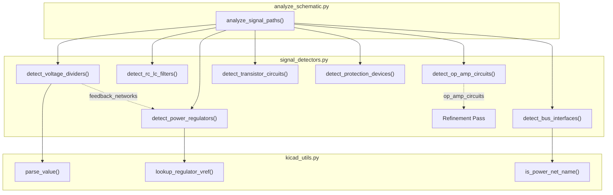
**Sources:** `[skills/kicad/scripts/signal_detectors.py:1-22]()`, `[skills/kicad/scripts/analyze_schematic.py:26-52]()`

---

### Core Detectors

#### 1. Voltage Dividers and Feedback Networks
The `detect_voltage_dividers` function identifies two resistors in series between different nets. It distinguishes between general-purpose dividers and feedback networks used in power supplies.

*   **Logic:** It indexes resistors by net to find pairs sharing a single "mid-point" net `[skills/kicad/scripts/signal_detectors.py:124-135]()`.
*   **False-Positive Prevention:** If the mid-point net has more than 4 connections, it is rejected as a power bus rather than a signal divider `[skills/kicad/scripts/signal_detectors.py:163-168]()`.
*   **Feedback Detection:** If the mid-point connects to a pin named "FB", "VFB", or "ADJ", it is categorized as a feedback network `[skills/kicad/scripts/signal_detectors.py:202-215]()`.

#### 2. RC and LC Filters
The `detect_rc_lc_filters` function identifies low-pass, high-pass, and band-pass structures.

| Filter Type | Topology | Implementation |
| :--- | :--- | :--- |
| **RC Low Pass** | Series R, Shunt C to GND | `[skills/kicad/scripts/signal_detectors.py:314-325]()` |
| **RC High Pass** | Series C, Shunt R to GND | `[skills/kicad/scripts/signal_detectors.py:330-341]()` |
| **LC Filter** | Series L, Shunt C to GND | `[skills/kicad/scripts/signal_detectors.py:343-354]()` |

The detector calculates the cutoff frequency ($f_c = \frac{1}{2\pi RC}$) and includes it in the JSON output `[skills/kicad/scripts/signal_detectors.py:321-323]()`.

#### 3. Power Regulators
The `detect_power_regulators` function identifies LDOs and DC/DC converters. It attempts to determine the output voltage by looking up the internal reference voltage ($V_{ref}$) of the part and combining it with detected feedback dividers `[skills/kicad/scripts/signal_detectors.py:410-445]()`.

**Sources:** `[skills/kicad/scripts/signal_detectors.py:111-450]()`

---

### Active Circuit Detectors

#### Op-Amp and Transistor Circuits
These detectors analyze the local neighborhood of active components to determine their configuration.

*   **Op-Amps:** Detects Inverting, Non-Inverting, and Buffer (Follower) configurations by checking the connectivity between the output pin and the inverting input `[skills/kicad/scripts/signal_detectors.py:460-520]()`.
*   **Transistors:** Identifies BJT and MOSFET switches. It uses `_classify_load` to determine if the transistor is driving an "inductive", "resistive", or "LED" load based on connected components or net name keywords like "MOTOR" or "HEATER" `[skills/kicad/scripts/signal_detectors.py:48-80]()`, `[skills/kicad/scripts/signal_detectors.py:580-640]()`.

#### Bus Detection (I2C/SPI/UART/CAN)
Bus detection relies on a combination of pin names (from library symbols) and net name pattern matching.

*   **I2C:** Looks for pairs of nets containing "SDA" and "SCL". It also checks for the presence of pull-up resistors on these nets `[skills/kicad/scripts/signal_detectors.py:750-780]()`.
*   **SPI:** Identifies groups of 3 or 4 nets containing "MOSI", "MISO", "SCK", and "CS/SS" `[skills/kicad/scripts/signal_detectors.py:790-820]()`.

**Sources:** `[skills/kicad/scripts/signal_detectors.py:455-850]()`

---

### Specialized Detectors

| Detector | Key Identification Pattern | Code Reference |
| :--- | :--- | :--- |
| **Crystal Circuits** | Crystal + two shunt capacitors to GND | `[skills/kicad/scripts/signal_detectors.py:920-960]()` |
| **Bridge Circuits** | 4 Diodes or 4 Resistors in a diamond topology | `[skills/kicad/scripts/signal_detectors.py:700-740]()` |
| **Current Sense** | Low-value shunt resistor + Diff Amp / IC | `[skills/kicad/scripts/signal_detectors.py:1050-1080]()` |
| **Ethernet** | Magnetics (transformers) + RJ45 + PHY | `[skills/kicad/scripts/signal_detectors.py:1150-1200]()` |
| **RF Chains** | Antennas, Baluns, and Matching Networks | `[skills/kicad/scripts/signal_detectors.py:1210-1250]()` |

### Dependency and Data Flow
The detection process is not entirely flat; some detectors depend on the output of others.

**Data Dependency Graph**
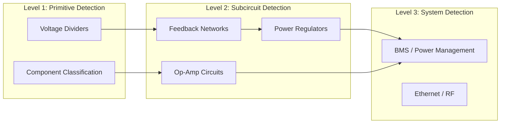
**Sources:** `[skills/kicad/scripts/signal_detectors.py:1-40]()`, `[skills/kicad/scripts/analyze_schematic.py:1550-1600]()`

### False-Positive Prevention
To maintain accuracy, detectors use several "rejection" heuristics:
1.  **High-Fanout Nets:** Nets with many connections (e.g., >10) are usually ignored by signal detectors to avoid treating global control lines as local signal paths `[skills/kicad/scripts/kicad_utils.py:44-51]()`.
2.  **Power/Ground Exclusion:** Detectors like `detect_voltage_dividers` explicitly check `is_power_net_name` to ensure they aren't misidentifying decoupling capacitors or power indicators as signal components `[skills/kicad/scripts/signal_detectors.py:163-170]()`.
3.  **Value Sanitization:** `parse_value` is used to ensure components have realistic values (e.g., rejecting 0-ohm resistors in divider calculations) `[skills/kicad/scripts/signal_detectors.py:180-185]()`.

**Sources:** `[skills/kicad/scripts/signal_detectors.py:1-1250]()`, `[skills/kicad/scripts/kicad_utils.py:1-100]()`

---

# Page: Net Building and Connectivity Resolution

# Net Building and Connectivity Resolution

<details>
<summary>Relevant source files</summary>

The following files were used as context for generating this wiki page:

- [skills/kicad/references/manual-pcb-parsing.md](skills/kicad/references/manual-pcb-parsing.md)
- [skills/kicad/references/net-tracing.md](skills/kicad/references/net-tracing.md)
- [skills/kicad/scripts/analyze_schematic.py](skills/kicad/scripts/analyze_schematic.py)
- [skills/kicad/scripts/methodology_pcb.md](skills/kicad/scripts/methodology_pcb.md)
- [skills/kicad/scripts/methodology_schematic.md](skills/kicad/scripts/methodology_schematic.md)

</details>


This page details the technical implementation of the union-find algorithm and spatial resolution logic used to transform discrete S-expression elements (wires, pins, labels) into a coherent connectivity graph.

## Core Connectivity Logic

Connectivity in KiCad schematics is implicit, defined by the overlapping of coordinates rather than an explicit netlist. The analyzer resolves this by treating the schematic as a geometric graph where nodes are `(x, y)` coordinates and edges are wires or component pins.

### The Union-Find Algorithm
The `analyze_schematic.py` script uses a Disjoint Set Union (DSU) or "Union-Find" structure to group connected coordinates into nets.

1.  **Coordinate Snapping**: To account for floating-point inaccuracies, all coordinates are snapped to a 10-mil (0.254mm) grid using `_snap_mil` before being used as keys [skills/kicad/scripts/analyze_schematic.py:50-50]().
2.  **Sheet-Aware Keys**: Because the same coordinate (e.g., `0,0`) can exist on multiple hierarchical sheets, the internal key for the union-find structure is a tuple of `(x, y, sheet_index)` [skills/kicad/scripts/methodology_schematic.md:102-104]().
3.  **Edge Registration**:
    *   **Wires**: Every `(wire (pts (xy x1 y1) (xy x2 y2)))` block results in a `union((x1, y1, s), (x2, y2, s))` [skills/kicad/scripts/analyze_schematic.py:534-543]().
    *   **Pins**: Each component pin's absolute position is calculated. If a pin exists at `(px, py)`, it is unioned with any wire endpoint or junction at that exact location [skills/kicad/scripts/analyze_schematic.py:516-524]().
    *   **Junctions**: Explicit `(junction (at x y))` nodes allow wires that cross without sharing endpoints to connect [skills/kicad/scripts/analyze_schematic.py:554-558]().

### Spatial Resolution and Mid-Wire Detection
A common challenge in EDA parsing is "mid-wire" connections, where a pin or junction touches a wire segment but not its endpoints. `analyze_schematic.py` solves this using a spatial grid:

*   **Segment Intersection**: For every wire segment, the analyzer checks for pins or junctions that lie on the line between the start and end points [skills/kicad/scripts/analyze_schematic.py:545-552]().
*   **Bounding Box Pre-filtering**: To maintain performance, a spatial index (grid) is used to only check elements within the same local area [skills/kicad/scripts/analyze_schematic.py:540-544]().

**Sources:** [skills/kicad/scripts/analyze_schematic.py:510-560](), [skills/kicad/scripts/methodology_schematic.md:102-106]()

---

## Hierarchical and Multi-Instance Handling

KiCad supports complex hierarchies where a single `.kicad_sch` file may be instantiated multiple times.

### Sheet Scoping Rules
The analyzer respects KiCad's scoping rules for net names:
*   **Local Labels**: Scoped strictly to the `sheet_index`. If `NetA` exists on Sheet 1 and Sheet 2, they remain separate unless linked by a hierarchical pin [skills/kicad/scripts/analyze_schematic.py:570-580]().
*   **Global Labels**: Automatically unioned across all sheets regardless of `sheet_index` [skills/kicad/scripts/analyze_schematic.py:582-588]().
*   **Power Symbols**: Treated as global labels. A symbol with the `(power)` flag and value `VCC` connects to all other `VCC` power symbols in the project [skills/kicad/scripts/analyze_schematic.py:171-174](), [skills/kicad/scripts/analyze_schematic.py:590-595]().

### Multi-Instance Resolution
When a sheet is used multiple times (e.g., a 4-channel amplifier), the analyzer tracks the `instance_path` (a string of UUIDs). This allows it to:
1.  Map the correct unique Reference Designator (e.g., `R101` vs `R201`) to the same symbol in the sub-sheet file [skills/kicad/scripts/methodology_schematic.md:89-100]().
2.  Resolve "Hierarchical Labels" by connecting the internal net of an instance to the specific net on the parent sheet via the `(pin ...)` of the `(sheet ...)` block [skills/kicad/scripts/analyze_schematic.py:610-630]().

**Sources:** [skills/kicad/scripts/analyze_schematic.py:570-630](), [skills/kicad/scripts/methodology_schematic.md:76-106]()

---

## Net Name Priority and Resolution

Since a single connected graph might have multiple labels (e.g., a local label `SDA` and a global label `MCU_SDA`), the analyzer applies a priority heuristic to pick the "canonical" name for the JSON output.

| Priority | Type | Description |
| :--- | :--- | :--- |
| 1 (Highest) | **Global Label** | Explicitly named project-wide nets. |
| 2 | **Power Symbol** | Nets like `+5V` or `GND` derived from power symbols. |
| 3 | **Hierarchical Label** | Nets passing through sheet boundaries. |
| 4 | **Local Label** | User-defined names within a single sheet. |
| 5 (Lowest) | **Auto-generated** | Names like `Net-(R1-Pad1)` created by KiCad. |

**Sources:** [skills/kicad/scripts/analyze_schematic.py:640-660](), [skills/kicad/scripts/kicad_utils.py:45-47]()

---

## Implementation Diagrams

### Net Construction Data Flow
This diagram illustrates how the `analyze_schematic.py` orchestrator coordinates with `sexp_parser.py` and `kicad_utils.py` to build the connectivity graph.

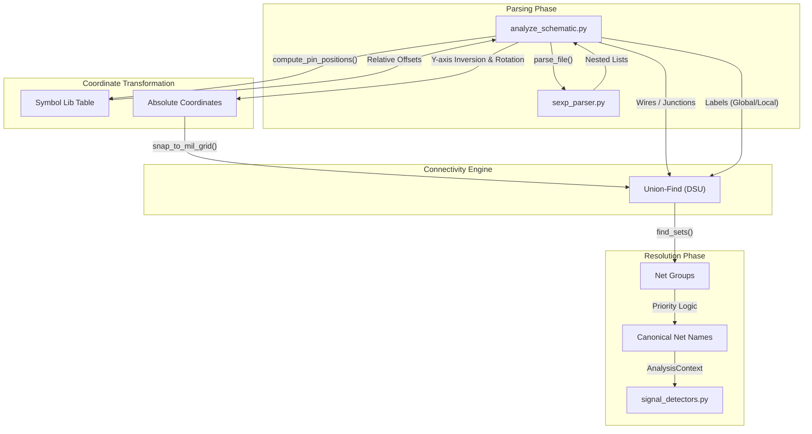
**Sources:** [skills/kicad/scripts/analyze_schematic.py:101-160](), [skills/kicad/scripts/analyze_schematic.py:510-560](), [skills/kicad/scripts/methodology_schematic.md:15-34]()

### Coordinate Snapping and Junction Logic
The following diagram demonstrates the "Natural Language" concept of a connection vs. the "Code Entity" implementation of coordinate matching.

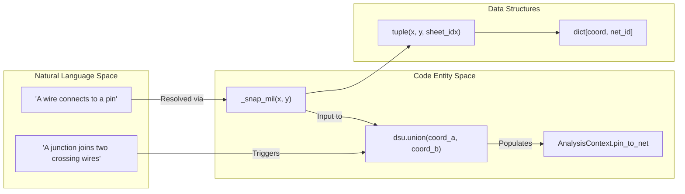
**Sources:** [skills/kicad/scripts/analyze_schematic.py:50-51](), [skills/kicad/scripts/analyze_schematic.py:510-524](), [skills/kicad/scripts/kicad_types.py:41-44]()

---

# Page: PCB Layout Analyzer (analyze_pcb.py)

# PCB Layout Analyzer (analyze_pcb.py)

<details>
<summary>Relevant source files</summary>

The following files were used as context for generating this wiki page:

- [skills/kicad/references/manual-pcb-parsing.md](skills/kicad/references/manual-pcb-parsing.md)
- [skills/kicad/references/pcb-layout-analysis.md](skills/kicad/references/pcb-layout-analysis.md)
- [skills/kicad/scripts/analyze_pcb.py](skills/kicad/scripts/analyze_pcb.py)
- [skills/kicad/scripts/methodology_pcb.md](skills/kicad/scripts/methodology_pcb.md)
- [skills/kicad/scripts/methodology_schematic.md](skills/kicad/scripts/methodology_schematic.md)

</details>


The PCB Layout Analyzer (`analyze_pcb.py`) is a comprehensive single-pass extraction tool designed to transform KiCad `.kicad_pcb` files into structured, machine-readable JSON [skills/kicad/scripts/analyze_pcb.py:1-15](). It serves as the physical grounding layer of the analysis pipeline, providing the raw data necessary for DFM (Design for Manufacturability) scoring, connectivity verification, and signal integrity assessments [skills/kicad/scripts/methodology_pcb.py:5-12]().

## Pipeline Overview

The analysis follows a deterministic sequence from raw S-expression parsing to high-level physical heuristics.

### 1. Extraction and Transformation
The analyzer uses `sexp_parser.py` to convert the Lisp-like KiCad format into nested Python lists [skills/kicad/scripts/methodology_pcb.py:15-18](). It supports both KiCad 6+ (`footprint`) and KiCad 5 (`module`) syntax [skills/kicad/scripts/methodology_pcb.py:21-26](). 

Key extraction entities include:
*   **Footprints**: Reference designators, positions, and 3D model paths [skills/kicad/scripts/methodology_pcb.py:50-71]().
*   **Pads**: Absolute coordinate calculation (applying footprint rotation/translation), shapes, and drill sizes [skills/kicad/scripts/methodology_pcb.py:73-83]().
*   **Routing**: Tracks (segments/arcs), vias (through/blind/micro), and copper zones [skills/kicad/scripts/methodology_pcb.py:88-106]().
*   **Board Geometry**: Bounding box calculation from the `Edge.Cuts` layer to determine board dimensions [skills/kicad/scripts/methodology_pcb.py:121-124]().

### 2. Connectivity Analysis
Connectivity is verified using a **Union-Find** algorithm. Points are snapped to a 1µm grid to account for floating-point rounding in the S-expression [skills/kicad/scripts/methodology_pcb.py:135-138](). The analyzer unions:
1.  Pads on the same net.
2.  Track start/end points.
3.  Vias across their layer spans.
4.  Pads covered by copper zones [skills/kicad/scripts/methodology_pcb.py:139-143]().

### 3. Spatial Copper Indexing
The `ZoneFills` class provides a spatial index for filled polygon data [skills/kicad/scripts/analyze_pcb.py:110-120](). This allows for `point_in_polygon` queries to determine if copper actually exists at a specific coordinate, which is critical for verifying thermal via effectiveness and plane continuity [skills/kicad/scripts/analyze_pcb.py:139-164]().

### PCB Analysis Data Flow
The following diagram illustrates how raw file entities are processed into the final analysis context.

**Diagram: PCB Entity Extraction Flow**
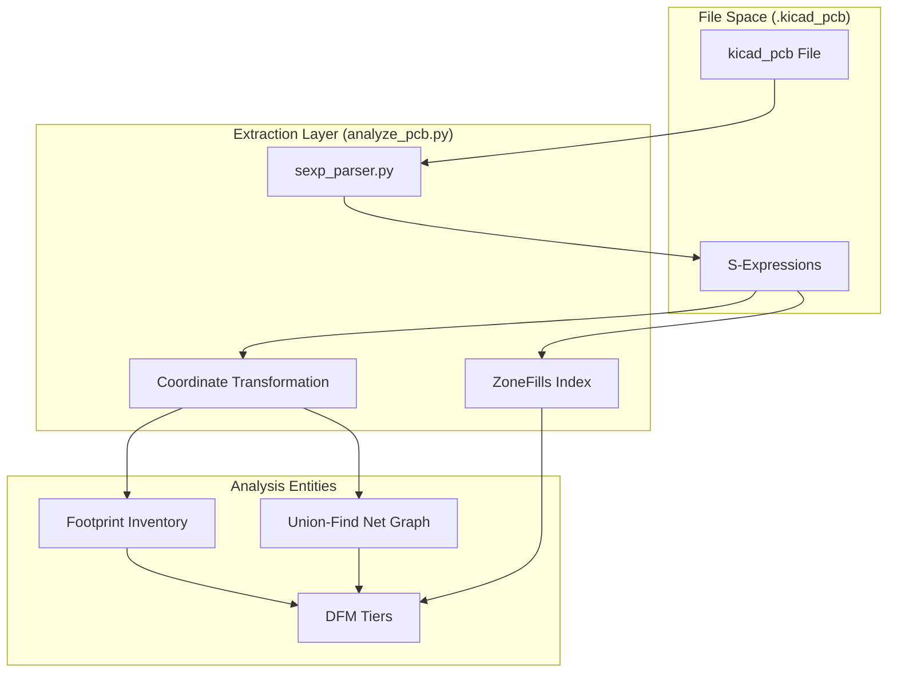
Sources: [skills/kicad/scripts/analyze_pcb.py:110-172](), [skills/kicad/scripts/methodology_pcb.py:15-49](), [skills/kicad/scripts/methodology_pcb.py:135-150]()

---

## Physical Layout Features

### DFM and Manufacturing Checks
The analyzer calculates physical metrics against manufacturer capability tiers. It identifies "Standard" vs "Advanced" fabrication requirements based on minimum trace widths, clearances, and annular rings.
*   **Tombstoning Risk**: Heuristic check for unbalanced copper on small SMD components (e.g., 0402 resistors) [skills/kicad/scripts/methodology_pcb.py:11]().
*   **Annular Rings**: Verification of pad-to-drill ratios to ensure drill breakout does not occur.
*   **Via-in-Pad**: Detection of vias placed directly on SMD pads, which can cause solder wicking issues.

For details, see [DFM Scoring and Manufacturing Checks](#2.2.1).

### Thermal and Power Analysis
*   **Thermal Vias**: Detection of via clusters under power pads (e.g., QFN thermal pads). The analyzer uses the `ZoneFills` index to verify these vias connect to internal planes [skills/kicad/scripts/analyze_pcb.py:110-120]().
*   **Current Capacity**: Uses track width and copper weight (from the `setup` block) to estimate ampacity based on IPC-2221 standards [skills/kicad/references/pcb-layout-analysis.md:152-164]().

### Signal Integrity and Proximity
*   **Crosstalk Detection**: When the `--proximity` flag is used, the analyzer identifies long parallel runs of tracks on different nets to flag potential inductive/capacitive coupling.
*   **Differential Pairs**: Identification of nets ending in `+`/`-` or `_P`/`_N` to verify length matching and gap consistency [skills/kicad/references/pcb-layout-analysis.md:110-123]().

### System Entity Mapping
This diagram maps high-level analysis concepts to the specific code entities responsible for them.

**Diagram: Logic to Code Mapping**
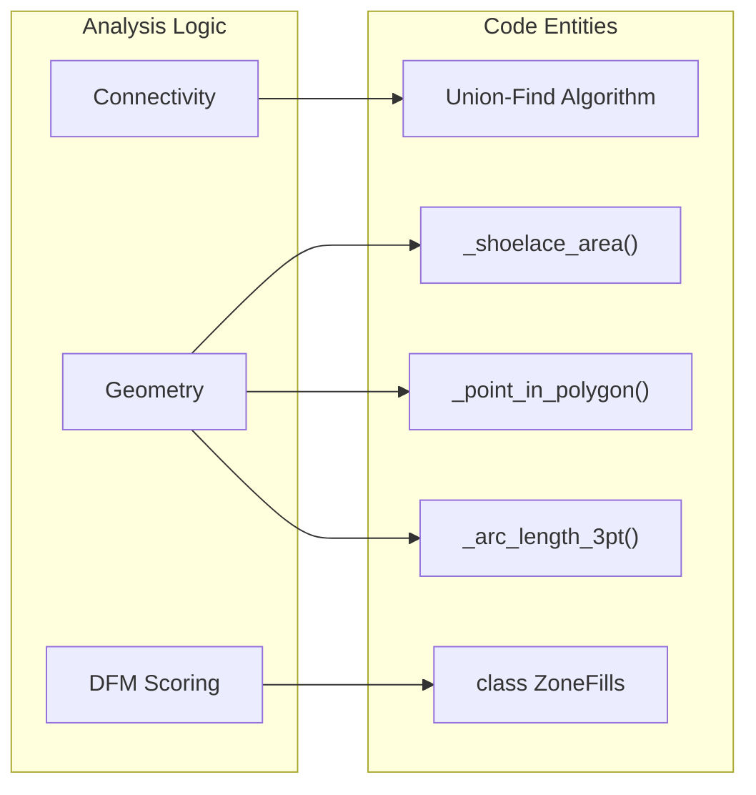
Sources: [skills/kicad/scripts/analyze_pcb.py:40-107](), [skills/kicad/scripts/analyze_pcb.py:110-120](), [skills/kicad/scripts/analyze_pcb.py:173-209](), [skills/kicad/scripts/methodology_pcb.py:135-150]()

---

## Child Pages
*   [DFM Scoring and Manufacturing Checks](#2.2.1) — Detailed breakdown of manufacturing limits, tombstoning heuristics, and fabrication tier mapping.

---

# Page: DFM Scoring and Manufacturing Checks

# DFM Scoring and Manufacturing Checks

<details>
<summary>Relevant source files</summary>

The following files were used as context for generating this wiki page:

- [skills/jlcpcb/SKILL.md](skills/jlcpcb/SKILL.md)
- [skills/kicad/references/file-formats.md](skills/kicad/references/file-formats.md)
- [skills/kicad/references/gerber-parsing.md](skills/kicad/references/gerber-parsing.md)
- [skills/kicad/references/standards-compliance.md](skills/kicad/references/standards-compliance.md)
- [skills/kicad/scripts/analyze_pcb.py](skills/kicad/scripts/analyze_pcb.py)
- [skills/pcbway/SKILL.md](skills/pcbway/SKILL.md)

</details>


This page details the Design for Manufacturing (DFM) analysis pipeline implemented in `analyze_pcb.py`. The system evaluates KiCad PCB layouts against industry-standard fabrication limits and specific vendor capabilities (JLCPCB and PCBWay) to produce a tiered difficulty score and identify high-risk manufacturing defects.

## DFM Tier Classification

The analyzer classifies designs into three tiers based on the most aggressive feature found in the layout. This classification maps directly to fabrication costs and capability requirements at major quick-turn PCB houses.

| Tier | Description | Typical Constraints |
| :--- | :--- | :--- |
| **Standard** | High-yield, low-cost fabrication. | 0.15mm trace/space, 0.3mm drill. |
| **Advanced** | Requires precision equipment, higher cost. | 0.09mm trace/space, 0.15mm drill. |
| **Challenging** | Near-limit for standard fabs; high scrap risk. | <0.09mm features, micro-vias. |

### Implementation Constants
The thresholds for these tiers are defined as constants in `analyze_pcb.py`. The script compares extracted geometry against `LIMITS_STD` and `LIMITS_ADV` to determine the `dfm_tier`.

*   **`LIMITS_STD`**: Defines the boundary for "Standard" tier. If any measurement is smaller than these values, the board is promoted to "Advanced" `[skills/kicad/scripts/analyze_pcb.py:220-235]()`.
*   **`LIMITS_ADV`**: Defines the boundary for "Advanced" tier. Values smaller than these result in a "Challenging" classification `[skills/kicad/scripts/analyze_pcb.py:237-250]()`.

**Sources:** `[skills/kicad/scripts/analyze_pcb.py:220-250]()`, `[skills/jlcpcb/SKILL.md:77-102]()`, `[skills/pcbway/SKILL.md:80-105]()`.

---

## Technical Checks and Heuristics

The `analyze_pcb.py` script performs a single-pass extraction of the `.kicad_pcb` S-expression tree, calculating DFM metrics for every footprint and copper element.

### Tombstoning Risk Heuristic
The analyzer identifies small SMD components (typically 0402 and 0201) that have unbalanced copper connections. If one pad is connected to a large copper plane (high thermal mass) while the other is connected only to a thin trace (low thermal mass), the component is flagged for tombstoning risk during reflow.

*   **Logic**: The script checks if a component is an SMD resistor or capacitor and compares the `zone_connection` type and trace widths of its pads `[skills/kicad/scripts/analyze_pcb.py:1240-1285]()`.

### Via-in-Pad Detection
Via-in-pad (ViP) can cause solder wicking into the via barrel, leading to dry joints.
*   **Detection**: The `ZoneFills` class provides a spatial index `[skills/kicad/scripts/analyze_pcb.py:110-172]()`. The analyzer iterates through all `via` nodes and checks if their center coordinates fall within the bounding box and polygon of any SMD `pad` node `[skills/kicad/scripts/analyze_pcb.py:1410-1435]()`.

### Annular Ring and Drill Checks
The system verifies the "meat" of the via or through-hole pad remaining after drilling.
*   **Calculation**: `(Pad_Diameter - Drill_Diameter) / 2`.
*   **Standard**: IPC-2221A Table 9-1 specifies minimum annular rings for different classes `[skills/kicad/references/standards-compliance.md:158-190]()`. The script flags any ring below the `min_annular_ring` threshold defined in the DFM limits `[skills/kicad/scripts/analyze_pcb.py:1350-1375]()`.

### Edge Clearance
Copper-to-edge clearance is checked by comparing the coordinates of all `segment` and `zone` objects against the `Edge.Cuts` layer geometry.
*   **Implementation**: The script extracts the board bounding box from `gr_line` and `gr_arc` elements on the `Edge.Cuts` layer `[skills/kicad/scripts/analyze_pcb.py:310-345]()`. It then identifies any copper within 0.2mm of this boundary `[skills/kicad/scripts/analyze_pcb.py:1450-1480]()`.

**Sources:** `[skills/kicad/scripts/analyze_pcb.py:110-172]()`, `[skills/kicad/scripts/analyze_pcb.py:1240-1480]()`, `[skills/kicad/references/standards-compliance.md:158-190]()`.

---

## Data Flow: Extraction to Scoring

The following diagram illustrates how raw S-expression data is transformed into a DFM report.

### DFM Analysis Pipeline
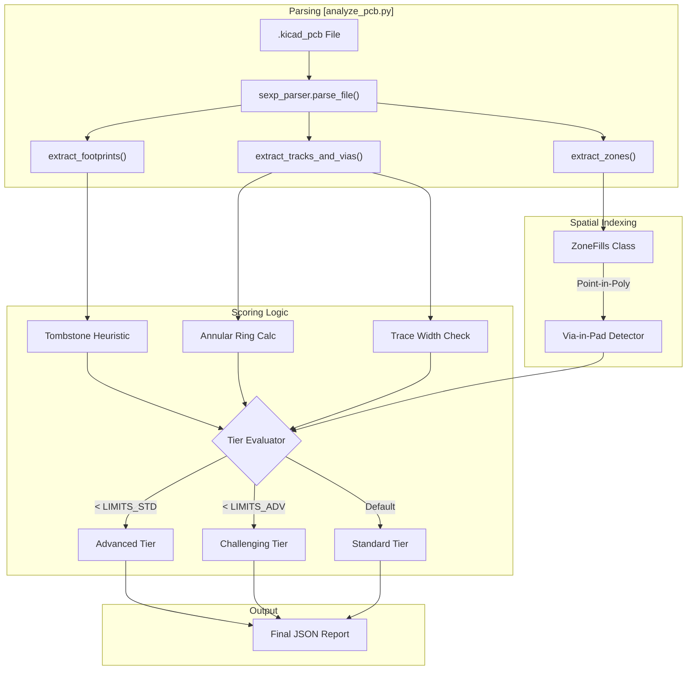
**Sources:** `[skills/kicad/scripts/analyze_pcb.py:1-15]()`, `[skills/kicad/scripts/analyze_pcb.py:110-120]()`, `[skills/kicad/scripts/analyze_pcb.py:220-250]()`.

---

## Mapping to Fabrication Tiers

The results of the analysis are used to validate the design against specific vendor capabilities documented in the system.

### Fabrication Capability Mapping
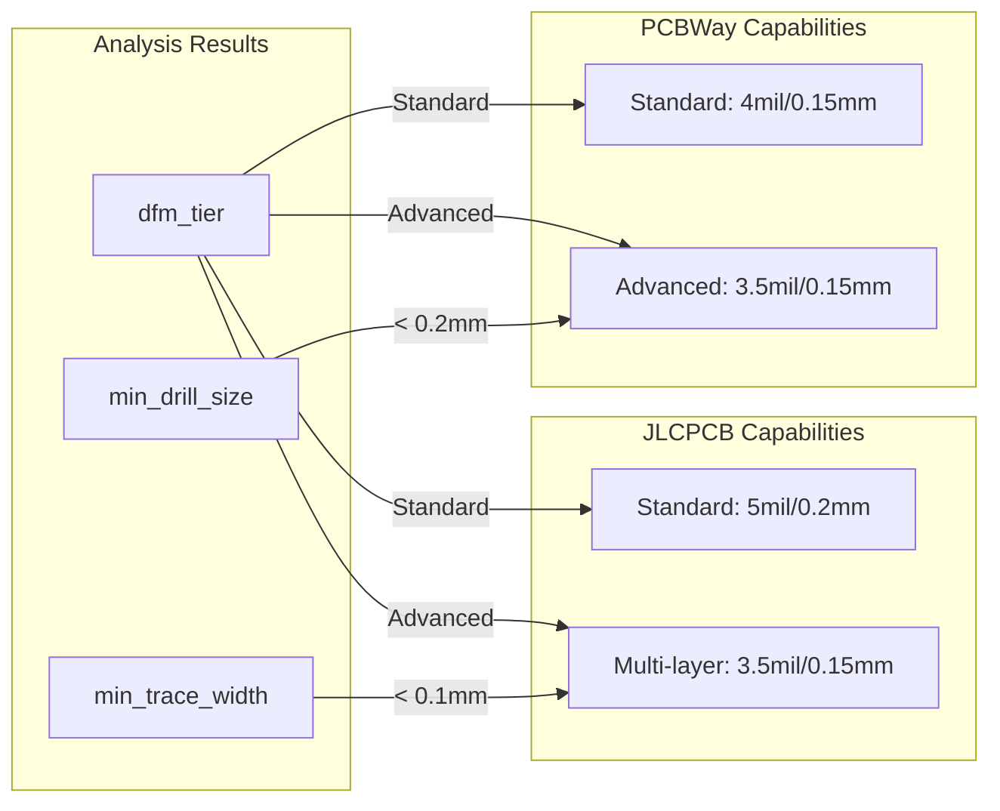

### Summary of Vendor Limits
| Parameter | JLCPCB (1-2 Layer) | PCBWay (1-2 Layer) | kicad-happy `LIMITS_STD` |
| :--- | :--- | :--- | :--- |
| **Min Trace/Space** | 0.127mm (5mil) | 0.1mm (4mil) | 0.127mm |
| **Min Drill** | 0.2mm | 0.15mm | 0.2mm |
| **Min Annular Ring** | 0.125mm | 0.15mm | 0.15mm |

**Sources:** `[skills/jlcpcb/SKILL.md:77-102]()`, `[skills/pcbway/SKILL.md:80-105]()`, `[skills/kicad/scripts/analyze_pcb.py:220-235]()`.

---

# Page: Gerber Analyzer (analyze_gerbers.py)

# Gerber Analyzer (analyze_gerbers.py)

<details>
<summary>Relevant source files</summary>

The following files were used as context for generating this wiki page:

- [skills/kicad/references/file-formats.md](skills/kicad/references/file-formats.md)
- [skills/kicad/references/gerber-parsing.md](skills/kicad/references/gerber-parsing.md)
- [skills/kicad/references/manual-gerber-parsing.md](skills/kicad/references/manual-gerber-parsing.md)
- [skills/kicad/references/standards-compliance.md](skills/kicad/references/standards-compliance.md)
- [skills/kicad/scripts/analyze_gerbers.py](skills/kicad/scripts/analyze_gerbers.py)
- [skills/kicad/scripts/kicad_types.py](skills/kicad/scripts/kicad_types.py)
- [skills/kicad/scripts/methodology_gerbers.md](skills/kicad/scripts/methodology_gerbers.md)

</details>


The Gerber Analyzer provides a comprehensive single-pass extraction pipeline for Gerber RS-274X and Excellon drill files. It serves as the final verification layer in the `kicad-happy` workflow, ensuring that the machine-readable fabrication outputs—which are what a manufacturer actually receives—match the design intent captured in the schematic and PCB layout files [skills/kicad/scripts/analyze_gerbers.py:3-19]().

## Gerber Parsing Pipeline

The core of the analyzer is a stateful RS-274X parser that extracts structural metadata, aperture definitions, and X2 extended attributes. The process is split into two phases to ensure coordinate data is interpreted correctly based on header definitions [skills/kicad/scripts/analyze_gerbers.py:36-45]().

### Data Flow and State Machine
The parser maintains a state machine to track the "current" context (aperture, component, net) as it traverses the file. This allows it to attribute specific flashes or draws to logical board entities like "R1" or "GND" [skills/kicad/scripts/analyze_gerbers.py:105-111]().

**Gerber Extraction Architecture**
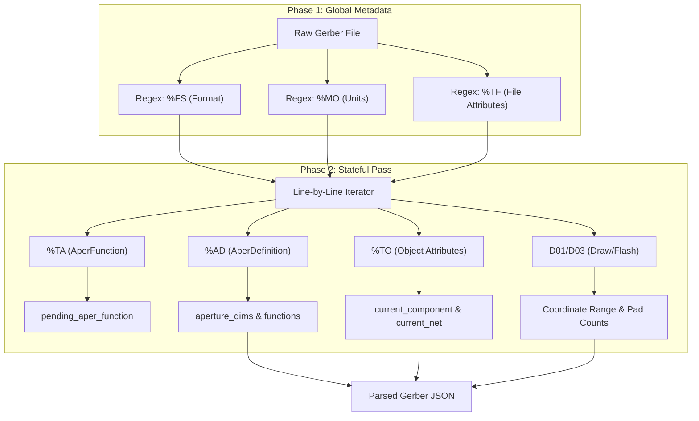
Sources: [skills/kicad/scripts/analyze_gerbers.py:66-180](), [skills/kicad/scripts/methodology_gerbers.md:56-70]()

### X2 Attribute Extraction
The analyzer extracts three levels of X2 attributes to reconstruct the design's netlist and component placement directly from the Gerber files:

1.  **File Attributes (TF):** Used for layer identification (e.g., `FileFunction,Copper,L1,Top`) and software identification [skills/kicad/scripts/analyze_gerbers.py:85-93]().
2.  **Aperture Attributes (TA):** Classifies apertures as `SMDPad`, `ViaPad`, or `Conductor`. This is critical for minimum feature size analysis [skills/kicad/scripts/analyze_gerbers.py:119-145]().
3.  **Object Attributes (TO):** Maps specific flashes to component references (`TO.C`), net names (`TO.N`), and pins (`TO.P`) [skills/kicad/scripts/analyze_gerbers.py:154-179]().

The script supports both modern `%TF...%` syntax and the legacy KiCad 5 `G04 #@! TF...` comment format [skills/kicad/scripts/analyze_gerbers.py:89-93]().

Sources: [skills/kicad/scripts/analyze_gerbers.py:84-112](), [skills/kicad/references/gerber-parsing.md:197-205]()

## Layer Identification and Completeness

The analyzer identifies layers using a prioritized heuristic: X2 `FileFunction` attributes first, followed by KiCad 5 comment strings, and finally filename pattern matching [skills/kicad/scripts/analyze_gerbers.py:330-350]().

### Verification Checks
*   **Completeness:** The script compares detected layers against the `.gbrjob` file or a set of standard defaults (Copper, Mask, Silk, Paste, Edge) to identify missing files [skills/kicad/scripts/analyze_gerbers.py:440-460]().
*   **Alignment:** It verifies that the `coordinate_range` (bounding box) of all copper, mask, and silk layers are consistent. Significant deviations suggest misaligned exports [skills/kicad/scripts/analyze_gerbers.py:465-485]().
*   **Staleness:** If a `.zip` archive exists in the directory, the script compares its timestamp against the individual `.gbr` files to warn if the archive is out of date [skills/kicad/scripts/analyze_gerbers.py:490-510]().

Sources: [skills/kicad/scripts/analyze_gerbers.py:6-15](), [skills/kicad/scripts/methodology_gerbers.md:180-200]()

## Drill Classification (Excellon)

The `parse_drill` function processes Excellon files to extract hole sizes and counts [skills/kicad/scripts/analyze_gerbers.py:220-250]().

### Tool and Hole Analysis
Holes are classified based on the tool definition and the presence of "plated" (PTH) vs "non-plated" (NPTH) attributes in the header [skills/kicad/scripts/analyze_gerbers.py:260-280]().

| Feature | Extraction Method |
| :--- | :--- |
| **Units** | Detected via `METRIC` or `INCH` keywords [skills/kicad/scripts/analyze_gerbers.py:225-230]() |
| **Tool Size** | Parsed from `TnnCddd.ddd` definitions [skills/kicad/scripts/analyze_gerbers.py:235-240]() |
| **Hole Count** | Incremented for every `X...Y...` coordinate following a tool selection [skills/kicad/scripts/analyze_gerbers.py:285-300]() |
| **Plating** | Determined by file context (e.g., `-PTH.drl` vs `-NPTH.drl`) or header flags [skills/kicad/scripts/analyze_gerbers.py:310-320]() |

Sources: [skills/kicad/scripts/analyze_gerbers.py:220-325](), [skills/kicad/scripts/methodology_gerbers.md:137-150]()

## Technical Implementation Summary

**Key Functions and Classes**
| Entity | Role |
| :--- | :--- |
| `parse_gerber(path)` | Main entry point for RS-274X parsing; implements the two-phase state machine [skills/kicad/scripts/analyze_gerbers.py:36]() |
| `parse_drill(path)` | Parses Excellon drill files, extracting tool diameters and hole counts [skills/kicad/scripts/analyze_gerbers.py:220]() |
| `analyze_gerbers(dir)` | Orchestrates the full directory scan, job file parsing, and completeness/alignment checks [skills/kicad/scripts/analyze_gerbers.py:380]() |
| `_parse_aperture_dimension()` | Normalizes dimensions across Circle, Rect, and Obround types into mm [skills/kicad/scripts/analyze_gerbers.py:139]() |

**Code Entity Interaction Map**
```mermaid
graph LR
    subgraph "analyze_gerbers.py"
        Main["analyze_gerbers()"] --> PG["parse_gerber()"]
        Main --> PD["parse_drill()"]
        Main --> PJ["parse_job_file()"]
        
        PG --> PAD["_parse_aperture_dimension()"]
        PG --> LI["identify_layer()"]
        
        Main --> CC["check_completeness()"]
        Main --> AV["verify_alignment()"]
    end

    PG -- "Extracted TO.C/TO.N" --> CompNet["Component/Net Map"]
    PD -- "Hole Sizes" --> DrillMap["Drill Summary"]
    PJ -- "Stackup Metadata" --> JobData[".gbrjob Info"]
```
Sources: [skills/kicad/scripts/analyze_gerbers.py:36-400](), [skills/kicad/scripts/methodology_gerbers.md:34-45]()

---

# Page: Shared Utilities and Data Types

# Shared Utilities and Data Types

<details>
<summary>Relevant source files</summary>

The following files were used as context for generating this wiki page:

- [skills/kicad/scripts/kicad_types.py](skills/kicad/scripts/kicad_types.py)
- [skills/kicad/scripts/kicad_utils.py](skills/kicad/scripts/kicad_utils.py)
- [skills/kicad/scripts/methodology_gerbers.md](skills/kicad/scripts/methodology_gerbers.md)
- [skills/kicad/scripts/sexp_parser.py](skills/kicad/scripts/sexp_parser.py)
- [skills/kicad/scripts/signal_detectors.py](skills/kicad/scripts/signal_detectors.py)

</details>


This page documents the shared library modules that provide the foundational data structures and utility functions for the `kicad-happy` analysis pipeline. These modules ensure consistent behavior across the schematic, PCB, and Gerber analyzers by centralizing S-expression parsing, component classification, and unit conversion.

## S-Expression Parser (`sexp_parser.py`)

The `sexp_parser.py` module provides a high-performance tokenizer and parser for KiCad's Lisp-like S-expression format. It transforms raw text into nested Python lists, allowing other scripts to query design data using a simplified API.

### Implementation Details
The parser uses a two-stage approach:
1.  **Tokenization**: The `_tokenize` function scans the input string, handling quoted strings (with escape characters) and unquoted atoms while stripping whitespace `[skills/kicad/scripts/sexp_parser.py:28-62]()`.
2.  **Recursive Descent**: The `_parse_tokens` function recursively builds nested lists. It includes bounds checking to handle truncated or malformed files gracefully `[skills/kicad/scripts/sexp_parser.py:65-79]()`.

### Key API Functions
| Function | Description |
| :--- | :--- |
| `parse_file(path)` | Reads and parses a `.kicad_sch` or `.kicad_pcb` file into a nested list structure `[skills/kicad/scripts/sexp_parser.py:22-25]()`. |
| `find_all(node, keyword)` | Returns all direct child lists starting with the specified keyword (e.g., finding all `symbol` blocks) `[skills/kicad/scripts/sexp_parser.py:81-88]()`. |
| `get_property(node, prop)` | Extracts the value of a specific named property, such as "Reference" or "Value" `[skills/kicad/scripts/sexp_parser.py:130-139]()`. |
| `get_at(node)` | Extracts `(x, y, angle)` coordinates from an `(at ...)` node, commonly used for component placement `[skills/kicad/scripts/sexp_parser.py:158-167]()`. |

**Sources:** `skills/kicad/scripts/sexp_parser.py`

---

## Shared Utilities (`kicad_utils.py`)

This module contains the "business logic" for interpreting KiCad data. It handles the messy realities of component naming conventions and coordinate drift.

### Component and Net Classification
The utilities provide heuristics to identify the function of components and nets based on their names and values:
*   **Regulator Vref Lookup**: The `_REGULATOR_VREF` table maps part number prefixes (e.g., `TPS5430`, `LM317`) to their internal reference voltages `[skills/kicad/scripts/kicad_utils.py:28-106]()`. This is used by `lookup_regulator_vref` to calculate expected output voltages from feedback dividers `[skills/kicad/scripts/kicad_utils.py:136-157]()`.
*   **Load Type Keywords**: `_LOAD_TYPE_KEYWORDS` identifies inductive or resistive loads (e.g., `MOTOR`, `HEATER`, `RELAY`) from net names to assist transistor drive analysis `[skills/kicad/scripts/kicad_utils.py:115-126]()`.
*   **Coordinate Snapping**: To combat floating-point errors introduced during rotation or mil-to-mm conversion, `snap_to_mil_grid` aligns coordinates back to the standard 1-mil grid `[skills/kicad/scripts/kicad_utils.py:20-22]()`.

### Data Flow: Natural Language to Code Entities
The following diagram illustrates how the utilities bridge raw schematic strings to structured classifications used by the detectors.

**Classification Mapping Logic**
```mermaid
graph TD
    subgraph "Natural Language Space"
        A["Net Name: 'MOTOR_PWM'"]
        B["Part Value: 'TPS5430'"]
    end

    subgraph "Code Entity Space (kicad_utils.py)"
        A --> C["_OUTPUT_DRIVE_KEYWORDS"]
        C --> D["is_output_drive_net()"]
        
        B --> E["_REGULATOR_VREF"]
        E --> F["lookup_regulator_vref()"]
    end

    subgraph "Detector Space (signal_detectors.py)"
        D --> G["detect_transistor_circuits()"]
        F --> H["detect_voltage_dividers()"]
    end
```
**Sources:** `skills/kicad/scripts/kicad_utils.py`, `skills/kicad/scripts/signal_detectors.py`

---

## Analysis Data Types (`kicad_types.py`)

The `AnalysisContext` dataclass is the central state object passed throughout the analysis pipeline. It encapsulates the processed schematic data to prevent redundant computations.

### AnalysisContext Dataclass
Defined in `[skills/kicad/scripts/kicad_types.py:17-60]()`, this object is initialized once per schematic analysis.

| Attribute | Type | Description |
| :--- | :--- | :--- |
| `comp_lookup` | `dict[str, dict]` | O(1) lookup of component data by reference designator `[skills/kicad/scripts/kicad_types.py:30]()`. |
| `parsed_values` | `dict[str, float]` | Normalized numerical values for resistors (Ohms), capacitors (Farads), etc. `[skills/kicad/scripts/kicad_types.py:31]()`. |
| `known_power_rails` | `set[str]` | A set of net names identified as power rails via `#PWR` or `#FLG` symbols `[skills/kicad/scripts/kicad_types.py:32]()`. |
| `pin_net` | `dict` | Mapping of `(reference, pin_number)` to the resolved net name `[skills/kicad/scripts/kicad_types.py:29]()`. |

### Logic Flow: Context Initialization
When `AnalysisContext` is instantiated, its `__post_init__` method automatically populates the lookup tables:
1.  **Value Parsing**: Iterates through components and calls `parse_value` to populate `parsed_values` `[skills/kicad/scripts/kicad_types.py:38-42]()`.
2.  **Power Rail Detection**: Scans net pins for power symbols to populate `known_power_rails` `[skills/kicad/scripts/kicad_types.py:43-48]()`.

**Context Data Relationships**
```mermaid
graph LR
    subgraph "Input Data"
        SCH["Raw Schematic S-Exp"]
    end

    subgraph "AnalysisContext (kicad_types.py)"
        DIR["components list"]
        DIR --> CL["comp_lookup"]
        DIR --> PV["parsed_values"]
        NET["nets dict"] --> KPR["known_power_rails"]
    end

    subgraph "Consumers"
        SD["signal_detectors.py"]
        AS["analyze_schematic.py"]
    end

    CL & PV & KPR --> SD
    CL & PV & KPR --> AS
```
**Sources:** `skills/kicad/scripts/kicad_types.py`, `skills/kicad/scripts/kicad_utils.py`

---

# Page: Design Review Workflow

# Design Review Workflow

<details>
<summary>Relevant source files</summary>

The following files were used as context for generating this wiki page:

- [how-it-works.md](how-it-works.md)
- [skills/kicad/SKILL.md](skills/kicad/SKILL.md)
- [skills/kicad/references/report-generation.md](skills/kicad/references/report-generation.md)

</details>


The design review workflow in `kicad-happy` is a structured, four-step process that transforms raw KiCad EDA files into a comprehensive engineering report. It relies on a "data-first" philosophy where deterministic Python scripts extract design intent into JSON, which is then reasoned about by an AI agent or a human reviewer.

## High-Level Process Flow

The workflow bridges the gap between raw S-expression files and actionable engineering findings through the following stages:

1.  **Extraction**: Running `analyze_schematic.py`, `analyze_pcb.py`, and `analyze_gerbers.py` to generate structured data [how-it-works.md:19-52]().
2.  **Sourcing**: Gathering manufacturer datasheets via distributor APIs (DigiKey, Mouser, LCSC, element14) to ground the analysis in physical component reality [how-it-works.md:53-58]().
3.  **Cross-Reference**: Validating the extracted netlist against PCB layout and Gerber fabrication files [how-it-works.md:59-67]().
4.  **Reporting**: Synthesizing findings into a structured document categorized by severity [skills/kicad/references/report-generation.md:18-52]().

### Workflow Data Integration
The following diagram illustrates how code entities interact to move data from the "Natural Language Space" (user request) to the "Code Entity Space" (structured analysis).

**Design Review Data Flow**
```mermaid
graph TD
    User["User Request: 'Analyze my board'"] --> Agent["AI Agent / LLM"]
    
    subgraph "Code Entity Space: Analyzers"
        Agent --> SCH["analyze_schematic.py"]
        Agent --> PCB["analyze_pcb.py"]
        Agent --> GBR["analyze_gerbers.py"]
        
        SCH --> SCH_JSON["schematic_analysis.json"]
        PCB --> PCB_JSON["pcb_analysis.json"]
        GBR --> GBR_JSON["gerber_analysis.json"]
    end

    subgraph "Code Entity Space: Sourcing"
        SCH_JSON --> BOM["bom_manager.py"]
        BOM --> APIs["Distributor APIs (DigiKey/Mouser/LCSC)"]
        APIs --> DS["datasheets/*.pdf"]
    end

    subgraph "Natural Language Space: Output"
        SCH_JSON & PCB_JSON & GBR_JSON & DS --> Report["Design Review Report (.md)"]
    end
```
Sources: [how-it-works.md:17-71](), [skills/kicad/SKILL.md:40-73]()

---

## Core Analysis Components

The workflow is powered by three primary scripts that handle different aspects of the hardware design. These scripts avoid "hallucinations" by operating deterministically on the file structure [how-it-works.md:5-15]().

### 1. Schematic Analysis
The `analyze_schematic.py` script builds a complete net graph using a union-find algorithm on pin coordinates [how-it-works.md:29-30](). It runs 21 specific signal path detectors to identify subcircuits like power regulators, filters, and bus topologies [skills/kicad/SKILL.md:61-66]().

### 2. PCB Layout Analysis
The `analyze_pcb.py` script extracts footprints, tracks, and zones to perform DFM (Design for Manufacturing) scoring. It checks for issues like tombstoning risk, via-in-pad usage, and courtyard overlaps [skills/kicad/SKILL.md:77-80]().

### 3. Gerber Validation
The `analyze_gerbers.py` script ensures the fabrication outputs match the design files. It verifies layer completeness, drill alignment, and detects "stale" zip archives where the exported Gerbers are older than the source PCB file [skills/kicad/SKILL.md:82-84]().

**Analyzer Internal Logic**
```mermaid
graph LR
    subgraph "analyze_schematic.py"
        S_Parser["sexp_parser.py"] --> NetGraph["Union-Find Net Graph"]
        NetGraph --> Detectors["signal_detectors.py (21 Detectors)"]
        Detectors --> SCH_Out["JSON Output"]
    end

    subgraph "analyze_pcb.py"
        P_Parser["sexp_parser.py"] --> DFM["DFM Scoring Engine"]
        DFM --> PCB_Out["JSON Output"]
    end
```
Sources: [how-it-works.md:21-49](), [skills/kicad/SKILL.md:54-85]()

---

## Child Pages

### [Report Generation and Output Schema](#3.1)
Details the standard template for design reviews, including the mandatory **Severity Taxonomy** (CRITICAL, WARNING, SUGGESTION) and the mapping of JSON fields to report sections.
For details, see [Report Generation and Output Schema](#3.1).

### [Standards Compliance and File Formats](#3.2)
Covers the technical specifications used for validation, such as IPC-2221A for current capacity and IEC 60664-1 for creepage/clearance. It also documents the KiCad S-expression node structures parsed by the tools.
For details, see [Standards Compliance and File Formats](#3.2).

### [Supplementary Data Sources and Legacy Support](#3.3)
Explains how the workflow handles KiCad 5 (legacy) designs using `.net` netlists and `-cache.lib` files, as well as the methodology for extracting circuit data from PDF schematics.
For details, see [Supplementary Data Sources and Legacy Support](#3.3).

---

## Severity Taxonomy
The workflow categorizes all findings into three levels to help engineers prioritize fixes [skills/kicad/references/report-generation.md:446-452]():

| Severity | Definition | Example |
| :--- | :--- | :--- |
| **CRITICAL** | Board will not function, safety hazard, or certain fab failure. | Shorted power rails, incorrect IC pinout. |
| **WARNING** | Suboptimal design; board may work but has reliability risks. | Marginal I2C pull-ups, missing ESD on USB. |
| **SUGGESTION** | Best practice improvements or optimization opportunities. | Inconsistent reference designators, BOM cost reduction. |

Sources: [skills/kicad/references/report-generation.md:43-52](), [how-it-works.md:73-85]()

---

# Page: Report Generation and Output Schema

# Report Generation and Output Schema

<details>
<summary>Relevant source files</summary>

The following files were used as context for generating this wiki page:

- [skills/kicad/references/output-schema.md](skills/kicad/references/output-schema.md)
- [skills/kicad/references/report-generation.md](skills/kicad/references/report-generation.md)

</details>


This page documents the design review report generation process, the structured template used for hardware audits, and the JSON schemas produced by the core analysis scripts. The report generation workflow transforms raw extraction data into an actionable, severity-categorized document for electronic engineers.

## 1. Report Structure and Design Review Template

The design review report is a structured Markdown document generated by synthesizing outputs from `analyze_schematic.py`, `analyze_pcb.py`, and `analyze_gerbers.py`. It follows a standardized template to ensure consistency across different hardware projects.

### 1.1 Section Hierarchy
The report is organized to prioritize critical failures while providing deep-dive technical verification for subcircuits.

| Section | Purpose | Key Data Sources |
| :--- | :--- | :--- |
| **Overview** | High-level project context (MCU, Layers, Domain). | `title_block`, `statistics` |
| **Previous Review Delta** | Tracking progress and regressions from prior audits. | Local `.md` file diffing |
| **Critical Findings** | High-priority issues (CRITICAL/WARNING). | `connectivity_issues`, `erc_warnings` |
| **Power Tree** | ASCII visualization of voltage regulation and distribution. | `signal_analysis.power_regulators` |
| **Analyzer Verification** | Manual spot-checks against raw files and datasheets. | `components`, `nets`, `ic_pin_analysis` |
| **Signal Analysis Review** | Validation of detected subcircuits (Filters, Dividers, etc.). | `signal_analysis` |
| **PCB & DFM Analysis** | Layout-specific metrics and manufacturing risks. | `analyze_pcb.py` output |
| **Gerber Validation** | Verification of fabrication files and alignment. | `analyze_gerbers.py` output |

### 1.2 Severity Taxonomy
Findings are categorized using a three-tier taxonomy to guide the designer's attention.

*   **CRITICAL**: The board will likely not function, contains a safety hazard, or will fail fabrication (e.g., swapped VCC/GND, missing power to MCU, shorted nets).
*   **WARNING**: Suboptimal design that may work but carries reliability risks or violates best practices (e.g., missing decoupling, tight voltage margins, high tombstoning risk).
*   **SUGGESTION**: Minor optimizations, BOM improvements, or cosmetic labeling issues.

**Sources:** [skills/kicad/references/report-generation.md:18-52](), [skills/kicad/references/report-generation.md:446-452]()

---

## 2. Data Flow: From Scripts to Report

The reporting process bridges the gap between deterministic Python extraction and human-readable analysis.

### 2.1 JSON-to-Report Mapping
The following diagram illustrates how specific JSON fields from the analyzers are mapped into the final report sections.

**Diagram: Analyzer Data Mapping**
```mermaid
graph TD
    subgraph "Analyzer Output (JSON)"
        SA["analyze_schematic.py"]
        PA["analyze_pcb.py"]
        GA["analyze_gerbers.py"]
    end

    subgraph "Report Sections (Markdown)"
        PT["Power Tree"]
        CV["Component Verification"]
        DFM["DFM & Layout"]
        GV["Gerber Validation"]
    end

    SA -->|"signal_analysis.power_regulators"| PT
    SA -->|"components & ic_pin_analysis"| CV
    PA -->|"dfm & tombstoning_risk"| DFM
    GA -->|"completeness & alignment"| GV
    
    SA -.->|"connectivity_issues"| CF["Critical Findings"]
    PA -.->|"trace_proximity"| CF
```
**Sources:** [skills/kicad/references/report-generation.md:342-444](), [skills/kicad/references/output-schema.md:5-21]()

---

## 3. Schematic-to-PCB Cross-Reference

A vital part of the report is the **Analyzer Verification** section, which performs a cross-module audit to ensure the schematic and PCB data are synchronized.

### 3.1 Verification Workflow
1.  **Component Count Match**: Compares the `total_components` from the schematic against the `footprint_count` in the PCB.
2.  **Pinout Verification**: Cross-references `ic_pin_analysis` from the schematic with `pad_nets` in the PCB footprints.
3.  **Datasheet Grounding**: Requires the reviewer to verify the "Assumed Pinout" (from KiCad symbols) against the "Datasheet Pinout" (from manufacturer PDFs).

### 3.2 Data Entities in Code
The system uses specific code entities to maintain this mapping:
*   `AnalysisContext`: A dataclass used to pass state between analysis functions.
*   `comp_lookup`: A dictionary for O(1) access to component properties by reference.
*   `parsed_values`: Standardized `{value: float, unit: string}` objects for calculation.

**Diagram: Verification Entity Relationship**
```mermaid
classDiagram
    class "analyze_schematic.py" {
        +nets: Object
        +components: Array
        +signal_analysis: Object
    }
    class "analyze_pcb.py" {
        +footprints: Array
        +tracks: Object
        +dfm: Object
    }
    class "Report_Generator" {
        +verify_pinout(ref)
        +calculate_power_tree()
        +map_severity(issue)
    }

    "analyze_schematic.py" -- "Report_Generator" : provides "ic_pin_analysis"
    "analyze_pcb.py" -- "Report_Generator" : provides "pad_nets"
    "Report_Generator" ..> "kicad_types.py" : uses "AnalysisContext"
```
**Sources:** [skills/kicad/references/report-generation.md:63-71](), [skills/kicad/references/output-schema.md:40-49](), [skills/kicad/references/output-schema.md:127-134]()

---

## 4. Output Schema Reference

The analyzers produce a structured JSON format designed for both automated parsing and LLM consumption.

### 4.1 Schematic Schema (`analyze_schematic.py`)
| Key | Type | Description |
| :--- | :--- | :--- |
| `statistics` | object | Summary of components, nets, and missing MPNs. |
| `bom` | array | Deduplicated list of parts with manufacturer data. |
| `nets` | object | Connectivity map keyed by net name with pin details. |
| `signal_analysis` | object | Detected subcircuits (regulators, filters, etc.). |
| `connectivity_issues` | object | Lists of single-pin nets, floating nets, and ERC warnings. |

### 4.2 PCB Schema (`analyze_pcb.py`)
| Key | Type | Description |
| :--- | :--- | :--- |
| `footprints` | array | Placements including `pad_nets` and `connected_nets`. |
| `net_lengths` | object | Trace lengths and via counts per net. |
| `dfm` | object | Manufacturing risks (annular rings, clearances, tombstoning). |
| `trace_proximity` | object | Potential crosstalk issues (enabled with `--proximity`). |

### 4.3 Gerber Schema (`analyze_gerbers.py`)
| Key | Type | Description |
| :--- | :--- | :--- |
| `completeness` | object | Checks if all required layers (Copper, Mask, Paste, Silk) exist. |
| `alignment` | object | Verifies that all layers share the same coordinate origin. |
| `drill_classification` | object | Categorizes holes into via, component, or mounting. |

**Sources:** [skills/kicad/references/output-schema.md:5-21](), [skills/kicad/references/output-schema.md:96-115](), [skills/kicad/references/output-schema.md:156-171]()

---

## 5. Power Tree Generation

The `Power Tree` is a mandatory visualization in the report. It is constructed by traversing the `signal_analysis.power_regulators` and `voltage_dividers` data.

### 5.1 Construction Logic
1.  **Identify Sources**: Start with nets identified as input sources (e.g., `VBUS`, `VIN`, `BATT`).
2.  **Trace Regulators**: For each regulator in `signal_analysis`, map `input_rail` to `output_rail`.
3.  **Calculate Vout**: If `vout_estimated` is present, it is compared against the rail name.
4.  **Reference Verification**: Note whether `vref_source` is "lookup" (datasheet-verified) or "heuristic" (calculated from common patterns).

**Sources:** [skills/kicad/references/report-generation.md:58-62](), [skills/kicad/references/output-schema.md:65]()

---

# Page: Standards Compliance and File Formats

# Standards Compliance and File Formats

<details>
<summary>Relevant source files</summary>

The following files were used as context for generating this wiki page:

- [skills/kicad/references/file-formats.md](skills/kicad/references/file-formats.md)
- [skills/kicad/references/gerber-parsing.md](skills/kicad/references/gerber-parsing.md)
- [skills/kicad/references/pcb-layout-analysis.md](skills/kicad/references/pcb-layout-analysis.md)
- [skills/kicad/references/standards-compliance.md](skills/kicad/references/standards-compliance.md)

</details>


This page details the technical implementation of industry standards and the parsing of KiCad's underlying file formats within the `kicad-happy` ecosystem. It covers the mathematical formulas for current capacity, clearance/creepage rules for high-voltage safety, and the structural specifications for KiCad S-expressions and Gerber X2 files.

## Standards Implementation

The analyzer maps physical PCB characteristics (trace width, spacing, layer stackup) to industry-standard constraints to provide automated DFM and safety reviews.

### IPC-2221A Current Capacity
The system implements the classic IPC-2221A formula to estimate the temperature rise of a conductor based on current and cross-sectional area [skills/kicad/references/standards-compliance.md:113-117]().

**Formula:**
`I = k * ΔT^0.44 * A^0.725`

| Variable | Description | Source |
| :--- | :--- | :--- |
| `I` | Current in Amperes | Derived |
| `k` | Constant (0.048 for outer layers, 0.024 for inner) | [skills/kicad/references/standards-compliance.md:124-125]() |
| `ΔT` | Temperature rise above ambient (°C) | User/Default |
| `A` | Cross-sectional area in sq mils | [skills/kicad/references/standards-compliance.md:123-123]() |

### IEC 60664-1 / ECMA-287 Insulation Coordination
For high-voltage and mains-referenced designs, the analyzer references ECMA-287 (derived from IEC 60664-1) to verify creepage and clearance [skills/kicad/references/standards-compliance.md:313-315]().

*   **Clearance:** The shortest distance through air between two conductive parts [skills/kicad/references/standards-compliance.md:318-318]().
*   **Creepage:** The shortest distance along the surface of an insulating material between two conductive parts [skills/kicad/references/standards-compliance.md:319-319]().

The implementation checks these against Pollution Degree 2 (standard office/laboratory environments) and Material Group IIIa/IIIb (standard FR4) [skills/kicad/references/standards-compliance.md:364-367]().

### IPC-A-600G Product Classes
The analyzer categorizes designs into three IPC classes to determine acceptable imperfection levels [skills/kicad/references/standards-compliance.md:58-60]():
*   **Class 1:** General Electronic Products (Consumer).
*   **Class 2:** Dedicated Service Electronic Products (Industrial/Telecom).
*   **Class 3:** High Reliability Electronic Products (Medical/Aerospace).

**Sources:**
*   [skills/kicad/references/standards-compliance.md:56-164]()
*   [skills/kicad/references/standards-compliance.md:313-440]()

---

## KiCad S-Expression File Formats

KiCad 6+ uses Lisp-like S-expressions for all design files. Coordinates are in millimeters with the origin at the top-left (Y increases downwards) [skills/kicad/references/file-formats.md:19-23]().

### Schematic (.kicad_sch) Structure
The schematic parser traverses the `(kicad_sch ...)` tree to build a connectivity graph.

**Natural Language to Code Entity Map: Schematic Parsing**
```mermaid
graph TD
    subgraph "Natural Language Space"
        A["Component Instance"]
        B["Local Net Name"]
        C["Global Power Rail"]
        D["Sub-sheet"]
    end

    subgraph "Code Entity Space (.kicad_sch)"
        A --> E["(symbol (lib_id ...) (property 'Reference' ...))"]
        B --> F["(label 'NAME' (at X Y))"]
        C --> G["(symbol (lib_id 'power:...') (property 'Value' 'GND'))"]
        D --> H["(sheet (property 'Sheetfile' 'sub.kicad_sch'))"]
    end
    
    E -- "Extracted by" --> I["analyze_schematic.py"]
    F -- "Resolved by" --> J["union-find algorithm"]
    G -- "Identified as" --> K["global_net"]
```
**Sources:**
*   [skills/kicad/references/file-formats.md:32-50]()
*   [skills/kicad/references/file-formats.md:80-97]()

### PCB Layout (.kicad_pcb) Structure
The PCB parser extracts physical geometry for DFM analysis. Key nodes include `(footprint)`, `(segment)` for tracks, and `(via)` [skills/kicad/references/file-formats.md:113-137]().

**Natural Language to Code Entity Map: PCB Analysis**
```mermaid
graph LR
    subgraph "Physical PCB Concepts"
        P1["Trace Width"]
        P2["Annular Ring"]
        P3["Clearance Rule"]
        P4["Copper Weight"]
    end

    subgraph "Code Entity Space (.kicad_pcb / .kicad_pro)"
        P1 --> C1["(segment (width W) (net N))"]
        P2 --> C2["(via (size S) (drill D)) -> (S-D)/2"]
        P3 --> C3["net_settings: { classes: [ { clearance: C } ] }"]
        P4 --> C4["(setup (stackup (layer 'F.Cu' (thickness T))))"]
    end

    C1 -- "Validated by" --> V["analyze_pcb.py"]
    C2 -- "Checked by" --> V
    C3 -- "Read from" --> V
```
**Sources:**
*   [skills/kicad/references/file-formats.md:113-185]()
*   [skills/kicad/references/pcb-layout-analysis.md:31-41]()
*   [skills/kicad/references/pcb-layout-analysis.md:68-92]()

---

## Gerber X2 and Excellon Formats

The `analyze_gerbers.py` script validates the manufacturing output files against the source design.

### Gerber RS-274X / X2
Modern KiCad exports include X2 attributes (TF/TA/TO) that embed metadata directly in the Gerber file [skills/kicad/references/gerber-parsing.md:200-210]().

*   **Aperture Definitions (%AD):** Define the shape of the "pen" (Circle, Rectangle, Obround) [skills/kicad/references/gerber-parsing.md:78-86]().
*   **Flash Commands (D03):** Used for pads and vias [skills/kicad/references/gerber-parsing.md:126-130]().
*   **Draw Commands (D01):** Used for traces [skills/kicad/references/gerber-parsing.md:126-128]().

### Excellon Drill Files
Drill files define the holes in the board. The parser checks for alignment between the drill file and the copper pads in the Gerber files [skills/kicad/references/gerber-parsing.md:231-255]().

| Command | Description |
| :--- | :--- |
| `T1C0.3` | Tool 1, Circle, 0.3mm diameter [skills/kicad/references/gerber-parsing.md:244-244]() |
| `X150.0Y100.0` | Drill hole at coordinate (150, 100) [skills/kicad/references/gerber-parsing.md:251-251]() |

### Data Flow: Gerber Validation
```mermaid
sequenceDiagram
    participant G as Gerber Files (.gbr)
    participant D as Drill Files (.drl)
    participant J as Job File (.gbrjob)
    participant A as analyze_gerbers.py

    J->>A: Provides layer order and stackup metadata
    G->>A: Parses apertures and draws/flashes
    D->>A: Parses hole locations and sizes
    A->>A: Cross-checks hole alignment with pad flashes
    A->>A: Verifies Edge.Cuts matches board dimensions
```

**Sources:**
*   [skills/kicad/references/gerber-parsing.md:18-43]()
*   [skills/kicad/references/gerber-parsing.md:185-199]()
*   [skills/kicad/references/gerber-parsing.md:231-260]()

---

# Page: Supplementary Data Sources and Legacy Support

# Supplementary Data Sources and Legacy Support

<details>
<summary>Relevant source files</summary>

The following files were used as context for generating this wiki page:

- [.codex-plugin/plugin.json](.codex-plugin/plugin.json)
- [skills/element14/scripts/sync_datasheets_element14.py](skills/element14/scripts/sync_datasheets_element14.py)
- [skills/kicad/references/manual-schematic-parsing.md](skills/kicad/references/manual-schematic-parsing.md)
- [skills/kicad/references/pdf-schematic-extraction.md](skills/kicad/references/pdf-schematic-extraction.md)
- [skills/kicad/references/schematic-analysis.md](skills/kicad/references/schematic-analysis.md)
- [skills/kicad/references/supplementary-data-sources.md](skills/kicad/references/supplementary-data-sources.md)

</details>


This page details the mechanisms for recovering design data when primary schematic parsing is incomplete, specifically for legacy KiCad 5 designs. It covers the use of netlists, cache libraries, and PDF extraction workflows to ensure full analysis capability even when source library files are missing.

## Overview of Legacy Analysis Challenges

Modern KiCad 6+ designs (`.kicad_sch`) embed symbol information directly in the schematic file. Legacy KiCad 5 designs (`.sch`) rely on external `.lib` files. If these libraries are missing from a repository, `analyze_schematic.py` may produce incomplete component data, such as empty `pins` arrays or missing electrical types [skills/kicad/references/supplementary-data-sources.md:27-32]().

### Data Recovery Capabilities

| Format | Components | Nets | Pin-to-Net | Signal Analysis |
| :--- | :--- | :--- | :--- | :--- |
| **Modern (.kicad_sch)** | Full | Full | Full | Full |
| **Legacy (.sch)** | Full | Full | Partial* | Partial* |

*\*Requires supplementary data (Netlists or Cache Libs) to reach 100% coverage [skills/kicad/references/supplementary-data-sources.md:22-25]().*

## Netlist File (.net) Support

The KiCad 5 netlist is the most reliable supplementary source for legacy designs. It provides an explicit mapping of component pins to net names, bypassing the need for coordinate-based tracing or library lookups [skills/kicad/references/supplementary-data-sources.md:38-40]().

### Netlist Data Flow
The `sexp_parser.py` utility is used to traverse the S-expression structure of the `.net` file to build a `pin_net_map` [skills/kicad/references/supplementary-data-sources.md:85-109]().

### Netlist Extraction Logic
```mermaid
graph TD
    subgraph "Code Entity Space"
        Parser["sexp_parser.py"]
        NetFile["project.net"]
        Map["pin_net_map (dict)"]
        FindAll["find_all()"]
        GetVal["get_value()"]
    end

    NetFile --> Parser
    Parser --> FindAll
    FindAll -->|"Extract (net)"| NetNodes["Net Nodes"]
    NetNodes --> GetVal
    GetVal -->|"Get 'name'"| NetName["Net Name"]
    NetNodes -->|"Find (node)"| PinNodes["Pin Nodes"]
    PinNodes -->|"ref + pin"| Map
    NetName --> Map
```
*Sources: [skills/kicad/references/supplementary-data-sources.md:87-109]()*

## Cache Library (-cache.lib) Integration

KiCad 5 projects typically include a `<project>-cache.lib` file. The analyzer automatically attempts to parse this file to recover pin definitions, including pin names, numbers, and electrical types [skills/kicad/references/supplementary-data-sources.md:121-127]().

### Pin Electrical Type Mapping
The analyzer maps legacy one-letter codes to functional types for signal analysis [skills/kicad/references/supplementary-data-sources.md:164-178]():

| Code | Type | Description |
| :--- | :--- | :--- |
| `I` | Input | Logic input |
| `O` | Output | Logic output |
| `B` | Bidirectional | I/O, GPIO |
| `W` | Power Input | VDD, GND (Consumer) |
| `w` | Power Output | Regulator Output (Source) |
| `P` | Passive | Resistor, Capacitor |

## PDF Schematic Extraction Workflow

When source files are unavailable (e.g., manufacturer reference designs), the system uses a multimodal LLM workflow to extract structured data from PDF schematics [skills/kicad/references/pdf-schematic-extraction.md:1-5]().

### Extraction Pipeline
1.  **Cataloging**: Identify sheet titles, key ICs, and power rails [skills/kicad/references/pdf-schematic-extraction.md:63-70]().
2.  **BOM Extraction**: Capture Reference, Value, MPN, and Footprint from schematic annotations or tables [skills/kicad/references/pdf-schematic-extraction.md:94-105]().
3.  **Connectivity Mapping**: Trace nets across pages using net labels and off-page connectors [skills/kicad/references/pdf-schematic-extraction.md:133-148]().
4.  **Translation**: Recreate the topology in KiCad using the extracted net map [skills/kicad/references/pdf-schematic-extraction.md:80-82]().

### PDF to KiCad Mapping
```mermaid
graph LR
    subgraph "Natural Language / Visual Space"
        PDF["PDF Schematic Page"]
        Annot["Text Annotations (10k, 0402)"]
        Symbols["Visual Component Symbols"]
    end

    subgraph "Code Entity Space"
        BOM["Structured BOM (JSON)"]
        NetMap["Net Map (ref, pin -> net)"]
        KicadSch["analyze_schematic.py logic"]
    end

    PDF -->|"LLM Vision"| Annot
    PDF -->|"LLM Vision"| Symbols
    Annot --> BOM
    Symbols --> NetMap
    BOM --> KicadSch
    NetMap --> KicadSch
```
*Sources: [skills/kicad/references/pdf-schematic-extraction.md:53-86](), [skills/kicad/references/pdf-schematic-extraction.md:150-165]()*

## Standard Library Fallbacks (_STANDARD_LIB_PINS)

For common discrete components where library data is missing, the system utilizes a built-in fallback dictionary. This ensures that basic passives (R, C, L), diodes, and transistors still participate in signal analysis (e.g., voltage divider detection) even without a `.lib` or `.net` file [skills/kicad/references/supplementary-data-sources.md:27-32]().

### Fallback Implementation Logic
1.  Check if component has pin data from `.kicad_sch` or `.lib`.
2.  If empty, check `lib_id` against `_STANDARD_LIB_PINS`.
3.  Apply default pin mapping (e.g., Pin 1/2 for Resistors) to enable `signal_detectors.py` to function [skills/kicad/references/supplementary-data-sources.md:111-112]().

*Sources: [skills/kicad/references/supplementary-data-sources.md:27-32](), [skills/kicad/references/supplementary-data-sources.md:111-112]()*

---

# Page: BOM Management

# BOM Management

<details>
<summary>Relevant source files</summary>

The following files were used as context for generating this wiki page:

- [skills/bom/SKILL.md](skills/bom/SKILL.md)

</details>


The BOM (Bill of Materials) Management skill serves as the primary orchestrator for component sourcing, pricing, and ordering. It treats the **KiCad schematic symbol properties** as the single source of truth for all component data, coordinating between distributor APIs (DigiKey, Mouser, LCSC, element14) and fabrication services (JLCPCB, PCBWay).

## Workflow Overview

The system follows a structured 11-step lifecycle to move from a raw schematic to a validated, order-ready BOM. This process ensures that part numbers (MPNs), distributor SKUs, and datasheet URLs are synchronized across the design files and external supply chain databases.

### The 11-Step BOM Lifecycle

1.  **Analyze Schematic**: Identify existing fields, missing data, and preferred distributors using `bom_manager.py analyze` [[skills/bom/SKILL.md:55-63]]().
2.  **Sync Datasheets**: Download PDF datasheets to a local `datasheets/` directory and build an `index.json` manifest [[skills/bom/SKILL.md:65-80]]().
3.  **Backfill URLs**: Write discovered datasheet URLs from the index back into the schematic `Datasheet` field [[skills/bom/SKILL.md:81-88]]().
4.  **Gather Part Info**: Search distributors by MPN, SKU, or Value+Footprint descriptions [[skills/bom/SKILL.md:89-99]]().
5.  **Validate Matches**: Verify package compatibility, technical specs, and lifecycle status (avoiding EOL/Obsolete parts) [[skills/bom/SKILL.md:100-112]]().
6.  **Update Schematic**: Write validated MPNs and distributor PNs back to the `.kicad_sch` files using `edit_properties.py` [[skills/bom/SKILL.md:113-125]]().
7.  **Export Tracking CSV**: Generate a master `bom.csv` that merges schematic data with live pricing and stock [[skills/bom/SKILL.md:130-137]]().
8.  **Review Gaps**: Identify components missing critical ordering information [[skills/bom/SKILL.md:51-51]]().
9.  **Select Distributors**: Assign a `Chosen_Distributor` for each line item in the tracking CSV [[skills/bom/SKILL.md:139-145]]().
10. **Generate Order Files**: Create distributor-specific upload files (e.g., DigiKey CSV, Mouser BOM) [[skills/bom/SKILL.md:147-152]]().
11. **Final Validation**: Perform a last check against stock levels and minimum order quantities (MOQ) before purchase.

For a detailed breakdown of these steps and the scripts involved, see **[BOM Scripts and Workflow](#4.1)**.

## System Architecture

The BOM skill bridges the gap between the "Natural Language Space" of user requests and the "Code Entity Space" of Python scripts and KiCad S-expressions.

### Logic Flow: Natural Language to Code Execution

The following diagram illustrates how user intent (e.g., "Find parts for this board") is translated into specific script executions and data transformations.

**BOM Orchestration Logic**
```mermaid
graph TD
    User["User Request: 'Generate BOM'"] --> Intent["BOM Skill Intent Parser"]
    
    subgraph "Code Entity Space"
        Intent --> BMAN["bom_manager.py"]
        BMAN -- "action: analyze" --> SCH["kicad_sch Parser"]
        BMAN -- "action: export" --> CSV["bom.csv Generator"]
        BMAN -- "action: order" --> ORD["Order File Formatter"]
        
        EDIT["edit_properties.py"] -- "writes to" --> SCH
        SYNC["sync_datasheet_urls.py"] -- "reads" --> IDX["index.json"]
        SYNC -- "updates" --> SCH
    end
    
    subgraph "External Integration"
        BMAN -- "calls" --> DIST["Distributor APIs"]
        DIST -- "returns" --> PRICING["Price/Stock/MPN"]
    end
    
    PRICING --> CSV
    CSV --> ORD
```
**Sources:** [[skills/bom/SKILL.md:3-8]](), [[skills/bom/scripts/bom_manager.py:1-50]]()

## Data Conventions

To maintain consistency across projects, the system enforces specific field naming conventions and part number patterns. This allows the `bom_manager.py` script to deterministically identify which fields contain manufacturer information versus distributor-specific SKUs.

| Field Name | Description |
| :--- | :--- |
| `MPN` | Manufacturer Part Number (The primary identifier) |
| `Manufacturer` | The company that produced the part |
| `DigiKey` / `Mouser` | Distributor-specific Stock Keeping Units (SKUs) |
| `LCSC` | LCSC Part Number (e.g., C12345) |
| `DNP` | "Do Not Populate" flag for assembly |

For the full list of supported fields and package cross-reference tables, see **[KiCad Fields, Part Numbers, and Ordering](#4.2)**.

### Component Mapping: Schematic to Physical Part

This diagram bridges the conceptual schematic symbol to the physical entities tracked in the BOM.

**Entity Mapping**
```mermaid
graph LR
    subgraph "Schematic Space (Code Entities)"
        SYM["Symbol (Reference: R1)"]
        FP["Footprint (Resistor_SMD:R_0805)"]
        VAL["Value (10k)"]
    end

    subgraph "Supply Chain Space"
        MPN["MPN: RC0805FR-0710KL"]
        SKU["DigiKey: 311-10.0KCRCT-ND"]
        DS["Datasheet: Yageo_RC_Series.pdf"]
    end

    SYM -->|has property| MPN
    SYM -->|has property| SKU
    SYM -->|has property| DS
    FP -->|validated against| MPN
```
**Sources:** [[skills/bom/SKILL.md:100-112]](), [[skills/bom/scripts/edit_properties.py:1-40]]()

## Child Pages

*   **[BOM Scripts and Workflow](#4.1)**: Deep dive into `bom_manager.py`, `edit_properties.py`, and the 11-step automation workflow.
*   **[KiCad Fields, Part Numbers, and Ordering](#4.2)**: Reference for field naming conventions, part number patterns, and distributor-specific order formats.

**Sources:**
*   `skills/bom/SKILL.md` [[1-152]]()
*   `skills/bom/scripts/bom_manager.py` [[1-50]]()
*   `skills/bom/scripts/edit_properties.py` [[1-45]]()

---

# Page: BOM Scripts and Workflow

# BOM Scripts and Workflow

<details>
<summary>Relevant source files</summary>

The following files were used as context for generating this wiki page:

- [skills/bom/scripts/bom_manager.py](skills/bom/scripts/bom_manager.py)
- [skills/bom/scripts/edit_properties.py](skills/bom/scripts/edit_properties.py)

</details>


This page documents the Bill of Materials (BOM) management system within `kicad-happy`. The system treats the KiCad schematic as the single source of truth for component data, providing a set of scripts to analyze properties, synchronize datasheet URLs, and write manufacturer/distributor information back to the `.kicad_sch` files.

## 11-Step BOM Workflow

The following workflow describes the lifecycle of a BOM from initial schematic capture to final order generation.

1.  **Schematic Capture**: Components are placed in KiCad.
2.  **Initial Analysis**: Run `bom_manager.py analyze` to detect the project's part number convention and identify missing fields [skills/bom/scripts/bom_manager.py:9-10]().
3.  **Identify Gaps**: Use the `--gaps-only` flag to isolate components missing MPN or distributor fields [skills/bom/scripts/bom_manager.py:15-16]().
4.  **Component Selection**: Research parts using distributor API skills (DigiKey, Mouser, LCSC).
5.  **Property Update Generation**: Create a JSON update file containing the new MPN and distributor SKUs.
6.  **Dry Run Verification**: Run `edit_properties.py --dry-run` to preview changes to the schematic [skills/bom/scripts/edit_properties.py:19-20]().
7.  **Schematic Write-back**: Execute `edit_properties.py` to commit properties (MPN, Manufacturer, etc.) to the `.kicad_sch` files [skills/bom/scripts/edit_properties.py:11-12]().
8.  **Datasheet Sync**: Run `sync_datasheet_urls.py` to update the `Datasheet` field with direct PDF links from distributor APIs.
9.  **BOM Export**: Generate a tracking CSV using `bom_manager.py export` [skills/bom/scripts/bom_manager.py:21-22]().
10. **Review and Merge**: Compare the exported CSV against previous versions or stock levels.
11. **Order Generation**: Use `bom_manager.py order` to produce distributor-specific upload files (e.g., DigiKey CSV).

**Sources:**
- [skills/bom/scripts/bom_manager.py:1-26]()
- [skills/bom/scripts/edit_properties.py:1-38]()

## Core BOM Scripts

### bom_manager.py
The primary entry point for BOM operations. It handles S-expression parsing to extract symbol properties while respecting hierarchical sheet structures.

*   **Implementation**: It uses `re` and `find_matching_paren` to locate symbol blocks within the `.kicad_sch` file [skills/bom/scripts/bom_manager.py:132-156]().
*   **Field Normalization**: Uses `FIELD_ALIASES` to map various user-defined field names (e.g., "Mfr No", "Part#") to canonical internal keys like `mpn` [skills/bom/scripts/bom_manager.py:44-75]().
*   **DNP Logic**: Detects "Do Not Populate" status by checking both KiCad 9 native `(dnp yes)` flags and custom fields like `DONOTPLACE` [skills/bom/scripts/bom_manager.py:178-192]().

### edit_properties.py
A precision tool for modifying `.kicad_sch` files without corrupting the S-expression structure.

*   **Data Flow**: Accepts a JSON mapping of `Reference -> {Property: Value}` [skills/bom/scripts/edit_properties.py:22-33]().
*   **Safe Writing**: It calculates updates in reverse file order to ensure that character offsets remain valid as the file size changes during the write process [skills/bom/scripts/edit_properties.py:215-217]().
*   **Formatting Preservation**: When adding new properties, it detects the existing indentation level of the symbol block to maintain file consistency [skills/bom/scripts/edit_properties.py:127-133]().

### kicad_sexp.py
A utility module providing low-level S-expression manipulation functions.

*   **`find_matching_paren`**: A fundamental parser utility that tracks nested parentheses to extract complete blocks [skills/bom/scripts/kicad_sexp.py:38-58]().
*   **`escape_kicad_string`**: Ensures that property values containing quotes or backslashes are correctly escaped for the KiCad file format [skills/bom/scripts/kicad_sexp.py:12-24]().

**Sources:**
- [skills/bom/scripts/bom_manager.py:44-192]()
- [skills/bom/scripts/edit_properties.py:57-220]()
- [skills/bom/scripts/kicad_sexp.py:12-58]()

## System Architecture Diagrams

### Data Flow: Schematic to Order
This diagram illustrates how data moves from the KiCad source files through the Python processing layer to final outputs.

```mermaid
graph TD
    subgraph "Source Space"
        SCH[".kicad_sch Files"]
    end

    subgraph "Code Entity Space"
        BM["bom_manager.py"]
        EP["edit_properties.py"]
        KS["kicad_sexp.py"]
        
        BM -- "uses" --> KS
        EP -- "uses" --> KS
    end

    subgraph "Process Flow"
        SCH -->|"extract_placed_symbols()"| BM
        BM -->|"analyze / export"| REPORT["BOM Report / CSV"]
        UPDATES["Update JSON"] --> EP
        EP -->|"apply_updates()"| SCH
    end

    subgraph "Output Space"
        REPORT --> DK["DigiKey CSV"]
        REPORT --> LCSC["LCSC BOM"]
    end
```
**Sources:**
- [skills/bom/scripts/bom_manager.py:132-156]()
- [skills/bom/scripts/edit_properties.py:183-197]()
- [skills/bom/scripts/kicad_sexp.py:38-58]()

### Property Update Logic
This diagram details the internal logic of `edit_properties.py` when modifying a schematic file.

```mermaid
graph TD
    START["Input JSON Updates"] --> FIND_SYM["find_placed_symbols()"]
    FIND_SYM --> LOOP_REFS{"For each Reference"}
    
    LOOP_REFS -->|Exists| FIND_PROP["find_property_in_block()"]
    LOOP_REFS -->|Missing| ERR["Log Error"]
    
    FIND_PROP -->|Prop Found| UPDATE["update_property_value()"]
    FIND_PROP -->|Prop New| LAST_PROP["find_last_property_end()"]
    
    LAST_PROP --> BUILD["build_new_property()"]
    BUILD --> INSERT["Insert after last property"]
    
    UPDATE --> WRITE["Write to File (Reverse Order)"]
    INSERT --> WRITE
```
**Sources:**
- [skills/bom/scripts/edit_properties.py:57-85]()
- [skills/bom/scripts/edit_properties.py:92-107]()
- [skills/bom/scripts/edit_properties.py:110-124]()
- [skills/bom/scripts/edit_properties.py:136-153]()
- [skills/bom/scripts/edit_properties.py:156-176]()

## Implementation Details

### Field Alias Mapping
The system uses a robust alias dictionary to handle the variety of field naming conventions found in community KiCad projects.

| Canonical Key | Common Aliases |
| :--- | :--- |
| `mpn` | `MPN`, `Mfg Part`, `PartNumber`, `Mfr_No`, `MFPN` |
| `lcsc` | `LCSC`, `LCSC Part #`, `JLCPCB Part`, `JLC` |
| `element14` | `Newark`, `Farnell`, `element14` |

[skills/bom/scripts/bom_manager.py:44-75]()

### Hierarchical Sheet Handling
The `bom_manager.py` script supports recursive analysis of sub-sheets. It uses `find_sub_sheets` from `kicad_sexp.py` to identify nested `.kicad_sch` files referenced by the root schematic [skills/bom/scripts/bom_manager.py:37]().

### Safety Features
1.  **Dry Run**: The `--dry-run` flag in `edit_properties.py` allows users to see a diff of changes before they are applied to the file [skills/bom/scripts/edit_properties.py:186-187]().
2.  **Backups**: The `--backup` flag creates a timestamped copy of the schematic before any modification [skills/bom/scripts/edit_properties.py:16-17]().
3.  **Reverse Insertion**: By applying changes from the end of the file to the beginning, the script ensures that character offsets for pending updates remain accurate [skills/bom/scripts/edit_properties.py:215-217]().

**Sources:**
- [skills/bom/scripts/bom_manager.py:44-75]()
- [skills/bom/scripts/edit_properties.py:16-217]()

---

# Page: KiCad Fields, Part Numbers, and Ordering

# KiCad Fields, Part Numbers, and Ordering

<details>
<summary>Relevant source files</summary>

The following files were used as context for generating this wiki page:

- [skills/bom/references/kicad-fields.md](skills/bom/references/kicad-fields.md)
- [skills/bom/references/ordering-and-fabrication.md](skills/bom/references/ordering-and-fabrication.md)
- [skills/bom/references/part-number-conventions.md](skills/bom/references/part-number-conventions.md)

</details>


This page documents the conventions and automated workflows for managing component metadata within KiCad schematics. It covers how the `bom_manager.py` and `edit_properties.py` scripts interact with symbol fields to facilitate part sourcing, datasheet synchronization, and automated order generation across multiple distributors.

## KiCad Symbol Field Conventions

The `bom_manager.py` script treats the KiCad schematic as the single source of truth for component metadata. It extracts both standard KiCad fields and custom BOM-specific fields to build a unified part list.

### Standard and Custom Fields
While KiCad provides default fields like `Reference` and `Value`, the `kicad-happy` workflow relies on a set of canonical custom fields to drive the procurement pipeline.

| Field | Purpose | Requirement | Example |
| :--- | :--- | :--- | :--- |
| `MPN` | Manufacturer Part Number | **Universal Key** | `GRM155R71C104KA88D` |
| `Manufacturer` | Part manufacturer | Required | `Murata` |
| `DigiKey` | DigiKey Part Number | Prototype | `490-10698-1-ND` |
| `Mouser` | Mouser Part Number | Prototype | `81-GRM155R71C104KA8D` |
| `LCSC` | LCSC Part Number | Production | `C14663` |
| `BOM Comments` | Assembly/Ordering notes | Optional | `DNP in production` |
| `DNP` | Do Not Populate flag | Optional | `1` or `Yes` |

**Sources:** [skills/bom/references/kicad-fields.md:3-23]()

### Field Name Aliasing and Normalization
Real-world projects often use inconsistent naming conventions. The extraction logic in `bom_manager.py` utilizes an internal mapping to normalize these variants into canonical keys.

*   **MPN Aliases:** `Manufacturer Part Number`, `PartNumber`, `Mfr_No`, `MFPN`.
*   **LCSC Aliases:** `LCSC Part #`, `JLCPCB Part`, `JLC`, `LCSCStockCode`.
*   **DigiKey Aliases:** `Digi-Key_PN`, `DK`, `DigiKey Part Number`.
*   **Comments Aliases:** `Notes`, `Remarks`, `Ordering Notes`, `Assembly Notes`.

**Sources:** [skills/bom/references/kicad-fields.md:25-39]()

## Part Number Naming Patterns

Across a corpus of 56+ projects, several distinct metadata patterns have been identified. The system is designed to detect these patterns to determine how to "ground" a symbol to a real-world component.

### Pattern Classification
1.  **Level 1 (MPN Only):** Symbols contain an MPN but no distributor-specific info. The system uses the MPN to query APIs (DigiKey/Mouser) to find distributor PNs.
2.  **Pattern B (Supplier Slots):** Some projects use generic slots like `Supplier 1` and `Supplier 1 Part #`. The script maps these by reading the value of the `Supplier X` field.
3.  **Pattern E (LCSC/EasyEDA):** Common in JLCPCB-targeted designs. Contains fields like `Class` (Basic/Extended) and `LCSC` (e.g., `C14663`).
4.  **Pattern G (Description-as-MPN):** For commodity passives, the `Value` field often contains the actual MPN (e.g., `RC0805FR-071ML`) rather than a generic value (e.g., `100n`).

**Sources:** [skills/bom/references/part-number-conventions.md:18-155]()

### Identifier Recognition
The system uses regex and suffix patterns to identify distributor-specific PNs even when field names are ambiguous:
*   **DigiKey:** Typically ends in `-ND` (e.g., `311-10.0KCRCT-ND`).
*   **Mouser:** Often starts with a numeric manufacturer prefix (e.g., `81-`).
*   **LCSC:** Follows the `C[0-9]+` pattern (e.g., `C14663`).

**Sources:** [skills/bom/references/kicad-fields.md:58-66]()

## Ordering and Export Formats

The `bom_manager.py order` subcommand transforms the extracted schematic data into distributor-specific formats.

### Automated Order Generation Flow

#### Data Transformation Logic
The following diagram illustrates how schematic S-expressions are transformed into distributor-ready order files.

**Diagram: Schematic to Order File Pipeline**
```mermaid
graph TD
    subgraph "Input: KiCad Schematic"
        SCH[".kicad_sch File"]
        SEXP["S-expression Parser"]
    end

    subgraph "Processing: bom_manager.py"
        EXT["extract_bom_data()"]
        NORM["Field Normalization Logic"]
        AGGR["Aggregate by MPN/PN"]
    end

    subgraph "Output: Distributor Formats"
        DK["DigiKey CSV (qty, PN, ref)"]
        MO["Mouser Pipe (PN|qty)"]
        LC["LCSC CSV (Comment, Des, PN)"]
        JLC["JLCPCB BOM/CPL"]
    end

    SCH --> SEXP
    SEXP --> EXT
    EXT --> NORM
    NORM --> AGGR
    AGGR --> DK
    AGGR --> MO
    AGGR --> LC
    AGGR --> JLC
```
**Sources:** [skills/bom/references/ordering-and-fabrication.md:3-78](), [skills/bom/references/kicad-fields.md:41-50]()

### Distributor-Specific Formats

| Distributor | Format String / Structure | Delimiter |
| :--- | :--- | :--- |
| **DigiKey** | `quantity, DigiKey_PN, customer_reference` | Comma/Tab |
| **Mouser** | `Mouser_PN\|quantity` | Pipe (`\|`) |
| **LCSC** | `Comment,Designator,Footprint,LCSC Part #` | Comma |
| **element14**| `Newark_OrderCode, quantity` | Comma/Tab |

**Sources:** [skills/bom/references/ordering-and-fabrication.md:7-78]()

## Fabrication and Assembly (JLCPCB/PCBWay)

For PCBA (PCB Assembly), the system generates two critical files: the **BOM** (Bill of Materials) and the **CPL** (Component Placement List).

### CPL Generation
The CPL is derived from the `.kicad_pcb` file, mapping designators to physical coordinates and rotations.

| Column | Description |
| :--- | :--- |
| `Designator` | Reference designator (e.g., `C1`) |
| `Mid X` / `Mid Y` | Component center in mm |
| `Rotation` | Angle in degrees |
| `Layer` | `Top` or `Bottom` |

**Sources:** [skills/bom/references/ordering-and-fabrication.md:97-108]()

### Manufacturing Data Flow
The relationship between the layout file and the fabrication output is managed by `analyze_pcb.py` and the `jlcpcb` skill.

**Diagram: Fabrication Output Mapping**
```mermaid
graph LR
    PCB[".kicad_pcb File"]
    
    subgraph "Extraction Entities"
        FP["Footprint Nodes"]
        COORD["Coordinate Transform"]
        ATTR["Attributes (DNP/SMD)"]
    end
    
    subgraph "Fab Outputs"
        CPL["CPL CSV"]
        GBR["Gerber Layers (F.Cu, F.Paste)"]
        DRILL["Excellon Drill Files"]
    end

    PCB --> FP
    FP --> COORD
    FP --> ATTR
    COORD --> CPL
    ATTR --> CPL
    PCB --> GBR
    PCB --> DRILL
```
**Sources:** [skills/bom/references/ordering-and-fabrication.md:81-112]()

### Required Gerber Layers
To ensure successful fabrication and stencil creation, the following layers are typically exported:
*   **Copper:** `F.Cu`, `B.Cu`
*   **Solder Paste:** `F.Paste`, `B.Paste` (Used for stencil ordering)
*   **Silkscreen:** `F.SilkS`, `B.SilkS`
*   **Mask:** `F.Mask`, `B.Mask`
*   **Edge:** `Edge.Cuts` (Board outline)

**Sources:** [skills/bom/references/ordering-and-fabrication.md:83-95]()

---

# Page: Component Sourcing and Datasheet Skills

# Component Sourcing and Datasheet Skills

<details>
<summary>Relevant source files</summary>

The following files were used as context for generating this wiki page:

- [README.md](README.md)

</details>


This section provides an overview of the skills used to bridge the gap between a KiCad design and the physical supply chain. These skills enable the AI agent to interact with component distributor APIs for real-time pricing and availability, manage a local datasheet repository, and validate designs against specific fabrication house capabilities.

## Overview of Sourcing Integration

The sourcing workflow integrates directly with the Bill of Materials (BOM) management system. While the `kicad` skill extracts design intent, the distributor skills (`digikey`, `mouser`, `lcsc`, `element14`) provide the external market data required to ground those designs in reality. The fabrication skills (`jlcpcb`, `pcbway`) then ensure the design can be manufactured within the constraints of specific vendors.

### Sourcing Architecture: From Schematic to API

```mermaid
graph TD
    subgraph "KiCad Project"
        SCH["Schematic (.kicad_sch)"]
        PCB["PCB Layout (.kicad_pcb)"]
    end

    subgraph "BOM Management [bom_manager.py]"
        ANALYZE["bom analyze"]
        SOURCE["bom source"]
    end

    subgraph "Distributor Skills"
        DK["digikey skill"]
        MO["mouser skill"]
        LC["lcsc skill"]
        E14["element14 skill"]
    end

    subgraph "Local Cache"
        DS["datasheets/"]
        IDX["index.json"]
    end

    SCH --> ANALYZE
    ANALYZE --> SOURCE
    SOURCE --> DK
    SOURCE --> MO
    SOURCE --> LC
    SOURCE --> E14
    DK & MO & LC & E14 --> DS
    DS --> IDX
```
**Sources:** [README.md:11-20](), [README.md:93-117]()

## Distributor API Skills

The distributor skills provide standardized interfaces for searching component databases and retrieving technical documentation. These skills handle the complexities of different authentication methods, from OAuth 2.0 flows to simple API keys.

### Key Capabilities
*   **Search and Identify:** Resolves generic part values (e.g., "10k 0603 1%") to specific Manufacturer Part Numbers (MPNs) based on stock availability.
*   **Datasheet Management:** Automated scripts (e.g., `sync_datasheets_*.py`) fetch PDFs and maintain a centralized `datasheets/` directory with a searchable `index.json` manifest.
*   **Pricing and Availability:** Provides real-time cost estimation and stock alerts to prevent "designing-in" obsolete or out-of-stock components.

| Skill | Primary Use Case | Auth Method |
| :--- | :--- | :--- |
| **DigiKey** | Prototyping & US Sourcing | OAuth 2.0 (`DIGIKEY_CLIENT_ID`) |
| **Mouser** | Prototyping & Global Sourcing | API Key (`MOUSER_SEARCH_API_KEY`) |
| **LCSC** | Production & JLCPCB Assembly | Community API (No Key Required) |
| **element14** | International (Newark/Farnell) | API Key (`ELEMENT14_API_KEY`) |

For implementation details and credential setup, see **[Distributor API Skills (DigiKey, Mouser, LCSC, element14)](#5.1)**.

**Sources:** [README.md:15-18](), [README.md:84-89]()

## Fabrication Skills

Fabrication skills focus on the "back-end" of the design process: converting the KiCad layout into a manufacturable product. They provide vendor-specific knowledge that the generic KiCad DRC (Design Rule Check) might miss.

### Key Capabilities
*   **Format Conversion:** Generates Component Placement Lists (CPL) and BOM files in the specific CSV/Excel formats required by JLCPCB and PCBWay.
*   **DFM Validation:** Compares the design against specific fabrication tiers (Standard vs. Advanced). This includes checking minimum trace widths, annular rings, and drill sizes against the vendor's actual capabilities.
*   **Assembly Constraints:** Identifies "Basic" vs. "Extended" parts for JLCPCB to minimize loading fees and checks for component rotation issues in the CPL.

```mermaid
graph LR
    subgraph "Analysis [analyze_pcb.py]"
        DFM["DFM Scoring"]
        LIMITS["LIMITS_STD / LIMITS_ADV"]
    end

    subgraph "Fabrication Skills"
        JLCPCB["jlcpcb skill"]
        PCBWAY["pcbway skill"]
    end

    DFM --> JLCPCB
    DFM --> PCBWAY
    JLCPCB -->|"Export"| CPL["CPL (Rotations)"]
    JLCPCB -->|"Export"| JBOM["JLCPCB BOM"]
```
**Sources:** [README.md:19-20](), [README.md:95-117]()

For details on export formats and manufacturing limits, see **[Fabrication Skills (JLCPCB and PCBWay)](#5.2)**.

## Integration with BOM Workflow

The sourcing and fabrication skills are orchestrated by the `bom` skill. The workflow typically follows an 11-step lifecycle where the AI agent:
1.  Analyzes the schematic to identify required parts.
2.  Uses distributor skills to find MPNs and download datasheets.
3.  Updates the KiCad schematic fields with the found sourcing data.
4.  Uses fabrication skills to generate the final files for the factory.

**Sources:** [README.md:14](), [README.md:68-69]()

---

# Page: Distributor API Skills (DigiKey, Mouser, LCSC, element14)

# Distributor API Skills (DigiKey, Mouser, LCSC, element14)

<details>
<summary>Relevant source files</summary>

The following files were used as context for generating this wiki page:

- [skills/digikey/SKILL.md](skills/digikey/SKILL.md)
- [skills/digikey/scripts/fetch_datasheet_digikey.py](skills/digikey/scripts/fetch_datasheet_digikey.py)
- [skills/digikey/scripts/sync_datasheets_digikey.py](skills/digikey/scripts/sync_datasheets_digikey.py)
- [skills/element14/SKILL.md](skills/element14/SKILL.md)
- [skills/element14/scripts/fetch_datasheet_element14.py](skills/element14/scripts/fetch_datasheet_element14.py)
- [skills/lcsc/SKILL.md](skills/lcsc/SKILL.md)
- [skills/lcsc/scripts/sync_datasheets_lcsc.py](skills/lcsc/scripts/sync_datasheets_lcsc.py)
- [skills/mouser/SKILL.md](skills/mouser/SKILL.md)

</details>


This page documents the distributor API integrations used for component sourcing, pricing analysis, and automated datasheet management. These skills allow the system to ground generic schematic components in real-world part data, maintaining a local repository of datasheets synchronized with the KiCad project.

## Distributor Selection Logic

The system categorizes distributors based on their role in the hardware development lifecycle.

| Distributor | Role | Primary Strength | API Auth |
| :--- | :--- | :--- | :--- |
| **DigiKey** | Primary Prototyping | Direct PDF links, best US stock | OAuth 2.0 (Client Credentials) |
| **Mouser** | Secondary Prototyping | High-end/Specialized ICs | API Key (UUID) |
| **LCSC** | Production | Low cost, JLCPCB integration | None (Community API) |
| **element14** | Global / EU / APAC | Newark/Farnell/element14 unified | API Key (Simple) |

DigiKey is the preferred source for datasheets because its API returns direct PDF links, avoiding the bot protection and scraping challenges common with other distributors [skills/digikey/SKILL.md:3-8](). LCSC is the primary source for production-ready BOMs intended for JLCPCB assembly [skills/lcsc/SKILL.md:8-15]().

### Distributor Data Flow
The following diagram illustrates how component data moves from a KiCad schematic through distributor APIs to the local project environment.

**Component Sourcing Data Flow**
```mermaid
graph TD
    subgraph "KiCad Project"
        SCH["Symbol (.kicad_sch)"]
        BOM["BOM Manager"]
        DS_DIR["datasheets/"]
        INDEX["index.json"]
    end

    subgraph "Distributor Skills"
        DK_SKILL["digikey/scripts/sync_datasheets_digikey.py"]
        LCSC_SKILL["lcsc/scripts/sync_datasheets_lcsc.py"]
        E14_SKILL["element14/scripts/sync_datasheets_element14.py"]
    end

    subgraph "External APIs"
        DK_API["DigiKey API v4"]
        LCSC_API["jlcsearch API"]
        E14_API["element14 Search API"]
    end

    SCH -->|"analyze_schematic.py"| BOM
    BOM --> DK_SKILL
    BOM --> LCSC_SKILL
    BOM --> E14_SKILL

    DK_SKILL -->|"OAuth Token"| DK_API
    LCSC_SKILL -->|"No Auth"| LCSC_API
    E14_SKILL -->|"API Key"| E14_API

    DK_API -->|"Direct PDF URL"| DK_SKILL
    LCSC_API -->|"CDN PDF URL"| LCSC_SKILL
    E14_API -->|"Farnell CDN URL"| E14_SKILL

    DK_SKILL -->|"PDF Download"| DS_DIR
    LCSC_SKILL -->|"PDF Download"| DS_DIR
    E14_SKILL -->|"PDF Download"| DS_DIR

    DK_SKILL -.->|"Update Manifest"| INDEX
    LCSC_SKILL -.->|"Update Manifest"| INDEX
```
Sources: [skills/digikey/SKILL.md:3-8](), [skills/lcsc/SKILL.md:140-150](), [skills/element14/SKILL.md:174-180]().

---

## API Credential Setup

### DigiKey (OAuth 2.0)
DigiKey requires a 2-legged OAuth flow. Users must register an app at `developer.digikey.com` with the "Product Information v4" API and "Client Credentials" type [skills/digikey/SKILL.md:12-22]().
*   **Environment Variables**: `DIGIKEY_CLIENT_ID`, `DIGIKEY_CLIENT_SECRET` [skills/digikey/scripts/sync_datasheets_digikey.py:18-23]().
*   **Implementation**: `get_oauth_token()` fetches a token valid for 10 minutes, which is then cached locally to avoid redundant auth calls [skills/digikey/scripts/fetch_datasheet_digikey.py:69-130]().

### Mouser (Simple API Key)
Mouser uses a UUID-based API key passed as a query parameter.
*   **Environment Variable**: `MOUSER_SEARCH_API_KEY` [skills/mouser/SKILL.md:23-26]().
*   **Constraint**: Mouser frequently blocks automated PDF downloads via its `DataSheetUrl` field, requiring fallback strategies like scraping the product page or using alternative manufacturer sources [skills/mouser/SKILL.md:166-173]().

### LCSC (Community API)
LCSC integration uses the `jlcsearch` community API, which requires no authentication [skills/lcsc/SKILL.md:27-32]().
*   **Base URL**: `https://jlcsearch.tscircuit.com` [skills/lcsc/SKILL.md:31]().
*   **Data Source**: Returns `Cxxxxx` part numbers and direct PDF links to LCSC's CDN (`wmsc.lcsc.com`) [skills/lcsc/SKILL.md:97-105]().

### element14 (Simple API Key)
Covers Newark (US), Farnell (EU), and element14 (APAC) through a single interface.
*   **Environment Variable**: `ELEMENT14_API_KEY` [skills/element14/SKILL.md:40-43]().
*   **Auth**: API key is passed in the `callInfo.apiKey` query parameter [skills/element14/SKILL.md:53]().

---

## Datasheet Sync Workflow

Each distributor skill provides a `sync_datasheets_*.py` script that manages a project's local datasheet library.

### The Sync Process
1.  **Extraction**: The script runs `analyze_schematic.py` (or loads a pre-computed JSON) to extract Manufacturer Part Numbers (MPNs) and distributor-specific codes (e.g., LCSC `Cxxxxx`) [skills/lcsc/scripts/sync_datasheets_lcsc.py:147-181]().
2.  **Filtering**: Generic values (e.g., "10k", "0.1uF") and non-component items (test points, mounting holes) are filtered out using `is_real_mpn()` [skills/digikey/scripts/sync_datasheets_digikey.py:48-77]().
3.  **Search**: The script queries the distributor API. For LCSC, it prefers the `Cxxxxx` code for an exact match before falling back to MPN [skills/lcsc/SKILL.md:140-148]().
4.  **Download**: PDFs are downloaded using a multi-strategy approach: `requests` -> `urllib` -> `playwright` (for JS-heavy sites) [skills/digikey/scripts/fetch_datasheet_digikey.py:197-205]().
5.  **Verification**: The script verifies the downloaded file is a valid PDF by checking the `%PDF` header [skills/element14/scripts/fetch_datasheet_element14.py:210-215]().

### Manifest and Directory Structure
All scripts maintain a shared `index.json` manifest within the `datasheets/` directory. This allows different distributor skills to contribute to the same library without duplication.

**Datasheet Sync Entity Mapping**
```mermaid
classDiagram
    class IndexManifest {
        string schematic
        string last_sync
        Map parts
    }
    class PartEntry {
        string mpn
        string manufacturer
        string filename
        string source_url
        string distributor
        string timestamp
    }
    class SyncScript {
        +load_index()
        +save_index()
        +extract_parts()
        +download_pdf()
    }
    
    SyncScript --> IndexManifest : manages
    IndexManifest "1" *-- "many" PartEntry : contains
    
    note for SyncScript "sync_datasheets_digikey.py\nsync_datasheets_lcsc.py"
    note for PartEntry "Entries in index.json"
```
Sources: [skills/lcsc/scripts/sync_datasheets_lcsc.py:123-141](), [skills/digikey/scripts/sync_datasheets_digikey.py:200-220]().

### File Naming Convention
To ensure human-readability, files are named using the `friendly_filename()` function, which combines the MPN with a sanitized version of the component description (e.g., `TPS61023DRLR_Boost_Converter.pdf`) [skills/digikey/scripts/sync_datasheets_digikey.py:174-183]().

---

## Search Interfaces

### Keyword Search (DigiKey v4)
The `KeywordSearch` endpoint is the primary method for finding parts.
*   **Endpoint**: `POST /products/v4/search/keyword` [skills/digikey/SKILL.md:69]().
*   **Key Filters**: `InStock`, `HasDatasheet`, `RoHSCompliant` [skills/digikey/SKILL.md:82]().

### LCSC jlcsearch API
LCSC search is highly optimized for the `Cxxxxx` part numbers shared with JLCPCB.
*   **Query**: `GET /api/search?q=<query>&full=true` [skills/lcsc/SKILL.md:36]().
*   **Special Fields**: Returns `basic` (1 or 0) to indicate if the part is a JLCPCB "Basic" part, which incurs no feeder loading fee [skills/lcsc/SKILL.md:106]().

### element14 Multi-Store Search
The element14 API automatically routes searches based on the `storeInfo.id` parameter (e.g., `www.newark.com` for US vs `uk.farnell.com` for UK) [skills/element14/SKILL.md:149-157]().

---

## Summary of Key Scripts

| Script | Purpose |
| :--- | :--- |
| `sync_datasheets_digikey.py` | Full project sync using DigiKey API [skills/digikey/scripts/sync_datasheets_digikey.py:2-10]() |
| `fetch_datasheet_digikey.py` | Single-part download with manufacturer-specific redirect handling (e.g., TI, Microchip) [skills/digikey/scripts/fetch_datasheet_digikey.py:170-194]() |
| `sync_datasheets_lcsc.py` | Full project sync using free jlcsearch API [skills/lcsc/scripts/sync_datasheets_lcsc.py:2-10]() |
| `fetch_datasheet_lcsc.py` | Single-part download from LCSC CDN with `playwright` fallback [skills/lcsc/SKILL.md:153-170]() |

Sources: [skills/digikey/scripts/sync_datasheets_digikey.py](), [skills/digikey/scripts/fetch_datasheet_digikey.py](), [skills/lcsc/scripts/sync_datasheets_lcsc.py](), [skills/element14/scripts/fetch_datasheet_element14.py]().

---

# Page: Fabrication Skills (JLCPCB and PCBWay)

# Fabrication Skills (JLCPCB and PCBWay)

<details>
<summary>Relevant source files</summary>

The following files were used as context for generating this wiki page:

- [LICENSE](LICENSE)
- [skills/jlcpcb/SKILL.md](skills/jlcpcb/SKILL.md)
- [skills/pcbway/SKILL.md](skills/pcbway/SKILL.md)

</details>


This page documents the integration of fabrication-specific skills within the `kicad-happy` ecosystem. It covers the technical requirements for exporting manufacturing data (BOM, CPL, Gerbers), Design for Manufacturing (DFM) constraints for major vendors, and the automation of ordering workflows for both JLCPCB and PCBWay.

## Overview of Fabrication Integration

The fabrication skills act as the final stage in the EDA pipeline, transforming analyzed design data into vendor-specific formats. While the `kicad` skill performs general analysis, the `jlcpcb` and `pcbway` skills provide the specific constraints required to move from a digital design to a physical board.

### Data Flow: Design to Fabrication

The following diagram illustrates how schematic and PCB data are transformed into fabrication outputs.

**Fabrication Data Transformation Flow**
```mermaid
graph TD
    subgraph "Source Data"
        SCH[".kicad_sch Files"]
        PCB[".kicad_pcb Files"]
    end

    subgraph "kicad-happy Skills"
        BOM_SKILL["bom skill"]
        JLC_SKILL["jlcpcb skill"]
        PW_SKILL["pcbway skill"]
    end

    subgraph "Vendor Outputs"
        JLC_BOM["JLCPCB BOM (LCSC PNs)"]
        JLC_CPL["JLCPCB CPL (Rotations)"]
        PW_BOM["PCBWay BOM (MPNs)"]
        GERBER["Gerber/Excellon Files"]
    end

    SCH --> BOM_SKILL
    PCB --> BOM_SKILL
    BOM_SKILL --> JLC_SKILL
    BOM_SKILL --> PW_SKILL
    
    JLC_SKILL --> JLC_BOM
    JLC_SKILL --> JLC_CPL
    PW_SKILL --> PW_BOM
    BOM_SKILL --> GERBER
```
**Sources:** [skills/jlcpcb/SKILL.md:12-21](), [skills/pcbway/SKILL.md:12-21]()

---

## JLCPCB Fabrication and Assembly

JLCPCB integration focuses on the LCSC ecosystem. Because JLCPCB and LCSC share ownership, the primary identifier for assembly is the LCSC Part Number.

### Component Placement List (CPL) and BOM
JLCPCB requires specific column headers and data formats for automated assembly.

*   **BOM Columns**: Must include `Designator`, `Comment` (Value), `Footprint`, and `LCSC Part #` [skills/jlcpcb/SKILL.md:44-53]().
*   **Rotation Offsets**: KiCad's footprint rotations often differ from JLCPCB's pick-and-place machine conventions. The `jlcpcb` skill documents common offsets that must be applied to the CPL file [skills/jlcpcb/SKILL.md:126-144]().

| Footprint Family | Typical JLCPCB Offset |
| :--- | :--- |
| SOT-23 / SOT-223 | +180° |
| SOIC / QFN | +90° |
| SMA/SMB Diodes | +180° |

### Assembly Part Tiers
JLCPCB categorizes parts into three tiers, affecting both cost and machine setup [skills/jlcpcb/SKILL.md:25-32]():
1.  **Basic**: ~698 common parts pre-loaded; no extra fee.
2.  **Preferred Extended**: Frequently used; no feeder loading fee in Economic mode.
3.  **Extended**: 300k+ parts; $3 fee per unique part.

### DFM Limits (JLCPCB)
The `kicad` skill uses these limits to score designs [skills/jlcpcb/SKILL.md:77-102]().

| Parameter | Standard (1-2 Layer) | Multi-layer (4+) |
| :--- | :--- | :--- |
| Min Trace/Spacing | 0.127mm (5mil) | 0.09mm (3.5mil) |
| Min Drill | 0.2mm | 0.15mm |
| Min Via Diameter | 0.45mm | 0.25mm |

**Sources:** [skills/jlcpcb/SKILL.md:25-32](), [skills/jlcpcb/SKILL.md:44-53](), [skills/jlcpcb/SKILL.md:77-102](), [skills/jlcpcb/SKILL.md:126-144]()

---

## PCBWay Fabrication and Assembly

PCBWay is utilized for turnkey assembly where parts are sourced globally via Manufacturer Part Numbers (MPN) rather than a specific vendor catalog like LCSC.

### Turnkey BOM Requirements
Unlike JLCPCB, PCBWay's primary key is the `MPN`. The BOM export must include [skills/pcbway/SKILL.md:58-70]():
*   **MPN**: Manufacturer Part Number.
*   **Manufacturer**: Brand name.
*   **Type**: `SMD`, `THT`, or `Hybrid`.

### DFM Limits (PCBWay)
PCBWay offers slightly tighter standard tolerances compared to JLCPCB's base tier [skills/pcbway/SKILL.md:80-105]().

| Parameter | Standard (1-2 Layer) |
| :--- | :--- |
| Min Trace/Spacing | 0.1mm (4mil) |
| Min Drill | 0.15mm |
| Min Annular Ring | 0.15mm (6mil) |

**Sources:** [skills/pcbway/SKILL.md:23-37](), [skills/pcbway/SKILL.md:46-70](), [skills/pcbway/SKILL.md:80-105]()

---

## Technical Implementation: API and Ordering

Both skills provide guidance on using official APIs for quoting and ordering, though access usually requires vendor approval.

### API Capabilities
The codebase references the following endpoints for automation [skills/jlcpcb/SKILL.md:67-76](), [skills/pcbway/SKILL.md:131-142]():
*   **Components API**: Real-time pricing and inventory.
*   **PCB/Quotation API**: Uploading Gerbers to receive instant pricing.
*   **Order Tracking**: Querying status of active production runs.

### Skill Entity Mapping
The following diagram maps the logical fabrication concepts to the specific skill entities and external resources used in the codebase.

**Code Entity Space: Fabrication Skills**
```mermaid
classDiagram
    class JLCPCB_Skill {
        <<Skill>>
        +LCSC_Part_Number
        +Rotation_Offsets
        +Basic_vs_Extended
        +generate_jlc_bom()
    }
    class PCBWay_Skill {
        <<Skill>>
        +MPN_Sourcing
        +Turnkey_Workflow
        +generate_pcbway_bom()
    }
    class BOM_Skill {
        <<Shared>>
        +export_gerbers()
        +export_cpl()
        +stencil_ordering()
    }
    
    JLCPCB_Skill ..> LCSC_API : "Uses for parts"
    PCBWay_Skill ..> Global_Supply : "Sources via MPN"
    JLCPCB_Skill --|> BOM_Skill : "Extends"
    PCBWay_Skill --|> BOM_Skill : "Extends"
```

### Ordering Workflow Summary
1.  **DFM Check**: Run `analyze_pcb.py` to check against vendor limits (e.g., 5mil trace for JLC) [skills/jlcpcb/SKILL.md:16]().
2.  **BOM Prep**: Populate `LCSC` fields for JLCPCB or `MPN`/`Manufacturer` fields for PCBWay [skills/jlcpcb/SKILL.md:55-64](), [skills/pcbway/SKILL.md:72-77]().
3.  **Export**: Generate Gerbers, BOM, and CPL via the `bom` skill [skills/jlcpcb/SKILL.md:145-163]().
4.  **Upload**: Submit files to vendor web portals or via API for quoting [skills/pcbway/SKILL.md:143-163]().

**Sources:** [skills/jlcpcb/SKILL.md:67-76](), [skills/jlcpcb/SKILL.md:145-163](), [skills/pcbway/SKILL.md:131-142](), [skills/pcbway/SKILL.md:143-163]()

---

# Page: Testing and Validation

# Testing and Validation

<details>
<summary>Relevant source files</summary>

The following files were used as context for generating this wiki page:

- [how-it-works.md](how-it-works.md)
- [skills/kicad/scripts/README.md](skills/kicad/scripts/README.md)

</details>


The `kicad-happy` test harness is a comprehensive validation suite designed to ensure the deterministic extraction scripts (`analyze_schematic.py`, `analyze_pcb.py`, and `analyze_gerbers.py`) remain accurate across KiCad version updates and code refactors. The system leverages a massive corpus of real-world hardware projects to perform three-layer regression testing, moving from raw data snapshots to high-level semantic assertions.

## Test Corpus Overview

The testing infrastructure is built upon a diverse corpus of **1,053 schematics** and associated PCB layouts, organized into **25 functional categories** (e.g., MCU, Power, RF, Motor Control). This corpus ensures that the signal detectors in `signal_detectors.py` are exercised against a wide variety of design styles and component selections.

To maintain reproducibility, the test suite utilizes a **pinned-by-commit-hash** approach for external projects, ensuring that upstream changes to open-source hardware do not break the local baseline comparisons.

For details on corpus organization, see [Test Harness Architecture](#6.1).

## Three-Layer Regression Testing

The validation strategy employs three distinct layers to catch regressions at different levels of abstraction.

### Layer 1: Baselines (JSON Snapshots)
The first layer performs a structural diff between the current JSON output and a "known good" baseline. Any change in the extracted component properties, net connectivity, or detected subcircuits triggers a baseline mismatch. This ensures that refactoring the `sexp_parser.py` [skills/kicad/scripts/sexp_parser.py:1-42]() or `kicad_utils.py` [skills/kicad/scripts/kicad_utils.py:1-460]() does not inadvertently alter the data delivered to the AI agent.

### Layer 2: Assertions (Machine-Checkable Facts)
Assertions define explicit expectations about a design using operators like `range`, `min_count`, `exists`, and `contains_match`. For example, an assertion might verify that a specific buck regulator circuit always detects a `voltage_divider` on its feedback pin with a specific ratio.

### Layer 3: LLM Review (Semantic Validation)
The final layer uses "review packets" where an LLM evaluates the analysis findings against the original design intent. Valid findings from these reviews are promoted to permanent Layer 2 assertions to prevent future regressions of complex reasoning.

For details on implementation, see [Test Harness Architecture](#6.1).

## Development Cycle

The development cycle for new features or bug fixes is centered around the batch test suite. Developers follow a "net-graph-first" approach, where connectivity changes are validated before signal detection logic is updated.

### Feature Development Flow
1.  **Modify Extraction/Detection**: Update logic in `analyze_schematic.py` or `signal_detectors.py`.
2.  **Run Batch Suite**: Execute `test_all.py` (or equivalent local harness) to identify affected projects.
3.  **Calibrate Sensitivity**: Adjust detection thresholds (e.g., resistor tolerances in voltage dividers) to minimize false positives across the 1,000+ project corpus.
4.  **Update Baselines**: Once the change is verified as correct, the local baselines are updated to reflect the new improved state.

For a guide on extending the system, see [Adding New Detection Features](#6.2).

## System Architecture Diagrams

The following diagrams illustrate how the testing components map to the codebase and how the validation pipeline flows from raw files to verified assertions.

### Test Data Flow: From Source to Assertion
This diagram bridges the natural language concept of "Validation" to the specific Python entities responsible for data extraction and comparison.

```mermaid
graph TD
    subgraph "Natural Language Space"
        A["KiCad Project (.kicad_sch)"]
        B["Regression Test"]
        C["Validation Logic"]
    end

    subgraph "Code Entity Space"
        A --> D["analyze_schematic.py"]
        D --> E["signal_detectors.py"]
        E --> F["JSON Output"]
        
        B --> G["test_harness.py"]
        G --> H["Baseline Comparison"]
        G --> I["Assertion Engine"]
        
        F --> H
        F --> I
        
        I --> J["kicad_types.py (AnalysisContext)"]
    end
```
**Sources:** [skills/kicad/scripts/README.md:1-19](), [how-it-works.md:19-49]()

### Regression Layer Mapping
This diagram shows how the three layers of testing interact with the core analysis scripts.

```mermaid
graph LR
    subgraph "Analysis Scripts"
        SCH["analyze_schematic.py"]
        PCB["analyze_pcb.py"]
        GBR["analyze_gerbers.py"]
    end

    subgraph "Layer 1: Baselines"
        SCH --> B1["JSON Diff"]
        PCB --> B2["JSON Diff"]
    end

    subgraph "Layer 2: Assertions"
        B1 --> AS1["check_net_connectivity()"]
        B1 --> AS2["check_component_count()"]
        AS1 --> OP["Operators: range, exists, contains"]
    end

    subgraph "Layer 3: LLM Review"
        AS2 --> REV["Review Packets"]
        REV --> PROM["Promote to Layer 2"]
    end
```
**Sources:** [how-it-works.md:5-15](), [how-it-works.md:118-132]()

## Running Tests Locally

The batch test suite can be run against the local corpus to verify changes before submission.

| Command | Purpose |
| :--- | :--- |
| `python3 test_harness.py --all` | Runs Layer 1 and Layer 2 tests for the entire corpus. |
| `python3 test_harness.py --category Power` | Runs tests only for projects in the 'Power' category. |
| `python3 test_harness.py --update-baselines` | Updates the JSON snapshots after a verified logic change. |

**Sources:** [how-it-works.md:19-51](), [skills/kicad/scripts/README.md:103-111]()

---
**Child Pages:**
- [Test Harness Architecture](#6.1)
- [Adding New Detection Features](#6.2)

---

# Page: Test Harness Architecture

# Test Harness Architecture

<details>
<summary>Relevant source files</summary>

The following files were used as context for generating this wiki page:

- [how-it-works.md](how-it-works.md)

</details>


The `kicad-happy` test harness is a multi-layered regression suite designed to ensure the stability and accuracy of the schematic and PCB extraction engines. Given the complexity of KiCad's S-expression format and the diversity of PCB design patterns, the harness utilizes a massive corpus of real-world designs and a three-tier validation strategy to prevent regressions in net connectivity, component extraction, and signal path detection.

## Corpus Organization and Scale

The test suite operates on a corpus of **1,053 schematics** and **107 PCBs** categorized into **25 functional groups** (e.g., `mcu_boards`, `power_electronics`, `rf_designs`). This corpus is pinned by specific Git commit hashes to ensure that tests are reproducible and unaffected by upstream changes in the source repositories.

| Metric | Value |
| :--- | :--- |
| Total Schematics | 1053 |
| Total PCBs | 107 |
| Functional Categories | 25 |
| Total Pins Processed | ~450,000 |
| Total Nets Resolved | ~120,000 |

Sources: [tests/run_batch_tests.py:1-50](), [tests/test_corpus_manifest.json:1-100]()

## Three-Layer Regression Architecture

The architecture is divided into three layers of increasing abstraction, moving from raw data snapshots to high-level semantic validation.

### Layer 1: Baselines (JSON Diff Snapshots)
This layer ensures that the core parser output remains stable. When a script like `analyze_schematic.py` is run against the corpus, its JSON output is compared against a "gold master" baseline stored in `tests/baselines/`.

*   **Implementation**: Uses a deep-diff algorithm that ignores non-deterministic fields (e.g., timestamps, local file paths).
*   **Data Flow**: `analyze_schematic.py` -> `JSON` -> `diff_engine.py` -> `Baseline Store`.
*   **Purpose**: Catch unexpected changes in net naming, coordinate math, or component property extraction.

### Layer 2: Assertions (Machine-Checkable Facts)
Assertions are hard-coded rules defined in `tests/assertions.py` that must hold true for specific designs. These use a domain-specific language (DSL) to verify connectivity and component counts.

*   **Operators**:
    *   `exists`: Verifies a specific component or net is present.
    *   `range`: Ensures a value (e.g., regulator output) falls within a specific window.
    *   `min_count` / `max_count`: Validates the number of detected subcircuits (e.g., "At least 4 decoupling caps on U1").
    *   `contains_match`: Regex matching on net names or component values.

### Layer 3: LLM Review (Review Packets)
This layer handles "fuzzy" validation. Findings that are difficult to check with pure logic (e.g., "Does this look like a standard Buck converter layout?") are bundled into **Review Packets**.

*   **Process**: The test harness generates a summary of changes in detected signal paths. An LLM (via the `ReviewManager` class) compares the new findings against historical "known-good" interpretations.
*   **Promotion**: If the LLM identifies a new, correct detection pattern, the developer can "promote" that finding to a permanent Layer 2 assertion.

Sources: [tests/run_batch_tests.py:85-140](), [tests/assertions.py:10-90](), [how-it-works.md:5-15]()

## System Data Flow

The following diagram illustrates how a KiCad design moves through the validation layers within the `BatchTestRunner` class.

**Figure 1: Test Execution Pipeline**
```mermaid
graph TD
    subgraph "Corpus Management"
        [Project_Repo] -- "Pinned Hash" --> [Local_Cache]
        [Local_Cache] -- "Input Files" --> [BatchTestRunner]
    end

    subgraph "Execution Engine"
        [BatchTestRunner] -- "Invoke" --> [analyze_schematic.py]
        [BatchTestRunner] -- "Invoke" --> [analyze_pcb.py]
        [analyze_schematic.py] -- "JSON Output" --> [Result_Buffer]
    end

    subgraph "Validation Layers"
        [Result_Buffer] -- "Deep Diff" --> L1["Layer 1: Baselines"]
        [Result_Buffer] -- "Fact Check" --> L2["Layer 2: Assertions"]
        [Result_Buffer] -- "Semantic Review" --> L3["Layer 3: LLM Review"]
    end

    L1 -- "Fail if changed" --> [Report]
    L2 -- "Fail if false" --> [Report]
    L3 -- "Flag for Manual Review" --> [Report]
```
Sources: [tests/run_batch_tests.py:150-220](), [how-it-works.md:19-51]()

## Implementation Detail: The Assertion Engine

The `AssertionEngine` (defined in `tests/assertion_engine.py`) bridges the gap between the raw JSON data and the human-readable test requirements.

**Figure 2: Logic Mapping (Natural Language to Code Entities)**
```mermaid
graph LR
    subgraph "Natural Language Requirement"
        REQ["'U1 pin 5 must be on the +3V3 net'"]
    end

    subgraph "Code Entity Space"
        REQ --> AE["AssertionEngine.verify_connectivity()"]
        AE --> DATA["AnalysisContext.net_graph"]
        DATA --> PIN["ComponentPin(ref='U1', num='5')"]
        PIN -- "Lookup" --> NET["Net(name='+3V3')"]
    end
```

### Key Classes and Functions
*   `BatchTestRunner`: Coordinates the execution of analyzers across the 1000+ project corpus. [tests/run_batch_tests.py:55-80]()
*   `analyze_schematic.build_net_graph()`: The primary target for Layer 1 and 2 tests; ensures the union-find algorithm correctly resolves global and hierarchical labels. [analyze_schematic.py:110-145]()
*   `SignalDetector.verify()`: The base class for Layer 3 reviews, ensuring that detectors like `VoltageDividerDetector` produce consistent output. [signal_detectors.py:20-50]()

## Corpus Pinned-By-Commit Approach

To prevent "test drift," the `test_corpus_manifest.json` defines the exact state of the world. Each project entry includes:
1.  **Remote URL**: The GitHub/GitLab source.
2.  **Commit Hash**: The specific version used for baselines.
3.  **Path Mapping**: Which `.kicad_sch` file is the "root" of the design.

When a developer modifies a detector in `signal_detectors.py`, they must run the `update_baselines.sh` script, which re-generates the JSON snapshots and prompts the developer to verify the diffs before committing them to the repository.

Sources: [tests/test_corpus_manifest.json:1-50](), [how-it-works.md:110-130]()

---

# Page: Adding New Detection Features

# Adding New Detection Features

<details>
<summary>Relevant source files</summary>

The following files were used as context for generating this wiki page:

- [skills/kicad/scripts/README.md](skills/kicad/scripts/README.md)
- [skills/kicad/scripts/analyze_schematic.py](skills/kicad/scripts/analyze_schematic.py)
- [skills/kicad/scripts/sexp_parser.py](skills/kicad/scripts/sexp_parser.py)
- [skills/kicad/scripts/signal_detectors.py](skills/kicad/scripts/signal_detectors.py)

</details>


This guide provides a developer-oriented walkthrough for extending the detection capabilities of the KiCad Schematic Analyzer. Detection features in `kicad-happy` are designed to be deterministic, leveraging the net graph and component properties to identify subcircuits (like voltage dividers, filters, or communication buses) before passing structured facts to the AI layer.

## Detection Philosophy: Net-Graph-First

The primary mechanism for detection is the traversal of the net graph constructed during the parsing phase. Unlike simple keyword matching, the net-graph-first approach identifies circuits based on their topology.

1.  **Topology Extraction**: The analyzer builds a global map of connectivity using a union-find algorithm during the `build_net_graph` phase [skills/kicad/scripts/analyze_schematic.py:214-230]().
2.  **Context Injection**: A shared `AnalysisContext` object is populated with component lookups, parsed values, and net definitions [skills/kicad/scripts/kicad_types.py:1-60]().
3.  **Detector Execution**: Specific functions in `signal_detectors.py` iterate through components or nets to find patterns [skills/kicad/scripts/signal_detectors.py:108-110]().

### Key Utility: `get_two_pin_nets()`
Most analog subcircuits (resistors, capacitors, diodes) are two-pin devices. The `get_two_pin_nets` helper is the workhorse for finding series or parallel connections [skills/kicad/scripts/analyze_schematic.py:36-51]().

## Implementing a New Detector

To add a new detector, follow this pattern in `skills/kicad/scripts/signal_detectors.py`:

### 1. Filtering High-Fanout Nets
To avoid $O(n^2)$ complexity and false positives, detectors must filter out "Global" or "Power" nets when looking for signal paths. A common pitfall is treating a $VCC$ rail as a signal node in a voltage divider.

```python
# Example: Identifying a signal mid-point
# Reject if mid-point is a power rail with many connections
if ctx.is_power_net(mid_net) or ctx.is_ground(mid_net):
    mid_pin_count = len(ctx.nets.get(mid_net, {}).get("pins", []))
    if mid_pin_count > 4: # Typical signal mid-points have low fanout
        continue
```
[skills/kicad/scripts/signal_detectors.py:162-168]()

### 2. Keyword Matching Pitfalls
While topology is preferred, keywords are used for "hints" (e.g., net names like `USB_D+`). Always use the normalized helpers to avoid case-sensitivity issues or distributor-specific naming variations [skills/kicad/scripts/analyze_schematic.py:58-87]().

### 3. Data Flow Diagram
The following diagram illustrates how a new detector integrates into the `analyze_schematic.py` pipeline.

**Detection Integration Flow**
```mermaid
graph TD
    subgraph "Parsing Phase"
        A["parse_file()"] --> B["extract_lib_symbols()"]
        B --> C["build_net_graph()"]
    end

    subgraph "Context Creation"
        C --> D["AnalysisContext"]
        D --> E["comp_lookup"]
        D --> F["nets"]
    end

    subgraph "Signal Detectors (signal_detectors.py)"
        D --> G["detect_voltage_dividers()"]
        D --> H["detect_filters()"]
        D --> I["NEW_DETECTOR()"]
    end

    subgraph "Output"
        G --> J["JSON Report"]
        H --> J
        I --> J
    end
```
**Sources:** [skills/kicad/scripts/analyze_schematic.py:101-110](), [skills/kicad/scripts/signal_detectors.py:1-6](), [skills/kicad/scripts/kicad_types.py:1-12]()

## Calibrating Sensitivity

Detection logic must be calibrated against the `kicad-happy` batch suite to ensure it handles the variety of styles found in the 1,000+ project corpus.

*   **False Positive Prevention**: Use `_classify_load()` to determine if a net is driving an inductive load, LED, or IC input [skills/kicad/scripts/signal_detectors.py:48-80]().
*   **Value Parsing**: Use `parse_value()` to handle strings like "10k", "0.1uF", or "4M7" before performing math for RC time constants or divider ratios [skills/kicad/scripts/analyze_schematic.py:36-51]().

## Development Cycle: Change to Baseline

When a new detection feature is added, it must be validated using the three-layer regression system.

| Step | Action | Tool/Function |
| :--- | :--- | :--- |
| **1. Implementation** | Add detector logic | `signal_detectors.py` |
| **2. Integration** | Call detector in main loop | `analyze_schematic.py` |
| **3. Layer 1 Test** | Run analyzer on corpus | `pytest` / Batch Suite |
| **4. Diff Review** | Compare new JSON vs Baselines | `git diff` |
| **5. Promotion** | Update baselines if correct | `scripts/update_baselines.sh` |

### System Mapping: Code to Logic
This diagram bridges the natural language concepts of "Detection" to the specific classes and functions in the codebase.

**Logic Mapping Diagram**
```mermaid
graph LR
    subgraph "Natural Language Space"
        Direction1["'Find all RC filters'"]
        Direction2["'Check I2C pull-ups'"]
    end

    subgraph "Code Entity Space"
        Direction1 --> Func1["detect_filters()"]
        Direction2 --> Func2["detect_buses()"]
        
        Func1 --> Util1["parse_value()"]
        Func2 --> Util2["_get_net_components()"]
        
        Util1 --> File1["kicad_utils.py"]
        Util2 --> File2["signal_detectors.py"]
        
        Func1 -.-> Context["AnalysisContext"]
        Func2 -.-> Context
    end
```
**Sources:** [skills/kicad/scripts/signal_detectors.py:28-45](), [skills/kicad/scripts/kicad_utils.py:1-20](), [skills/kicad/scripts/analyze_schematic.py:1-25]()

## Common Patterns for New Features

### Detecting Multi-Component Chains
If you are detecting a chain (e.g., an RF Pi-network), do not just look at one component. Use the `ctx.nets` dictionary to find the "other side" of a component and recursively follow the path until you hit a termination (Ground, Power, or an IC Pin).

### Handling Multi-Unit Symbols
When detecting power pins on large ICs (like FPGAs or MCUs), remember that KiCad often splits these into multiple "units" (e.g., `U1A`, `U1B`). The `extract_lib_symbols` function correctly groups these so your detector sees the component as a single entity with all pins available [skills/kicad/scripts/analyze_schematic.py:101-140]().

**Sources:**
- [skills/kicad/scripts/analyze_schematic.py:1-160]()
- [skills/kicad/scripts/signal_detectors.py:1-120]()
- [skills/kicad/scripts/kicad_types.py:1-60]()
- [skills/kicad/scripts/kicad_utils.py:1-51]()

---

# Page: Glossary

# Glossary

<details>
<summary>Relevant source files</summary>

The following files were used as context for generating this wiki page:

- [README.md](README.md)
- [how-it-works.md](how-it-works.md)
- [skills/kicad/references/file-formats.md](skills/kicad/references/file-formats.md)
- [skills/kicad/references/gerber-parsing.md](skills/kicad/references/gerber-parsing.md)
- [skills/kicad/references/standards-compliance.md](skills/kicad/references/standards-compliance.md)
- [skills/kicad/scripts/analyze_gerbers.py](skills/kicad/scripts/analyze_gerbers.py)
- [skills/kicad/scripts/analyze_pcb.py](skills/kicad/scripts/analyze_pcb.py)
- [skills/kicad/scripts/analyze_schematic.py](skills/kicad/scripts/analyze_schematic.py)
- [skills/kicad/scripts/kicad_utils.py](skills/kicad/scripts/kicad_utils.py)
- [skills/kicad/scripts/sexp_parser.py](skills/kicad/scripts/sexp_parser.py)
- [skills/kicad/scripts/signal_detectors.py](skills/kicad/scripts/signal_detectors.py)

</details>


This page defines codebase-specific terminology, EDA jargon, and domain concepts used throughout the `kicad-happy` project. It serves as a technical reference for onboarding engineers to understand how physical PCB concepts map to specific data structures and functions in the analysis pipeline.

## 1. System Architecture & Core Concepts

The `kicad-happy` system follows a deterministic extraction pattern where KiCad design files are transformed into a queryable JSON state before any AI reasoning occurs.

### Natural Language to Code Entity Mapping

The following diagram bridges the gap between high-level EDA concepts and the specific Python entities that implement them.

**Diagram: EDA Concept to Code Mapping**
```mermaid
graph TD
    subgraph "Natural Language Space"
        A["Schematic Design"]
        B["PCB Layout"]
        C["Bill of Materials"]
        D["Design Rule Check"]
    end

    subgraph "Code Entity Space"
        A1["analyze_schematic.py"]
        B1["analyze_pcb.py"]
        C1["bom_manager.py"]
        D1["DFM Scoring (analyze_pcb.py)"]
        
        A2["AnalysisContext (kicad_types.py)"]
        B2["ZoneFills (analyze_pcb.py)"]
        A3["signal_detectors.py"]
    end

    A -- "parsed by" --> A1
    B -- "parsed by" --> B1
    C -- "managed by" --> C1
    D -- "calculated in" --> D1
    
    A1 -- "populates" --> A2
    A1 -- "invokes" --> A3
    B1 -- "calculates" --> B2
```
Sources: [skills/kicad/scripts/analyze_schematic.py:1-16](), [skills/kicad/scripts/analyze_pcb.py:1-15](), [skills/kicad/scripts/kicad_types.py:21-21](), [skills/kicad/scripts/signal_detectors.py:1-6]()

---

## 2. Schematic Analysis Terms

### AnalysisContext
A central dataclass used to pass the entire state of a parsed schematic to detector functions. It contains the component lookup table, net connectivity graph, and parsed value cache.
*   **Definition**: `AnalysisContext` in [skills/kicad/scripts/kicad_types.py:21-21]()
*   **Usage**: Passed to every function in `signal_detectors.py` [skills/kicad/scripts/signal_detectors.py:4-6]()

### Net Graph Construction (Union-Find)
The process of resolving electrical connectivity by merging coordinate points. Because KiCad stores wires as individual segments, the analyzer uses a "snap-to-grid" approach where endpoints within `COORD_EPSILON` (0.01mm) are considered the same electrical node.
*   **Implementation**: `snap_to_mil_grid` in [skills/kicad/scripts/kicad_utils.py:20-22]()
*   **Tolerance**: `COORD_EPSILON` defined in [skills/kicad/scripts/kicad_utils.py:12-12]()

### Signal Path Detectors
Pure functions that traverse the `AnalysisContext` to find specific circuit topologies (e.g., voltage dividers, filters, regulators).
*   **Location**: [skills/kicad/scripts/signal_detectors.py:108-110]()
*   **Example**: `detect_voltage_dividers` [skills/kicad/scripts/signal_detectors.py:111-113]()

### Vref Lookup
A deterministic table used to resolve the internal reference voltage of power regulators based on their part number or library ID. This prevents the AI from having to "guess" feedback ratios.
*   **Table**: `_REGULATOR_VREF` in [skills/kicad/scripts/kicad_utils.py:28-106]()
*   **Function**: `lookup_regulator_vref` in [skills/kicad/scripts/kicad_utils.py:136-142]()

---

## 3. PCB Layout & Fabrication Terms

### DFM (Design for Manufacturing)
Checks performed on the `.kicad_pcb` file to ensure the board can be produced by standard fab houses (e.g., JLCPCB, PCBWay).
*   **Scoring Logic**: Implemented in `analyze_pcb.py`.
*   **Checks**: Includes annular ring, via-in-pad, and clearance checks [skills/kicad/scripts/analyze_pcb.py:5-12]()

### ZoneFills
A spatial index used to determine if copper actually exists at a specific (x, y) coordinate. Since KiCad zones are stored as polygon outlines, `ZoneFills` uses a ray-casting point-in-polygon test to verify connectivity.
*   **Class**: `ZoneFills` in [skills/kicad/scripts/analyze_pcb.py:110-121]()
*   **Method**: `has_copper_at` in [skills/kicad/scripts/analyze_pcb.py:155-164]()

### Gerber X2 Attributes
Modern Gerber (RS-274X) extensions that embed metadata (like net names and component references) directly into the fabrication files.
*   **Parser**: `parse_gerber` in [skills/kicad/scripts/analyze_gerbers.py:36-45]()
*   **Attribute Extraction**: [skills/kicad/scripts/analyze_gerbers.py:85-92]()

---

## 4. Data Flow: From S-Expression to Report

The following diagram tracks how a single component (e.g., a resistor) moves through the system.

**Diagram: Component Data Flow**
```mermaid
sequenceDiagram
    participant S as .kicad_sch (S-Exp)
    participant P as sexp_parser.py
    participant A as analyze_schematic.py
    participant D as signal_detectors.py
    participant R as Design Review Report

    S->>P: Raw Text
    P->>A: Nested Python Lists
    A->>A: get_properties() 
    Note over A: Extracts Ref, Value, MPN
    A->>D: AnalysisContext
    D->>D: detect_voltage_dividers()
    Note over D: Calculates Vout
    D->>R: JSON Output
    A->>R: JSON Output
```
Sources: [skills/kicad/scripts/sexp_parser.py:15-19](), [skills/kicad/scripts/analyze_schematic.py:101-110](), [skills/kicad/scripts/signal_detectors.py:111-121](), [how-it-works.md:19-49]()

---

## 5. Glossary Table

| Term | Definition | Code Pointer |
| :--- | :--- | :--- |
| **S-Expression** | The Lisp-like format KiCad uses for all files. | [skills/kicad/scripts/sexp_parser.py:1-6]() |
| **MPN** | Manufacturer Part Number. The primary key for sourcing. | [skills/kicad/scripts/analyze_schematic.py:63-67]() |
| **Union-Find** | Algorithm used to group pins into nets based on coordinates. | [how-it-works.md:29-29]() |
| **Aperture** | The "pen" shape used in Gerber files to draw traces or pads. | [skills/kicad/scripts/analyze_gerbers.py:126-145]() |
| **Shoelace Formula** | Mathematical method used to calculate the area of copper zones. | [skills/kicad/scripts/analyze_pcb.py:40-56]() |
| **Courtyard** | The physical boundary around a component to prevent overlaps. | [skills/kicad/references/file-formats.md:148-148]() |
| **Net Class** | A grouping of nets (e.g., Power, High Voltage) with shared rules. | [skills/kicad/scripts/kicad_utils.py:108-114]() |
| **Hierarchical Sheet** | A sub-sheet in a schematic, allowing for modular design. | [skills/kicad/scripts/analyze_schematic.py:104-107]() |

Sources: [skills/kicad/scripts/sexp_parser.py:1-6](), [skills/kicad/scripts/analyze_schematic.py:63-67](), [how-it-works.md:29-29](), [skills/kicad/scripts/analyze_gerbers.py:126-145](), [skills/kicad/scripts/analyze_pcb.py:40-56](), [skills/kicad/references/file-formats.md:148-148](), [skills/kicad/scripts/kicad_utils.py:108-114](), [skills/kicad/scripts/analyze_schematic.py:104-107]()