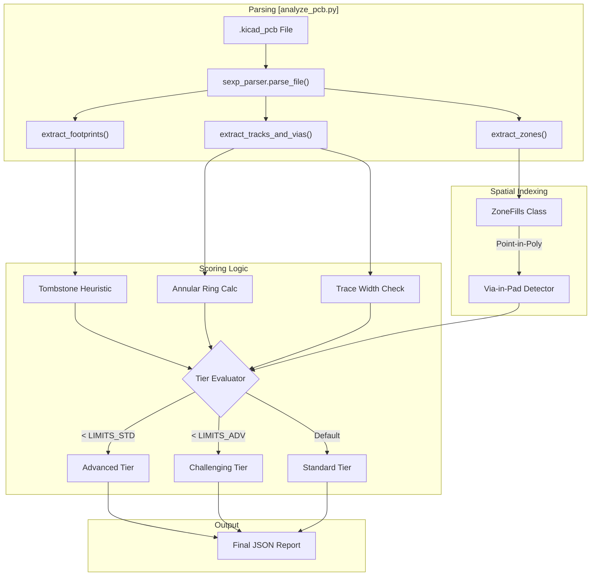
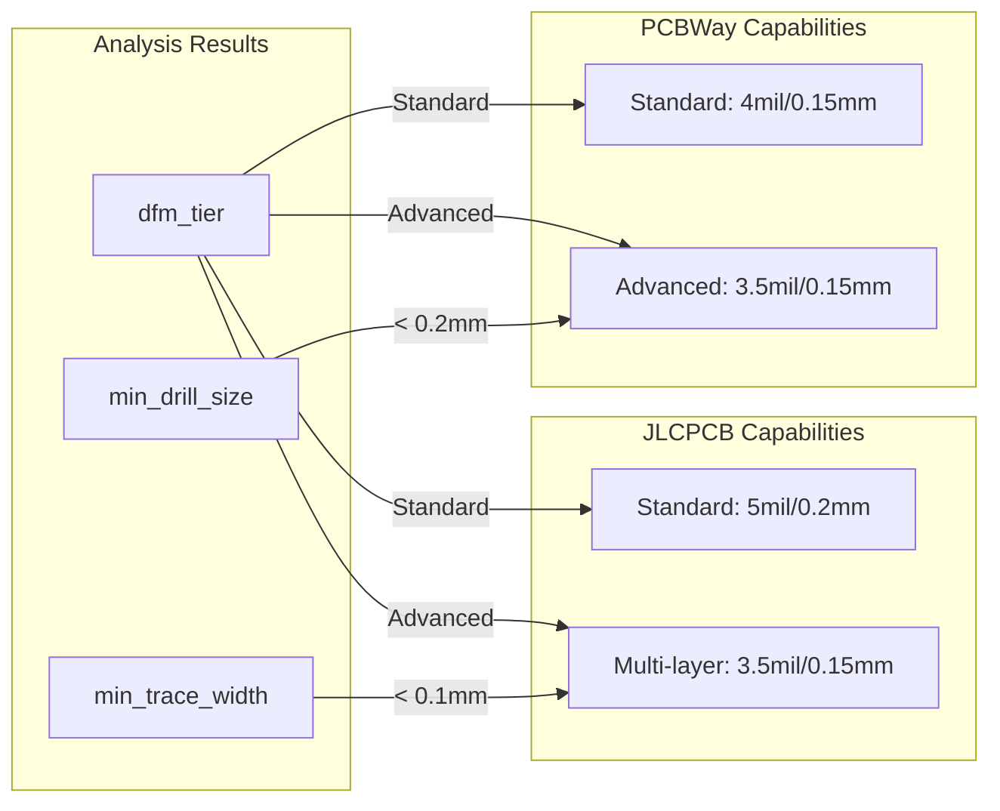

<!-- source: DeepWiki mcp.deepwiki.com · repo aklofas/kicad-happy · extra page DFM Scoring and Manufacturing Checks · fetched 2026-10-27 -->

# DFM Scoring and Manufacturing Checks

Relevant source files

The following files were used as context for generating this wiki page:

- [skills/jlcpcb/SKILL.md](skills/jlcpcb/SKILL.md)
- [skills/kicad/references/file-formats.md](skills/kicad/references/file-formats.md)
- [skills/kicad/references/gerber-parsing.md](skills/kicad/references/gerber-parsing.md)
- [skills/kicad/references/standards-compliance.md](skills/kicad/references/standards-compliance.md)
- [skills/kicad/scripts/analyze_pcb.py](skills/kicad/scripts/analyze_pcb.py)
- [skills/pcbway/SKILL.md](skills/pcbway/SKILL.md)

This page details the Design for Manufacturing (DFM) analysis pipeline implemented in `analyze_pcb.py`. The system evaluates KiCad PCB layouts against industry-standard fabrication limits and specific vendor capabilities (JLCPCB and PCBWay) to produce a tiered difficulty score and identify high-risk manufacturing defects.

## DFM Tier Classification

The analyzer classifies designs into three tiers based on the most aggressive feature found in the layout. This classification maps directly to fabrication costs and capability requirements at major quick-turn PCB houses.

| Tier | Description | Typical Constraints |
| :--- | :--- | :--- |
| **Standard** | High-yield, low-cost fabrication. | 0.15mm trace/space, 0.3mm drill. |
| **Advanced** | Requires precision equipment, higher cost. | 0.09mm trace/space, 0.15mm drill. |
| **Challenging** | Near-limit for standard fabs; high scrap risk. | <0.09mm features, micro-vias. |

### Implementation Constants
The thresholds for these tiers are defined as constants in `analyze_pcb.py`. The script compares extracted geometry against `LIMITS_STD` and `LIMITS_ADV` to determine the `dfm_tier`.

*   **`LIMITS_STD`**: Defines the boundary for "Standard" tier. If any measurement is smaller than these values, the board is promoted to "Advanced" `[skills/kicad/scripts/analyze_pcb.py:220-235]()`.
*   **`LIMITS_ADV`**: Defines the boundary for "Advanced" tier. Values smaller than these result in a "Challenging" classification `[skills/kicad/scripts/analyze_pcb.py:237-250]()`.

**Sources:** `[skills/kicad/scripts/analyze_pcb.py:220-250]()`, `[skills/jlcpcb/SKILL.md:77-102]()`, `[skills/pcbway/SKILL.md:80-105]()`.

---

## Technical Checks and Heuristics

The `analyze_pcb.py` script performs a single-pass extraction of the `.kicad_pcb` S-expression tree, calculating DFM metrics for every footprint and copper element.

### Tombstoning Risk Heuristic
The analyzer identifies small SMD components (typically 0402 and 0201) that have unbalanced copper connections. If one pad is connected to a large copper plane (high thermal mass) while the other is connected only to a thin trace (low thermal mass), the component is flagged for tombstoning risk during reflow.

*   **Logic**: The script checks if a component is an SMD resistor or capacitor and compares the `zone_connection` type and trace widths of its pads `[skills/kicad/scripts/analyze_pcb.py:1240-1285]()`.

### Via-in-Pad Detection
Via-in-pad (ViP) can cause solder wicking into the via barrel, leading to dry joints.
*   **Detection**: The `ZoneFills` class provides a spatial index `[skills/kicad/scripts/analyze_pcb.py:110-172]()`. The analyzer iterates through all `via` nodes and checks if their center coordinates fall within the bounding box and polygon of any SMD `pad` node `[skills/kicad/scripts/analyze_pcb.py:1410-1435]()`.

### Annular Ring and Drill Checks
The system verifies the "meat" of the via or through-hole pad remaining after drilling.
*   **Calculation**: `(Pad_Diameter - Drill_Diameter) / 2`.
*   **Standard**: IPC-2221A Table 9-1 specifies minimum annular rings for different classes `[skills/kicad/references/standards-compliance.md:158-190]()`. The script flags any ring below the `min_annular_ring` threshold defined in the DFM limits `[skills/kicad/scripts/analyze_pcb.py:1350-1375]()`.

### Edge Clearance
Copper-to-edge clearance is checked by comparing the coordinates of all `segment` and `zone` objects against the `Edge.Cuts` layer geometry.
*   **Implementation**: The script extracts the board bounding box from `gr_line` and `gr_arc` elements on the `Edge.Cuts` layer `[skills/kicad/scripts/analyze_pcb.py:310-345]()`. It then identifies any copper within 0.2mm of this boundary `[skills/kicad/scripts/analyze_pcb.py:1450-1480]()`.

**Sources:** `[skills/kicad/scripts/analyze_pcb.py:110-172]()`, `[skills/kicad/scripts/analyze_pcb.py:1240-1480]()`, `[skills/kicad/references/standards-compliance.md:158-190]()`.

---

## Data Flow: Extraction to Scoring

The following diagram illustrates how raw S-expression data is transformed into a DFM report.

### DFM Analysis Pipeline

**Sources:** `[skills/kicad/scripts/analyze_pcb.py:1-15]()`, `[skills/kicad/scripts/analyze_pcb.py:110-120]()`, `[skills/kicad/scripts/analyze_pcb.py:220-250]()`.

---

## Mapping to Fabrication Tiers

The results of the analysis are used to validate the design against specific vendor capabilities documented in the system.

### Fabrication Capability Mapping

### Summary of Vendor Limits
| Parameter | JLCPCB (1-2 Layer) | PCBWay (1-2 Layer) | kicad-happy `LIMITS_STD` |
| :--- | :--- | :--- | :--- |
| **Min Trace/Space** | 0.127mm (5mil) | 0.1mm (4mil) | 0.127mm |
| **Min Drill** | 0.2mm | 0.15mm | 0.2mm |
| **Min Annular Ring** | 0.125mm | 0.15mm | 0.15mm |

**Sources:** `[skills/jlcpcb/SKILL.md:77-102]()`, `[skills/pcbway/SKILL.md:80-105]()`, `[skills/kicad/scripts/analyze_pcb.py:220-235]()`.

---

