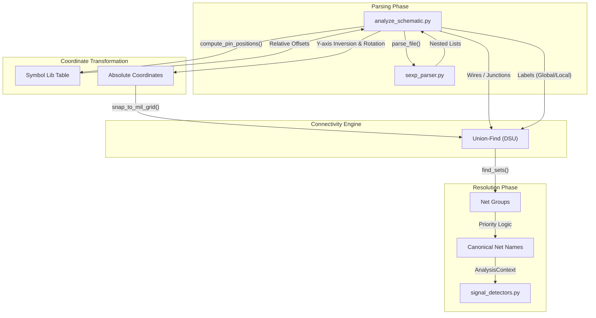
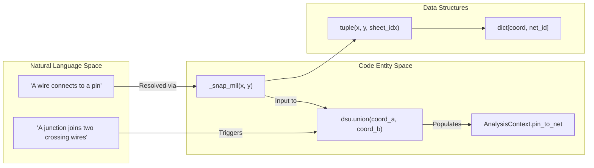

<!-- source: DeepWiki mcp.deepwiki.com · repo aklofas/kicad-happy · extra page Net Building and Connectivity Resolution · fetched 2026-10-27 -->

# Net Building and Connectivity Resolution

Relevant source files

The following files were used as context for generating this wiki page:

- [skills/kicad/references/manual-pcb-parsing.md](skills/kicad/references/manual-pcb-parsing.md)
- [skills/kicad/references/net-tracing.md](skills/kicad/references/net-tracing.md)
- [skills/kicad/scripts/analyze_schematic.py](skills/kicad/scripts/analyze_schematic.py)
- [skills/kicad/scripts/methodology_pcb.md](skills/kicad/scripts/methodology_pcb.md)
- [skills/kicad/scripts/methodology_schematic.md](skills/kicad/scripts/methodology_schematic.md)

This page details the technical implementation of the union-find algorithm and spatial resolution logic used to transform discrete S-expression elements (wires, pins, labels) into a coherent connectivity graph.

## Core Connectivity Logic

Connectivity in KiCad schematics is implicit, defined by the overlapping of coordinates rather than an explicit netlist. The analyzer resolves this by treating the schematic as a geometric graph where nodes are `(x, y)` coordinates and edges are wires or component pins.

### The Union-Find Algorithm
The `analyze_schematic.py` script uses a Disjoint Set Union (DSU) or "Union-Find" structure to group connected coordinates into nets.

1.  **Coordinate Snapping**: To account for floating-point inaccuracies, all coordinates are snapped to a 10-mil (0.254mm) grid using `_snap_mil` before being used as keys [skills/kicad/scripts/analyze_schematic.py:50-50]().
2.  **Sheet-Aware Keys**: Because the same coordinate (e.g., `0,0`) can exist on multiple hierarchical sheets, the internal key for the union-find structure is a tuple of `(x, y, sheet_index)` [skills/kicad/scripts/methodology_schematic.md:102-104]().
3.  **Edge Registration**:
    *   **Wires**: Every `(wire (pts (xy x1 y1) (xy x2 y2)))` block results in a `union((x1, y1, s), (x2, y2, s))` [skills/kicad/scripts/analyze_schematic.py:534-543]().
    *   **Pins**: Each component pin's absolute position is calculated. If a pin exists at `(px, py)`, it is unioned with any wire endpoint or junction at that exact location [skills/kicad/scripts/analyze_schematic.py:516-524]().
    *   **Junctions**: Explicit `(junction (at x y))` nodes allow wires that cross without sharing endpoints to connect [skills/kicad/scripts/analyze_schematic.py:554-558]().

### Spatial Resolution and Mid-Wire Detection
A common challenge in EDA parsing is "mid-wire" connections, where a pin or junction touches a wire segment but not its endpoints. `analyze_schematic.py` solves this using a spatial grid:

*   **Segment Intersection**: For every wire segment, the analyzer checks for pins or junctions that lie on the line between the start and end points [skills/kicad/scripts/analyze_schematic.py:545-552]().
*   **Bounding Box Pre-filtering**: To maintain performance, a spatial index (grid) is used to only check elements within the same local area [skills/kicad/scripts/analyze_schematic.py:540-544]().

**Sources:** [skills/kicad/scripts/analyze_schematic.py:510-560](), [skills/kicad/scripts/methodology_schematic.md:102-106]()

---

## Hierarchical and Multi-Instance Handling

KiCad supports complex hierarchies where a single `.kicad_sch` file may be instantiated multiple times.

### Sheet Scoping Rules
The analyzer respects KiCad's scoping rules for net names:
*   **Local Labels**: Scoped strictly to the `sheet_index`. If `NetA` exists on Sheet 1 and Sheet 2, they remain separate unless linked by a hierarchical pin [skills/kicad/scripts/analyze_schematic.py:570-580]().
*   **Global Labels**: Automatically unioned across all sheets regardless of `sheet_index` [skills/kicad/scripts/analyze_schematic.py:582-588]().
*   **Power Symbols**: Treated as global labels. A symbol with the `(power)` flag and value `VCC` connects to all other `VCC` power symbols in the project [skills/kicad/scripts/analyze_schematic.py:171-174](), [skills/kicad/scripts/analyze_schematic.py:590-595]().

### Multi-Instance Resolution
When a sheet is used multiple times (e.g., a 4-channel amplifier), the analyzer tracks the `instance_path` (a string of UUIDs). This allows it to:
1.  Map the correct unique Reference Designator (e.g., `R101` vs `R201`) to the same symbol in the sub-sheet file [skills/kicad/scripts/methodology_schematic.md:89-100]().
2.  Resolve "Hierarchical Labels" by connecting the internal net of an instance to the specific net on the parent sheet via the `(pin ...)` of the `(sheet ...)` block [skills/kicad/scripts/analyze_schematic.py:610-630]().

**Sources:** [skills/kicad/scripts/analyze_schematic.py:570-630](), [skills/kicad/scripts/methodology_schematic.md:76-106]()

---

## Net Name Priority and Resolution

Since a single connected graph might have multiple labels (e.g., a local label `SDA` and a global label `MCU_SDA`), the analyzer applies a priority heuristic to pick the "canonical" name for the JSON output.

| Priority | Type | Description |
| :--- | :--- | :--- |
| 1 (Highest) | **Global Label** | Explicitly named project-wide nets. |
| 2 | **Power Symbol** | Nets like `+5V` or `GND` derived from power symbols. |
| 3 | **Hierarchical Label** | Nets passing through sheet boundaries. |
| 4 | **Local Label** | User-defined names within a single sheet. |
| 5 (Lowest) | **Auto-generated** | Names like `Net-(R1-Pad1)` created by KiCad. |

**Sources:** [skills/kicad/scripts/analyze_schematic.py:640-660](), [skills/kicad/scripts/kicad_utils.py:45-47]()

---

## Implementation Diagrams

### Net Construction Data Flow
This diagram illustrates how the `analyze_schematic.py` orchestrator coordinates with `sexp_parser.py` and `kicad_utils.py` to build the connectivity graph.

**Sources:** [skills/kicad/scripts/analyze_schematic.py:101-160](), [skills/kicad/scripts/analyze_schematic.py:510-560](), [skills/kicad/scripts/methodology_schematic.md:15-34]()

### Coordinate Snapping and Junction Logic
The following diagram demonstrates the "Natural Language" concept of a connection vs. the "Code Entity" implementation of coordinate matching.

**Sources:** [skills/kicad/scripts/analyze_schematic.py:50-51](), [skills/kicad/scripts/analyze_schematic.py:510-524](), [skills/kicad/scripts/kicad_types.py:41-44]()

---

