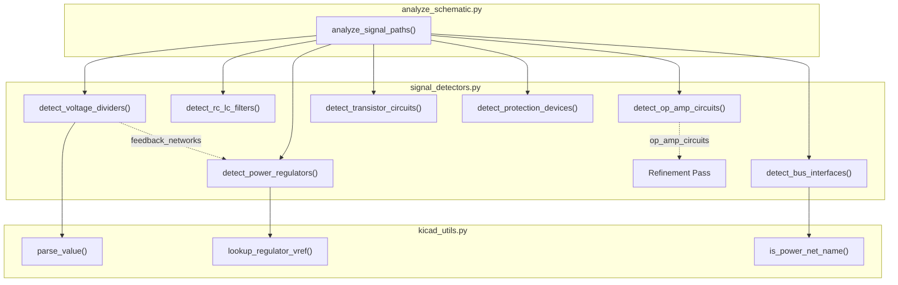
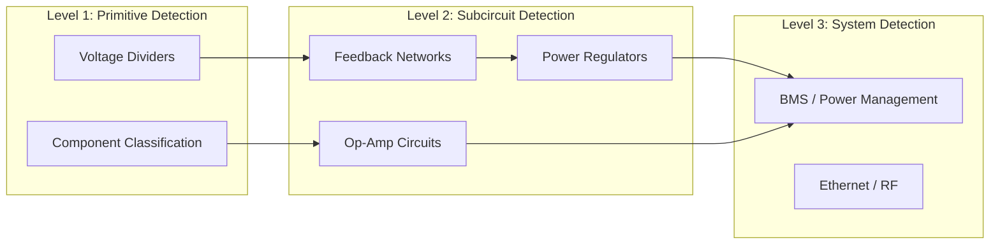

<!-- source: DeepWiki mcp.deepwiki.com · repo aklofas/kicad-happy · extra page Signal Path Detectors · fetched 2026-10-27 -->

# Signal Path Detectors

Relevant source files

The following files were used as context for generating this wiki page:

- [skills/kicad/scripts/analyze_schematic.py](skills/kicad/scripts/analyze_schematic.py)
- [skills/kicad/scripts/sexp_parser.py](skills/kicad/scripts/sexp_parser.py)
- [skills/kicad/scripts/signal_detectors.py](skills/kicad/scripts/signal_detectors.py)

The Signal Path Detectors are a suite of 21 specialized heuristic engines located in `signal_detectors.py`. Their purpose is to transform a raw netlist and component inventory into a high-level functional understanding of the circuit. By identifying common subcircuits (like voltage dividers, filters, and communication buses), the system can perform "semantic" design reviews, such as checking if a feedback divider ratio matches a regulator's target voltage.

### Detection Architecture

Detectors operate on an `AnalysisContext` object, which provides a unified view of the schematic's connectivity (via a union-find net graph) and component properties.

#### Code Entity Map: Detection Pipeline
The following diagram illustrates how the `analyze_schematic.py` script coordinates the various detector functions within `signal_detectors.py`.

**Signal Path Extraction Flow**

**Sources:** `[skills/kicad/scripts/signal_detectors.py:1-22]()`, `[skills/kicad/scripts/analyze_schematic.py:26-52]()`

---

### Core Detectors

#### 1. Voltage Dividers and Feedback Networks
The `detect_voltage_dividers` function identifies two resistors in series between different nets. It distinguishes between general-purpose dividers and feedback networks used in power supplies.

*   **Logic:** It indexes resistors by net to find pairs sharing a single "mid-point" net `[skills/kicad/scripts/signal_detectors.py:124-135]()`.
*   **False-Positive Prevention:** If the mid-point net has more than 4 connections, it is rejected as a power bus rather than a signal divider `[skills/kicad/scripts/signal_detectors.py:163-168]()`.
*   **Feedback Detection:** If the mid-point connects to a pin named "FB", "VFB", or "ADJ", it is categorized as a feedback network `[skills/kicad/scripts/signal_detectors.py:202-215]()`.

#### 2. RC and LC Filters
The `detect_rc_lc_filters` function identifies low-pass, high-pass, and band-pass structures.

| Filter Type | Topology | Implementation |
| :--- | :--- | :--- |
| **RC Low Pass** | Series R, Shunt C to GND | `[skills/kicad/scripts/signal_detectors.py:314-325]()` |
| **RC High Pass** | Series C, Shunt R to GND | `[skills/kicad/scripts/signal_detectors.py:330-341]()` |
| **LC Filter** | Series L, Shunt C to GND | `[skills/kicad/scripts/signal_detectors.py:343-354]()` |

The detector calculates the cutoff frequency ($f_c = \frac{1}{2\pi RC}$) and includes it in the JSON output `[skills/kicad/scripts/signal_detectors.py:321-323]()`.

#### 3. Power Regulators
The `detect_power_regulators` function identifies LDOs and DC/DC converters. It attempts to determine the output voltage by looking up the internal reference voltage ($V_{ref}$) of the part and combining it with detected feedback dividers `[skills/kicad/scripts/signal_detectors.py:410-445]()`.

**Sources:** `[skills/kicad/scripts/signal_detectors.py:111-450]()`

---

### Active Circuit Detectors

#### Op-Amp and Transistor Circuits
These detectors analyze the local neighborhood of active components to determine their configuration.

*   **Op-Amps:** Detects Inverting, Non-Inverting, and Buffer (Follower) configurations by checking the connectivity between the output pin and the inverting input `[skills/kicad/scripts/signal_detectors.py:460-520]()`.
*   **Transistors:** Identifies BJT and MOSFET switches. It uses `_classify_load` to determine if the transistor is driving an "inductive", "resistive", or "LED" load based on connected components or net name keywords like "MOTOR" or "HEATER" `[skills/kicad/scripts/signal_detectors.py:48-80]()`, `[skills/kicad/scripts/signal_detectors.py:580-640]()`.

#### Bus Detection (I2C/SPI/UART/CAN)
Bus detection relies on a combination of pin names (from library symbols) and net name pattern matching.

*   **I2C:** Looks for pairs of nets containing "SDA" and "SCL". It also checks for the presence of pull-up resistors on these nets `[skills/kicad/scripts/signal_detectors.py:750-780]()`.
*   **SPI:** Identifies groups of 3 or 4 nets containing "MOSI", "MISO", "SCK", and "CS/SS" `[skills/kicad/scripts/signal_detectors.py:790-820]()`.

**Sources:** `[skills/kicad/scripts/signal_detectors.py:455-850]()`

---

### Specialized Detectors

| Detector | Key Identification Pattern | Code Reference |
| :--- | :--- | :--- |
| **Crystal Circuits** | Crystal + two shunt capacitors to GND | `[skills/kicad/scripts/signal_detectors.py:920-960]()` |
| **Bridge Circuits** | 4 Diodes or 4 Resistors in a diamond topology | `[skills/kicad/scripts/signal_detectors.py:700-740]()` |
| **Current Sense** | Low-value shunt resistor + Diff Amp / IC | `[skills/kicad/scripts/signal_detectors.py:1050-1080]()` |
| **Ethernet** | Magnetics (transformers) + RJ45 + PHY | `[skills/kicad/scripts/signal_detectors.py:1150-1200]()` |
| **RF Chains** | Antennas, Baluns, and Matching Networks | `[skills/kicad/scripts/signal_detectors.py:1210-1250]()` |

### Dependency and Data Flow
The detection process is not entirely flat; some detectors depend on the output of others.

**Data Dependency Graph**

**Sources:** `[skills/kicad/scripts/signal_detectors.py:1-40]()`, `[skills/kicad/scripts/analyze_schematic.py:1550-1600]()`

### False-Positive Prevention
To maintain accuracy, detectors use several "rejection" heuristics:
1.  **High-Fanout Nets:** Nets with many connections (e.g., >10) are usually ignored by signal detectors to avoid treating global control lines as local signal paths `[skills/kicad/scripts/kicad_utils.py:44-51]()`.
2.  **Power/Ground Exclusion:** Detectors like `detect_voltage_dividers` explicitly check `is_power_net_name` to ensure they aren't misidentifying decoupling capacitors or power indicators as signal components `[skills/kicad/scripts/signal_detectors.py:163-170]()`.
3.  **Value Sanitization:** `parse_value` is used to ensure components have realistic values (e.g., rejecting 0-ohm resistors in divider calculations) `[skills/kicad/scripts/signal_detectors.py:180-185]()`.

**Sources:** `[skills/kicad/scripts/signal_detectors.py:1-1250]()`, `[skills/kicad/scripts/kicad_utils.py:1-100]()`

---

