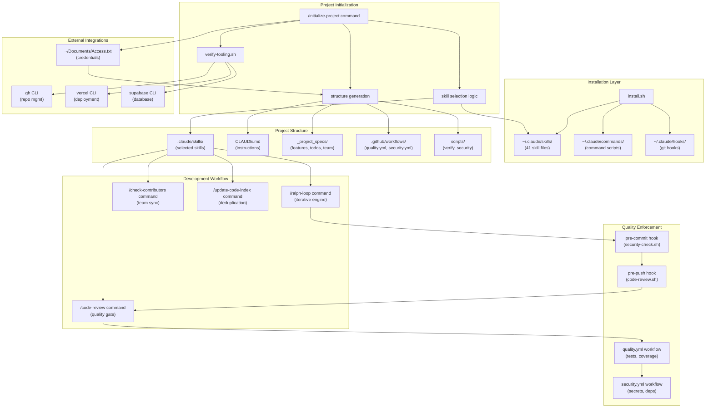
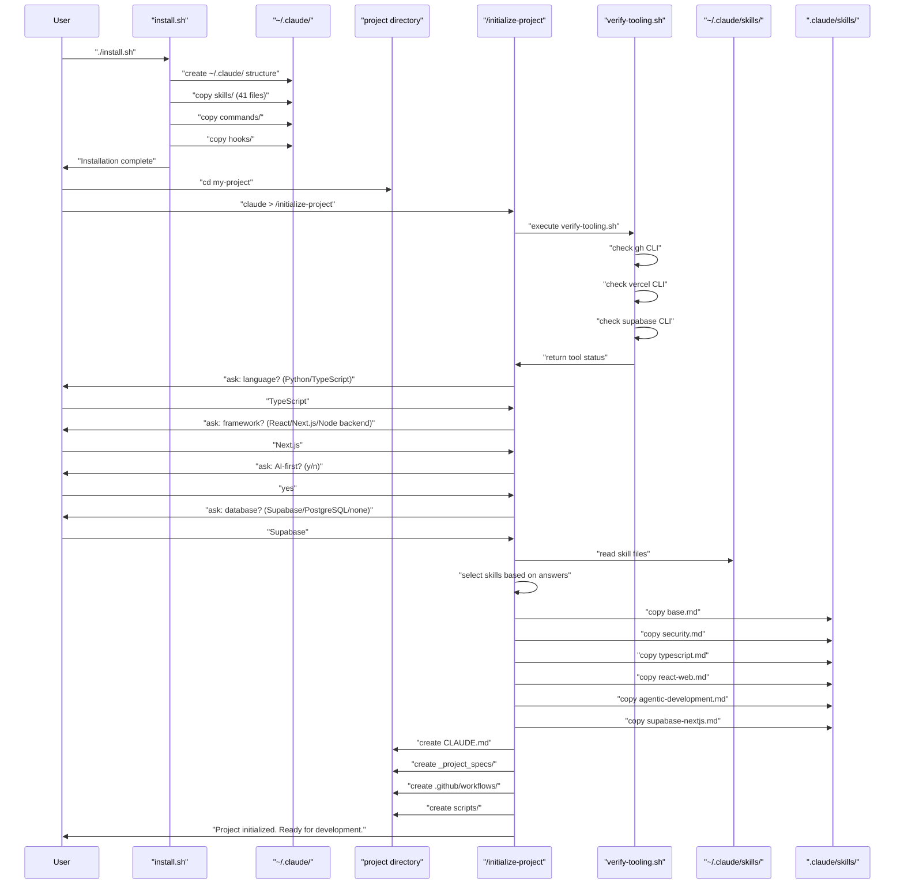
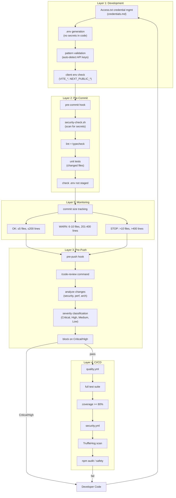
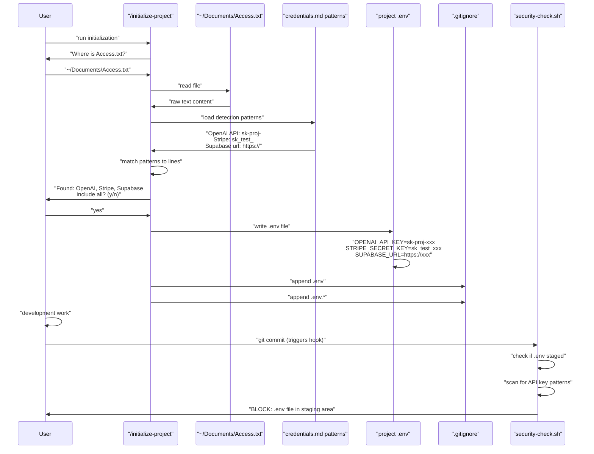
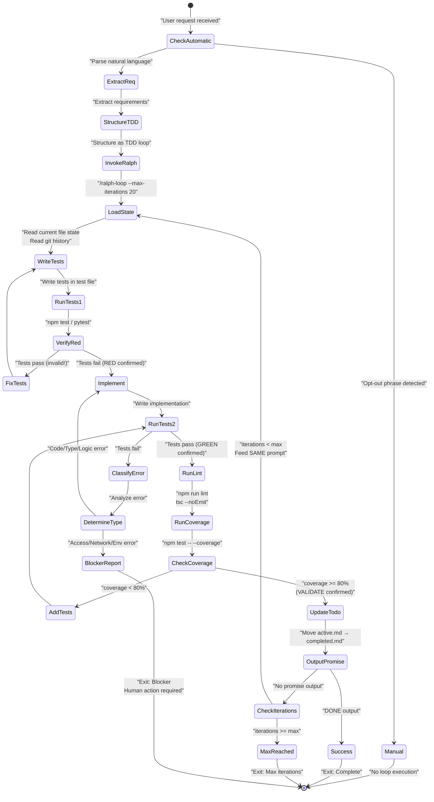
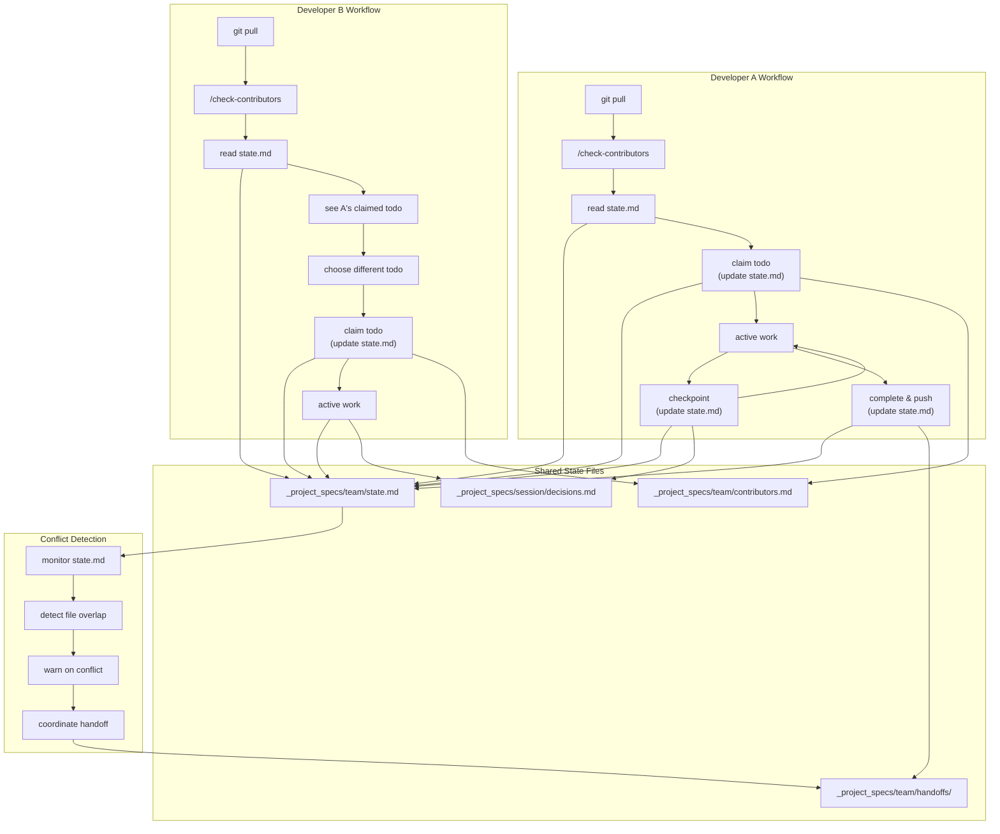

<!-- source: DeepWiki mcp.deepwiki.com · repo alinaqi/claude-bootstrap · page 1 Overview · fetched 2026-10-27 -->

# Overview

<details>
<summary>Relevant source files</summary>

The following files were used as context for generating this wiki page:

- [README.md](README.md)

</details>


## Purpose and Scope

This document provides a comprehensive overview of Claude Bootstrap, an AI-native development system designed to add TDD-first guardrails to Claude Code. It explains the system architecture, core components, and how they interact to enable iterative, quality-enforced development workflows.

For detailed information about specific subsystems:
- Installation and setup procedures: see [Installation](#2.1)
- TDD workflow mechanics: see [TDD Workflow](#3.2)
- Ralph loop iteration engine: see [Ralph Loop](#4.1)
- Skills system details: see [Skills Architecture](#5.1)
- Team coordination features: see [Multi-Developer Coordination](#8.1)

**Sources:** [README.md:1-50]()

---

## What is Claude Bootstrap?

Claude Bootstrap is a project initialization and development workflow system that transforms Claude Code from a powerful but unpredictable tool into a structured, quality-enforced development environment. It addresses a fundamental challenge: **AI can generate infinite code, but humans still need to comprehend, review, and maintain it.**

The system implements three core mechanisms:

1. **Mandatory TDD** - Tests must fail before implementation proves they validate requirements
2. **Iterative Loops** - Self-referential refinement cycles continue until quality gates pass
3. **Complexity Constraints** - Hard limits (20 lines/function, 200 lines/file) prevent unmaintainable code

These guardrails are encoded as a modular skills system that adapts to project type (web, mobile, backend, AI-native) while maintaining consistent development patterns.

**Sources:** [README.md:1-50]()

---

## System Architecture

The following diagram shows the complete system architecture from installation through deployment, using actual file and directory names from the codebase.

### Architecture Overview



**Sources:** [README.md:52-70](), [README.md:296-317]()

---

## Installation to Initialization Flow

This diagram shows the exact sequence from running `install.sh` to having a fully initialized project, using actual file paths and command names.

### Installation Flow



**Sources:** [README.md:52-70](), [README.md:296-317]()

---

## Core Skills Loading System

This diagram shows how the modular skills system loads different skill files based on project configuration, using actual skill file names.

### Skills Selection Logic

```mermaid
graph TB
    subgraph "Always Loaded (Core)"
        BASE["base.md"]
        SECURITY["security.md"]
        CREDENTIALS["credentials.md"]
        SESSION["session-management.md"]
        CODE_REVIEW_SKILL["code-review.md"]
        COMMIT_HYG["commit-hygiene.md"]
        DEDUP["code-deduplication.md"]
        TEAM_COORD["team-coordination.md"]
        ITER_DEV["iterative-development.md"]
        PROJECT_TOOL["project-tooling.md"]
    end
    
    subgraph "Language Selection"
        LANG_Q{"Language?"}
        PYTHON["python.md"]
        TYPESCRIPT["typescript.md"]
    end
    
    subgraph "Framework Selection"
        FW_Q{"Framework?"}
        REACT_WEB["react-web.md"]
        REACT_NATIVE["react-native.md"]
        NODEJS_BACKEND["nodejs-backend.md"]
        FASTAPI["fastapi.md"]
    end
    
    subgraph "Database Selection"
        DB_Q{"Database?"}
        SUPABASE["supabase.md"]
        SUPABASE_NEXTJS["supabase-nextjs.md"]
        SUPABASE_PYTHON["supabase-python.md"]
        SUPABASE_NODE["supabase-node.md"]
        DB_SCHEMA["database-schema.md"]
    end
    
    subgraph "UI Selection"
        UI_Q{"UI Platform?"}
        UI_WEB["ui-web.md"]
        UI_MOBILE["ui-mobile.md"]
        UI_TESTING["ui-testing.md"]
        PLAYWRIGHT["playwright-testing.md"]
        USER_JOURNEYS["user-journeys.md"]
        PWA["pwa-development.md"]
    end
    
    subgraph "AI Selection"
        AI_Q{"AI-First?"}
        AGENTIC["agentic-development.md"]
        LLM_PATTERNS["llm-patterns.md"]
        AI_MODELS["ai-models.md"]
    end
    
    subgraph "Integration Selection"
        INT_Q{"Integrations?"}
        WEB_PAYMENTS["web-payments.md"]
        POSTHOG["posthog-analytics.md"]
        REDDIT_API["reddit-api.md"]
        REDDIT_ADS["reddit-ads.md"]
        SHOPIFY["shopify-apps.md"]
        WOOCOMMERCE["woocommerce.md"]
        MEDUSA["medusa.md"]
        KLAVIYO["klaviyo.md"]
        MS_TEAMS["ms-teams-apps.md"]
        WEB_CONTENT["web-content.md"]
        AEO["aeo-optimization.md"]
        SITE_ARCH["site-architecture.md"]
    end
    
    subgraph "Destination"
        DEST[".claude/skills/<br/>(project copy)"]
    end
    
    LANG_Q -->|"Python"| PYTHON
    LANG_Q -->|"TypeScript"| TYPESCRIPT
    
    FW_Q -->|"React"| REACT_WEB
    FW_Q -->|"React Native"| REACT_NATIVE
    FW_Q -->|"Node backend"| NODEJS_BACKEND
    FW_Q -->|"FastAPI"| FASTAPI
    
    DB_Q -->|"Supabase + Next.js"| SUPABASE_NEXTJS
    DB_Q -->|"Supabase + Python"| SUPABASE_PYTHON
    DB_Q -->|"Supabase + Node"| SUPABASE_NODE
    DB_Q -->|"Any database"| DB_SCHEMA
    DB_Q --> SUPABASE
    
    UI_Q -->|"Web"| UI_WEB
    UI_Q -->|"Mobile"| UI_MOBILE
    UI_Q -->|"E2E Testing"| PLAYWRIGHT
    UI_Q --> UI_TESTING
    UI_Q --> USER_JOURNEYS
    UI_Q -->|"PWA"| PWA
    
    AI_Q -->|"Yes"| AGENTIC
    AI_Q -->|"Yes"| LLM_PATTERNS
    AI_Q -->|"Yes"| AI_MODELS
    
    INT_Q -->|"Stripe"| WEB_PAYMENTS
    INT_Q -->|"PostHog"| POSTHOG
    INT_Q -->|"Reddit"| REDDIT_API
    INT_Q -->|"Reddit Ads"| REDDIT_ADS
    INT_Q -->|"Shopify"| SHOPIFY
    INT_Q -->|"WooCommerce"| WOOCOMMERCE
    INT_Q -->|"Medusa"| MEDUSA
    INT_Q -->|"Klaviyo"| KLAVIYO
    INT_Q -->|"Teams"| MS_TEAMS
    INT_Q -->|"SEO"| WEB_CONTENT
    INT_Q -->|"SEO"| AEO
    INT_Q -->|"SEO"| SITE_ARCH
    
    BASE --> DEST
    SECURITY --> DEST
    CREDENTIALS --> DEST
    SESSION --> DEST
    CODE_REVIEW_SKILL --> DEST
    COMMIT_HYG --> DEST
    DEDUP --> DEST
    TEAM_COORD --> DEST
    ITER_DEV --> DEST
    PROJECT_TOOL --> DEST
    
    PYTHON --> DEST
    TYPESCRIPT --> DEST
    REACT_WEB --> DEST
    REACT_NATIVE --> DEST
    NODEJS_BACKEND --> DEST
    FASTAPI --> DEST
    SUPABASE --> DEST
    SUPABASE_NEXTJS --> DEST
    SUPABASE_PYTHON --> DEST
    SUPABASE_NODE --> DEST
    DB_SCHEMA --> DEST
    UI_WEB --> DEST
    UI_MOBILE --> DEST
    UI_TESTING --> DEST
    PLAYWRIGHT --> DEST
    USER_JOURNEYS --> DEST
    PWA --> DEST
    AGENTIC --> DEST
    LLM_PATTERNS --> DEST
    AI_MODELS --> DEST
    WEB_PAYMENTS --> DEST
    POSTHOG --> DEST
    REDDIT_API --> DEST
    REDDIT_ADS --> DEST
    SHOPIFY --> DEST
    WOOCOMMERCE --> DEST
    MEDUSA --> DEST
    KLAVIYO --> DEST
    MS_TEAMS --> DEST
    WEB_CONTENT --> DEST
    AEO --> DEST
    SITE_ARCH --> DEST
```



**Sources:** [README.md:396-466]()

---

## Development Workflow Pipeline

This diagram illustrates the complete development flow from feature specification to deployment, showing actual commands and file locations.

### End-to-End Development Flow

```mermaid
graph LR
    subgraph "Specification Phase"
        SPEC_CREATE["Create feature spec<br/>_project_specs/features/"]
        TODO_CREATE["Break into todos<br/>_project_specs/todos/active.md"]
    end
    
    subgraph "Implementation Phase"
        RALPH_EXEC["/ralph-loop<br/>(auto or manual)"]
        TDD_RED["RED: Write failing tests"]
        TDD_GREEN["GREEN: Implement minimum"]
        TDD_VALIDATE["VALIDATE: lint + types + coverage"]
        TODO_MOVE["Move to completed<br/>active.md → completed.md"]
    end
    
    subgraph "Pre-Commit Phase"
        GIT_ADD["git add ."]
        PREHOOK_EXEC["pre-commit hook<br/>scripts/security-check.sh"]
        LINT_CHECK["lint + typecheck"]
        UNIT_TESTS["unit tests (changed files)"]
        SECRET_SCAN["secret scanning"]
    end
    
    subgraph "Pre-Push Phase"
        GIT_COMMIT["git commit -m '...'"]
        SIZE_CHECK["commit size tracking<br/>(commit-hygiene.md)"]
        GIT_PUSH["git push"]
        PUSHOOK_EXEC["pre-push hook<br/>scripts/code-review.sh"]
        REVIEW_EXEC["/code-review"]
        SEVERITY_CHECK["severity check<br/>(Critical/High = block)"]
    end
    
    subgraph "CI/CD Phase"
        GH_ACTIONS["GitHub Actions trigger"]
        QUALITY_WF["quality.yml workflow"]
        FULL_TESTS["full test suite"]
        COVERAGE_CHECK["coverage >= 80%"]
        SECURITY_WF["security.yml workflow"]
        TRUFFLEHOG["TruffleHog secret scan"]
        DEP_AUDIT["npm audit / safety"]
    end
    
    subgraph "Deployment Phase"
        MERGE["merge to main"]
        VERCEL_DEPLOY["vercel deploy"]
        SUPABASE_MIG["supabase db push"]
        PRODUCTION["production"]
    end
    
    SPEC_CREATE --> TODO_CREATE
    TODO_CREATE --> RALPH_EXEC
    
    RALPH_EXEC --> TDD_RED
    TDD_RED --> TDD_GREEN
    TDD_GREEN --> TDD_VALIDATE
    TDD_VALIDATE --> TODO_MOVE
    TODO_MOVE --> GIT_ADD
    
    GIT_ADD --> PREHOOK_EXEC
    PREHOOK_EXEC --> LINT_CHECK
    LINT_CHECK --> UNIT_TESTS
    UNIT_TESTS --> SECRET_SCAN
    SECRET_SCAN --> GIT_COMMIT
    
    GIT_COMMIT --> SIZE_CHECK
    SIZE_CHECK --> GIT_PUSH
    GIT_PUSH --> PUSHOOK_EXEC
    PUSHOOK_EXEC --> REVIEW_EXEC
    REVIEW_EXEC --> SEVERITY_CHECK
    SEVERITY_CHECK --> GH_ACTIONS
    
    GH_ACTIONS --> QUALITY_WF
    QUALITY_WF --> FULL_TESTS
    FULL_TESTS --> COVERAGE_CHECK
    COVERAGE_CHECK --> SECURITY_WF
    SECURITY_WF --> TRUFFLEHOG
    TRUFFLEHOG --> DEP_AUDIT
    DEP_AUDIT --> MERGE
    
    MERGE --> VERCEL_DEPLOY
    MERGE --> SUPABASE_MIG
    VERCEL_DEPLOY --> PRODUCTION
    SUPABASE_MIG --> PRODUCTION
    
    TDD_VALIDATE -->|"tests fail"| TDD_RED
    SEVERITY_CHECK -->|"Critical/High"| TDD_RED
    DEP_AUDIT -->|"fail"| TDD_RED
```



**Sources:** [README.md:71-100](), [README.md:176-210](), [README.md:516-530]()

---

## Project File Structure

When `/initialize-project` completes, it creates the following directory structure with specific files:

### Generated Directory Structure

| Path | Purpose | Created By |
|------|---------|------------|
| `.claude/skills/` | Project-specific skill files copied from `~/.claude/skills/` | `/initialize-project` |
| `.claude/skills/base.md` | Core TDD patterns, simplicity rules, atomic todos | Always copied |
| `.claude/skills/security.md` | OWASP patterns, secrets management | Always copied |
| `.claude/skills/credentials.md` | Access.txt integration, .env generation | Always copied |
| `.claude/skills/[language].md` | Language-specific patterns (python.md or typescript.md) | Based on selection |
| `.claude/skills/[framework].md` | Framework patterns (react-web.md, fastapi.md, etc.) | Based on selection |
| `CLAUDE.md` | Master instruction file for Claude Code | `/initialize-project` |
| `_project_specs/` | Specification and state management directory | `/initialize-project` |
| `_project_specs/overview.md` | Project vision and architecture | `/initialize-project` |
| `_project_specs/features/` | Feature specification files | `/initialize-project` |
| `_project_specs/todos/active.md` | Current work items with test cases | `/initialize-project` |
| `_project_specs/todos/completed.md` | Completed todos with TDD logs | Moved from active.md |
| `_project_specs/session/` | Session management files | Session work |
| `_project_specs/session/current-state.md` | Current session state | Session checkpoints |
| `_project_specs/session/decisions.md` | Architectural decisions | During development |
| `_project_specs/session/code-landmarks.md` | Key code locations | Session work |
| `_project_specs/team/` | Team coordination (multi-dev only) | `/check-contributors --team` |
| `_project_specs/team/state.md` | Active sessions, claimed todos, conflicts | Team updates |
| `_project_specs/team/contributors.md` | Team members, ownership areas | `/check-contributors --team` |
| `_project_specs/team/handoffs/` | Context transfer notes | Developer handoffs |
| `_project_specs/CODE_INDEX.md` | Semantic capability index | `/update-code-index` |
| `.github/workflows/quality.yml` | Lint, type-check, test with 80% coverage | `/initialize-project` |
| `.github/workflows/security.yml` | TruffleHog secret scan, dependency audit | `/initialize-project` |
| `scripts/verify-tooling.sh` | Validate gh, vercel, supabase CLIs | `/initialize-project` |
| `scripts/security-check.sh` | Pre-commit secret scanning | `/initialize-project` |
| `.husky/pre-commit` or `.git/hooks/pre-commit` | Runs security-check.sh, lint, unit tests | Hook installation |
| `.husky/pre-push` or `.git/hooks/pre-push` | Runs /code-review, blocks on Critical/High | Hook installation |

**Sources:** [README.md:296-317]()

---

## Command Reference

Claude Bootstrap provides five primary commands that drive the development workflow:

### Core Commands

| Command | Location | Purpose | When to Use |
|---------|----------|---------|-------------|
| `/initialize-project` | `~/.claude/commands/` | Initialize or update project structure, copy skills, create specs | New projects or skill updates |
| `/ralph-loop` | Plugin (ralph-loop@claude-plugins-official) | Execute iterative TDD cycles with stop-hook mechanism | Auto-invoked or manual for specific tasks |
| `/code-review` | `~/.claude/commands/` | Analyze changes for security, performance, architecture issues | Before every push (enforced by pre-push hook) |
| `/check-contributors` | `~/.claude/commands/` | Check team state, detect solo vs. team mode, convert projects | Start of each session, before claiming todos |
| `/update-code-index` | `~/.claude/commands/` | Regenerate CODE_INDEX.md semantic capability index | After significant code additions |
| `/cancel-ralph` | Plugin | Interrupt running ralph-loop iterations | When loop needs to be stopped |

**Sources:** [README.md:52-70](), [README.md:71-100](), [README.md:176-210](), [README.md:211-253](), [README.md:255-295]()

---

## Quality Enforcement Layers

The system implements five layers of quality enforcement, each with specific tools and mechanisms:

### Defense-in-Depth Quality Gates



**Sources:** [README.md:119-147](), [README.md:176-210](), [README.md:516-530]()

---

## Credentials Management Flow

The system uses centralized credentials management to prevent secrets from entering the codebase:

### Access.txt Integration



**Sources:** [README.md:358-379]()

---

## Ralph Loop Iterative Engine

The Ralph loop is the core automation engine. This diagram shows the actual command flow and file interactions:

### Ralph Loop Execution



**Sources:** [README.md:71-118](), [README.md:579-612]()

---

## Team Coordination System

For multi-developer projects, the system provides state management through `_project_specs/team/`:

### Team State Management



**Sources:** [README.md:211-253]()

---

## Complexity Constraints

The system enforces measurable complexity limits defined in `base.md`:

### Enforced Constraints

| Constraint | Limit | Enforcement Point | Violates? |
|------------|-------|-------------------|-----------|
| Lines per function | 20 max | Code review, manual check | Stop development, refactor immediately |
| Parameters per function | 3 max | Code review, manual check | Stop development, refactor immediately |
| Nesting depth | 2 levels max | Code review, manual check | Stop development, flatten logic |
| Lines per file | 200 max | Code review, manual check | Stop development, split file |
| Test coverage | 80% min | CI/CD quality.yml workflow | Block merge |
| Files per commit | 10 max (warning at 6) | commit-hygiene.md monitoring | Advisory at 6, strong warning at 10 |
| Lines changed per commit | 400 max (warning at 200) | commit-hygiene.md monitoring | Advisory at 200, strong warning at 400 |

**Protocol when limit exceeded:**
1. Development **stops immediately**
2. Refactor to meet constraint
3. Verify tests still pass
4. Resume development

**Sources:** [README.md:344-357](), [README.md:119-147]()

---

## Integration with External Tools

The system integrates with three primary CLIs validated during initialization:

### CLI Tool Integration

| Tool | Command | Validated By | Used For | Configuration File |
|------|---------|--------------|----------|-------------------|
| GitHub CLI | `gh` | `verify-tooling.sh` | Repository creation, PR management | `~/.config/gh/hosts.yml` |
| Vercel CLI | `vercel` | `verify-tooling.sh` | Deployment, environment variables | `.vercel/project.json` |
| Supabase CLI | `supabase` | `verify-tooling.sh` | Database migrations, Edge Functions | `supabase/config.toml` |

Additional integrations based on selected skills:

| Integration | Skill File | Configuration Method |
|-------------|-----------|---------------------|
| Stripe | `web-payments.md` | API keys from Access.txt → .env |
| PostHog | `posthog-analytics.md` | Project API key → .env |
| Reddit Ads | `reddit-ads.md` | OAuth credentials → .env |
| Klaviyo | `klaviyo.md` | Private API key → .env |
| WooCommerce | `woocommerce.md` | Consumer key/secret → .env |
| Medusa | `medusa.md` | Database URL → .env |

**Sources:** [README.md:497-513]()

---

## Session Management

The system preserves context across sessions using files in `_project_specs/session/`:

### Session Context Files

| File | Purpose | Updated When | Content Structure |
|------|---------|--------------|-------------------|
| `current-state.md` | Current session state, active work, next steps | Checkpoint triggers, end of work | What's done, what's in progress, blockers, next actions |
| `decisions.md` | Architectural decisions with rationale | Major design choices | Decision, context, alternatives considered, rationale |
| `code-landmarks.md` | Important code locations and patterns | New major components | File paths, key functions, patterns used |
| `CODE_INDEX.md` | Semantic capability index | `/update-code-index` | Organized by what code does, not where it lives |

**Checkpoint triggers:**
- Every 30 minutes of continuous work
- Before switching contexts
- At natural breakpoints (feature complete, tests passing)
- When complexity threshold approached

**Sources:** [README.md:255-295]()

---

## TDD Workflow Execution

Every feature and bug follows the RED-GREEN-VALIDATE pattern enforced by `base.md`:

### TDD Phase Execution

| Phase | Feature Development | Bug Fixing | Validation |
|-------|---------------------|------------|------------|
| **RED** | Write tests based on acceptance criteria | Write test that reproduces bug | Tests MUST fail |
| **GREEN** | Write minimum implementation | Fix the bug | Tests MUST pass |
| **VALIDATE** | Lint + TypeCheck + Coverage ≥80% | Lint + TypeCheck + Full suite | All checks MUST pass |

**Commands executed:**

```
# RED phase
npm test                                    # Must fail
pytest                                      # Must fail

# GREEN phase  
npm test                                    # Must pass
pytest                                      # Must pass

# VALIDATE phase
npm run lint && npm run typecheck          # Must pass
npm test -- --coverage                     # Must be ≥80%
```

**Anti-patterns prevented:**
- Tests written after implementation
- Bug fixes without new test
- Todos marked complete with failing tests
- Skipping validation phase

**Sources:** [README.md:320-343](), [README.md:531-578]()

---

## Key Design Decisions

### Why Stop Hooks Instead of Explicit Loops

The Ralph loop uses a "stop hook" mechanism that intercepts Claude's exit attempts. When Claude tries to finish, the system feeds the **identical prompt** back with updated file states visible. This creates a self-referential loop where Claude sees its own changes and continues refining until tests pass or completion criteria are met.

**Alternative considered:** Explicit loop command invocation requiring user to repeatedly run `/ralph-loop`.

**Rationale:** Stop hooks enable natural language interaction ("add email validation") without requiring users to understand loop mechanics.

### Why File-Based Team Coordination

Team coordination uses files (`state.md`, `contributors.md`) checked into git rather than external databases or services.

**Alternative considered:** Dedicated coordination service or database.

**Rationale:** 
- Zero infrastructure dependencies
- Works offline
- Visible in standard git workflow
- No additional authentication required
- Full audit trail through git history

### Why 80% Coverage Threshold

The system enforces minimum 80% test coverage in CI/CD.

**Alternative considered:** Lower thresholds (60-70%) or no enforcement.

**Rationale:**
- Industry data shows 80%+ correlates with significant defect reduction
- High enough to ensure critical paths tested
- Low enough to avoid diminishing returns
- Enforced at CI level, not local development

### Why Centralized Access.txt

All credentials stored in single file (e.g., `~/Documents/Access.txt`) with auto-detection.

**Alternative considered:** Per-project `.env.example` files, 1Password CLI, environment variables.

**Rationale:**
- Single source of truth for developer
- Pattern-based auto-detection reduces manual mapping
- Works across all projects without setup
- Still generates project-specific `.env`

**Sources:** [README.md:358-379]()

---

## System Boundaries and Limitations

### What Claude Bootstrap Does

- Provides TDD guardrails and iterative workflow automation
- Enforces complexity constraints and quality gates
- Manages credentials and security scanning
- Coordinates multi-developer work through shared state
- Adapts skills based on project type

### What Claude Bootstrap Does NOT Do

- Replace code review by humans (augments, doesn't replace)
- Guarantee bug-free code (reduces defects, doesn't eliminate)
- Make architectural decisions (enforces constraints, requires human judgment)
- Work without installed CLIs (requires gh, vercel, supabase)
- Support languages beyond Python/TypeScript (skill-limited)

### Known Edge Cases

- Ralph loop may hit max iterations on truly complex problems → requires human decomposition
- Multi-developer conflicts detected but not auto-resolved → requires human coordination  
- Secret detection is pattern-based → can have false positives/negatives
- Coverage threshold can be met with poor quality tests → requires code review

**Sources:** [README.md:615-695]()

---

## Related Documentation

For deeper understanding of specific subsystems:

- Installation and first-time setup: [Installation](#2.1)
- Project initialization walkthrough: [Initializing Your First Project](#2.2)
- TDD workflow mechanics: [TDD Workflow (RED-GREEN-VALIDATE)](#3.2)
- Ralph loop implementation details: [Ralph Loop: Iterative Development](#4.1)
- Skills system architecture: [Skills Architecture](#5.1)
- Security implementation: [Security Architecture](#6.1)
- Team features: [Multi-Developer Coordination](#8.1)
- Command reference: [Commands Reference](#9.1)
- Extending the system: [Extending Claude Bootstrap](#9.3)

**Sources:** [README.md:1-713]()

---

