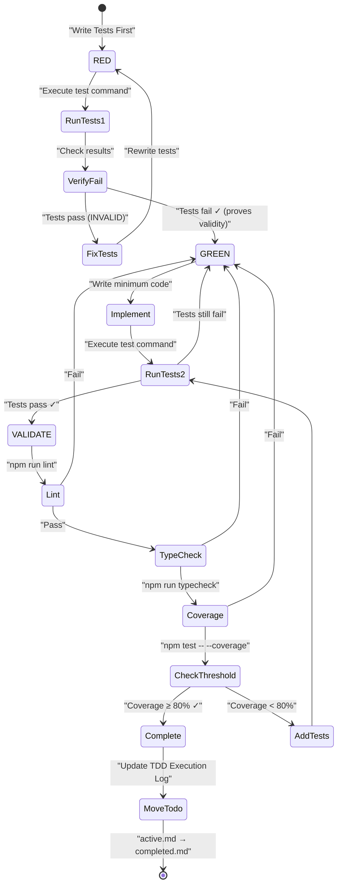
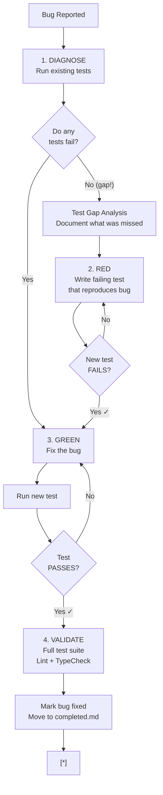
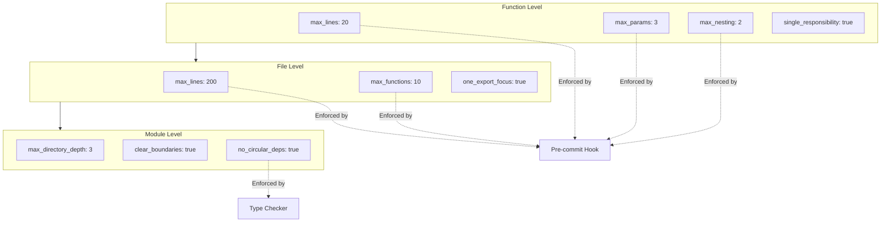
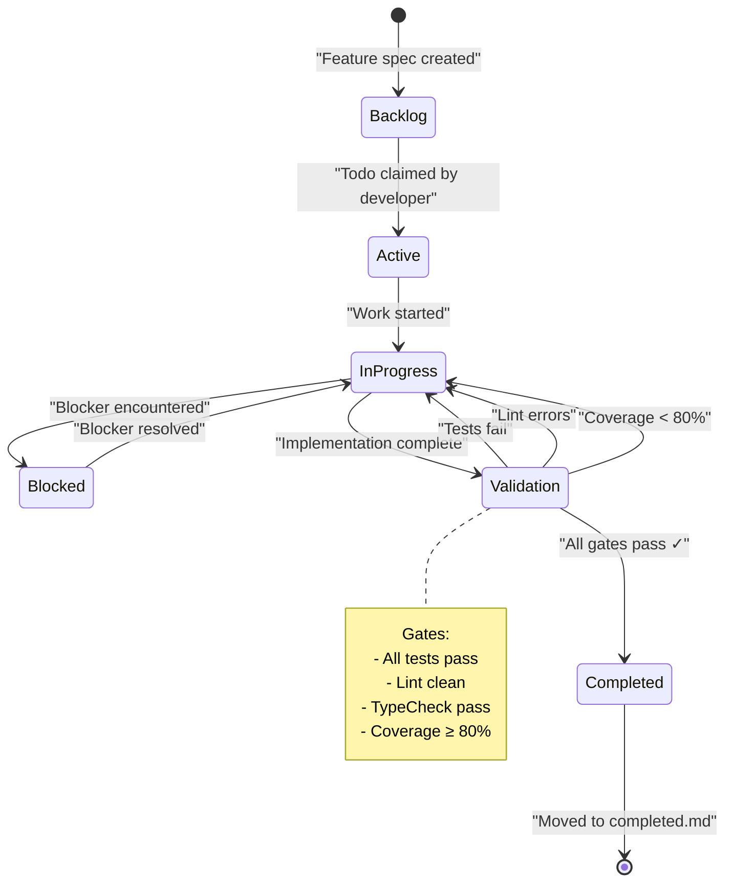
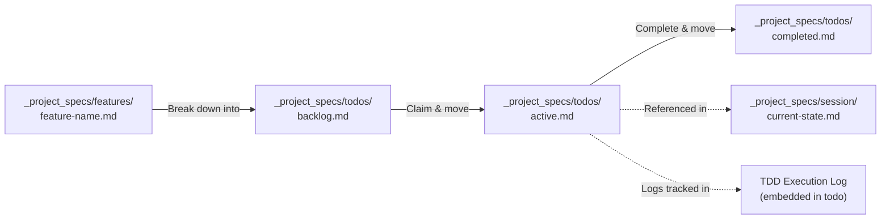
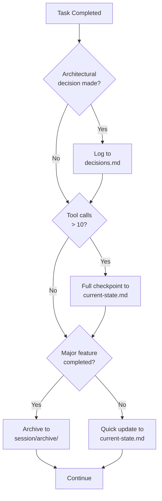
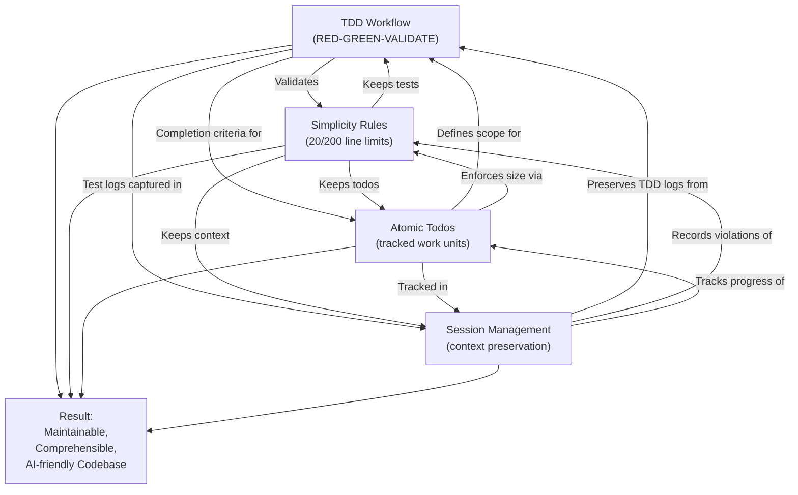

<!-- source: DeepWiki mcp.deepwiki.com · repo alinaqi/claude-bootstrap · page 3 Core Concepts · fetched 2026-10-27 -->

# Core Concepts

<details>
<summary>Relevant source files</summary>

The following files were used as context for generating this wiki page:

- [README.md](README.md)
- [skills/base.md](skills/base.md)
- [templates/CLAUDE.md](templates/CLAUDE.md)

</details>


This page introduces the fundamental principles that underpin Claude Bootstrap: **test-driven development as mandatory workflow**, **simplicity rules enforced at the file/function level**, **atomic work units tracked through todos**, and **session management for context preservation**. These four pillars work together to create an AI-native development system that keeps code comprehensible and verifiable.

For detailed implementation workflows, see [Development Workflow](#4). For specific skill modules that implement these concepts, see [Skills System](#5).

---

## The Four Pillars

Claude Bootstrap is built on four non-negotiable principles:

| Pillar | Enforcement Mechanism | Exit Condition |
|--------|----------------------|----------------|
| **TDD-First** | Tests must fail before implementation | All tests passing + 80% coverage |
| **Simplicity Limits** | Pre-commit validation blocks violations | ≤20 lines/function, ≤200 lines/file |
| **Atomic Todos** | Tracked in `_project_specs/todos/active.md` | Moved to `completed.md` after validation |
| **Session Context** | Checkpoint triggers preserve state | `current-state.md` updated after major tasks |

These principles address the fundamental problem: **AI can generate infinite code, but humans must comprehend it**. The bottleneck has shifted from generation to comprehension, and these guardrails keep complexity manageable.

**Sources:** [README.md:3-40](), [skills/base.md:1-10]()

---

## Test-Driven Development: RED-GREEN-VALIDATE

Every feature and bug fix follows a mandatory three-phase workflow. Tests are written first, must fail initially, then implementation makes them pass, followed by quality validation.

### TDD Workflow Diagram



### Phase Breakdown

| Phase | Commands (Node.js) | Commands (Python) | Exit Criteria |
|-------|-------------------|-------------------|---------------|
| **RED** | `npm test -- --grep "feature"` | `pytest -k "feature" -v` | All tests FAIL |
| **GREEN** | `npm test -- --grep "feature"` | `pytest -k "feature" -v` | All tests PASS |
| **VALIDATE** | `npm run lint && npm run typecheck && npm test -- --coverage` | `ruff check . && mypy . && pytest --cov --cov-fail-under=80` | Lint clean, types valid, coverage ≥80% |

**Why tests must fail first:** If tests pass immediately, they don't validate the requirement. For bug fixes, a passing test proves it wouldn't have caught the bug. The RED phase validates test validity before implementation begins.

**Sources:** [skills/base.md:186-214](), [skills/base.md:216-253](), [README.md:321-342]()

---

## TDD Execution Tracking

Every todo includes a `TDD Execution Log` table that documents each phase:

```markdown
### TDD Execution Log
| Phase | Command | Result | Timestamp |
|-------|---------|--------|-----------|
| RED | `npm test -- --grep "email validation"` | 5 tests failed ✓ | 2024-01-15 14:23 |
| GREEN | `npm test -- --grep "email validation"` | 5 tests passed ✓ | 2024-01-15 14:45 |
| VALIDATE | `npm run lint && npm run typecheck && npm test -- --coverage` | Pass, 84% ✓ | 2024-01-15 14:47 |
| COMPLETE | Moved to completed.md | ✓ | 2024-01-15 14:48 |
```

This provides an audit trail proving TDD workflow was followed.

**Sources:** [skills/base.md:172-178](), [skills/base.md:377-384]()

---

## Bug Fix Workflow: Test Gap Analysis

Bug fixes follow a specialized TDD workflow that identifies why existing tests didn't catch the issue:



### Test Gap Analysis Format

```markdown
### Test Gap Analysis
- Existing test coverage: `signup.test.ts` - only tested valid emails
- Gap identified: Missing test for email without domain
- New test needed: Add case for partial emails ("user@")
```

**Anti-patterns blocked:**
- ❌ Fixing bug without writing test first
- ❌ Writing test after fix (can't prove it catches bug)
- ❌ Skipping gap analysis (misses systemic issue)

**Sources:** [skills/base.md:272-297](), [skills/base.md:299-334]()

---

## Simplicity Rules: Hard Constraints

Complexity is measured through quantifiable limits enforced at every file modification. These are not guidelines—they are blocking conditions.

### Constraint Hierarchy Diagram



### Enforcement Protocol

Before completing ANY file, Claude must execute this check:

```markdown
1. Count total lines - if > 200, STOP and split
2. Count functions - if > 10, STOP and split
3. Check each function length - if any > 20 lines, STOP and decompose
4. Check parameter counts - if any > 3, STOP and refactor
```

If limits are exceeded, this blocking message appears:

```
⚠️ FILE SIZE VIOLATION DETECTED

src/auth/handlers.ts has 247 lines (limit: 200)

Splitting into:
- src/auth/handlers/login.ts - Login flow
- src/auth/handlers/signup.ts - Signup flow
- src/auth/handlers/password-reset.ts - Password reset
```

**Never defer refactoring.** The system stops and refactors immediately.

**Sources:** [skills/base.md:9-50](), [README.md:344-357]()

---

## Constraint Reference Table

| Constraint | Limit | Violation Action | Rationale |
|------------|-------|------------------|-----------|
| **Lines per function** | 20 max | Decompose immediately | Function should fit in viewport |
| **Parameters per function** | 3 max | Use options object or decompose | Reduces cognitive load |
| **Nesting depth** | 2 levels max | Flatten with early returns | Reduces complexity |
| **Lines per file** | 200 max | Split by responsibility | File should be comprehensible in one read |
| **Functions per file** | 10 max | Split by domain | Maintains focus |
| **Directory depth** | 3 levels max | Flatten structure | Easier navigation |
| **Test coverage** | 80% min | Block CI merge | Ensures validation |

**Sources:** [skills/base.md:13-23](), [README.md:349-357]()

---

## Atomic Work Units: The Todo System

All work is tracked as atomic todos in `_project_specs/todos/`. Each todo is self-contained, testable, and moves through a state machine from `active.md` to `completed.md`.

### Todo State Machine



### Todo File Structure Mapping



### Todo Format Structure

Every todo follows this mandatory format:

```markdown
## [TODO-042] Add email validation to signup form

**Status:** pending | in-progress | blocked | done
**Priority:** high | medium | low
**Estimate:** XS | S | M | L | XL

### Description
One paragraph describing what needs to be done.

### Acceptance Criteria
- [ ] Email field shows error for invalid format
- [ ] Form cannot submit with invalid email

### Test Cases
| Input | Expected Output | Notes |
|-------|-----------------|-------|
| user@example.com | Valid | Standard email |
| notanemail | Invalid, show error | No @ symbol |

### TDD Execution Log
| Phase | Command | Result | Timestamp |
|-------|---------|--------|-----------|
| RED | `npm test -- --grep "email validation"` | 5 tests failed ✓ | - |
| GREEN | `npm test -- --grep "email validation"` | 5 tests passed ✓ | - |
| VALIDATE | `npm run lint && npm test -- --coverage` | Pass, 84% ✓ | - |
```

**Key fields:**
- **Test Cases table**: Defines expected behavior before writing tests
- **TDD Execution Log**: Audit trail proving TDD was followed
- **Dependencies**: Links to blocking/blocked todos

**Sources:** [skills/base.md:138-178](), [skills/base.md:343-384](), [README.md:531-558]()

---

## Todo Rules and Sizing

| Rule | Description | Enforcement |
|------|-------------|-------------|
| **Atomic** | Single, completable unit of work | If requires "and" in description, split |
| **Testable** | Has validation criteria and test cases | Blocking condition for completion |
| **Sized** | Estimated as XS/S/M/L/XL | If > M, decompose into smaller todos |
| **Independent** | Minimize dependencies | Document in Dependencies section |
| **Tracked** | Moves through active.md → completed.md | Never delete, always move |

**Anti-patterns blocked:**
- ❌ Marking complete with failing tests
- ❌ Skipping TDD Execution Log
- ❌ Oversized todos (> M estimate)
- ❌ Deleting completed todos (lose history)

**Sources:** [skills/base.md:180-185](), [README.md:531-558]()

---

## Project Specs Directory Structure

The `_project_specs/` directory provides the organizational framework for all project context:

```
_project_specs/
├── overview.md              # Project vision and goals
├── features/                # Feature specifications
│   ├── feature-a.md
│   └── feature-b.md
├── todos/                   # Atomic work tracking
│   ├── active.md            # Current sprint/focus
│   ├── backlog.md           # Future work
│   └── completed.md         # Done items (reference)
├── session/                 # Session state
│   ├── current-state.md     # Live session context
│   ├── decisions.md         # Key decisions log
│   ├── code-landmarks.md    # Important code locations
│   └── archive/             # Past session summaries
├── team/                    # Multi-developer coordination
│   ├── state.md             # Active sessions, claimed todos
│   ├── contributors.md      # Team members, focus areas
│   └── handoffs/            # Context transfer notes
└── prompts/                 # LLM prompt specs (AI-first projects)
```

**Separation of concerns:**
- `docs/` directory: Technical code documentation (architecture, API reference)
- `_project_specs/` directory: Business requirements, features, work tracking
- `CLAUDE.md`: Claude-specific instructions and skill references

**Sources:** [skills/base.md:99-135](), [templates/CLAUDE.md:1-113]()

---

## Session Management and Context Preservation

Session management ensures Claude can resume work from any point with full context. The system uses tiered checkpointing based on work significance.

### Checkpoint Trigger Matrix



### Session Files and Their Roles

| File | Purpose | Update Frequency | Content Type |
|------|---------|------------------|--------------|
| `current-state.md` | Live session context | After every task | Current todos, recent changes, next steps |
| `decisions.md` | Architectural decisions log | On major decisions | Why choices were made, alternatives considered |
| `code-landmarks.md` | Important code locations | When structure changes | Key files, entry points, critical functions |
| `archive/*.md` | Historical sessions | On major feature completion | Archived session summaries |

**Session start protocol:**
1. Read `_project_specs/session/current-state.md`
2. Check `_project_specs/todos/active.md`
3. Review `decisions.md` for recent architectural choices
4. Continue from documented "Next Steps"

**Session end protocol:**
1. Archive current session if major feature complete
2. Update `current-state.md` with handoff notes
3. Ensure next steps are specific and actionable
4. Log any architectural decisions made

**Sources:** [skills/base.md:457-478](), [skills/base.md:118-122]()

---

## How the Four Pillars Work Together

The four core concepts form a reinforcing system where each pillar supports the others:



**Reinforcement examples:**

1. **TDD validates Simplicity**: Tests are easier to write for simple functions. If a function is hard to test, it's too complex—simplicity rules catch this before implementation.

2. **Simplicity keeps Todos atomic**: A 20-line function limit naturally constrains todo scope. Oversized todos violate simplicity rules during implementation, forcing decomposition.

3. **Atomic Todos define TDD scope**: Each todo's test cases table directly maps to the RED phase. The TDD Execution Log provides completion audit trail.

4. **Session Management captures all three**: `current-state.md` tracks active todos, `decisions.md` logs simplicity refactorings, TDD logs preserved for resumability.

**Why this matters for AI**: Large Language Models lose coherence as context grows. These four pillars keep the system within Claude's comprehension window—any engineer (or AI) can understand the entire system in one session.

**Sources:** [README.md:3-40](), [README.md:42-50](), [skills/base.md:1-10]()

---

## Default Behavior: Automatic Iterative TDD

With Claude Bootstrap skills loaded, Claude automatically transforms implementation requests into iterative TDD loops via the Ralph Wiggum system (see [Ralph Loop: Iterative Development](#4.1)).

### Auto-Invocation Rules

| User Request Type | Claude Action | Example |
|-------------------|---------------|---------|
| Feature implementation | Invoke `/ralph-loop` with TDD workflow | "Add email validation" → Auto-loop until tests pass |
| Bug fix | Invoke `/ralph-loop` with test gap analysis | "Fix login bug" → Find gap, write test, loop until fixed |
| Refactoring | Invoke `/ralph-loop` with test safety net | "Refactor auth module" → Loop with existing tests as guard |
| Explanation/question | Normal response (no loop) | "Explain how auth works" → Direct answer |
| One-line fix | Normal response (no loop) | "Fix typo in error message" → Direct fix |

### Opt-Out Phrases

Users can explicitly skip automatic loops:
- "Just explain..." → Explanation only
- "Quick fix..." → One-liner without loop
- "Don't loop..." → Explicit opt-out
- "Help me understand..." → Learning/discussion

**Sources:** [skills/base.md:499-579](), [templates/CLAUDE.md:10-62](), [README.md:71-100]()

---

## Integration with CLAUDE.md

Every project includes a `CLAUDE.md` file that configures Claude's default behavior:

```markdown
## Default Behavior: Automatic Iterative TDD

For any implementation task, automatically use Ralph Wiggum loops with TDD.

### Auto-Invoke Rules
When I ask you to implement something:
1. DO NOT just start coding
2. DO automatically invoke /ralph-loop with:
   - Requirements extracted from my request
   - TDD workflow (write failing tests first)
   - Clear completion criteria
   - --max-iterations 25
   - --completion-promise based on task
```

This file lives at the project root and is read by Claude on every session start.

**Sources:** [templates/CLAUDE.md:10-62]()

---

