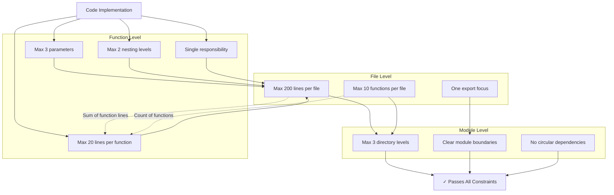
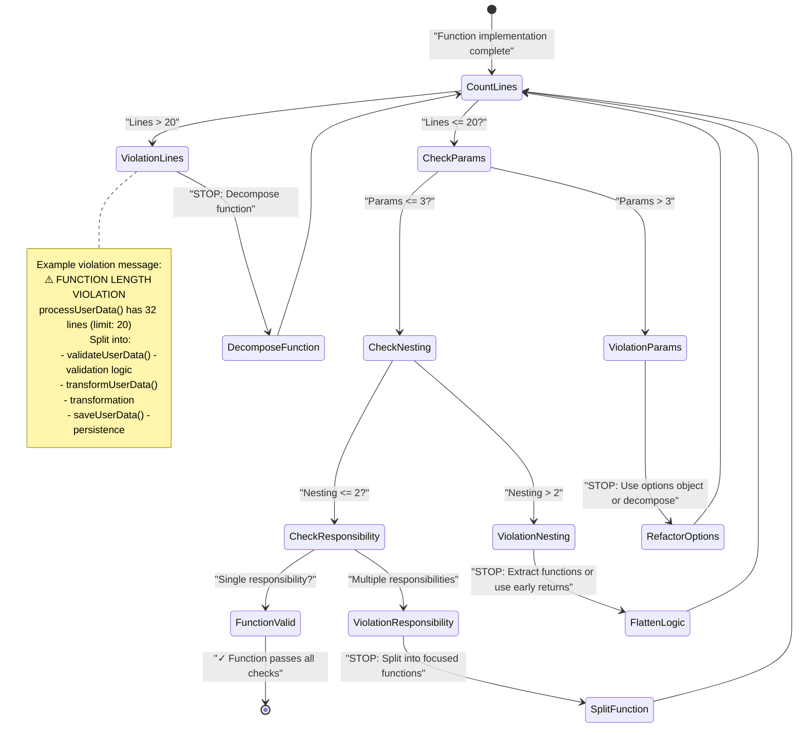
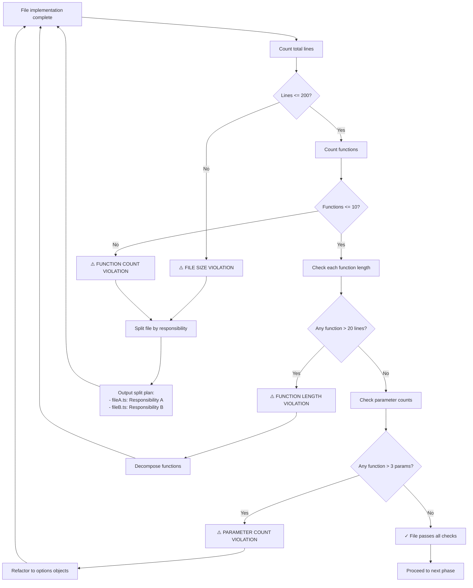
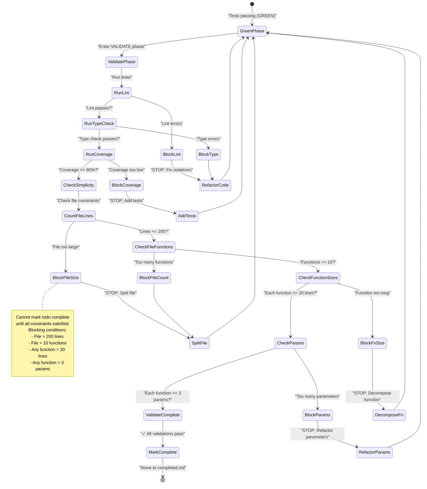
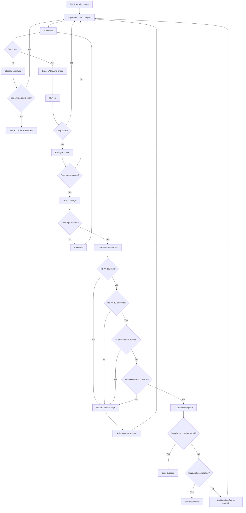
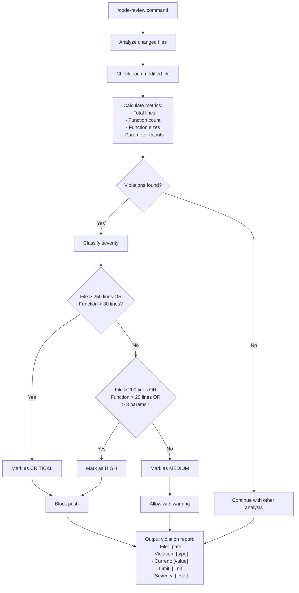

<!-- source: DeepWiki mcp.deepwiki.com · repo alinaqi/claude-bootstrap · page 3.3 Simplicity Rules and Enforcement · fetched 2026-10-27 -->

# Simplicity Rules and Enforcement

<details>
<summary>Relevant source files</summary>

The following files were used as context for generating this wiki page:

- [skills/base.md](skills/base.md)
- [templates/CLAUDE.md](templates/CLAUDE.md)

</details>


## Purpose and Scope

This document defines the strict complexity limits enforced throughout Claude Bootstrap and the mechanisms that automatically detect and block violations. These rules prevent technical debt accumulation by establishing hard boundaries on code size and structure. The enforcement protocol stops development when limits are exceeded, requiring immediate refactoring before work continues.

For the TDD workflow that invokes these rules during the VALIDATE phase, see [TDD Workflow (RED-GREEN-VALIDATE)](#3.2). For the Ralph loop's automatic enforcement during iterative development, see [Ralph Loop: Iterative Development](#4.1). For commit hygiene rules that complement these file-level constraints, see [Quality Gates and Code Review](#4.3).

---

## The Simplicity Hierarchy

Claude Bootstrap enforces complexity limits at three nested levels: function, file, and module. Each level has specific constraints that must be validated before code is considered complete.

### Three-Level Enforcement Model



**Sources:** [skills/base.md:9-29]()

---

## Function Level Constraints

Function-level rules ensure each unit of logic remains comprehensible and testable in isolation. These are the most frequently checked constraints during development.

### Constraint Definitions

| Constraint | Limit | Rationale |
|------------|-------|-----------|
| **Lines per function** | 20 maximum | Forces decomposition, keeps logic visible on one screen |
| **Parameters per function** | 3 maximum | High parameter counts indicate missing abstractions |
| **Nesting levels** | 2 maximum | Deep nesting creates cognitive load, flatten with early returns |
| **Responsibility** | Single | Each function does exactly one thing |
| **Documentation** | Names over comments | If a comment is needed to explain "what", rename the function |

### Function Constraint Enforcement



**Sources:** [skills/base.md:13-18]()

---

## File Level Constraints

File-level rules prevent god objects and maintain manageable cognitive load. These constraints are checked before any file is marked complete.

### Constraint Definitions

| Constraint | Limit | Rationale |
|------------|-------|-----------|
| **Lines per file** | 200 maximum | Keeps entire file visible without scrolling, forces modular design |
| **Functions per file** | 10 maximum | Prevents feature creep within single files |
| **Export focus** | One primary export | A file should have one clear purpose |

### File Size Enforcement Protocol

The enforcement protocol executes before completing any file, checking all constraints in sequence. Violations trigger immediate decomposition.



**Sources:** [skills/base.md:20-24](), [skills/base.md:30-49]()

---

## Module Level Constraints

Module-level rules maintain architectural clarity across the codebase, preventing deep hierarchies and circular dependencies.

### Constraint Definitions

| Constraint | Limit | Rationale |
|------------|-------|-----------|
| **Directory nesting** | 3 levels maximum | Flat structures are easier to navigate, deep nesting indicates over-engineering |
| **Module boundaries** | Single public interface | Each module exposes one clear API |
| **Circular dependencies** | None allowed | Circular imports create fragile, tightly-coupled systems |

### Example Directory Structure Validation

```
✓ VALID (2 levels):
project/
├── src/
│   ├── auth/          ← Level 1
│   │   ├── login.ts   ← Level 2
│   │   └── signup.ts
│   └── api/
│       ├── users.ts
│       └── posts.ts

✓ VALID (3 levels):
project/
├── src/
│   ├── features/       ← Level 1
│   │   ├── auth/       ← Level 2
│   │   │   ├── login.ts    ← Level 3
│   │   │   └── signup.ts
│   │   └── posts/
│   │       ├── create.ts
│   │       └── list.ts

❌ INVALID (4 levels):
project/
├── src/
│   ├── features/       ← Level 1
│   │   ├── user/       ← Level 2
│   │   │   ├── profile/    ← Level 3
│   │   │   │   ├── view.ts     ← Level 4 (TOO DEEP)
│   │   │   │   └── edit.ts
```

**Sources:** [skills/base.md:25-28]()

---

## Enforcement Protocol

The enforcement protocol defines when and how violations are detected, blocking development until resolved. This happens at multiple checkpoints throughout the development workflow.

### Enforcement Checkpoints

```mermaid
graph LR
    subgraph "Development Phase"
        WRITE["Write code"]
        SELF_CHECK["Developer self-check"]
    end
    
    subgraph "TDD VALIDATE Phase"
        LINT["Run linter"]
        TYPE["Run type checker"]
        TEST["Run tests + coverage"]
    end
    
    subgraph "Pre-Commit Hook"
        HOOK_LINT["Lint check"]
        HOOK_TYPE["Type check"]
        HOOK_TEST["Run unit tests"]
    end
    
    subgraph "Code Review"
        REVIEW_CMD["/code-review command"]
        ANALYZE["Analyze complexity"]
        SEVERITY["Severity classification"]
    end
    
    subgraph "CI/CD"
        CI_LINT["Full lint"]
        CI_TYPE["Full type check"]
        CI_TEST["Full test suite"]
        CI_COVERAGE["Coverage threshold"]
    end
    
    WRITE --> SELF_CHECK
    SELF_CHECK -.->|"Checkpoint 1"| CHECK1["Check file constraints"]
    
    SELF_CHECK --> LINT
    LINT --> TYPE
    TYPE --> TEST
    TEST -.->|"Checkpoint 2"| CHECK2["Validate phase enforcement"]
    
    TEST --> HOOK_LINT
    HOOK_LINT --> HOOK_TYPE
    HOOK_TYPE --> HOOK_TEST
    HOOK_TEST -.->|"Checkpoint 3"| CHECK3["Pre-commit enforcement"]
    
    HOOK_TEST --> REVIEW_CMD
    REVIEW_CMD --> ANALYZE
    ANALYZE --> SEVERITY
    SEVERITY -.->|"Checkpoint 4"| CHECK4["Code review enforcement"]
    
    SEVERITY --> CI_LINT
    CI_LINT --> CI_TYPE
    CI_TYPE --> CI_TEST
    CI_TEST --> CI_COVERAGE
    CI_COVERAGE -.->|"Checkpoint 5"| CHECK5["CI/CD enforcement"]
    
    CHECK1 -.->|Violation| BLOCK1["STOP: Refactor immediately"]
    CHECK2 -.->|Violation| BLOCK2["STOP: Fix before continue"]
    CHECK3 -.->|Violation| BLOCK3["STOP: Commit blocked"]
    CHECK4 -.->|Critical/High| BLOCK4["STOP: Push blocked"]
    CHECK5 -.->|Violation| BLOCK5["STOP: Merge blocked"]
    
    BLOCK1 --> WRITE
    BLOCK2 --> WRITE
    BLOCK3 --> WRITE
    BLOCK4 --> WRITE
    BLOCK5 --> WRITE
```



**Sources:** [skills/base.md:30-49](), [skills/base.md:487-492]()

---

## Violation Messages and Resolution

When violations are detected, the system outputs structured messages with clear remediation steps.

### File Size Violation Output Format

```
⚠️ FILE SIZE VIOLATION DETECTED

[filename].ts has [X] lines (limit: 200)

Splitting into:
- [filename-a].ts - [responsibility A description]
- [filename-b].ts - [responsibility B description]
```

### Function Length Violation Output Format

```
⚠️ FUNCTION LENGTH VIOLATION DETECTED

functionName() has [X] lines (limit: 20)

Decomposing into:
- validateInput() - input validation logic
- processData() - core processing
- formatOutput() - output formatting
```

### Parameter Count Violation Output Format

```
⚠️ PARAMETER COUNT VIOLATION DETECTED

functionName(a, b, c, d, e) has 5 parameters (limit: 3)

Refactor options:
1. Use options object: functionName({ a, b, c, d, e })
2. Decompose into smaller functions with fewer concerns
```

**Sources:** [skills/base.md:38-47]()

---

## Integration with TDD Workflow

Simplicity rules are checked during the VALIDATE phase of the RED-GREEN-VALIDATE cycle. If violations exist, the todo cannot be marked complete until resolved.

### VALIDATE Phase Enforcement Flow



**Sources:** [skills/base.md:203-214](), [skills/base.md:254-263]()

---

## Automatic Enforcement in Ralph Loop

The Ralph Wiggum loop automatically enforces simplicity rules during iterative development. Each iteration checks constraints and blocks progression on violations.

### Ralph Loop Constraint Checking



**Sources:** [skills/base.md:499-578]()

---

## Never Defer Refactoring

A core principle of the enforcement system is immediate remediation. When violations are detected, development stops until they are resolved. Deferring refactoring creates technical debt that compounds over time.

### Enforcement Timing Rules

| Situation | Action | Rationale |
|-----------|--------|-----------|
| **During development** | STOP immediately, refactor before continuing | Prevents accumulation of violations |
| **Before marking todo complete** | VALIDATE phase must pass all checks | Ensures completed work meets standards |
| **In code review** | Block Critical/High severity issues | Last gate before merge |
| **In CI/CD** | Fail build on violations | Defense in depth |

### The Refactoring Priority

```
❌ ANTI-PATTERN:
"TODO: Refactor this later when file exceeds 200 lines"
"FIXME: Split this function when we have time"

✓ CORRECT PATTERN:
[Detect violation] → [STOP] → [Refactor immediately] → [Continue]
```

**Sources:** [skills/base.md:49](), [skills/base.md:495]()

---

## Flagging Complexity Warnings

During development, Claude must proactively flag when code approaches complexity limits, even before violations occur. This creates awareness and prevents surprise refactoring.

### Warning Thresholds

| Metric | Warning Threshold | Violation Threshold |
|--------|------------------|---------------------|
| File lines | 180 lines (90%) | 200 lines |
| Functions per file | 9 functions (90%) | 10 functions |
| Function lines | 18 lines (90%) | 20 lines |
| Parameters | At 3 parameters | More than 3 parameters |

### Warning Message Format

```
⚠️ COMPLEXITY WARNING

[filename].ts approaching file size limit:
- Current: 185 lines
- Limit: 200 lines
- Margin: 15 lines remaining

Consider splitting soon to avoid mid-feature refactoring.
```

**Sources:** [skills/base.md:487-492]()

---

## Code Review Integration

The `/code-review` command analyzes code for simplicity violations as part of its multi-dimensional analysis. Violations are classified by severity and can block pushes.

### Code Review Simplicity Checks



**Sources:** Reference from overall system architecture, code review is mentioned in [skills/base.md:440-453]()

---

## Anti-Patterns

Common mistakes developers make when attempting to circumvent simplicity rules.

### Violation Anti-Patterns

| Anti-Pattern | Why It's Wrong | Correct Approach |
|--------------|----------------|------------------|
| **Adding comments to justify size** | Comments don't reduce complexity | Split the code |
| **Counting only "real" lines** | All lines count, including whitespace structure | Refactor to reduce total lines |
| **Extracting to helper file in same directory** | Doesn't fix cognitive load, just moves it | Proper modularization by responsibility |
| **Using one-liner functions to game metrics** | Creates different complexity (too many functions) | Meaningful decomposition |
| **Disabling linter rules** | Defeats the purpose of enforcement | Fix the underlying issue |
| **"Just this once" exceptions** | Exceptions become the norm | No exceptions, refactor immediately |

### Example: Wrong vs Right Decomposition

```
❌ WRONG (gaming the system):
// file-a.ts (195 lines)
function processUserData(user) {
  return helperA(helperB(helperC(user)));
}

// file-a-helpers.ts (in same directory, 180 lines)
function helperA(data) { /* 60 lines */ }
function helperB(data) { /* 60 lines */ }
function helperC(data) { /* 60 lines */ }

✓ RIGHT (proper modularization):
// user-validation.ts (120 lines)
export function validateUser(user) { /* focused validation */ }

// user-transformation.ts (85 lines)
export function transformUser(user) { /* focused transformation */ }

// user-persistence.ts (95 lines)
export function saveUser(user) { /* focused persistence */ }

// user-service.ts (45 lines)
export function processUser(user) {
  const validated = validateUser(user);
  const transformed = transformUser(validated);
  return saveUser(transformed);
}
```

**Sources:** [skills/base.md:82-96]()

---

## Summary of Enforcement Points

The simplicity rules are enforced at five distinct checkpoints, creating defense-in-depth:

1. **Self-Check**: Developer/AI checks before completing file ([skills/base.md:30-37]())
2. **TDD VALIDATE Phase**: Automatic check during todo completion ([skills/base.md:203-214]())
3. **Pre-Commit Hook**: Local validation before commit ([skills/base.md:447-453]())
4. **Code Review**: Manual review with `/code-review` command before push ([skills/base.md:440-453]())
5. **CI/CD**: Final automated validation in GitHub Actions

This layered approach ensures violations are caught early and resolved immediately, preventing technical debt accumulation and maintaining codebase simplicity throughout the development lifecycle.

---

