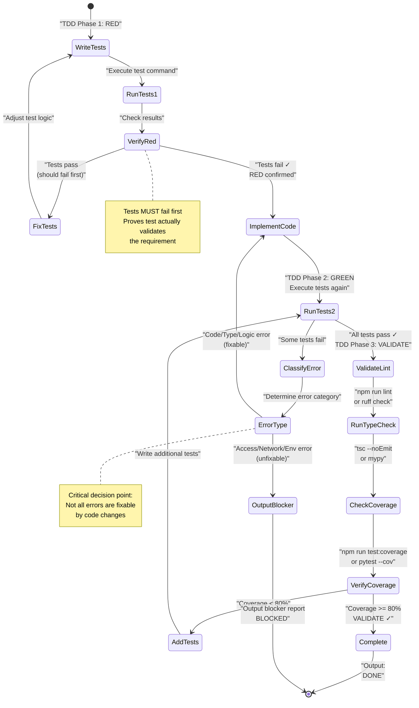
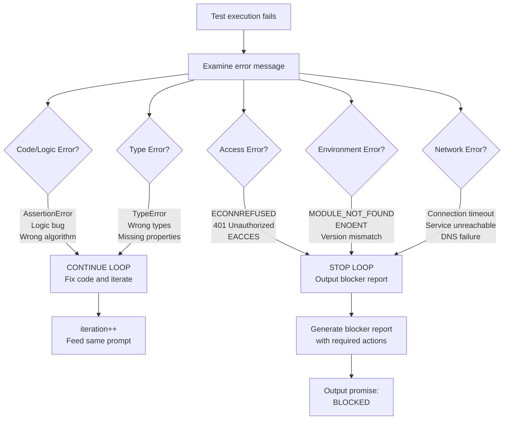
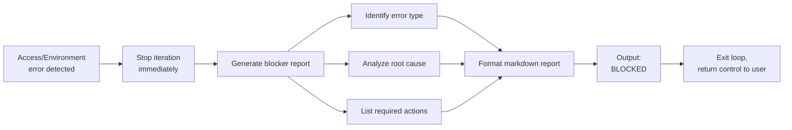
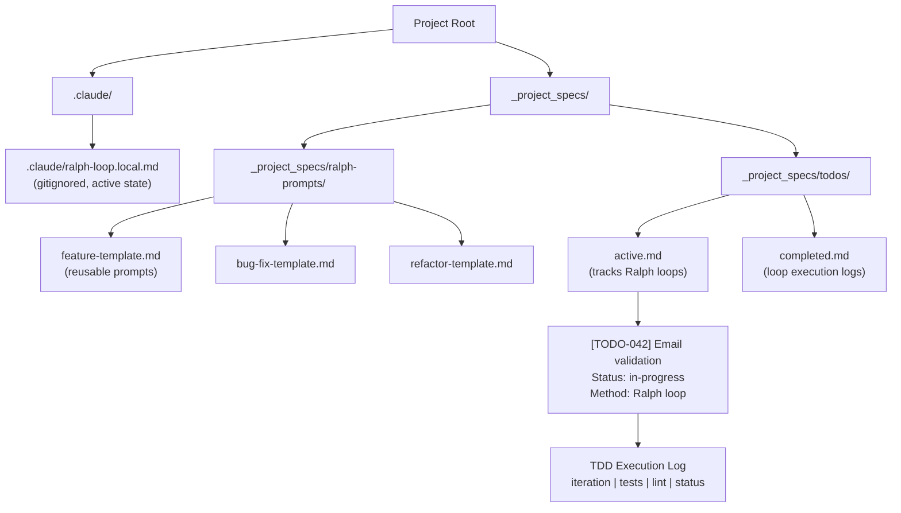

<!-- source: DeepWiki mcp.deepwiki.com · repo alinaqi/claude-bootstrap · page 4.1 Ralph Loop: Iterative Development · fetched 2026-10-27 -->

# Ralph Loop: Iterative Development

<details>
<summary>Relevant source files</summary>

The following files were used as context for generating this wiki page:

- [README.md](README.md)
- [skills/iterative-development.md](skills/iterative-development.md)

</details>


## Purpose and Scope

This document describes the Ralph Wiggum loop system, the core iterative development engine in Claude Bootstrap. The Ralph loop implements self-referential TDD cycles where Claude autonomously iterates on a task until completion criteria are met, with automatic error classification to distinguish between code errors (fixable by iteration) and environment/access errors (requiring human intervention).

For information about the broader development philosophy and TDD principles, see [Development Philosophy](#3.1) and [TDD Workflow](#3.2). For session management and context preservation between work sessions, see [Session Management](#4.2). For quality gates that run after loop completion, see [Quality Gates and Code Review](#4.3).

**Sources:** [README.md:71-117](), [skills/iterative-development.md:1-9]()

---

## Core Mechanism: The Stop Hook

The Ralph loop operates through a "stop hook" mechanism that intercepts Claude's exit attempts and feeds the identical prompt back with updated file state, creating a self-referential improvement cycle.

### State Machine Flow

```mermaid
stateDiagram-v2
    [*] --> InitializeLoop: "/ralph-loop prompt<br/>--max-iterations N<br/>--completion-promise text"
    
    InitializeLoop --> ReadCurrentState: "Load file state<br/>and git history"
    
    ReadCurrentState --> ExecuteTask: "Claude works on task<br/>(same prompt each iteration)"
    
    ExecuteTask --> AttemptExit: "Claude tries to exit"
    
    AttemptExit --> CheckPromise: "Stop hook intercepts"
    
    CheckPromise --> ExitSuccess: "Promise detected:<br/><promise>DONE</promise>"
    CheckPromise --> CheckIterations: "No promise yet"
    
    CheckIterations --> ExitMaxReached: "iterations >= max"
    CheckIterations --> FeedbackLoop: "iterations < max"
    
    FeedbackLoop --> ReadCurrentState: "Feed SAME prompt<br/>with modified files visible"
    
    ExitSuccess --> [*]: "Loop complete"
    ExitMaxReached --> [*]: "Incomplete, manual review needed"
    
    note right of ReadCurrentState
        Key insight: Prompt never changes
        Only file state evolves
        Claude sees own previous work
        via file modifications and git history
    end note
    
    note right of CheckPromise
        Exit detection via XML tags:
        <promise>COMPLETION_TEXT</promise>
        Must match --completion-promise flag
    end note
```



**Sources:** [skills/iterative-development.md:49-71](), [README.md:71-85]()

### File State Persistence

The loop maintains state in `.claude/ralph-loop.local.md`, which tracks:

| Field | Purpose |
|-------|---------|
| `iteration` | Current iteration count (1 to max) |
| `prompt` | Original task prompt (unchanged) |
| `max_iterations` | Hard limit to prevent infinite loops |
| `completion_promise` | Exit condition text to detect |

**File Location:** [.claude/ralph-loop.local.md]() (gitignored, session-specific)

**Sources:** [skills/iterative-development.md:464-468](), [skills/iterative-development.md:486-492]()

---

## TDD Integration: The Three Phases

Every Ralph loop enforces the RED-GREEN-VALIDATE TDD cycle as its completion criteria.

### TDD Phase State Machine



**Sources:** [skills/iterative-development.md:76-106](), [README.md:17-21]()

### Completion Criteria Structure

Every Ralph prompt must include explicit completion criteria:

```markdown
### Completion Criteria
- [ ] All tests passing
- [ ] Coverage >= 80%
- [ ] Lint clean (no errors)
- [ ] TypeScript/type check passing

### Exit Condition
When ALL criteria above are TRUE, output:
<promise>ALL TESTS PASSING AND LINT CLEAN</promise>
```

**Sources:** [skills/iterative-development.md:96-105](), [skills/iterative-development.md:225-240]()

---

## Error Classification System

The loop distinguishes between errors Claude can fix through iteration and blockers requiring human intervention.

### Error Type Decision Tree



**Sources:** [skills/iterative-development.md:293-331](), [README.md:579-612]()

### Error Classification Table

| Error Type | Examples | Claude Can Fix? | Action |
|------------|----------|-----------------|--------|
| **Code Error** | Logic bug, wrong assertion, missing validation | ✅ Yes | Continue loop, fix implementation |
| **Type Error** | Wrong types, missing properties, type mismatch | ✅ Yes | Continue loop, fix types |
| **Test Error** | Wrong assertion, incomplete test coverage | ✅ Yes | Continue loop, fix tests |
| **Access Error** | Missing API key, DB connection refused, 401/403 | ❌ No | STOP + report blocker |
| **Permission Error** | File access denied (EACCES), auth failed | ❌ No | STOP + report blocker |
| **Environment Error** | Missing dependency (MODULE_NOT_FOUND), wrong version | ❌ No | STOP + report blocker |
| **Network Error** | Service unreachable (ECONNREFUSED), timeout | ❌ No | STOP + report blocker |

**Sources:** [skills/iterative-development.md:296-307]()

### Blocker Detection Patterns

Common error patterns that trigger blocker reports:

| Error Pattern | Likely Cause | Required Human Action |
|---------------|--------------|----------------------|
| `ECONNREFUSED :5432` | PostgreSQL not running | `brew services start postgresql` |
| `ECONNREFUSED :6379` | Redis not running | `brew services start redis` |
| `ECONNREFUSED :27017` | MongoDB not running | `brew services start mongodb` |
| `401 Unauthorized` | Invalid/missing API key | Check `.env` file for correct key |
| `403 Forbidden` | Wrong permissions/scopes | Verify API key permissions |
| `ENOENT .env` | Missing `.env` file | Create from `.env.example` |
| `MODULE_NOT_FOUND` | Missing npm package | Run `npm install` |
| `ENOMEM` | Out of memory | Close other apps, increase swap |

**Sources:** [skills/iterative-development.md:362-372]()

---

## Prompt Structure and Templates

Effective Ralph prompts follow a standardized structure with explicit TDD workflow and completion criteria.

### Feature Development Template

```bash
/ralph-loop "
## Task: [Feature Name]

### Requirements
- [Requirement 1]
- [Requirement 2]
- [Requirement 3]

### TDD Workflow (MUST FOLLOW)
1. Write failing tests based on requirements
2. Run tests - verify they FAIL (RED phase)
3. Implement minimum code to pass tests
4. Run tests - verify they PASS (GREEN phase)
5. Run lint and typecheck
6. If any failures, debug and fix
7. Repeat until all green

### Completion Criteria
- [ ] All tests passing
- [ ] Coverage >= 80%
- [ ] Lint clean (no errors)
- [ ] TypeScript/type check passing

### Exit Condition
When ALL criteria above are TRUE, output:
<promise>ALL TESTS PASSING AND LINT CLEAN</promise>
" --completion-promise "ALL TESTS PASSING AND LINT CLEAN" --max-iterations 30
```

**Sources:** [skills/iterative-development.md:76-106]()

### Bug Fix Template with Test Gap Analysis

```bash
/ralph-loop "
## Bug: [Bug Description]

### Reproduction
1. [Step 1]
2. [Step 2]
3. Observe: [Wrong behavior]
4. Expected: [Correct behavior]

### TDD Bug Fix Workflow (MUST FOLLOW)
1. Run existing tests - note if any catch the bug
2. Write a failing test that reproduces the bug
3. Run test - verify it FAILS (proves test catches bug)
4. Fix the bug with minimum code change
5. Run test - verify it PASSES
6. Run FULL test suite for regressions
7. Run lint and typecheck
8. If any failures, debug and fix
9. Repeat until all green

### Completion Criteria
- [ ] New test for bug exists
- [ ] New test passes
- [ ] All existing tests pass
- [ ] No regressions
- [ ] Lint clean

### Exit Condition
When ALL criteria are TRUE, output:
<promise>BUG FIXED WITH TEST</promise>
" --completion-promise "BUG FIXED WITH TEST" --max-iterations 25
```

**Sources:** [skills/iterative-development.md:108-142](), [README.md:560-577]()

### Refactoring Template (Safety-First)

```bash
/ralph-loop "
## Refactor: [What to refactor]

### Goals
- [Goal 1: e.g., Extract function, reduce complexity]
- [Goal 2: e.g., Improve naming]
- [Goal 3: e.g., Split file if > 200 lines]

### Safety Constraints
- All existing tests MUST continue to pass
- No behavior changes (refactor only)
- Coverage must not decrease

### Workflow
1. Run all tests - establish baseline (must pass)
2. Make ONE refactoring change
3. Run tests - must still pass
4. Run lint and typecheck
5. If failures, REVERT and try different approach
6. Commit working refactor
7. Repeat for next change

### Completion Criteria
- [ ] All refactoring goals met
- [ ] All tests passing
- [ ] Coverage same or higher
- [ ] Lint clean

### Exit Condition
<promise>REFACTOR COMPLETE ALL TESTS GREEN</promise>
" --completion-promise "REFACTOR COMPLETE ALL TESTS GREEN" --max-iterations 20
```

**Sources:** [skills/iterative-development.md:144-178]()

### API Development Template

```bash
/ralph-loop "
## Task: Build [API Name] API

### Endpoints Required
- POST /api/resource - Create
- GET /api/resource - List
- GET /api/resource/:id - Get one
- PUT /api/resource/:id - Update
- DELETE /api/resource/:id - Delete

### Requirements
- Input validation (Zod/Pydantic)
- Error handling with proper status codes
- Tests for each endpoint
- OpenAPI/Swagger docs

### TDD Workflow
1. Write integration tests for each endpoint
2. Run tests - all should FAIL
3. Implement endpoints one by one
4. Run tests after each endpoint
5. Continue until all pass
6. Add validation and error handling
7. Run full test suite
8. Generate API docs

### Completion Criteria
- [ ] All endpoint tests passing
- [ ] Input validation working
- [ ] Error responses correct
- [ ] Coverage >= 80%
- [ ] Lint clean

### Exit Condition
<promise>API COMPLETE WITH TESTS</promise>
" --completion-promise "API COMPLETE WITH TESTS" --max-iterations 40
```

**Sources:** [skills/iterative-development.md:180-219]()

---

## Blocker Detection and Reporting

When Claude encounters an unfixable error, it generates a structured blocker report and exits the loop.

### Blocker Report Structure



**Sources:** [skills/iterative-development.md:333-359]()

### Blocker Report Format

```markdown
## 🛑 LOOP BLOCKED - Human Action Required

**Error Type:** Access/Environment (cannot be fixed by code changes)

**Error Message:**
```
ECONNREFUSED 127.0.0.1:5432 - Connection refused
```

**Root Cause:**
PostgreSQL database is not running or not accessible.

**Required Human Actions:**
1. [ ] Start PostgreSQL: `brew services start postgresql`
2. [ ] Verify connection: `psql -U postgres -c "SELECT 1"`
3. [ ] Check DATABASE_URL in .env matches running instance

**After Fixing:**
Run `/ralph-loop` again with the same prompt, or tell me to continue.

<promise>BLOCKED ENVIRONMENT</promise>
```

**Sources:** [skills/iterative-development.md:333-359](), [README.md:589-602]()

---

## Monitoring and Control

### Loop State Inspection

Check current iteration count:

```bash
grep '^iteration:' .claude/ralph-loop.local.md
```

View full loop state:

```bash
head -10 .claude/ralph-loop.local.md
```

**Sources:** [skills/iterative-development.md:445-457]()

### Cancelling Active Loop

```bash
/cancel-ralph
```

This command terminates the current loop immediately, regardless of iteration count or completion status.

**Sources:** [skills/iterative-development.md:459-462]()

### Safety Mechanisms

| Mechanism | Purpose | Configuration |
|-----------|---------|---------------|
| `--max-iterations` | Hard limit to prevent infinite loops | Required parameter, typically 20-40 |
| Error classification | Stops loop on unfixable errors | Automatic, based on error patterns |
| Blocker detection | Reports when human action needed | Automatic, outputs structured report |

**Sources:** [README.md:635-642](), [skills/iterative-development.md:242-250]()

---

## Integration with Project Structure

The Ralph loop integrates with Claude Bootstrap's project structure and workflow.

### File System Integration



**Sources:** [skills/iterative-development.md:472-485](), [skills/iterative-development.md:495-515]()

### Todo Integration Pattern

When a todo is executed via Ralph loop, it tracks the execution:

```markdown
## [TODO-042] Add email validation

**Status:** in-progress
**Method:** Ralph loop

### Ralph Prompt
/ralph-loop "..." --max-iterations 20 --completion-promise "..."

### TDD Execution Log
| Iteration | Tests | Lint | Status |
|-----------|-------|------|--------|
| 1 | 0/5 pass | errors | RED |
| 2 | 2/5 pass | errors | RED |
| 3 | 5/5 pass | clean | GREEN ✓ |

### Completion
- Iterations used: 3/20
- Promise detected: <promise>ALL TESTS PASSING</promise>
```

**Sources:** [skills/iterative-development.md:495-515](), [README.md:532-558]()

### Gitignore Configuration

The loop state file must be excluded from version control:

```gitignore
# Ralph loop state (session-specific)
.claude/ralph-loop.local.md
```

**Sources:** [skills/iterative-development.md:488-492]()

---

## Use Cases and Anti-Patterns

### Appropriate Use Cases

| Use Case | Why Ralph Loop Works | Typical Max Iterations |
|----------|---------------------|----------------------|
| **TDD feature development** | Tests provide clear pass/fail feedback | 20-30 |
| **Bug fixes with test gaps** | Clear reproduction → test → fix cycle | 15-25 |
| **Refactoring with test safety net** | Tests ensure no regressions during changes | 15-20 |
| **API endpoint development** | Each endpoint independently testable | 30-40 |
| **Greenfield projects** | Can iterate without breaking existing code | 20-30 |
| **Getting failing tests to pass** | Clear success criteria (all tests green) | 10-20 |

**Sources:** [skills/iterative-development.md:419-431]()

### Inappropriate Use Cases

| Use Case | Why Ralph Loop Fails | Alternative Approach |
|----------|---------------------|---------------------|
| **Subjective design decisions** | No clear "done" criteria, will loop forever | Manual iteration with human judgment |
| **UI/UX work** | Requires human aesthetic judgment | Manual development with design review |
| **One-shot operations** | No need for iteration (e.g., simple config) | Direct implementation without loop |
| **Unclear requirements** | Cannot determine completion, loops indefinitely | Define requirements first, then loop |
| **Production debugging** | Needs human oversight for live systems | Manual debugging with monitoring |

**Sources:** [skills/iterative-development.md:433-441]()

### Anti-Patterns to Avoid

| Anti-Pattern | Problem | Correct Approach |
|--------------|---------|------------------|
| ❌ No `--max-iterations` flag | Loop runs forever on unclear requirements | Always set `--max-iterations` (typically 20-40) |
| ❌ Vague completion criteria | Cannot determine when done, loops indefinitely | Define explicit, measurable criteria |
| ❌ No TDD in prompt | No objective success metric | Include full TDD workflow in prompt |
| ❌ Outputting false promise to exit | Lies to escape loop, work incomplete | Let loop complete or cancel explicitly |
| ❌ Manual intervention mid-loop | Breaks autonomous iteration | Let loop complete or cancel and restart |
| ❌ Skipping test failure verification | Tests might not validate requirements | Always verify tests FAIL before implementing |

**Sources:** [skills/iterative-development.md:519-527]()

---

## Automatic Loop Invocation

Claude Bootstrap skills configure Claude to automatically invoke Ralph loops for natural language requests without explicit `/ralph-loop` commands.

### Automatic Detection Pattern

| User Request | Claude Interprets As | Auto-Loop Behavior |
|--------------|---------------------|-------------------|
| "Add email validation to signup" | Feature request with clear requirements | Automatically structures as TDD loop with completion criteria |
| "Fix the login bug" | Bug fix request | Identifies test gap → writes test → loops until fixed |
| "Build a REST API for todos" | API development | Loops until all endpoint tests pass |
| "Refactor the auth module" | Refactoring request | Loops with tests as safety net |

**Sources:** [README.md:71-95]()

### Opt-Out Phrases

To prevent automatic loop invocation for quick tasks:

| Phrase | Effect |
|--------|--------|
| "Just explain..." | Explanation only, no loop |
| "Quick fix..." | One-liner implementation, no loop |
| "Don't loop..." | Explicit opt-out from iteration |
| "Show me how..." | Educational response, no loop |

**Sources:** [README.md:96-99](), [README.md:629-635]()

---

## Example: Complete Ralph Loop Session

### Real TDD Session with Email Validation

```bash
/ralph-loop "
## Task: Add email validation to signup form

### Requirements
- Email field shows error for invalid format
- Error clears when user fixes email
- Form cannot submit with invalid email
- Valid emails pass without error

### Test Cases
| Input | Expected |
|-------|----------|
| user@example.com | Valid |
| user@sub.example.com | Valid |
| notanemail | Error |
| user@ | Error |
| @example.com | Error |

### TDD Workflow
1. Create test file: signup-validation.test.ts
2. Write tests for ALL test cases above
3. Run: npm test -- --grep 'email validation'
4. Verify: All 5 tests FAIL (RED)
5. Implement: validateEmail function
6. Run: npm test -- --grep 'email validation'
7. Verify: All 5 tests PASS (GREEN)
8. Run: npm run lint && npm run typecheck
9. If any errors, fix and re-run
10. When all green, output completion

### Completion Criteria
- [ ] 5 tests exist for email validation
- [ ] All 5 tests passing
- [ ] Lint clean
- [ ] TypeCheck passing

### Exit Condition
<promise>EMAIL VALIDATION COMPLETE</promise>
" --completion-promise "EMAIL VALIDATION COMPLETE" --max-iterations 15
```

### Expected Loop Progression

| Iteration | Action | Tests | Lint | TypeCheck | Status |
|-----------|--------|-------|------|-----------|--------|
| 1 | Write 5 failing tests | 0/5 pass | clean | pass | RED phase ✓ |
| 2 | Implement `validateEmail()` | 2/5 pass | errors | fail | Fixing implementation |
| 3 | Fix regex pattern | 4/5 pass | clean | pass | Almost there |
| 4 | Handle edge case | 5/5 pass | clean | pass | GREEN phase ✓ |
| 5 | Run final validation | 5/5 pass | clean | pass | VALIDATE phase ✓ → Exit |

**Exit Output:**
```
<promise>EMAIL VALIDATION COMPLETE</promise>
```

**Sources:** [skills/iterative-development.md:530-573]()

---

## Installation and Setup

### Installing Ralph Loop Plugin

Via official marketplace (in Claude Code):

```bash
/plugin install ralph-loop@claude-plugins-official
```

### Troubleshooting: "Source path does not exist"

If you encounter the error about `ralph-wiggum` not found, create a symlink:

```bash
ln -s ~/.claude/plugins/marketplaces/claude-plugins-official/plugins/ralph-loop \
      ~/.claude/plugins/marketplaces/claude-plugins-official/plugins/ralph-wiggum
```

Then retry the plugin installation.

**Sources:** [README.md:101-117](), [skills/iterative-development.md:34-44]()

---

## Checklist for Ralph Loop Sessions

### Before Starting Loop

- [ ] Clear completion criteria defined with measurable outcomes
- [ ] `--max-iterations` set to appropriate limit (safety net)
- [ ] `--completion-promise` set to match exit condition
- [ ] Full TDD workflow included in prompt
- [ ] Test cases defined with expected inputs/outputs
- [ ] Error classification logic included if complex

### During Loop Execution

- [ ] Monitor iteration count via `.claude/ralph-loop.local.md`
- [ ] Check test results each iteration for progress
- [ ] Watch for repeating patterns (indicates stuck)
- [ ] Look for blocker reports in output

### After Loop Completion

- [ ] Verify all tests actually pass (run test suite)
- [ ] Run full test suite to check for regressions
- [ ] Check coverage meets threshold (≥80%)
- [ ] Review and commit changes
- [ ] Update todo status: `active.md` → `completed.md`

**Sources:** [skills/iterative-development.md:576-595]()

---

