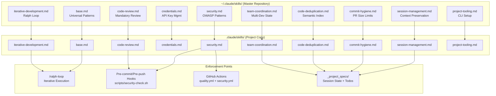
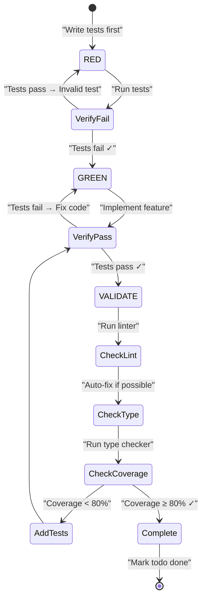
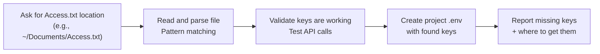
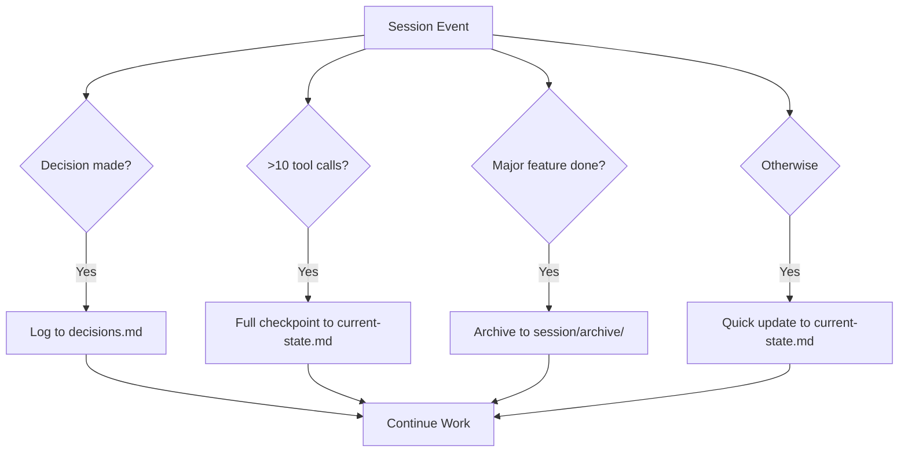
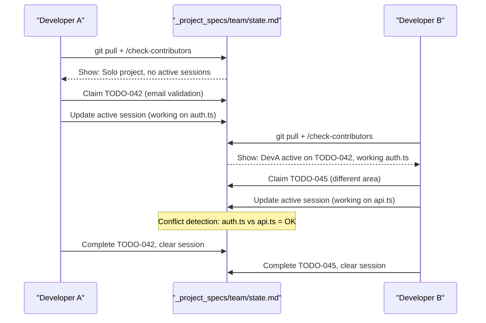
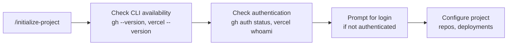
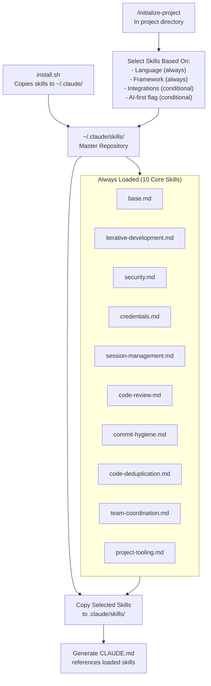
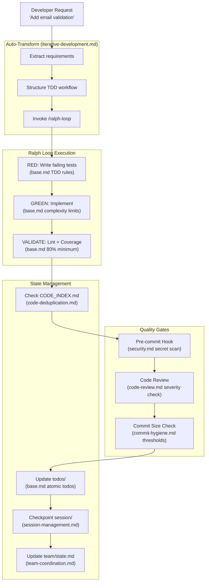

<!-- source: DeepWiki mcp.deepwiki.com · repo alinaqi/claude-bootstrap · page 5.2 Core Skills · fetched 2026-10-27 -->

# Core Skills

<details>
<summary>Relevant source files</summary>

The following files were used as context for generating this wiki page:

- [README.md](README.md)
- [skills/base.md](skills/base.md)
- [templates/CLAUDE.md](templates/CLAUDE.md)

</details>


This document describes the 10 core skills that are loaded for every project initialized with Claude Bootstrap, regardless of language, framework, or project type. These skills establish the fundamental development patterns, quality gates, and workflows that all projects must follow.

For information about language-specific skills (Python, TypeScript) and framework skills (React, FastAPI, etc.), see [Language and Framework Skills](#5.3). For skills related to building AI agents and agentic systems, see [AI and Agentic Development](#5.6).

---

## Overview

Core skills are mandatory skills that define the baseline behavior and constraints for all Claude Bootstrap projects. They are stored in `~/.claude/skills/` after installation and copied to `.claude/skills/` during project initialization.

### Core Skills vs. Conditional Skills

| Skill Type | Load Condition | Example Skills |
|------------|---------------|----------------|
| **Core Skills** | Always loaded | `base.md`, `security.md`, `session-management.md` |
| **Conditional Skills** | Based on project type | `python.md`, `react-web.md`, `playwright-testing.md` |

Core skills establish:
- **TDD workflow enforcement** - RED-GREEN-VALIDATE cycle
- **Complexity constraints** - 20 lines/function, 200 lines/file, 3 params max
- **Security requirements** - No secrets in code, client-side env var checks
- **Quality gates** - 80% coverage minimum, mandatory code review
- **Session management** - Context preservation and resumability
- **Team coordination** - Multi-developer workflow patterns

**Sources:** [README.md:396-410](), [skills/base.md:1-579]()

---

## Core Skills Architecture

**Diagram: Core Skills Loading and Interaction**



**Sources:** [README.md:52-70](), [README.md:296-317]()

---

## The 10 Core Skills

### base.md - Universal Patterns and TDD

`base.md` is the foundational skill that establishes the core development philosophy, complexity constraints, and mandatory TDD workflow.

**Key Enforcement Rules:**

| Constraint | Limit | Enforcement Point |
|------------|-------|-------------------|
| Lines per function | 20 max | Pre-completion check |
| Parameters per function | 3 max | Pre-completion check |
| Nesting depth | 2 levels max | Pre-completion check |
| Lines per file | 200 max | Pre-completion check, auto-split |
| Functions per file | 10 max | Pre-completion check |
| Test coverage | 80% minimum | CI/CD validation |

**TDD Workflow Phases:**



**Atomic Todo Format:**

Every work item follows the structure defined at [skills/base.md:143-179](). The todo includes:
- Status, priority, estimate
- Acceptance criteria (specific, testable)
- Test cases table
- TDD execution log tracking RED → GREEN → VALIDATE phases

**Anti-Patterns Blocked:**

```
❌ Fixing bugs without adding test first
❌ Writing tests after implementation
❌ Marking todos complete with failing tests
❌ Skipping lint/typecheck before completion
❌ Global state
❌ Deep nesting (>2 levels)
❌ Large PRs (>400 lines)
```

**File Structure Conventions:**

The skill mandates separation of code documentation from project specifications at [skills/base.md:99-136]():
- `docs/` - Technical documentation (architecture, API, setup)
- `_project_specs/` - Business requirements (features, todos, sessions)
- `_project_specs/session/` - Session state for resumability
- `CLAUDE.md` - Claude-specific instructions

**Sources:** [skills/base.md:1-579](), [README.md:320-357]()

---

### iterative-development.md - Ralph Wiggum Loop

`iterative-development.md` enables automatic iterative TDD cycles through the Ralph Wiggum loop mechanism. The skill transforms natural language requests into self-correcting implementation loops.

**Auto-Invocation Logic:**

| User Request Type | Action |
|-------------------|--------|
| "Add email validation" | Auto-invoke `/ralph-loop` with TDD template |
| "Fix the login bug" | Auto-invoke `/ralph-loop` with bug fix template |
| "Build REST API for todos" | Auto-invoke `/ralph-loop` with API template |
| "Just explain..." | Skip loop, provide explanation |
| "Quick fix..." | Skip loop, one-liner change |

**Automatic Transformation Example:**

When user says: `"Add forgot password feature"`

Claude automatically structures as:
```markdown
## Task: Add forgot password feature

### Requirements (extracted from user request)
- User can request password reset via email
- Reset link sent to registered email
- Link expires after 24 hours
- User can set new password via link

### TDD Workflow
1. Write failing tests for each requirement
2. Verify tests FAIL (RED)
3. Implement feature
4. Verify tests PASS (GREEN)
5. Run lint + typecheck
6. Repeat if failures

### Completion Criteria
- [ ] All tests passing
- [ ] Coverage >= 80%
- [ ] Lint clean
- [ ] Security review (no token in URL params)

<promise>FORGOT PASSWORD COMPLETE</promise>
```

And invokes: `/ralph-loop [prompt] --completion-promise "FORGOT PASSWORD COMPLETE" --max-iterations 25`

**Error Classification:**

The skill defines error types that determine loop continuation vs. exit:

| Error Type | Examples | Claude Fixes? | Action |
|------------|----------|---------------|--------|
| **Code Error** | Logic bug, wrong assertion | ✅ Yes | Continue loop |
| **Type Error** | Type mismatch, missing property | ✅ Yes | Continue loop |
| **Access Error** | Missing API key, DB refused | ❌ No | Stop + blocker report |
| **Environment Error** | Missing package, wrong version | ❌ No | Stop + blocker report |

**Sources:** [skills/base.md:499-578](), [README.md:71-118](), [README.md:579-612]()

---

### security.md - Security Patterns and Enforcement

`security.md` establishes mandatory security requirements and provides patterns for common vulnerabilities. It integrates with pre-commit hooks, code review, and CI/CD validation.

**Essential Security Checks:**

```markdown
1. No secrets in code - Use environment variables
2. .env in .gitignore - Always, no exceptions
3. No secrets in client-exposed env vars - Never VITE_*, NEXT_PUBLIC_*
4. Validate all input - Use Zod/Pydantic at API boundaries
5. Parameterized queries only - No string concatenation for SQL
6. Hash passwords properly - bcrypt with 12+ rounds
7. Dependency scanning - npm audit / safety check must pass
```

**Required Security Files:**

| File | Purpose | Location |
|------|---------|----------|
| `.gitignore` | Block secrets patterns | Project root |
| `.env.example` | Document required vars (no values) | Project root |
| `scripts/security-check.sh` | Pre-commit validation | Project `scripts/` |
| `.github/workflows/security.yml` | CI secret scanning | GitHub Actions |

**Client-Side Environment Variable Check:**

The skill enforces that secrets never appear in client-exposed environment variables:
- `VITE_*` prefix - Vite bundles into client JavaScript
- `NEXT_PUBLIC_*` prefix - Next.js exposes to browser
- Any secret in these variables = blocker

**Sources:** [skills/base.md:413-437](), [README.md:358-365]()

---

### credentials.md - Centralized API Key Management

`credentials.md` implements the centralized credentials workflow using a single `Access.txt` file to store all API keys, with automatic detection, validation, and `.env` generation.

**Workflow Steps:**



**Key Pattern Detection:**

| Service | Pattern | Env Variable | Validation Command |
|---------|---------|--------------|-------------------|
| OpenAI | `sk-proj-*` | `OPENAI_API_KEY` | `curl` with bearer token |
| Claude | `sk-ant-*` | `ANTHROPIC_API_KEY` | `curl` with x-api-key header |
| Render | `rnd_*` | `RENDER_API_KEY` | `curl /v1/owners` |
| Replicate | `r8_*` | `REPLICATE_API_TOKEN` | `curl` with token header |
| Stripe | `sk_test_*`, `sk_live_*` | `STRIPE_SECRET_KEY` | Stripe CLI verify |
| Supabase | URL + key format | `SUPABASE_URL`, `SUPABASE_ANON_KEY` | `curl /rest/v1/` |

**Access.txt Format Example:**

```
OpenAI API: sk-proj-xxx
Claude API: sk-ant-xxx
Stripe: sk_test_xxx
Supabase url: https://xxx.supabase.co
Anon key: eyJxxx
```

**Sources:** [skills/base.md:388-410](), [README.md:366-379]()

---

### session-management.md - Context Preservation

`session-management.md` enables resumability by maintaining session state across Claude conversations. It defines when and how to checkpoint work to prevent context loss.

**Checkpoint Triggers:**



**Session Files Structure:**

```
_project_specs/session/
├── current-state.md       # Live session state, next steps
├── decisions.md           # Key architectural decisions log
├── code-landmarks.md      # Important code locations/patterns
└── archive/               # Past session summaries
    ├── 2024-01-15-auth.md
    └── 2024-01-16-api.md
```

**Session Start Protocol:**
1. Read `_project_specs/session/current-state.md`
2. Check `_project_specs/todos/active.md`
3. Continue from documented "Next Steps"

**Session End Protocol:**
1. Archive current session to `session/archive/YYYY-MM-DD-topic.md`
2. Update `current-state.md` with handoff notes
3. Ensure next steps are specific and actionable

**Sources:** [skills/base.md:456-478](), [README.md:308-312]()

---

### code-review.md - Mandatory Code Review

`code-review.md` enforces mandatory code review before every push through the `/code-review` command and pre-push hooks. Reviews analyze security, performance, architecture, and code quality.

**Severity Levels and Actions:**

| Level | Icon | Action | Push Allowed? | Example Issues |
|-------|------|--------|---------------|----------------|
| Critical | 🔴 | Must fix now | ❌ BLOCKED | SQL injection, exposed secrets |
| High | 🟠 | Must fix now | ❌ BLOCKED | XSS vulnerability, N+1 queries |
| Medium | 🟡 | Fix soon | ✅ Advisory | Missing error handling, complexity |
| Low | 🟢 | Nice to have | ✅ Advisory | Minor optimization, style |

**Review Categories:**

```
Security: SQL injection, XSS, secrets in code, weak auth
Performance: N+1 queries, memory leaks, inefficient algorithms
Architecture: SOLID violations, coupling, circular dependencies
Code Quality: Complexity violations, duplication, missing types
```

**Enforcement Points:**

1. **Manual:** Developer runs `/code-review` before commit
2. **Pre-push hook:** `~/.claude/install-hooks.sh` enables automatic blocking
3. **GitHub Actions:** CI runs review on all PRs
4. **Pre-merge:** Blocks merge if Critical/High issues found

**Sources:** [README.md:176-210](), [README.md:34-39]()

---

### commit-hygiene.md - Atomic Commits and PR Size Management

`commit-hygiene.md` monitors commit size and advises when PRs become too large, based on research showing defect rates correlate with PR size.

**Commit Size Thresholds:**

| Status | Files | Lines | Action | Defect Rate |
|--------|-------|-------|--------|-------------|
| 🟢 OK | ≤ 5 | ≤ 200 | Continue working | ~15% |
| 🟡 WARN | 6-10 | 201-400 | Consider committing | ~23% |
| 🔴 STOP | > 10 | > 400 | Commit NOW | 40%+ |

**Automatic Monitoring:**

Claude automatically checks git status after completing tasks and advises:

| Changes | Claude Says |
|---------|-------------|
| 3 files, 95 lines | ✅ Tests passing. Good time to commit! |
| 7 files, 225 lines | 💡 Approaching threshold. Consider committing. |
| 12 files, 400 lines | ⚠️ Changes too large! Commit now before continuing. |

**Atomic Commit Principle:**

```
If you need "and" to describe your commit, split it.

❌ "Add auth and fix navigation bug"
✅ "Add user authentication"
✅ "Fix navigation bug on mobile"
```

**Sources:** [README.md:119-147]()

---

### code-deduplication.md - Semantic Capability Index

`code-deduplication.md` prevents semantic duplication by maintaining a capability index (`CODE_INDEX.md`) organized by what functions DO, not their names. AI tends to reimplement rather than reuse, creating duplicate purpose.

**Check-Before-Write Protocol:**

```
Before creating ANY new function:
1. Check CODE_INDEX.md for existing capabilities
2. Search codebase for similar functionality
3. Extend existing if possible
4. Only create new if nothing suitable exists
```

**CODE_INDEX.md Structure:**

```markdown
## Validation
| Function | Location | Does What |
|----------|----------|-----------|
| isEmail() | utils/validate.ts | Validates email format |
| isPhone() | utils/validate.ts | Validates phone number |

## Date/Time
| Function | Location | Does What |
|----------|----------|-----------|
| formatRelative() | utils/dates.ts | "2 days ago" format |
| parseDate() | utils/dates.ts | Parse ISO string to Date |
```

**Commands:**

```bash
/update-code-index      # Regenerate index from codebase
/audit-duplicates       # Find semantic duplicates to merge
```

**Example Prevention:**

Developer wants to add email validation. Before writing `validateEmail()`:
1. Check `CODE_INDEX.md` → finds `isEmail()` exists in `utils/validate.ts`
2. Use existing function instead of creating duplicate
3. If existing doesn't meet needs, extend it rather than create new

**Optional Integration:**

For codebases >100 files, the skill supports vector DB integration (ChromaDB/LanceDB) for semantic search beyond simple grep.

**Sources:** [README.md:255-294]()

---

### team-coordination.md - Multi-Developer State Management

`team-coordination.md` enables multiple developers to use Claude Code on the same repository simultaneously without conflicts through file-based state management.

**Team Coordination Flow:**



**Team State Structure:**

```
_project_specs/team/
├── state.md              # Active sessions, claimed todos, conflicts
├── contributors.md       # Team members, ownership, focus areas
├── handoffs/             # Context transfer when passing work
│   └── 2024-01-15-auth-handoff.md
└── decisions.md          # Shared architectural decisions
```

**state.md Format:**

```markdown
## Active Sessions
| Developer | Todo | Files Touched | Status | Last Updated |
|-----------|------|---------------|--------|--------------|
| Alice | TODO-042 | src/auth.ts, src/auth.test.ts | Active | 2024-01-15 10:30 |
| Bob | TODO-045 | src/api.ts | Active | 2024-01-15 10:45 |

## Claimed Todos (Not Yet Started)
| Developer | Todo | Claimed At |
|-----------|------|------------|
| Charlie | TODO-050 | 2024-01-15 09:00 |

## Conflict Warnings
⚠️ Alice and Bob may conflict on src/types.ts
```

**Workflow Commands:**

```bash
/check-contributors          # Check state, offer conversion
/check-contributors --status # Quick status only
/check-contributors --team   # Convert solo → team project
```

**Conflict Detection:**

The system monitors `state.md` for file overlap and warns when multiple developers touch the same files, enabling coordination before merge conflicts occur.

**Sources:** [README.md:211-254]()

---

### project-tooling.md - CLI Configuration

`project-tooling.md` handles validation and configuration of external CLIs used for project scaffolding and deployment: `gh` (GitHub), `vercel` (Vercel), `supabase` (Supabase), and `render` (Render).

**Required CLIs:**

| CLI | Purpose | Install Command | Auth Command |
|-----|---------|----------------|--------------|
| `gh` | GitHub repo management | `brew install gh` | `gh auth login` |
| `vercel` | Vercel deployment | `npm i -g vercel` | `vercel login` |
| `supabase` | Supabase DB/Edge Functions | `brew install supabase/tap/supabase` | `supabase login` |
| `render` | Render deployment | `brew install renderinc/tap/render` | `render login` |

**Validation During Initialization:**



**Setup Actions:**

1. **GitHub:** Create repo, add secrets, configure branch protection
2. **Vercel:** Link project, set env vars, configure domains
3. **Supabase:** Link project, create local config, setup migrations
4. **Render:** Create service, set env vars, configure build

**Sources:** [README.md:497-514]()

---

## Skills Loading Mechanism

**Diagram: Skills Copy Process During Initialization**



**Re-Initialization Behavior:**

Running `/initialize-project` in an existing project:
- **Overwrites** all skills in `.claude/skills/` with latest from `~/.claude/skills/`
- **Preserves** existing project configuration (`.env`, `package.json`, etc.)
- **Updates** `CLAUDE.md` to reference current skill set
- **Adds** new skills if project answers changed (e.g., adding Playwright)

**Sources:** [README.md:52-70](), [README.md:469-495]()

---

## Core Skills Integration

**Diagram: How Core Skills Interact Throughout Development Cycle**



**Skill Dependencies:**

| Primary Skill | Depends On | Reason |
|---------------|------------|--------|
| `iterative-development.md` | `base.md` | Uses TDD workflow and todo format |
| `code-review.md` | `security.md` | Security checks in review |
| `commit-hygiene.md` | `base.md` | Atomic todo principle |
| `team-coordination.md` | `session-management.md` | Uses session state format |
| `code-deduplication.md` | `base.md` | Check-before-write enforcement |

**Enforcement Layers:**

```
Layer 1: Development-Time (base.md)
  └─ Complexity checks before file completion
  └─ TDD workflow enforcement
  └─ 80% coverage requirement

Layer 2: Pre-Commit (security.md)
  └─ Secret scanning
  └─ .env validation
  └─ Lint + type check

Layer 3: Pre-Push (code-review.md)
  └─ Mandatory review
  └─ Critical/High blocks push
  └─ Medium/Low advisory

Layer 4: CI/CD (security.md + base.md)
  └─ Full test suite
  └─ TruffleHog secret scan
  └─ Dependency audit
  └─ Coverage validation

Layer 5: Session End (session-management.md)
  └─ Checkpoint state
  └─ Archive decisions
  └─ Update handoffs
```

**Sources:** [README.md:10-40](), [skills/base.md:1-579](), [templates/CLAUDE.md:1-113]()

---

