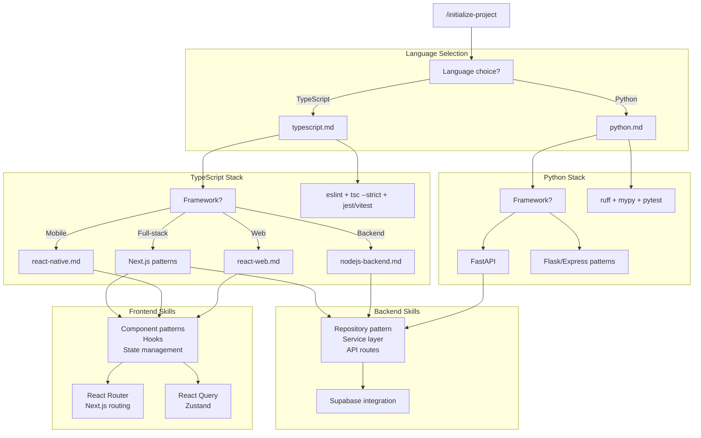
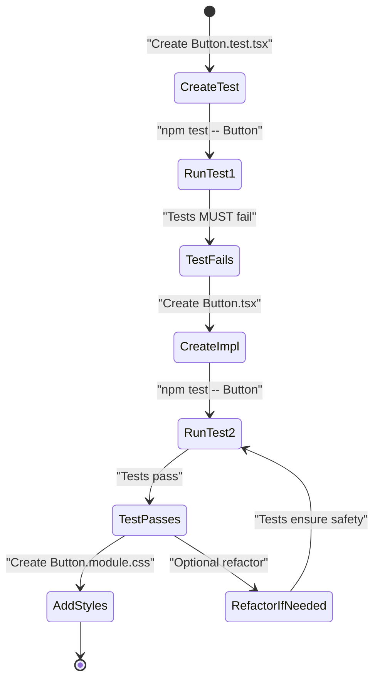
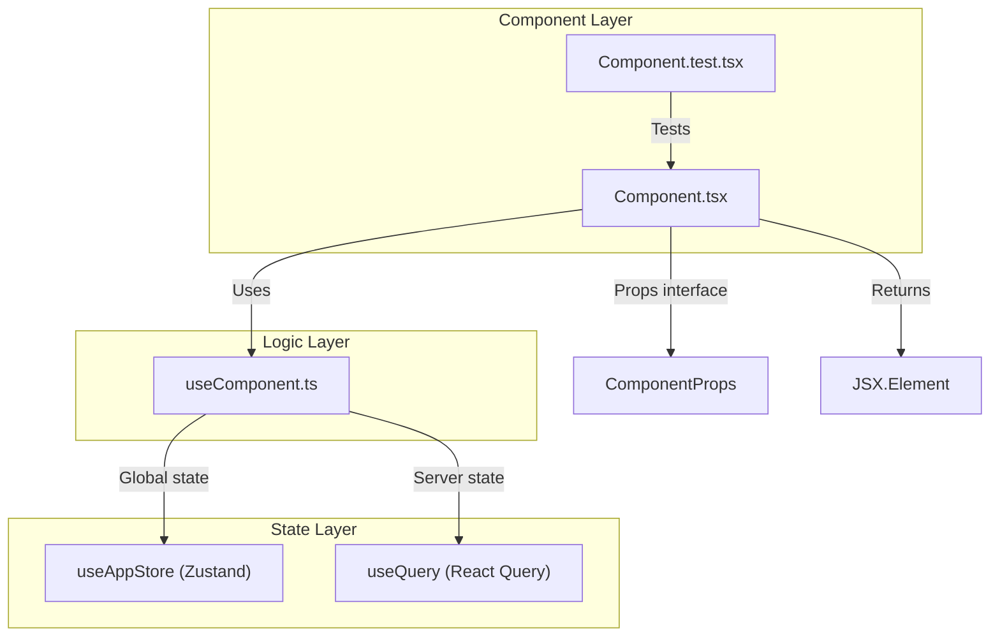
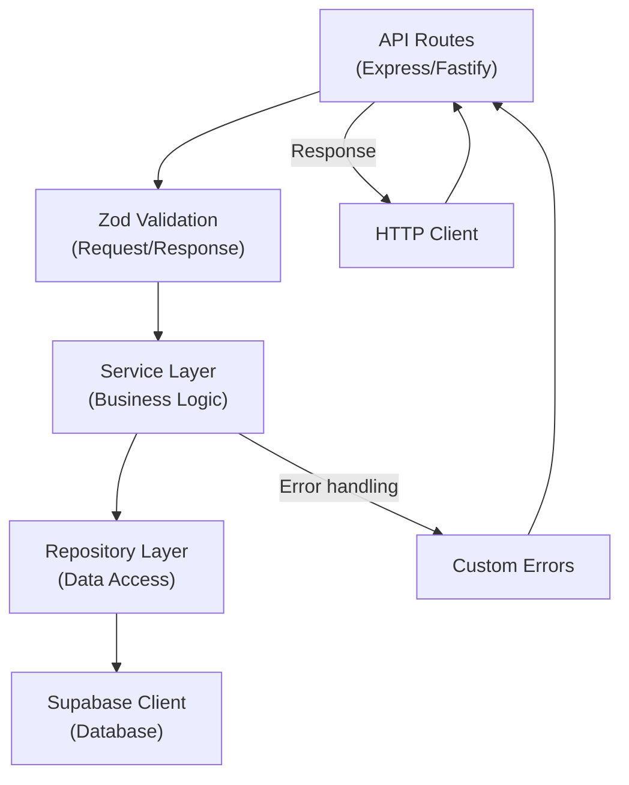
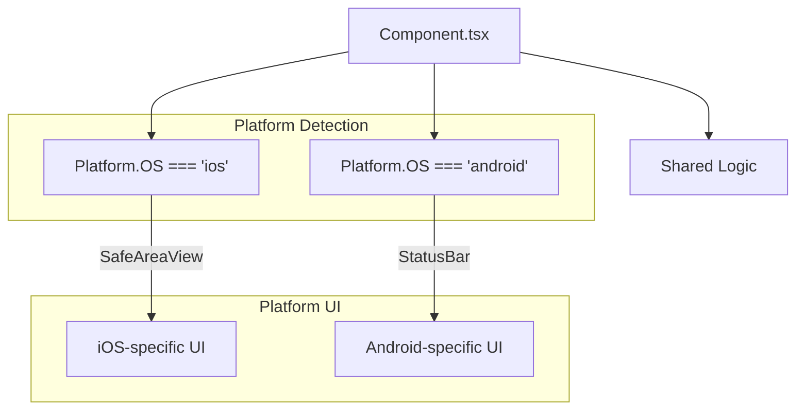
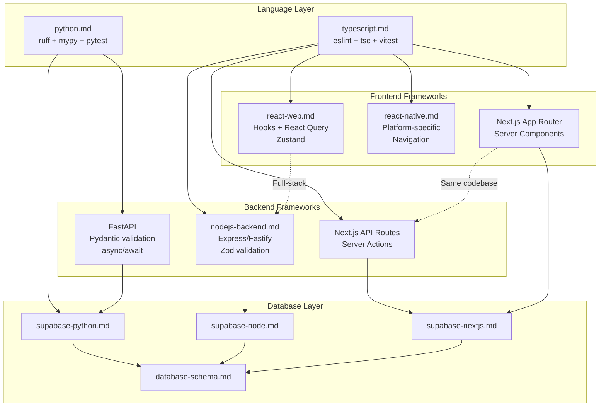

<!-- source: DeepWiki mcp.deepwiki.com · repo alinaqi/claude-bootstrap · page 5.3 Language and Framework Skills · fetched 2026-10-27 -->

# Language and Framework Skills

<details>
<summary>Relevant source files</summary>

The following files were used as context for generating this wiki page:

- [README.md](README.md)
- [skills/playwright-testing.md](skills/playwright-testing.md)
- [skills/react-web.md](skills/react-web.md)

</details>


## Purpose and Scope

This document covers the language-specific and framework-specific skills in Claude Bootstrap. These skills provide technology stack patterns, tooling configurations, and coding standards that enforce TDD-first development, strict type safety, and maintainable architecture.

For the overall skills architecture and loading mechanism, see [Skills Architecture](#5.1). For core skills that apply to all projects, see [Core Skills](#5.2). For UI-specific patterns and accessibility requirements, see [UI Development and Testing](#5.4).

**Coverage:**
- Language skills: Python, TypeScript
- Backend frameworks: Node.js (Express/Fastify), FastAPI
- Frontend frameworks: React (Web), Next.js, React Native
- Tool configurations: linters, formatters, type checkers, test runners
- Skill selection logic during project initialization

---

## Skills Hierarchy and Selection

### Language and Framework Skill Tree



**Sources:** [README.md:396-465](), Diagram 3 from system architecture

### Skill Loading Matrix

| Project Type | Language Skill | Framework Skill(s) | Additional Skills |
|--------------|----------------|-------------------|-------------------|
| Python Backend | `python.md` | `supabase-python.md` | `database-schema.md` |
| Python FastAPI | `python.md` | FastAPI patterns | `supabase-python.md` |
| TypeScript Backend | `typescript.md` | `nodejs-backend.md`, `supabase-node.md` | `database-schema.md` |
| React Web | `typescript.md` | `react-web.md` | `ui-web.md`, `playwright-testing.md` |
| React Native | `typescript.md` | `react-native.md` | `ui-mobile.md`, `ui-testing.md` |
| Next.js Full-Stack | `typescript.md` | `react-web.md`, `supabase-nextjs.md` | `ui-web.md`, `database-schema.md` |

**Sources:** [README.md:412-420](), [README.md:438-446]()

---

## Python Language Skill

### Tool Configuration

The Python skill enforces modern Python tooling with strict type checking and formatting:

**Toolchain:**
- **ruff**: Linting and auto-formatting (replaces Black, isort, flake8)
- **mypy**: Static type checking with strict mode
- **pytest**: Test framework with coverage reporting

### Project Structure

```
project/
├── src/
│   ├── core/              # Business logic
│   ├── api/               # FastAPI routes
│   ├── services/          # Service layer
│   ├── repositories/      # Data access
│   └── models/            # Pydantic models
├── tests/
│   ├── unit/
│   ├── integration/
│   └── conftest.py
├── pyproject.toml         # Tool configuration
├── mypy.ini
└── pytest.ini
```

### Tool Configuration Files

**pyproject.toml:**
```toml
[tool.ruff]
line-length = 100
target-version = "py311"
select = ["E", "F", "I", "N", "W"]
fixable = ["ALL"]

[tool.mypy]
strict = true
warn_return_any = true
warn_unused_configs = true
disallow_untyped_defs = true

[tool.pytest.ini_options]
testpaths = ["tests"]
python_files = ["test_*.py"]
python_functions = ["test_*"]
addopts = "--cov=src --cov-report=term-missing --cov-fail-under=80"
```

### Type Safety Patterns

```python
# Strict typing enforced
from typing import Protocol, TypedDict, Literal

class UserRepository(Protocol):
    def get_by_id(self, user_id: str) -> User | None:
        ...

# Pydantic for validation
from pydantic import BaseModel, EmailStr

class CreateUserRequest(BaseModel):
    email: EmailStr
    password: str
    name: str | None = None
```

**Sources:** [README.md:415]()

---

## TypeScript Language Skill

### Tool Configuration

The TypeScript skill enforces strict type checking and modern ESLint rules:

**Toolchain:**
- **TypeScript**: Strict mode (`strict: true`) in `tsconfig.json`
- **ESLint**: Code quality and consistency rules
- **Jest/Vitest**: Test framework with coverage
- **Prettier**: Code formatting (optional)

### TypeScript Strict Mode Requirements

```json
// tsconfig.json
{
  "compilerOptions": {
    "strict": true,
    "noImplicitAny": true,
    "strictNullChecks": true,
    "strictFunctionTypes": true,
    "strictBindCallApply": true,
    "strictPropertyInitialization": true,
    "noImplicitThis": true,
    "alwaysStrict": true,
    "noUnusedLocals": true,
    "noUnusedParameters": true,
    "noImplicitReturns": true,
    "noFallthroughCasesInSwitch": true,
    "noUncheckedIndexedAccess": true
  }
}
```

### ESLint Configuration

```javascript
// eslint.config.js
export default [
  {
    rules: {
      '@typescript-eslint/no-explicit-any': 'error',
      '@typescript-eslint/explicit-function-return-type': 'warn',
      '@typescript-eslint/no-unused-vars': 'error',
      'no-console': ['warn', { allow: ['error', 'warn'] }],
      'max-lines-per-function': ['error', { max: 20 }],
      'max-lines': ['error', { max: 200 }],
      'max-params': ['error', 3],
      'complexity': ['error', 5]
    }
  }
];
```

### Interface and Type Patterns

```typescript
// Explicit interfaces required
interface UserProps {
  id: string;
  email: string;
  name?: string;
}

// Type guards for narrowing
function isUser(value: unknown): value is User {
  return typeof value === 'object' && value !== null && 'id' in value;
}

// Discriminated unions
type Result<T> = 
  | { success: true; data: T }
  | { success: false; error: string };
```

**Sources:** [README.md:416]()

---

## React Web Framework Skill

### Test-First Development (Mandatory)

The React Web skill enforces strict test-first development where tests must be written before implementation.



**Sources:** [skills/react-web.md:9-138]()

### Component Development Order

| Step | File | Action | Command |
|------|------|--------|---------|
| 1 | `Button.test.tsx` | Write all test cases | - |
| 2 | - | Run tests (must fail) | `npm test -- Button` |
| 3 | `Button.tsx` | Implement component | - |
| 4 | - | Run tests (must pass) | `npm test -- Button` |
| 5 | `Button.module.css` | Add styles | - |

### Project Structure

```
src/
├── core/                      # Pure business logic (no React)
│   ├── types.ts
│   └── services/
├── components/                # Reusable UI components
│   ├── Button/
│   │   ├── Button.tsx
│   │   ├── Button.test.tsx
│   │   ├── Button.module.css
│   │   └── index.ts
│   └── index.ts
├── pages/                     # Route-level components
│   ├── Home/
│   │   ├── HomePage.tsx
│   │   ├── useHome.ts        # Page-specific hook
│   │   └── index.ts
│   └── index.ts
├── hooks/                     # Shared custom hooks
├── store/                     # State management (Zustand)
├── api/                       # React Query hooks
└── utils/
```

**Sources:** [skills/react-web.md:142-176]()

### Component Patterns



**Functional Components Only:**
```typescript
// Explicit props interface required
interface ButtonProps {
  label: string;
  onClick: () => void;
  disabled?: boolean;
  variant?: 'primary' | 'secondary';
}

export function Button({
  label,
  onClick,
  disabled = false,
  variant = 'primary'
}: ButtonProps): JSX.Element {
  return (
    <button
      className={styles[variant]}
      onClick={onClick}
      disabled={disabled}
    >
      {label}
    </button>
  );
}
```

**Sources:** [skills/react-web.md:180-208]()

### State Management Stack

| State Type | Tool | Use Case |
|------------|------|----------|
| Local | `useState` | Component-only state |
| Global UI | Zustand | Theme, user preferences, UI state |
| Server | React Query | API data, caching, mutations |
| Form | React Hook Form | Form state and validation |

**Zustand Global State:**
```typescript
// store/useAppStore.ts
import { create } from 'zustand';

interface AppState {
  user: User | null;
  theme: 'light' | 'dark';
  setUser: (user: User | null) => void;
  toggleTheme: () => void;
}

export const useAppStore = create<AppState>((set) => ({
  user: null,
  theme: 'light',
  setUser: (user) => set({ user }),
  toggleTheme: () => set((state) => ({
    theme: state.theme === 'light' ? 'dark' : 'light'
  })),
}));
```

**React Query Server State:**
```typescript
// api/queries/useItems.ts
import { useQuery, useMutation, useQueryClient } from '@tanstack/react-query';

export function useItems() {
  return useQuery({
    queryKey: ['items'],
    queryFn: itemsApi.getAll,
    staleTime: 5 * 60 * 1000,
  });
}

export function useCreateItem() {
  const queryClient = useQueryClient();
  return useMutation({
    mutationFn: itemsApi.create,
    onSuccess: () => {
      queryClient.invalidateQueries({ queryKey: ['items'] });
    },
  });
}
```

**Sources:** [skills/react-web.md:260-314]()

### Testing Patterns

**Component Test Structure:**
```typescript
// Button.test.tsx - Create BEFORE Button.tsx
import { render, screen, fireEvent } from '@testing-library/react';
import { Button } from './Button';

describe('Button', () => {
  describe('rendering', () => {
    it('renders with label', () => {
      render(<Button label="Click me" onClick={() => {}} />);
      expect(screen.getByRole('button', { name: 'Click me' })).toBeInTheDocument();
    });
  });

  describe('interactions', () => {
    it('calls onClick when clicked', () => {
      const onClick = vi.fn();
      render(<Button label="Click me" onClick={onClick} />);
      fireEvent.click(screen.getByRole('button'));
      expect(onClick).toHaveBeenCalledTimes(1);
    });
  });

  describe('accessibility', () => {
    it('has correct aria attributes when disabled', () => {
      render(<Button label="Click" onClick={() => {}} disabled />);
      expect(screen.getByRole('button')).toHaveAttribute('aria-disabled', 'true');
    });
  });
});
```

**Sources:** [skills/react-web.md:37-81](), [skills/react-web.md:433-464]()

---

## Node.js Backend Framework Skill

### Architecture Pattern



### Project Structure

```
src/
├── routes/                    # API endpoints
│   ├── users.ts
│   └── index.ts
├── services/                  # Business logic
│   ├── user.service.ts
│   └── user.service.test.ts
├── repositories/              # Data access
│   ├── user.repository.ts
│   └── user.repository.test.ts
├── schemas/                   # Zod validation schemas
│   ├── user.schema.ts
│   └── index.ts
├── middleware/                # Express/Fastify middleware
│   ├── auth.ts
│   └── error-handler.ts
├── db/                        # Database client
│   └── supabase.ts
└── server.ts                  # App entry point
```

### Layer Separation Pattern

**Route Layer (Express):**
```typescript
// routes/users.ts
import { Router } from 'express';
import { createUserSchema } from '../schemas/user.schema';
import { userService } from '../services/user.service';

const router = Router();

router.post('/users', async (req, res, next) => {
  try {
    const data = createUserSchema.parse(req.body);
    const user = await userService.createUser(data);
    res.status(201).json(user);
  } catch (error) {
    next(error);
  }
});

export default router;
```

**Service Layer:**
```typescript
// services/user.service.ts
import { userRepository } from '../repositories/user.repository';
import type { CreateUserData, User } from '../types';

export const userService = {
  async createUser(data: CreateUserData): Promise<User> {
    // Validation and business logic
    if (await userRepository.existsByEmail(data.email)) {
      throw new ConflictError('Email already exists');
    }
    return userRepository.create(data);
  },

  async getUserById(id: string): Promise<User | null> {
    return userRepository.findById(id);
  }
};
```

**Repository Layer:**
```typescript
// repositories/user.repository.ts
import { supabase } from '../db/supabase';
import type { CreateUserData, User } from '../types';

export const userRepository = {
  async create(data: CreateUserData): Promise<User> {
    const { data: user, error } = await supabase
      .from('users')
      .insert(data)
      .select()
      .single();

    if (error) throw new DatabaseError(error.message);
    return user;
  },

  async findById(id: string): Promise<User | null> {
    const { data, error } = await supabase
      .from('users')
      .select()
      .eq('id', id)
      .single();

    if (error && error.code !== 'PGRST116') {
      throw new DatabaseError(error.message);
    }
    return data;
  },

  async existsByEmail(email: string): Promise<boolean> {
    const { count } = await supabase
      .from('users')
      .select('id', { count: 'exact', head: true })
      .eq('email', email);

    return (count ?? 0) > 0;
  }
};
```

### Request Validation with Zod

```typescript
// schemas/user.schema.ts
import { z } from 'zod';

export const createUserSchema = z.object({
  email: z.string().email(),
  password: z.string().min(8),
  name: z.string().optional(),
});

export const updateUserSchema = z.object({
  name: z.string().optional(),
  bio: z.string().max(500).optional(),
});

export type CreateUserData = z.infer<typeof createUserSchema>;
export type UpdateUserData = z.infer<typeof updateUserSchema>;
```

**Sources:** [README.md:418]()

---

## React Native Framework Skill

### Platform-Specific Patterns



### Project Structure

```
src/
├── components/
│   ├── Button/
│   │   ├── Button.tsx
│   │   ├── Button.ios.tsx        # iOS-specific
│   │   ├── Button.android.tsx    # Android-specific
│   │   └── Button.test.tsx
│   └── index.ts
├── screens/                       # Navigation screens
│   ├── Home/
│   │   ├── HomeScreen.tsx
│   │   └── useHome.ts
│   └── index.ts
├── navigation/
│   ├── AppNavigator.tsx
│   └── types.ts
├── hooks/
├── store/
└── utils/
```

### Platform-Specific Code

**File Extension Pattern:**
```typescript
// Button.ios.tsx - iOS implementation
import { StyleSheet, TouchableOpacity } from 'react-native';

export function Button({ label, onPress }: ButtonProps) {
  return (
    <TouchableOpacity style={styles.button} onPress={onPress}>
      <Text style={styles.text}>{label}</Text>
    </TouchableOpacity>
  );
}

const styles = StyleSheet.create({
  button: {
    backgroundColor: '#007AFF', // iOS blue
    borderRadius: 8,
    paddingVertical: 12,
  },
});
```

```typescript
// Button.android.tsx - Android implementation
import { StyleSheet, TouchableNativeFeedback } from 'react-native';

export function Button({ label, onPress }: ButtonProps) {
  return (
    <TouchableNativeFeedback onPress={onPress}>
      <View style={styles.button}>
        <Text style={styles.text}>{label}</Text>
      </View>
    </TouchableNativeFeedback>
  );
}

const styles = StyleSheet.create({
  button: {
    backgroundColor: '#6200EE', // Material purple
    borderRadius: 4,
    elevation: 2,
  },
});
```

**Inline Platform Detection:**
```typescript
import { Platform } from 'react-native';

const styles = StyleSheet.create({
  container: {
    paddingTop: Platform.OS === 'ios' ? 44 : 0,
    ...Platform.select({
      ios: {
        shadowColor: '#000',
        shadowOffset: { width: 0, height: 2 },
        shadowOpacity: 0.25,
      },
      android: {
        elevation: 4,
      },
    }),
  },
});
```

### Navigation Patterns (React Navigation)

```typescript
// navigation/types.ts
export type RootStackParamList = {
  Home: undefined;
  Profile: { userId: string };
  Settings: undefined;
};

// navigation/AppNavigator.tsx
import { NavigationContainer } from '@react-navigation/native';
import { createNativeStackNavigator } from '@react-navigation/native-stack';

const Stack = createNativeStackNavigator<RootStackParamList>();

export function AppNavigator() {
  return (
    <NavigationContainer>
      <Stack.Navigator>
        <Stack.Screen name="Home" component={HomeScreen} />
        <Stack.Screen name="Profile" component={ProfileScreen} />
      </Stack.Navigator>
    </NavigationContainer>
  );
}

// screens/Home/HomeScreen.tsx
import type { NativeStackScreenProps } from '@react-navigation/native-stack';
import type { RootStackParamList } from '../../navigation/types';

type Props = NativeStackScreenProps<RootStackParamList, 'Home'>;

export function HomeScreen({ navigation }: Props) {
  return (
    <Button
      label="Go to Profile"
      onPress={() => navigation.navigate('Profile', { userId: '123' })}
    />
  );
}
```

**Sources:** [README.md:419]()

---

## FastAPI Framework Skill

### Project Structure

```
src/
├── api/
│   ├── routes/               # API endpoints
│   │   ├── users.py
│   │   └── __init__.py
│   ├── dependencies.py       # FastAPI dependencies
│   └── main.py               # FastAPI app
├── core/
│   ├── config.py             # Settings with pydantic
│   └── security.py           # Auth utilities
├── services/                 # Business logic
│   ├── user_service.py
│   └── __init__.py
├── repositories/             # Data access
│   ├── user_repository.py
│   └── __init__.py
├── models/                   # Pydantic models
│   ├── user.py
│   └── __init__.py
└── db/
    ├── supabase.py
    └── __init__.py
```

### FastAPI Route Patterns

```python
# api/routes/users.py
from fastapi import APIRouter, Depends, HTTPException, status
from typing import List
from models.user import CreateUser, User
from services.user_service import UserService
from api.dependencies import get_user_service

router = APIRouter(prefix="/users", tags=["users"])

@router.post("/", response_model=User, status_code=status.HTTP_201_CREATED)
async def create_user(
    user_data: CreateUser,
    service: UserService = Depends(get_user_service)
) -> User:
    """Create a new user."""
    existing = await service.get_by_email(user_data.email)
    if existing:
        raise HTTPException(
            status_code=status.HTTP_409_CONFLICT,
            detail="Email already registered"
        )
    return await service.create(user_data)

@router.get("/{user_id}", response_model=User)
async def get_user(
    user_id: str,
    service: UserService = Depends(get_user_service)
) -> User:
    """Get user by ID."""
    user = await service.get_by_id(user_id)
    if not user:
        raise HTTPException(
            status_code=status.HTTP_404_NOT_FOUND,
            detail="User not found"
        )
    return user
```

### Pydantic Models for Validation

```python
# models/user.py
from pydantic import BaseModel, EmailStr, Field
from datetime import datetime

class CreateUser(BaseModel):
    """Request model for creating a user."""
    email: EmailStr
    password: str = Field(min_length=8, max_length=100)
    name: str | None = Field(None, max_length=100)

class User(BaseModel):
    """Response model for user data."""
    id: str
    email: EmailStr
    name: str | None
    created_at: datetime
    
    class Config:
        from_attributes = True  # For SQLAlchemy models

class UpdateUser(BaseModel):
    """Request model for updating a user."""
    name: str | None = Field(None, max_length=100)
    bio: str | None = Field(None, max_length=500)
```

### Dependency Injection

```python
# api/dependencies.py
from fastapi import Depends
from db.supabase import get_supabase_client
from services.user_service import UserService
from repositories.user_repository import UserRepository
from supabase import Client

def get_user_repository(
    client: Client = Depends(get_supabase_client)
) -> UserRepository:
    """Get user repository instance."""
    return UserRepository(client)

def get_user_service(
    repo: UserRepository = Depends(get_user_repository)
) -> UserService:
    """Get user service instance."""
    return UserService(repo)
```

### Service Layer Pattern

```python
# services/user_service.py
from repositories.user_repository import UserRepository
from models.user import CreateUser, User, UpdateUser

class UserService:
    """Business logic for user operations."""
    
    def __init__(self, repository: UserRepository):
        self.repository = repository
    
    async def create(self, data: CreateUser) -> User:
        """Create a new user with hashed password."""
        hashed_password = hash_password(data.password)
        user_data = data.dict(exclude={'password'})
        user_data['password_hash'] = hashed_password
        return await self.repository.create(user_data)
    
    async def get_by_id(self, user_id: str) -> User | None:
        """Get user by ID."""
        return await self.repository.find_by_id(user_id)
    
    async def get_by_email(self, email: str) -> User | None:
        """Get user by email."""
        return await self.repository.find_by_email(email)
```

**Sources:** [README.md:415]()

---

## Next.js Full-Stack Pattern

### Project Structure

Next.js projects combine frontend and backend in a single codebase:

```
project/
├── app/                       # App Router (Next.js 13+)
│   ├── (auth)/               # Route group
│   │   ├── login/
│   │   │   └── page.tsx
│   │   └── register/
│   │       └── page.tsx
│   ├── dashboard/
│   │   ├── page.tsx
│   │   └── layout.tsx
│   ├── api/                  # API routes
│   │   ├── users/
│   │   │   └── route.ts
│   │   └── auth/
│   │       └── route.ts
│   ├── layout.tsx
│   └── page.tsx
├── components/                # React components
├── lib/                       # Utilities
│   ├── supabase/
│   │   ├── client.ts         # Client-side Supabase
│   │   └── server.ts         # Server-side Supabase
│   └── api/                   # API client hooks
├── hooks/
└── types/
```

### Server vs Client Components

```typescript
// app/dashboard/page.tsx - Server Component (default)
import { createServerSupabaseClient } from '@/lib/supabase/server';

export default async function DashboardPage() {
  const supabase = createServerSupabaseClient();
  const { data: items } = await supabase.from('items').select();
  
  return <ItemList items={items} />;
}

// components/InteractiveButton.tsx - Client Component
'use client';

import { useState } from 'react';

export function InteractiveButton() {
  const [count, setCount] = useState(0);
  return <button onClick={() => setCount(c => c + 1)}>{count}</button>;
}
```

### API Route Handlers

```typescript
// app/api/users/route.ts
import { NextRequest, NextResponse } from 'next/server';
import { createServerSupabaseClient } from '@/lib/supabase/server';
import { z } from 'zod';

const createUserSchema = z.object({
  email: z.string().email(),
  name: z.string().optional(),
});

export async function POST(request: NextRequest) {
  try {
    const body = await request.json();
    const data = createUserSchema.parse(body);
    
    const supabase = createServerSupabaseClient();
    const { data: user, error } = await supabase
      .from('users')
      .insert(data)
      .select()
      .single();
    
    if (error) {
      return NextResponse.json(
        { error: error.message },
        { status: 400 }
      );
    }
    
    return NextResponse.json(user, { status: 201 });
  } catch (error) {
    if (error instanceof z.ZodError) {
      return NextResponse.json(
        { error: error.errors },
        { status: 400 }
      );
    }
    return NextResponse.json(
      { error: 'Internal server error' },
      { status: 500 }
    );
  }
}

export async function GET() {
  const supabase = createServerSupabaseClient();
  const { data: users, error } = await supabase
    .from('users')
    .select();
  
  if (error) {
    return NextResponse.json(
      { error: error.message },
      { status: 500 }
    );
  }
  
  return NextResponse.json(users);
}
```

### Server Actions (Next.js 14+)

```typescript
// app/actions/user.ts
'use server';

import { createServerSupabaseClient } from '@/lib/supabase/server';
import { revalidatePath } from 'next/cache';

export async function createUser(formData: FormData) {
  const email = formData.get('email') as string;
  const name = formData.get('name') as string;
  
  const supabase = createServerSupabaseClient();
  const { data, error } = await supabase
    .from('users')
    .insert({ email, name })
    .select()
    .single();
  
  if (error) {
    return { error: error.message };
  }
  
  revalidatePath('/users');
  return { data };
}

// app/users/CreateUserForm.tsx
'use client';

import { createUser } from '../actions/user';
import { useFormStatus } from 'react-dom';

function SubmitButton() {
  const { pending } = useFormStatus();
  return (
    <button type="submit" disabled={pending}>
      {pending ? 'Creating...' : 'Create User'}
    </button>
  );
}

export function CreateUserForm() {
  return (
    <form action={createUser}>
      <input name="email" type="email" required />
      <input name="name" type="text" />
      <SubmitButton />
    </form>
  );
}
```

**Sources:** [README.md:416](), [README.md:443]()

---

## Tool Configuration Reference

### Python Stack Configuration

**pyproject.toml:**
```toml
[project]
name = "my-project"
version = "0.1.0"
requires-python = ">=3.11"

dependencies = [
  "fastapi>=0.104.0",
  "uvicorn[standard]>=0.24.0",
  "pydantic>=2.5.0",
  "supabase>=2.0.0",
]

[project.optional-dependencies]
dev = [
  "pytest>=7.4.0",
  "pytest-cov>=4.1.0",
  "pytest-asyncio>=0.21.0",
  "mypy>=1.7.0",
  "ruff>=0.1.0",
]

[tool.ruff]
line-length = 100
target-version = "py311"
select = [
  "E",   # pycodestyle errors
  "F",   # pyflakes
  "I",   # isort
  "N",   # pep8-naming
  "W",   # pycodestyle warnings
  "UP",  # pyupgrade
  "B",   # flake8-bugbear
]

[tool.mypy]
strict = true
python_version = "3.11"
warn_return_any = true
warn_unused_configs = true
disallow_untyped_defs = true
plugins = ["pydantic.mypy"]

[tool.pytest.ini_options]
testpaths = ["tests"]
python_files = ["test_*.py"]
python_functions = ["test_*"]
addopts = [
  "--cov=src",
  "--cov-report=term-missing",
  "--cov-report=html",
  "--cov-fail-under=80",
]
asyncio_mode = "auto"
```

### TypeScript Stack Configuration

**tsconfig.json:**
```json
{
  "compilerOptions": {
    "target": "ES2022",
    "lib": ["ES2022", "DOM", "DOM.Iterable"],
    "module": "ESNext",
    "moduleResolution": "bundler",
    "resolveJsonModule": true,
    "allowJs": false,
    "strict": true,
    "noImplicitAny": true,
    "strictNullChecks": true,
    "strictFunctionTypes": true,
    "noUnusedLocals": true,
    "noUnusedParameters": true,
    "noImplicitReturns": true,
    "noFallthroughCasesInSwitch": true,
    "noUncheckedIndexedAccess": true,
    "esModuleInterop": true,
    "skipLibCheck": true,
    "forceConsistentCasingInFileNames": true,
    "isolatedModules": true,
    "jsx": "react-jsx",
    "baseUrl": ".",
    "paths": {
      "@/*": ["src/*"]
    }
  },
  "include": ["src/**/*"],
  "exclude": ["node_modules", "dist", "build"]
}
```

**package.json scripts:**
```json
{
  "scripts": {
    "dev": "vite",
    "build": "tsc && vite build",
    "test": "vitest",
    "test:coverage": "vitest --coverage",
    "lint": "eslint src --ext ts,tsx",
    "lint:fix": "eslint src --ext ts,tsx --fix",
    "typecheck": "tsc --noEmit"
  }
}
```

### Vitest Configuration

**vitest.config.ts:**
```typescript
import { defineConfig } from 'vitest/config';
import react from '@vitejs/plugin-react';
import path from 'path';

export default defineConfig({
  plugins: [react()],
  test: {
    globals: true,
    environment: 'jsdom',
    setupFiles: ['./src/test/setup.ts'],
    coverage: {
      provider: 'v8',
      reporter: ['text', 'html', 'lcov'],
      exclude: [
        'node_modules/',
        'src/test/',
        '**/*.test.{ts,tsx}',
        '**/*.spec.{ts,tsx}',
        '**/index.ts',
      ],
      thresholds: {
        lines: 80,
        functions: 80,
        branches: 80,
        statements: 80,
      },
    },
  },
  resolve: {
    alias: {
      '@': path.resolve(__dirname, './src'),
    },
  },
});
```

**Sources:** [README.md:515-530]()

---

## Framework Skill Interaction Matrix



**Sources:** [README.md:412-446](), [README.md:667-678]()

---

## Anti-Patterns and Violations

### Common Violations Across All Skills

| Anti-Pattern | Detection | Enforcement |
|--------------|-----------|-------------|
| **Implementation before tests** | No `.test.ts` file exists | `⚠️ TEST-FIRST VIOLATION` - Must create test file first |
| **Any type in TypeScript** | ESLint `@typescript-eslint/no-explicit-any` | Blocks commit in pre-commit hook |
| **Missing type annotations** | TypeScript strict mode | Build fails |
| **Functions > 20 lines** | ESLint `max-lines-per-function` | Lint error |
| **Files > 200 lines** | ESLint `max-lines` | Lint error |
| **> 3 function parameters** | ESLint `max-params` | Lint error |
| **Untyped Pydantic models** | mypy strict mode | Type check fails |
| **Missing test coverage < 80%** | pytest/vitest coverage check | CI blocks merge |

### React-Specific Anti-Patterns

```typescript
// ❌ WRONG: Inline function in JSX
<button onClick={() => handleClick(id)}>Click</button>

// ✅ CORRECT: useCallback
const handleClick = useCallback((id: string) => {
  // handle click
}, []);
<button onClick={() => handleClick(id)}>Click</button>

// ❌ WRONG: Logic in component
export function UserList() {
  const [users, setUsers] = useState([]);
  useEffect(() => {
    fetch('/api/users').then(r => r.json()).then(setUsers);
  }, []);
  return <div>{/* render */}</div>;
}

// ✅ CORRECT: Extract to hook
function useUsers() {
  return useQuery({ queryKey: ['users'], queryFn: fetchUsers });
}
export function UserList() {
  const { data: users } = useUsers();
  return <div>{/* render */}</div>;
}

// ❌ WRONG: Index as key
{items.map((item, index) => <Item key={index} item={item} />)}

// ✅ CORRECT: Stable ID as key
{items.map(item => <Item key={item.id} item={item} />)}
```

**Sources:** [skills/react-web.md:535-549]()

### Backend Anti-Patterns

```python
# ❌ WRONG: Business logic in route
@router.post("/users")
async def create_user(user_data: CreateUser):
    # Mixing validation, business logic, and data access
    if not user_data.email:
        raise HTTPException(400)
    hashed = hash_password(user_data.password)
    user = await supabase.from('users').insert({...}).execute()
    return user

# ✅ CORRECT: Layered architecture
@router.post("/users")
async def create_user(
    user_data: CreateUser,
    service: UserService = Depends(get_user_service)
):
    return await service.create(user_data)
```

```typescript
// ❌ WRONG: No error handling
router.post('/users', async (req, res) => {
  const user = await userService.createUser(req.body);
  res.json(user);
});

// ✅ CORRECT: Try-catch with proper error handling
router.post('/users', async (req, res, next) => {
  try {
    const data = createUserSchema.parse(req.body);
    const user = await userService.createUser(data);
    res.status(201).json(user);
  } catch (error) {
    next(error);
  }
});
```

**Sources:** [README.md:338-342]()

---

## Quick Reference: Skills by Project Type

| Project Type | Initialize With | Skills Loaded |
|--------------|-----------------|---------------|
| **Python CLI** | `/initialize-project` → Python | `base.md`, `python.md`, `security.md`, `credentials.md` |
| **FastAPI Backend** | `/initialize-project` → Python + FastAPI | Above + `supabase-python.md`, `database-schema.md` |
| **React SPA** | `/initialize-project` → TypeScript + React | `base.md`, `typescript.md`, `react-web.md`, `ui-web.md` |
| **React Native App** | `/initialize-project` → TypeScript + React Native | `base.md`, `typescript.md`, `react-native.md`, `ui-mobile.md` |
| **Node.js API** | `/initialize-project` → TypeScript + Backend | `base.md`, `typescript.md`, `nodejs-backend.md`, `supabase-node.md` |
| **Next.js Full-Stack** | `/initialize-project` → TypeScript + Next.js | `base.md`, `typescript.md`, `react-web.md`, `supabase-nextjs.md`, `ui-web.md` |

**Test Requirements (All Projects):**
- Unit tests: `pytest` (Python) or `vitest` (TypeScript)
- E2E tests: `playwright` (web/mobile)
- Coverage: ≥80% enforced in CI
- TDD: Tests written before implementation

**Sources:** [README.md:667-678]()

---

