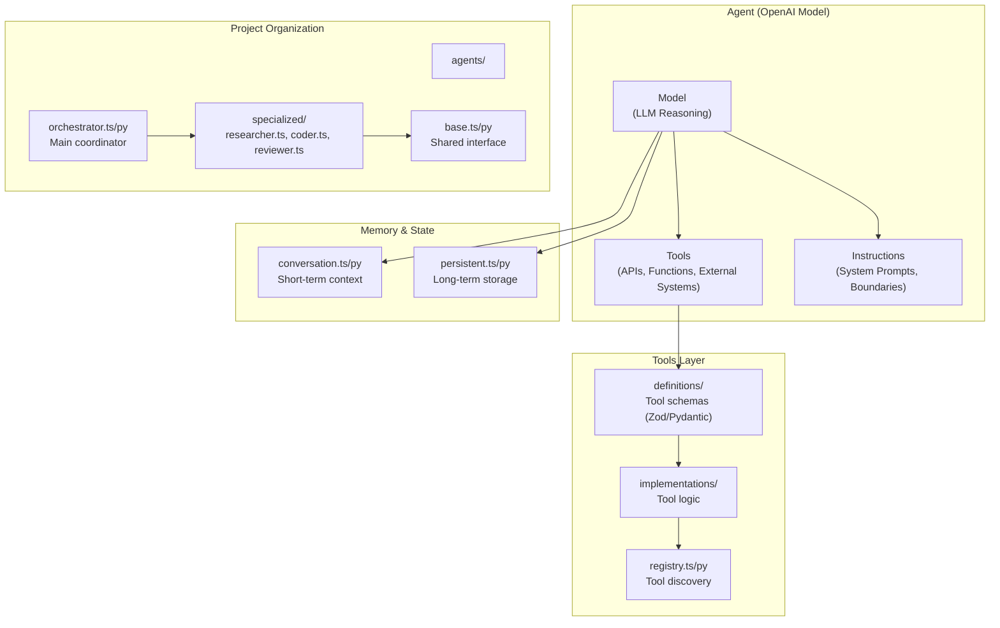
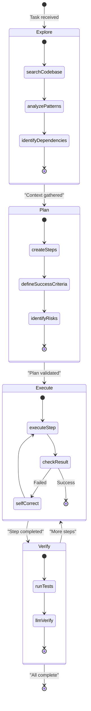
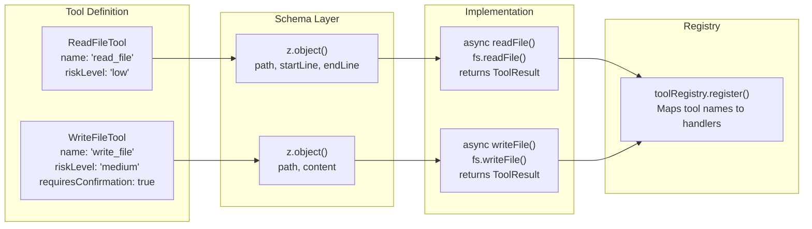
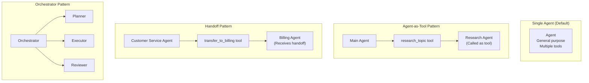
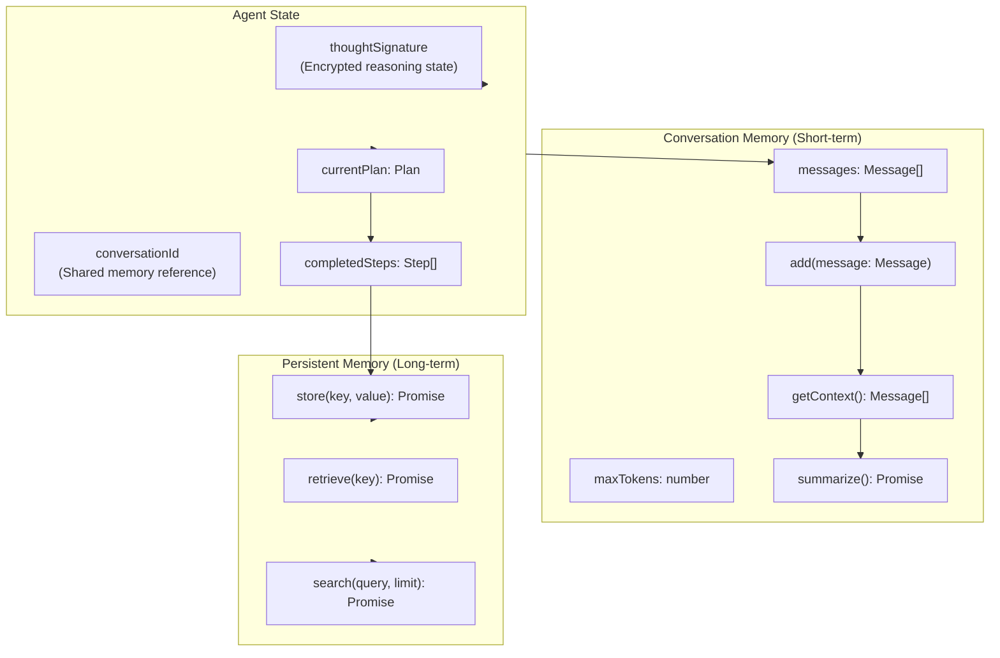
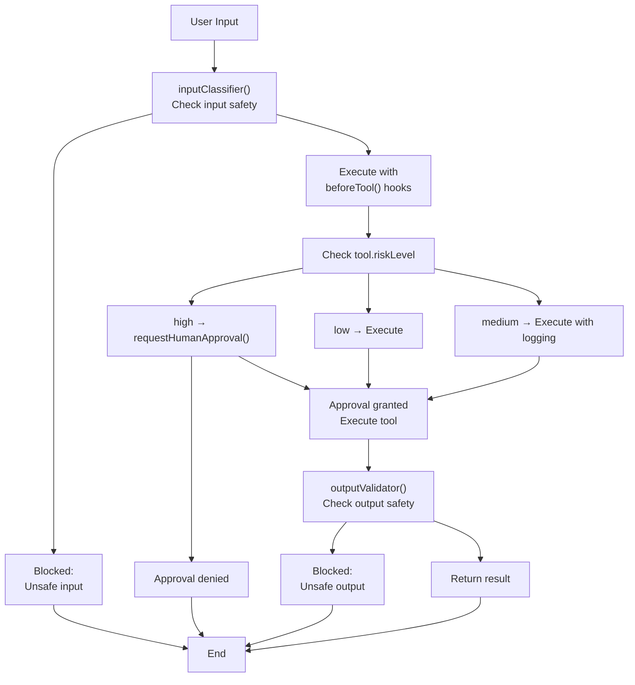
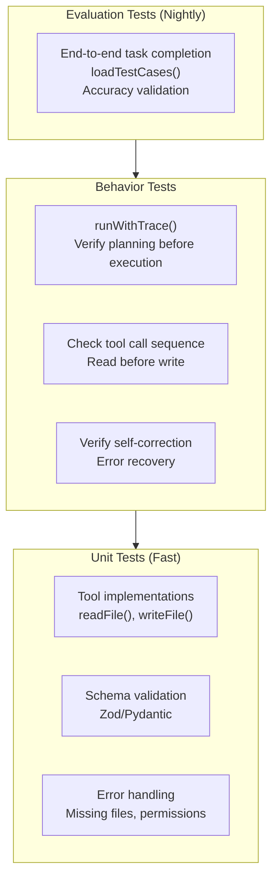

<!-- source: DeepWiki mcp.deepwiki.com · repo alinaqi/claude-bootstrap · page 5.6 AI and Agentic Development · fetched 2026-10-27 -->

# AI and Agentic Development

<details>
<summary>Relevant source files</summary>

The following files were used as context for generating this wiki page:

- [README.md](README.md)
- [skills/agentic-development.md](skills/agentic-development.md)

</details>


## Purpose and Scope

This document covers skills and patterns for building autonomous AI agents that perform multi-step tasks using tools and reasoning. It focuses on two primary frameworks: **Pydantic AI** (Python default) and **Claude Agent SDK** (Node.js default). These agents follow an Explore-Plan-Execute-Verify workflow with built-in guardrails and structured output validation.

For general LLM integration patterns and testing approaches, see [LLM Patterns](#5.7). For available model specifications and capabilities, see [AI Models Reference](#5.8).

**Sources:** [skills/agentic-development.md:1-8]()

---

## Framework Selection by Language

Claude Bootstrap defaults to framework choices optimized for type safety and production readiness:

| Language/Framework | Default Framework | Key Benefits |
|-------------------|------------------|--------------|
| **Python** | Pydantic AI | Type-safe results, Pydantic validation, multi-model support, production-ready |
| **Node.js / Next.js** | Claude Agent SDK | Official Anthropic SDK, native tool support, multi-agent coordination, streaming |

### Python: Pydantic AI Architecture

The Pydantic AI framework provides type-safe agent construction with automatic validation:

```python
from pydantic_ai import Agent
from pydantic import BaseModel

class SearchResult(BaseModel):
    title: str
    url: str
    summary: str

agent = Agent(
    'claude-sonnet-4-20250514',
    result_type=list[SearchResult],
    system_prompt='You are a research assistant.',
)

result = await agent.run('Find articles about AI agents')
for item in result.data:
    print(f"{item.title}: {item.url}")
```

### Node.js: Claude SDK Agentic Loop

The Claude SDK implements the agentic pattern through explicit tool handling:

```typescript
const tools: Anthropic.Tool[] = [{
  name: "web_search",
  description: "Search the web for information",
  input_schema: {
    type: "object",
    properties: {
      query: { type: "string", description: "Search query" },
    },
    required: ["query"],
  },
}];

while (true) {
  const response = await client.messages.create({
    model: "claude-sonnet-4-20250514",
    max_tokens: 4096,
    tools,
    messages,
  });

  if (response.stop_reason === "tool_use") {
    // Execute tool and continue loop
  } else {
    return response.content;
  }
}
```

**Sources:** [skills/agentic-development.md:11-93]()

---

## Agent Architecture and Project Structure

### Agent Component Model



**Directory Structure**

The recommended project layout separates concerns by agent type, tool definitions, and memory management:

```
project/
├── src/
│   ├── agents/
│   │   ├── orchestrator.ts        # Main agent coordinator
│   │   ├── specialized/           # Task-specific agents
│   │   │   ├── researcher.ts      # Research agent
│   │   │   ├── coder.ts           # Coding agent
│   │   │   └── reviewer.ts        # Review agent
│   │   └── base.ts                # Shared agent interface
│   ├── tools/
│   │   ├── definitions/           # Tool schemas
│   │   ├── implementations/       # Tool logic
│   │   └── registry.ts            # Tool discovery
│   ├── prompts/
│   │   ├── system/                # Agent instructions
│   │   └── templates/             # Task templates
│   └── memory/
│       ├── conversation.ts        # Short-term context
│       └── persistent.ts          # Long-term storage
├── tests/
│   ├── agents/                    # Agent behavior tests
│   ├── tools/                     # Tool unit tests
│   └── evals/                     # End-to-end evaluations
```

**Sources:** [skills/agentic-development.md:106-154]()

---

## Explore-Plan-Execute-Verify Workflow

The core agent workflow enforces planning before action and verification after execution. This pattern prevents premature execution and ensures quality at each step.

### Workflow State Diagram



### Explore Phase Implementation

The explore phase gathers context before taking action. This prevents blind execution and ensures informed decisions.

```typescript
// agents/base.ts
async function explore(task: Task): Promise<Context> {
  const relevantFiles = await agent.searchCodebase(task.query);
  const existingPatterns = await agent.analyzePatterns(relevantFiles);
  const dependencies = await agent.identifyDependencies(task);

  return { relevantFiles, existingPatterns, dependencies };
}
```

**Key Functions:**
- `searchCodebase(query: string)`: Locate relevant files using semantic search
- `analyzePatterns(files: File[])`: Identify existing code patterns
- `identifyDependencies(task: Task)`: Map task dependencies

### Plan Phase Implementation

Planning creates explicit, verifiable steps with success criteria. The LLM must output structured plans before execution.

```typescript
// agents/base.ts
async function plan(task: Task, context: Context): Promise<Plan> {
  const prompt = `
    Task: ${task.description}
    Context: ${JSON.stringify(context)}

    Create a step-by-step plan. For each step:
    1. What action to take
    2. What tools to use
    3. How to verify success
    4. What could go wrong

    Output JSON with steps array.
  `;

  return await llmCall({ prompt, schema: PlanSchema });
}
```

**Key Schemas:**
- `PlanSchema`: Zod/Pydantic schema defining plan structure
- `StepSchema`: Individual step with action, tools, verification, risks

### Execute Phase Implementation

Execution proceeds incrementally with verification after each step. Failed steps trigger self-correction or escalation.

```typescript
// agents/base.ts
async function execute(plan: Plan): Promise<Result[]> {
  const results: Result[] = [];

  for (const step of plan.steps) {
    const result = await executeStep(step);

    if (!await verify(step, result)) {
      const corrected = await selfCorrect(step, result);
      if (!corrected.success) {
        return handleFailure(step, results);
      }
    }

    results.push(result);
  }

  return results;
}
```

### Verify Phase Implementation

Independent verification prevents overfitting to immediate results. Tests and LLM validation both run.

```typescript
// agents/base.ts
async function verify(step: Step, result: Result): Promise<boolean> {
  // Run tests if available
  if (step.testCommand) {
    const testResult = await runCommand(step.testCommand);
    if (!testResult.success) return false;
  }

  // Use LLM to verify against criteria
  const verification = await llmCall({
    prompt: `
      Step: ${step.description}
      Expected: ${step.successCriteria}
      Actual: ${JSON.stringify(result)}

      Does the result satisfy the success criteria?
      Respond with { "passes": boolean, "reasoning": string }
    `,
    schema: VerificationSchema
  });

  return verification.passes;
}
```

**Sources:** [skills/agentic-development.md:156-243]()

---

## Tool Design Patterns

Tools are the agent's interface to external systems. Proper tool design includes schemas, risk levels, and confirmation requirements.

### Tool Definition to Implementation Flow



### Tool Definition Pattern

Tool definitions specify schemas, risk levels, and confirmation requirements:

```typescript
// tools/definitions/file-operations.ts
import { z } from 'zod';

export const ReadFileTool = {
  name: 'read_file',
  description: 'Read contents of a file. Use before modifying any file.',
  parameters: z.object({
    path: z.string().describe('Absolute path to the file'),
    startLine: z.number().optional().describe('Start line (1-indexed)'),
    endLine: z.number().optional().describe('End line (1-indexed)'),
  }),
  riskLevel: 'low' as const,
};

export const WriteFileTool = {
  name: 'write_file',
  description: 'Write content to a file. Always read first to understand context.',
  parameters: z.object({
    path: z.string().describe('Absolute path to the file'),
    content: z.string().describe('Complete file content'),
  }),
  riskLevel: 'medium' as const,
  requiresConfirmation: true,
};
```

### Tool Implementation Pattern

Implementations return structured `ToolResult` objects with success/error states:

```typescript
// tools/implementations/file-operations.ts
export async function readFile(
  params: z.infer<typeof ReadFileTool.parameters>
): Promise<ToolResult> {
  try {
    const content = await fs.readFile(params.path, 'utf-8');
    const lines = content.split('\n');

    const start = (params.startLine ?? 1) - 1;
    const end = params.endLine ?? lines.length;

    return {
      success: true,
      data: lines.slice(start, end).join('\n'),
      metadata: { totalLines: lines.length }
    };
  } catch (error) {
    return {
      success: false,
      error: `Failed to read file: ${error.message}`
    };
  }
}
```

### Risk Levels and Confirmation

Tools categorized by risk level determine whether human approval is required:

| Risk Level | Examples | Requires Confirmation? | Action |
|-----------|----------|----------------------|--------|
| `low` | `read_file`, `web_search` | No | Execute immediately |
| `medium` | `write_file`, `database_query` | Optional | Request approval for sensitive contexts |
| `high` | `delete_file`, `execute_command` | Yes | Always require human approval |

**Sources:** [skills/agentic-development.md:247-319]()

---

## Multi-Agent Coordination Patterns

Multiple agents enable specialization but add complexity. Use single agents by default and add multi-agent patterns only when needed.

### Multi-Agent Pattern Types



### Agent-as-Tool Pattern

Specialized agents exposed as callable tools to a main agent:

```typescript
// agents/specialized/researcher.ts
const researchAgent = createAgent({
  name: 'researcher',
  instructions: 'You research topics and return structured findings.',
  tools: [webSearchTool, documentReadTool],
});

// agents/orchestrator.ts
const mainAgent = createAgent({
  tools: [
    {
      type: 'function',
      function: {
        name: 'research_topic',
        description: 'Delegate research to specialized agent',
        parameters: ResearchQuerySchema,
        handler: async (query) => researchAgent.run(query),
      },
    },
  ],
});
```

**Key Functions:**
- `createAgent(config)`: Initialize agent with tools and instructions
- `researchAgent.run(query)`: Execute research agent as tool
- `ResearchQuerySchema`: Zod schema for research parameters

### Handoff Pattern

One-way transfer between agents with context preservation:

```typescript
// agents/customer-service.ts
const customerServiceAgent = createAgent({
  tools: [
    {
      name: 'transfer_to_billing',
      description: 'Transfer to billing specialist for payment issues',
      handler: async (context) => {
        return { handoff: 'billing_agent', context };
      },
    },
  ],
});
```

### Pydantic AI Multi-Agent Orchestration

Python multi-agent coordination using Pydantic AI:

```python
from pydantic_ai import Agent

# Specialized agents
planner = Agent('claude-sonnet-4-20250514', system_prompt='Create detailed plans.')
executor = Agent('claude-sonnet-4-20250514', system_prompt='Execute tasks precisely.')
reviewer = Agent('claude-sonnet-4-20250514', system_prompt='Review and verify work.')

async def orchestrate(task: str):
    # 1. Plan
    plan = await planner.run(f"Create a plan for: {task}")

    # 2. Execute each step
    results = []
    for step in plan.data.steps:
        result = await executor.run(f"Execute: {step}")
        results.append(result.data)

    # 3. Review
    review = await reviewer.run(
        f"Review the results:\nTask: {task}\nResults: {results}"
    )

    return review.data
```

**When to Use Multiple Agents:**
- Separate task domains with non-overlapping tools
- Different authorization levels needed
- Complex workflows with clear handoff points
- Parallel execution of independent subtasks

**Sources:** [skills/agentic-development.md:321-373](), [skills/agentic-development.md:682-707]()

---

## Memory and State Management

Agents maintain state across tool calls and sessions through conversation memory and persistent storage.

### Memory Architecture



### Conversation Memory Interface

Short-term memory for active agent sessions:

```typescript
// memory/conversation.ts
interface ConversationMemory {
  messages: Message[];
  maxTokens: number;

  add(message: Message): void;
  getContext(): Message[];
  summarize(): Promise<string>;
}
```

### Agent State Interface

State preserved across tool calls, especially for reasoning models:

```typescript
// agents/base.ts
interface AgentState {
  thoughtSignature?: string;  // Encrypted reasoning state (Gemini)
  conversationId: string;     // For shared memory
  currentPlan?: Plan;
  completedSteps: Step[];
}
```

**Key Properties:**
- `thoughtSignature`: Required for Gemini function calling with reasoning preserved
- `conversationId`: Links messages across sessions
- `currentPlan`: Active execution plan
- `completedSteps`: Audit trail of completed actions

### Persistent Memory Interface

Long-term storage with semantic search:

```typescript
// memory/persistent.ts
interface PersistentMemory {
  // Store learnings across sessions
  store(key: string, value: any): Promise<void>;
  retrieve(key: string): Promise<any>;

  // Semantic search over past interactions
  search(query: string, limit: number): Promise<Memory[]>;
}
```

**Sources:** [skills/agentic-development.md:377-412]()

---

## Guardrails and Safety Mechanisms

Multi-layer protection prevents unsafe agent behavior through input validation, tool risk assessment, and human-in-the-loop approvals.

### Guardrail Execution Flow



### Guardrail Configuration

The `GuardrailConfig` interface defines multi-layer protection:

```typescript
// guards/index.ts
interface GuardrailConfig {
  // Input validation
  inputClassifier: (input: string) => Promise<SafetyResult>;

  // Output validation
  outputValidator: (output: string) => Promise<SafetyResult>;

  // Tool risk assessment
  toolRiskLevels: Record<string, 'low' | 'medium' | 'high'>;

  // Actions requiring human approval
  humanInTheLoop: string[];
}
```

### Execution with Guardrails

The `executeWithGuardrails` function wraps agent execution with safety checks:

```typescript
// guards/index.ts
async function executeWithGuardrails(
  agent: Agent,
  input: string,
  config: GuardrailConfig
): Promise<Result> {
  // 1. Check input safety
  const inputCheck = await config.inputClassifier(input);
  if (!inputCheck.safe) {
    return { blocked: true, reason: inputCheck.reason };
  }

  // 2. Execute with tool monitoring
  const result = await agent.run(input, {
    beforeTool: async (tool, params) => {
      const risk = config.toolRiskLevels[tool.name];
      if (risk === 'high' || config.humanInTheLoop.includes(tool.name)) {
        return await requestHumanApproval(tool, params);
      }
      return { approved: true };
    },
  });

  // 3. Validate output
  const outputCheck = await config.outputValidator(result.output);
  if (!outputCheck.safe) {
    return { blocked: true, reason: outputCheck.reason };
  }

  return result;
}
```

### Scope Enforcement

System prompts define hard boundaries for agent behavior:

```typescript
const agentInstructions = `
You are a customer service agent for Acme Corp.

SCOPE BOUNDARIES (non-negotiable):
- Only answer questions about Acme products and services
- Never provide legal, medical, or financial advice
- Never access or modify data outside your authorized scope
- If a request is out of scope, politely decline and explain why

If you cannot complete a task within scope, notify the user
and request explicit approval before proceeding.
`;
```

**Sources:** [skills/agentic-development.md:415-481]()

---

## Testing Agent Behavior

Agent testing spans three levels: unit tests for tools, behavior tests for agent decisions, and evaluation tests for accuracy.

### Test Pyramid for Agents



### Unit Tests for Tools

Fast tests validating individual tool implementations:

```typescript
// tests/tools/file-operations.test.ts
describe('readFile tool', () => {
  it('reads file content correctly', async () => {
    const result = await readFile({ path: '/test/file.txt' });
    expect(result.success).toBe(true);
    expect(result.data).toContain('expected content');
  });

  it('handles missing files gracefully', async () => {
    const result = await readFile({ path: '/nonexistent.txt' });
    expect(result.success).toBe(false);
    expect(result.error).toContain('Failed to read file');
  });
});
```

### Behavior Tests for Agent Decisions

Tests validating agent decision-making patterns:

```typescript
// tests/agents/planning.test.ts
describe('agent planning', () => {
  it('creates plan before executing file modifications', async () => {
    const trace = await agent.runWithTrace('Refactor the auth module');

    // Verify planning happened first
    const firstToolCall = trace.toolCalls[0];
    expect(firstToolCall.name).toBe('read_file');

    // Verify no writes without reads
    const writeIndex = trace.toolCalls.findIndex(t => t.name === 'write_file');
    const readIndex = trace.toolCalls.findIndex(t => t.name === 'read_file');
    expect(readIndex).toBeLessThan(writeIndex);
  });
});
```

**Key Functions:**
- `agent.runWithTrace(prompt)`: Execute with detailed trace of tool calls
- `trace.toolCalls`: Array of tools called with parameters
- `findIndex()`: Verify execution order

### Evaluation Tests

Long-running accuracy tests using predefined test cases:

```typescript
// tests/evals/coding-tasks.test.ts
describe('Agent Accuracy (Eval)', () => {
  const testCases = loadTestCases('./evals/coding-tasks.json');

  it.each(testCases)('completes $name correctly', async (testCase) => {
    const result = await agent.run(testCase.input);

    // Verify against expected outcomes
    expect(result.filesModified).toEqual(testCase.expectedFiles);
    expect(await runTests(testCase.testCommand)).toBe(true);
  }, 120000); // 2 minute timeout
});
```

### Pydantic AI Testing with TestModel

Mock model for deterministic agent testing:

```python
# tests/test_agents.py
import pytest
from pydantic_ai import Agent
from pydantic_ai.models.test import TestModel

@pytest.fixture
def test_agent():
    return Agent(
        TestModel(),  # Mock model for testing
        result_type=str,
    )

async def test_agent_response(test_agent):
    result = await test_agent.run('Test prompt')
    assert result.data is not None

# Test with specific responses
async def test_with_mock_response():
    model = TestModel()
    model.seed_response('Expected output')

    agent = Agent(model)
    result = await agent.run('Any prompt')
    assert result.data == 'Expected output'
```

**Key Classes:**
- `TestModel`: Mock model with predictable responses
- `seed_response(output)`: Set expected output for testing

**Sources:** [skills/agentic-development.md:530-575](), [skills/agentic-development.md:726-750]()

---

## Model Selection and Configuration

Different models optimize for different agent tasks. Select based on complexity, latency requirements, and reasoning depth.

### Model Selection Matrix

| Task Complexity | Recommended Model | Use Case |
|----------------|-------------------|----------|
| Simple, fast | `gpt-5-mini`, `claude-haiku` | Quick queries, low latency tasks |
| General purpose | `gpt-4.1`, `claude-sonnet` | Standard agent operations |
| Complex reasoning | `o4-mini`, `claude-opus` | Multi-step planning, complex logic |
| Deep planning | `gpt-5 + reasoning`, `ultrathink` | Research, strategic planning |

### Claude Thinking Modes

Claude supports extended thinking through prompt keywords:

```typescript
// agents/orchestrator.ts
const thinkingLevels = {
  'think': 'standard analysis',
  'think hard': 'deeper reasoning',
  'think harder': 'extensive analysis',
  'ultrathink': 'maximum reasoning budget',
};

const prompt = `
Think hard about this problem before proposing a solution.

Task: ${task.description}
`;
```

**Thinking Triggers:**
- `"think"` → Standard analysis
- `"think hard"` → Deeper reasoning
- `"think harder"` → Extensive analysis
- `"ultrathink"` → Maximum reasoning

### Gemini Configuration

Gemini requires specific configuration for reasoning and function calling:

```typescript
// agents/gemini-agent.ts
const response = await gemini.generate({
  model: 'gemini-3',
  thinking_level: 'high',  // For complex planning
  temperature: 1.0,        // Keep at 1.0 for reasoning engine
});

// Preserve thought state across tool calls (REQUIRED)
const nextResponse = await gemini.generate({
  thoughtSignature: response.thoughtSignature,  // Pass back for function calling
  // ... rest of params
});
```

**Critical Settings:**
- `thinking_level`: `'high'` | `'low'` - Controls reasoning depth
- `temperature`: Always `1.0` for reasoning models
- `thoughtSignature`: **Must** pass back for function calling to preserve reasoning state

**Sources:** [skills/agentic-development.md:485-527]()

---

## Pydantic AI Implementation Patterns

Python projects default to Pydantic AI for type-safe agent development with automatic validation.

### Agent with Typed Dependencies

Dependencies inject context and services into tools:

```python
# src/agents/researcher.py
from pydantic_ai import Agent, RunContext
from pydantic import BaseModel
from httpx import AsyncClient

class SearchResult(BaseModel):
    title: str
    url: str
    snippet: str

class ResearchDeps(BaseModel):
    http_client: AsyncClient
    api_key: str

research_agent = Agent(
    'claude-sonnet-4-20250514',
    deps_type=ResearchDeps,
    result_type=list[SearchResult],
    system_prompt='You are a research assistant. Use tools to find information.',
)

@research_agent.tool
async def web_search(ctx: RunContext[ResearchDeps], query: str) -> list[dict]:
    """Search the web for information."""
    response = await ctx.deps.http_client.get(
        'https://api.search.com/search',
        params={'q': query},
        headers={'Authorization': f'Bearer {ctx.deps.api_key}'},
    )
    return response.json()['results']
```

**Key Classes:**
- `Agent(model, deps_type, result_type, system_prompt)`: Initialize agent
- `RunContext[ResearchDeps]`: Type-safe dependency injection
- `@research_agent.tool`: Decorator for tool registration

### Structured Output with Validation

Pydantic models provide automatic validation:

```python
# src/models/schemas.py
from pydantic import BaseModel, Field
from pydantic_ai import Agent

class CodeReview(BaseModel):
    summary: str = Field(description="Brief summary of the review")
    issues: list[str] = Field(description="List of issues found")
    suggestions: list[str] = Field(description="Improvement suggestions")
    approval: bool = Field(description="Whether code is approved")
    confidence: float = Field(ge=0, le=1, description="Confidence score")

review_agent = Agent(
    'claude-sonnet-4-20250514',
    result_type=CodeReview,
    system_prompt='Review code for quality, security, and best practices.',
)

# Result is validated Pydantic model
result = await review_agent.run(f"Review this code:\n```python\n{code}\n```")
if result.data.approval:
    print("Code approved!")
else:
    for issue in result.data.issues:
        print(f"Issue: {issue}")
```

### Streaming Responses

Stream responses for real-time feedback:

```python
# src/agents/streaming.py
from pydantic_ai import Agent

agent = Agent('claude-sonnet-4-20250514')

async def stream_response(prompt: str):
    async with agent.run_stream(prompt) as response:
        async for chunk in response.stream():
            print(chunk, end='', flush=True)

    # Get final structured result
    result = await response.get_data()
    return result
```

**Key Methods:**
- `agent.run_stream(prompt)`: Start streaming execution
- `response.stream()`: Async iterator for chunks
- `response.get_data()`: Final structured result after streaming completes

**Sources:** [skills/agentic-development.md:579-723]()

---

## Skills Pattern (Anthropic)

The Anthropic skills pattern organizes agent capabilities as self-contained modules with instructions, scripts, and resources.

### Skills Directory Structure

```
skills/
└── code-review/
    ├── instructions.md      # How to perform code reviews
    ├── scripts/
    │   └── run-linters.sh   # Supporting scripts
    └── resources/
        └── checklist.md     # Review checklist
```

### Instructions Format

Each skill defines when to use it, the process, and output format:

```markdown
# Code Review Skill

## When to Use
Activate this skill when asked to review code, PRs, or diffs.

## Process
1. Read the changed files completely
2. Run linters: `./scripts/run-linters.sh`
3. Check against resources/checklist.md
4. Provide structured feedback

## Output Format
- Summary (1-2 sentences)
- Issues found (severity: critical/major/minor)
- Suggestions for improvement
- Approval recommendation
```

### Dynamic Skill Loading

Load skills at runtime based on task requirements:

```typescript
// agents/skill-loader.ts
async function loadSkill(skillName: string): Promise<Skill> {
  const skillPath = `./skills/${skillName}`;
  const instructions = await fs.readFile(`${skillPath}/instructions.md`, 'utf-8');
  const scripts = await glob(`${skillPath}/scripts/*`);
  const resources = await glob(`${skillPath}/resources/*`);

  return {
    name: skillName,
    instructions,
    scripts: scripts.map(s => ({ name: path.basename(s), path: s })),
    resources: await Promise.all(resources.map(loadResource)),
  };
}
```

**Sources:** [skills/agentic-development.md:753-802]()

---

## Anti-Patterns to Avoid

Common mistakes that reduce agent effectiveness:

| Anti-Pattern | Impact | Solution |
|-------------|--------|----------|
| **No planning before execution** | More errors, wasted tool calls | Implement explore-plan-execute-verify |
| **Monolithic agents** | Confused with 50+ tools | Split by domain or use agent-as-tool pattern |
| **No verification** | Silent failures, wrong outputs | Add verify() after each step |
| **Hardcoded tool sequences** | Inflexible, breaks on edge cases | Let model decide tool order |
| **Missing guardrails** | Unsafe behavior, out-of-scope actions | Add multi-layer protection |
| **No state management** | Lose context across tool calls | Use ConversationMemory + AgentState |
| **Testing only happy paths** | Production failures | Test failures, errors, edge cases |
| **Ignoring model differences** | Poor reasoning model usage | Configure thinking_level, thoughtSignature |
| **No cost tracking** | Budget overruns | Monitor token usage per run |
| **Full automation without oversight** | Dangerous actions | Human-in-the-loop for high-risk operations |

**Sources:** [skills/agentic-development.md:806-818]()

---

## Quick Reference

### Agent Development Checklist

- [ ] Define clear agent scope and boundaries
- [ ] Design tools with explicit schemas and risk levels
- [ ] Implement explore-plan-execute-verify workflow
- [ ] Add multi-layer guardrails
- [ ] Set up conversation and persistent memory
- [ ] Write behavior and evaluation tests
- [ ] Configure appropriate model for task complexity
- [ ] Add human-in-the-loop for high-risk operations
- [ ] Monitor token usage and costs
- [ ] Document skills and instructions

### Framework Quick Start

**Python (Pydantic AI):**
```python
from pydantic_ai import Agent
agent = Agent('claude-sonnet-4-20250514', result_type=MyModel)
result = await agent.run('task description')
```

**Node.js (Claude SDK):**
```typescript
const response = await client.messages.create({
  model: "claude-sonnet-4-20250514",
  tools: [...],
  messages: [...],
});
```

### Thinking Triggers (Claude)

| Keyword | Effect |
|---------|--------|
| `"think"` | Standard analysis |
| `"think hard"` | Deeper reasoning |
| `"think harder"` | Extensive analysis |
| `"ultrathink"` | Maximum reasoning budget |

### Gemini Configuration

```typescript
{
  thinking_level: "high" | "low",
  temperature: 1.0,  // Keep at 1.0 for reasoning
  thoughtSignature: "<pass back for function calling>"
}
```

**Sources:** [skills/agentic-development.md:820-849]()

---

