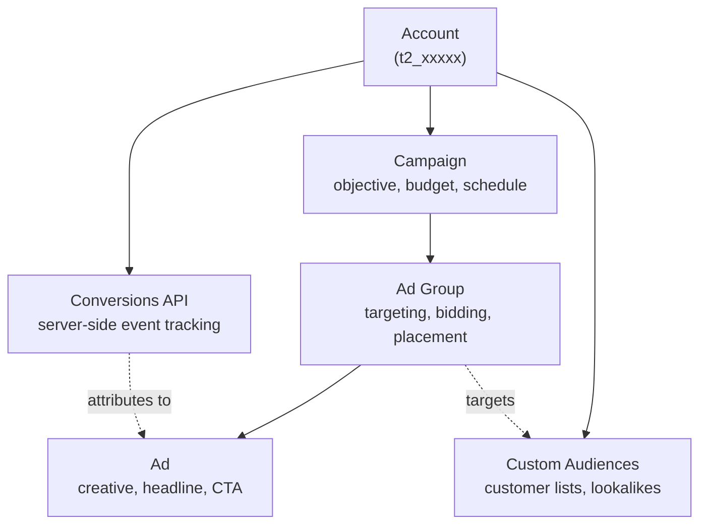
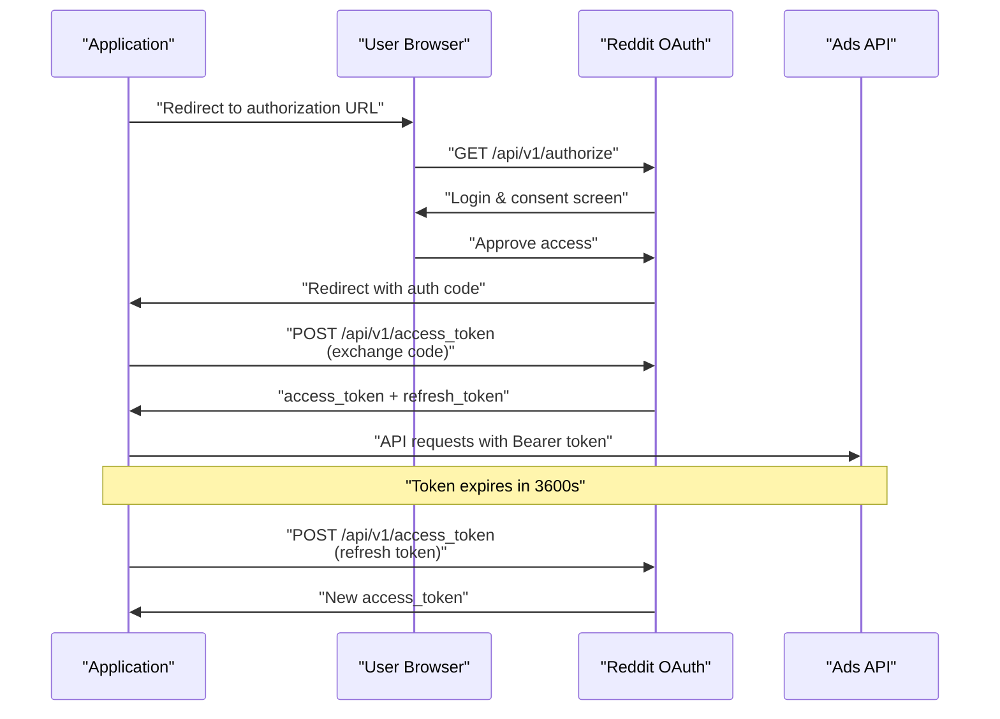
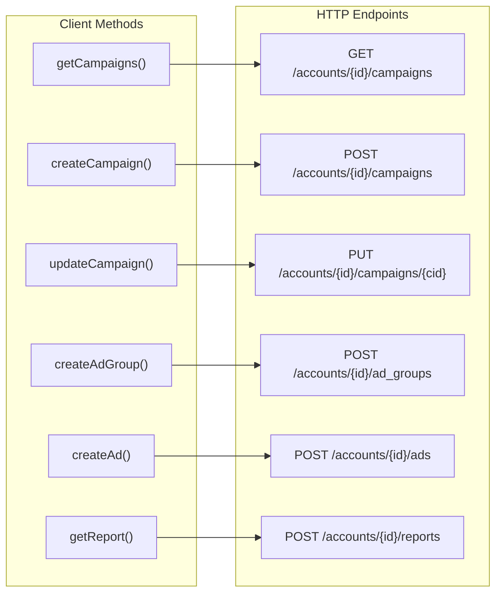
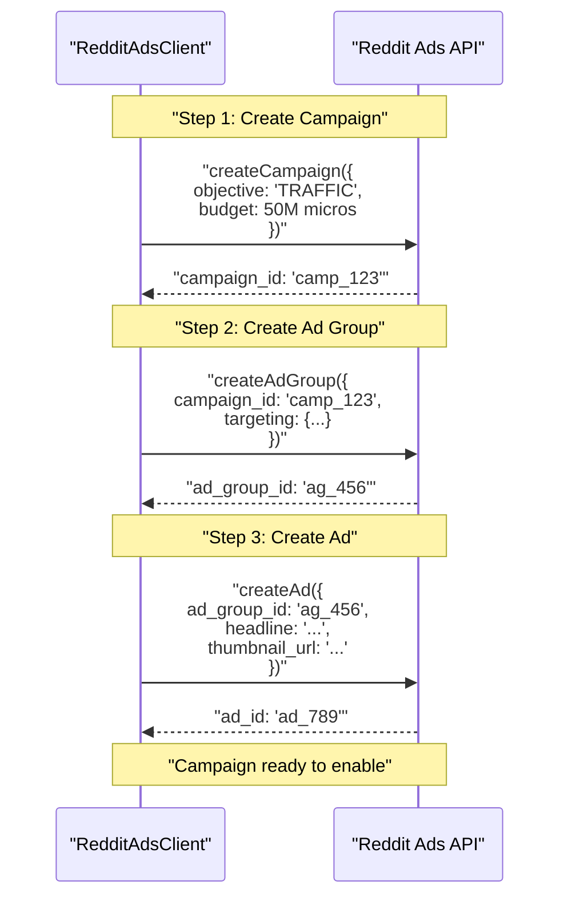
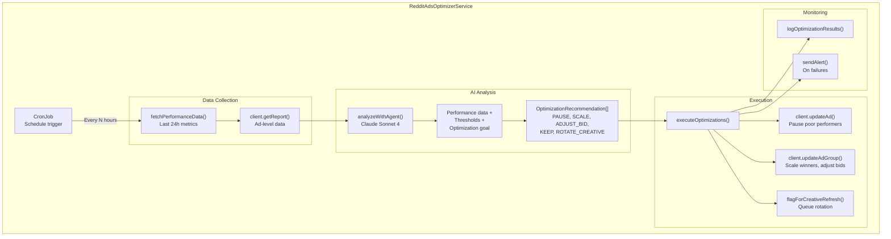
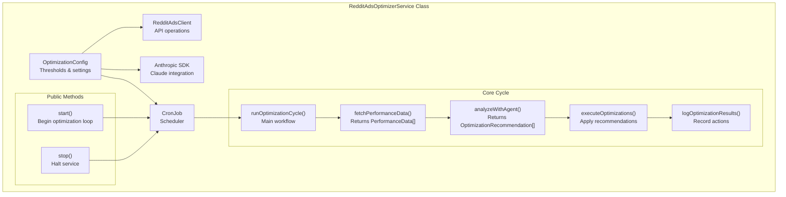
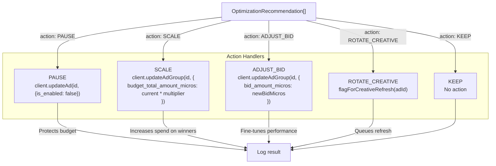
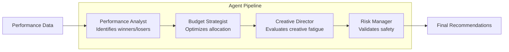

<!-- source: DeepWiki mcp.deepwiki.com · repo alinaqi/claude-bootstrap · page 7.4 Reddit Ads Integration · fetched 2026-10-27 -->

# Reddit Ads Integration

<details>
<summary>Relevant source files</summary>

The following files were used as context for generating this wiki page:

- [skills/reddit-ads.md](skills/reddit-ads.md)

</details>


**Purpose:** This document covers Reddit Ads API integration patterns for programmatically creating, managing, and optimizing advertising campaigns on Reddit. It includes OAuth2 authentication, API client implementations, campaign management workflows, conversion tracking, reporting, and an AI-powered agentic optimization service that automatically scales winners and pauses poor performers.

For general integration patterns and credential management, see [Security and Credentials](#6). For other advertising and analytics platforms, see [Analytics with PostHog](#7.1).

---

## Overview

The Reddit Ads integration enables automated campaign management through a hierarchical structure: Account → Campaign → Ad Group → Ad. The system provides both imperative API clients for direct control and a declarative agentic optimizer service that uses Claude to make optimization decisions autonomously.

**Sources:** [skills/reddit-ads.md:1-30]()

### Campaign Hierarchy



**Campaign Properties:**
- Objective: `BRAND_AWARENESS`, `TRAFFIC`, `CONVERSIONS`, `VIDEO_VIEWS`, `APP_INSTALLS`
- Budget: `DAILY` (average per day) or `LIFETIME` (total spend)
- Amount: Specified in micros (1 USD = 1,000,000 micros)

**Ad Group Properties:**
- Bidding: `LOWEST_COST`, `COST_CAP`, `MANUAL`
- Targeting: Communities (subreddits), interests, keywords, geo, devices, custom audiences
- Goal: `CLICKS`, `IMPRESSIONS`, `CONVERSIONS`

**Ad Properties:**
- Type: `LINK`, `TEXT`, `VIDEO`, `CAROUSEL`, `PRODUCT`
- Call-to-action: `SHOP_NOW`, `SIGN_UP`, `LEARN_MORE`, `DOWNLOAD`, etc.
- Creative: Headline (300 chars max), body, thumbnail, video

**Sources:** [skills/reddit-ads.md:12-29](), [skills/reddit-ads.md:460-506](), [skills/reddit-ads.md:524-596](), [skills/reddit-ads.md:627-708]()

---

## Authentication

### OAuth2 Flow

Reddit Ads uses OAuth2 with three-step authorization:

1. **Authorization URL Generation** - Redirect user to Reddit with required scopes
2. **Code Exchange** - Trade authorization code for access/refresh tokens
3. **Token Refresh** - Use refresh token to obtain new access tokens before expiry



**Required Environment Variables:**

| Variable | Purpose | Format |
|----------|---------|--------|
| `REDDIT_ADS_CLIENT_ID` | OAuth client ID | Alphanumeric string |
| `REDDIT_ADS_CLIENT_SECRET` | OAuth client secret | Base64-encodable string |
| `REDDIT_ADS_ACCOUNT_ID` | Ads account identifier | `t2_xxxxx` format |
| `REDDIT_ADS_ACCESS_TOKEN` | Current bearer token | JWT-like string |
| `REDDIT_ADS_REFRESH_TOKEN` | Long-lived refresh token | Opaque string |

**Required Scopes:**

| Scope | Access Level |
|-------|--------------|
| `adsread` | Read campaigns, ad groups, ads, reports |
| `adsedit` | Create/update campaigns, ad groups, ads |
| `history` | Access account history |

**Sources:** [skills/reddit-ads.md:33-184](), [skills/reddit-ads.md:986-995]()

### Token Management Implementation

**JavaScript/TypeScript:**
- Authorization URL: [skills/reddit-ads.md:54-63]()
- Code exchange: [skills/reddit-ads.md:66-87]()
- Token refresh: [skills/reddit-ads.md:90-109]()

**Python:**
- Authorization URL: [skills/reddit-ads.md:124-135]()
- Code exchange: [skills/reddit-ads.md:137-155]()
- Token refresh: [skills/reddit-ads.md:157-174]()

---

## API Client Architecture

### RedditAdsClient Structure

Both Node.js and Python implementations provide identical method signatures for consistent cross-language usage.

```mermaid
graph TB
    subgraph "RedditAdsClient Class"
        Config["RedditAdsConfig<br/>accessToken, accountId"]
        Request["_request()<br/>HTTP wrapper with auth"]
        
        subgraph "Account Methods"
            GetAccount["getAccount()"]
        end
        
        subgraph "Campaign Methods"
            GetCampaigns["getCampaigns()"]
            GetCampaign["getCampaign(id)"]
            CreateCampaign["createCampaign(data)"]
            UpdateCampaign["updateCampaign(id, data)"]
        end
        
        subgraph "Ad Group Methods"
            GetAdGroups["getAdGroups(campaignId?)"]
            GetAdGroup["getAdGroup(id)"]
            CreateAdGroup["createAdGroup(data)"]
            UpdateAdGroup["updateAdGroup(id, data)"]
        end
        
        subgraph "Ad Methods"
            GetAds["getAds(adGroupId?)"]
            CreateAd["createAd(data)"]
            UpdateAd["updateAd(id, data)"]
        end
        
        subgraph "Reporting & Audiences"
            GetReport["getReport(request)"]
            GetAudiences["getCustomAudiences()"]
            CreateAudience["createCustomAudience(data)"]
        end
        
        Config --> Request
        Request --> GetAccount
        Request --> GetCampaigns
        Request --> GetCampaign
        Request --> CreateCampaign
        Request --> UpdateCampaign
        Request --> GetAdGroups
        Request --> GetAdGroup
        Request --> CreateAdGroup
        Request --> UpdateAdGroup
        Request --> GetAds
        Request --> CreateAd
        Request --> UpdateAd
        Request --> GetReport
        Request --> GetAudiences
        Request --> CreateAudience
    end
    
    API["Reddit Ads API<br/>https://ads-api.reddit.com/api/v2.0"]
    
    GetAccount --> API
    GetCampaigns --> API
    CreateCampaign --> API
    GetAdGroups --> API
    CreateAdGroup --> API
    GetAds --> API
    CreateAd --> API
    GetReport --> API
    GetAudiences --> API
```



**Node.js Implementation:**
- Class definition: [skills/reddit-ads.md:192-307]()
- Constructor: [skills/reddit-ads.md:203-206]()
- Request wrapper: [skills/reddit-ads.md:208-231]()
- Campaign methods: [skills/reddit-ads.md:238-253]()
- Ad Group methods: [skills/reddit-ads.md:255-273]()
- Ad methods: [skills/reddit-ads.md:275-289]()
- Reporting: [skills/reddit-ads.md:291-294]()
- Custom audiences: [skills/reddit-ads.md:296-303]()

**Python Implementation:**
- Class definition: [skills/reddit-ads.md:312-400]()
- Constructor: [skills/reddit-ads.md:325-333]()
- Request wrapper: [skills/reddit-ads.md:335-344]()
- Campaign methods: [skills/reddit-ads.md:351-361]()
- Ad Group methods: [skills/reddit-ads.md:364-376]()
- Ad methods: [skills/reddit-ads.md:378-388]()
- Reporting: [skills/reddit-ads.md:390-392]()
- Custom audiences: [skills/reddit-ads.md:394-399]()

**Sources:** [skills/reddit-ads.md:187-400]()

### API Endpoint Mapping



**Base URL:** `https://ads-api.reddit.com/api/v2.0`  
**Rate Limit:** 1 request per second  
**Authentication:** Bearer token in `Authorization` header

**Complete endpoint reference:**
- Account endpoints: [skills/reddit-ads.md:406-411]()
- Campaign endpoints: [skills/reddit-ads.md:413-421]()
- Ad Group endpoints: [skills/reddit-ads.md:423-431]()
- Ad endpoints: [skills/reddit-ads.md:433-441]()
- Custom audience endpoints: [skills/reddit-ads.md:443-450]()
- Report endpoints: [skills/reddit-ads.md:452-456]()

**Sources:** [skills/reddit-ads.md:404-457]()

---

## Campaign Management Workflow

### Complete Campaign Creation

The typical workflow creates entities in sequence: Campaign → Ad Group → Ad. Each entity requires the parent's ID.



**Implementation example:** [skills/reddit-ads.md:1070-1140]()

**Sources:** [skills/reddit-ads.md:1068-1140]()

### Campaign Configuration

**CampaignCreate Interface:**

| Field | Type | Description | Example |
|-------|------|-------------|---------|
| `name` | string | Campaign name | `"Q1 2025 Traffic Campaign"` |
| `objective` | enum | Campaign goal | `"TRAFFIC"` |
| `is_enabled` | boolean | Active status | `false` (start paused) |
| `budget_type` | enum | Budget model | `"DAILY"` |
| `budget_total_amount_micros` | number | Budget in micros | `50_000_000` ($50) |
| `start_time` | ISO 8601 | Campaign start | `"2025-01-15T00:00:00Z"` |
| `end_time` | ISO 8601 | Campaign end (optional) | `"2025-03-31T23:59:59Z"` |

**Objective options:** [skills/reddit-ads.md:463-471]()  
**Budget types:** [skills/reddit-ads.md:473-478]()  
**Example payload:** [skills/reddit-ads.md:494-505]()

**Sources:** [skills/reddit-ads.md:460-520]()

### Ad Group Configuration

**AdGroupCreate Interface:**

| Field | Type | Description |
|-------|------|-------------|
| `name` | string | Ad group name |
| `campaign_id` | string | Parent campaign ID |
| `is_enabled` | boolean | Active status |
| `bid_strategy` | enum | `LOWEST_COST`, `COST_CAP`, `MANUAL` |
| `goal_type` | enum | `CLICKS`, `IMPRESSIONS`, `CONVERSIONS` |
| `targeting` | object | Targeting configuration |
| `targeting.communities` | string[] | Subreddit names (without `r/`) |
| `targeting.interests` | string[] | Interest categories |
| `targeting.keywords` | string[] | Keyword targets |
| `targeting.geo_locations` | object | Geographic targeting |
| `targeting.devices` | enum[] | `DESKTOP`, `MOBILE`, `TABLET` |
| `targeting.custom_audience_ids` | string[] | Custom audience IDs |

**Bidding strategies:** [skills/reddit-ads.md:526-532]()  
**Targeting options:** [skills/reddit-ads.md:534-543]()  
**Example payload:** [skills/reddit-ads.md:572-596]()

**Sources:** [skills/reddit-ads.md:522-623]()

### Ad Configuration

**AdCreate Interface:**

| Field | Type | Description |
|-------|------|-------------|
| `name` | string | Ad name |
| `ad_group_id` | string | Parent ad group ID |
| `is_enabled` | boolean | Active status |
| `type` | enum | `LINK`, `TEXT`, `VIDEO`, `CAROUSEL`, `PRODUCT` |
| `headline` | string | Ad headline (max 300 chars) |
| `body` | string | Ad body text (optional) |
| `url` | string | Landing page URL |
| `display_url` | string | Display URL (optional) |
| `call_to_action` | string | CTA button text |
| `thumbnail_url` | string | Image URL (for image/video ads) |
| `video_url` | string | Video URL (for video ads) |

**Ad types:** [skills/reddit-ads.md:629-637]()  
**CTA options:** [skills/reddit-ads.md:639-655]() (13 options including `SHOP_NOW`, `SIGN_UP`, `LEARN_MORE`)  
**Example payload:** [skills/reddit-ads.md:674-688]()

**Sources:** [skills/reddit-ads.md:625-707]()

---

## Conversion Tracking

### Conversions API

Server-side event tracking for accurate attribution and optimization. Events are sent to Reddit's Conversions API endpoint with hashed PII data.

**Event Types:**

| Event Type | Description | Use Case |
|------------|-------------|----------|
| `PAGE_VISIT` | Page view | Track landing page visits |
| `VIEW_CONTENT` | Product/content view | Track product page views |
| `SEARCH` | Search action | Track site search usage |
| `ADD_TO_CART` | Add to cart | E-commerce funnel tracking |
| `ADD_TO_WISHLIST` | Add to wishlist | Intent tracking |
| `PURCHASE` | Completed purchase | Revenue attribution |
| `LEAD` | Lead submission | Lead generation tracking |
| `SIGN_UP` | Account creation | User acquisition |
| `CUSTOM` | Custom event | Domain-specific events |

**Sources:** [skills/reddit-ads.md:714-725]()

### ConversionEvent Structure

```mermaid
graph TB
    Event["ConversionEvent"]
    
    subgraph "Required Fields"
        EventAt["event_at<br/>(Unix timestamp ms)"]
        EventType["event_type<br/>(tracking_type + custom_event_name)"]
    end
    
    subgraph "User Identity (Hashed)"
        Email["email<br/>(SHA256)"]
        Phone["phone_number<br/>(SHA256)"]
        ExtID["external_id"]
        IP["ip_address"]
        UA["user_agent"]
        AAID["aaid<br/>(Android)"]
        IDFA["idfa<br/>(iOS)"]
    end
    
    subgraph "Event Metadata"
        ConvID["conversion_id<br/>(unique)"]
        Value["value_decimal"]
        Currency["currency"]
        Items["item_count"]
        Products["products[]"]
    end
    
    subgraph "Attribution"
        ClickID["click_id<br/>(rdt_cid param)"]
    end
    
    Event --> EventAt
    Event --> EventType
    Event --> Email
    Event --> Phone
    Event --> ExtID
    Event --> IP
    Event --> UA
    Event --> AAID
    Event --> IDFA
    Event --> ConvID
    Event --> Value
    Event --> Currency
    Event --> Items
    Event --> Products
    Event --> ClickID
```



**Interface definition:** [skills/reddit-ads.md:728-757]()

**PII Hashing Rules:**
- Algorithm: SHA256
- Normalization: Lowercase, trim whitespace
- Email: Hash after normalization
- Phone: E.164 format before hashing

**JavaScript hashing:** [skills/reddit-ads.md:765-770]()  
**Python hashing:** [skills/reddit-ads.md:827-829]()

**Constraints:**
- Events must occur within **last 7 days**
- Maximum **500 events per batch**
- Include `click_id` when available for attribution
- Use `test_mode: true` for testing

**Sources:** [skills/reddit-ads.md:710-885]()

### Sending Conversion Events

**JavaScript Implementation:**

Endpoint: `POST https://ads-api.reddit.com/api/v2.0/conversions/events/{pixel_id}`

Request body structure:
```
{
  events: ConversionEvent[],
  test_mode: boolean
}
```

**Implementation:** [skills/reddit-ads.md:772-820]()

**Python Implementation:**

Same endpoint and structure, different HTTP client.

**Implementation:** [skills/reddit-ads.md:831-876]()

**Sources:** [skills/reddit-ads.md:760-885]()

---

## Custom Audiences

### Audience Types

| Type | Description | Minimum Size |
|------|-------------|--------------|
| `CUSTOMER_LIST` | Upload hashed emails/phone/MAIDs | 1,000 matched users |
| `WEBSITE_VISITORS` | Pixel-based retargeting | Varies |
| `LOOKALIKE` | Similar to source audience | Source must have 1,000+ |

**CustomAudienceCreate Interface:**

| Field | Type | Description |
|-------|------|-------------|
| `name` | string | Audience name |
| `type` | enum | `CUSTOMER_LIST`, `WEBSITE_VISITORS`, `LOOKALIKE` |
| `description` | string | Optional description |
| `users` | array | User identifiers (hashed) |
| `users[].email_sha256` | string | Hashed email address |
| `users[].maid_sha256` | string | Hashed mobile advertising ID |

**Example:** [skills/reddit-ads.md:911-921]()

**Match Rates:**
- Displayed as ranges for privacy (e.g., "1,000 - 5,000")
- 1,000 matched users minimum to be targetable
- Higher match rates improve campaign performance

**Sources:** [skills/reddit-ads.md:887-928]()

---

## Reporting

### Report Request Structure

**ReportRequest Interface:**

| Field | Type | Description |
|-------|------|-------------|
| `start_date` | string | Start date (YYYY-MM-DD) |
| `end_date` | string | End date (YYYY-MM-DD) |
| `level` | enum | `ACCOUNT`, `CAMPAIGN`, `AD_GROUP`, `AD` |
| `metrics` | string[] | Metrics to include |
| `dimensions` | string[] | Breakdown dimensions (e.g., `date`) |
| `filters` | object | Optional filters |
| `filters.campaign_ids` | string[] | Filter by campaign IDs |
| `filters.ad_group_ids` | string[] | Filter by ad group IDs |

**Example request:** [skills/reddit-ads.md:948-965]()

**Sources:** [skills/reddit-ads.md:930-965]()

### Available Metrics

| Metric | Description | Unit |
|--------|-------------|------|
| `impressions` | Total impressions | Count |
| `clicks` | Total clicks | Count |
| `spend` | Total spend | Account currency |
| `ctr` | Click-through rate | Percentage |
| `cpc` | Cost per click | Currency |
| `cpm` | Cost per 1,000 impressions | Currency |
| `conversions` | Total conversions | Count |
| `conversion_rate` | Conversions / Clicks | Percentage |
| `cpa` | Cost per acquisition | Currency |
| `video_views` | Video view count | Count |
| `video_completions` | Videos watched to completion | Count |

**Full metrics table:** [skills/reddit-ads.md:967-981]()

**Sources:** [skills/reddit-ads.md:967-981]()

---

## Agentic Optimization Service

### Architecture Overview

The agentic optimizer is a background service that automatically optimizes Reddit Ads campaigns using Claude AI to analyze performance data and execute optimizations. It runs on a scheduled interval (default: every 4-6 hours) and implements a feedback loop: Fetch → Analyze → Execute.



**Service lifecycle:**
1. **Start:** Initialize CronJob with configured interval
2. **Fetch:** Query last 24h performance data at ad-level granularity
3. **Analyze:** Send performance data to Claude with optimization thresholds
4. **Execute:** Apply AI recommendations via Reddit Ads API
5. **Log:** Record actions taken and performance impact
6. **Alert:** Notify on failures or critical issues

**Sources:** [skills/reddit-ads.md:1207-1230]()

### RedditAdsOptimizerService Class

**Node.js Implementation:**



**Class structure:** [skills/reddit-ads.md:1234-1281]()  
**Constructor:** [skills/reddit-ads.md:1274-1281]()  
**Start method:** [skills/reddit-ads.md:1283-1294]()  
**Main cycle:** [skills/reddit-ads.md:1304-1322]()

**OptimizationConfig Fields:**

| Field | Type | Default | Description |
|-------|------|---------|-------------|
| `accountId` | string | Required | Reddit Ads account ID |
| `accessToken` | string | Required | Current bearer token |
| `refreshToken` | string | Required | Refresh token |
| `minCTR` | number | 0.005 | Pause ads below 0.5% CTR |
| `maxCPA` | number | 50 | Pause ads above $50 CPA |
| `minImpressions` | number | 1000 | Min impressions before decisions |
| `budgetScaleFactor` | number | 1.5 | Scale winners by 1.5x |
| `optimizationGoal` | enum | `CONVERSIONS` | `CLICKS`, `CONVERSIONS`, `ROAS` |
| `checkIntervalHours` | number | 4 | Hours between optimization runs |

**Config interface:** [skills/reddit-ads.md:1243-1252]()

**Python Implementation:**

Same architecture with Python-specific libraries (`schedule` instead of `cron`, `anthropic` Python SDK).

**Class structure:** [skills/reddit-ads.md:1545-1577]()  
**Config dataclass:** [skills/reddit-ads.md:1511-1521]()  
**Start method:** [skills/reddit-ads.md:1555-1572]()  
**Entry point:** [skills/reddit-ads.md:1756-1772]()

**Sources:** [skills/reddit-ads.md:1232-1772]()

### Performance Data Collection

The optimizer fetches last 24 hours of ad-level performance data to make decisions.

**PerformanceData Structure:**

| Field | Type | Description |
|-------|------|-------------|
| `campaignId` | string | Campaign identifier |
| `adGroupId` | string | Ad group identifier |
| `adId` | string | Ad identifier |
| `impressions` | number | Total impressions |
| `clicks` | number | Total clicks |
| `spend` | number | Total spend (dollars) |
| `conversions` | number | Total conversions |
| `ctr` | number | Click-through rate |
| `cpc` | number | Cost per click |
| `cpa` | number | Cost per acquisition |
| `roas` | number | Return on ad spend |

**JavaScript implementation:** [skills/reddit-ads.md:1324-1352]()  
**Python implementation:** [skills/reddit-ads.md:1600-1630]()

**Report configuration:**
- Date range: Last 24 hours
- Level: `AD` (most granular)
- Metrics: `impressions`, `clicks`, `spend`, `conversions`, `ctr`, `cpc`, `cpa`, `conversion_value`

**Sources:** [skills/reddit-ads.md:1254-1266](), [skills/reddit-ads.md:1324-1352](), [skills/reddit-ads.md:1600-1630]()

### AI-Powered Analysis

Claude analyzes performance data and returns structured recommendations. The prompt includes performance data, optimization configuration, and decision criteria.

**Prompt Structure:**

1. **Performance Data:** JSON array of `PerformanceData` objects
2. **Optimization Configuration:** Thresholds and goals from `OptimizationConfig`
3. **Task Instructions:** Analyze each ad and recommend one action
4. **Action Types:**
   - `PAUSE`: Poor performers (low CTR, high CPA, no conversions)
   - `SCALE`: Winners (high CTR, low CPA, good ROAS)
   - `ADJUST_BID`: Moderate performers needing bid adjustment
   - `KEEP`: Insufficient data or acceptable performance
   - `ROTATE_CREATIVE`: Good targeting but creative fatigue
5. **Output Format:** JSON array of `OptimizationRecommendation` objects

**OptimizationRecommendation Structure:**

| Field | Type | Description |
|-------|------|-------------|
| `adId` | string | Ad identifier |
| `adGroupId` | string | Ad group identifier |
| `action` | enum | `PAUSE`, `SCALE`, `ADJUST_BID`, `KEEP`, `ROTATE_CREATIVE` |
| `reason` | string | Explanation for action |
| `newBidMicros` | number? | New bid amount (for `ADJUST_BID`) |
| `budgetMultiplier` | number? | Budget multiplier (for `SCALE`) |

**JavaScript implementation:** [skills/reddit-ads.md:1354-1404]()  
**Python implementation:** [skills/reddit-ads.md:1632-1695]()

**Model used:** `claude-sonnet-4-20250514` with 4096 max tokens

**Sources:** [skills/reddit-ads.md:1354-1404](), [skills/reddit-ads.md:1476-1483](), [skills/reddit-ads.md:1632-1695]()

### Optimization Execution

The service executes AI recommendations by calling Reddit Ads API methods.



**Execution logic:**

1. **PAUSE:** Set `is_enabled: false` on ad to stop spending on poor performers
2. **SCALE:** Get current ad group budget, multiply by `budgetMultiplier` (default 1.5x), update ad group
3. **ADJUST_BID:** Update ad group with new bid amount (for `COST_CAP` or `MANUAL` strategies)
4. **ROTATE_CREATIVE:** Flag ad for creative refresh (implementation-specific)
5. **KEEP:** No action, log for monitoring

**JavaScript implementation:** [skills/reddit-ads.md:1406-1449]()  
**Python implementation:** [skills/reddit-ads.md:1697-1727]()

**Error handling:** Each action wrapped in try-catch to prevent single failure from blocking entire cycle.

**Sources:** [skills/reddit-ads.md:1406-1449](), [skills/reddit-ads.md:1697-1727]()

### Optimization Strategies

The agentic optimizer implements multiple strategies based on performance thresholds:

**1. Performance-Based Pausing**
```
IF impressions > minImpressions AND ctr < minCTR → PAUSE
IF impressions > (minImpressions / 2) AND conversions = 0 → PAUSE
IF cpa > maxCPA → PAUSE
```

**2. Winner Scaling**
```
IF ctr > (minCTR * 2) AND cpa < maxCPA AND conversions > 5 → SCALE
Cap at 3x original budget to manage risk
```

**3. Bid Optimization**
```
IF position low AND ctr good → INCREASE bid 10-20%
IF cpa high but converting → DECREASE bid 10-15%
```

**4. Creative Fatigue Detection**
```
IF ctr declining 3 consecutive days → ROTATE_CREATIVE
IF frequency > 3 → ROTATE_CREATIVE
```

**5. Budget Reallocation**
```
Move budget from paused ads to scaled winners
Maintain total daily budget cap
```

**Strategy documentation:** [skills/reddit-ads.md:1816-1850]()

**Sources:** [skills/reddit-ads.md:1816-1850]()

### Multi-Agent Optimization Pattern

Advanced implementation using multiple specialized Claude agents working in sequence.



**Agent Roles:**

| Agent | System Prompt Focus | Output |
|-------|---------------------|--------|
| **Performance Analyst** | Identify top/poor performers, trends | Structured analysis with confidence scores |
| **Budget Strategist** | Optimize budget allocation | Budget increase/decrease recommendations |
| **Creative Director** | Evaluate creative performance | Creative refresh recommendations |
| **Risk Manager** | Ensure optimization safety | Approve/modify/reject recommendations |

**Each agent:**
1. Receives previous agents' outputs as context
2. Performs specialized analysis
3. Adds structured recommendations
4. Passes enriched context to next agent

**Implementation:** [skills/reddit-ads.md:1852-1933]()

**MultiAgentOptimizer workflow:**
```typescript
async runAgentPipeline(performanceData) {
  let context = { performanceData };
  
  for (const agent of AGENTS) {
    const response = await anthropic.messages.create({
      model: 'claude-sonnet-4-20250514',
      system: agent.systemPrompt,
      messages: [{
        role: 'user',
        content: `Previous context:\n${JSON.stringify(context)}\n\nProvide your analysis.`
      }]
    });
    
    context[agent.name] = response.content[0];
  }
  
  return context;
}
```

**Sources:** [skills/reddit-ads.md:1852-1933]()

### Deployment Configuration

**Docker Deployment:**

Dockerfile structure:
- Base image: Python 3.11 slim
- Install dependencies from `requirements.txt`
- Copy application code
- Run optimizer service

**Docker Compose configuration:**

```yaml
services:
  reddit-ads-optimizer:
    build: .
    container_name: reddit-ads-optimizer
    restart: unless-stopped
    environment:
      - REDDIT_ADS_CLIENT_ID
      - REDDIT_ADS_CLIENT_SECRET
      - REDDIT_ADS_ACCOUNT_ID
      - REDDIT_ADS_ACCESS_TOKEN
      - REDDIT_ADS_REFRESH_TOKEN
      - ANTHROPIC_API_KEY
    volumes:
      - ./logs:/app/logs
    logging:
      driver: "json-file"
      options:
        max-size: "10m"
        max-file: "3"
```

**Dockerfile:** [skills/reddit-ads.md:1777-1789]()  
**Docker Compose:** [skills/reddit-ads.md:1791-1814]()

**Environment variables required:**
- Reddit Ads credentials (5 variables)
- `ANTHROPIC_API_KEY` for Claude access

**Restart policy:** `unless-stopped` ensures service recovers from failures

**Logging:** JSON file driver with 10MB rotation, 3 file retention

**Sources:** [skills/reddit-ads.md:1775-1814]()

### Monitoring and Observability

**OptimizationStats Interface:**

| Field | Type | Description |
|-------|------|-------------|
| `period` | string | Time period analyzed |
| `totalOptimizations` | number | Total recommendations executed |
| `actionBreakdown` | object | Count by action type |
| `actionBreakdown.paused` | number | Ads paused |
| `actionBreakdown.scaled` | number | Ad groups scaled |
| `actionBreakdown.bidAdjusted` | number | Bids adjusted |
| `actionBreakdown.creativeRotated` | number | Creatives flagged for rotation |
| `performanceImpact` | object | Before/after metrics |
| `performanceImpact.ctrChange` | number | CTR delta percentage |
| `performanceImpact.cpaChange` | number | CPA delta percentage |
| `performanceImpact.roasChange` | number | ROAS delta percentage |
| `performanceImpact.spendEfficiency` | number | Efficiency improvement |
| `budgetSaved` | number | Total budget saved by pausing |
| `revenueIncreased` | number | Total revenue from scaling |

**Logging implementation:**

JavaScript: [skills/reddit-ads.md:1455-1469]()  
Python: [skills/reddit-ads.md:1735-1747]()

**Log output example:**
```json
{
  "timestamp": "2025-01-15T14:30:00Z",
  "totalRecommendations": 47,
  "actions": {
    "paused": 12,
    "scaled": 5,
    "bidAdjusted": 8,
    "creativeRotation": 3,
    "kept": 19
  }
}
```

**Stats API interface:** [skills/reddit-ads.md:1936-1966]()

**Sources:** [skills/reddit-ads.md:1455-1469](), [skills/reddit-ads.md:1735-1747](), [skills/reddit-ads.md:1936-1966]()

---

## Best Practices

### Campaign Structure

Recommended hierarchy for maintainability and optimization:

```
Campaign (by objective/product line)
├── Ad Group: Subreddit Targeting - Tech
│   ├── Ad: Headline A + Image 1
│   └── Ad: Headline B + Image 1
├── Ad Group: Subreddit Targeting - Business
│   ├── Ad: Headline A + Image 1
│   └── Ad: Headline B + Image 1
└── Ad Group: Interest Targeting - Entrepreneurs
    ├── Ad: Headline A + Image 2
    └── Ad: Headline B + Image 2
```

**Principles:**
- Separate ad groups by targeting type (subreddits vs. interests vs. keywords)
- Test 2-3 ad variations per ad group
- Use clear, consistent naming conventions
- Keep campaigns focused on single objective

**Structure diagram:** [skills/reddit-ads.md:1003-1023]()

**Sources:** [skills/reddit-ads.md:999-1023]()

### Naming Conventions

**Campaign:** `[Objective] - [Product/Brand] - [Date Range]`  
Example: `TRAFFIC - ProductX - Q1-2025`

**Ad Group:** `[Targeting Type] - [Audience Description]`  
Example: `Subreddits - Tech Enthusiasts`

**Ad:** `[Headline Type] - [Creative Version]`  
Example: `Problem-Solution - Image-A`

**Sources:** [skills/reddit-ads.md:1025-1036]()

### Rate Limiting

**Constraint:** 1 request per second

**Implementation with exponential backoff:**

```typescript
async function rateLimitedRequest<T>(
  fn: () => Promise<T>,
  retries = 3
): Promise<T> {
  for (let i = 0; i < retries; i++) {
    try {
      await new Promise(resolve => setTimeout(resolve, 1000)); // 1 sec delay
      return await fn();
    } catch (error: any) {
      if (error.status === 429 && i < retries - 1) {
        const delay = Math.pow(2, i) * 1000; // Exponential backoff
        await new Promise(resolve => setTimeout(resolve, delay));
        continue;
      }
      throw error;
    }
  }
  throw new Error('Max retries exceeded');
}
```

**Pattern:**
1. Wait 1 second before each request (rate limit compliance)
2. On 429 error, implement exponential backoff: 1s, 2s, 4s, etc.
3. Retry up to 3 times before failing
4. Batch operations where possible

**Implementation:** [skills/reddit-ads.md:1044-1064]()

**Sources:** [skills/reddit-ads.md:1038-1064]()

---

## Testing

### Test Checklist

| Category | Test Item | Validation |
|----------|-----------|------------|
| **Authentication** | OAuth flow completes | Access token received |
| **Authentication** | Token refresh works | New token before expiry |
| **Campaign Management** | Campaign creates with correct budget | Budget in micros correct |
| **Targeting** | Ad group targeting applied correctly | Subreddits/interests saved |
| **Creative** | Ad creative displays properly | Thumbnail/headline render |
| **Conversion Tracking** | Events tracked (test mode) | Events appear in reports |
| **Reporting** | Reports return expected metrics | All metrics present |
| **Rate Limiting** | Rate limiting handled gracefully | No 429 errors cascade |
| **Error Handling** | Error responses handled | Proper error messages |

**Full checklist:** [skills/reddit-ads.md:1144-1157]()

**Sources:** [skills/reddit-ads.md:1144-1157]()

### Mock API for Development

Using MSW (Mock Service Worker) for development and testing:

**Mock handlers:**
- `POST /api/v1/access_token` → Return mock tokens
- `GET /accounts/:accountId` → Return mock account data
- `POST /accounts/:accountId/campaigns` → Return mock campaign with ID

**Implementation:** [skills/reddit-ads.md:1159-1189]()

**Pattern:** Mock returns request body with generated ID, enabling full workflow testing without API calls.

**Sources:** [skills/reddit-ads.md:1159-1189]()

---

## Troubleshooting

### Common Errors

| Error | Cause | Fix |
|-------|-------|-----|
| `401 Unauthorized` | Invalid/expired token | Refresh access token using refresh token |
| `403 Forbidden` | Account not whitelisted | Contact Reddit Ads support for API access |
| `429 Too Many Requests` | Rate limit exceeded | Implement exponential backoff, reduce request rate |
| `400 Bad Request` | Invalid payload | Check required fields, data types, value ranges |
| `Audience too small` | < 1,000 matched users | Add more users to custom audience |

**Error handling in client:**
- All errors throw with `Reddit Ads API Error:` prefix
- Error response body included in message
- HTTP status available for conditional handling

**Client error handling:** [skills/reddit-ads.md:225-228]()

**Sources:** [skills/reddit-ads.md:1193-1201](), [skills/reddit-ads.md:225-228]()

---

## Resources

- [Reddit Ads API Documentation](https://ads-api.reddit.com/docs/)
- [Reddit Developer Portal](https://www.reddit.com/prefs/apps/)
- [Reddit Ads Help Center](https://business.reddithelp.com/s/article/Reddit-Ads-API)
- [OAuth2 Documentation](https://www.reddit.com/dev/api/oauth/)

**Sources:** [skills/reddit-ads.md:1970-1975]()

---

