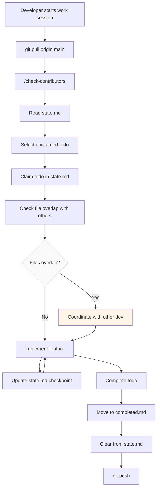
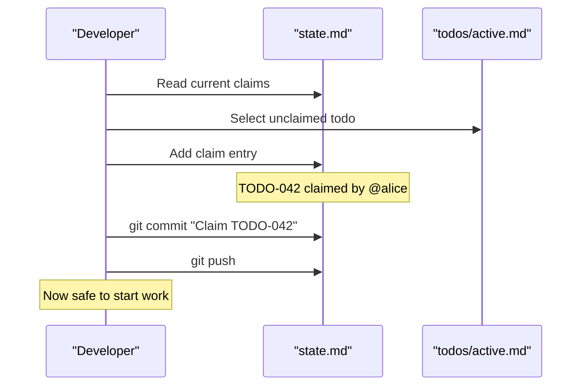
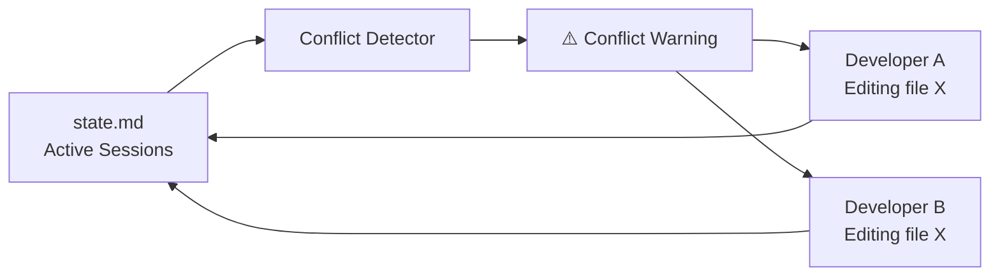
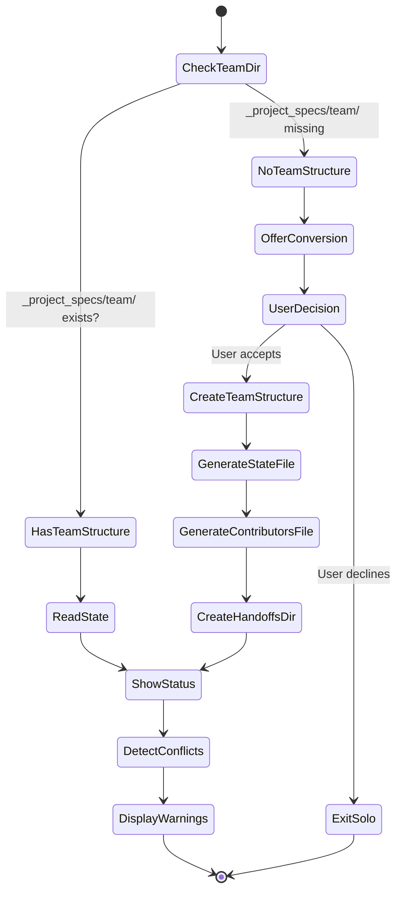
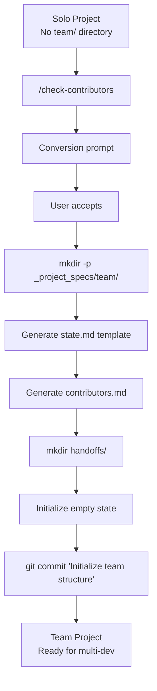
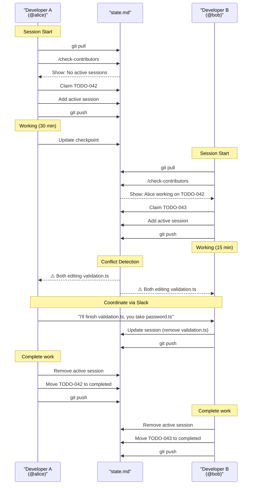

<!-- source: DeepWiki mcp.deepwiki.com · repo alinaqi/claude-bootstrap · page 8.1 Multi-Developer Coordination · fetched 2026-10-27 -->

# Multi-Developer Coordination

<details>
<summary>Relevant source files</summary>

The following files were used as context for generating this wiki page:

- [README.md](README.md)

</details>


## Purpose and Scope

This document covers the coordination mechanisms for multiple developers using Claude Code on the same repository simultaneously. The system uses file-based state management to prevent duplicate work, detect conflicts, and enable structured handoffs between team members.

For details on individual developer session management, see [Session Management](#4.2). For implementation details of the shared state files, see [Shared State Management](#8.2).

**Sources:** [README.md:211-253]()

---

## Overview

When multiple developers use Claude Code on the same codebase, coordination becomes critical to prevent:

- **Duplicate work** - Two people implementing the same todo
- **Merge conflicts** - Multiple developers editing the same files simultaneously
- **Lost context** - No visibility into what others are working on
- **Decision divergence** - Making conflicting architectural choices

Claude Bootstrap addresses these challenges through a file-based coordination system that operates entirely through git, requiring no external services or infrastructure.

**Sources:** [README.md:211-224]()

---

## State Management Architecture

The coordination system uses a dedicated directory structure to track team activity:

```
_project_specs/team/
├── state.md           # Active sessions, claimed todos, file ownership
├── contributors.md    # Team member profiles, roles, focus areas
└── handoffs/          # Context transfer notes
    ├── feature-auth-handoff.md
    └── bug-fix-validation-handoff.md
```

### State File Structure

The `state.md` file serves as the central coordination point, tracking real-time developer activity:

```markdown
# Team State

**Last Updated:** 2025-01-15 14:30 UTC
**Active Developers:** 2

## Active Sessions

### Developer A (@alice)
- **Status:** Active
- **Working On:** [TODO-042] Add email validation
- **Files Being Modified:**
  - src/components/SignupForm.tsx
  - src/utils/validation.ts
  - tests/signup.test.ts
- **Started:** 2025-01-15 13:00 UTC
- **Last Update:** 2025-01-15 14:30 UTC

### Developer B (@bob)
- **Status:** Active
- **Working On:** [TODO-043] Implement password strength checker
- **Files Being Modified:**
  - src/components/PasswordInput.tsx
  - src/utils/password.ts
  - tests/password.test.ts
- **Started:** 2025-01-15 14:00 UTC
- **Last Update:** 2025-01-15 14:15 UTC

## Claimed Todos

| Todo ID | Claimed By | Claimed At | Status |
|---------|------------|------------|--------|
| TODO-042 | @alice | 2025-01-15 13:00 | in-progress |
| TODO-043 | @bob | 2025-01-15 14:00 | in-progress |

## File Ownership (Current Session)

| File Path | Owner | Since |
|-----------|-------|-------|
| src/components/SignupForm.tsx | @alice | 13:00 |
| src/utils/validation.ts | @alice | 13:00 |
| src/components/PasswordInput.tsx | @bob | 14:00 |
| src/utils/password.ts | @bob | 14:00 |

## Conflict Warnings

⚠️ **No active conflicts detected**

## Recent Handoffs

| Date | From | To | Topic | Notes |
|------|------|----|----|-------|
| 2025-01-14 | @alice | @bob | Auth module | See handoffs/auth-handoff.md |
```

**Sources:** [README.md:226-231]()

---

## Multi-Developer Workflow



**Workflow Steps:**

1. **Start session** - Begin development work
2. **git pull** - Sync latest changes
3. **Check state** - Run `/check-contributors` to view team activity
4. **Select todo** - Choose an unclaimed todo from `_project_specs/todos/active.md`
5. **Claim todo** - Update `state.md` with claim before starting
6. **Check overlap** - Review which files others are working on
7. **Coordinate** - If files overlap, coordinate with other developers
8. **Work** - Implement the feature
9. **Update state** - Periodically update `state.md` with progress
10. **Complete** - Finish the todo
11. **Move todo** - Transfer to `completed.md`
12. **Clear state** - Remove from active sessions in `state.md`
13. **Push** - Commit and push changes

**Sources:** [README.md:243-246]()

---

## Todo Claiming System

### Claiming Process

Developers must claim todos **before** starting work to prevent duplicate effort:



### Claim Format

Claims are recorded in the `state.md` file:

| Field | Description |
|-------|-------------|
| **Todo ID** | The unique identifier (e.g., `TODO-042`) |
| **Claimed By** | GitHub username or identifier |
| **Claimed At** | Timestamp in UTC |
| **Status** | `claimed`, `in-progress`, `blocked`, `completed` |

**Example:**

```markdown
## Claimed Todos

| Todo ID | Claimed By | Claimed At | Status |
|---------|------------|------------|--------|
| TODO-042 | @alice | 2025-01-15 13:00 | in-progress |
| TODO-043 | @bob | 2025-01-15 14:00 | in-progress |
| TODO-044 | @charlie | 2025-01-15 15:00 | claimed |
```

### Claim Rules

1. **Check before claiming** - Always run `/check-contributors` first
2. **Claim atomically** - Commit and push the claim immediately
3. **Update status** - Move from `claimed` → `in-progress` when starting work
4. **Release on abandon** - Remove claim if not starting work within 1 hour
5. **Clear on complete** - Remove from claims when moving to `completed.md`

**Sources:** [README.md:235-241]()

---

## Active Session Tracking

### Session Information

Active sessions provide real-time visibility into developer activity:

```markdown
### Developer A (@alice)
- **Status:** Active
- **Working On:** [TODO-042] Add email validation
- **Files Being Modified:**
  - src/components/SignupForm.tsx
  - src/utils/validation.ts
  - tests/signup.test.ts
- **Started:** 2025-01-15 13:00 UTC
- **Last Update:** 2025-01-15 14:30 UTC
- **Checkpoint:** 3 of 5 test cases passing
```

### Session Fields

| Field | Purpose | Update Frequency |
|-------|---------|------------------|
| **Status** | `Active`, `Away`, `Paused`, `Blocked` | On state change |
| **Working On** | Current todo being implemented | When starting new todo |
| **Files Being Modified** | List of files in scope | When editing new files |
| **Started** | Session start timestamp | Once per session |
| **Last Update** | Most recent activity | Every checkpoint (15-30 min) |
| **Checkpoint** | Progress summary | During periodic updates |

### Update Triggers

Sessions should be updated at these points:

1. **Session start** - When beginning work
2. **File changes** - When editing a new file
3. **Checkpoints** - Every 15-30 minutes during active work
4. **Blocking issues** - When encountering a blocker
5. **Session end** - When completing or pausing work

**Sources:** [README.md:235-241]()

---

## Conflict Detection

The system monitors for conflicts where multiple developers work on overlapping areas.

### File Overlap Detection



### Conflict Warning Format

When the system detects file overlap:

```markdown
## Conflict Warnings

⚠️ **CONFLICT DETECTED**

**File:** `src/utils/validation.ts`
**Developers:**
- @alice (claimed at 13:00, last active 14:30)
- @bob (claimed at 14:15, last active 14:20)

**Recommended Action:**
- Coordinate immediately via Slack/Teams
- Decide who continues, who pauses
- Consider splitting the file if both changes are needed
- Update state.md with resolution

**Risk Level:** 🔴 HIGH - Same file, overlapping time
```

### Conflict Severity Levels

| Level | Criteria | Action Required |
|-------|----------|----------------|
| 🔴 **High** | Same file, both active now | Coordinate immediately |
| 🟡 **Medium** | Same directory, related files | Check for logical conflicts |
| 🟢 **Low** | Same module, different files | Awareness, no immediate action |

### Automatic Detection Logic

The `/check-contributors` command scans `state.md` for conflicts:

1. **Parse active sessions** - Extract file lists from each developer
2. **Compare file paths** - Identify exact matches or directory overlaps
3. **Check timestamps** - Determine if sessions are concurrent
4. **Calculate risk** - Classify conflict severity
5. **Generate warnings** - Add to `state.md` conflict section

**Sources:** [README.md:235-241]()

---

## The `/check-contributors` Command

### Command Syntax

```bash
/check-contributors [--status|--team]
```

### Options

| Flag | Purpose | Output |
|------|---------|--------|
| (none) | Full check with conversion prompt | Shows state, offers team conversion |
| `--status` | Quick status only | Shows who's working on what, exits |
| `--team` | Force team conversion | Creates team structure without prompting |

### Command Flow



### Output Format

**Status Display:**

```
📊 Team Status - Updated 2025-01-15 14:30 UTC

Active Developers: 2

👤 @alice
   Working on: [TODO-042] Add email validation
   Files: 3 (src/components/SignupForm.tsx, ...)
   Status: Active (last update 14:30)

👤 @bob
   Working on: [TODO-043] Password strength checker
   Files: 3 (src/components/PasswordInput.tsx, ...)
   Status: Active (last update 14:15)

⚠️ Warnings:
   - No conflicts detected

📋 Available Todos: 12 unclaimed in _project_specs/todos/active.md
```

### Solo Project Detection

If `_project_specs/team/` doesn't exist, the command prompts:

```
🔍 Project Structure Analysis

Current setup: Solo project (no team coordination)

Would you like to convert this to a team project?

Team features:
✓ Shared state tracking (who's working on what)
✓ Todo claiming (prevent duplicate work)
✓ Conflict detection (file overlap warnings)
✓ Handoff support (context transfer between devs)

Convert to team project? [y/N]
```

**Sources:** [README.md:217-253]()

---

## Converting Solo to Team Projects

### Conversion Process



### Generated Files

**state.md Template:**

```markdown
# Team State

**Last Updated:** 2025-01-15 14:30 UTC
**Active Developers:** 0

## Active Sessions

_No active sessions_

## Claimed Todos

| Todo ID | Claimed By | Claimed At | Status |
|---------|------------|------------|--------|
| _No claimed todos_ | | | |

## File Ownership (Current Session)

| File Path | Owner | Since |
|-----------|-------|-------|
| _No active file locks_ | | |

## Conflict Warnings

✅ **No active conflicts**

## Recent Handoffs

| Date | From | To | Topic | Notes |
|------|------|----|----|-------|
| _No handoffs yet_ | | | | |
```

**contributors.md Template:**

```markdown
# Project Contributors

**Last Updated:** 2025-01-15

## Team Members

### @current-user (You)
- **Role:** Developer
- **Focus Areas:** TBD
- **Join Date:** 2025-01-15
- **Active:** Yes

## Adding New Contributors

When a new team member joins:

1. Add entry to this file
2. Update state.md if they claim a todo
3. Run /check-contributors to verify team structure
4. Share project documentation and Access.txt location

## Communication Channels

- **Primary:** TBD
- **Urgent:** TBD
- **Async:** GitHub comments, state.md updates
```

### Migration Checklist

When converting from solo to team:

- [ ] Run `/check-contributors --team` to create structure
- [ ] Review and customize `contributors.md` with team info
- [ ] Communicate workflow to team members
- [ ] Ensure all developers have Access.txt location
- [ ] Test claiming a todo in `state.md`
- [ ] Commit team structure to shared repository
- [ ] Document communication channels in `contributors.md`

**Sources:** [README.md:217-253]()

---

## Handoff Patterns

Handoffs occur when one developer passes work to another. The `handoffs/` directory stores structured context transfer documents.

### Handoff Structure

```markdown
# Handoff: Email Validation Feature

**From:** @alice
**To:** @bob
**Date:** 2025-01-15
**Status:** In Progress → Paused

## What's Done

- [x] Validation utility functions (src/utils/validation.ts)
- [x] Unit tests for validation logic (tests/validation.test.ts)
- [x] SignupForm integration (partial)

## What's Remaining

- [ ] Complete SignupForm error handling
- [ ] Add error messages to UI
- [ ] Integration tests for full signup flow
- [ ] Update documentation

## Current State

**Files Modified:**
- src/utils/validation.ts (complete)
- src/components/SignupForm.tsx (70% done)
- tests/signup.test.ts (needs integration tests)

**Test Status:**
- Unit tests: 15/15 passing
- Integration tests: 2/5 implemented

**Known Issues:**
- Form doesn't show validation errors yet (lines 45-60 in SignupForm.tsx)
- Need to wire up validation.validateEmail() to form state

## Context You Need

**Key Decisions:**
1. Using Zod for schema validation (see decisions.md entry 2025-01-14)
2. Validation runs on blur, not on change (UX decision)
3. Server-side validation duplicates client-side (security requirement)

**Important Files:**
- docs/validation-strategy.md - Overall approach
- .claude/skills/security.md - Validation requirements

**Dependencies:**
- zod@3.22.4 (already installed)
- react-hook-form@7.49.0 (for form state)

## Next Steps

1. Open SignupForm.tsx
2. Review TODO comments (search for "ALICE:")
3. Implement error message display (see design in Figma)
4. Add remaining integration tests
5. Run /ralph-loop for TDD completion

## Questions for You

- Do we want real-time validation or just on submit? (Currently on blur)
- Should we add debouncing to the validation? (Not implemented yet)

## How to Continue

```bash
git pull origin main
git checkout feature/email-validation
/check-contributors  # Claim TODO-042
# Continue at line 45 in SignupForm.tsx
```
```

### Handoff Triggers

Create a handoff document when:

1. **Developer unavailable** - Must stop work for extended period (>1 day)
2. **Task blocked** - Waiting on external dependency, another dev can help
3. **Expertise transfer** - Passing work to specialist (e.g., backend → frontend)
4. **Planned rotation** - Team policy to rotate ownership
5. **Context risk** - Work complex enough that context loss is a concern

### Handoff Checklist

Before creating a handoff:

- [ ] Commit all work in progress
- [ ] Push to feature branch
- [ ] Run tests and document status
- [ ] Create handoff document in `handoffs/`
- [ ] Update `state.md` with handoff reference
- [ ] Tag the other developer in commit message
- [ ] Update todo status to `blocked` or `in-handoff`

**Sources:** [README.md:235-241]()

---

## Coordination Workflow Example

### Scenario: Two Developers, One Feature



### Step-by-Step Workflow

**Developer A (Alice):**

1. `git pull origin main`
2. `/check-contributors` - See no one else working
3. Edit `state.md` - Claim TODO-042, add active session
4. `git commit -m "Claim TODO-042: Email validation"`
5. `git push`
6. Work on feature for 30 minutes
7. Edit `state.md` - Update checkpoint
8. `git commit -m "Checkpoint: 3/5 tests passing"`
9. `git push`
10. Notice conflict warning about Bob
11. Coordinate with Bob via Slack
12. Continue work after agreement
13. Complete feature
14. Edit `state.md` - Remove active session
15. Move TODO-042 from `active.md` to `completed.md`
16. `git commit -m "Complete TODO-042: Email validation"`
17. `git push`

**Developer B (Bob):**

1. `git pull origin main`
2. `/check-contributors` - See Alice working on TODO-042
3. Select different todo (TODO-043)
4. Edit `state.md` - Claim TODO-043, add active session
5. `git commit -m "Claim TODO-043: Password strength"`
6. `git push`
7. Work on feature for 15 minutes
8. Notice conflict warning about Alice
9. Coordinate with Alice via Slack
10. Update `state.md` - Remove validation.ts from file list
11. `git commit -m "Update session: Remove validation.ts conflict"`
12. `git push`
13. Complete feature
14. Edit `state.md` - Remove active session
15. Move TODO-043 from `active.md` to `completed.md`
16. `git commit -m "Complete TODO-043: Password strength"`
17. `git push`

**Sources:** [README.md:243-246]()

---

## Best Practices

### Communication Patterns

| Situation | Communication Method | Response Time |
|-----------|---------------------|----------------|
| **Conflict detected** | Immediate sync (Slack/Teams) | < 5 minutes |
| **Claiming todo** | Commit message + state.md | Async |
| **Checkpoint updates** | state.md commit | Async |
| **Handoff** | Handoff document + mention | < 24 hours |
| **Architecture decisions** | decisions.md + team meeting | Before implementation |

### State Update Frequency

| Activity | Update Frequency | Method |
|----------|------------------|--------|
| **Todo claims** | Immediately before starting | Edit state.md, commit, push |
| **Active sessions** | Every 15-30 minutes | Edit state.md, commit, push |
| **File changes** | When editing new file | Update active session entry |
| **Blocking issues** | Immediately when blocked | Update status field |
| **Session end** | When completing/pausing | Remove from active sessions |

### Conflict Resolution Protocol

1. **Detect** - System flags overlap in state.md
2. **Communicate** - Developers sync immediately
3. **Decide** - Who continues, who pivots, or split work
4. **Update** - Winner updates state.md, loser removes file
5. **Commit** - Both push updated state
6. **Monitor** - Check for new conflicts in next update

### Common Pitfalls

| Pitfall | Prevention | Recovery |
|---------|-----------|----------|
| **Forgetting to claim** | Always run `/check-contributors` first | Apologize, merge carefully |
| **Stale state.md** | Update every 15-30 min | Pull before trusting state |
| **Large file overlap** | Check state before starting | Split the work, create handoff |
| **Merge conflicts** | Commit state.md changes separately | Manual merge, update both versions |
| **Lost handoffs** | Use handoffs/ directory | Recreate from git history + Slack |

**Sources:** [README.md:235-246]()

---

## Integration with Other Systems

### Session Management Integration

The multi-developer coordination system extends individual session management (see [Session Management](#4.2)):

| File | Solo Project | Team Project |
|------|--------------|--------------|
| `current-state.md` | Individual session state | Per-developer state |
| `decisions.md` | Personal decisions | Shared team decisions |
| `state.md` | N/A | Team coordination state |
| `contributors.md` | N/A | Team member directory |

### Todo System Integration

The claiming system integrates with the atomic todo workflow (see [Atomic Todos and Project Specs](#3.4)):

```
_project_specs/todos/active.md
    ↓ (claim via state.md)
Developer A working
    ↓ (complete)
_project_specs/todos/completed.md
    ↓ (clear from state.md)
Available for reference
```

### Code Review Integration

When working in teams, code review (see [Quality Gates and Code Review](#4.3)) includes coordination checks:

1. **Pre-commit** - Check if claimed in state.md
2. **Pre-push** - Verify no active conflicts
3. **CI/CD** - Validate state.md is up-to-date
4. **Merge** - Ensure active session cleared

**Sources:** [README.md:211-253]()

---

