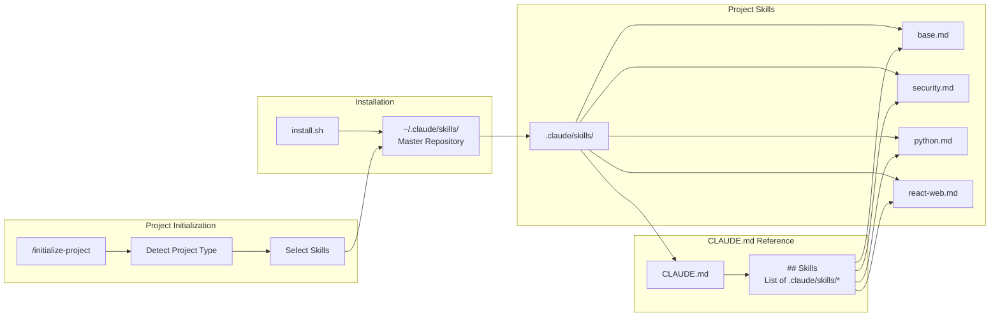
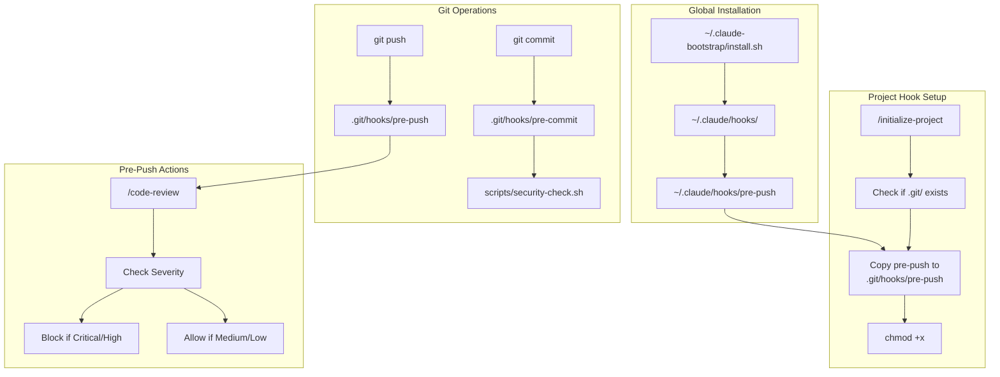
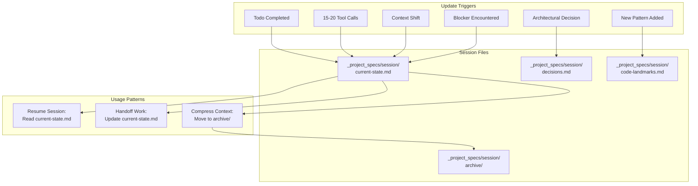
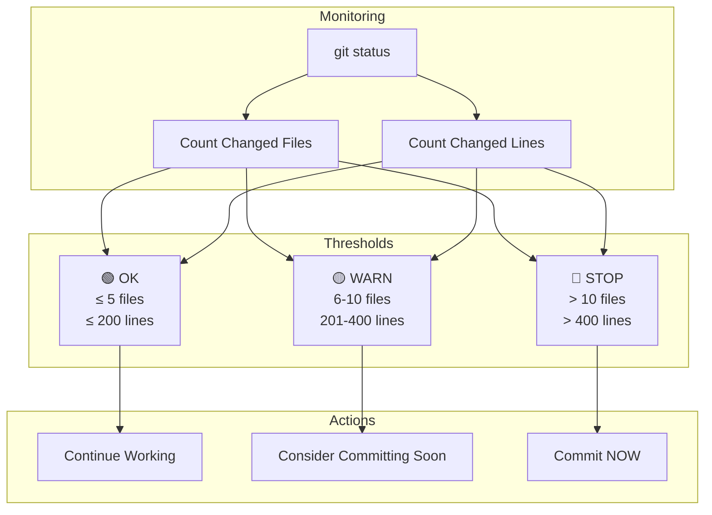

<!-- source: DeepWiki mcp.deepwiki.com · repo alinaqi/claude-bootstrap · page 9 Reference · fetched 2026-10-27 -->

# Reference

<details>
<summary>Relevant source files</summary>

The following files were used as context for generating this wiki page:

- [README.md](README.md)
- [commands/initialize-project.md](commands/initialize-project.md)

</details>


This page provides technical reference documentation for Claude Bootstrap's commands, configuration files, and system internals. Use this as a quick lookup guide when working with Claude Bootstrap projects.

For step-by-step workflows, see [Quick Start](#2). For architectural concepts and philosophy, see [Core Concepts](#3). For extending the system with custom skills and commands, see [Extending Claude Bootstrap](#9.3).

---

## Command Overview

Claude Bootstrap provides six core commands accessible through Claude Code's command interface.

### Command Quick Reference

| Command | Purpose | When to Use |
|---------|---------|-------------|
| `/initialize-project` | Set up or update project structure, skills, and tooling | First time setup, updating skills, adding missing configuration |
| `/check-contributors` | View team state, detect conflicts, convert solo→team | Start of session, before claiming todos, checking for conflicts |
| `/code-review` | Analyze changes for security, performance, architecture issues | Before commits, enforced by pre-push hook |
| `/update-code-index` | Regenerate semantic capability index from codebase | After adding/removing major functionality, periodic maintenance |
| `/ralph-loop` | Run iterative TDD loop until completion criteria met | Manual iteration when automatic loops disabled |
| `/cancel-ralph` | Stop currently running Ralph loop | Emergency stop, when loop is stuck |

**Note:** Detailed syntax, options, and examples for each command are covered in [Commands Reference](#9.1).

**Sources:** [README.md:467-495](), [commands/initialize-project.md:1-821]()

---

## Project Structure

Claude Bootstrap creates a standardized directory structure that supports TDD workflows, session management, and team coordination.

### Directory Structure Diagram

```mermaid
graph TB
    subgraph "Project Root"
        ROOT["/"]
    end
    
    subgraph ".claude/ - Skills & Configuration"
        SKILLS[".claude/skills/"]
        BASE["base.md"]
        SECURITY["security.md"]
        LANG["python.md / typescript.md"]
        FRAMEWORK["react-web.md / fastapi.md"]
    end
    
    subgraph "_project_specs/ - State & Specifications"
        SPECS["_project_specs/"]
        OVERVIEW["overview.md"]
        FEATURES["features/"]
        TODOS["todos/"]
        ACTIVE["todos/active.md"]
        BACKLOG["todos/backlog.md"]
        COMPLETED["todos/completed.md"]
        SESSION["session/"]
        CURRENT["session/current-state.md"]
        DECISIONS["session/decisions.md"]
        LANDMARKS["session/code-landmarks.md"]
        ARCHIVE["session/archive/"]
        PROMPTS["prompts/"]
        TEAM["team/"]
        STATE["team/state.md"]
        CONTRIB["team/contributors.md"]
        HANDOFFS["team/handoffs/"]
    end
    
    subgraph "scripts/ - Automation"
        SCRIPTS["scripts/"]
        VERIFY["verify-tooling.sh"]
        SECCHECK["security-check.sh"]
    end
    
    subgraph ".github/ - CI/CD"
        GITHUB[".github/workflows/"]
        QUALITY["quality.yml"]
        SECURITYWF["security.yml"]
    end
    
    subgraph "Configuration Files"
        CLAUDEMD["CLAUDE.md"]
        GITIGNORE[".gitignore"]
        ENVEXAMPLE[".env.example"]
        ENV[".env - NEVER COMMIT"]
    end
    
    ROOT --> SKILLS
    ROOT --> SPECS
    ROOT --> SCRIPTS
    ROOT --> GITHUB
    ROOT --> CLAUDEMD
    ROOT --> GITIGNORE
    ROOT --> ENVEXAMPLE
    ROOT --> ENV
    
    SKILLS --> BASE
    SKILLS --> SECURITY
    SKILLS --> LANG
    SKILLS --> FRAMEWORK
    
    SPECS --> OVERVIEW
    SPECS --> FEATURES
    SPECS --> TODOS
    SPECS --> SESSION
    SPECS --> PROMPTS
    SPECS --> TEAM
    
    TODOS --> ACTIVE
    TODOS --> BACKLOG
    TODOS --> COMPLETED
    
    SESSION --> CURRENT
    SESSION --> DECISIONS
    SESSION --> LANDMARKS
    SESSION --> ARCHIVE
    
    TEAM --> STATE
    TEAM --> CONTRIB
    TEAM --> HANDOFFS
    
    SCRIPTS --> VERIFY
    SCRIPTS --> SECCHECK
    
    GITHUB --> QUALITY
    GITHUB --> SECURITYWF
```



**Sources:** [README.md:296-318](), [commands/initialize-project.md:134-143]()

### Core Directories

| Directory | Purpose | Created By | Overwritten on Re-init? |
|-----------|---------|------------|-------------------------|
| `.claude/skills/` | Coding guardrails and patterns | `/initialize-project` | Yes - always updated with latest |
| `_project_specs/` | Project state, todos, session management | `/initialize-project` | No - preserved |
| `_project_specs/features/` | Feature specifications | User/Claude | No |
| `_project_specs/todos/` | Atomic todos (active, backlog, completed) | `/initialize-project` | No - todos preserved |
| `_project_specs/session/` | Session state, decisions, landmarks | `/initialize-project` | No - state preserved |
| `_project_specs/team/` | Team coordination (state, contributors, handoffs) | `/check-contributors --team` | No |
| `scripts/` | Automation scripts (verify, security) | `/initialize-project` | Yes - scripts updated |
| `.github/workflows/` | CI/CD pipelines | `/initialize-project` | Yes if missing |
| `docs/` | Technical documentation | `/initialize-project` | No |

**Sources:** [commands/initialize-project.md:134-617]()

---

## Configuration Files

### CLAUDE.md

The primary instruction file that Claude reads on project load. Contains skills list, project overview, tech stack, and key commands.

**Structure:**
```markdown
## Skills
- .claude/skills/base.md
- .claude/skills/security.md
- [other skills]

## Project Overview
[Description]

## Tech Stack
[Stack details]

## Key Commands
[Project commands]

## Atomic Todos
[Todo workflow]

## Session Management
[Session state tracking rules]

## Project-Specific Patterns
[Custom patterns]
```

**Location:** `CLAUDE.md` (project root)

**Created by:** `/initialize-project`

**Preservation:** Existing `CLAUDE.md` is preserved and updated, not overwritten

**Sources:** [commands/initialize-project.md:320-438]()

### .gitignore

Security-critical file that prevents secrets from being committed.

**Key entries:**
```gitignore
.env
.env.*
!.env.example
*.pem
*.key
credentials.json
secrets.json
service-account*.json
node_modules/
__pycache__/
```

**Location:** `.gitignore` (project root)

**Created by:** `/initialize-project`

**Enforcement:** `scripts/security-check.sh` validates before commits

**Sources:** [commands/initialize-project.md:168-200]()

### .env.example

Template for environment variables. Developers copy to `.env` and fill in actual values.

**Pattern:**
```bash
# .env.example - Copy to .env and fill in values
# Server-side only (NEVER prefix with VITE_ or NEXT_PUBLIC_)
DATABASE_URL=
ANTHROPIC_API_KEY=

# Client-side safe (public, non-sensitive)
VITE_SUPABASE_URL=
VITE_SUPABASE_ANON_KEY=
```

**Security rules:**
- Server secrets: NO `VITE_*` or `NEXT_PUBLIC_*` prefix
- Client vars: Only non-sensitive values
- Never commit `.env` (only `.env.example`)

**Sources:** [commands/initialize-project.md:203-214](), [README.md:29-32]()

### verify-tooling.sh

Validates CLI tools are installed and authenticated.

**Checks:**
- GitHub CLI: `gh auth status`
- Vercel CLI: `vercel whoami`
- Supabase CLI: `supabase projects list`

**Location:** `scripts/verify-tooling.sh`

**Usage:** `./scripts/verify-tooling.sh`

**Sources:** [commands/initialize-project.md:217-267]()

### security-check.sh

Pre-commit security validation script.

**Checks:**
1. `.env` not staged for commit
2. Common secret patterns in staged files
3. `VITE_*` secrets (client-exposed)
4. Dependency vulnerabilities (`npm audit`, `safety check`)

**Location:** `scripts/security-check.sh`

**Enforcement:** Pre-commit hooks, GitHub Actions

**Sources:** [commands/initialize-project.md:270-318]()

---

## Skills System

### Skills Loading Flow



**Sources:** [commands/initialize-project.md:145-166](), [README.md:396-466]()

### Skill Categories and File Names

| Category | File Names | Selection Criteria |
|----------|------------|-------------------|
| **Core** (always loaded) | `base.md`, `security.md`, `credentials.md`, `session-management.md`, `project-tooling.md`, `code-review.md`, `commit-hygiene.md`, `code-deduplication.md`, `team-coordination.md`, `iterative-development.md` | Always copied |
| **Language** | `python.md`, `typescript.md` | Based on language selection |
| **Framework** | `react-web.md`, `react-native.md`, `nodejs-backend.md`, `fastapi.md` | Based on framework selection |
| **UI** | `ui-web.md`, `ui-mobile.md`, `ui-testing.md`, `playwright-testing.md` | If web or mobile project |
| **AI & Agentic** | `agentic-development.md`, `llm-patterns.md`, `ai-models.md` | If `--ai-first` flag set |
| **Database** | `database-schema.md`, `supabase.md`, `supabase-nextjs.md`, `supabase-python.md`, `supabase-node.md` | If Supabase selected |
| **Integration** | `web-payments.md`, `posthog-analytics.md`, `reddit-api.md`, `reddit-ads.md`, `ms-teams-apps.md`, `shopify-apps.md`, `woocommerce.md`, `medusa.md`, `klaviyo.md` | If integration selected |
| **Content & SEO** | `aeo-optimization.md`, `web-content.md`, `site-architecture.md` | If content/SEO focus |
| **User Experience** | `user-journeys.md`, `pwa-development.md` | If UX or PWA focus |

**Sources:** [README.md:398-466](), [commands/initialize-project.md:145-166]()

---

## Git Hooks System

### Hook Installation Flow



**Sources:** [commands/initialize-project.md:678-698](), [README.md:176-209]()

### Hook Locations

| Hook | Location | Purpose | Enforcement Level |
|------|----------|---------|-------------------|
| `pre-commit` | `.git/hooks/pre-commit` | Lint, type-check, unit tests, security scan | Blocks commit on failure |
| `pre-push` | `.git/hooks/pre-push` | `/code-review` - blocks on Critical/High issues | Blocks push on Critical/High |

**Manual installation:** Run `~/.claude/install-hooks.sh` in any project

**Disable hooks:** `rm .git/hooks/pre-push` or `rm .git/hooks/pre-commit`

**Sources:** [commands/initialize-project.md:678-698](), [README.md:188-192]()

---

## CI/CD Workflows

### GitHub Actions Files

| File | Triggers | Checks | Failure Action |
|------|----------|--------|----------------|
| `.github/workflows/quality.yml` | Push to main, PRs | Lint, type-check, tests, 80% coverage | Blocks merge |
| `.github/workflows/security.yml` | Push to main, PRs, weekly schedule | TruffleHog secret scan, `npm audit`, `safety check` | Blocks merge |

### Security Workflow Structure

```yaml
name: Security
on:
  push:
    branches: [main]
  pull_request:
    branches: [main]
  schedule:
    - cron: '0 9 * * 1'  # Weekly

jobs:
  secrets-scan:
    runs-on: ubuntu-latest
    steps:
      - uses: trufflesecurity/trufflehog@main

  dependency-audit:
    runs-on: ubuntu-latest
    steps:
      - name: NPM Audit
        run: npm audit --audit-level=high
      - name: Safety check
        run: pip install safety && safety check
```

**Sources:** [commands/initialize-project.md:619-668]()

---

## Session State Files

### State File Mapping



**Sources:** [commands/initialize-project.md:395-427](), [commands/initialize-project.md:495-617]()

### File Update Rules

| File | Update Frequency | Content | Append-Only? |
|------|------------------|---------|--------------|
| `current-state.md` | After todo completion, every 15-20 tool calls, before context shift | Active task, status, files modified, next steps | No - overwrites |
| `decisions.md` | When making architectural/security decisions | Decision, context, options, choice, reasoning, trade-offs | Yes |
| `code-landmarks.md` | When adding entry points, patterns, gotchas | Entry points, business logic, config locations, patterns | No - updates sections |
| `archive/*.md` | End of session or major feature | Historical session summaries | Yes - new files |

**Sources:** [commands/initialize-project.md:495-617]()

---

## Todo File Format

### Todo Structure

```markdown
## [TODO-042] Add email validation to signup form

**Status:** in-progress
**Priority:** high
**Estimate:** S

### Acceptance Criteria
- [ ] Email field shows error for invalid format
- [ ] Form cannot submit with invalid email

### Test Cases
| Input | Expected |
|-------|----------|
| user@example.com | Valid |
| notanemail | Error |

### TDD Execution Log
| Phase | Command | Result |
|-------|---------|--------|
| RED | `npm test -- --grep "email validation"` | 2 tests failed ✓ |
| GREEN | `npm test -- --grep "email validation"` | 2 tests passed ✓ |
| VALIDATE | `npm run lint && npm run typecheck` | Pass, 84% ✓ |
```

**Sources:** [README.md:533-577]()

### Todo Workflow States

| File | Contains | State Transitions |
|------|----------|-------------------|
| `_project_specs/todos/active.md` | Currently in progress | New → Active |
| `_project_specs/todos/backlog.md` | Future work, prioritized | Backlog → Active (when started) |
| `_project_specs/todos/completed.md` | Done items for reference | Active → Completed (when done) |

**Move operations:** Cut from source file, paste into destination file (never delete)

**Sources:** [README.md:384-394](), [commands/initialize-project.md:462-493]()

---

## Atomic Commit Thresholds

### Commit Size Guidelines



**Rationale:**
- PRs < 200 lines: 15% defect rate
- PRs 200-400 lines: 23% defect rate
- PRs > 400 lines: 40%+ defect rate (often rubber-stamped)

**Atomic commit principle:** If you need "and" to describe your commit, split it.

**Sources:** [README.md:119-146]()

---

## Access.txt Credential Format

Centralized credential storage outside the repository.

**Format:**
```
OpenAI API: sk-proj-xxx
Claude API: sk-ant-xxx
Stripe: sk_test_xxx
Supabase url: https://xxx.supabase.co
Anon key: eyJxxx
```

**Location:** User-specified (e.g., `~/Documents/Access.txt`)

**Detection patterns:**
- `OpenAI API:` → Extracts `OPENAI_API_KEY`
- `Claude API:` → Extracts `ANTHROPIC_API_KEY`
- `Stripe:` → Extracts `STRIPE_SECRET_KEY`
- `Supabase url:` → Extracts `SUPABASE_URL`
- `Anon key:` → Extracts `SUPABASE_ANON_KEY`

**Workflow:**
1. `/initialize-project` asks for Access.txt location
2. Reads and parses credentials
3. Validates keys (API calls with test values)
4. Generates `.env` with validated keys
5. Adds `.env` to `.gitignore`

**Sources:** [README.md:367-378]()

---

## Quick Reference Tables

### Environment Variable Patterns

| Pattern | Exposure | Usage | Example |
|---------|----------|-------|---------|
| `DATABASE_URL` | Server-only | Database connection | ✅ Safe for secrets |
| `ANTHROPIC_API_KEY` | Server-only | API authentication | ✅ Safe for secrets |
| `VITE_*` | **Client-exposed** | Vite frontend env vars | ⚠️ NO SECRETS |
| `NEXT_PUBLIC_*` | **Client-exposed** | Next.js frontend env vars | ⚠️ NO SECRETS |
| `VITE_SUPABASE_URL` | Client-safe | Public Supabase URL | ✅ Safe (non-sensitive) |
| `VITE_POSTHOG_KEY` | Client-safe | Public analytics key | ✅ Safe (non-sensitive) |

**Security rule:** Any `VITE_*` or `NEXT_PUBLIC_*` variable is visible to all users in browser. Never use for secrets.

**Sources:** [README.md:29-32](), [commands/initialize-project.md:203-214]()

### Coverage and Quality Gates

| Gate | Threshold | Enforcement | Failure Action |
|------|-----------|-------------|----------------|
| Test Coverage | ≥ 80% | CI, pre-push | Blocks merge/push |
| Lint | 0 errors | Pre-commit, CI | Blocks commit/merge |
| Type Check | 0 errors | Pre-commit, CI | Blocks commit/merge |
| Secret Scan | 0 secrets | Pre-commit, CI | Blocks commit/merge |
| Dependency Audit | 0 high/critical | CI, weekly | Blocks merge |
| Code Review Severity | No Critical/High | Pre-push | Blocks push |

**Sources:** [README.md:515-529](), [commands/initialize-project.md:619-668]()

### Complexity Constraints

| Constraint | Limit | Enforcement | Violation Action |
|------------|-------|-------------|------------------|
| Lines per function | 20 | `base.md` skill | STOP - refactor required |
| Parameters per function | 3 | `base.md` skill | STOP - refactor required |
| Nesting depth | 2 levels | `base.md` skill | STOP - refactor required |
| Lines per file | 200 | `base.md` skill | STOP - split file |
| Test coverage | 80% minimum | CI pipeline | Blocks merge |

**STOP protocol:** Development pauses until violation is fixed. No "TODO" comments allowed.

**Sources:** [README.md:344-357]()

---

## Additional Reference Material

For detailed command syntax, parameters, and examples, see [Commands Reference](#9.1).

For complete file format specifications and configuration options, see [Configuration and Project Structure](#9.2).

For creating custom skills, commands, and modifying initialization, see [Extending Claude Bootstrap](#9.3).

---

