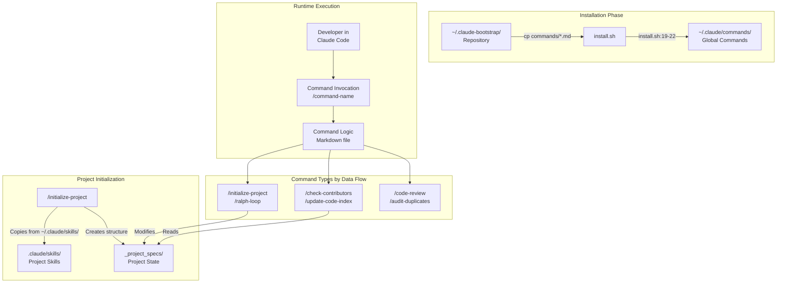
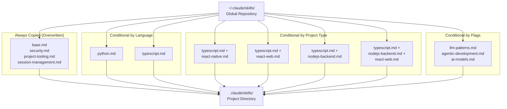
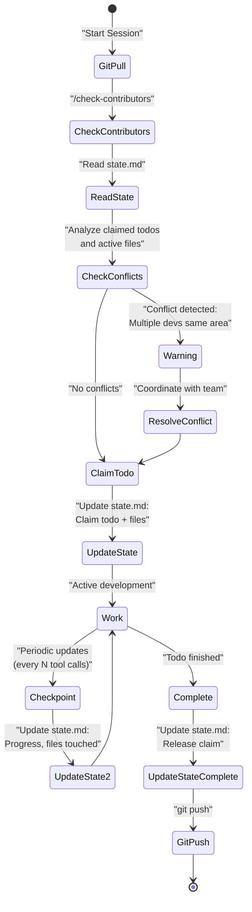
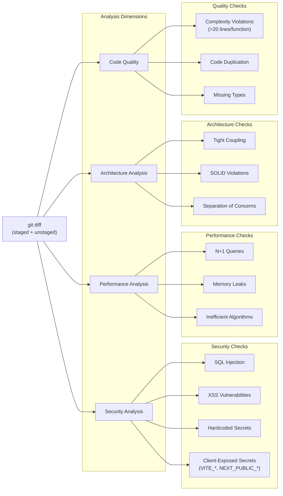
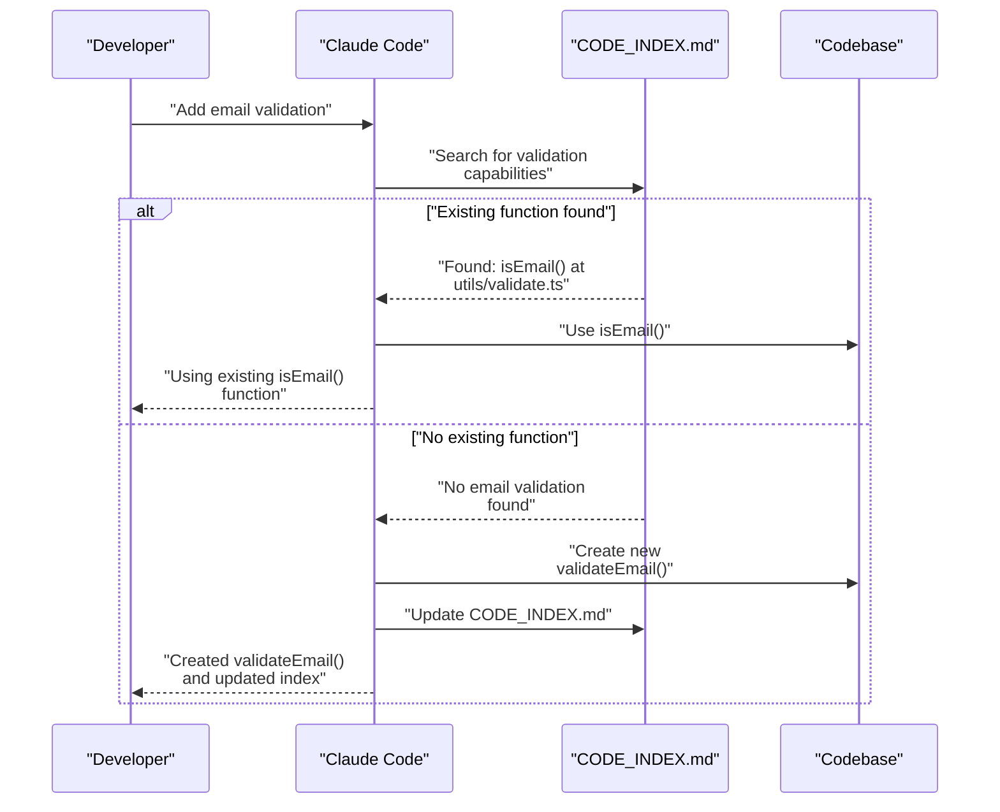
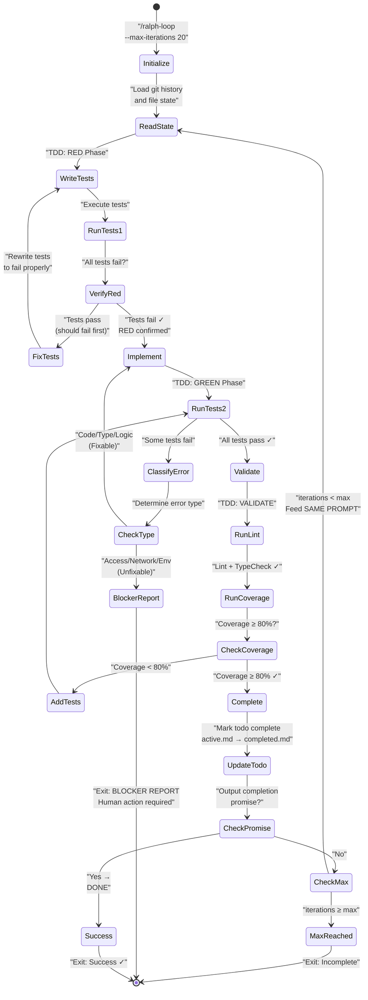
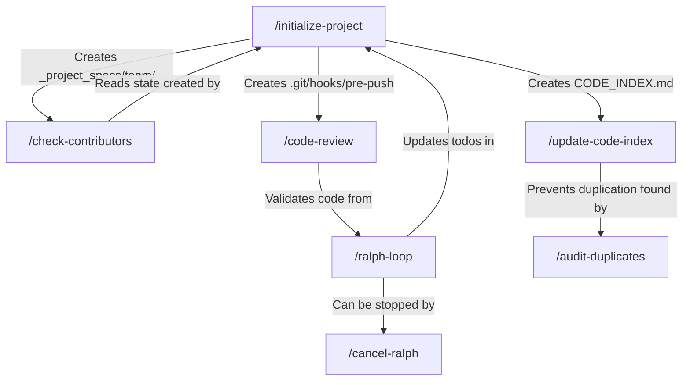

<!-- source: DeepWiki mcp.deepwiki.com · repo alinaqi/claude-bootstrap · page 9.1 Commands Reference · fetched 2026-10-27 -->

# Commands Reference

<details>
<summary>Relevant source files</summary>

The following files were used as context for generating this wiki page:

- [README.md](README.md)
- [commands/initialize-project.md](commands/initialize-project.md)
- [install.sh](install.sh)

</details>


This document provides a complete technical reference for all custom commands available in Claude Bootstrap. Commands are installed to `~/.claude/commands/` and are invoked in Claude Code using the `/command-name` syntax.

For information about the skills system that these commands interact with, see [Skills Architecture](#5.1). For details on the development workflow that these commands support, see [Ralph Loop: Iterative Development](#4.1).

---

## Command Overview

All commands are markdown files stored in `~/.claude/commands/` and copied during installation via [install.sh:19-22]().

| Command | Purpose | Primary Use Case | Blocking Behavior |
|---------|---------|------------------|-------------------|
| `/initialize-project` | Project setup and configuration | First-time setup, skill updates | No |
| `/check-contributors` | Team coordination and state management | Multi-developer projects | No |
| `/code-review` | Automated code review analysis | Pre-push validation | Yes (Critical/High issues) |
| `/update-code-index` | Regenerate semantic capability index | Prevent duplicate code | No |
| `/ralph-loop` | Iterative TDD execution engine | Feature development, bug fixes | No |
| `/cancel-ralph` | Stop active Ralph loop | Cancel runaway iterations | No |
| `/audit-duplicates` | Find semantic code duplication | Code cleanup | No |

Sources: [README.md:52-62](), [README.md:248-253](), [install.sh:19-22]()

---

## Command Invocation Architecture

### Diagram: Command Installation and Execution Flow



Sources: [install.sh:1-66](), [commands/initialize-project.md:1-821]()

---

## /initialize-project

**Purpose:** Full project setup with Claude coding guardrails, security configuration, and skill installation. Idempotent - can be run multiple times to update skills or add missing structure.

### Syntax

```bash
/initialize-project
```

No command-line options. All configuration is performed through interactive questions.

### Execution Phases

The command executes in five sequential phases as defined in [commands/initialize-project.md:9-799]():

#### Phase 1: Detect Project State

Determines whether this is a new project, existing project with Claude setup, or existing codebase without Claude.

**Detection Logic:**
- Checks for `.claude/skills/` directory
- Checks for `CLAUDE.md` file
- Checks for `_project_specs/` directory
- Checks for git remote configuration
- Checks for `package.json` or `pyproject.toml`

**Outcomes:**
- New project: Full setup
- Existing with skills: Update mode (preserves customizations)
- Existing codebase: Add mode (preserves code)

Sources: [commands/initialize-project.md:9-35]()

#### Phase 2: Validate CLI Tools

Verifies authentication status of required CLIs:

```bash
# GitHub CLI check
gh auth status

# Vercel CLI check
vercel whoami

# Supabase CLI check
supabase projects list
```

If tools are missing or unauthenticated, offers to skip or provides installation instructions.

Sources: [commands/initialize-project.md:37-57]()

#### Phase 3: Interactive Project Questions

Collects project configuration through sequential questions:

| Question | Purpose | Auto-Detection |
|----------|---------|----------------|
| What are you building? | Project description | Reads existing `CLAUDE.md` |
| Language/runtime? | Determines skill files | Checks `package.json`, `pyproject.toml` |
| Project type? | Selects framework skills | Analyzes dependencies |
| AI-first application? | Loads LLM skills | Checks for `anthropic`, `openai` packages |
| Framework? | Framework-specific patterns | Dependency analysis |
| Database? | Database integration | Checks for `supabase/` directory |
| Deployment platform? | CI/CD configuration | Checks for `vercel.json`, `render.yaml` |
| Repository setup? | GitHub integration | Checks `git remote -v` |

Sources: [commands/initialize-project.md:60-130]()

#### Phase 4: Execute Setup

Creates directory structure and installs configuration files:

**Directory Structure Created:**
```
.claude/skills/          # Skill files
docs/                    # Documentation
_project_specs/
  ├── features/          # Feature specifications
  ├── todos/             # Active, backlog, completed
  ├── prompts/           # Prompt templates
  └── session/           # Session state management
      └── archive/       # Historical sessions
scripts/                 # Utility scripts
```

**Skills Installation Logic:**



**Key Files Generated:**

| File | Purpose | Overwrite Behavior |
|------|---------|-------------------|
| `CLAUDE.md` | Main instruction file | Preserves customizations if exists |
| `.gitignore` | Security-critical entries | Appends missing entries |
| `.env.example` | Environment template | Creates if missing |
| `scripts/verify-tooling.sh` | CLI validation | Always overwrites |
| `scripts/security-check.sh` | Pre-commit security | Always overwrites |
| `.github/workflows/quality.yml` | CI/CD quality gates | Creates based on language |
| `.github/workflows/security.yml` | Security scanning | Always creates |

Sources: [commands/initialize-project.md:132-669]()

#### Phase 5: Post-Setup Actions

**GitHub Repository Setup:**
- Creates new repository via `gh repo create` if requested
- Connects to existing repository via `git remote add`

**Deployment Initialization:**
- Vercel: Runs `vercel link` if `vercel.json` missing
- Supabase: Runs `supabase init` if `supabase/` missing

**Hook Installation:**
Pre-push code review hook installed to `.git/hooks/pre-push` from [~/.claude/hooks/pre-push]().

Sources: [commands/initialize-project.md:699-726]()

### Output Summary

**For New Projects:**
```
Created:
✓ .claude/skills/ with 5 skill files
✓ CLAUDE.md
✓ _project_specs/ structure
✓ scripts/verify-tooling.sh
✓ .github/workflows/quality.yml
✓ Pre-commit hooks configured
✓ Pre-push code review hook (blocks on Critical/High issues)
✓ GitHub repository: https://github.com/[owner]/[repo]
```

**For Updates:**
```
Updated:
✓ Skills updated to latest versions
✓ Pre-push code review hook (installed/updated)

Added:
✓ llm-patterns.md (new skill added)

Unchanged:
- CLAUDE.md (preserved your customizations)
- _project_specs/todos/ (preserved your todos)
```

Sources: [commands/initialize-project.md:729-763]()

### State Management

The command reads and preserves existing state from:
- `CLAUDE.md`: Project-specific patterns and tech stack
- `_project_specs/todos/`: All todo files (active, backlog, completed)
- `_project_specs/session/`: Session state and decisions
- `.git/config`: Repository configuration

Sources: [commands/initialize-project.md:320-438]()

---

## /check-contributors

**Purpose:** Team coordination for multi-developer Claude Code projects. Detects team vs. solo projects and manages shared state.

### Syntax

```bash
/check-contributors                # Interactive mode
/check-contributors --status       # Quick status only
/check-contributors --team         # Convert to team project
```

### Behavior

**Solo Project Detection:**
- No `_project_specs/team/` directory exists
- Offers to convert to team project structure

**Team Project Detection:**
- `_project_specs/team/state.md` exists
- Displays current team state

### Team State Structure

When converting to team project, creates:

```
_project_specs/team/
├── state.md           # Active sessions, claimed todos, conflicts
├── contributors.md    # Team roster, ownership, focus areas
└── handoffs/          # Context transfer notes
```

### State File Format

**state.md Schema:**

| Section | Content |
|---------|---------|
| Active Sessions | Who is working right now, on which files |
| Claimed Todos | Reserved work items (prevents duplication) |
| File Conflicts | Warning when multiple devs edit same files |
| Last Updated | Timestamp for staleness detection |

**contributors.md Schema:**

| Section | Content |
|---------|---------|
| Team Members | Name, contact, timezone |
| Ownership Areas | Primary responsibility assignments |
| Focus Areas | Current focus per developer |

Sources: [README.md:211-253]()

### Team Coordination Workflow



Sources: [README.md:232-246]()

### Conflict Detection

The command detects conflicts by analyzing:
- **Todo conflicts:** Same todo claimed by multiple developers
- **File conflicts:** Same file being modified by multiple active sessions
- **Stale state:** `state.md` not updated in > 4 hours (warns of potentially stale data)

Sources: [README.md:236-240]()

---

## /code-review

**Purpose:** Automated code review analysis that blocks pushes on Critical/High severity issues. Enforces security, performance, and architecture standards.

### Syntax

```bash
/code-review
```

No options. Analyzes all uncommitted changes via `git diff`.

### Integration Points

**Pre-Push Hook:**
Automatically invoked by `.git/hooks/pre-push` installed via [commands/initialize-project.md:676-698]().

**CI/CD:**
Referenced in GitHub Actions workflows for remote validation.

### Severity Classification

| Severity | Symbol | Action | Push Allowed? |
|----------|--------|--------|---------------|
| Critical | 🔴 | Must fix immediately | ❌ BLOCKED |
| High | 🟠 | Must fix immediately | ❌ BLOCKED |
| Medium | 🟡 | Fix soon | ✅ Advisory |
| Low | 🟢 | Nice to have | ✅ Advisory |

Sources: [README.md:194-201]()

### Analysis Categories

The command analyzes code across multiple dimensions:



Sources: [README.md:203-207]()

### Blocking Behavior

**When Critical/High Issues Found:**
```bash
# Pre-push hook behavior
.git/hooks/pre-push  # Runs /code-review
# If Critical/High found:
# - Displays issues
# - Exits with code 1
# - Push cancelled
```

**Exit Codes:**
- `0`: No Critical/High issues (push allowed)
- `1`: Critical/High issues found (push blocked)

Sources: [README.md:176-209]()

### Output Format

```
Code Review Results
===================

🔴 CRITICAL: SQL injection vulnerability
  File: src/api/users.ts:42
  Issue: Unparameterized query with user input
  Fix: Use parameterized queries or ORM

🟠 HIGH: Performance issue
  File: src/services/orders.ts:78
  Issue: N+1 query in loop (fetches user per order)
  Fix: Use JOIN or batch loading

🟡 MEDIUM: Code complexity
  File: src/utils/validator.ts:12
  Issue: Function exceeds 20 line limit (currently 35)
  Fix: Split into smaller functions

Push BLOCKED due to 1 Critical and 1 High severity issue(s)
```

Sources: [README.md:176-209]()

---

## /update-code-index

**Purpose:** Regenerates `CODE_INDEX.md` semantic capability index to prevent duplicate code creation.

### Syntax

```bash
/update-code-index
```

No options. Scans entire codebase.

### Indexing Logic

**Capability Organization:**
Functions are grouped by what they DO, not where they are:

```markdown
## Validation
| Function | Location | Does What |
|----------|----------|-----------|
| `isEmail()` | utils/validate.ts | Validates email format |
| `isPhone()` | utils/validate.ts | Validates phone number |

## Date/Time
| Function | Location | Does What |
|----------|----------|-----------|
| `formatRelative()` | utils/dates.ts | "2 days ago" format |
| `parseISODate()` | utils/dates.ts | Parse ISO 8601 strings |
```

**Semantic Categories:**
- Validation
- Date/Time manipulation
- String formatting
- Data transformation
- HTTP requests
- Database queries
- Authentication/Authorization
- File operations

Sources: [README.md:255-294]()

### Workflow Integration



Sources: [README.md:255-294]()

### Large Codebase Optimization

For projects with 100+ files, optional vector database integration:

**Supported Backends:**
- ChromaDB
- LanceDB

**Query Flow:**
1. Convert capability description to embedding
2. Semantic search in vector DB
3. Return top-K similar functions
4. Claude evaluates relevance

Sources: [README.md:294]()

---

## /ralph-loop

**Purpose:** Iterative TDD execution engine that runs autonomous RED-GREEN-VALIDATE cycles until tests pass or max iterations reached.

### Syntax

```bash
/ralph-loop --max-iterations 20 --completion-promise "DONE"
```

**Options:**

| Option | Default | Description |
|--------|---------|-------------|
| `--max-iterations` | 20 | Maximum loop iterations before exit |
| `--completion-promise` | "DONE" | String to output when complete |

### Execution Flow

The Ralph loop implements a state machine with error classification:



Sources: [README.md:71-118](), Diagram 4 in system overview

### Stop Hook Mechanism

**Key Innovation:** The prompt NEVER changes. Only the file state evolves through git commits and modifications.

**Mechanism:**
1. Claude attempts to exit (signal completion or give up)
2. Stop hook intercepts the exit
3. Same prompt fed back to Claude
4. Claude sees updated file state (its own previous work)
5. Self-referential improvement loop continues

**Termination Conditions:**
- Completion promise output: `<promise>DONE</promise>`
- Max iterations reached
- Unfixable blocker detected

Sources: Diagram 4 in system overview, [README.md:71-94]()

### Error Classification

The loop distinguishes between fixable and unfixable errors:

| Error Type | Examples | Claude Fixes? | Action |
|------------|----------|---------------|--------|
| Code Error | Logic bug, wrong assertion, type mismatch | ✅ Yes | Continue loop |
| Type Error | TypeScript type errors | ✅ Yes | Continue loop |
| Test Error | Wrong test expectation | ✅ Yes | Continue loop |
| Access Error | Missing API key, DB connection refused | ❌ No | Stop + report |
| Network Error | Service unavailable, DNS failure | ❌ No | Stop + report |
| Environment Error | Missing package, wrong Node version | ❌ No | Stop + report |

**Blocker Report Format:**
```
🛑 LOOP BLOCKED - Human Action Required

Error: ECONNREFUSED 127.0.0.1:5432

Classification: Access Error (Database)

Required Actions:
1. Start PostgreSQL: brew services start postgresql
2. Verify connection: psql -U postgres -c "SELECT 1"
3. Check DATABASE_URL in .env

After fixing, run /ralph-loop again.
```

Sources: [README.md:579-612]()

### Automatic Invocation

With Claude Bootstrap skills loaded, Ralph loops are invoked automatically for most development requests:

**Triggers:**
- "Add [feature]"
- "Fix [bug]"
- "Implement [functionality]"
- "Build [component]"

**Opt-Out Phrases:**
- "Just explain..."
- "Quick fix..."
- "Don't loop..."

Sources: [README.md:73-99]()

---

## /cancel-ralph

**Purpose:** Stop an active Ralph loop iteration.

### Syntax

```bash
/cancel-ralph
```

No options.

### Behavior

- Terminates current loop immediately
- Does not rollback changes (git state preserved)
- Outputs current loop iteration count
- Safe to run - no data loss

**Use Cases:**
- Loop stuck on unfixable issue
- Wrong completion criteria specified
- Need to modify approach before continuing

Sources: [README.md:62]()

---

## /audit-duplicates

**Purpose:** Find semantic code duplication (functions with similar purpose but different names/implementations).

### Syntax

```bash
/audit-duplicates
```

No options. Scans entire codebase.

### Detection Logic

**Semantic Similarity Analysis:**
1. Parse all function signatures and bodies
2. Extract semantic purpose from:
   - Function name
   - Parameter names
   - Return type
   - Comments/docstrings
3. Compare purposes using embeddings (if vector DB available) or pattern matching
4. Report functions with >80% semantic similarity

**Output Format:**
```
Potential Duplicate Functions
==============================

Group 1: Email Validation
  - isValidEmail() at utils/validate.ts:12
  - validateEmail() at services/auth.ts:45
  - checkEmailFormat() at api/users.ts:78
  Recommendation: Keep isValidEmail(), remove others

Group 2: Date Formatting
  - formatDate() at utils/dates.ts:23
  - dateToString() at components/DatePicker.tsx:102
  Recommendation: Keep formatDate(), remove dateToString()
```

Sources: [README.md:255-294]()

### Merge Recommendations

For each duplicate group, provides:
- Which function to keep (most comprehensive, best named)
- Which functions to remove
- Required refactoring (update call sites)

---

## Command File Structure

All commands follow a standardized markdown format:

```markdown
# Command Name

Brief description and purpose.

---

## Phase 1: [Phase Name]

Description of phase behavior.

### Code blocks
```bash
# Command examples
```

### Sub-sections
Detailed specifications.

---

## Phase 2: [Phase Name]

...
```

**Common Sections:**
- Purpose statement
- Syntax/options
- Execution phases
- Output format
- Error handling
- Integration points

Sources: [commands/initialize-project.md:1-821]()

---

## Command Execution Context

Commands execute within Claude Code's environment with access to:

**Environment Variables:**
- `HOME`: User home directory
- `PWD`: Current working directory
- Git environment variables (when in repository)

**Filesystem Access:**
- Read: Entire project directory
- Write: Project directory (not `~/.claude/`)
- Execute: Shell commands via subprocess

**Git Integration:**
- Can execute `git` commands
- Access to `git diff`, `git log`, `git status`
- Can modify `.git/hooks/`

Sources: [commands/initialize-project.md:13-24](), [install.sh:1-66]()

---

## Error Handling Patterns

All commands implement consistent error handling:

**CLI Tool Validation:**
```bash
# Pattern used across commands
if command -v gh &> /dev/null; then
  if gh auth status &> /dev/null; then
    echo "✓ GitHub CLI authenticated"
  else
    echo "✗ GitHub CLI not authenticated. Run: gh auth login"
    exit 1
  fi
else
  echo "⚠ GitHub CLI not installed. Run: brew install gh"
fi
```

**Graceful Degradation:**
- Missing optional tools: Warn and continue
- Missing required tools: Error and stop
- Invalid configuration: Prompt for correction

Sources: [commands/initialize-project.md:40-57](), [commands/initialize-project.md:216-263]()

---

## Command Interaction Matrix

Some commands depend on or complement each other:



**Dependencies:**
- `/check-contributors` requires `/initialize-project` to have run (creates team structure)
- `/code-review` is installed by `/initialize-project` as pre-push hook
- `/update-code-index` operates on structure created by `/initialize-project`
- `/cancel-ralph` only works when `/ralph-loop` is running

Sources: [README.md:52-62](), [commands/initialize-project.md:676-698]()

---

