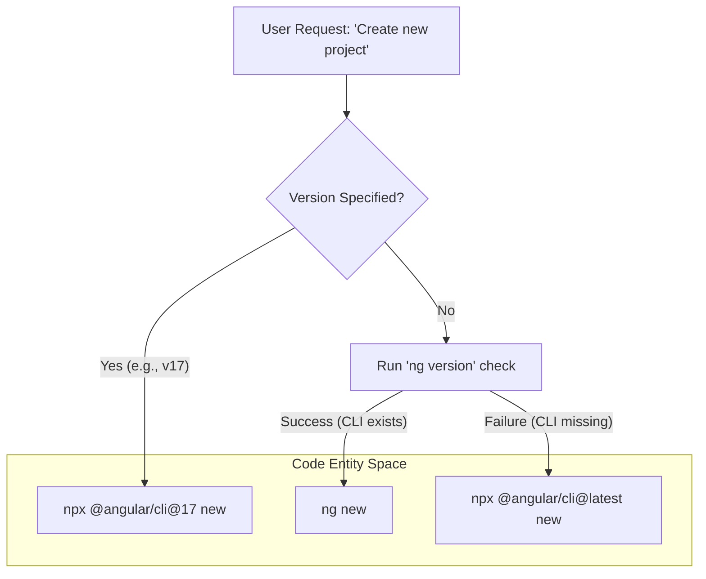
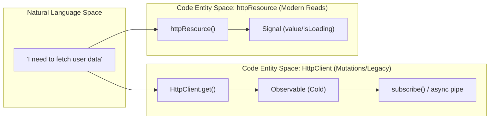

<!-- source: DeepWiki mcp.deepwiki.com · repo angular/skills · page 1.1 angular-developer Skill · fetched 2026-10-27 -->

# angular-developer Skill

Relevant source files

The following files were used as context for generating this wiki page:

- [README.md](README.md)
- [angular-developer/SKILL.md](angular-developer/SKILL.md)
- [angular-developer/references/http-client.md](angular-developer/references/http-client.md)

The `angular-developer` skill is a specialized agentic capability designed to generate idiomatic Angular code and provide architectural guidance aligned with modern best practices (Angular v19+). It serves as the primary intelligence layer for creating components, services, and HTTP communication, while ensuring compliance with the latest reactivity models, form strategies, and accessibility standards [angular-developer/SKILL.md:1-8]().

## Activation and Purpose

The skill is activated when an agentic tool (such as Gemini CLI or Antigravity) encounters tasks related to [angular-developer/SKILL.md:3-8]():
*   **Project Initialization**: Scaffolding new applications or workspaces.
*   **Code Generation**: Creating components, services, directives, pipes, or routes.
*   **Reactivity**: Implementing state management using Signals, `linkedSignal`, `resource`, or `httpResource`.
*   **Forms**: Implementing Signal Forms (v22+) or legacy Reactive/Template-driven forms.
*   **Infrastructure**: Configuring Dependency Injection, Routing, SSR, or Testing.
*   **Compliance**: Applying naming conventions ("Intent over Role") and accessibility (ARIA) patterns.

## Project Creation Decision Logic

When tasked with creating a new Angular project, the `angular-developer` skill follows a strict hierarchical decision tree to determine the execution environment and versioning strategy.

### Execution Rules for `ng new`

The system prioritizes user intent, then local environment capabilities, and finally falls back to the latest stable release [angular-developer/SKILL.md:25-43]().

| Condition | Action | Command |
| :--- | :--- | :--- |
| **Explicit Version Requested** | Bypass local install; use `npx` | `npx @angular/cli@<version> new <name>` |
| **No Version Specified & CLI Installed** | Use existing local/global installation | `ng new <name>` |
| **No Version Specified & CLI Missing** | Fetch and execute latest via `npx` | `npx @angular/cli@latest new <name>` |

### System Flow: Project Initialization
The following diagram illustrates the internal logic used by the skill to bridge the Natural Language request for a "new project" to the specific CLI execution [angular-developer/SKILL.md:25-43]().

**Sources:** [angular-developer/SKILL.md:25-43]()

## Reference Topic Map

The `angular-developer` skill acts as a router to specific domain documentation. It organizes its knowledge base into the following reference domains:

### 1. Component Architecture
Focuses on modern component anatomy and the shift toward signal-based inputs and outputs.
*   **Key Files**: `references/components.md`, `references/inputs.md`, `references/outputs.md`, `references/host-elements.md` [angular-developer/SKILL.md:48-51]().
*   **Core Primitives**: `@Component`, `input()`, `output()`, `model()`.

### 2. Reactivity & Data
Covers the signal-based reactivity system introduced in v17+ and refined in v19+.
*   **Key Files**: `references/signals-overview.md`, `references/linked-signal.md`, `references/resource.md`, `references/effects.md` [angular-developer/SKILL.md:60-63]().
*   **Core Primitives**: `signal()`, `computed()`, `linkedSignal()`, `resource()`.

### 3. HTTP & Connectivity
Defines how to interact with backends using both traditional Observables and new Signal-native resources.
*   **Key Files**: `references/http-client.md` [angular-developer/SKILL.md:69]().
*   **Core Primitives**: `HttpClient`, `httpResource()`, `provideHttpClient()`.

### 4. Dependency Injection (DI)
Detailed rules for the `inject()` function and hierarchical injector resolution.
*   **Key Files**: `references/di-fundamentals.md`, `references/creating-services.md`, `references/defining-providers.md`, `references/injection-context.md`, `references/hierarchical-injectors.md` [angular-developer/SKILL.md:86-90]().

### 5. Specialized Domains
*   **Forms**: Defaulting to **Signal Forms** for v22+ projects [angular-developer/SKILL.md:23, 75]().
*   **Aria**: Implementing accessible patterns via `@angular/aria` [angular-developer/SKILL.md:98-101]().
*   **Naming**: Applying "Intent over Role" conventions (e.g., `user-profile.ts` instead of `user-profile.component.ts`) [angular-developer/SKILL.md:52]().

## Data Flow: HTTP Communication
This diagram bridges the Natural Language requirement "fetch data" to the `HttpClient` and `httpResource` implementations [angular-developer/references/http-client.md:24-108]().

**Sources:** [angular-developer/references/http-client.md:24-108]()

## Implementation Guidelines
The skill follows these non-negotiable technical constraints:
1.  **Version Awareness**: Always analyze the project's Angular version before suggesting features (e.g., checking if `Signal Forms` is available in v22+) [angular-developer/SKILL.md:12, 75]().
2.  **CLI Consistency**: Use Angular CLI for all scaffolding to ensure consistent directory structures [angular-developer/SKILL.md:14]().
3.  **Verification**: After generating code, the skill is instructed to run `ng build` to validate the output [angular-developer/SKILL.md:16]().
4.  **Service Encapsulation**: Backend calls must be encapsulated in injectable services using the `inject()` function, not directly in components [angular-developer/references/http-client.md:26-34]().

**Sources:** [angular-developer/SKILL.md:1-101](), [README.md:1-34](), [angular-developer/references/http-client.md:1-108]()

---

