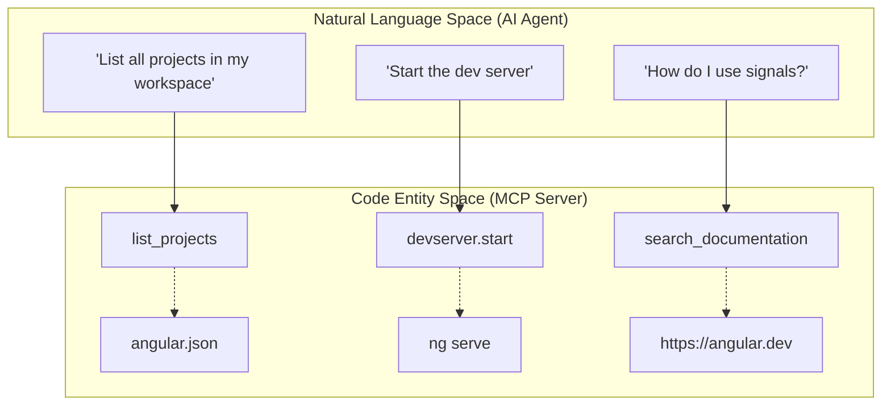
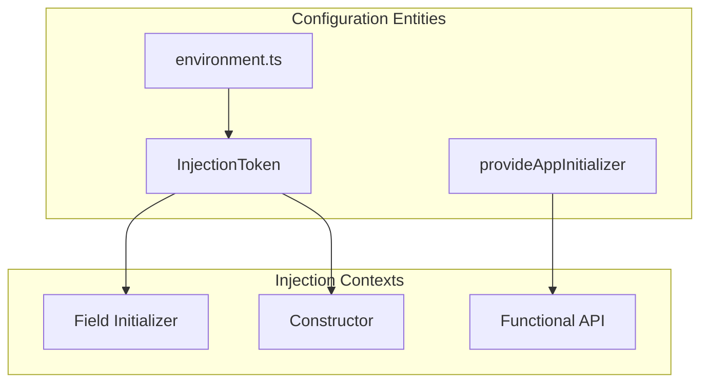

<!-- source: DeepWiki mcp.deepwiki.com · repo angular/skills · page 10 Tooling and Configuration · fetched 2026-10-27 -->

# Tooling and Configuration

Relevant source files

The following files were used as context for generating this wiki page:

- [angular-developer/references/cli.md](angular-developer/references/cli.md)
- [angular-developer/references/injection-context.md](angular-developer/references/injection-context.md)
- [angular-developer/references/mcp.md](angular-developer/references/mcp.md)
- [angular-developer/references/migrations.md](angular-developer/references/migrations.md)

The Angular ecosystem provides a robust suite of tools designed to automate project management, code generation, and modernization. This section covers the primary interfaces for interacting with an Angular workspace, including the Angular CLI, automated migration schematics, and the Model Context Protocol (MCP) server for AI-driven development.

## Angular CLI

The Angular CLI (`ng`) is the primary tool for managing the application lifecycle. It handles everything from project initialization and dependency management to local development and production builds. 

### Key CLI Operations
*   **Dependency Management**: Always use `ng add` for Angular libraries to ensure initialization schematics are executed [angular-developer/references/cli.md:7-13]().
*   **Code Generation**: Use `ng generate` to scaffold components, services, guards, and environment files according to standard patterns [angular-developer/references/cli.md:21-32]().
*   **Build System**: Modern Angular utilizes the `@angular/build:application` builder, which is based on `esbuild` for high-performance AOT compilation [angular-developer/references/cli.md:64-70]().
*   **Dev Server**: `ng serve` provides a local environment with Hot Module Replacement (HMR) and configurable backend API proxying via `proxy.conf.json` [angular-developer/references/cli.md:38-60]().

For detailed command references and workspace configuration, see **[Angular CLI](#10.1)**.

---

## Automated Migrations

Angular provides official schematics to modernize existing codebases. These tools automate the transition from legacy patterns (like `NgModules` or `@Input()`) to modern APIs (like Standalone components and Signals).

| Feature to Modernize | Schematic Command |
| :--- | :--- |
| **Control Flow** | `ng generate @angular/core:control-flow` |
| **Signal Inputs** | `ng generate @angular/core:signal-input-migration` |
| **Signal Queries** | `ng generate @angular/core:signal-queries-migration` |
| **`inject()` Function** | `ng generate @angular/core:inject` |

The transition to **Standalone** components is a specialized three-phase workflow involving component conversion, `NgModule` removal, and finally, updating the bootstrap logic [angular-developer/references/migrations.md:24-30]().

For migration workflows and full schematic lists, see **[Automated Migrations](#10.2)**.

Sources: [angular-developer/references/migrations.md:10-30]()

---

## Angular MCP Server

The Model Context Protocol (MCP) server enables AI assistants to interact directly with the Angular CLI. This allows agents to analyze projects, search documentation, and execute migrations within a structured context.

### AI-to-CLI Integration
AI agents access the workspace through a set of defined tools:
*   `list_projects`: Reads `angular.json` to identify workspace structure [angular-developer/references/mcp.md:16-16]().
*   `onpush_zoneless_migration`: Provides plans for migrating to zoneless change detection [angular-developer/references/mcp.md:17-17]().
*   `devserver.start`: Manages the lifecycle of the development server for the agent [angular-developer/references/mcp.md:12-12]().

### Configuration Mapping
The MCP server is activated via `npx @angular/cli mcp` and can be configured for various IDEs and CLI tools.

**Tool-to-Entity Mapping**

Sources: [angular-developer/references/mcp.md:1-20]()

For configuration steps for Cursor, VS Code, and Gemini, see **[Angular MCP Server](#10.3)**.

---

## Environment Configuration and Rendering

Angular supports flexible configuration strategies for different deployment targets and rendering requirements.

### Configuration Strategies
*   **Build-time**: Using `ng generate environments` to create file replacements in `angular.json` [angular-developer/references/cli.md:32-32]().
*   **Runtime**: Utilizing `provideAppInitializer` to fetch configuration before the application starts.
*   **Injection Context**: Managing configuration access via the `inject()` function within a valid context [angular-developer/references/injection-context.md:1-13]().

### Rendering Overview
Angular supports multiple rendering strategies depending on performance and SEO needs:
1.  **Client-Side Rendering (CSR)**: Standard SPA behavior.
2.  **Server-Side Rendering (SSR)**: Dynamic HTML generation per request.
3.  **Static Site Generation (SSG)**: Pre-rendering routes at build time.

**Environment Injection Workflow**

Sources: [angular-developer/references/injection-context.md:1-13](), [angular-developer/references/cli.md:32-32]()

For details on setting up environments and choosing a rendering strategy, see **[Environment Configuration and Rendering Strategies](#10.4)**.

---

