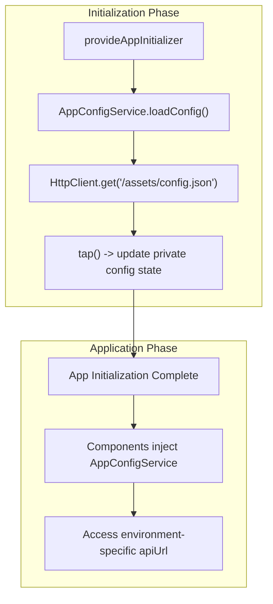

<!-- source: DeepWiki mcp.deepwiki.com · repo angular/skills · page 10.4 Environment Configuration and Rendering Strategies · fetched 2026-10-27 -->

# Environment Configuration and Rendering Strategies

<details>
<summary>Relevant source files</summary>

The following files were used as context for generating this wiki page:

- [angular-developer/references/environment-configuration.md](angular-developer/references/environment-configuration.md)
- [angular-developer/references/rendering-strategies.md](angular-developer/references/rendering-strategies.md)

</details>


This page documents the strategies for managing application configuration across different environments and selecting the appropriate rendering model (CSR, SSR, or SSG) to balance SEO, performance, and deployment flexibility.

## Environment Configuration Strategies

Angular supports two primary methods for managing configuration: **Build-time** (static) and **Runtime** (dynamic).

### Build-Time Configuration
Build-time configuration uses file replacement to swap configuration values during the `ng build` process [angular-developer/references/environment-configuration.md:14-16]().

1.  **Generation**: Use `ng generate environments` to create the standard environment file structure [angular-developer/references/environment-configuration.md:23-27]().
2.  **File Structure**:
    *   `src/environments/environment.ts`: Default/Production values [angular-developer/references/environment-configuration.md:31-36]().
    *   `src/environments/environment.development.ts`: Development-specific overrides [angular-developer/references/environment-configuration.md:38-43]().
3.  **Usage**: Components and services import the base `environment.ts` file. The CLI replaces this file with the environment-specific version based on the build target [angular-developer/references/environment-configuration.md:45-53]().
4.  **Dev Mode**: Instead of a manual `production` flag, use the `isDevMode()` function from `@angular/core` to check the current execution mode [angular-developer/references/environment-configuration.md:55-55]().

> [!WARNING]
> **Security Warning**: Environment files are bundled into the client-side JavaScript. Never store sensitive secrets, API keys, or credentials in these files as they are publicly accessible [angular-developer/references/environment-configuration.md:18-21]().

### Runtime Configuration
Runtime configuration allows a single build artifact to be deployed across multiple environments by loading a configuration file (typically JSON) at application startup [angular-developer/references/environment-configuration.md:61-68]().

#### Implementation: AppConfigService
To implement runtime config, create a service that fetches a JSON file from the `assets` folder:

| Entity | Role |
| :--- | :--- |
| `AppConfigService` | Manages the loading and retrieval of runtime settings [angular-developer/references/environment-configuration.md:90-91](). |
| `loadConfig()` | Method using `HttpClient` to fetch `assets/config.json` [angular-developer/references/environment-configuration.md:96-102](). |
| `provideAppInitializer` | DI provider that ensures `loadConfig()` completes before the app renders [angular-developer/references/environment-configuration.md:113-119](). |

**Configuration Data Flow**
The following diagram illustrates how runtime configuration is resolved before the UI is initialized.


**Sources:** [angular-developer/references/environment-configuration.md:90-119]()

### Strategy Comparison

| Criteria | Build-time | Runtime |
| :--- | :--- | :--- |
| **Change without rebuild** | No | Yes |
| **Startup performance** | Faster | Slight delay (due to HTTP fetch) |
| **Complexity** | Low | Moderate |
| **Deployment flexibility** | Limited (Build per env) | High (Single artifact) |

**Sources:** [angular-developer/references/environment-configuration.md:129-137]()

---

## Rendering Strategies

Angular allows developers to choose how and where the application is rendered to optimize for specific requirements like SEO and Initial Load Time.

### Rendering Models

1.  **Client-Side Rendering (CSR)**: The default strategy. The browser downloads a minimal HTML file and the JavaScript bundle, which then renders the UI [angular-developer/references/rendering-strategies.md:5-7]().
    *   *Best for*: Internal dashboards and high-interactivity tools [angular-developer/references/rendering-strategies.md:9-9]().
2.  **Static Site Generation (SSG / Prerendering)**: Content is rendered into static HTML at build time [angular-developer/references/rendering-strategies.md:13-15]().
    *   *Best for*: Marketing sites, blogs, and documentation [angular-developer/references/rendering-strategies.md:17-17]().
3.  **Server-Side Rendering (SSR)**: The server renders the initial request into HTML. Subsequent navigations are handled client-side [angular-developer/references/rendering-strategies.md:21-23]().
    *   *Best for*: E-commerce and personalized dynamic content requiring SEO [angular-developer/references/rendering-strategies.md:25-25]().

### Hydration and Interactivity
When using SSR or SSG, **Hydration** is the process of restoring interactivity to the server-rendered HTML [angular-developer/references/rendering-strategies.md:29-31]().

*   **Full Hydration**: The entire application is bootstrapped at once [angular-developer/references/rendering-strategies.md:33-33]().
*   **Incremental Hydration**: Specific parts of the UI become interactive as needed, often utilizing `@defer` blocks [angular-developer/references/rendering-strategies.md:34-34]().
*   **Event Replay**: Angular captures user events (like clicks) that occur before hydration is complete and replays them once the app is interactive [angular-developer/references/rendering-strategies.md:35-35]().

### Strategy Decision Matrix

| Requirement | Recommended Strategy |
| :--- | :--- |
| SEO + Static Content | **SSG** |
| SEO + Dynamic Content | **SSR** |
| No SEO + High Interactivity | **CSR** |
| Mixed Requirements | **Hybrid (Route-based)** |

**Sources:** [angular-developer/references/rendering-strategies.md:37-44]()

### Rendering Strategy Mapping
The following diagram maps high-level requirements to the technical implementation strategies available in the codebase.

```mermaid
graph TD
    REQ_SEO["High SEO Requirement"] -->|Static Data| SSG["Static Site Generation (Build-time)"]
    REQ_SEO -->|Dynamic Data| SSR["Server-Side Rendering (Node.js)"]
    
    REQ_PERF["Initial Visibility Speed"] --> SSG
    REQ_PERF --> SSR
    
    REQ_COST["Low Server Cost"] --> CSR["Client-Side Rendering (Default)"]
    REQ_COST --> SSG
    
    SSR --> HYD["Hydration Process"]
    SSG --> HYD
    
    HYD -->|Event Replay| ER["User Interaction Buffer"]
    HYD -->|@defer| IH["Incremental Hydration"]
```
**Sources:** [angular-developer/references/rendering-strategies.md:1-44]()

---

