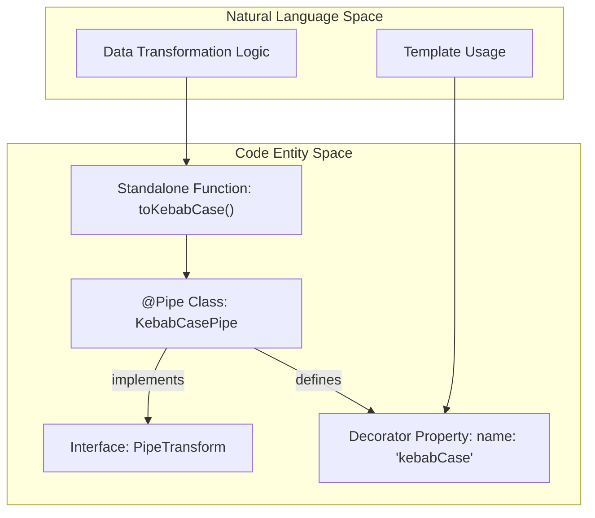
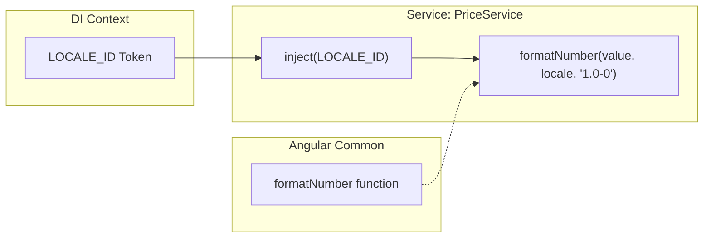

<!-- source: DeepWiki mcp.deepwiki.com · repo angular/skills · page 11.1 Pipes · fetched 2026-10-27 -->

# Pipes

Relevant source files

The following files were used as context for generating this wiki page:

- [angular-developer/references/pipes.md](angular-developer/references/pipes.md)

Pipes are declarative operators used within Angular templates to transform data for display using the `|` symbol. They allow developers to keep transformation logic separate from component class logic, ensuring templates remain clean and readable.

### Using Pipes in Templates

To use a pipe, the pipe class must be imported and added to the component's `imports` array (for standalone components). In the template, the pipe is applied to an expression followed by optional arguments separated by colons.

| Feature | Description |
| :--- | :--- |
| **Operator** | `|` (pipe operator) |
| **Arguments** | Passed via `:`, e.g., `value | date:'short'` |
| **Chaining** | Multiple pipes can be chained: `value | pipe1 | pipe2` |

**Sources:** [angular-developer/references/pipes.md:3-25]()

---

### Custom Pipe Implementation

Custom pipes are defined using the `@Pipe` decorator and must implement the `PipeTransform` interface. The `transform` method receives the value to be transformed as the first argument, followed by any optional parameters.

#### Implementation Requirements
*   **Decorator**: `@Pipe({ name: 'myPipeName' })`. The `name` should use `camelCase` without hyphens [angular-developer/references/pipes.md:121-129]().
*   **Interface**: `PipeTransform`.
*   **Method**: `transform(value: any, ...args: any[]): any`.
*   **Naming Convention**: The class name should be the PascalCase version of the name suffixed with `Pipe` (e.g., `TruncatePipe`) [angular-developer/references/pipes.md:130-130]().

#### Logic Extraction Pattern
A best practice for reusability is to extract the transformation logic into a standalone function. The pipe then delegates to this function, allowing services or other TypeScript files to import the logic directly without involving the Angular Pipe mechanism.

**Entity Association: Custom Pipe Structure**

**Sources:** [angular-developer/references/pipes.md:31-53](), [angular-developer/references/pipes.md:116-130]()

---

### Built-in Pipes and Standalone Functions

Angular provides several built-in pipes for common tasks like formatting dates, numbers, and currencies. These pipes are locale-aware and rely on the `LOCALE_ID` token.

#### Mapping Pipes to Standalone Functions
For use-cases outside of templates (e.g., inside a Service), Angular exports standalone formatting functions from `@angular/common`. **Pipes should never be injected via Dependency Injection** [angular-developer/references/pipes.md:29-29]().

| Pipe Class | Standalone Function | Purpose |
| :--- | :--- | :--- |
| `DatePipe` | `formatDate` | Formats date objects/strings based on locale. |
| `CurrencyPipe` | `formatCurrency` | Formats numbers as currency. |
| `DecimalPipe` | `formatNumber` | Formats numbers with specific decimal representations. |
| `PercentPipe` | `formatPercent` | Formats numbers as percentages. |

**Sources:** [angular-developer/references/pipes.md:68-77]()

#### Locale-Aware Formatting in Services
To use these functions in a service, inject the `LOCALE_ID` token to ensure the formatting matches the application's current locale configuration.

**Data Flow: Locale-Aware Formatting in Services**

**Sources:** [angular-developer/references/pipes.md:81-93]()

---

### Pure vs. Impure Pipes

Angular categorizes pipes into two types based on their execution behavior during change detection.

#### Pure Pipes (Default)
*   **Behavior**: Angular executes a pure pipe only when it detects a pure change to the input value. A pure change is a change to a primitive input value (String, Number, Boolean, Symbol) or a changed object reference (Date, Array, Function, Object).
*   **Performance**: Highly efficient; if the reference doesn't change, the pipe isn't re-executed.

#### Impure Pipes
*   **Behavior**: Defined by setting `pure: false` in the `@Pipe` metadata [angular-developer/references/pipes.md:137-137]().
*   **Execution**: Runs on every change detection cycle, even if the inputs haven't changed.
*   **Use Case**: Necessary when the pipe needs to detect internal mutations within an array or object (e.g., adding an item to an array without changing the array's reference) [angular-developer/references/pipes.md:132-134]().
*   **Warning**: Use sparingly as they can significantly degrade performance [angular-developer/references/pipes.md:145]().

**Sources:** [angular-developer/references/pipes.md:132-145]()

---

