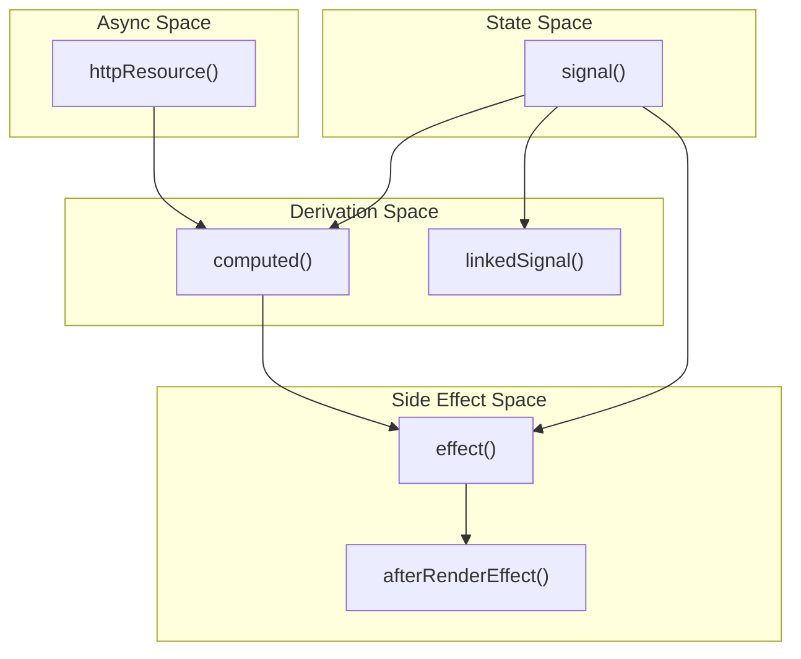
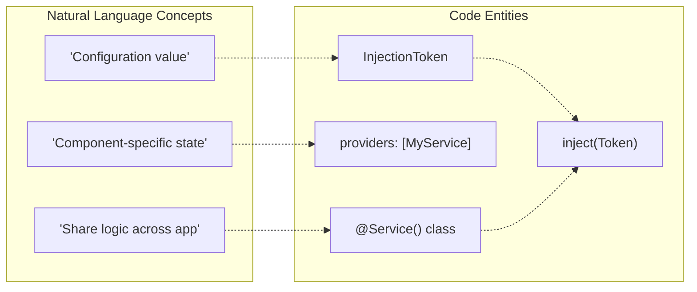
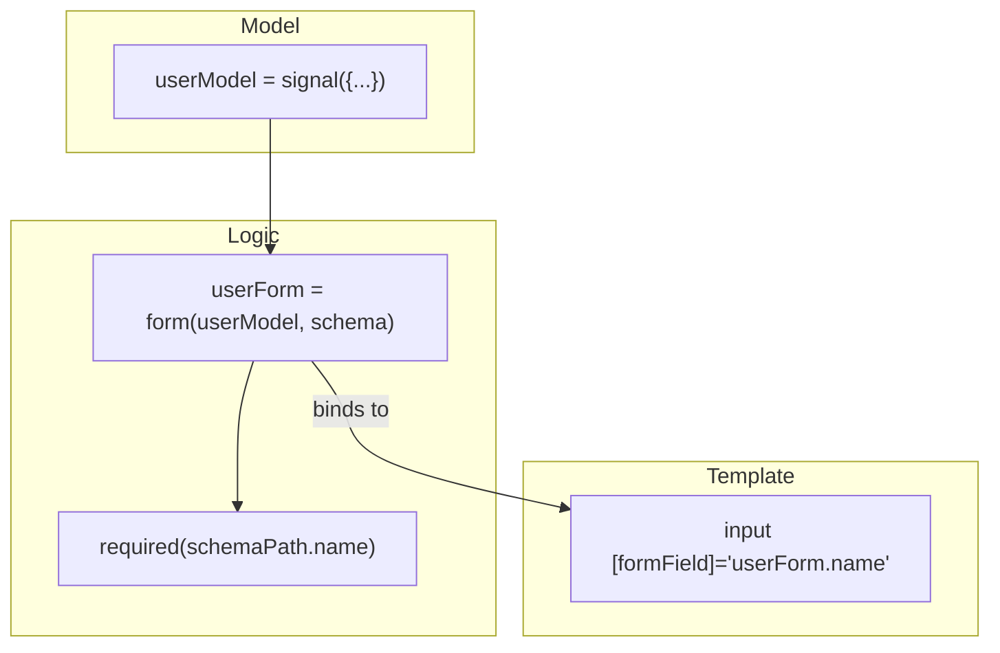
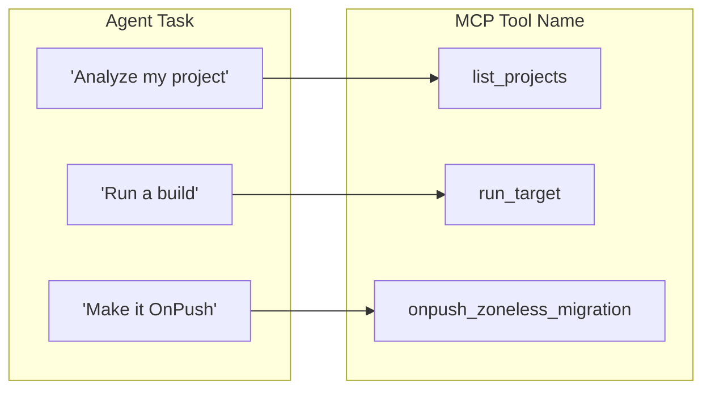

<!-- source: DeepWiki mcp.deepwiki.com · repo angular/skills · page 12 Glossary · fetched 2026-10-27 -->

# Glossary

Relevant source files

The following files were used as context for generating this wiki page:

- [README.md](README.md)
- [angular-developer/SKILL.md](angular-developer/SKILL.md)
- [angular-developer/references/angular-aria.md](angular-developer/references/angular-aria.md)
- [angular-developer/references/cli.md](angular-developer/references/cli.md)
- [angular-developer/references/creating-services.md](angular-developer/references/creating-services.md)
- [angular-developer/references/di-fundamentals.md](angular-developer/references/di-fundamentals.md)
- [angular-developer/references/environment-configuration.md](angular-developer/references/environment-configuration.md)
- [angular-developer/references/hierarchical-injectors.md](angular-developer/references/hierarchical-injectors.md)
- [angular-developer/references/http-client.md](angular-developer/references/http-client.md)
- [angular-developer/references/injection-context.md](angular-developer/references/injection-context.md)
- [angular-developer/references/mcp.md](angular-developer/references/mcp.md)
- [angular-developer/references/migrations.md](angular-developer/references/migrations.md)
- [angular-developer/references/pipes.md](angular-developer/references/pipes.md)
- [angular-developer/references/rendering-strategies.md](angular-developer/references/rendering-strategies.md)
- [angular-developer/references/signal-forms.md](angular-developer/references/signal-forms.md)
- [angular-developer/references/testing-fundamentals.md](angular-developer/references/testing-fundamentals.md)

This page provides definitions for codebase-specific terms, Angular-specific jargon, and domain concepts used throughout the Angular Skills repository. It is intended to bridge the gap between natural language requirements and the technical implementation details found in the `angular-developer` and `angular-new-app` skills.

## Core Reactivity Terms

Angular v19+ emphasizes a signal-based reactivity model. Understanding these primitives is essential for state management and data flow.

| Term | Definition | Implementation Detail |
| :--- | :--- | :--- |
| **Signal** | A wrapper around a value that notifies consumers when it changes. | Created via `signal()` [angular-developer/references/signals-overview.md:60-60](). |
| **Computed Signal** | A reactive value derived from other signals. | Created via `computed()` [angular-developer/references/signals-overview.md:60-60](). |
| **linkedSignal** | A writable signal that automatically resets or updates its value when a source signal changes. | Used for dependent writable state [angular-developer/references/linked-signal.md:59](). |
| **Resource** | An API for fetching asynchronous data (like HTTP) directly into a reactive signal state. | Created via `resource()` or `httpResource()` [angular-developer/references/resource.md:62-62](). |
| **Effect** | A reactive function that runs whenever the signals it reads change. | Created via `effect()` or `afterRenderEffect()` [angular-developer/references/effects.md:63-63](). |

### Reactivity Data Flow
The following diagram illustrates how state flows from a source `signal` through derivations to the UI.

**Signal Data Flow Architecture**

Sources: [angular-developer/references/signals-overview.md:60-60](), [angular-developer/references/linked-signal.md:59](), [angular-developer/references/resource.md:62-62](), [angular-developer/references/effects.md:63-63]()

---

## Dependency Injection (DI) Concepts

Angular uses a hierarchical DI system to share logic and data.

*   **Injection Context**: A specific runtime environment where `inject()` can be called. This includes class field initializers and constructors [angular-developer/references/di-fundamentals.md:71-81]().
*   **Provider**: An instruction to the DI system on how to obtain a value for a dependency [angular-developer/references/defining-providers.md:72]().
*   **Singleton**: A service instance shared across the entire application, typically defined using `@Service()` or `providedIn: 'root'` [angular-developer/references/creating-services.md:31-38]().
*   **Tree-shaking**: A build-time process that removes unused services from the final bundle [angular-developer/references/creating-services.md:37-37]().

### DI Entity Mapping
This diagram maps the natural language concepts of "Sharing Logic" to the specific code entities in the DI system.

**Natural Language to Code Entity: Dependency Injection**

Sources: [angular-developer/references/di-fundamentals.md:1-30](), [angular-developer/references/creating-services.md:1-45](), [angular-developer/references/defining-providers.md:72]()

---

## Forms and Validation

The repository distinguishes between three form strategies, with a strong preference for **Signal Forms** in modern projects.

*   **Signal Forms**: A model-driven approach where form state is managed by signals. It uses the `form()` function and `[formField]` directive [angular-developer/references/signal-forms.md:3-36]().
*   **FormField**: The structural representation of a form or field in Signal Forms [angular-developer/references/signal-forms.md:111-127]().
*   **FieldState**: The actual reactive state (value, touched, valid) accessed by calling a `FormField` as a function [angular-developer/references/signal-forms.md:115-125]().
*   **Validators**: Functions like `required`, `email`, or `minLength` used within a form schema to enforce data integrity [angular-developer/references/signal-forms.md:72-109]().

### Signal Forms Implementation
**Signal Forms Data Binding**

Sources: [angular-developer/references/signal-forms.md:34-69](), [angular-developer/references/signal-forms.md:158-167]()

---

## Tooling and Infrastructure

*   **MCP (Model Context Protocol)**: A protocol that allows AI agents to interact with the Angular CLI to run builds, tests, and migrations [angular-developer/references/mcp.md:1-5]().
*   **Schematics**: Automated code generation and transformation scripts used by `ng generate` and `ng update` [angular-developer/references/cli.md:21-33]().
*   **Zoneless**: A mode of operation in Angular where change detection is triggered by signals rather than `Zone.js` monkey-patching [angular-developer/references/testing-fundamentals.md:5-15]().
*   **Headless Components**: Components (like those in `@angular/aria`) that provide logic and accessibility attributes but no default styling, requiring the developer to provide CSS [angular-developer/references/angular-aria.md:1-9]().

### MCP Tooling Map
**Natural Language to Code Entity: AI Agent Tools**

Sources: [angular-developer/references/mcp.md:5-20]()

---

## Abbreviations and Short-hands

| Abbreviation | Full Term | Context |
| :--- | :--- | :--- |
| **AOT** | Ahead-of-Time | Compilation phase that happens during `ng build` [angular-developer/references/cli.md:70-70](). |
| **CSR** | Client-Side Rendering | Standard Angular rendering in the browser [angular-developer/references/rendering-strategies.md]() |
| **SSR** | Server-Side Rendering | Rendering Angular on the server for SEO and performance [angular-developer/SKILL.md:3-3](). |
| **HMR** | Hot Module Replacement | Updating code in a running `ng serve` session without a full reload [angular-developer/references/cli.md:38-42](). |
| **XSRF** | Cross-Site Request Forgery | Security protection configured in `provideHttpClient` [angular-developer/references/http-client.md:82-86](). |

Sources: [angular-developer/references/cli.md:70-70](), [angular-developer/SKILL.md:3-3](), [angular-developer/references/http-client.md:82-86]()