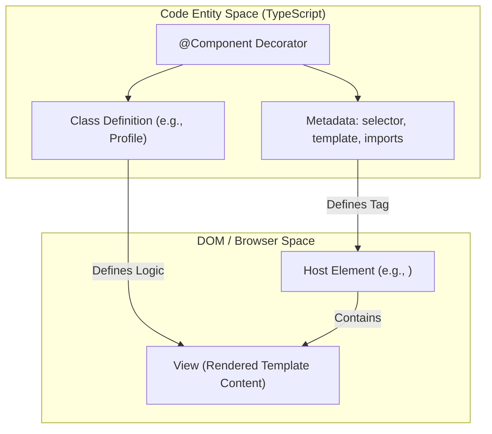
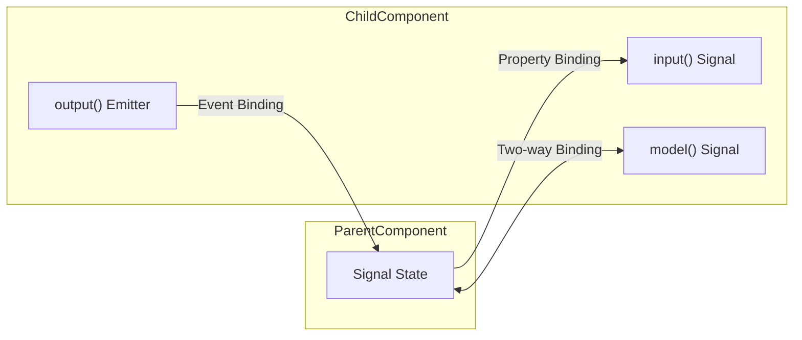

<!-- source: DeepWiki mcp.deepwiki.com · repo angular/skills · page 2 Components and Templates · fetched 2026-10-27 -->

# Components and Templates

Relevant source files

The following files were used as context for generating this wiki page:

- [angular-developer/references/components.md](angular-developer/references/components.md)
- [angular-developer/references/inputs.md](angular-developer/references/inputs.md)
- [angular-developer/references/outputs.md](angular-developer/references/outputs.md)

Angular component architecture in modern versions (v19+) focuses on a declarative, signal-based approach to building user interfaces. Components serve as the primary building blocks, encapsulating logic, templates, and styles into reusable units that form a hierarchical tree structure.

## Component Architecture

Every Angular component consists of a TypeScript class decorated with `@Component`, which defines its metadata and behavior [angular-developer/references/components.md:3-10](). By default, modern Angular components are **standalone**, meaning they manage their own dependencies via an `imports` array rather than requiring an `NgModule` [angular-developer/references/components.md:36-40, 133-134]().

### Visualizing Component Structure

The following diagram illustrates the relationship between the TypeScript class, the metadata, and the rendered DOM (Host Element).

**Component Entity Mapping**

Sources: [angular-developer/references/components.md:3-27, 131-132]()

## Core Concepts

### Component Anatomy and Template Syntax
Angular uses a specialized HTML-based template syntax. This includes modern built-in control flow blocks like `@if`, `@for`, and `@switch` for conditional rendering and iteration [angular-developer/references/components.md:71-128](). It also supports modern developer experience features like self-closing tags for custom components [angular-developer/references/components.md:51-67]().

For details, see [Component Anatomy and Template Syntax](#2.1).

### Data Flow: Inputs and Outputs
Modern Angular emphasizes **Signal-based reactivity**. Data flows into components via `input()` and `input.required()` signals [angular-developer/references/inputs.md:5-26](). Communication back to parents is handled via the `output()` function [angular-developer/references/outputs.md:5-27](). Two-way synchronization is facilitated by the `model()` API [angular-developer/references/inputs.md:54-70]().

For details, see [Inputs, Outputs, and Two-Way Binding](#2.2).

### Host Elements and Styling
Every component is associated with a **Host Element** in the DOM, defined by its `selector` [angular-developer/references/components.md:31, 131](). Styling is encapsulated by default, ensuring that CSS defined within a component does not leak to the rest of the application [angular-developer/references/components.md:16-20, 34-35]().

For details, see [Host Elements and Component Styling](#2.3).

### Naming Conventions
Modern Angular (v20+) follows an **"Intent over Role"** philosophy. This involves moving away from mandatory `Component` suffixes in class names and filenames (e.g., `profile.ts` instead of `profile.component.ts`) to create cleaner, more readable directory structures [angular-developer/references/components.md:135]().

For details, see [Naming Conventions](#2.4).

## Data Communication Summary

The following table summarizes the modern vs. legacy APIs for component communication:

| Feature | Modern API (v19+) | Legacy API |
| :--- | :--- | :--- |
| **Input** | `input()` / `input.required()` | `@Input()` |
| **Output** | `output()` | `@Output()` / `EventEmitter` |
| **Two-Way** | `model()` | `@Input()` + `@Output()` |
| **Logic** | Signals / `computed()` | Plain properties / `ngOnChanges` |

Sources: [angular-developer/references/inputs.md:5-93](), [angular-developer/references/outputs.md:5-79]()

**Data Flow Directionality**

Sources: [angular-developer/references/inputs.md:7-9, 72-80](), [angular-developer/references/outputs.md:29-35]()

---

