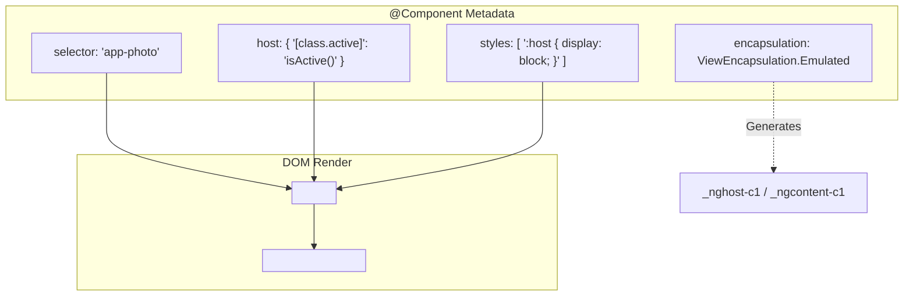

<!-- source: DeepWiki mcp.deepwiki.com · repo angular/skills · page 2.3 Host Elements and Component Styling · fetched 2026-10-27 -->

# Host Elements and Component Styling

<details>
<summary>Relevant source files</summary>

The following files were used as context for generating this wiki page:

- [angular-developer/references/component-styling.md](angular-developer/references/component-styling.md)
- [angular-developer/references/define-routes.md](angular-developer/references/define-routes.md)
- [angular-developer/references/host-elements.md](angular-developer/references/host-elements.md)
- [angular-developer/references/tailwind-css.md](angular-developer/references/tailwind-css.md)

</details>


This page details the mechanisms for managing a component's relationship with its DOM host, the strategies for style encapsulation, and the integration of modern CSS frameworks like Tailwind CSS.

## Host Element Bindings

The **host element** is the DOM element that matches a component's selector. Angular allows components to manage their own host element's attributes, classes, and event listeners directly within the `@Component` decorator using the `host` property [angular-developer/references/host-elements.md:1-10]().

### Host Property Configuration
The `host` property is the modern, preferred approach for defining host bindings, replacing legacy decorators like `@HostBinding` and `@HostListener` [angular-developer/references/host-elements.md:7-9]().

| Binding Type | Syntax Example | Description |
| :--- | :--- | :--- |
| **Static Attribute** | `'role': 'slider'` | Sets a fixed attribute on the host [angular-developer/references/host-elements.md:13](). |
| **Attribute Binding** | `'[attr.aria-valuenow]': 'value'` | Binds an attribute to a component property [angular-developer/references/host-elements.md:14](). |
| **Class Binding** | `'[class.active]': 'isActive()'` | Conditionally applies a CSS class based on a signal or property [angular-developer/references/host-elements.md:15](). |
| **Style Binding** | `'[style.color]': 'color()'` | Binds a CSS style property to a value [angular-developer/references/host-elements.md:16](). |
| **Property Binding** | `'[tabIndex]': 'disabled ? -1 : 0'` | Binds directly to the DOM element's property [angular-developer/references/host-elements.md:17](). |
| **Event Binding** | `'(keydown)': 'onKeyDown($event)'` | Listens for DOM events on the host element [angular-developer/references/host-elements.md:18](). |

### Host Attribute Injection
For static attributes required at initialization, Angular provides `HostAttributeToken`. This allows the component to `inject` values passed to the host element via the template [angular-developer/references/host-elements.md:59-62]().

```ts
// Definition
export class AppButton {
  type = inject(new HostAttributeToken('type')); // Reads 'type' from host [angular-developer/references/host-elements.md:72]()
}

// Usage
// <app-btn type="primary">Click Me</app-btn> [angular-developer/references/host-elements.md:79]()
```

### Binding Collision Resolution
When both the component's host configuration and the consumer's template attempt to bind to the same property, Angular follows these resolution rules [angular-developer/references/host-elements.md:51-58]():
1. **Static vs. Static**: The consumer (instance) binding wins.
2. **Static vs. Dynamic**: The dynamic binding wins.
3. **Dynamic vs. Dynamic**: The component's internal host binding wins.

**Sources:** [angular-developer/references/host-elements.md:1-80]()

---

## Component Styling and Encapsulation

Angular components encapsulate styles to prevent them from leaking into the global scope or affecting other components.

### Defining Styles
Styles can be defined inline using the `styles` property or via external files using `styleUrl` [angular-developer/references/component-styling.md:5-22]().

### View Encapsulation Strategies
The `encapsulation` metadata property determines how Angular scopes the component's CSS [angular-developer/references/component-styling.md:24-34]().

| Mode | Behavior |
| :--- | :--- |
| `Emulated` (Default) | Scopes styles using unique HTML attributes (e.g., `_ngcontent-c1`). Global styles can still leak in [angular-developer/references/component-styling.md:30](). |
| `ShadowDom` | Uses native browser Shadow DOM for total isolation [angular-developer/references/component-styling.md:31](). |
| `None` | Disables encapsulation; styles become global [angular-developer/references/component-styling.md:32](). |
| `ExperimentalIsolatedShadowDom` | Guarantees only the component's styles apply [angular-developer/references/component-styling.md:33](). |

### Component Styling Flow
The following diagram illustrates how the `@Component` metadata interacts with the DOM and CSS selectors.

**Styling and Host Interaction**

**Sources:** [angular-developer/references/component-styling.md:1-58](), [angular-developer/references/host-elements.md:1-20]()

### Special Selectors
*   `:host`: Targets the component's host element [angular-developer/references/component-styling.md:49-58]().
*   `:host-context(.theme-dark)`: Applies styles if an ancestor matches the selector [angular-developer/references/component-styling.md:60-68]().
*   `::ng-deep`: Forcefully disables encapsulation for a specific rule. **Discouraged** and kept only for legacy compatibility [angular-developer/references/component-styling.md:71-74]().

**Sources:** [angular-developer/references/component-styling.md:1-91]()

---

## Tailwind CSS Integration (v4)

Modern Angular projects utilize **Tailwind CSS v4**, which shifts configuration from JavaScript (`tailwind.config.js`) to CSS variables and PostCSS [angular-developer/references/tailwind-css.md:1-6]().

### Configuration Architecture
Tailwind v4 integration relies on the `@tailwindcss/postcss` plugin rather than a standalone configuration file [angular-developer/references/tailwind-css.md:21-45]().

**Tailwind v4 Data Flow**
```mermaid
graph LR
    subgraph Configuration_Files ["Configuration"]
        POSTCSS[".postcssrc.json"]
        GLOBAL_CSS["styles.css"]
    end

    subgraph Build_Process ["Angular Build Pipeline"]
        TAILWIND_PLUGIN["@tailwindcss/postcss"]
        CSS_VARS["CSS Theme Variables"]
    end

    subgraph Components ["Component Templates"]
        HTML_CLASSES["class='text-3xl font-bold'"]
    end

    POSTCSS --> TAILWIND_PLUGIN
    GLOBAL_CSS -->|@import 'tailwindcss'| TAILWIND_PLUGIN
    TAILWIND_PLUGIN --> CSS_VARS
    CSS_VARS --> HTML_CLASSES
```

### Key Implementation Steps
1.  **Automated Setup**: Run `ng add tailwindcss` to handle installation and configuration automatically [angular-developer/references/tailwind-css.md:7-13]().
2.  **PostCSS Setup**: Ensure `.postcssrc.json` contains the `@tailwindcss/postcss` plugin [angular-developer/references/tailwind-css.md:35-43]().
3.  **Import**: Use `@import 'tailwindcss';` in the global `styles.css` file [angular-developer/references/tailwind-css.md:47-55]().
4.  **Avoid v3 Patterns**: Do not use `@tailwind base;` directives or create a `tailwind.config.js` file, as these are incompatible with the v4 workflow [angular-developer/references/tailwind-css.md:65-69]().

**Sources:** [angular-developer/references/tailwind-css.md:1-69]()

---

