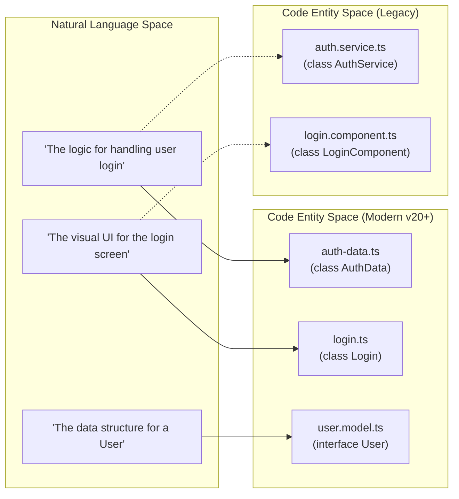
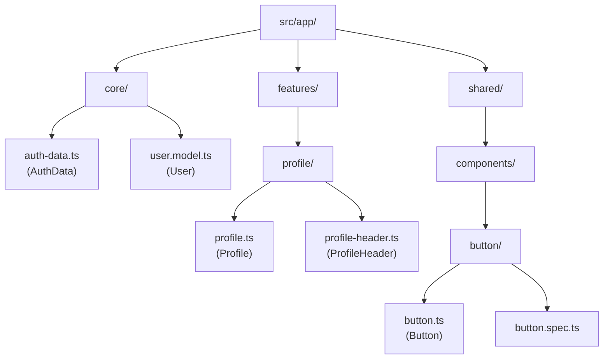
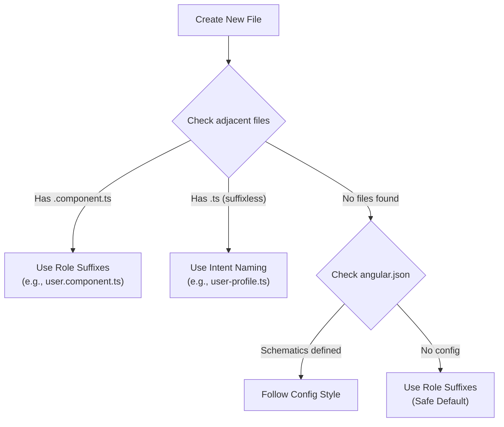

<!-- source: DeepWiki mcp.deepwiki.com · repo angular/skills · page 2.4 Naming Conventions · fetched 2026-10-27 -->

# Naming Conventions

Relevant source files

The following files were used as context for generating this wiki page:

- [angular-developer/references/naming-conventions.md](angular-developer/references/naming-conventions.md)

This section documents the Angular v20+ **"Intent over Role"** naming philosophy. Modern Angular development prioritizes the domain purpose of a file over its technical implementation details (suffixes). This approach reduces boilerplate and leverages directory structure and IDE capabilities for context.

## Core Principles

The primary shift in Angular v20+ is the transition from role-based suffixes (e.g., `.component.ts`) to intent-based naming (e.g., `product-list.ts`). However, this transition must be managed carefully to ensure consistency within existing codebases.

*   **Prioritize Existing Conventions**: Before generating new files, developers must inspect `angular.json` and existing project files. Suffixless naming should not be forced on projects relying on standard suffixes [angular-developer/references/naming-conventions.md:9-9]().
*   **Intent-Based Naming**: In modern projects, filenames and TypeScript classes drop functional extensions like `Component`, `Service`, or `Directive`. Names should reflect the business purpose, such as `auth-data.ts` (Class: `AuthData`) instead of `auth.service.ts` [angular-developer/references/naming-conventions.md:10-11]().
*   **Folder as Context**: The technical role of a file is inferred from its location (e.g., `core/`, `features/`, `shared/`) rather than its name [angular-developer/references/naming-conventions.md:12-12]().
*   **Interface Exception**: Data models and interfaces retain the `.model.ts` suffix to clearly distinguish type contracts from executable logic [angular-developer/references/naming-conventions.md:13-13]().

### Intent vs. Role Mapping

The following diagram illustrates the shift from the traditional "Role" naming to the modern "Intent" naming for a hypothetical Authentication module.

**Natural Language to Code Entity Space: Auth Module Mapping**

Sources: [angular-developer/references/naming-conventions.md:33-38](), [angular-developer/references/naming-conventions.md:73-74]()

---

## Recommended Project Structure

The directory structure provides the necessary context that was previously provided by file suffixes.

### 1. Core Directory (Application Foundation)
Contains singleton services, global state, and system-wide models [angular-developer/references/naming-conventions.md:31-31]().
*   **Services**: Use domain-purpose suffixes like `-data`, `-store`, or `-api` (e.g., `user-data-client.ts` for `class UserDataClient`) [angular-developer/references/naming-conventions.md:36-36]().
*   **Models**: Use `[domain].model.ts` (e.g., `user.model.ts` for `interface User`) [angular-developer/references/naming-conventions.md:37-38]().

### 2. Features Directory (Domain Logic)
Organized by feature-specific folders containing components, local services, and routes [angular-developer/references/naming-conventions.md:42-42]().
*   **Main Component**: Named after the route or feature (e.g., `features/profile/profile.ts` for `class Profile`) [angular-developer/references/naming-conventions.md:45-45]().
*   **Sub-Components**: Named by functional role (e.g., `project-card.ts` for `class ProjectCard`) [angular-developer/references/naming-conventions.md:48-48]().

### 3. Shared Directory (UI Toolkit)
Houses presentational elements and helpers with no business logic [angular-developer/references/naming-conventions.md:54-54]().
*   **Components**: e.g., `shared/components/spinner/spinner.ts` (Class: `Spinner`) [angular-developer/references/naming-conventions.md:58-58]().
*   **Directives**: e.g., `highlight.ts` (Class: `Highlight`) [angular-developer/references/naming-conventions.md:63-63]().

**File System Organization Diagram**

Sources: [angular-developer/references/naming-conventions.md:29-64]()

---

## Coexistence and Conflict Resolution

Transitioning to suffixless naming introduces the risk of namespace collisions. The following rules must be followed to maintain code health.

### Identifier Matching & Consistency
*   **Kebab-case**: Use hyphens for filenames (e.g., `product-list.ts`) [angular-developer/references/naming-conventions.md:21-21]().
*   **Unified Filenames**: If using split files, the base name must be identical across `.ts`, `.html`, and `.css` [angular-developer/references/naming-conventions.md:23-26]().
*   **Tests**: Always use the `.spec.ts` suffix [angular-developer/references/naming-conventions.md:27-27]().

### Avoiding Namespace Collisions
Without suffixes, `user.ts` (a component) and `user.model.ts` (an interface) might both attempt to declare the identifier `User`.
*   **Rule**: Use more specific, intent-based names for classes (e.g., `UserProfile` or `UserDetail`) while keeping the simple domain name for the interface (`User`) [angular-developer/references/naming-conventions.md:73-74]().

### Determination Logic
When determining which style to use, follow this priority:
1.  **Inspect Adjacent Files**: Check if neighboring files use `.component.ts` or `.ts` [angular-developer/references/naming-conventions.md:70-70]().
2.  **Check angular.json**: Look for custom schematic options [angular-developer/references/naming-conventions.md:71-71]().
3.  **Default to Legacy**: If the environment is ambiguous, use the traditional role suffix style (`.component.ts`) as it is the safest default [angular-developer/references/naming-conventions.md:72-72]().

**Decision Flow: Choosing a Naming Convention**

Sources: [angular-developer/references/naming-conventions.md:69-72]()

---
**Sources:**
*   [angular-developer/references/naming-conventions.md:1-76]()

---

