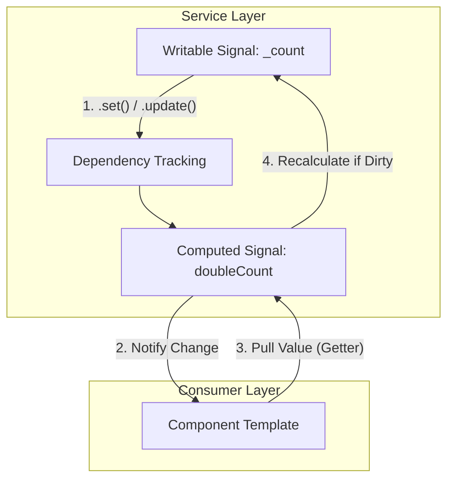
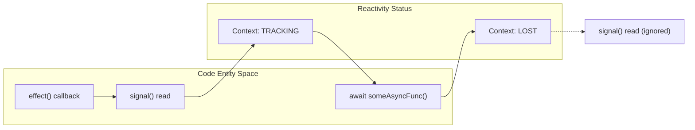

<!-- source: DeepWiki mcp.deepwiki.com · repo angular/skills · page 3.1 Signals and Computed State · fetched 2026-10-27 -->

# Signals and Computed State

<details>
<summary>Relevant source files</summary>

The following files were used as context for generating this wiki page:

- [angular-developer/references/creating-services.md](angular-developer/references/creating-services.md)
- [angular-developer/references/signals-overview.md](angular-developer/references/signals-overview.md)

</details>


Signals are the foundation of reactivity in modern Angular applications. A **signal** is a wrapper around a value that notifies interested consumers when that value changes, enabling fine-grained reactivity and efficient change detection [angular-developer/references/signals-overview.md:1-4]().

## Writable Signals

A writable signal is created using the `signal()` function. It provides a synchronous API to get and set values [angular-developer/references/signals-overview.md:5-13]().

| Method | Description | Example |
| :--- | :--- | :--- |
| `getter()` | Reads the current value. Always requires calling the function. | `count()` |
| `set(value)` | Replaces the signal value with a new one. | `count.set(5)` |
| `update(fn)` | Updates the value based on the previous state. | `count.update(v => v + 1)` |
| `asReadonly()` | Returns a read-only version of the signal. | `this.count.asReadonly()` |

### Read-Only Signal Pattern
When managing state within a service, it is a best practice to keep the writable signal `private` and expose a read-only version publicly. This prevents external components from mutating internal service state directly [angular-developer/references/creating-services.md:13-24]().

```ts
// Service implementation
@Service()
export class DataStore {
  private readonly _data = signal<string[]>([]);
  
  // Public read-only exposure
  readonly data = this._data.asReadonly();

  addItem(item: string) {
    this._data.update(items => [...items, item]);
  }
}
```
Sources: [angular-developer/references/creating-services.md:15-29](), [angular-developer/references/signals-overview.md:25-33]()

---

## Computed Signals

`computed()` creates a read-only signal that derives its value from other signals. Computed signals are lazily evaluated and memoized [angular-developer/references/signals-overview.md:35-41]().

### Characteristics
*   **Lazy Evaluation**: The derivation function only runs when the signal is explicitly read [angular-developer/references/signals-overview.md:39-39]().
*   **Memoization**: The result is cached. Recalculation only occurs if one of the signals read during the last execution has changed [angular-developer/references/signals-overview.md:40-40]().
*   **Dynamic Dependencies**: Angular tracks only the signals actually accessed during the function execution. If a signal is inside an `if` block that isn't reached, it is not tracked as a dependency [angular-developer/references/signals-overview.md:41-41]().

### Logic Flow: Signal Value Propagation
The following diagram illustrates how state flows from a writable source through a computed derivation to a consumer (like a component template).

**Data Flow: Writable to Computed**

Sources: [angular-developer/references/signals-overview.md:43-50](), [angular-developer/references/creating-services.md:70-85]()

---

## Reactive Contexts

A **reactive context** is a runtime environment where Angular monitors signal reads to establish dependencies [angular-developer/references/signals-overview.md:52-54]().

### Automatic Contexts
Angular automatically establishes a reactive context when executing:
*   `computed()` derivation functions [angular-developer/references/signals-overview.md:58-58]().
*   `effect()` callbacks [angular-developer/references/signals-overview.md:59-59]().
*   `linkedSignal()` computations [angular-developer/references/signals-overview.md:60-60]().
*   Component templates during view updates [angular-developer/references/signals-overview.md:61-61]().

### Untracked Reads
To read a signal inside a reactive context without establishing a dependency, use the `untracked()` function. This prevents the context (e.g., an effect) from re-running when that specific signal changes [angular-developer/references/signals-overview.md:63-66]().

```ts
effect(() => {
  // Only triggers when currentUser() changes
  console.log(`User: ${currentUser()}, Logged at: ${untracked(timer)}`);
});
```
Sources: [angular-developer/references/signals-overview.md:67-75]()

---

## Async Boundaries

Reactivity is strictly **synchronous**. The reactive context is lost once an asynchronous boundary (like `await`, `setTimeout`, or a Promise) is crossed. Signals read after an `await` will not be tracked as dependencies [angular-developer/references/signals-overview.md:77-79]().

**Entity Mapping: Async Signal Handling**
This diagram maps the natural language concept of "Async Boundaries" to the required code structure for maintaining reactivity.



### Correct Implementation Pattern
Always capture signal values into local variables before entering an asynchronous block [angular-developer/references/signals-overview.md:88-94]().

| Pattern | Code Example | Result |
| :--- | :--- | :--- |
| **Incorrect** | `effect(async () => { await fn(); console.log(sig()); });` | `sig()` is **not** tracked. |
| **Correct** | `effect(async () => { const val = sig(); await fn(); console.log(val); });` | `sig()` **is** tracked. |

Sources: [angular-developer/references/signals-overview.md:81-94]()

---

